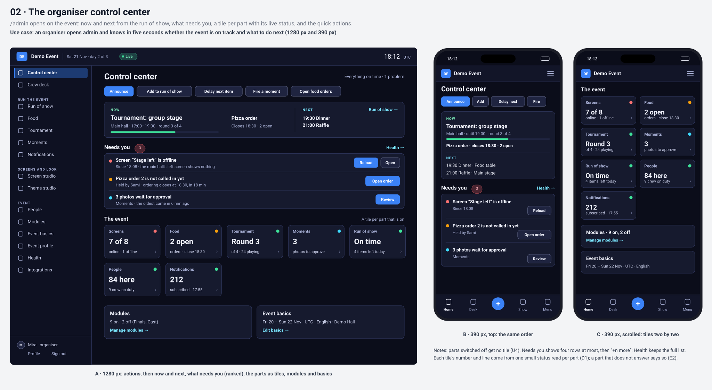
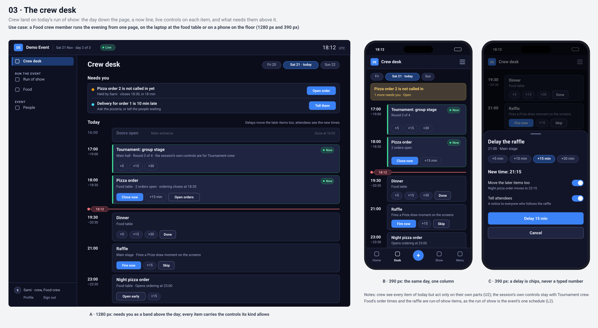
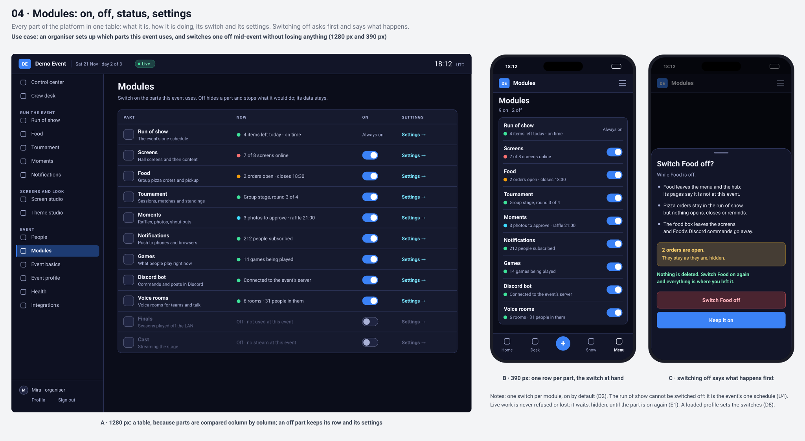
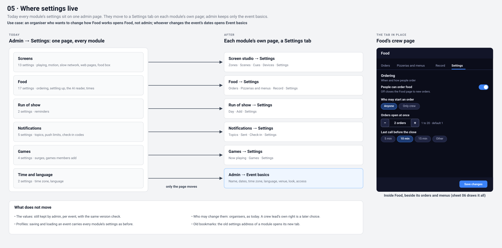
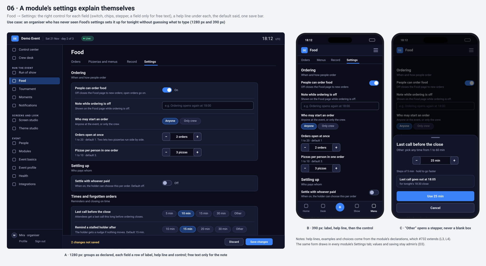
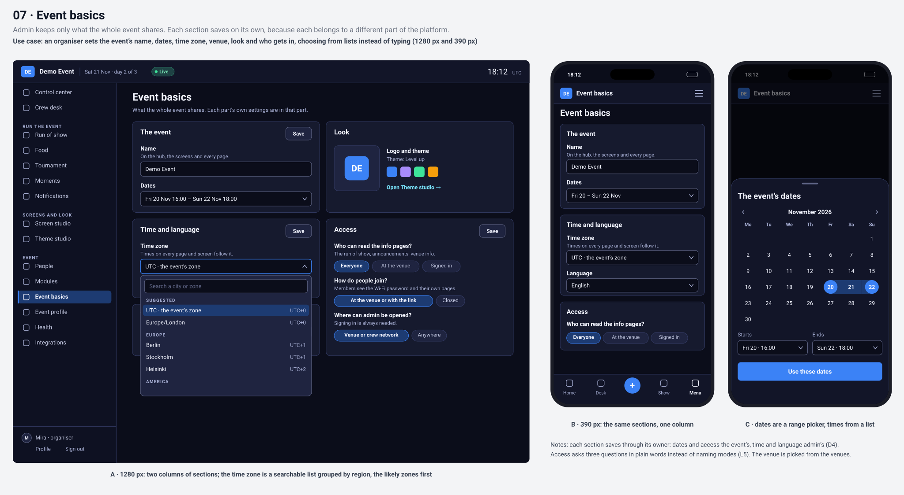
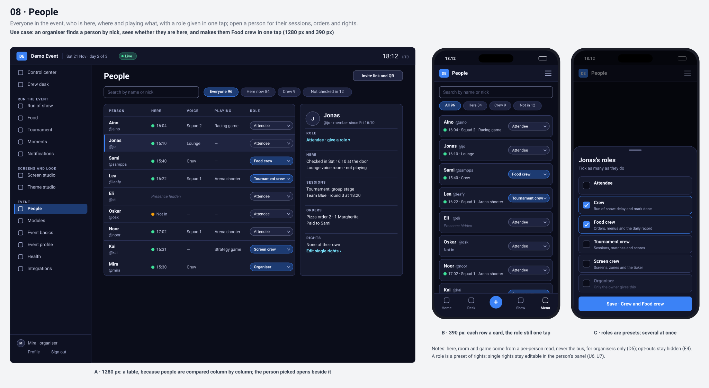
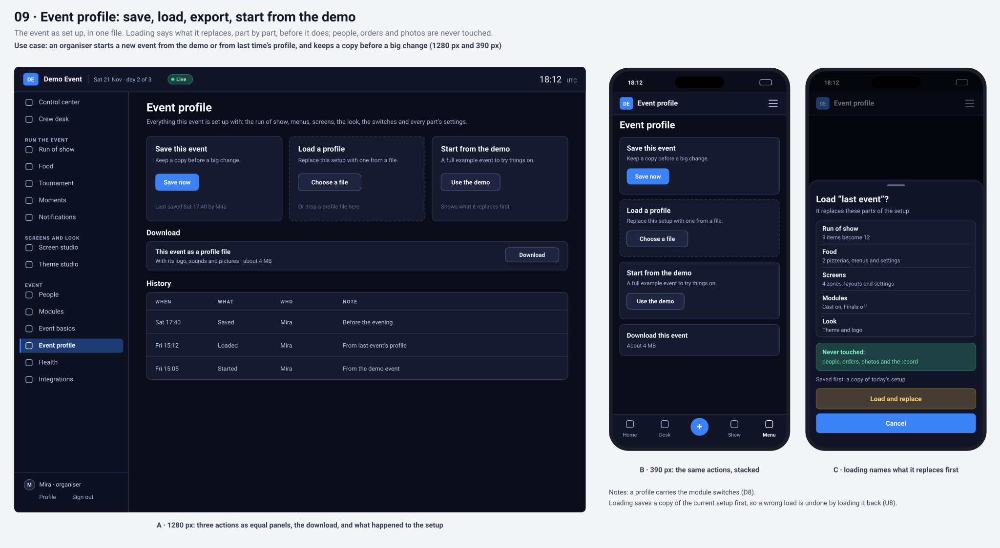
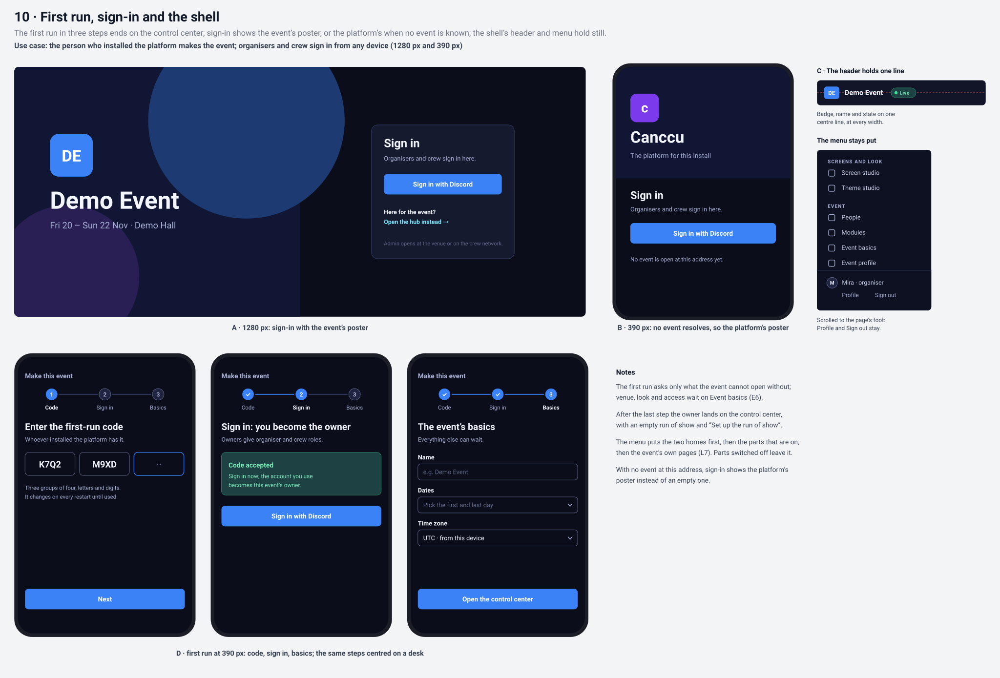
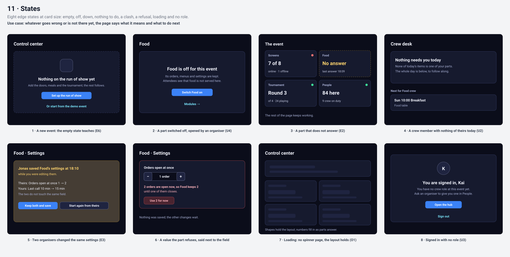

# Admin as the event's control room

The research pack for a short session between the product owner and the lead on what admin is and how it looks as a whole, issue #734. It follows the [outline of a research pack](README.md#outline-of-a-research-pack), at the size of one capability rather than a step: about ten key screens. It draws the base the product owner and the lead agreed on 2026-11-22, shows two other directions next to it, and lists what is still open. After it merges the lead runs the session and writes the plan (`## Plan`) into this file; the product owner accepts the plan before any build starts. The PO wants this designed **before the step 5 gate**.

**In this pack**
- This file: the goal, what was read, what admin is today, three directions and the recommended one, the key screens, port / drop / invent, the proposed issues.
- [admin-control-room/questions.md](admin-control-room/questions.md): the question bank, 40 questions in six themes, each with options and a recommendation. Its IDs (U3, D2, …) are used throughout.
- [admin-control-room/decision-draft.md](admin-control-room/decision-draft.md): a draft decision record for the two choices that outlive the build: settings live in their modules, and every module has an on/off switch.
- [admin-control-room/](admin-control-room/): 11 SVG sheets, drawn new in the shipped dark organiser shell (the [step 4 polish](step-4-polish/README.md)), with the demo event only, at 1280 px and at 390 px ([amendment 5](../design/README.md#5--equal-on-pc-and-phone-2026-11-21)). Each view picks its form first ([amendment 3](../design/README.md#3--grids-scale-with-their-content-2026-11-19)): a ranked list for what needs you, a day schedule for the run of show ([amendment 4](../design/README.md#4--things-planned-in-time-are-a-day-schedule-2026-11-21)), tables for modules and people, a form for settings, and a card grid only for the parts of the event, which are like items people scan.
- [`experience-map.md`](../design/experience-map.md#where-each-setting-lives) "Where each setting lives" is rewritten to match this pack.

## Goal
The product owner, after a first look at admin on the dev server (2026-11-21): "we need to have the Admin designed in super good way." What they saw:
- mostly text boxes with no idea what to write in them;
- module settings (Food and others) on one admin Settings page instead of with their module;
- no way to switch modules on or off;
- the purpose of `/admin` unclear: today it only redirects to the first page the person may open.

**What admin is, for a new organiser:** admin is the event's control room. When you open it you see what is happening right now, what needs you, and what is next on the schedule, with a button for the things you do most. From there every part of the event is one tap away: the screens, the food, the tournament, the people. You switch on the parts your event uses, and each part keeps its own settings. Admin itself keeps only what the whole event shares: its name, dates, time zone, language, venue, look and who gets in.

**Who uses it, and what each sees:**
| Who | Lands on | Sees |
|---|---|---|
| **Owner** (the event admin who set the event up) | the control center | everything, and is the only one who gives and takes organiser rights |
| **Organiser** (an event admin) | the control center | everything except giving organiser rights |
| **Crew** (a member with crew rights for one or more parts: Food crew, Screen crew, Tournament crew, or plain crew) | the crew desk | today's run of show with the live controls their rights allow, what needs them, and the pages of the parts they crew |

A person with no rights who signs in sees "No role yet" and the hub, as today.

## What was read
- **The design:** the [design guideline](../design/README.md) with amendments 3 ("Choose the form first", #716), 4 (day schedules) and 5 (equal on PC and phone, [0032](../decisions/0032-hub-equal-on-pc-and-phone.md)); [`mockups.html`](../design/mockups.html) sheets "One header, one Event menu, one left edge", "The event's front door" and "Settings of a module, health, people, event profile"; [`experience-map.md`](../design/experience-map.md) "Where each setting lives"; [`widgets.md`](../design/widgets.md).
- **Decisions:** [0022](../decisions/0022-product-vision.md) (the product, admin reachable from the venue or Tailscale by default), [0013](../decisions/0013-multi-tenant-core.md) (feature flags per tenant, item 17), [0019](../decisions/0019-work-packages.md), [0020](../decisions/0020-best-of-old-freely-new.md), [0023](../decisions/0023-step-design-briefs.md), [0026](../decisions/0026-briefs-are-research-packs.md), [0031](../decisions/0031-mini-tournaments-after-v1-day-schedules.md), [0032](../decisions/0032-hub-equal-on-pc-and-phone.md).
- **Contracts:** [admin.md](../../contracts/admin.md) (settings and their groups, rights and presets, the Health note), [tenants.md](../../contracts/tenants.md) (roles, membership, the join link, access modes, feature flags, privacy), [flags.yaml](../../contracts/flags.yaml) (two flags today, both Screen's), [profile.md](../../contracts/profile.md) (settings declarations, the profile), [agenda.md](../../contracts/agenda.md) (items, kinds, editing live, tournament sessions), [events.md](../../contracts/events.md) (presence stays off the bus), [notify.md](../../contracts/notify.md) (check-in by the rotating QR).
- **The built code:** admin's [README](../../modules/admin/README.md), its settings declarations (`modules/admin/declarations/`: admin, agenda, games, notify, pizza, screen), its `/` route (a redirect), the shared organiser menu (`MENU` in `packages/kit-py/src/canccu_kit/ui_base.py`), the agenda's day view.
- **Briefs:** the [step 8 pack](step-8-admin-operations.md) (Health's "Needs you" and its incidents, the calm crew desk; the home here shows its incidents, it does not replace them), the [step 5 plan](step-5-pizza.md#plan) (the crew Food page, Admin → Integrations), the [step 7 pack](step-7-tournament.md) (tournament sessions as run-of-show items), the [step 4 polish](step-4-polish/README.md) (the dark shell).
- **Issues:** #708 (sign-in without an event, closed), #716, #719, #731 (the shell header and side menu), #732 (settings controls and help lines).
- **The legacy:** the [inventory](../legacy-inventory/README.md): each legacy app had its own admin (signage's admin session by a Discord link, the tourney's admin tokens, the manager's terminal dashboard, the signup site's pizza admin). None had one home for the event.

## What admin is today
- **`/admin`** redirects to the first page the person may open (Run of show for most). There is no home.
- **Settings:** one page lists every module that declares settings (Screens, Food, Run of show, Notifications, Games, Time and language), each opening a form generated from its declarations. The forms are text and number boxes with a label; few have a help line, and the time zone is free text (#732).
- **Health, People, Event profile, Integrations:** built pages in the Admin group of the menu. People gives the admin role and the Screen crew preset; it shows no presence and no check-in.
- **No module switch:** every module is always on. Feature flags exist per tenant (`<module>.<feature>`, tenants contract), but only two are declared, both inside Screen.
- **The shell:** one header and one side menu for every module (`MENU`); its header alignment and its menu on long pages are #731.

## How comparable products solve it
| Field | What they do | What we take |
|---|---|---|
| **Event-management suites** | A dashboard with today's numbers, a checklist for setup, then one page per feature; feature toggles in an "Apps" or "Features" page | The home with live numbers, the module page with switches; not the setup checklist as the home (it is the first-run page instead, sheet 10) |
| **Live-production run sheets** | One running order, a "now" bar, items you slip by minutes, a big clock | The crew desk on the run of show with a now line and delay chips (sheet 03) |
| **Workspace admin consoles** | Settings next to the thing they change, a search that finds any setting, help text under every field | Settings in their module (sheets 05, 06), a help line per field; a settings search is a question (L6) |
| **Smart-home and fleet apps** | Tiles per room or device with a live state; one tap to act | The tiles per part with live status on the control center (sheet 02) |
| **Store and app platforms** | Plugins switched on and off; off hides them, data kept | The module switch, with what switching off does said in the dialog (sheet 04) |

The lesson across them: **the home answers "is everything all right, and what do I do next"**, **every setting sits where you were when you wanted to change it**, and **switching something off never loses anything**.

## Three directions
Each for the owner and organisers, the crew, and attendees (who meet admin only through what it switches on). The sheet [01](admin-control-room/01-directions.svg) shows them side by side.

### A · Settings, tidied
Admin stays the place for settings, made friendly: each field gets the right control and a help line (#732), the Settings page becomes a list of modules with a switch each, and `/admin` gets a page of links to every part with the Health tiles above them.
- **Organisers:** one familiar place to change anything; nothing moves. Still no answer to "what is happening now".
- **Crew:** land on a links page; the run of show is one link among many.
- **Attendees:** see only what the switches leave on.
- **Cost:** small (one issue beside #732). **Trade-off:** fixes the boxes but not the purpose; settings stay far from their part, and the PO's "settings with their module" is not met.

### B · The control room (the agreed base)
Two homes. The **organiser control center**: now, next and what needs you; a tile per part with its live status; quick actions; the modules and the event basics. The **crew desk**: today's run of show down the page with a now line, live controls on each item and a "needs you" list. The run of show is the event's one schedule: tournament sessions, food order times and raffles are items in it. Settings live in their module; admin keeps the event basics, the modules, people and the event profile.
- **Organisers:** open admin and see the event, not a menu; one tap to any part, its settings inside it.
- **Crew:** land on today, with the buttons they need on each item; nothing to learn beyond the run of show.
- **Attendees:** the parts switched off disappear from the hub and the screens; the run of show they see is the same schedule the crew run.
- **Cost:** medium: two home pages, the module page and switch, the event basics page, People with presence, and a Settings tab per built module (Food first, in step 5's polish). **Trade-off:** each module carries its own Settings tab; the home needs a live read from every part (one small status answer each).

### C · One live board
A single full-width board for everyone, like a broadcast gallery: every part's live panel at once (screens' thumbnails, the food queue, the bracket, the run of show), and a command bar ("delay raffle 10 min", "switch Food off", "time zone") that finds any action or setting by typing.
- **Organisers:** everything visible at once on a big desk; power users fly with the command bar.
- **Crew:** a dense wall on a phone; the bits they need are small.
- **Attendees:** as B.
- **Cost:** large: every part needs a live panel at board size and a command grammar. **Trade-off:** great on a 2560 px desk in the gallery, poor at 390 px, and against "equal on PC and phone"; a new organiser faces everything at once.

## Recommended direction: B, the control room
**B**, with one idea from C kept as a question: a "find a setting" search in the header ([L6](admin-control-room/questions.md#l6-find-a-setting)). A fixes the forms the PO disliked but leaves admin without a purpose; the PO's complaint was as much "what is /admin for" as "what do I write here". C answers the purpose but only at one size and for one kind of person. B gives each person the page they need when they open admin: the organiser the whole event, the crew today's schedule. It also builds on what exists: the run of show is built and already has a day view, Health already knows what needs you (and grows incidents in step 8), and settings already come from declarations, so moving a form into its module moves a page, not data.

**Design principles**
1. **Open on the event, not on a menu.** The first screen says what is happening and what needs you; the menu is for going elsewhere.
2. **One schedule.** The run of show is the only timeline: anything with a time (a session, an order's close, a raffle) is an item in it, and the crew run the event from it.
3. **A setting lives where you use it.** A module's settings are a tab of its own page; admin keeps only what the whole event shares.
4. **Off is safe.** Switching a part off hides it and stops what it would do, and keeps every piece of its data; switching it on brings it back as it was.
5. **Every field explains itself.** The right control, a help line in people's words, the default and an example; free text only for real free text.
6. **Equal on PC and phone.** Every page has its 1280 px and 390 px layout; the crew desk is as good on a phone on the floor as on the laptop at the desk.

## Key screens
Each names its users and its sheet.

### The organiser control center (owner, organisers)
Status at a glance: **Now** and **Next** from the run of show as one strip, then **Needs you** as a ranked list (most urgent first, at most four rows and "+n more"), then **a tile per part** with its live status (Screens: devices online; Food: open orders and the next close; Tournament: sessions today; Moments: photos to approve and the next moment; Run of show: on time or late; People: here now and crew on; Notifications: the last push). A tile leads to its part. Quick actions sit in one band above: Announce, Add to the run of show, Delay the next item, Fire a moment. Below the tiles, **Modules** (how many on, a link) and **Event basics** (name, dates, time zone, language, a link). Parts switched off have no tile ([U1](admin-control-room/questions.md#u1-two-homes), [L1](admin-control-room/questions.md#l1-the-control-centers-order), [D1](admin-control-room/questions.md#d1-where-a-tiles-status-comes-from)).

### The crew desk (crew; organisers can open it)
Today's run of show, one day, with the times down the side and a **now** line, as the agenda's day view draws it. Each item carries the **live controls** its kind allows and the person's rights cover: delay by preset chips (+5, +15, +30), mark done, and the item's own action (Food's order: close now, reopen; a raffle: fire now). **Needs you** is a band above the day, so it is first on a phone too. A crew member who crews one part sees all of today's items but controls only theirs ([U2](admin-control-room/questions.md#u2-what-crew-see-on-the-desk), [U3](admin-control-room/questions.md#u3-who-lands-where), [L2](admin-control-room/questions.md#l2-live-controls-on-an-item)).

### Modules: on, off, status, settings (owner, organisers)
A table: one row per module with its name, a one-line status, its switch, and a link to its settings. The run of show and admin are always on. Switching a part off asks first and says what happens: **its pages leave the menu and the hub, its items in the run of show stay but its scheduled actions stop (reminders, auto-closes, fired moments), its screen widgets hide, its bot commands go, and its data stays**; switching it on brings everything back. A part with live work (open orders, a session running) says so in the dialog ([U4](admin-control-room/questions.md#u4-which-modules-can-be-switched-off), [D2](admin-control-room/questions.md#d2-the-switch-in-the-contract), [E1](admin-control-room/questions.md#e1-switching-off-with-live-work)).

### Where settings live (everyone who changes settings)
The admin Settings page goes. Each module's settings become a **Settings tab on its own page**: Food → Settings, Screen studio → Settings, Run of show → Settings, Notifications → Settings, Games → Settings. Admin keeps the **Event basics** page. The data and the API stay as they are: the tab draws the same declarations through the same `GET`/`PUT /api/admin/settings/{module}`, so nothing moves but the page; the old links redirect ([D3](admin-control-room/questions.md#d3-the-move-without-a-contract-change), [U5](admin-control-room/questions.md#u5-who-may-change-a-modules-settings)).

### Settings that explain themselves (organisers)
Food → Settings drawn with the right control for each field: switches for on/off, chips for a choice of a few, a stepper with its unit and range for counts, preset chips for durations, a dropdown for long lists; each field with a help line, its default and, for text, an example. Fields are grouped as the declarations group them, with one save bar. #732 builds the controls and the schema fields (`help`, `example`, `choices`); this sheet is what they add up to ([L3](admin-control-room/questions.md#l3-the-control-for-each-type), [L4](admin-control-room/questions.md#l4-help-lines)).

### Event basics (owner, organisers)
Only what the whole event shares: name, dates (a date range picker), time zone (a dropdown grouped by region, the venue's zone first), language, venue (picked from the venues), look (logo and theme, with a link to the Theme studio), and access (who may read the info pages, how people join, where admin can be opened from). Each field keeps its owner: dates and access are the tenants module's, the language and time zone admin's settings, the look theming's; the page writes each through its own API ([D4](admin-control-room/questions.md#d4-one-page-several-owners), [L5](admin-control-room/questions.md#l5-access-in-words)).

### People (owner, organisers; crew read)
A table of everyone in the event with filters (Everyone, Here now, Crew, Not checked in) and a search by name or nick. Each row: here or not and since when, the voice room, what they are playing, and the role, which is a dropdown: one tap gives crew, Tournament crew, Food crew, Screen crew or organiser. A person who opted out of presence shows "Presence hidden". Opening a person shows their sessions, orders, check-in and roles in a panel beside the list (a master–detail page) ([U6](admin-control-room/questions.md#u6-roles-in-one-tap), [D5](admin-control-room/questions.md#d5-presence-for-the-people-page), [E4](admin-control-room/questions.md#e4-privacy-and-presence-opt-out)).

### Event profile (owner, organisers)
Save the event as a profile, load one, export it as a zip, and start from the demo event. Loading says what it will replace, part by part, before it does ([U8](admin-control-room/questions.md#u8-the-event-profile)).

### First run, sign-in and the shell (everyone)
The first run as three steps: the first-run code, sign in, then the event basics, ending on the control center. The sign-in page with the event's poster, and with the platform poster when no event resolves (#708). The shell's header on one centre line and the side menu that stays in view with Profile and Sign out at its foot (#731), with the menu's new order: Control center and Crew desk first, then the parts, then Event ([L7](admin-control-room/questions.md#l7-the-side-menu)).

### States (everyone)
The edge states at card size: a new event with nothing in the run of show, a part switched off, a part down, a crew member with no items today, a save that met another organiser's change, a setting a module refused, the control center while a part does not answer, and a person with no rights ([E2](admin-control-room/questions.md#e2-a-part-that-does-not-answer), [E3](admin-control-room/questions.md#e3-two-organisers-change-the-same-settings)).

### Every mockup
| File | What it shows | For whom |
|---|---|---|
| [01-directions.svg](admin-control-room/01-directions.svg) | The three directions side by side | the session |
| [02-control-center.svg](admin-control-room/02-control-center.svg) | The control center: now and next, needs you, a tile per part, quick actions, modules and basics; 1280 px and 390 px | owner, organisers |
| [03-crew-desk.svg](admin-control-room/03-crew-desk.svg) | Today's run of show with a now line, live controls on each item, needs you; 1280 px and 390 px | crew |
| [04-modules.svg](admin-control-room/04-modules.svg) | Every module with its status, switch and settings link; switching Food off; 1280 px and 390 px | owner, organisers |
| [05-settings-move.svg](admin-control-room/05-settings-move.svg) | Where each setting goes: from one admin page to each module's Settings tab and the event basics | everyone who changes settings |
| [06-module-settings.svg](admin-control-room/06-module-settings.svg) | Food → Settings with the right control and a help line per field; 1280 px and 390 px | organisers |
| [07-event-basics.svg](admin-control-room/07-event-basics.svg) | Name, dates, time zone, language, venue, look, access; the time zone dropdown open; 1280 px and 390 px | owner, organisers |
| [08-people.svg](admin-control-room/08-people.svg) | People with filters, search, presence and one-tap roles, a person opened; 1280 px and 390 px | owner, organisers |
| [09-event-profile.svg](admin-control-room/09-event-profile.svg) | Save, load, export, start from the demo; what a load replaces; 1280 px and 390 px | owner, organisers |
| [10-first-run-shell.svg](admin-control-room/10-first-run-shell.svg) | First run in three steps, sign-in with and without an event, the header and the side menu | everyone |
| [11-states.svg](admin-control-room/11-states.svg) | Eight edge states at card size | everyone |

## Port, drop or invent
### Port with changes
- **Health's "what needs you"** (built, grown by step 8's incidents): the control center and the crew desk show the same list, ranked, at most four rows; Health stays the full page.
- **The agenda's day view** (built): the crew desk's schedule, with live controls added per item.
- **Settings forms from declarations** (built): the same generator, drawn inside each module's page as a Settings tab, with #732's controls.
- **People** (built): grows filters, presence, check-in and one-tap roles; the role grants stay the rights presets of the admin contract.
- **The event profile** (built): the same Save, Load and export, with a "what it replaces" step.

### Drop
- **The admin Settings page** as a list of every module: replaced by each module's tab and Event basics; its address redirects.
- **`/admin` as a redirect:** it becomes the control center (or the crew desk for crew).
- **The legacy per-app admins** (signage's admin link, the tourney's admin tokens, the manager's terminal dashboard): one sign-in and one control room replace them; nothing to port.

### Invent
- **The organiser control center** and its tiles, each fed by one small status answer per part.
- **The crew desk** on the run of show, with live controls per item.
- **The module switch**: one flag per module and what "off" means for pages, schedules, screens and the bot.
- **Event basics** as one page over several owners.
- **One-tap crew roles** and presence on People.

## Proposed issue changes
The pack's author creates no issues; the lead applies these after the session ([P2](admin-control-room/questions.md#p2-the-issue-set)). Risk classes are proposals for the planner.

### Keep · #731 fix(ui): the shell header lines up and the side menu stays in view
As written; it also takes the menu's new order once the plan accepts it ([L7](admin-control-room/questions.md#l7-the-side-menu)).

### Keep, extend · #732 feat(admin): settings forms use the right control and explain each field
Add: the controls render the same inside a module's Settings tab (the kit's settings form, not admin's page), and the help lines of every built module's settings are written in people's words.

### New · feat(admin,kit): the control center and the crew desk (normal)
`/admin` opens the control center for organisers and the crew desk for crew. Now and next, needs you, tiles per part, quick actions; the crew desk on the run of show with live controls. Each part answers one small status read for its tile (an additive endpoint per module, shipped with the tile that uses it). Both widths, screenshots at 390 px and 1280 px.

### New · feat(tenants,admin,kit): every module can be switched on and off (normal)
One flag per module in `flags.yaml` (additive), the Modules page, the confirm dialog that says what happens, and the kit hiding an off module's menu items and hub entries. Each built module honours its flag: its pages answer "not at this event", its scheduled actions stop, its data stays. Food honours it in step 5's polish; the other built modules in their own polish.

### New · feat(admin,pizza): Food's settings move to Food → Settings (normal, step 5 polish)
The kit's settings form inside Food's crew page as a Settings tab; the admin Settings page redirects Food's form there. The other built modules (Screens, Run of show, Notifications, Games) move theirs in their own step's polish, each one small issue; the admin Settings page goes when the last one has moved.

### New · feat(admin,tenants,theming): event basics on one page (normal)
Name, dates, time zone, language, venue, look, access, each written through its owner's API; the time zone and language as dropdowns.

### New · feat(admin,bot): People with presence, check-in and one-tap roles (high: personal data and rights)
Filters, search, here and since when, voice room and game, the role dropdown that grants presets, the person panel. Presence through a per-person read from the bot (never the bus), respecting the presence opt-out.

### New, small · feat(admin): the event profile says what a load replaces (low)
Unless the session folds it into the event basics issue.

### Order (a sketch for the planner)
#731 and #732 first (both already open). Then the control center with the crew desk, and the module switch, in parallel. Food's settings move and its switch in step 5's polish; Event basics after #732; People on its own (high).

## Open questions
All in [questions.md](admin-control-room/questions.md). **Decide first:** [P1](admin-control-room/questions.md#p1-the-direction), [U1](admin-control-room/questions.md#u1-two-homes), [U4](admin-control-room/questions.md#u4-which-modules-can-be-switched-off), [U5](admin-control-room/questions.md#u5-who-may-change-a-modules-settings), [D2](admin-control-room/questions.md#d2-the-switch-in-the-contract).
