# Step 10 brief: Hardening

The research pack for the product owner's brainstorming session on [step 10, Hardening](../roadmap.md#10-hardening) (epic #64), issue #169. It follows the [outline of a research pack](README.md#outline-of-a-research-pack) and is built like step 5's pack ([step-5-pizza.md](step-5-pizza.md)). After this merges, the lead runs the session over as many rounds as it takes, writes the final plan into this brief (`## Plan`) and rewrites the step's issues; the product owner accepts the plan before any build starts.

> **Source update (2026-11-20, #677).** The [canccuplatform inventory](../legacy-inventory/canccuplatform.md#refresh-2026-11-20) was refreshed: since 2026-11-10 the legacy runs the off-LAN mini tourney on a cloud VM with backups and a deploy path this pack did not see. Nightly SQLite backups with an integrity check, 7 on the host and 30 pulled off it over a key limited to one forced command; a written restore with a safety copy, and a rehearsal "once per event block"; deploys by sha only through a forced-command user with one sudo command, a lock, read-only releases, a database backup before the switch, a 60-second health check and an automatic restore and rollback, with exit codes; a deploy on every upstream merge, with only "between seasons" as advice; finals-core upgrades as bump PRs. What it touches, with no decision of this pack changed:
> - Port as is, "the restore steps", and [D5](step-10-hardening/questions.md#d5-what-does-a-restore-check-before-it-says-done): the same order, plus hashes at every hop and row counts (the database replace of 2026-11-13).
> - Drop, "backups to the same host only": no longer true of the newest legacy (the off-host pull exists, still unencrypted).
> - [O8](step-10-hardening/questions.md#o8-the-reviewers-own-os-user): the forced-command deploy user is a closer precedent than the manager's user.
> - [D12](step-10-hardening/questions.md#d12-the-deploy-window) and [E11](step-10-hardening/questions.md#e11-a-deploy-during-a-live-event): the legacy deploy path has no live-event hold at all, which is the gap recommendation A closes.

**In this pack**
- This file: goal, what was read, what is already built, how others solve it, three directions and the recommended one, the key flows, port / drop / invent, proposed issue changes and exit criteria.
- [step-10-hardening/questions.md](step-10-hardening/questions.md): the question bank, 75 questions in six themes, each with options and a recommendation. IDs (U6, D1, …) are used throughout.
- [step-10-hardening/](step-10-hardening/): 16 SVG mockups, drawn new, with the demo event only. GitHub shows them inline below. Organiser and superadmin pages are drawn in the organiser shell of `packages/ui` (the dark shell of the step 4 polish sheets); terminal sessions as a terminal; the rest as diagrams. Grids follow [design amendment 3](../design/README.md#3--grids-scale-with-their-content-2026-11-19).

## Goal
The platform survives the event and can be recovered from cold ([roadmap](../roadmap.md#10-hardening)). The roadmap's "In it":
- backup and restore, the fallback laptop, an outside watchdog with a heartbeat;
- an install kit, pre-flight checks before an event, and release channels to pin from ([0022](../decisions/0022-product-vision.md));
- the admin simplification pass, theme, and Finnish as the first language pack;
- the reviewer moves to its own OS user that alone holds its token ([0014](../decisions/0014-independent-review.md), Known limits);
- dependency auditing ([0015](../decisions/0015-dependency-auditing.md)).

Exit: a restore onto the fallback laptop works from cold and secrets decrypt after it; the audit jobs run in CI and update PRs arrive.

The epic has no build issues yet: its children are "written when the step starts from the legacy inventory and agreed with the product owner". This pack proposes them ([Proposed issue changes](#proposed-issue-changes)).

## What was read
- **Decisions:** [0022](../decisions/0022-product-vision.md) (install kit, pre-flight checks and release channels as core features; no hot standby, no venue edge box, no offline-first player; the large event of 1,000–2,000), [0011](../decisions/0011-hosting-on-remote-vm.md) (the remote VM; the fallback laptop is the only on-site copy and a hard requirement; the uplink is a dependency), [0013](../decisions/0013-multi-tenant-core.md) (items 13, 22–26, 28, 29, 31: superadmin hardening, releases and deploy holds, pinned screen bundles, staging, offline-capable screens, backups off the VM, observability, secrets, GDPR and backup retention), [0007](../decisions/0007-stateless-containers.md) (a whole backup is Postgres plus files plus the key and `deploy/.env`; Valkey is not backed up), [0014](../decisions/0014-independent-review.md) and [0012](../decisions/0012-development-on-the-vm.md) (the reviewer's own OS user), [0015](../decisions/0015-dependency-auditing.md) (audit and update PRs; bot PRs and the PR rules), [0016](../decisions/0016-merge-policy.md), [0021](../decisions/0021-no-fixed-dates.md) (a release freeze only by its own record), [0020](../decisions/0020-best-of-old-freely-new.md), [0026](../decisions/0026-briefs-are-research-packs.md), [0027](../decisions/0027-product-decisions-2026-11-07-08.md) (the Go-public track), [0029](../decisions/0029-additive-contracts-ship-with-consumers.md).
- **The roadmap:** [step 10](../roadmap.md#10-hardening), [step 8](../roadmap.md#8-admin-operations) (alerts and `/platform status`), [step 11](../roadmap.md#11-dress-rehearsal-and-switch) (the rehearsal restores onto the fallback laptop; the event pins a tested release), [How the system fits together](../roadmap.md#how-the-system-fits-together), and the open question on deploys while tenants are live.
- **Legacy inventories:** the [summary](../legacy-inventory/README.md) (X21, gaps 11–14, TH4, TI1, TI3, TI6, TE5, TA2, N1, N6, N12, N24, N26, the dropped heartbeat rows D14, F15, X17), [canccuplatform](../legacy-inventory/canccuplatform.md) (problem 14: no backups; the single points of failure; the deploy script), [canccudocs](../legacy-inventory/canccudocs.md) (the backup, logging, rollback and burn-in plans), [canccumanager](../legacy-inventory/canccumanager.md) (the heartbeat, its problems P5, P7 and P10), [canccubot](../legacy-inventory/canccubot.md) (problem 9: the heartbeat false alarm), [canccusignage](../legacy-inventory/canccusignage.md) (the SQLite backup runbook, the dependency audit, the hard-coded locale), [signup-site](../legacy-inventory/signup-site.md) (no backups; the incidents).
- **The legacy itself** (read-only): the signage backup and restore runbook and its storage policy, the rehearsal checklist, the cutover readiness checks and their thresholds, the rollback asset checklist and its 30-minute target, the degraded-mode runbook; the manager's heartbeat and its contract; the manager's hardened unit (its own system user); the deploy script; where secrets were kept; how Finnish appeared (date formats and a few hard-coded phrases).
- **Contracts it builds on:** [admin.md](../../contracts/admin.md) (the Health shape, the health note, the `language` setting, profile export and import), [tenants.md](../../contracts/tenants.md) (lifecycle `draft → live → archived`, retention, deleting a tenant, venues), [screen.md](../../contracts/screen.md) (devices, heartbeat, the offline state, pinned bundles), [events.md](../../contracts/events.md) (`admin.settings.changed` for the language), [theming.md](../../contracts/theming.md) (admin tokens and the contrast fallback; "language packs" not in it).
- **What exists:** `setup/` ([README](../../setup/README.md): install, firewall, boot units, the auto-deploy with rollback and its `deploy` health check), `deploy/.env.example` (the secrets key and its rotation), the kits' `SecretBox`, [docs/ci.md](../ci.md) (release tags, images, the weekly run with `upgrade` and `audit`, regressions), `packages/ui` (the shell, `menu.json`), the step 3 UX audit ([ux-audit-step3.md](../reports/ux-audit-step3.md)).
- **Briefs and design:** [design README](../design/README.md) (amendments 1–3), step 3's questions U11, E1, D15, O7 (all pointing at step 10), the [App track](track-app.md) U15 (languages are one platform decision), step 5's pack (its form).
- **The epic and its issues:** #64, #169; the Go-public track #166 with #55 (backups off the VM) and #45 (the backup target); step 8's #62 and step 11's #65.

## What is already built
More of step 10 exists than the roadmap's text suggests, and one large part belongs to another track.
- **Backups are #55 (Go-public track),** not this step: nightly base backup with WAL for point-in-time recovery, files, the key and `deploy/.env` apart from the dump, per-tenant export and import, a documented restore and a restore test script. It waits for #45 (the target host, a product owner task). Step 10 builds on it: the drill, the fallback laptop, the watchdog over it ([P4](step-10-hardening/questions.md#p4-what-waits-for-55-and-45)).
- **Install:** `setup/install` checks Docker, writes `deploy/.env` with random passwords, matches images to the checkout (reuse, pull or build), starts the stack and checks health; `--boot` adds the firewall and boot units and ends with `check-boot`. What is missing is the wizard for the other values (domain, Discord app, secrets key, backup target, watchdog) and a host check before install.
- **Releases:** every green main gets `v0.<step>.<n>` and its images; a step's checkpoint gets `step-<n>`; the auto-deploy follows `dev` with rollback on failure and a `deploy` check in health. The weekly `upgrade` job proves the newest step tag upgrades to main. What is missing: a channel a host follows other than `dev`, a hold while events are live, and an event's own pin.
- **Audit:** the weekly run's `audit` job already runs `npm audit --audit-level=high` and `pip-audit` and files a `regression` issue on failure. What is missing: the audit on pull requests, and update PRs (no Renovate or Dependabot).
- **Health:** every module's `/health`, admin's Health page and the health note in the shell, the screens' heartbeat and offline state, and Studio's "the venue uplink may be down". What is missing: anything outside the VM.
- **Secrets:** `SecretBox` in both kits with key versions and rotation; the key lives in `deploy/.env`, whose example says to back it up apart from the dumps.
- **Language:** admin's `language` setting (`en`, `fi`) exists and is announced by `admin.settings.changed`; kit-py's date format waits for "step 10"; every page still says `<html lang="en">` and has its English text in code.
- **Theme:** the organiser shell is dark only; the event's admin tokens apply on top with a contrast fallback.

## How comparable products solve it
| Field | What they do | What we take |
|---|---|---|
| **Self-hosted home servers** (backup of the whole system) | Automatic encrypted backups with retention; the key shown once as an "emergency kit" to print or save; a fresh install offers "restore from backup" on its first screen | The emergency kit (D3) and restore as the first thing a fresh install can do ([mockup 10](step-10-hardening/10-install-kit.svg)) |
| **Self-hosted forums and code hosts** | Backup and restore tools on the command line; a secrets file that must be kept apart from the data backup, or the restore cannot decrypt; release channels (tests-passed, beta, stable) | The split of data and secrets the platform already has (0013 item 26); channels on the stack, not per user (D10) |
| **All-in-one self-hosting bundles** | Daily backups with an integrity check, a retention policy, restore from the bundle's own page, a check before each update | Verify after restore (D5) and the drill on a schedule (O1, O4) |
| **Dead man's switches and uptime monitors** | The watched system pings out; silence raises the alarm; an outside prober checks the public address; alert once, recover once | Both signals (D8), the legacy's once-and-recover rule (D9), the watchdog outside the VM (D7) |
| **Status pages** | A page hosted apart from the product that says what is down | One static page on the watchdog (L5) |
| **Pre-flight and site-health checklists** (aviation, broadcast, CMS site health) | A fixed list run before each flight or show; each item green, amber or red with the fix next to it; blockers stop the take-off | The readiness page: blockers and warnings, each with its fix (U4, [mockup 02](step-10-hardening/02-readiness.svg)) |
| **Broadcast backup playout** | A spare that can take the air in minutes, checked before each show, switched by a person | The fallback laptop with a warm copy (D1), checked before each event (U10), promoted by a person (U6) |
| **Dependency bots** | Grouped weekly update PRs, majors apart, security fixes at once, a config in the repo | Grouped weekly PRs that follow the PR rules through a template (D17) |
| **Localisation in large web apps** | Message catalogs per area, ICU plurals, a glossary, a CI check for missing keys, a pseudo-locale to find hard-coded text | One catalog per module, the CI check, the glossary (D13, D16, L8) |

The lesson across them: the good ones **keep the rescue path outside the thing being rescued** (a kit on paper, a monitor on another host, a restore that works from a bare install), **rehearse it on a schedule** rather than once, and **show readiness as a list a person can act on**. The legacy wrote the runbooks and never ran them: no backup was ever automated, no drill recorded, and the heartbeat's watcher raised false alarms.

## Three directions
The same evening in each: Saturday 21:12 of the demo event, the hosted VM stops answering, the hall's screens show their last state, and the on-call person has the fallback laptop in a bag by the stage.

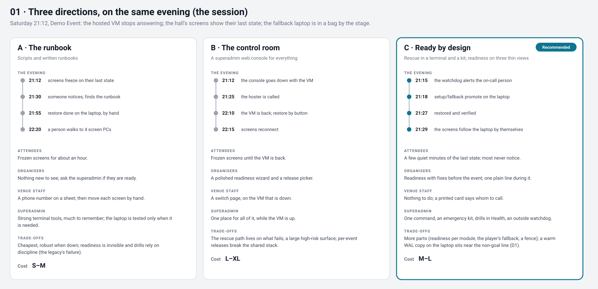

### A · The runbook
Everything as scripts and written runbooks: `setup/backup-check`, `setup/restore`, `setup/fallback`, `setup/preflight`; a hosted uptime monitor on the public health URL; Finnish strings; a Renovate config.
- **Attendees:** nothing changes; on the night, the screens freeze until someone restores.
- **Organisers:** see nothing new; ask the superadmin "are we ready?" before each event.
- **Venue staff:** a phone number on a sheet.
- **Superadmin:** strong tools in a terminal, a lot to remember; whether the laptop works is known only when it is used.
- **Trade-offs:** the cheapest and the most robust when things are down, but nobody can see readiness, the drill depends on discipline (the legacy's failure), and a person must walk to every screen PC on the night.
- **Cost: S–M.**

### B · The control room
A superadmin web console for all of it: a backups page with a restore button, a release picker per event, a pre-flight wizard, an uptime dashboard, a translation editor, a theme manager.
- **Attendees:** as A.
- **Organisers:** a polished readiness wizard; release choice per event.
- **Venue staff:** a "switch to fallback" page.
- **Superadmin:** one place for everything, while the VM is up.
- **Trade-offs:** the console lives on the VM that fails, so the rescue path depends on the thing it rescues; a restore button in a web page is a large high-risk surface; per-event releases break the one shared stack (D10); it duplicates step 8.
- **Cost: L–XL.**

### C · Ready by design
The rescue tools work from a terminal and a printed kit, because they run when the platform is down; three thin views show readiness where people decide: the organiser's **Readiness** page, the superadmin's **Platform** health, and Studio's **fallback band**. The watchdog lives outside the VM; drills run every week in CI and on the laptop before each event; the screens follow the laptop by themselves once a person promotes it.
- **Attendees:** the screens come back within minutes and they likely never notice; Finnish where the event speaks it.
- **Organisers:** a readiness page with blockers and fixes, digests before the event, a calm "we are on it" if the platform fails; organiser pages in their language and theme.
- **Venue staff:** nothing to do in a switch; a printed card says whom to call.
- **Superadmin:** one command to promote the laptop, an emergency kit, an outside watchdog that says when backups stop, drill results in Health.
- **Trade-offs:** more parts than A (a readiness contract per module, a fallback address in the player, a fence against two primaries); a warm WAL copy on the laptop during live events (D1), which is close to the non-goal line and is argued there.
- **Cost: M–L.**

## Recommended direction: ready by design
**C.** The platform's single point of failure is not a container, it is one VM in a server room, reached through one venue uplink ([0011](../decisions/0011-hosting-on-remote-vm.md)). Every hour spent on a web console for the rescue path (B) is spent on the part that disappears first. A (the runbook) is honest about that but repeats the legacy's real failure: the runbooks were good and nobody ran them. C keeps the rescue in a terminal and a printed kit, and spends its interface effort on the one thing people can actually act on before an event: **is this event ready, and if not, what do I fix?**

C also costs less than it looks. The backups are #55's; the release tags, the upgrade test, the weekly audit, the auto-deploy's rollback and the health shape exist. The new code is the restore and the laptop, the watchdog, one readiness read per module, the language pack, and two configs.

**Design principles**
1. **The rescue never depends on the thing it rescues.** Restore, promote and alert work with the VM gone: a terminal, a laptop, a printed kit, a watchdog on another host.
2. **Practised, not planned.** A drill every week in CI and before every event on the laptop; the result is shown, timed and dated.
3. **One person decides, the machines follow.** A person promotes the laptop; the screens move by themselves; nobody walks to a screen PC.
4. **Never two primaries.** A promotion fences the other side; moving back is a deliberate step after the event (E1, E2).
5. **Readiness is a list you can act on.** Each check says what is wrong in one sentence and links to its fix; blockers are few.
6. **Calm surfaces.** Attendees should not notice a switch; organisers get one plain line, not a dashboard of red.
7. **The event's language, the person's choice.** Screens in the event's language; organiser pages in the person's.
8. **Updates are routine.** One grouped PR a week, reviewed like any PR; a known vulnerability fails CI until fixed or ignored with a reason and an end date.

## Key flows
Each flow names its users and its mockup. The mockups use the demo event's names only (Demo Event, Demo Player, the zones main, entrance and café; `platform.example` for the platform's domain).

### Readiness before an event (organiser, crew, superadmin)
A summary line, then the checks as cards by area: screens, content, people and access, platform. Blockers first in each group; each card says its fix. Phone width shows one column ([U3](step-10-hardening/questions.md#u3-who-sees-the-readiness-page), [U4](step-10-hardening/questions.md#u4-does-a-red-readiness-check-block-going-live), [L1](step-10-hardening/questions.md#l1-the-readiness-pages-form)).

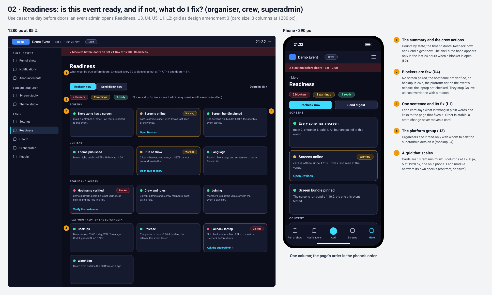

### The event timeline (organiser, superadmin)
What happens when: the release picked at T−14 days, the digest and the laptop's check at T−7, the deploy hold and a verified backup at T−1, the last digest 2 hours before doors, the laptop's warm copy during the event ([O5](step-10-hardening/questions.md#o5-the-event-timeline), [U5](step-10-hardening/questions.md#u5-when-is-readiness-checked), [D12](step-10-hardening/questions.md#d12-the-deploy-window)).

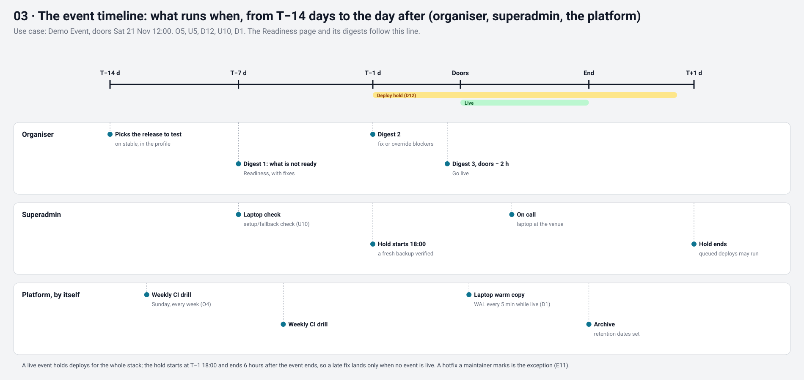

### Platform health (superadmin)
Health's Platform tab: backups and WAL, the last drills, the watchdog, the release and the deploy hold, disk and certificates, the fallback laptop's last check ([L3](step-10-hardening/questions.md#l3-the-platform-part-of-health)).

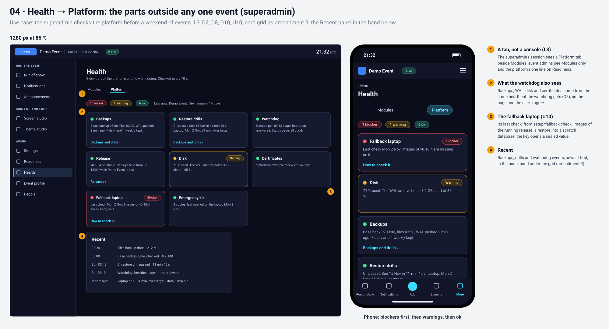

### Backups and drills (superadmin)
The backups #55 makes, their age and retention; every drill with its time, its data age and its result; the emergency kit's last check ([U10](step-10-hardening/questions.md#u10-how-does-the-fallback-laptop-show-that-it-is-ready), [O1](step-10-hardening/questions.md#o1-drill-cadence), [D2](step-10-hardening/questions.md#d2-restore-targets)).

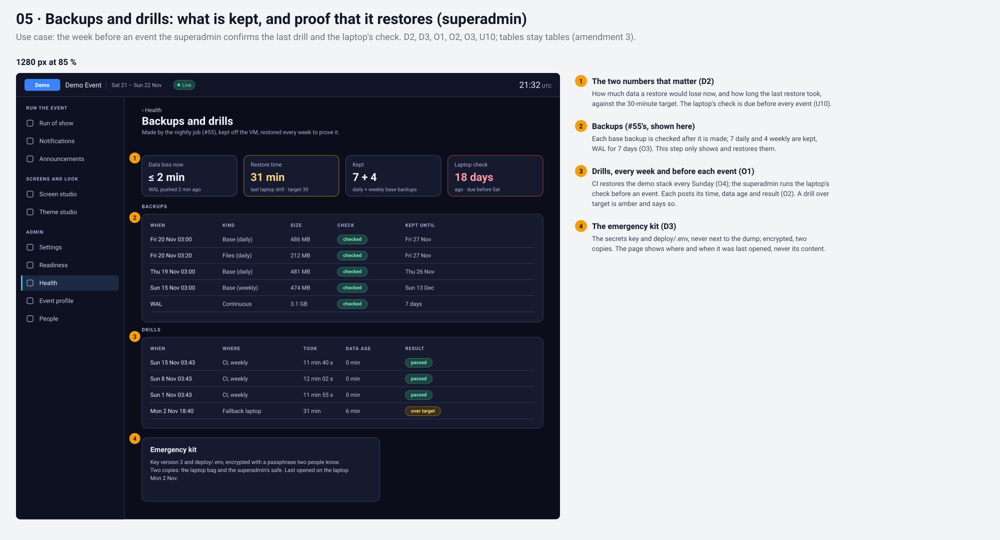

### Restore from cold (superadmin, on the fallback laptop)
One command, with the emergency kit: it shows the data's age, restores base and WAL, checks the key, verifies, and promotes; the time line against the 30-minute target ([U1](step-10-hardening/questions.md#u1-who-may-restore), [D1](step-10-hardening/questions.md#d1-how-fresh-is-the-fallback-laptops-copy), [D5](step-10-hardening/questions.md#d5-what-does-a-restore-check-before-it-says-done)).

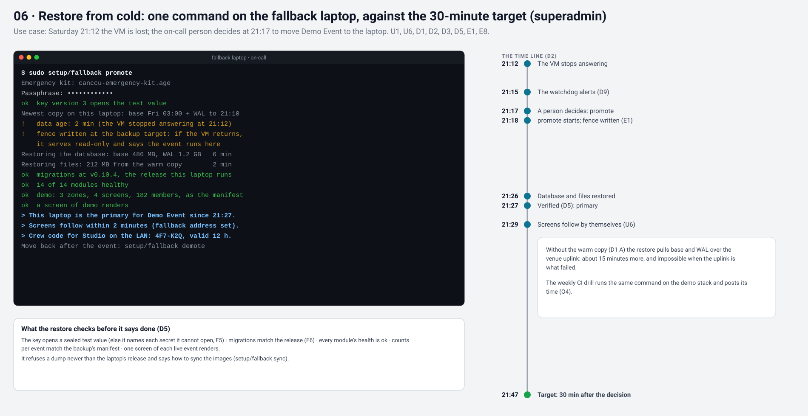

### The fallback at the venue (venue staff, crew, attendees in the hall)
The network before and after the switch, the screens following the laptop, Studio's fallback band, the venue staff's card ([U6](step-10-hardening/questions.md#u6-who-switches-the-event-to-the-fallback-laptop-and-how), [U7](step-10-hardening/questions.md#u7-what-do-phones-get-while-the-laptop-is-the-primary), [E1](step-10-hardening/questions.md#e1-two-primaries-after-a-switch), [E7](step-10-hardening/questions.md#e7-certificates-on-the-laptop)).

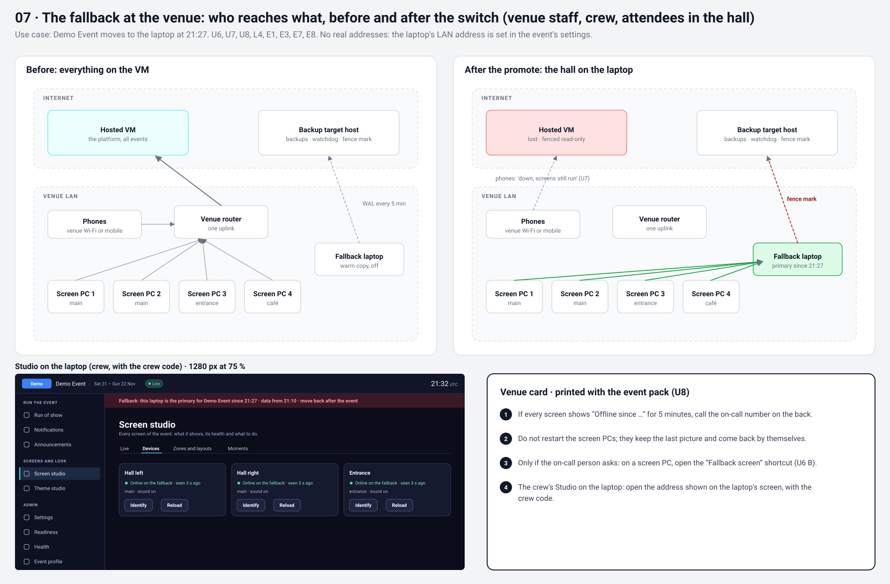

### The watchdog (superadmin, organisers of a live event)
Where it runs, what it watches, the alerts in the platform channel and the organiser's one line, the outside status page ([D7](step-10-hardening/questions.md#d7-where-does-the-watchdog-live), [D8](step-10-hardening/questions.md#d8-what-does-the-watchdog-watch), [D9](step-10-hardening/questions.md#d9-alert-rules), [U9](step-10-hardening/questions.md#u9-who-gets-the-watchdogs-alerts), [L5](step-10-hardening/questions.md#l5-the-outside-status-page)).

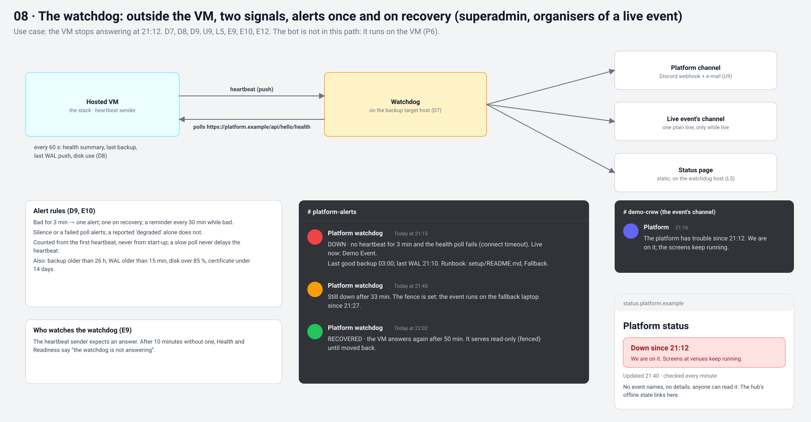

### Releases (superadmin, organiser)
The stack's channel, the tags, which events tested which release, the deploy hold; the organiser's one line in the event's settings ([D10](step-10-hardening/questions.md#d10-what-does-a-release-channel-pin-on-a-shared-stack), [D11](step-10-hardening/questions.md#d11-version-numbers-after-the-switch), [D12](step-10-hardening/questions.md#d12-the-deploy-window)).

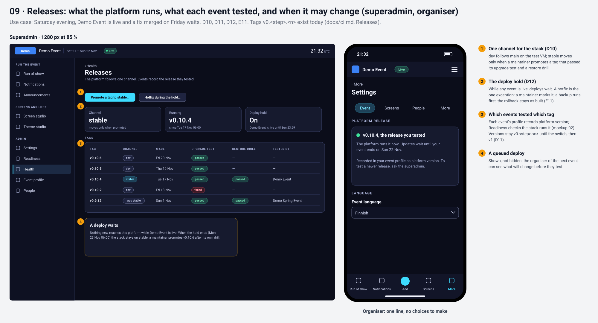

### The install kit (superadmin)
The host check, the wizard that writes `deploy/.env`, and the fresh install's first page that offers "restore from a backup" ([U13](step-10-hardening/questions.md#u13-who-installs-the-platform-with-the-install-kit), [O6](step-10-hardening/questions.md#o6-the-install-kits-checks), [D3](step-10-hardening/questions.md#d3-the-emergency-kit)).

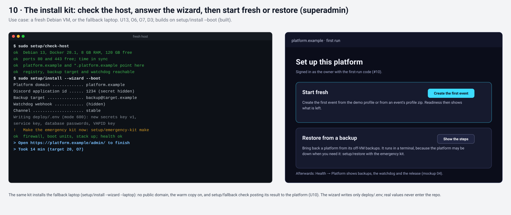

### Finnish (organiser, attendees in the hall)
The event's language and the person's own, a screen and an organiser page in Finnish, the catalog's coverage in CI, long words in fixed boxes ([D13](step-10-hardening/questions.md#d13-finnish-how-are-strings-kept), [D14](step-10-hardening/questions.md#d14-which-surfaces-speak-finnish-in-this-step), [D15](step-10-hardening/questions.md#d15-whose-language-the-events-or-the-persons), [E14](step-10-hardening/questions.md#e14-long-finnish-words-in-fixed-boxes)).

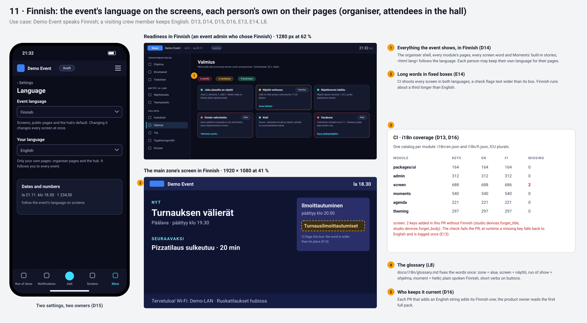

### A simpler admin (organiser)
Browser dialogs become in-page confirms and undo; the menu finds pages; settings grouped by task ([U12](step-10-hardening/questions.md#u12-which-pages-does-the-admin-simplification-pass-cover), [L9](step-10-hardening/questions.md#l9-undo-or-confirm), [L10](step-10-hardening/questions.md#l10-search-in-the-organiser-shell)).

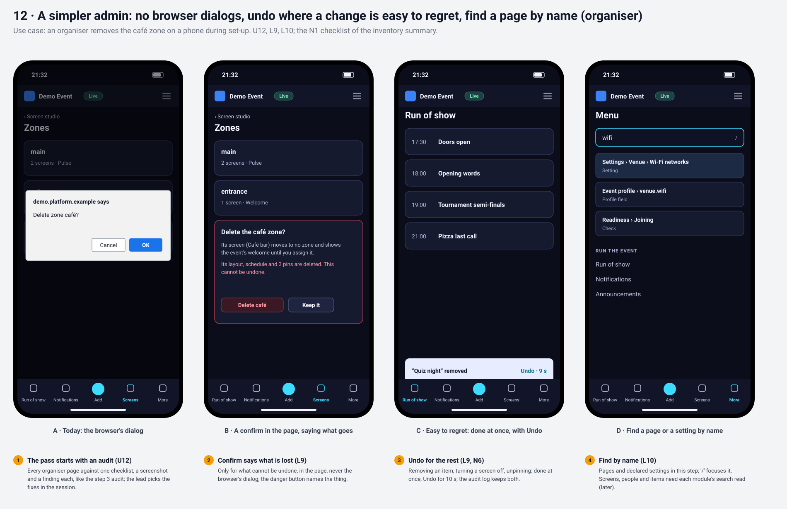

### Shell themes (organiser)
The same page in Dark, Light and high contrast, chosen per person ([L6](step-10-hardening/questions.md#l6-which-shell-themes), [L7](step-10-hardening/questions.md#l7-what-does-theme-in-the-roadmaps-step-10-mean)).

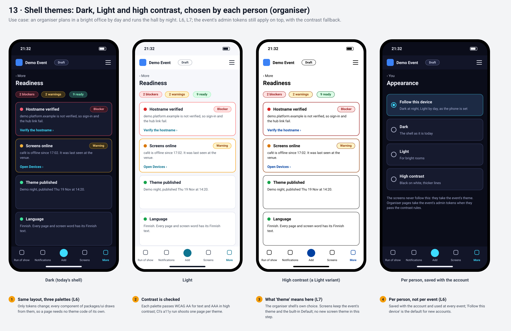

### Dependency updates (maintainer, reviewer)
The weekly grouped PR and its body, the audit check on a lock-file change, the ignore file, the path from Renovate to merge ([D17](step-10-hardening/questions.md#d17-how-are-update-prs-grouped), [D18](step-10-hardening/questions.md#d18-where-does-the-audit-run), [E16](step-10-hardening/questions.md#e16-a-vulnerability-with-no-fix)).

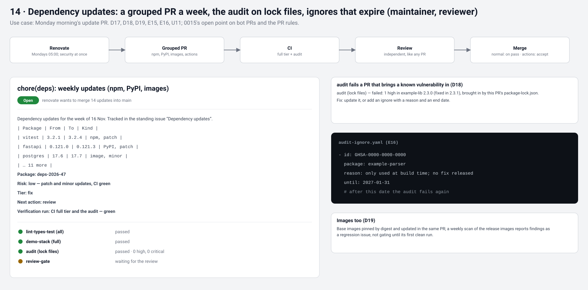

### The reviewer's own OS user (maintainer)
Who holds which token on the VM before and after ([O8](step-10-hardening/questions.md#o8-the-reviewers-own-os-user)).

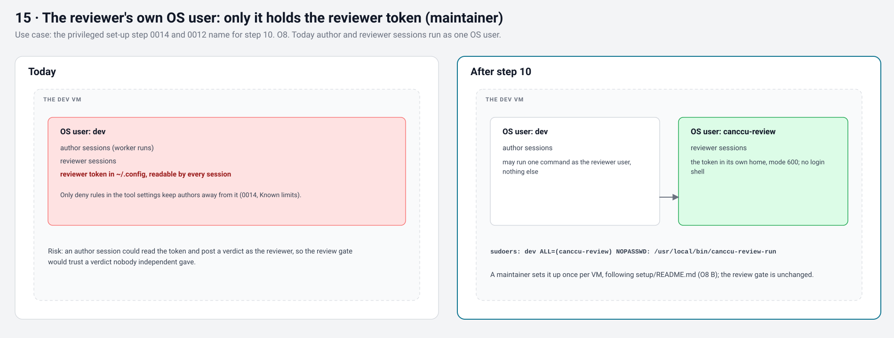

### When things fail (everyone)
Each failure, what each person sees, and what the platform does ([E1](step-10-hardening/questions.md#e1-two-primaries-after-a-switch)–[E12](step-10-hardening/questions.md#e12-disk-full-on-the-vm)).

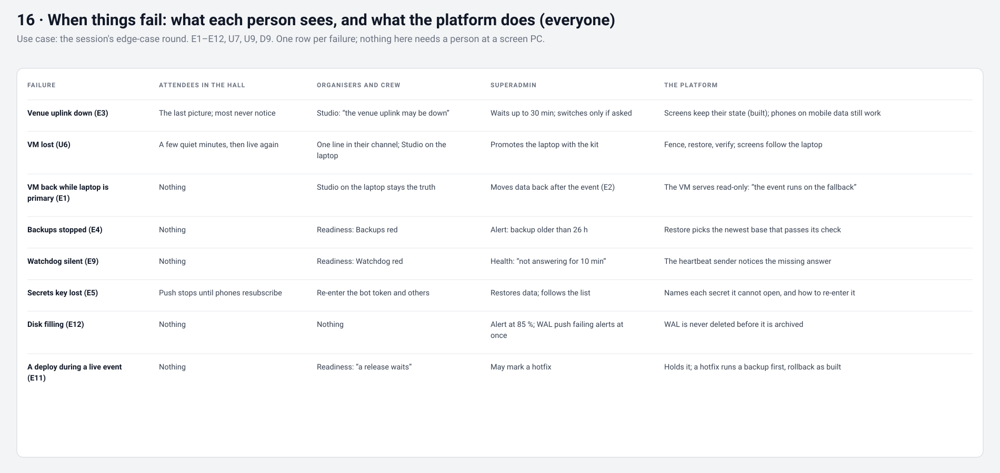

### Every mockup
| File | What it shows | For whom |
|---|---|---|
| [01-directions.svg](step-10-hardening/01-directions.svg) | The three directions on the same evening | the session |
| [02-readiness.svg](step-10-hardening/02-readiness.svg) | The Readiness page at 1280 px and on a phone: blockers, warnings, the platform part | organiser, crew, superadmin |
| [03-event-timeline.svg](step-10-hardening/03-event-timeline.svg) | What runs when, from T−14 days to T+1 | organiser, superadmin |
| [04-platform-health.svg](step-10-hardening/04-platform-health.svg) | Health's Platform tab at 1280 px and on a phone | superadmin |
| [05-backups-and-drills.svg](step-10-hardening/05-backups-and-drills.svg) | Backups, retention, drills, the emergency kit's check | superadmin |
| [06-restore-from-cold.svg](step-10-hardening/06-restore-from-cold.svg) | The restore on the laptop, step by step, against the 30-minute target | superadmin |
| [07-fallback-at-the-venue.svg](step-10-hardening/07-fallback-at-the-venue.svg) | The switch: network, screens, Studio's band, the venue card | venue staff, crew, attendees |
| [08-watchdog.svg](step-10-hardening/08-watchdog.svg) | The watchdog's signals, alerts, the organiser's line, the status page | superadmin, organiser |
| [09-releases.svg](step-10-hardening/09-releases.svg) | Releases: channel, tags, events' tested releases, the hold | superadmin, organiser |
| [10-install-kit.svg](step-10-hardening/10-install-kit.svg) | Host check, wizard, the first page with restore | superadmin |
| [11-language.svg](step-10-hardening/11-language.svg) | Language settings, Finnish pages and screen, coverage | organiser, attendees |
| [12-admin-simpler.svg](step-10-hardening/12-admin-simpler.svg) | Confirm and undo, finding a page, settings by task | organiser |
| [13-shell-themes.svg](step-10-hardening/13-shell-themes.svg) | Dark, Light and high contrast | organiser |
| [14-dependency-updates.svg](step-10-hardening/14-dependency-updates.svg) | The weekly PR, the audit check, the ignore file | maintainer, reviewer |
| [15-reviewer-user.svg](step-10-hardening/15-reviewer-user.svg) | OS users and tokens before and after | maintainer |
| [16-failure-modes.svg](step-10-hardening/16-failure-modes.svg) | Seven failures: who sees what, what happens | everyone |

## Port, drop or invent
Each with its reason ([0020](../decisions/0020-best-of-old-freely-new.md)). The legacy has little code for this step and much experience; most of what it gives is rules and lessons.

### Port as is (rules and their tests)
| Legacy | Where it goes | Why |
|---|---|---|
| The manager's debounce and "alert once, recover once, remind every 30 minutes" | The watchdog's alert rules (D9) | Proven at events; its tests are the spec |
| "Silence alerts, reported status does not" (the heartbeat contract) | The watchdog (D8) | Avoids alarms on a `degraded` that is still serving |
| The restore steps: stage the copy, check its integrity, take a safety copy of what is live, swap, check health | `setup/restore` | The signage runbook's order was right; only the engine changes (SQLite to Postgres) |
| Retention 7 daily and 4 weekly (gap 12, TH4) | Shown by this step, set by #55 | The numbers were agreed and never built |
| The 30-minute recovery target and the cold-boot thresholds (health in 5 minutes, a picture in 7) | D2 and the drill's timing | Concrete targets a drill can measure |
| The rehearsal checklist's evidence (date, tag, screenshots, failures) | Drill results (O2) | A drill without a record is a rumour |

### Port with changes
| Legacy | Becomes | Why |
|---|---|---|
| The manager's heartbeat pushed to the signup site, checked by its cron | The VM's heartbeat to the watchdog on the backup target host (D7, D8), plus polling from outside | The signup site is gone; one heartbeat is not enough to see "up but unreachable" |
| The bot's watcher DMing admins | Alerts by a webhook the watchdog holds, to the platform channel (U9) | The bot runs on the VM; false alarms fixed (E10) |
| The manager's own system user, its locked env file and its narrow sudo rule | The reviewer's own OS user (O8) | The closest precedent on record |
| The cutover readiness checks (host, commit, health, screen, backup, rollback assets) | The Readiness page's checks, per module and platform (U4) | From a one-off worksheet to a page every event uses |
| The rollback asset checklist (contacts, cables, where credentials are) | The emergency kit and the venue card (D3, U8) | Kept short and printed |
| Dates formatted `fi-FI` in a few places | The platform's format helpers by the event's language (D13) | One rule, both kits |
| Lock files and `npm ci` | Kept, plus a lock file for every Python package (pinned `pip-audit` needs one) and Renovate | The bot had only lower bounds; audits need exact versions |

### Drop
| Legacy | Why |
|---|---|
| The heartbeat to the signup site, its bearer token, the bot's heartbeat watcher (D14, F15, X17) | Replaced by the watchdog; the watcher was the false-alarm source |
| Backups to the same host only, unencrypted | 0013 item 26: off the VM; the kit is encrypted (D3) |
| `git reset --hard` deploys over SSH, the version as a short SHA | The auto-deploy with images and release tags (built) |
| The 8-hour supervised burn-in and written risk acceptance (never started) | The weekly soak and drill in CI do it continuously; the dress rehearsal is step 11 |
| Units running as root, `.env` in the install folder | The stack's units and `deploy/.env` at mode 600 (built) |
| Hard-coded locale and time zone in code | The event's time zone (built) and language (this step) |

### Invent
| New | Why |
|---|---|
| The Readiness page and a readiness read per module (U3, U4) | The roadmap's "pre-flight checks", in the one place organisers look |
| The fallback laptop's warm copy, promote and fence (D1, U6, E1) | A cold copy is useless when the uplink is what failed; two primaries are worse than one outage |
| The screens follow the laptop by themselves (U6) | Nobody walks to every screen PC at 21:14 |
| The emergency kit (D3) | The key and `deploy/.env` apart from the dump and with the laptop, safe if lost |
| Drills in CI every week and on the laptop before each event (O1, O4) | The exit criterion proven continuously |
| The outside status page (L5) | The one page that works when the VM does not |
| Release channels on the stack and the deploy hold (D10, D12) | An organiser's tested release is the one that runs |
| Catalogs, the glossary, the missing-key check (D13, D16, L8) | Finnish that stays complete as the platform grows |
| Per-person shell themes and language (L6, D15) | The organiser works in an office by day and a hall by night |
| Grouped weekly update PRs that follow the PR rules (D17) | 0015's open point closed |

## Proposed issue changes
The lead applies these after the session; the pack's author creates and edits no issues. The epic has no build issues yet, so all are new. Every contract item below is additive and ships with the code that uses it ([0029](../decisions/0029-additive-contracts-ship-with-consumers.md)). Risk follows [P5](step-10-hardening/questions.md#p5-risk-classes).

### Missing: the plan issue
Every step starts with two issues, the research pack and the plan ([README](README.md#how-a-brief-is-made)); step 10 has only the pack (#169). The lead opens `docs(briefs): step 10 (hardening): plan`, blocked by #169, and the issues below are blocked by it.

### New · feat(setup): restore from cold, the fallback laptop and the emergency kit (high)
- [ ] `setup/restore [--dry-run] [--verify] [--to <time>]`: from #55's backups and the emergency kit onto an empty host; names the data's age before it starts; verifies as D5; times itself
- [ ] `setup/fallback check|sync|warm|promote|demote`: the laptop's check (U10) and its result posted to the platform (O2); the images of the stack's release (E6); the warm WAL copy during live events (D1); promote with the fence (E1) and a crew code (E8); move back (E2)
- [ ] The emergency kit: `setup/emergency-kit make|check` (D3), its printed sheet, two copies
- [ ] The player follows the fallback: the event's fallback address and the `primary` flag (screen contract, additive) (U6); Studio's fallback band (L4)
- [ ] The weekly `restore` drill in CI (O4)
- [ ] The runbook in `setup/README.md` and the venue card (U8)

Out of scope: the backup job (#55); a hot standby (0022); the hub on the laptop (U7).

### New · feat(setup): the outside watchdog and the heartbeat (high)
- [ ] The watchdog on the backup target host (D7): polling and heartbeat (D8), the alert rules with the legacy's fixes (D9, E10), a webhook to the platform channel and e-mail (U9), the organiser's line for live events, the static status page (L5)
- [ ] The VM's heartbeat sender (health summary, backup and WAL age, disk) and its "watchdog not answering" check (E9, E12)
- [ ] Tests: a stopped heartbeat alerts once after 3 minutes and recovers once; no alert before the first heartbeat

Out of scope: step 8's alerts for module problems; per-tenant status beyond the one line (TI6).

### New · feat(admin): readiness before an event and the platform's health (normal)
- [ ] `GET /internal/<module>/readiness?tenant_id=` for every module with checks (screens, theming, agenda, notify, moments, tenants; pizza, bot and tournament when they exist): `id`, `severity` (`blocker`, `warning`, `info`), `status`, one sentence, a fix link (admin contract, additive)
- [ ] The Readiness page (U3, L1, L2) at phone and desk widths, as amendment 3; the platform rows for the superadmin
- [ ] Blockers stop `draft → live` unless overridden with an audited reason (U4) (tenants contract, additive `readiness_blocked`)
- [ ] Digests at T−7, T−1 and doors−2 h through step 8's alerts when they exist (U5)
- [ ] Health's Platform tab (L3) and the drill results (O2)
- [ ] CI screenshots next to [mockups 02 and 04](step-10-hardening/02-readiness.svg)

Out of scope: the checks' fixes themselves (they live on each module's own pages).

### New · feat(deploy,ci): release channels, the deploy hold and the event's tested release (high)
- [ ] `CANCCU_CHANNEL` (`dev` or `stable`) for the auto-deploy; a maintainer promotes a tag to `stable` (D10, D11)
- [ ] The deploy hold while any event is live, hotfixes excepted, with a backup before a hotfix (D12, E11)
- [ ] The event's tested release in its profile (`platform.version`, profile contract, additive); the readiness check that the stack runs it
- [ ] The Releases view for the superadmin and the organiser's one line ([mockup 09](step-10-hardening/09-releases.svg))
- [ ] The install kit: `setup/check-host` (O6), the wizard that writes `deploy/.env` (U13), restore offered on a fresh install ([mockup 10](step-10-hardening/10-install-kit.svg))

Out of scope: per-event backends (D10 B).

### New · ci: dependency updates and the audit on pull requests (high)
- [ ] Renovate: weekly grouped minor and patch PR, majors apart, security at once, images by digest; a body template that meets the PR rules and a standing issue (D17, U11)
- [ ] The audit on every PR that changes a lock file, `audit-ignore.yaml` with reasons and end dates (D18, E16); lock files for the Python packages
- [ ] The weekly image scan, reporting (D19)

### New · feat(ui): Finnish, the first language pack (normal)
- [ ] Catalogs per module and package, the helpers in both kits, ICU plurals; the event's language for screens and public pages, each person's for organiser pages and the hub (D13, D15; profile field additive)
- [ ] Every organiser page, every screen word, every hub and public page built by then in Finnish (D14); `<html lang>` from the language
- [ ] The glossary (L8); the CI check for missing keys (D16); screenshots in both languages and the overflow check (E14)

Out of scope: a third language; translation tooling.

### New · feat(ui,admin): the admin simplification pass and shell themes (normal)
- [ ] A short audit of every organiser page against the N1 checklist (U12), then the fixes the lead picks: browser dialogs to in-page confirm and undo (L9), phone widths, plain words, page search (L10)
- [ ] Dark, Light, high contrast and follow-the-system, chosen per person (L6), the event's admin tokens still on top
- [ ] CI screenshots of each changed page next to [mockups 12 and 13](step-10-hardening/12-admin-simpler.svg)

### A maintainer task · the reviewer's own OS user (high)
- [ ] The user, the token in its home at mode 600, the deny rule for author sessions, the `sudo -u` rule; documented in `setup/README.md` (O8)

### Order (a sketch for the planner)
1. **In parallel at once** (they need nothing from #55): the readiness package; Finnish; the admin pass and themes; dependency updates; the reviewer user.
2. **After #55 merges:** restore, fallback and the emergency kit, with the watchdog in the same package (both `setup/`, both high: one accept, [P5](step-10-hardening/questions.md#p5-risk-classes)).
3. **Releases and the install kit** after the readiness package (its check reads the readiness API).

## Proposed exit criteria
The roadmap's two, made checkable ([P3](step-10-hardening/questions.md#p3-the-exit-criteria)):
- On a laptop with nothing but the install kit and the emergency kit, the demo platform is restored from the off-VM backup within 30 minutes; every module's health is `ok`, a sealed secret opens, and a screen shows the demo event. The weekly CI drill does the same and passes.
- The audit runs on pull requests that change a lock file and in the weekly run; the first grouped update PR has arrived and followed the PR rules.
- Plus: a stopped heartbeat alerts once in the platform channel and recovers once; the demo event's pages and screens show in Finnish with no missing key.

## Open questions
The [question bank](step-10-hardening/questions.md) holds every open question found: 75 in six themes, each with options and a recommendation. **Decide first:** P1 (the direction), D1 (the laptop's warm copy), U6 (who switches, and how), E1 (two primaries), D7 (where the watchdog lives), D10 (what a channel pins), U4 (blockers), P2 (the issue set), P3 (the exit criteria).
