# Step 11 brief: Dress rehearsal and switch (research pack)

The research pack for the product owner's brainstorming session on [step 11, Dress rehearsal and switch](../roadmap.md#11-dress-rehearsal-and-switch) (epic #65), issue #170. It follows the [outline of a research pack](README.md#outline-of-a-research-pack) and is built like [step 5's pack](step-5-pizza.md). After this merges, the lead runs the session over as many rounds as it takes, writes the final plan into this brief (`## Plan`) and writes the step's issues; the product owner accepts the plan before any build starts.

**In this pack**
- This file: goal, what was read, what earlier steps and tracks bring, how others solve it, three directions and the recommended one, the key flows, port / drop / invent, proposed issue changes and exit criteria.
- [step-11-dress-rehearsal/questions.md](step-11-dress-rehearsal/questions.md): the question bank, 69 questions in six themes, each with options and a recommendation. IDs (U2, D1, …) are used throughout.
- [step-11-dress-rehearsal/](step-11-dress-rehearsal/): 13 SVG mockups, drawn new, with the demo event only. Organiser and superadmin pages are drawn in the organiser shell's default look from `packages/ui` (the Event menu of [sheet 2](../design/README.md)); the attendee's page in the demo theme's "Demo night" colours, as the hub takes the event's theme. Pages marked "new" in the menu do not exist yet.

## Goal
An event runs on a pinned, tested release, and the legacy system is retired ([roadmap](../roadmap.md#11-dress-rehearsal-and-switch)). The roadmap's "In it": the event pins a tested release (no freeze date, [0021](../decisions/0021-no-fixed-dates.md)); a dress rehearsal on the VM, mainly the product owner testing the whole system at home, including a restore onto the fallback laptop, with the App track's privacy center in place before it; the legacy bot cut over (the migration built and tested in step 6 runs, the legacy bot is stopped, its token moves into the tenant); the switch (the old repos renamed `-legacy` and archived, this repo renamed `canccuplatform`). Exit: the dress rehearsal passed; the bot data was migrated at the switch; the event repo pins a tested release.

Unlike steps 3–9, step 11 builds little that attendees see. Its users are the product owner, the organiser and the superadmin, and its product is **confidence**: knowing, before the doors open, that the event will run, and knowing what to do when it does not.

## What was read
- **Decisions:** [0022](../decisions/0022-product-vision.md) (the vision: an install kit, pre-flight checks and release channels; "a dry run" and "a load harness for the large event" in the backlog; no hot standby), [0021](../decisions/0021-no-fixed-dates.md) (no freeze; a release freeze only by its own record; step 11 renamed), [0013](../decisions/0013-multi-tenant-core.md) (one shared version, items 22 releases and the deploy hold, 23 pinned screen bundles, 24 the staging stack, 25 offline screens, 26 backups and the monthly restore test; the bot cutover in its Consequences), [0004](../decisions/0004-nothing-migrated.md) (only the bot's data is migrated), [0005](../decisions/0005-signup-site-stays-outside.md) (registration stays outside), [0011](../decisions/0011-hosting-on-remote-vm.md) (the remote VM, the fallback laptop, the uplink as a dependency), [0012](../decisions/0012-development-on-the-vm.md) (revisit development on the VM before real event data comes to it), [0014](../decisions/0014-independent-review.md) (the reviewer's own OS user), [0016](../decisions/0016-merge-policy.md) (its freeze, superseded), [0017](../decisions/0017-naming.md) and [0002](../decisions/0002-no-legacy-history-or-docs.md) (the rename and the archived legacy), [0025](../decisions/0025-finals-and-games-modules.md) (the mini tourney stays independent), [0027](../decisions/0027-product-decisions-2026-11-07-08.md) (every account a Discord account; joining at the venue or with the link), [0020](../decisions/0020-best-of-old-freely-new.md), [0026](../decisions/0026-briefs-are-research-packs.md) and [0029](../decisions/0029-additive-contracts-ship-with-consumers.md).
- **The roadmap:** [step 11](../roadmap.md#11-dress-rehearsal-and-switch), [step 10](../roadmap.md#10-hardening) (backup and restore, the fallback laptop, the watchdog, the install kit, pre-flight checks, release channels, the reviewer's own OS user), [step 8](../roadmap.md#8-admin-operations) (alerts, series and clone, the venue profile), the [App track](../roadmap.md#app) (the privacy center before the rehearsal), and the open questions "deploys while tenants are live" and "a separate dev VM".
- **Legacy inventories:** the [summary](../legacy-inventory/README.md) (the row "Cutover thresholds and burn-in", gaps 13 and 14, TE6 and TE7, DR4, OC6), [canccudocs](../legacy-inventory/canccudocs.md) (PLAN 12, the direct cutover checklist; SUBPLAN 06, burn-in and rehearsal), [canccubot](../legacy-inventory/canccubot.md) (what the bot holds: its settings and two small state files; durable data lives in the signup site), [canccusignage](../legacy-inventory/canccusignage.md) (the rehearsal items never tested, the cutover worksheet).
- **The legacy itself** (read-only): the cutover plan (readiness gates, rollback triggers with times set per event, a 30-minute target for the display path), the burn-in plan (an 8-hour supervised run, failure scenarios, an evidence bundle, written risk acceptance: "no silent success"), and the signage repo's cutover and rollback runbooks.
- **Contracts and code it builds on:** [tenants.md](../../contracts/tenants.md) (the lifecycle draft → live → archived and the deploy hold counting live tenants, series and clone with `shift_seconds`, the venue IP check and its emergency switch, privacy and retention, the superadmin), [screen.md](../../contracts/screen.md#offline-theming-and-the-pinned-bundle) (pins of the bundle and the theme), [profile.md](../../contracts/profile.md) (the event profile), [admin.md](../../contracts/admin.md) (health with the platform version), [bot.md](../../contracts/bot.md) (the clone moves the bot's binding); [setup/README.md](../../setup/README.md) (install, the auto-deploy only while `CANCCU_VERSION` is `dev`, the rollback on a failed deploy, check-boot), [docs/ci.md](../ci.md#releases) (`v0.<step>.<n>` tags on every green main, the `step-<n>` checkpoint tags, the upgrade test, the weekly run, `release-red`).
- **The epic and its issues:** #65 (no children yet; its title still says "Freeze"), #125 (the bot migration, step 6), #166 (Go public), #169 (the step 10 pack), #160 (the App track).

## What earlier steps and tracks bring
Step 11 is mostly assembly: it turns other steps' parts into one path from "release picked" to "legacy archived".
- **Built already:** the release tags `v0.<step>.<n>` on every green main and the `step-<n>` checkpoint tags; the upgrade test from the last checkpoint and the weekly regression run; the auto-deploy with health checks and rollback (dev mode only); boot survival and `check-boot`; the tenant lifecycle with the deploy hold counting live tenants; screens that pin a bundle and a theme revision and keep their last state offline; the Health page; `scripts/screen-soak`.
- **Coming from other steps** (the gates of the rehearsal, [P5](step-11-dress-rehearsal/questions.md#p5-what-must-be-closed-before-the-rehearsal)): HTTPS, the central sign-in, membership and backups off the VM (Go public, #166); clone and alerts (step 8); restore onto the fallback laptop, pre-flight checks, release channels, the watchdog and the reviewer's own OS user (step 10); the bot module and the tested migration (step 6, #125); the privacy center (App track).
- **Not built anywhere yet:** a deploy that moves a production stack to a release tag (`setup/deploy` acts only in dev mode); what "pinned" means for a whole event on a shared stack; a hotfix path for a pinned release; release numbers after the last step milestone (the tagger fails without one); one place that says whether an event is ready; the rehearsal's script and drills; the rename's runbook.

## How comparable products solve it
| Field | What they do | What we take |
|---|---|---|
| **Theatre and broadcast** (dress rehearsal, tech run) | The full show, in costume, with the real cues, once; a stage manager's "go" on a call sheet; understudies | The rehearsal as the real thing on the real stack (U2), a run sheet ([mockup 06](step-11-dress-rehearsal/06-rehearsal-run-sheet.svg)), one person's "go" (U5) |
| **Launch readiness reviews** (SaaS and game launches) | A go/no-go meeting over a readiness checklist; each red item has an owner, a fix or a signed risk acceptance | The go-live board with automatic and hand-ticked gates and written acceptances ([mockup 02](step-11-dress-rehearsal/02-go-live-board.svg)) |
| **Release trains and LTS branches** | Fixed release lines; a branch per supported release; patches cherry-picked; channels (stable, beta, nightly) | Channels from step 10, a release branch for the pinned release, patch tags (D3, D4, [mockup 11](step-11-dress-rehearsal/11-live-window.svg)) |
| **Change freezes in retail and ticketing** | No deploys during peak trading; an emergency change process with approval | The deploy hold while an event is live, the hotfix lane with a reason and an audit (D5, [mockup 04](step-11-dress-rehearsal/04-go-live.svg)) |
| **Game days and chaos drills** | Break production on purpose in a planned window; time the recovery; write it up | The failure drills with targets and measured times ([mockup 07](step-11-dress-rehearsal/07-failure-drills.svg)) |
| **Disaster recovery tests** | Restore from backup on clean hardware against an RTO, regularly | The restore drill on the fallback laptop, monthly and before each event (O8, [mockup 08](step-11-dress-rehearsal/08-fallback-restore.svg)) |
| **Repository and product renames** | Redirects, a deprecation period, archived old repos with a pointer | The two-move switch (O3), the rename runbook ([mockup 10](step-11-dress-rehearsal/10-the-switch.svg)) |

The lesson across them: **rehearse the real thing, decide in writing, and make the way back as rehearsed as the way forward.** The legacy plans knew all three (gates, triggers, evidence, "no silent success") and never ran them; the platform can make them part of the product, so the second event inherits them.

## Three directions
The same moment in each: one week before the event, the release is chosen and the rehearsal is due.

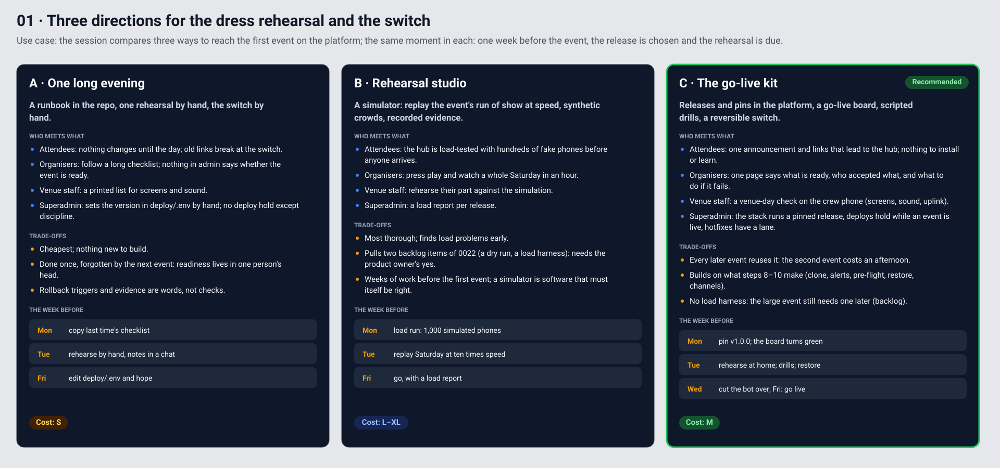

### A · One long evening
A runbook in the repo; the rehearsal done once by hand; the version set in `deploy/.env` by hand; the switch by hand.
- **Attendees:** nothing changes until the day; old pizza and tournament links break at the switch.
- **Organisers:** a long checklist; nothing in admin says whether the event is ready or who accepted what.
- **Venue staff:** a printed list for screens and sound.
- **Superadmin:** edits the version by hand; the deploy hold is discipline, not code; a hotfix is improvised.
- **Trade-offs:** the cheapest, and enough for one event. But readiness lives in one person's head and is rebuilt for every event; rollback triggers and evidence are words; "pinned" stays undefined on a shared stack.
- **Cost: S.**

### B · Rehearsal studio
A simulator: the event's run of show replayed at speed, synthetic attendees (hundreds of scripted phones), recorded evidence, a load report per release.
- **Attendees:** the hub is load-tested before anyone arrives.
- **Organisers:** press play and watch a whole Saturday in an hour.
- **Venue staff:** rehearse their part against the simulation.
- **Superadmin:** a load report per release, regressions caught early.
- **Trade-offs:** the most thorough, and the only one that tests the large event's load. But it pulls two items 0022 keeps in the backlog (a dry run, a load harness), needs the product owner's yes, and is weeks of work before the first event; a simulator is software that must itself be right, and it still cannot test the venue.
- **Cost: L–XL.**

### C · The go-live kit
Releases and pins in the platform, one go-live board, a scripted rehearsal with drills, and a reversible switch in two moves.
- **Attendees:** one announcement when the bot moves; old links land on a "moved" page with a button to the hub; nothing to install or learn.
- **Organisers:** one page says what is ready, what the stack and the modules checked, who accepted what and why, and what happens if it fails; going live is one deliberate step.
- **Venue staff:** a venue-day check on the crew phone: screens drawing, sound per zone, the uplink, the venue's address seen.
- **Superadmin:** the stack runs a release, never `dev`; deploys hold while an event is live; a fix travels as a patch of the pinned release on its own lane, staged first and applied with a reason.
- **Trade-offs:** more to build than A (a page, a few gates, the deploy and tag changes, a decision record), and no load harness. But each part is small, most of the checks already exist in other steps, and every later event reuses all of it.
- **Cost: M.**

## Recommended direction: the go-live kit
**C.** The first event on the platform is not the hard part; the hard part is that it is the first of many, on a shared stack, with nobody whose job is to remember how it went last time. A would get the first event through and leave the tenth to luck. B solves a problem the first event does not have (load) with a tool 0022 parked, and still cannot rehearse what actually broke at the legacy's events: the venue's network, its PCs, its sound, and the human steps around them.

C makes the step's three promises concrete and keeps them for every event after:
- **"Pinned"** gets a meaning a shared stack can keep: the stack runs one release, each event records the release it tested, going live is held while they differ, and deploys hold while any event is live (D1, D5). The open question in the roadmap ("deploys while tenants are live") is closed by a record (P6).
- **"Tested"** becomes a definition, not a feeling: CI, the upgrade test, the weekly run, and a rehearsal on that release, with failures fixed on a patch or accepted in writing (D2, U5).
- **"Retired"** happens in two moves with a way back at each: the bot before the event (its stopped container is the rollback), the repos after the first event has run (O3).

It also costs less than it looks. The checks the board shows mostly exist or come from steps 8 and 10; the board is one page; the run sheet is a document; the drills are an evening; the deploy and tag changes are small but high-risk, so they travel together in one package with one accept.

**Design principles**
1. **Rehearse the real thing.** The production stack, the real domain, the pinned release, a copy of the real event (U2); only the venue is stood in for, and the venue-day check covers what home cannot (U6).
2. **No silent success.** Every gate is green, or accepted in writing by a named person with a reason; an acceptance belongs to one event (U5).
3. **One stack, one version, one hold.** An event that is live never sees a deploy it did not test; main keeps moving (D1, D5, O1).
4. **The way back is rehearsed.** Every rollback trigger has a drill, a target and a measured time (E1–E3).
5. **Every step is reversible until it is not, and the one that is not is deliberate.** The cutover rolls back with one button; going live asks for the event's name (L3).
6. **Nothing event-specific here.** This repo holds the generic run sheet and a scrubbed summary; real names and evidence live in the event repo (D11).
7. **The second event costs an afternoon.** Everything the first event builds (board, run sheet, triggers, timings) carries over; only acceptances do not ([mockup 12](step-11-dress-rehearsal/12-after-the-event.svg)).

## Key flows
Each flow names its users and its mockup. The mockups use the demo event's names only (Demo Event, Demo Autumn Event, Main hall, Stage, Lobby, Food corner, Product Owner, Organiser, Superadmin); versions are examples.

### The go-live board (organiser, superadmin, crew)
Every gate in one place: what the stack checks, what the modules check, what people tick; the decision and the rollback triggers beside them; the crew phone shows what waits for a person first ([L1](step-11-dress-rehearsal/questions.md#l1-where-does-readiness-live), [U5](step-11-dress-rehearsal/questions.md#u5-who-decides-go-or-no-go-and-how-is-it-recorded), [O7](step-11-dress-rehearsal/questions.md#o7-which-gates-are-automatic-which-by-hand)).

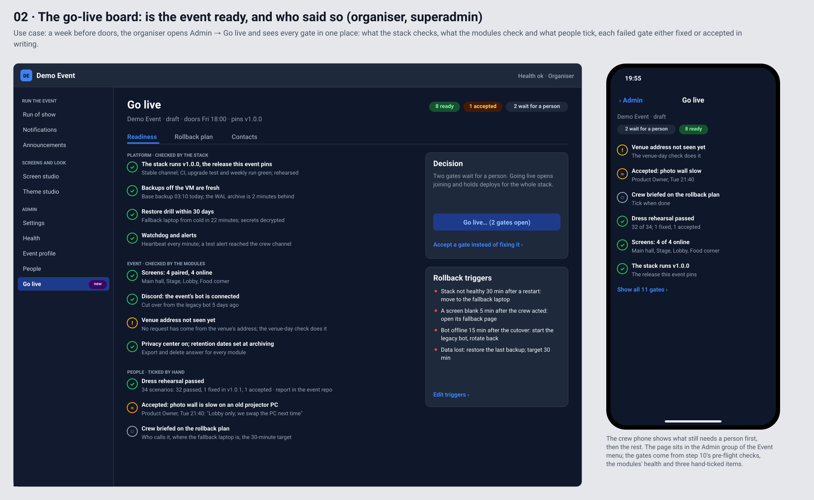

### Releases and pins (superadmin, organiser)
The release the stack runs and its channel's evidence; the events on the stack and the release each pins; the hotfix lane; the organiser's Platform card; a go-live held because the pins differ ([D1](step-11-dress-rehearsal/questions.md#d1-what-does-the-event-pins-a-tested-release-mean-on-a-shared-stack), [D2](step-11-dress-rehearsal/questions.md#d2-what-makes-a-release-tested), [E12](step-11-dress-rehearsal/questions.md#e12-two-events-live-at-once)).

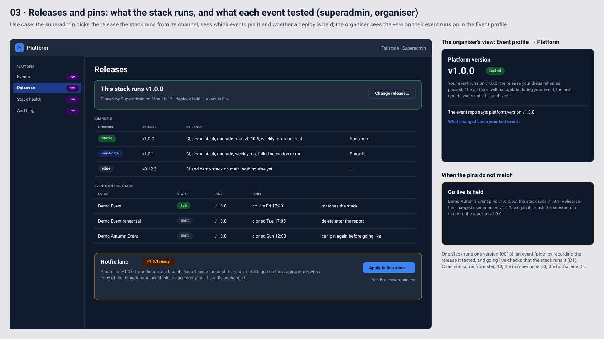

### Going live (organiser, superadmin)
The dialog that says what changes, the accepted gates, the typed name; the shell's Live pill and the hold on Health; a deploy refused while live ([L3](step-11-dress-rehearsal/questions.md#l3-how-deliberate-is-going-live), [D5](step-11-dress-rehearsal/questions.md#d5-deploys-while-an-event-is-live), [O6](step-11-dress-rehearsal/questions.md#o6-what-happens-to-a-held-deploy)).

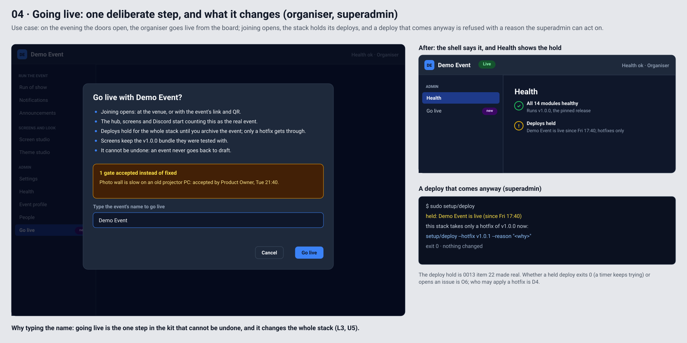

### The dress rehearsal at home (product owner, lead)
What stands in for the venue (a TV as the projector, two phones, a home venue, the test server), the rehearsal copy, and the evening's plan from clone to overnight soak ([U1](step-11-dress-rehearsal/questions.md#u1-who-takes-part-in-the-dress-rehearsal), [U2](step-11-dress-rehearsal/questions.md#u2-what-does-the-rehearsal-run-on), [U3](step-11-dress-rehearsal/questions.md#u3-what-stands-in-for-the-venue-at-home), [U9](step-11-dress-rehearsal/questions.md#u9-how-long-is-the-rehearsal)).

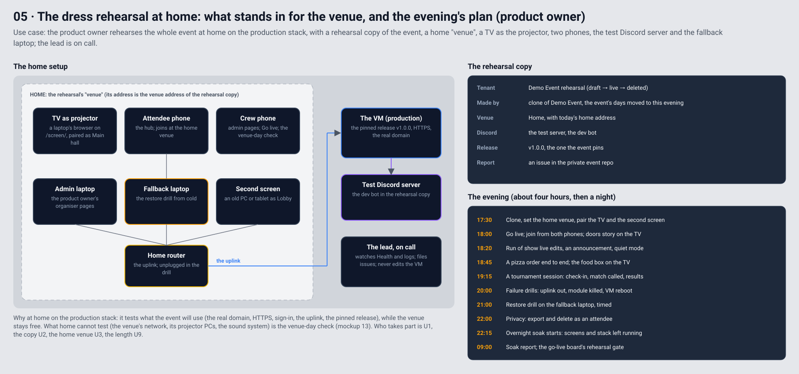

### The run sheet (product owner, lead)
Every scenario with its steps, what should happen, the result and the evidence; a fail becomes an issue and then a fix or an acceptance ([L7](step-11-dress-rehearsal/questions.md#l7-what-does-the-rehearsal-report-look-like), [E11](step-11-dress-rehearsal/questions.md#e11-the-rehearsal-finds-a-blocker-late), [D11](step-11-dress-rehearsal/questions.md#d11-where-does-the-evidence-live)).

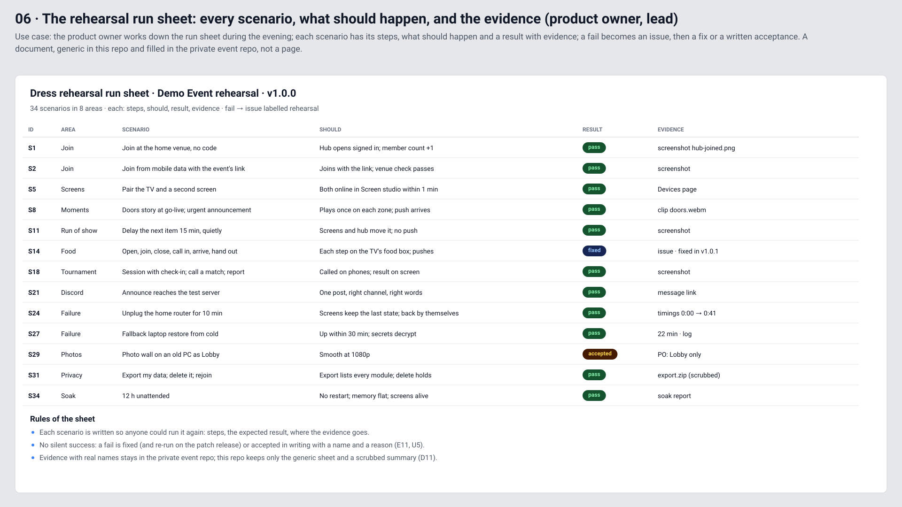

### Failure drills (product owner, lead, superadmin)
Eight drills, each with what is broken, what people should see, the target and the measured time; what a screen draws while the uplink is out ([E1](step-11-dress-rehearsal/questions.md#e1-which-failure-drills-run-in-the-rehearsal), [E2](step-11-dress-rehearsal/questions.md#e2-what-are-the-recovery-time-targets), [E3](step-11-dress-rehearsal/questions.md#e3-what-are-the-rollback-triggers)).

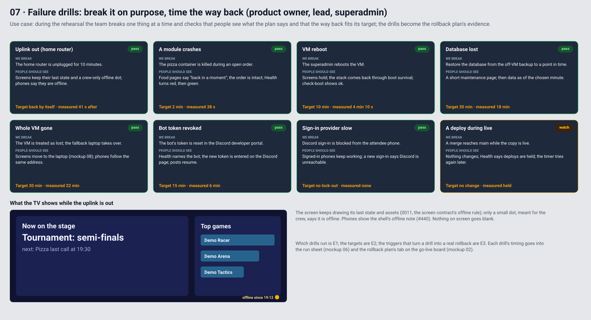

### The restore drill (superadmin, venue crew)
The fallback laptop from cold in six timed steps, the terminal, the drill's record; what step 10 must still decide ([O8](step-11-dress-rehearsal/questions.md#o8-how-often-is-the-restore-drilled)).

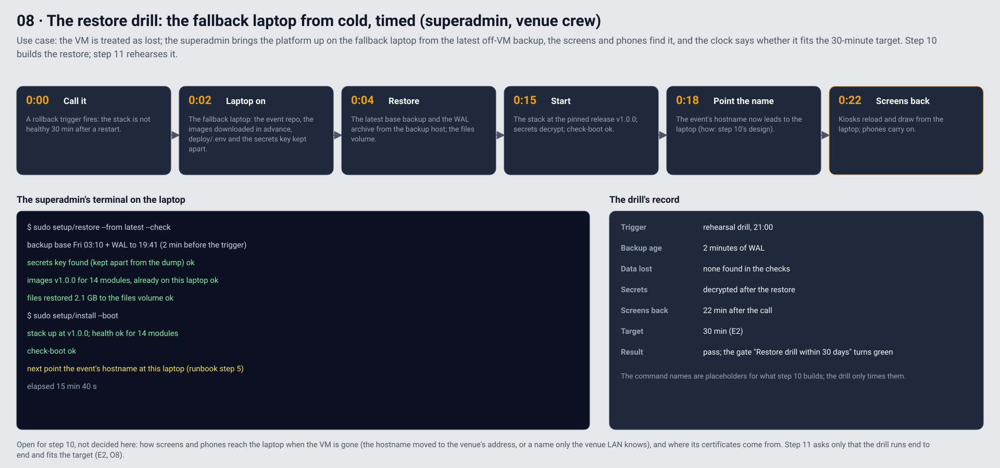

### Cutting the legacy bot over (organiser, superadmin, attendees)
Stop the legacy bot, the dry run's report, import, the token entered once, online; the rollback; what the server sees ([D6](step-11-dress-rehearsal/questions.md#d6-what-does-the-bot-migration-take), [D7](step-11-dress-rehearsal/questions.md#d7-where-does-the-bots-token-go-and-how), [E6](step-11-dress-rehearsal/questions.md#e6-the-bot-cutover-fails), [E7](step-11-dress-rehearsal/questions.md#e7-two-bots-on-one-token), [O2](step-11-dress-rehearsal/questions.md#o2-when-does-the-bot-cut-over)).

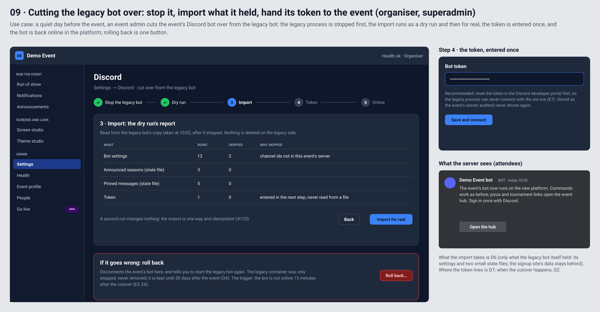

### The switch (superadmin, lead, everyone)
What is renamed, archived, re-pointed and kept; the order in one quiet window; what each kind of user meets ([D12](step-11-dress-rehearsal/questions.md#d12-how-is-the-repo-rename-done), [D13](step-11-dress-rehearsal/questions.md#d13-which-repos-are-renamed-and-archived), [O3](step-11-dress-rehearsal/questions.md#o3-when-is-the-legacy-retired), [E8](step-11-dress-rehearsal/questions.md#e8-renaming-while-work-is-open), [E9](step-11-dress-rehearsal/questions.md#e9-the-pinned-images-after-the-rename)).

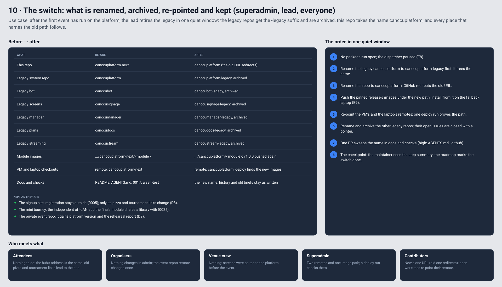

### The live window (superadmin, lead)
A week on a time line: the event's status, the stack's version, the screens' bundle, main, the bot; the hotfix lane in seven steps ([D3](step-11-dress-rehearsal/questions.md#d3-how-are-releases-numbered-at-the-switch-and-after), [D4](step-11-dress-rehearsal/questions.md#d4-how-does-a-fix-reach-a-live-event), [O1](step-11-dress-rehearsal/questions.md#o1-is-there-a-release-freeze), [O11](step-11-dress-rehearsal/questions.md#o11-when-does-the-hold-lift-and-what-runs-next)).

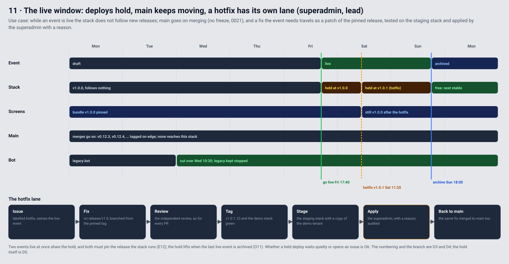

### After the event (organiser, lead, superadmin)
Archive, deploys resume, one report, the legacy bot's container removed, retention; the next event's board, cloned, with only the changed scenarios to re-run ([O4](step-11-dress-rehearsal/questions.md#o4-how-long-is-the-legacy-bots-container-kept-stopped), [D10](step-11-dress-rehearsal/questions.md#d10-what-happens-to-the-rehearsal-copy-afterwards), [E16](step-11-dress-rehearsal/questions.md#e16-cloning-moves-the-bot)).

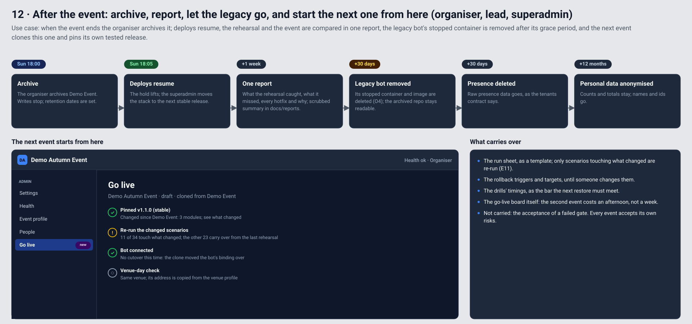

### The venue day and the attendee's side (venue crew, attendees)
The crew phone's venue check, one screen's detail with the sound check, and the "this page has moved" card for old links ([U6](step-11-dress-rehearsal/questions.md#u6-what-do-venue-staff-do-before-doors), [L5](step-11-dress-rehearsal/questions.md#l5-what-does-an-old-link-show), [D8](step-11-dress-rehearsal/questions.md#d8-what-happens-to-the-signup-sites-pizza-tournament-and-display-parts)).

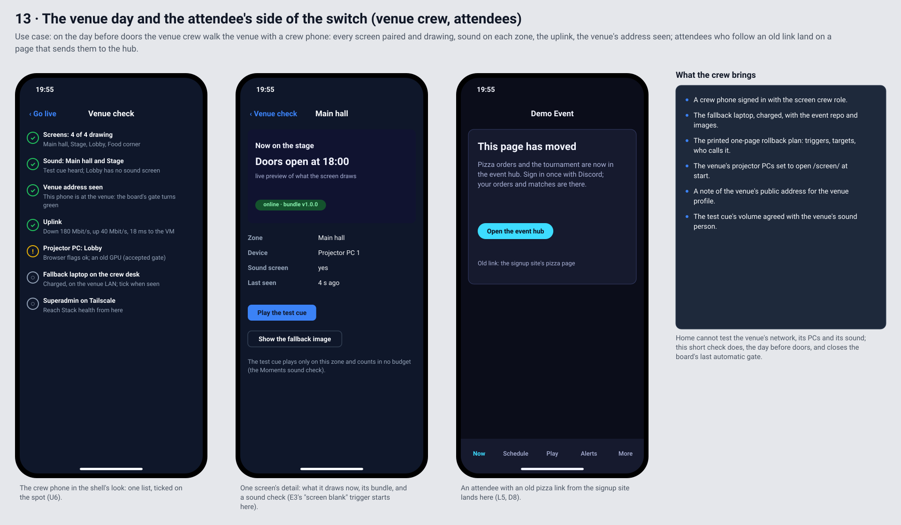

### Every mockup
| File | What it shows | For whom |
|---|---|---|
| [01-directions.svg](step-11-dress-rehearsal/01-directions.svg) | The three directions side by side, with the week before in each | the session |
| [02-go-live-board.svg](step-11-dress-rehearsal/02-go-live-board.svg) | The go-live board on a desk and on a crew phone | organiser, superadmin, crew |
| [03-releases-and-pins.svg](step-11-dress-rehearsal/03-releases-and-pins.svg) | Releases, channels, events and their pins, the hotfix lane; the Platform card; a held go-live | superadmin, organiser |
| [04-go-live.svg](step-11-dress-rehearsal/04-go-live.svg) | The go-live dialog; the Live pill and the hold on Health; a refused deploy | organiser, superadmin |
| [05-rehearsal-at-home.svg](step-11-dress-rehearsal/05-rehearsal-at-home.svg) | The home setup, the rehearsal copy, the evening's plan | product owner, lead |
| [06-rehearsal-run-sheet.svg](step-11-dress-rehearsal/06-rehearsal-run-sheet.svg) | The run sheet with results and evidence | product owner, lead |
| [07-failure-drills.svg](step-11-dress-rehearsal/07-failure-drills.svg) | Eight drills with targets and timings; a screen during an outage | product owner, lead, superadmin |
| [08-fallback-restore.svg](step-11-dress-rehearsal/08-fallback-restore.svg) | The restore onto the fallback laptop, timed | superadmin, venue crew |
| [09-bot-cutover.svg](step-11-dress-rehearsal/09-bot-cutover.svg) | The cutover wizard, the token, the rollback, the server's announcement | organiser, superadmin, attendees |
| [10-the-switch.svg](step-11-dress-rehearsal/10-the-switch.svg) | The rename map, the order, who meets what | superadmin, lead, everyone |
| [11-live-window.svg](step-11-dress-rehearsal/11-live-window.svg) | The live week on a time line; the hotfix lane | superadmin, lead |
| [12-after-the-event.svg](step-11-dress-rehearsal/12-after-the-event.svg) | After the event; the next event's board | organiser, lead, superadmin |
| [13-venue-day.svg](step-11-dress-rehearsal/13-venue-day.svg) | The venue check and a screen's detail on a crew phone; the "moved" card | venue crew, attendees |

## Port, drop or invent
Each with its reason ([0020](../decisions/0020-best-of-old-freely-new.md)). The legacy here is plans and runbooks, not code ([0002](../decisions/0002-no-legacy-history-or-docs.md): its docs are read, never imported).

### Port with changes (ideas from the legacy plans)
| Legacy | Becomes | Why |
|---|---|---|
| Readiness gates before a switch (PLAN 12: host, health, readiness, screen, observability, rollback assets) | The go-live board's gates, most of them checked by the stack and the modules (O7) | The same questions, answered by the platform instead of an operator's worksheet |
| Rollback triggers with times set per event; a 30-minute target for the display path (PLAN 12, gap 13) | The board's Rollback plan tab with defaults; targets per kind of failure (E2, E3) | Kept, made specific: screens never blank, the 30 minutes for the laptop |
| The 8-hour supervised burn-in on the final stack (SUBPLAN 06, gap 14) | An evening of scenarios and an overnight soak with `scripts/screen-soak` (U9, O10) | The same hours, split into what needs a person and what does not |
| Failure scenarios: restarts, cloud loss, the override lifecycle (SUBPLAN 06) | Eight timed drills (E1) | The same idea, for a remote VM and a fallback laptop |
| An evidence bundle, written risk acceptance, "no silent success" (SUBPLAN 06) | The run sheet with evidence in the event repo; acceptances on the board (U5, D11) | The best rule in the legacy plans, never carried out |
| "Tag a release or record the commit for the event build" (SUBPLAN 06) | The event pins a release on the stable channel (D1, D2) | Already the roadmap's; now defined for a shared stack |
| The cutover worksheet (signage runbooks) | The run sheet template in this repo, filled per event in the event repo | Generic here, event-specific there ([0003](../decisions/0003-event-content-scrubbed.md)) |

### Drop
| Legacy | Why |
|---|---|
| The PiSignage cutover and rollback (X22) | Retired before this inventory; nothing to cut over from |
| A freeze date for the whole repo (0016, SUBPLAN 06) | 0021: pinning protects the event; main keeps moving (O1) |
| Keeping the legacy screens and site as the runtime rollback | The fallback laptop is the rollback (0011); two systems double the crew's practice (E5) |
| A final doc sweep "to match as-deployed behaviour" at freeze | The comment rule and docs changing with behaviour in each PR already hold; the switch sweeps only the name (D12) |
| The bot's link commands with tokens (`/pizza order`, `/tournament register`) | Gone with step 6's rebuilt commands; old links land on the "moved" card (L5) |

### Invent
| New | Why |
|---|---|
| What "pinned" means on a shared stack, and go-live held on a mismatch (D1, E12) | The roadmap's promise, made true for every event on one stack |
| A definition of "tested" (D2) | A release is tested when the rehearsal and the machines agree |
| The go-live board with written acceptances (L1, U5) | One place, kept with the event, reused by the next |
| Going live as one deliberate step (L3) | The one irreversible step that changes the whole stack |
| The hotfix lane: a release branch, patch tags, the staging stack, an audited apply (D4) | A fix for the event without the features main gained since |
| Release numbers after the last step: `v1.0.0` at the switch (D3) | The tagger needs a rule once the step milestones end |
| The deploy to a release tag and the hold in `setup/deploy` (D15, D5) | Production stops following main |
| The rehearsal copy by clone with shifted dates (U2, E13) | The real event's setup without touching the real event |
| Failure drills with targets and timings (E1, E2) | The way back, rehearsed |
| The cutover wizard with a dry run, a token reset and a one-button rollback (mockup 09, E7) | #125's import made safe to run by an event admin |
| The venue-day check on a crew phone (U6) | What home cannot test |
| The "this page has moved" card (L5) | Old links lead somewhere useful |
| The switch in two moves (O3) | Each move with its own way back |

## Proposed issue changes
The lead applies these after the session; the pack's author creates and edits no issues. Every contract item below is additive and ships with the code that uses it ([0029](../decisions/0029-additive-contracts-ship-with-consumers.md)). Risk follows [P4](step-11-dress-rehearsal/questions.md#p4-risk-classes).

### #65 · the epic (keep, rewrite)
Title `Step 11: Dress rehearsal and switch` (drop "Freeze", 0021); its milestone's description drops the freeze date ([P8](step-11-dress-rehearsal/questions.md#p8-the-epic-and-the-milestone)). Its Planned checklist lists the issues below in order; its criteria become the exit criteria below.

### #125 · the legacy bot data migration (keep in step 6; scope by D6)
Unchanged in place: step 6 builds and tests it, step 11 runs it. Its "scope follows the product owner's answer" criterion is answered by [D6](step-11-dress-rehearsal/questions.md#d6-what-does-the-bot-migration-take) (recommended: only what the legacy bot held). Proposed addition for step 6: the dry-run report has the shape of [mockup 09](step-11-dress-rehearsal/09-bot-cutover.svg), and the import is reachable from the Discord settings page for an event admin.

### New · a decision record for releases on a shared stack (normal)
Proposed title: `docs(decisions): pinned releases, the live window and hotfixes`.
- [ ] Records D1 (pinned), D2 (tested), D3 (numbering), D4 (the hotfix lane), D5 (deploys while live), O1 (no freeze) and D14 (development after the switch, following 0012)
- [ ] The roadmap's open question "deploys while tenants are live" is closed; 0012's revisit trigger is answered; the change log has its line

### New · pin a release: the deploy, the hold and the hotfix lane (high: `setup/`, `.github/`)
Proposed title: `feat(deploy): the stack runs a pinned release, holds deploys while an event is live, and takes hotfixes`.
- [ ] `setup/deploy` moves a production stack to a release tag (`--release <tag>`), with the same health check and rollback as the dev path; refuses while any tenant is live except `--hotfix <tag> --reason` for a patch of the release it runs (D4, D5, D15); a held run exits 0 and opens one issue per live window (O6)
- [ ] `release-tag` tags `v1.0.0` on the switch release and `v1.<minor>.<n>` after the last step milestone; patch tags from `release/v<major>.<minor>` branches build their images (D3, D4)
- [ ] The tenant records the event's `platform_version` from its profile; going live is held while it differs from the stack's version (D1, E12) (**contract**, additive: tenants and profile)
- [ ] The staging stack (0013 item 24) runs a release with a copy of the demo tenant, by one command
- [ ] Tests in `setup/test.sh` and `.github/scripts/*.test.mjs`; a dry run of each path

### New · the go-live board and the Platform card (normal)
Proposed title: `feat(admin): the go-live board, the Platform card and going live`.
- [ ] Admin → Go live: automatic gates read from step 10's pre-flight checks and the modules' health; hand-ticked gates; acceptances with a name, a time and a reason, audited; the Rollback plan tab with editable triggers and the defaults of E3; the Contacts tab ([mockup 02](step-11-dress-rehearsal/02-go-live-board.svg))
- [ ] The go-live dialog with the typed name, calling the tenants lifecycle; the shell's Live pill; Health's "Deploys held" row ([mockup 04](step-11-dress-rehearsal/04-go-live.svg), L4)
- [ ] The Event profile's Platform card ([mockup 03](step-11-dress-rehearsal/03-releases-and-pins.svg), L2); the superadmin's Releases page if the session takes it (it needs the superadmin's pages, which no step has built yet: see Out of step 11)
- [ ] Rights: going live and accepting a gate need the event-admin role; ticking crew items a crew right (U11) (**contract**, additive: admin)
- [ ] Phone and desktop; CI screenshots next to the mockups; Finnish and English

### New · the dress rehearsal kit (low)
Proposed title: `docs(ops): the dress rehearsal run sheet, the failure drills and the venue-day check`.
- [ ] A generic run sheet in `docs/` (every scenario: steps, should, evidence), the eight drills with targets, the overnight soak's measures, and the venue-day check, with demo names only; the event repo copies and fills it (L7, E1, E2, O10, U6)
- [ ] The rollback plan's defaults and the crew briefing's one page (E3)
- [ ] A light load check script, if O5 takes it

### New · run the dress rehearsal (product owner's task)
Proposed title: `Dress rehearsal: run it at home and report` (like step 0's product-owner tasks).
- [ ] The rehearsal copy cloned with shifted dates; the evening per the run sheet; the drills; the restore onto the fallback laptop; the overnight soak (U1–U3, U9, E13)
- [ ] Every failure an issue labelled `rehearsal`, then fixed on a patch release or accepted on the board; the failed scenarios re-run (E11)
- [ ] The report in the event repo; a scrubbed summary in `docs/reports/`; the copy deleted (D10, D11)

### New · cut the legacy bot over (high: a token, personal data)
Proposed title: `ops(bot): cut the event's bot over from the legacy bot`.
- [ ] On a quiet day before the event (O2): the legacy bot stopped, #125's dry run and import, the token reset and entered (E7), the bot online; the announcement posted (U7)
- [ ] The rollback rehearsed once on the test server; the legacy container kept stopped until 30 days after the event, then removed (E6, O4)

### New · the switch (high: `AGENTS.md`, `.github/`, `setup/`)
Proposed title: `chore: the switch: rename and archive the legacy repos, rename this repo, re-point images and remotes`.
- [ ] After the first event has run (O3), in one quiet window (E8): the legacy repos renamed `-legacy`, their open issues closed with a pointer, archived; this repo renamed `canccuplatform` (D12, D13)
- [ ] The pinned release's images pushed under the new path; the VM's and the fallback laptop's remotes re-pointed; one deploy run and one install on the laptop prove it (E9)
- [ ] One PR sweeps the name in README, AGENTS.md, CLAUDE.md, 0017 and the checks; old briefs and reports stay as written
- [ ] The signup site's pizza and tournament links point to the hub; its owner turns those parts off (D8; a change in another repo)

### Out of step 11 (proposed)
The superadmin's own pages (Events, Releases, Stack health, Audit log in [mockup 03](step-11-dress-rehearsal/03-releases-and-pins.svg)): the tenants contract has the superadmin's API but no step builds its pages; until one does, the superadmin works from the API and the command line, and the Releases page is a `Roadmap note:` for the lead. Also out: a simulator and the load harness (B, 0022's backlog, P7); a clone option that leaves the bot behind (E16, step 8 or 6); how the fallback laptop takes over the event's hostname (step 10).

### Order (a sketch for the planner)
1. **The decision record** first (it settles what the deploy package builds), alone or with the rehearsal kit's docs (low).
2. **The deploy package** (high, one accept) and **the go-live board** (normal) in parallel; the board reads the tenant's `platform_version`, so if both touch the tenants contract the planner orders them.
3. **The dress rehearsal** (the product owner's task) once the gates of [P5](step-11-dress-rehearsal/questions.md#p5-what-must-be-closed-before-the-rehearsal) are closed; patch releases as it finds things.
4. **The bot cutover**, on a quiet day before the event.
5. **The first event.** Then **the switch**, then the checkpoint.

## Proposed exit criteria
The roadmap's three, made checkable, plus the goal's "an event runs" ([P3](step-11-dress-rehearsal/questions.md#p3-the-exit-criterion)):
- The dress rehearsal passed on the release the event pins: every scenario passed, or was fixed on a patch and re-run, or was accepted on the board; the restore onto the fallback laptop fit its target and the secrets decrypted after it.
- The bot data was migrated at the cutover (#125's import, its report in the event repo), the legacy bot is stopped, and the event's bot runs in its tenant.
- The event repo's `platform.version` names a release on the stable channel, the stack ran that release (or a patch of it) for the whole live window, and no deploy other than an audited hotfix reached it.
- The first event ran on it, and the legacy repos are renamed `-legacy` and archived; this repo is `canccuplatform`.

## Open questions
The [question bank](step-11-dress-rehearsal/questions.md) holds every open question found: 69 in six themes, each with options and a recommendation. **Decide first:** P1 (the direction), D1 (what "pinned" means), D5 (deploys while an event is live), D4 (hotfixes), O3 (when the legacy is retired), P3 (the exit criterion), U2 (the rehearsal copy), P2 (the issue set).
