# Step 3 brief: Screen core and Pulse (research pack)

The research pack for the product owner's brainstorming session on [roadmap step 3](../roadmap.md#3-screen-core-incl-pptx), issue #106. It follows the [brief outline](README.md#outline-of-a-brief) and the lead's comment on #106 of 2026-11-08: mockups of every key screen and flow, a full question bank instead of at most 7 questions, and the step's issues treated as input, not a fixed scope. After this merges, the lead runs the session over as many rounds as it takes, writes the final plan into this brief ([Plan](#plan-final-plan-after-the-session)) and rewrites the step's issues; the product owner accepts the plan before any build starts.

**In this pack**
- This file: goal, what was read, how others solve it, three directions and the recommended one, the key flows, port / drop / invent, the lead's step 2 notes, proposed issue changes.
- [step-3-screen/questions.md](step-3-screen/questions.md): the question bank, about 70 questions in six themes, each with options and a recommendation. IDs (U6, L2, …) are used throughout.
- [step-3-screen/](step-3-screen/): 17 SVG mockups, drawn new, with the demo event only. GitHub shows them inline below.

## Goal
The projector PC plays a Pulse screen from the VM, always current by push, and an event can run several screens (roadmap step 3). Pulse is "very visual, lively, coherent and always current", composed of widgets, with Moments at the peaks and a QR handoff to phones ([0022](../decisions/0022-product-vision.md)). Alongside Screen, step 3 builds three new modules from their step 2 contracts: `theming` (the brand kit), `agenda` (the run-of-show) and `notify` (topics, Web Push, check-in by the rotating QR).

Exit criteria (roadmap): the projector plays a Pulse screen over HTTPS, including a PPTX deck, and keeps showing it when the uplink is cut; a run-of-show change reaches it by push with no reload; a second device in another zone plays its own playlist; a valid token outside the venue address is refused; a device whose current tenant is another event is refused; admin shows both devices' health.

## What was read
- **Decisions:** [0022](../decisions/0022-product-vision.md) (vision), [0020](../decisions/0020-best-of-old-freely-new.md) (best of the old, freely new), [0023](../decisions/0023-step-design-briefs.md) (briefs), [0013](../decisions/0013-multi-tenant-core.md) items 23, 25, 27, 33–34 (pins, offline, fair queues, venues and devices), [0018](../decisions/0018-ticker-manual.md) (manual ticker), [0010](../decisions/0010-scope.md) (what is dropped).
- **Legacy inventories:** [canccusignage](../legacy-inventory/canccusignage.md) in full (features, routes, state v2, known problems, the port table, tenancy questions); from the [summary](../legacy-inventory/README.md): the signage feature map, T-G (venues and devices), T-J (screens and schedules), gaps 4–7 and the opportunities N1, N3, N4, N14–N18 and N25.
- **The step's issues:** #107 (devices, zones, assignments), #108 (scheduler, playlists, ticker, assets, PPTX), #109 (Pulse player with push), #110 (Screen studio), the epic #57, and the lead's step 2 notes on #106.
- **Contracts they build on:** [screen](../../contracts/screen.md), [theming](../../contracts/theming.md) and [theme.schema.json](../../contracts/theme.schema.json), [agenda](../../contracts/agenda.md), [notify](../../contracts/notify.md), [tenants](../../contracts/tenants.md) (venues, venue info, the venue IP check, lifecycle), the [event catalog](../../contracts/events.md), and the demo themes in [events/demo/themes/](../../events/demo/themes/).
- **Related open work:** #157 (step 2 kit follow-ups: module-to-module identity, the secrets helper, the new theming tokens in `packages/ui`).

## How comparable products solve it
What polished products in neighbouring fields do, and what step 3 takes from each.

| Field | What they do | What we take |
|---|---|---|
| **Cloud digital signage** (for example Yodeck, ScreenCloud, OptiSigns, Xibo, Screenly) | Pair a player with a code shown on the screen. Content is playlists placed in layouts with zones, chosen by schedules with priorities. Widget "apps" (clock, feeds, dashboards). Players cache content for outages. Remote health and a picture of what each screen shows. | Code pairing (kept, plus a QR, U3); schedule with priority (the legacy core, kept); remote thumbnails (O4). Their weakness is ours to beat: they are content-production tools, so a screen is blank until someone makes slides. |
| **Departure boards** (airports, railways) | Glanceable rows of now and next, status colours (on time, delayed, cancelled), readable from far away, never blank, no motion for its own sake. | The now/next rail with delay chips (`agenda_now`), status colour semantics, the readability rule (L7). |
| **Broadcast and esports graphics** | A rundown of segments; lower thirds, stingers and a station bug; an operator cutting scenes with hotkeys or a button deck. | The grammar of the peaks: lower thirds as overlay claims, stingers as claim steps ([mockup 04](step-3-screen/04-pulse-claims.svg)). Not a separate scene engine, and no operator required: the run-of-show drives it. |
| **Event apps and stage screens** (live agenda apps, audience Q&A and polling on stage) | One agenda feeds the app, the stage screens and the notifications; a QR on the big screen brings the room onto phones. | The agenda as the one source for screens, the bot and the hub (`GET /api/agenda/now`); the QR handoff ([mockup 14](step-3-screen/14-flow-checkin-handoff.svg)). |
| **TV dashboards** (wall-mounted metrics boards) | Auto-refreshing data widgets, rotating pages. Their trap: dense and unreadable at distance. | Data-first widgets that fill themselves, with few, big things per region. |
| **Ambient TV modes** (smart-TV screensavers) | A designed idle state: art and a clock instead of a black screen. | Idle is designed, never blank (L2, E13). |
| **Arena and stadium screens** | Sponsor rotations with proof of play; big moments (a goal) take every screen at once. | Takeovers across zones (claims, step 4); sponsor loops stay backlog (N17). |

The lesson across them: the best venue screens are **fed, not authored**. They show what the system already knows (the schedule, the status, the moment) and leave hand-made content for the gaps.

## Three directions
The same moment on the main-hall screen in each (18:42, dinner running 15 minutes late):

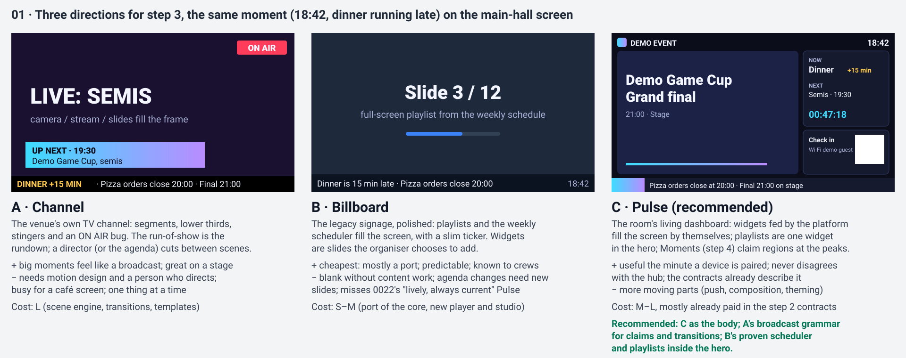

### A · Channel: the venue's own TV channel
The screen is a broadcast. The run-of-show is the rundown; each segment is a scene (live stream or camera, slides, a bracket), with lower thirds, stingers and an ON AIR bug. A director (or the agenda, on autopilot) cuts between scenes.
- **Attendees:** the peaks feel like watching a stream at the venue; big and exciting on a stage screen, but one thing at a time, so the café screen is busy and the Wi-Fi or the next item is not always there when someone looks.
- **Organisers:** someone has to direct, or trust the autopilot; content must be made as scenes.
- **Venue crew:** a screen per stage, few per venue; the stream and camera sources are the Cast track's, not here.
- **Trade-offs:** strongest at the peaks, weakest at the 95 % of the day that is not a peak. Motion design for every scene type. Leans on Cast (open question in the roadmap) for its best moments.
- **Cost: L.** A scene engine, transitions and a template set on top of everything Pulse needs anyway.

### B · Billboard: the legacy signage, polished
The legacy core, rebuilt on the stack: playlists and the weekly scheduler fill the screen, with a slim ticker. Widgets exist as playlist items the organiser adds.
- **Attendees:** a slide show; reliable, familiar, and only as current as the last slide someone made.
- **Organisers:** every change on the day is a new slide or a ticker line; a delay means editing a slide or living with a wrong one.
- **Venue crew:** the easiest to run; what the legacy crews know.
- **Trade-offs:** cheapest and safest, but it fails the vision: 0022 asks for a screen that is "lively, coherent and always current", which a playlist is not without constant work. The step 2 contracts already describe more than this.
- **Cost: S–M.** Mostly the port of the core, a new player and a new studio.

### C · Pulse: the room's living dashboard
The screen composes itself from what the platform knows: the run-of-show (now, next, countdowns), the venue (Wi-Fi, check-in), the theme, and later games, food and the tournament. Playlists are one widget in the hero; Moments (step 4) claim regions at the peaks. A new event shows a useful screen the minute a device is paired.
- **Attendees:** one glance answers "what is on, what is next, where, and how do I get on the Wi-Fi"; the QR brings the same information to the phone; at the peaks the screen comes alive.
- **Organisers:** they curate instead of producing: set up the run-of-show once, edit it live from a phone, and everything follows (screens, Discord, phones).
- **Venue crew:** pair, assign, watch health; screens move to the next event without being touched.
- **Trade-offs:** more moving parts (composition, push, theming) and more to test; the screen is only as good as the data, so the agenda must be easy to keep right.
- **Cost: M–L**, but most of the design cost is already paid: the screen, theming and agenda contracts of step 2 describe exactly this (regions with roles, widgets with view-models, the composed state, SSE).

## Recommended direction: Pulse, with Channel's finish and Billboard's engine
**C as the body, A's broadcast grammar for the peaks, B's proven scheduler and playlists inside the hero.**

Why, boldly:
1. **Content production is the bottleneck of a volunteer-run event.** A Billboard screen is blank or stale unless someone makes slides; on the day, nobody has time. A Pulse screen is fed by the run-of-show the organisers keep anyway. Target: **a new event's first useful screen in five minutes with nothing uploaded but a logo** ([mockup 17](step-3-screen/17-flow-first-screen.svg)).
2. **One source of truth makes the platform feel polished.** Screen, hub and bot read the same `agenda/now`, so they never disagree. A delay typed on a phone shows "+15 min" on every screen within a second, notifies the people who opted in once, and posts once in Discord.
3. **The peaks need grammar, not a second engine.** Channel's lower thirds, stingers and takeovers become claim templates and steps in the regions Pulse already has. Step 3 builds and tests placement with fixture overrides, so step 4 (Moments) only adds the ranking.
4. **The legacy's best code still does the heavy lifting.** The scheduler, bookmarks, break maths, validators and parsers move over as they are, with their tests as the spec, into the hero's playlist widget.
5. **The contracts already chose it.** Picking B would leave most of the step 2 contracts unused; picking A would add a scene engine nobody has specified.

**Design principles for the step** (proposed for the session to keep, change or drop):
- **Never blank.** Every state has a designed frame: idle, not assigned, offline, refused, archived ([mockup 05](step-3-screen/05-device-states.svg)).
- **Readable from 20 metres.** Big type, few things per region, contrast checked in CI (L7).
- **Fed, not authored.** Widgets fill themselves; hand-made content fills the gaps.
- **Live from a phone.** The things done on the floor are one tap ([mockup 13](step-3-screen/13-crew-remote.svg)).
- **Fail visible, fail graceful.** An outage shows a small mark, not a black screen, and Studio says what to check in plain words ([mockup 16](step-3-screen/16-flow-offline.svg)).
- **Show before it goes live.** Previews for themes, zones and "what plays at…".

## Key flows
Each flow for the user who meets it, with its mockup. Questions that change a flow are named.

### The Pulse screen (attendees)
The main hall in the built-in `pulse` layout: header, a rotating hero (playlist, photo, bracket; empty widgets skipped), the now/next rail with delays, the venue rail with Wi-Fi and the rotating check-in QR, and the ticker.

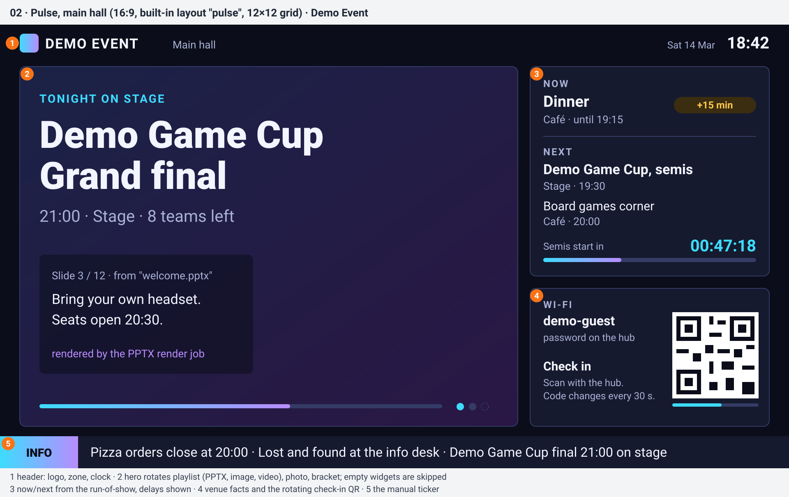

Portrait screens use `pulse_portrait`; a zone changes what each region shows without touching the theme, so the entrance screen puts the check-in QR in its hero (U4, L8).

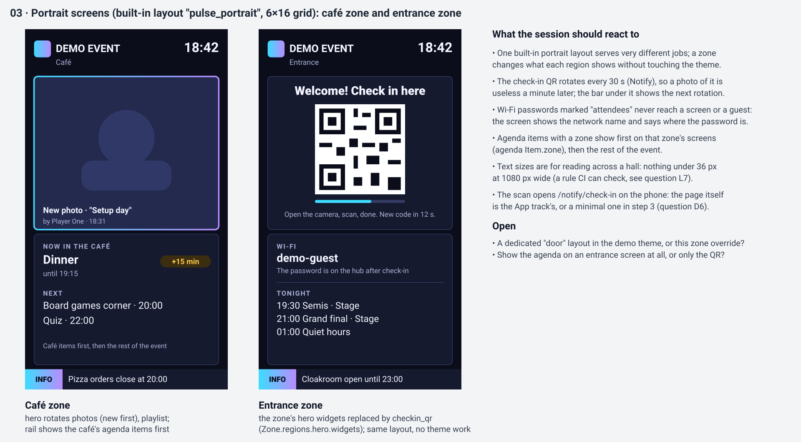

### The peaks: claims (attendees; built in step 3, ranked by Moments in step 4)
An announcement takes the rail, an emergency takes the whole screen, a hot game plays a short sequence in the hero, a match call is an overlay band. Placement is deterministic, so every screen of a zone agrees, and a claim ends on time even if Moments is down (P5).

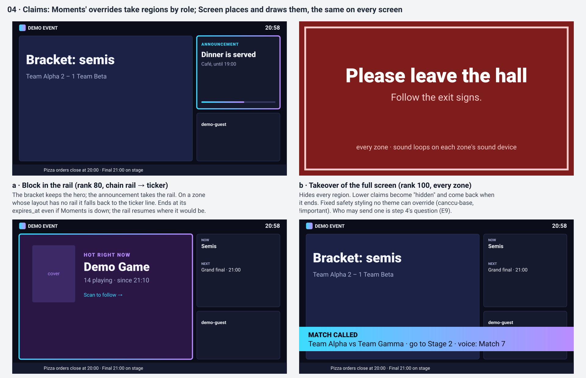

### Pairing a screen (venue crew and an organiser)
Open the start URL on the kiosk, scan or type the code on a phone, name it, pick the zone: the Pulse appears within two seconds. Target: under a minute (U2, U3, D1).

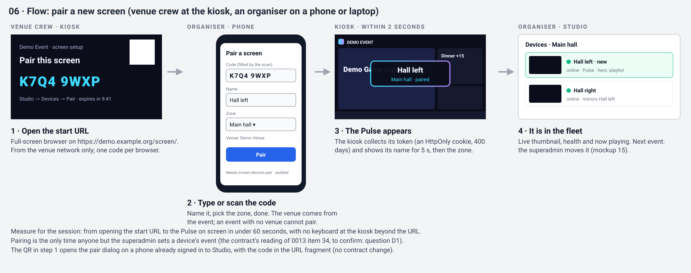

What the kiosk shows in every device state, including a moved device and a refused one (D2, E4):

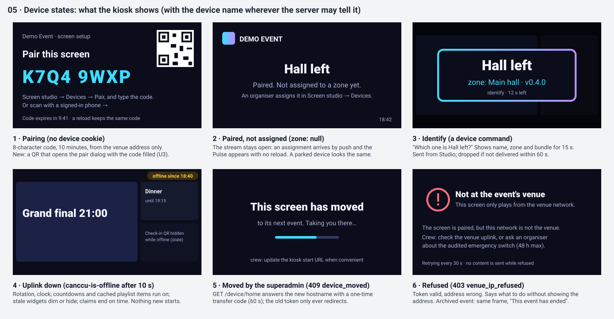

### The first screen in five minutes (organiser)
Brand kit, five agenda items, one paired screen: the Pulse is full with nothing uploaded. With no playlist the hero shows the next item with a big countdown (L2).

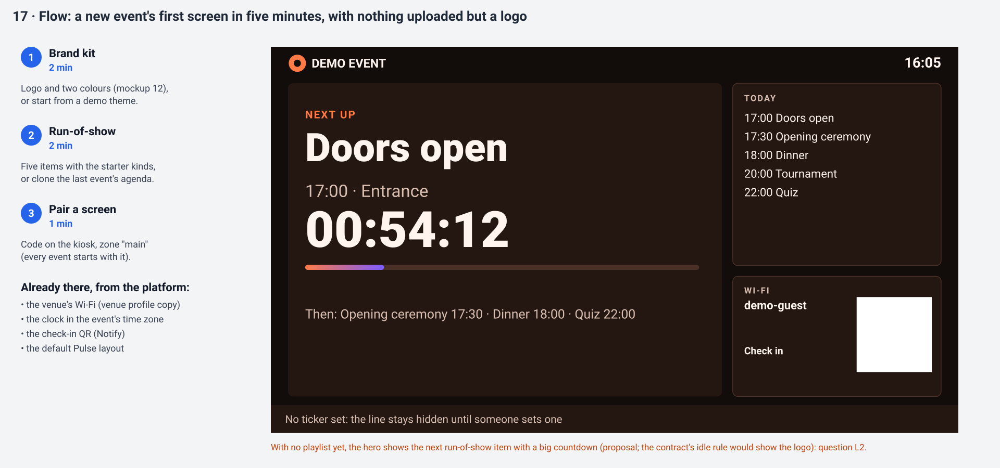

### The brand kit (organiser)
A logo and two colours become the whole look, adjusted for contrast, previewed on the screen, the hub, admin and Discord, then published to every screen by push (L4, L5, D15, D16).

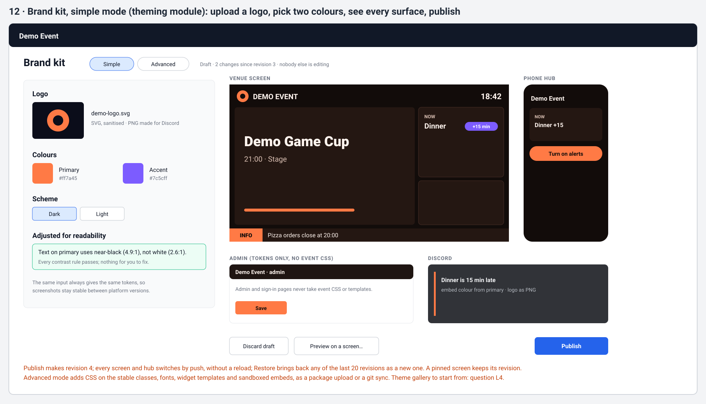

### Running the day: the run-of-show (organiser)
Dinner runs late: delay it by 15 minutes "and everything after it". Before anything changes, the dialog shows which items move, which do not (quiet hours), and who will hear about it (U9, E7).

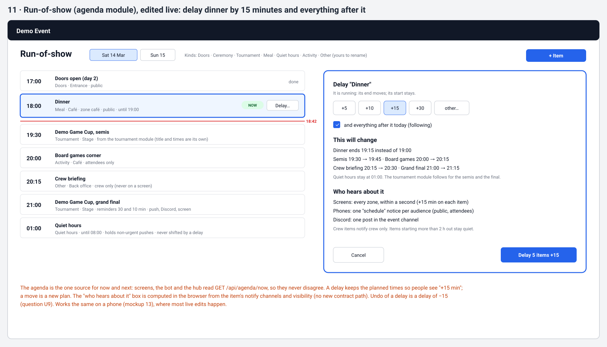

### Running the day: the crew remote (organiser, venue crew)
Studio on a phone: the Live view of every zone, the ticker, and a device that needs help, in plain steps (U1, U7, U8, D7, E2).

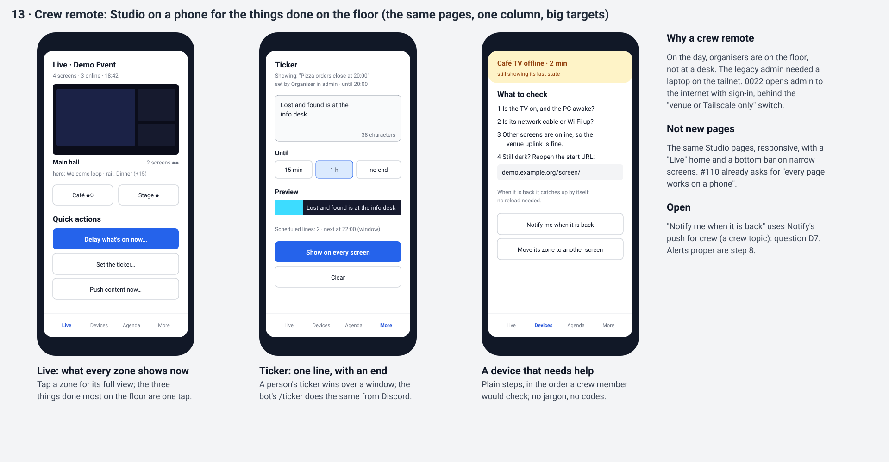

### Watching the fleet (venue crew, organiser)
Devices with live thumbnails, health and now playing, and the actions identify, reload and assign (O4, E2, E3, E10).

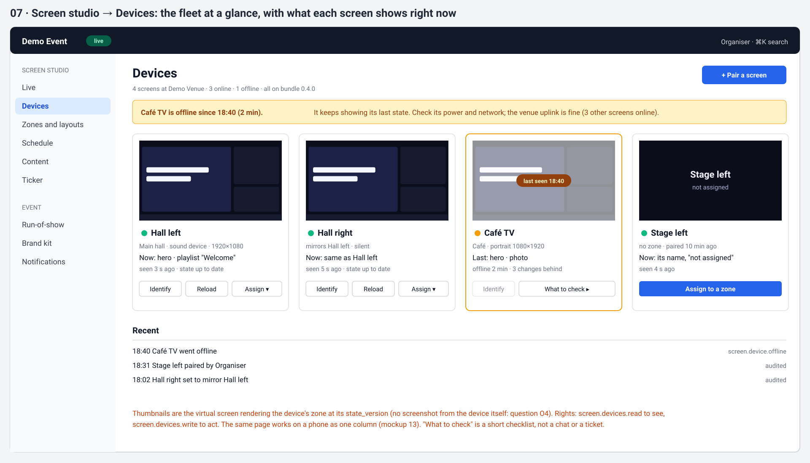

### Composing a zone (organiser)
Pick the layout, choose what each region shows and how it rotates, preview at any time, then go live, with undo (U6, L2).

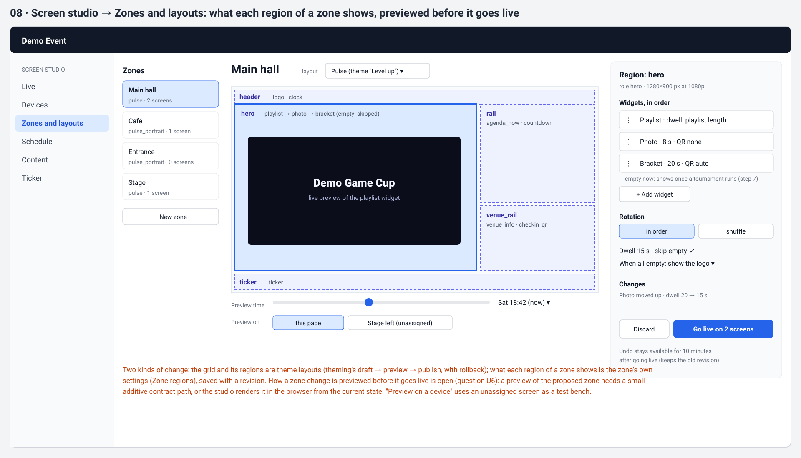

### Planning the week (organiser)
The legacy week calendar on the event's real dates: windows and their winner, windows bound to run-of-show items that move with a delay, breaks, and "what plays at…" (D4, D5, E12).

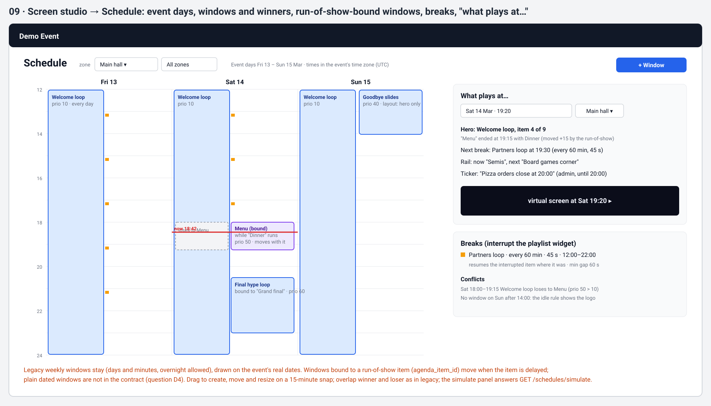

### Content (organiser)
Drop files, watch a deck render slide by slide, build a playlist, push it to every zone until a time (D8, D9, D10, D13, O7, O8).

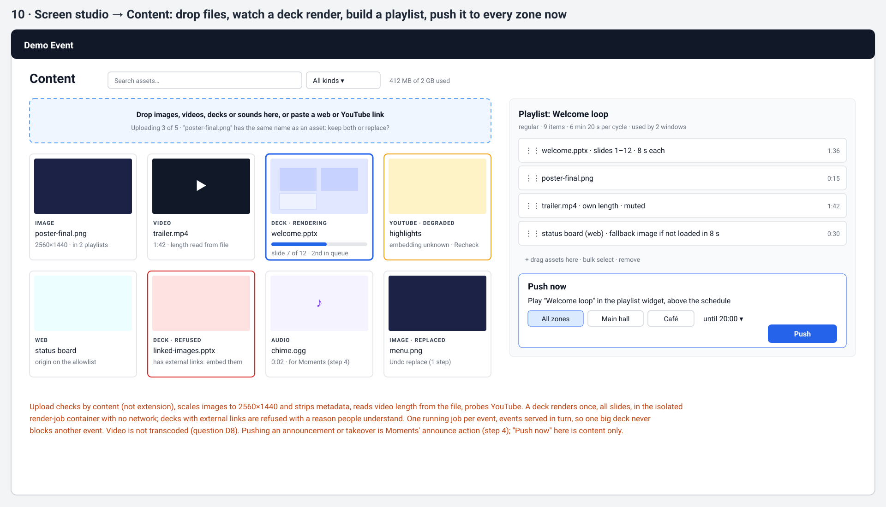

### From the screen to the phone (attendee)
Scan the rotating QR at the entrance, sign in once, checked in; the hub takes over from there (D6, D18).

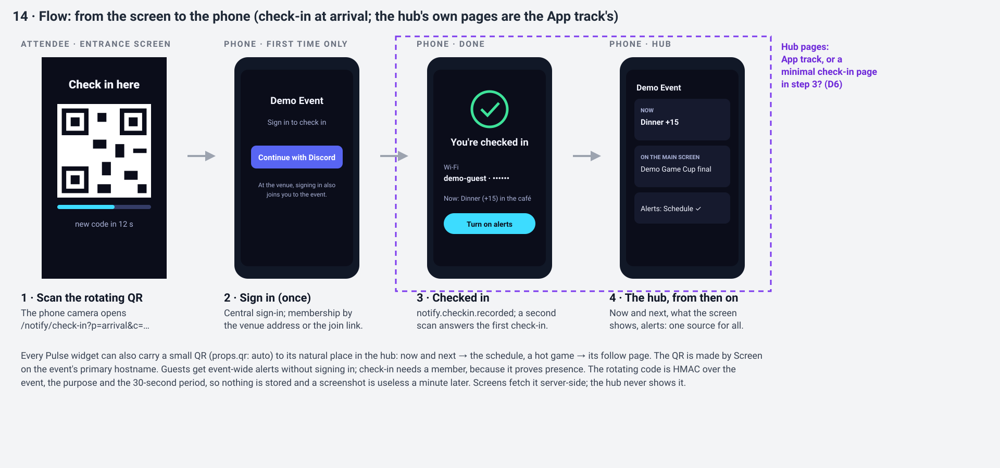

### Handing screens to the next event (superadmin)
Select the venue's screens, move them to the next event at the same venue; kiosks follow by themselves (O6, E8).

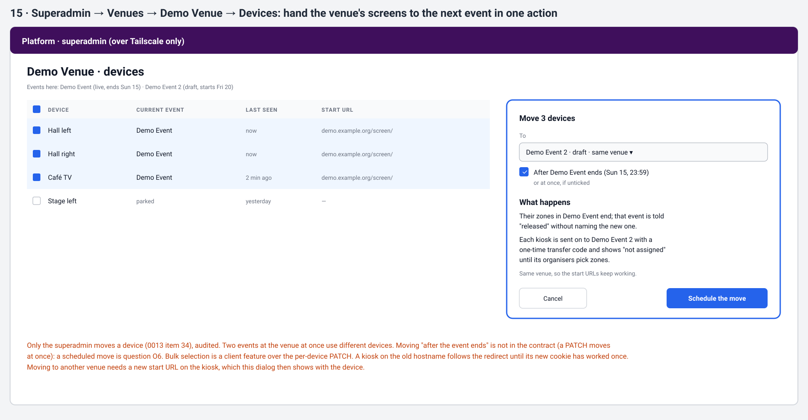

### When the uplink drops (everyone)
Screens play on with a small mark, Studio says "the venue uplink may be down" once, phones on mobile data keep working, and screens catch up when it returns (E2, E11).

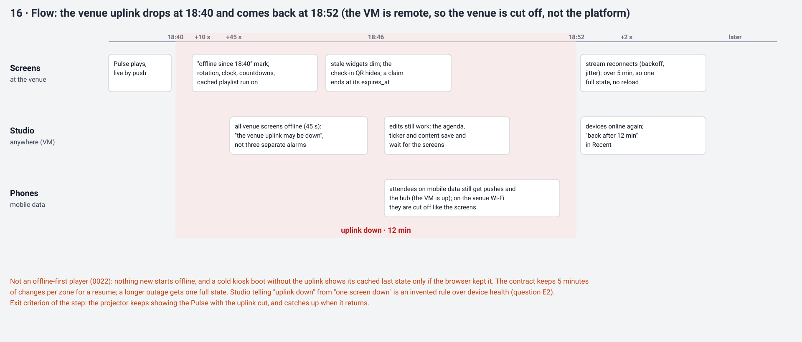

## Port, drop or invent
Verdicts follow [0020](../decisions/0020-best-of-old-freely-new.md) and the [canccusignage port table](../legacy-inventory/canccusignage.md#port-recommendation); this is what step 3 does with each.

### Port as is (code and its tests, with clock, zone and storage injected)
| Legacy | Into | Why |
|---|---|---|
| Scheduler and windows, active-window choice (priority, later start, playlist priority, id; overnight, 24:00) | Screen scheduler | Pure and well tested; organisers know its rules |
| Playback engine, timing, the "elapsed since saved" bookmark maths | Screen scheduler | Pure; the bookmark fixes (double-counted offset, lost slide position) come with it |
| Break (ADVT) window, gap, slideshow maths, seeded shuffle, play-once | `break` playlists | Pure; the play-once and daily-window fixes come with it |
| Playlist, item and schedule validators; duration parsers | Screen API | Pure |
| Upload validation, image normalisation, video length parser, PPTX slide count | Screen assets | Pure or nearly; the huge-photo fix (2560×1440 cap) comes with it |
| YouTube normalisation, oEmbed health, player error rules | Screen assets and player | Pure; the stalled-embed and early-end fixes come with it |

### Port with changes
| Legacy | Change | Why |
|---|---|---|
| Bookmark and session storage | Per tenant and zone in Postgres | One screen by design today |
| Break tick | One server-side tick per zone; reading the state never writes | "Reads that write" was the legacy's worst design flaw |
| Asset catalog, replace and one-step undo | Postgres and the tenant's files, content-addressed | The logic is worth keeping |
| PPTX rendering | The isolated render-job container, whole deck once, fair queue | It ran inside the page request, per slide |
| Web asset allowlist | Per event setting | It was environment config |
| Ready check and fallback | The frame's load event with a timeout and the event's fallback image | The message protocol is dropped (0010) |
| Scene transitions (two slots, load-then-fade, reduced motion) | The player's region transitions | Proven smooth on the venue kiosk |
| Kiosk player (scene slots, audio unlock, retries, draining response bodies) | Rebuilt player keeps these techniques; device token, SSE | The drained bodies fixed a real memory leak |
| Ticker store and appearance presets | Screen's manual ticker and ticker windows (0018) | Kept across restarts now |
| Photo carousel | Screen photos with upload from Studio; the bot feed in step 6 | Per tenant, events instead of a bearer upload |
| Diagnostics and readiness | Device health and the module health check | Per tenant, from heartbeats |
| Admin view-models (week calendar, schedule insights, break overlap, replace plan, status line) | Studio | Pure and tested; only the string-built pages go |

### Rebuild
- **The screen page and snapshot serving** become the composed state and its SSE stream.
- **Device identity and health** (pairing, tokens, the venue check, moving, commands): the legacy had a loopback browser and process memory.
- **The admin pages** become Screen studio: one admin, one look, no native dialogs, works on a phone (N1).

### Drop
| Legacy | Why |
|---|---|
| Polling every second; reads that write | Push and a server-side tick replace them |
| Loopback trust by Host header | Device token plus venue address |
| The screen-embed message protocol, the pages message, the Ready message | Dropped by 0010; frames are sandboxed and silent |
| Baseline web page with auto-registration on read | The LAN display page is step 9; nothing registers itself |
| The stream directive kind | Never built; Cast is its own track |
| Admin password, sessions, login links, control and carousel bearer tokens | Central sign-in and rights |
| Supervisor, systemd, Windows kiosk scripts, backfill CLIs, in-code migrations | Containers, the hosted VM, kit migrations; no legacy data (0004) |
| Trigger settings page | The bot's own settings (step 6) |
| `playback-progress`, `ready-log`, `sound-*` endpoints | The server owns bookmarks; the heartbeat carries errors and sound state |

Moved to step 4 (Moments), not dropped: directives and their ranking, the sound engine and board, spotlight.

### Invent
| New | Where | Why |
|---|---|---|
| Pulse composition: regions with roles, widgets with view-models, server-clock rotation, claims | Screen (in the contract) | The vision's heart |
| Push by SSE with resume, and the composed state | Screen (in the contract) | Always current within a second |
| Zones, mirroring, devices that move between events | Screen (in the contract) | Several screens, several events at one venue |
| The first screen in five minutes: the hero shows the next item when there is no content | Screen (L2) | Useful with nothing uploaded |
| Pairing by QR as well as by code | Studio (U3) | Nobody types at a kiosk |
| Live multi-view of every zone | Studio (U7) | The first place to look on the day |
| The crew remote: Studio on a phone with a Live home | Studio (U1) | Organisers are on the floor |
| The delay dialog's "this will change, who hears about it" preview, and undo | Agenda pages (U9) | Confidence before a change that notifies people |
| "The venue uplink may be down" instead of one alarm per screen | Studio (E2) | Tells the crew where to look |
| "Freeze for the event" | Studio (O5) | No deploy changes a running event's screens unasked |
| Zone preview with real data | Screen contract (U6) | Show before it goes live |
| PDF decks, and font warnings on render results | Screen contract (D9, D10) | Fewer surprises from decks |
| A minimal check-in page | Notify (D6) | The check-in QR works end to end in step 3 |
| A kiosk setup guide and check page | Docs and the player (E1) | The legacy's black and silent screens came from browser flags |
| Accelerated soak, push latency test, a 100-screen load script, a readability check | CI (O1–O3, L7) | Measurable polish |

## The lead's step 2 notes
1. **The three choices from the screen contract** (pairing sets the new device's tenant; the transfer code for moved devices; SSE rather than WebSocket): put to the product owner as D1, D2 and D3, each recommended as written in the contract; D1 also needs an amendment of 0013 item 34 in its own decision PR.
2. **The `checkin_qr` widget** reads Notify's rotating code through `GET /internal/notify/check-in/code` (the path is in the notify contract). Proposed: it ships on the internal network's guard like every internal path today, and moves to the module identity when #157 lands (D12).
3. **The "now playing" board** needs a module identity and a module path in the bot contract: proposed to stay `empty` until the bot (step 6) (D12).
4. **Theming keeps pinned revisions** by following `screen.pin.changed` and reading `GET /api/screen/pin` on start-up: a criterion of the proposed theming issue below.
5. **CI screenshots** `theming-<theme>-<surface>[-<layout>].png` and per widget `theming-<theme>-screen-<layout>-<widget>.png` in `scripts/demo-screenshots`: their own issue after the player, high risk because it touches `.github` (P6), with the readability check (L7).

## Proposed issue changes
For the lead to apply after the session; each assumes the recommendation of the questions it names.

### #107 devices, zones and assignments (keep, high)
- Sharpen pairing to the contract: the 8-character code, 10 minutes, the per-event and per-address limits, the pairing and device cookies.
- Add moving (the superadmin registry), the transfer code and superseded tokens with their tests (D2); parked devices; no dangling references (mirrors and the zone's sound device).
- Add the device commands `reload` and `identify` (stored and expired here; delivered on the stream by #109).
- Move "push content to all zones or one zone" to #108; drop "push an override" (Moments' announce action, step 4).
- Heartbeat and health as in the contract, plus the clock-offset flag (E3) and the shared-token flag (E10).
- Record the three confirmations D1–D3 in the issue.

### #108 content engine (keep, normal; render job moved out)
- Move the PPTX render job to its own issue (P3).
- Replace "dated windows next to weekly ones" with windows bound to run-of-show items (D4), consuming `agenda.*`.
- Add push content (from #107), `break` playlists per zone with their region, simulate, ticker windows, the photos API with upload (D11), the `audio` asset kind, and `pdf` if D9 is taken.
- Add daylight-saving tests for the scheduler (E12) and name each ported legacy module with the tests that come with it.

### #109 Pulse player (keep, normal)
- Fix the push channel to SSE (D3) and remove "SSE or WebSocket".
- Add the composed-state builder, region roles, server-clock rotation, the idle rules (with `next`, L2), and claim placement tested with fixture `moments.override.*` events (P5).
- Name the step 3 widgets: `clock`, `agenda_now`, `countdown`, `playlist`, `ticker`, `photo`, `qr`, `checkin_qr`, `venue_info`, `logo`, `embed`, and the claim templates `announcement`, `match_called`, `winner_card`, `sting`. `hot_game`, `bracket`, `leaderboard`, `food_status`, `stats` and `now_playing` render `empty` until their sources exist.
- Add the device-state frames ([mockup 05](step-3-screen/05-device-states.svg)) and the kiosk check page (E1).
- Replace the 24-hour CI soak with an accelerated soak in CI plus a real 24-hour run on the test VM before the exit (O3); add the push latency test (O2) and the load script (O1).
- Add the service worker for a cold boot offline (E11), if taken.

### #110 Screen studio (split, both high)
- **Studio essentials:** Live multi-view (U7); Devices (pair by code and QR, name, assign, mirror, identify, reload, health, thumbnails, the uplink rule: U3, O4, E2); Zones with preview and undo (U6); Ticker; the phone layout with the Live home (U1); rights and audit on every action; message keys for every string (U11).
- **Studio planning:** the week calendar with simulate; playlists, assets and render progress; push now; pins and "freeze for the event" (O5).

### New issues
| Proposed issue | Risk | From |
|---|---|---|
| `docs(contracts): step 3 additions to the screen contract`: the zone preview path (U6), the idle value `next` (L2), the `pdf` asset kind (D9), `warnings` on render results (D10). Merges first | normal | U6, L2, D9, D10 |
| `docs(decisions): pairing sets a new device's tenant` (amends 0013 item 34) | lead's call | D1 |
| `feat(screen): the render-job container for PPTX and PDF`: isolation (no network, no shared volume, external links refused), fair queue, events, fonts | high | P3, D9, D10 |
| `feat(theming): the theming module`: drafts, the simple-mode brand kit, package upload with every check, publish, restore, the current theme API, pinned revisions kept (`screen.pin.changed`, `GET /api/screen/pin`), the brand-kit pages; git sync and clone later (D14, D15) | high | P1, P4 |
| `feat(theming): custom embeds in the same-host sandbox` | high | D16 |
| `feat(agenda): the agenda module`: items, kinds, live edits with delay and following, the reminder scheduler, the tournament-session mirror on fixtures, the run-of-show pages with the change preview and undo | normal | P1, P4, D17, U9 |
| `feat(notify): the notify module`: topic registry, Web Push, delivery rules, the inbox, DM requests, check-in codes and the minimal check-in page | high | P1, D6, D18 |
| `ci(screen): theming and screen screenshots and the readability check` | high | P6, L7 |

### Order (a sketch for the planner)
1. The contract additions (and the 0013 amendment, if D1 is A).
2. In parallel: theming module; agenda module; #107 devices; notify module.
3. #108 content engine and the render job; theming embeds.
4. #109 the player.
5. Studio essentials and Studio planning; the CI screenshots.
6. The exit: the real 24-hour soak and the exit criteria on the demo tenant, then the health pass and the checkpoint.

Proposed additions to the exit criteria: a new event's first useful screen in five minutes with nothing uploaded but a logo; no blank frame in any device state; push p95 under one second on the demo stack.

## Open questions
All of them are in the [question bank](step-3-screen/questions.md). Decide first: **L1** (the direction), **U1** (who runs the screens), **U6** (zone preview), **L2** (the empty hero), **D6** and **D18** (how much of Notify, and the check-in page), **P1–P3** (the shape of the step's issues), **O3** (the soak test).

## Plan: final plan (after the session)
The outcome of the brainstorming session with the product owner on 2026-11-08, four rounds, with this pack as its agenda. The product owner accepted this plan on the same day. It bounds the step's build: each issue's Room to design is measured against it ([0026](../decisions/0026-briefs-are-research-packs.md)), not against the pack's recommendations above. The research above stays as it was written.

### What the session changed
Every question in the [bank](step-3-screen/questions.md) took its recommendation, except for these changes and additions:
- **A seventh design principle:** check-in is never mandatory (below, and [0027](../decisions/0027-product-decisions-2026-11-07-08.md)).
- **L9, resolutions:** 1920×1080 is the primary target and 3840×2160 proves the future; **nothing below 1080p** is assumed, so 1280×720 is dropped. CI screenshots at 1080p and 4K, landscape and portrait, for the default theme; 1080p for the other themes.
- **New requirement: live schedule editing must be easy, agile and logical.** New things come up during an event and must land in the run-of-show at once (the agenda issue, #187).
- **O6** was explained, not changed: in step 3 the superadmin moves screens to the next event by hand; an automatic move when an event ends may come later.

No mockup changed in the session; the pack's 17 mockups stand.

### Direction
The pack's recommendation, unchanged (L1). **Pulse is the body:** the room's living dashboard, composed from what the platform knows: the run-of-show, the venue, the theme, and later games, food and the tournament.
- **The peaks** borrow Channel's broadcast grammar: lower thirds, stingers and takeovers as claim templates.
- **The hero** keeps Billboard's proven engine inside it: the legacy scheduler and playlists.
- **Target:** a new event's first useful screen in five minutes, with nothing uploaded but a logo.

### Design principles
1. **Never blank:** every state has a designed frame (idle, not assigned, offline, refused, archived).
2. **Readable from 20 m:** big type, few things per region, contrast and size checked in CI.
3. **Fed, not authored:** widgets fill themselves; hand-made content fills the gaps.
4. **Live from a phone:** what is done on the floor takes one tap.
5. **Fail visible, fail graceful:** an outage shows a small mark, never a black screen; Studio says what to check.
6. **Show before it goes live:** previews of themes, zones and "what plays at…".
7. **Check-in is never mandatory:** someone who does not check in on arrival loses nothing public; checking in unlocks the extras.

### Decisions, one line each
**Who uses it and how**
- U1: organisers run the day from phones; a screen person is possible but not required.
- U2: venue screens stay paired across events, with a "screen crew" rights preset.
- U3: pairing uses a code plus a QR.
- U4: one hub QR per screen, plus check-in where a zone wants it.
- U5: Studio opens on Live during an event, on Zones before it.
- U6: zone changes get a true preview (an additive contract path) and a 10-minute undo.
- U7: the Live page shows every zone at once.
- U8: the ticker is set from Studio and the crew remote in step 3; the bot follows in step 6.
- U9: live agenda edits get a 2-minute undo, which says people get notified again.
- U10: no backstage screen yet.
- U11: each event has a language: English first, Finnish in step 10.

**Live schedule editing (new in the session)**
- Quick-add from a phone in a few taps: title; when ("now", "in 30 min", or a time); where; everything else defaulted.
- Move, delay and cancel, with previews of what moves and who is told.
- An optional "show on screens now", with an announcement in the same step.
- Templates for recurring kinds (food, ceremony, game session).

**Look and feel**
- L2: an empty hero shows the next item with a big countdown (idle `next`).
- L3: motion per theme: moderate by default, calm in quiet hours, always reduced-motion aware.
- L4: the demo themes are starting points.
- L5: the organiser picks dark or light; dark by default.
- L6: the platform's mark appears only on the device-state screens.
- L7: readability is checked in CI, with a warning on publish.
- L8: portrait from the start.
- L9: **1080p is the primary target and 4K proves the future; nothing below 1080p** (changed in the session).
- L10: the theme sets the safe inset.
- L11: optional burn-in drift.
- L12: video sound only on the zone's sound device.
- L13: the ticker is a calm fading line.

**Data and integrations**
- D1: pairing sets the device's event (amends 0013, #183).
- D2: moved devices follow by a transfer code.
- D3: push uses SSE.
- D4: windows are weekly or bound to run-of-show items.
- D5: kinds don't switch layouts yet.
- D6: a minimal, optional check-in page ships in step 3.
- D7: crew alerts come in step 8.
- D8: video is MP4 and WebM only.
- D9, D10: decks are PDF as well as PPTX, with font warnings.
- D11: the photo carousel has upload.
- D12: the `checkin_qr` widget reads Notify's code on the internal network's guard until the module identity lands; `now_playing` stays `empty` until the bot.
- D13: web and YouTube assets sit behind a flag and an allowlist.
- D14, D15: clone with an event and theme git sync come later.
- D16: custom embeds ship in step 3.
- D17: the tournament mirror runs on fixtures.
- D18: the whole Notify backend ships in step 3, tested with a fake push service.

**Edge cases and failure**
- E1: a kiosk setup guide and a check page.
- E2: "the venue uplink may be down" detection.
- E3: a clock-drift flag.
- E4: a refused-screen guide; the event admin's audited emergency switch or the superadmin's address update, never a learned address.
- E5: theme restore, plus a required preview for CSS changes.
- E6: a failing playlist item is skipped.
- E7: concurrent edits show who, and merge when they don't overlap.
- E8: archived screens stop.
- E9: emergency takeovers by the event admin, or by the superadmin venue-wide.
- E10: a copied-cookie flag.
- E11: a cold boot offline shows the last state.
- E12: daylight-saving tests.
- E13: with nothing to show, the logo or the event name.

**Operations and scale**
- O1: a CI load script with 100 screens.
- O2: push latency p95 under 1 s, measured.
- O3: a 24-hour soak, accelerated in CI and real on the test VM.
- O4: device thumbnails.
- O5: "freeze for the event".
- O6: manual device moves by the superadmin.
- O7: 2 GB per event.
- O8: a fair render queue.
- O9: safe deploys.

**Plan and scope**
- P1: one issue per new module.
- P2: Studio is split into essentials and planning.
- P3: the render job is its own issue.
- P4: the event pages sit under one "Event" menu.
- P5: claim placement is built in step 3; Moments ranks claims in step 4.
- P6: CI screenshots.

### The final issue set
The pack's [proposed issue changes](#proposed-issue-changes) as the session settled them:

| Issue | Status |
|---|---|
| [#182](https://github.com/Tammilanit/canccuplatform-next/issues/182) docs(contracts): step 3 additions to the screen contract | new |
| [#183](https://github.com/Tammilanit/canccuplatform-next/issues/183) docs(decisions): pairing sets a new device's event | new |
| [#185](https://github.com/Tammilanit/canccuplatform-next/issues/185) feat(theming): the theming module and the brand kit | new |
| [#187](https://github.com/Tammilanit/canccuplatform-next/issues/187) feat(agenda): the run-of-show module with easy live editing | new, with the live-editing requirement |
| [#107](https://github.com/Tammilanit/canccuplatform-next/issues/107) feat(screen): devices, zones and assignments | kept, rewritten |
| [#188](https://github.com/Tammilanit/canccuplatform-next/issues/188) feat(notify): the notify backend and the optional check-in page | new |
| [#108](https://github.com/Tammilanit/canccuplatform-next/issues/108) feat(screen): the content engine: scheduler, playlists, assets, photos and the ticker | kept, rewritten; render job moved out |
| [#184](https://github.com/Tammilanit/canccuplatform-next/issues/184) feat(screen): the render-job container for PPTX and PDF | new |
| [#186](https://github.com/Tammilanit/canccuplatform-next/issues/186) feat(theming): custom embeds in the same-host sandbox | new |
| [#109](https://github.com/Tammilanit/canccuplatform-next/issues/109) feat(screen): the Pulse player with push updates | kept, rewritten |
| [#189](https://github.com/Tammilanit/canccuplatform-next/issues/189) feat(screen): Studio essentials: Live, devices, zones and the ticker | new, from #110 |
| [#190](https://github.com/Tammilanit/canccuplatform-next/issues/190) feat(screen): Studio planning: schedule, content and freeze | new, from #110 |
| [#191](https://github.com/Tammilanit/canccuplatform-next/issues/191) ci(screen): theming and screen screenshots and the readability check | new |
| [#110](https://github.com/Tammilanit/canccuplatform-next/issues/110) feat(screen): Screen studio in admin | split into #189 and #190 |

### Package order (a sketch for the planner)
1. The contract additions (#182) and the 0013 amendment (#183).
2. In parallel: the theming module (#185); the agenda module (#187); devices (#107); the notify module (#188).
3. The content engine (#108) and the render job (#184); theming embeds (#186).
4. The Pulse player (#109).
5. Studio essentials (#189) and Studio planning (#190); the CI screenshots and readability check (#191).
6. The exit: the real 24-hour soak, then the health pass and the checkpoint.

### Exit criteria: what the product owner sees at the checkpoint
- A **1080p and a 4K screen**, landscape and portrait, paired by code or QR, show a **themed Pulse** fed by the run-of-show, with no blank frame in any device state.
- A **new event's first useful screen in five minutes**: brand kit, a few run-of-show items and one paired screen, with nothing else uploaded.
- **Live from a phone:** quick-add an item, delay "dinner" by 15 minutes and everything after it, and every screen shows it in **under 1 second (p95 measured)**. Undo works.
- **Studio essentials:** the Live multi-view, devices with health and thumbnails, zones with preview, the ticker. **Studio planning:** the schedule with "what plays at…", content with PPTX and PDF rendering, and "freeze for the event".
- **Check-in is optional:** the QR check-in works end to end, and nothing public needs it.
- The CI load test (100 screens) and the 24-hour soak (accelerated in CI, plus one real run) pass.
