# Step 4 brief: Moments (research pack)

The research pack for the product owner's brainstorming session on [roadmap step 4](../roadmap.md#4-moments), issue #111. It follows the [outline of a research pack](README.md#outline-of-a-research-pack) and the lead's comments on #111: the research pack for a very heavy, extensive and interactive brainstorming session (2026-11-08), and the design guideline (PO 2026-11-12) that puts scenes, the crew spotlight, cues, reactions, storyboards and announcements in Moments. After this merges, the lead runs the session over as many rounds as it takes, writes the final plan into this brief (`## Plan`) and rewrites the step's issues; the product owner accepts the plan before any build starts.

**In this pack**
- This file: goal, what was read, how others solve it, three directions and the recommended one, the key flows, port / drop / invent, the lead's step 2 notes, proposed issue changes.
- [step-4-moments/questions.md](step-4-moments/questions.md): the question bank, 87 questions in six themes, each with options and a recommendation. IDs (U3, D2, …) are used throughout.
- [step-4-moments/](step-4-moments/): 16 SVG mockups, drawn new, with the demo event only. GitHub shows them inline below.

## Goal
One module decides what the screens show and play, and when: the Moments at the peaks of the event ([0022](../decisions/0022-product-vision.md)). It is built on the legacy directive ranking and sound engine (takeovers, blocks, overlays and the sound budget) and runs on the server, so every screen gets the same thing and a reload loses nothing. One announce action reaches the screen, Discord and the ticker at once; the Discord side lands in step 6 (roadmap step 4).

Exit criterion (roadmap): a test event takes over the screen and plays sound within the budget.

Since the roadmap was written, the accepted design guideline ([docs/design](../design/README.md), PO 2026-11-12) gave Moments more to own ([experience-map.md](../design/experience-map.md#moments-step-4-111-brief-112-engine-113-sound-114-storyboards-115-announce)): **scenes** (the venue's autopilot), the **crew spotlight**, **cues** (a picture plus an optional sound), **reactions** on screen, the **visual heartbeat's rate**, storyboards and announcements. This pack treats that as input to the step, not as settled scope: [P1](step-4-moments/questions.md#p1-the-steps-issue-set) asks how much of it step 4 builds.

## What was read
- **Decisions:** [0022](../decisions/0022-product-vision.md) (vision: the screen is the heart; a director desk later; no cheer meter), [0020](../decisions/0020-best-of-old-freely-new.md) (best of the old, freely new), [0023](../decisions/0023-step-design-briefs.md) and [0026](../decisions/0026-briefs-are-research-packs.md) (briefs), [0010](../decisions/0010-scope.md) (no page embedding, no `postMessage`), [0018](../decisions/0018-ticker-manual.md) (manual ticker), [0027](../decisions/0027-product-decisions-2026-11-07-08.md) (check-in never mandatory), [0029](../decisions/0029-additive-contracts-ship-with-consumers.md) (additive contracts ship with their code).
- **The design guideline:** [docs/design/README.md](../design/README.md) with its two binding amendments (energy levels change the look, never the pace; the six-box dashboard gets more air), [experience-map.md](../design/experience-map.md), [widgets.md](../design/widgets.md), and in `mockups.html` sheet 12 (scenes), sheet 13 (the Director and the crew spotlight), sheet 14 (cues: picture and sound) and sheet 15 (the two backgrounds). Its open questions Q17–Q22 are Moments' and come back in the bank.
- **Legacy inventories:** [canccusignage](../legacy-inventory/canccusignage.md): directives, directive history, scene precedence, spotlight, the sound engine and its triggers, the sound desk, the configuration keys, the known problems (11 and 14 are sound) and the port table; [canccubot](../legacy-inventory/canccubot.md): the announce, clear and reset commands, the trigger settings and the directive labels; from the [summary](../legacy-inventory/README.md): flows 3, 4 and 6 (announcement, hot-game banner, photo spotlight). The legacy sound code itself (`src/lib/sound/categories.ts`, `cues.ts`, `engine.ts`, `catch-up.ts`) for the real categories, priorities, cooldowns and catch-up windows.
- **The step's issues:** #112 (engine), #113 (sound), #114 (storyboards), #115 (announcements), the epic #58, and the lead's two step 2 notes on #111.
- **Contracts it builds on:** [events.md](../../contracts/events.md#screen-overrides) (the Override and `moments.override.*`), [screen.md](../../contracts/screen.md#moments-drive-it-claims) (claims, placement, `steps`, `sound`, `on_end`, the composed state and its push, motion levels and the stage, the heartbeat's `claims_sounded`), [agenda.md](../../contracts/agenda.md) (kinds, `links.moment_id`, `agenda.item.started`, quiet hours), [notify.md](../../contracts/notify.md) (the `announcements` topic, urgent delivery, quiet hours, the hourly cap), [bot.md](../../contracts/bot.md), [theming.md](../../contracts/theming.md) (motion vocabulary), [tenants.md](../../contracts/tenants.md).
- **What step 3 built:** Screen already places claims by rank and degrade chain and reports them (`modules/screen/src/compose/claims.ts`, with tests), plays claim `steps`, ends a claim at its `expires_at` by itself, and computes the motion level from the day's phase. `modules/moments/` is an empty folder.

## How comparable products solve it
| Field | What they do | What we take |
|---|---|---|
| **Broadcast graphics and playout** (template-driven graphics systems, live production switchers) | A rundown of templates; "take" and "clear"; preview before program; lower thirds and stingers layered on top of the main picture | Templates as data; take and clear; a preview before anything goes live ([mockups 05](step-4-moments/05-announce-composer.svg), [10](step-4-moments/10-storyboard-builder.svg)). Not the operator: the run-of-show and the rules do the taking |
| **Theatre and show control** (cue-list playback, lighting consoles) | A cue stack with GO, auto-follow and wait times; scenes with fade times; a "panic" that blacks everything out | Storyboards as cue lists with auto-follow; scenes with hold and blend times (design sheet 12); emergency as the one panic button |
| **Arena and in-venue entertainment** | A goal fires a scripted sequence (sting, replay, sound, scoreboard) on every screen at once; a sound effects library with "don't overplay" rules | Event-triggered storyboards across zones; a sound budget instead of a sound board |
| **Home automation** (trigger → condition → action rules, scenes, blueprints) | Rules anyone can read; scenes as named states; blueprints to start from; a trace of why an automation fired | Scenes with presets (design sheet 12); built-in rules per domain event; **a trace**: the history says why every moment started, what it displaced and how it ended ([mockup 09](step-4-moments/09-history.svg)) |
| **Mass notification and emergency alerting** (severity levels, compose once, many channels) | One composer reaches every channel; levels (info, urgent, emergency); per-channel previews; withdraw | The announcement composer ([mockup 05](step-4-moments/05-announce-composer.svg)): one form, three levels, each channel previewed, edit and withdraw everywhere |
| **Game audio design** (voice limits, priorities, ducking, cooldowns) | One voice per bus, higher priority interrupts, a lower one waits briefly then drops, per-sound cooldowns | The legacy engine already does this: one sound at a time, category priorities, a stale queue, cooldowns ([mockup 13](step-4-moments/13-flow-sound-decision.svg)) |
| **Livestream alerts** (follower alerts with variations, an alert queue, cooldowns, moderation) | Alerts queue so none is lost; variations picked at random; rate limits and word filters on viewer input | Cue pools picked at random, never twice running (design sheet 14); reactions from a fixed set with rate limits ([mockup 15](step-4-moments/15-reactions.svg)) |

The lesson across them: the polished systems **separate deciding from drawing**, **explain what they did**, and **give the operator very few, very safe buttons**. A venue screen at 03:00 has no operator, so the deciding must be automatic and the buttons must be impossible to misuse.

## Three directions
The same moment in each: 21:15, the grand final starts while the crew announces that the pizza is here.

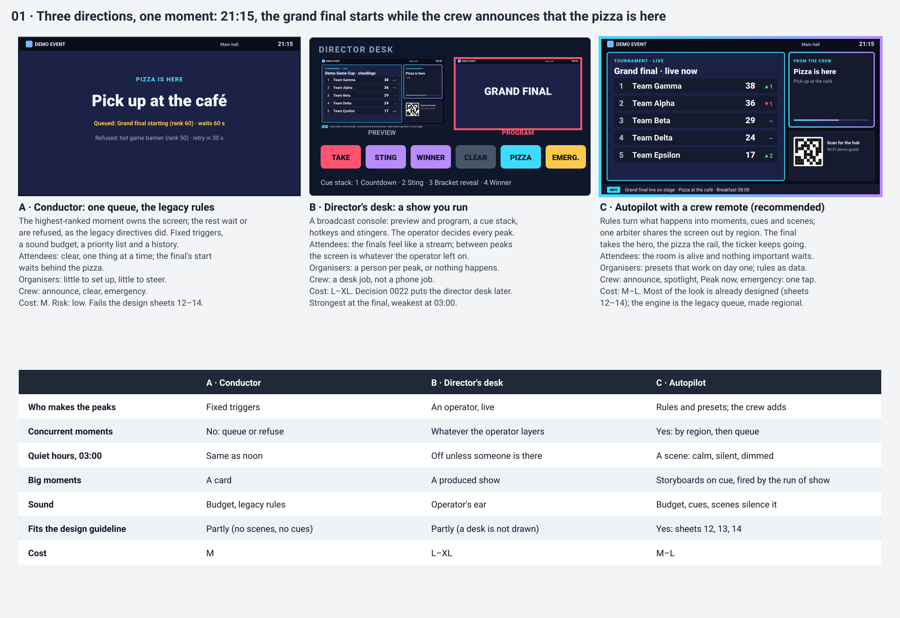

### A · Conductor: one queue, the legacy rules
The legacy directive model, moved to the server and the event: one ranked queue per zone, the highest moment owns the screen, lower ones wait or are refused with a retry, fixed triggers per domain event, the legacy sound engine with its budget.
- **Attendees:** clear, one thing at a time; the final's start waits behind the pizza, and a hot game is refused while anything ranks higher.
- **Organisers:** little to set up and little to steer: a priority list, a few trigger settings, announce, clear.
- **Venue crew:** announce, clear, emergency.
- **Trade-offs:** the cheapest and safest, and it meets the roadmap's words. It ignores what step 3 built (regions, placement by role) and what the design guideline drew (scenes, cues, the spotlight); the screen at the peaks is the legacy's single-slot takeover again.
- **Cost: M.**

### B · Director's desk: a show you run
A broadcast console in admin: preview and program monitors, a cue stack, hotkeys for stingers and storyboards, a person who decides every peak.
- **Attendees:** the finals feel produced, like a stream in the room; between peaks the screen shows whatever the operator left on.
- **Organisers:** a person per peak, or nothing happens; a volunteer-run event rarely has one at 03:00.
- **Venue crew:** a desk job, not a phone job.
- **Trade-offs:** the strongest finals, the weakest everything else; 0022 puts the director desk on the "later" list.
- **Cost: L–XL.**

### C · Autopilot with a crew remote
Moments is the venue's autopilot. **Rules** turn what happens (the run-of-show, domain events, the crew) into **moments** that claim regions, **cues** that touch boxes, **scenes** that set the room's mood, and **storyboards** for the big peaks. One **arbiter** ranks every claim per zone and shares the screen out by region; it queues only when no region of a moment's chain is free. The crew steers from phones: announce, spotlight, fire a storyboard, "Peak now", emergency.
- **Attendees:** the room is alive and nothing important waits: the final takes the hero, the pizza takes the rail, the ticker keeps going; at 03:00 the screen is calm and silent by itself.
- **Organisers:** presets that work on day one (built-in rules, five scene presets, five storyboards, announcement templates); everything is data they can change without code.
- **Venue crew:** one-tap actions that cannot break the screen, because every one of them is a request to the arbiter.
- **Trade-offs:** more to build and to test than A (rules, scenes, cues, three Studio pages), and more to explain, which the history and the On air page answer. Some inputs (presence, games, tournament, pizza) arrive in later steps, so their rules are tested on fixtures here.
- **Cost: M–L.** Much of it is already paid: Screen places claims, plays steps and ends them offline (step 3), and the look is drawn (sheets 12–14).

## Recommended direction: the Autopilot, with the Conductor's engine and the Desk's grammar
**C as the body; A's legacy rules as the arbiter's core (TTL, refusal with retry, revert, history, the sound engine as is); B's grammar (preview, take, test-fire, cue lists) for storyboards and the On air page, with no operator required.**

Why, boldly:
1. **The screen is shared, not owned.** Step 3 made the screen a set of regions with roles. A single-slot queue (A) would throw that away at exactly the moments that matter: two things happening at once is the normal state of a LAN event at 21:00, not the edge case. Sharing by region first and queueing second is the step's core idea ([mockup 02](step-4-moments/02-composition.svg)).
2. **Nobody directs at 03:00.** A volunteer-run event has no show operator most of the time. An autopilot that knows the run-of-show, the hour and the room's activity makes the screen right by itself, and the crew adds the human moments from their phones ([mockup 04](step-4-moments/04-crew-remote.svg)).
3. **Explainable beats clever.** Every decision is written down with its reason: the On air page says what each zone shows and what waits ([mockup 03](step-4-moments/03-on-air.svg)), the history says what displaced what ([mockup 09](step-4-moments/09-history.svg)), the sound log says why a sound did not play ([mockup 12](step-4-moments/12-sound-desk.svg)). An organiser trusts an autopilot they can read.
4. **The legacy engine is good; its shape was not.** Its ranking rules, its sound engine and their tests are the best code in the old repos for this step. What failed was where they ran (in the kiosk, in reads that write, in process memory) and the one-slot model. Moving the rules to the server and making them regional keeps the good and fixes the bad.
5. **The design guideline already chose it.** Sheets 12–14 draw scenes, cues and the spotlight as Moments'; picking A or B would leave the accepted design without an engine.

**Design principles for the step** (proposed for the session to keep, change or drop):
1. **One arbiter.** Everything that claims a screen goes through Moments: rules, people, storyboards, scenes. Nothing else emits overrides (events.md already says so).
2. **Share before you queue.** A moment takes the first free region of its chain; it waits only when none is free, and never longer than its patience.
3. **Autopilot first, crew second, operator never required.**
4. **Subtle but not brief.** Cues move a little and hold long (the design's 60–120 s frame and glow); the pace never changes with the energy level (amendment 1).
5. **Sound is a budget, not a right.** Every sound passes the same gates on the server; the picture plays even when the sound does not.
6. **Explain every decision.** History, On air and the sound log carry a reason for everything that played, waited, was refused or stayed silent.
7. **Safety is simple.** Emergency: one hold to start, one tap to end, nothing outranks it, and every screen comes back as it was ([mockup 07](step-4-moments/07-flow-emergency.svg)).
8. **Rehearse before it is live.** Every moment, storyboard, announcement and priority change has a preview on the virtual screen; storyboards and cues can be test-fired on one zone.

## Key flows
Each flow for the user who meets it, with its mockup. Questions that change a flow are named.

### Composition: many moments on one screen (attendees)
The main hall shows the standings in the hero, the crew's announcement in the rail and the ticker at once; the entrance's portrait screen gets the same announcement as a ticker line; a crew spotlight grows the Dashboard's hero box; an emergency hides everything and gives it back afterwards (D1, D2, E8).

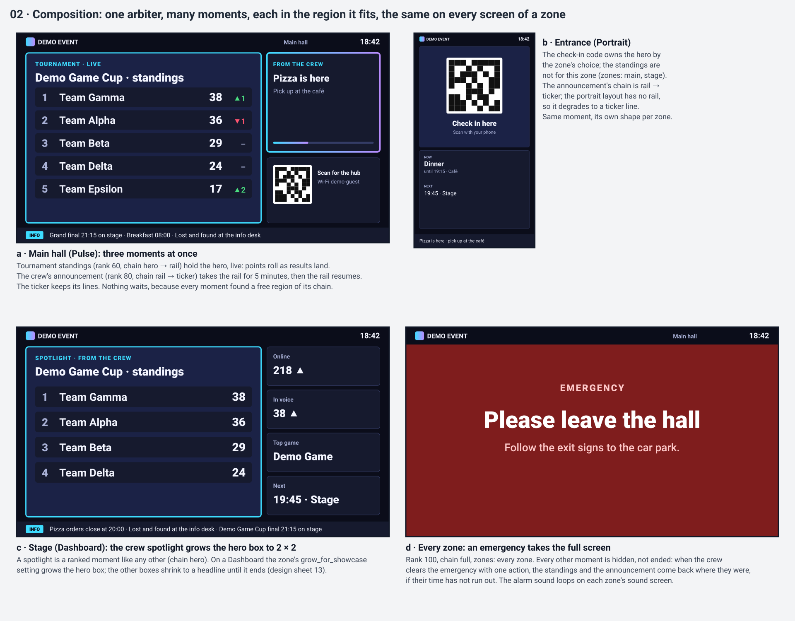

### The life of a moment (everyone, implicitly)
Requested, ranked, then placed, hidden, queued or refused; renewed by a later `expires_at`; ended with a reason; the region resumes. Everything is a row in Postgres, so a restart of Moments loses nothing, and screens end claims by themselves if Moments is down (E1, E2, D3).

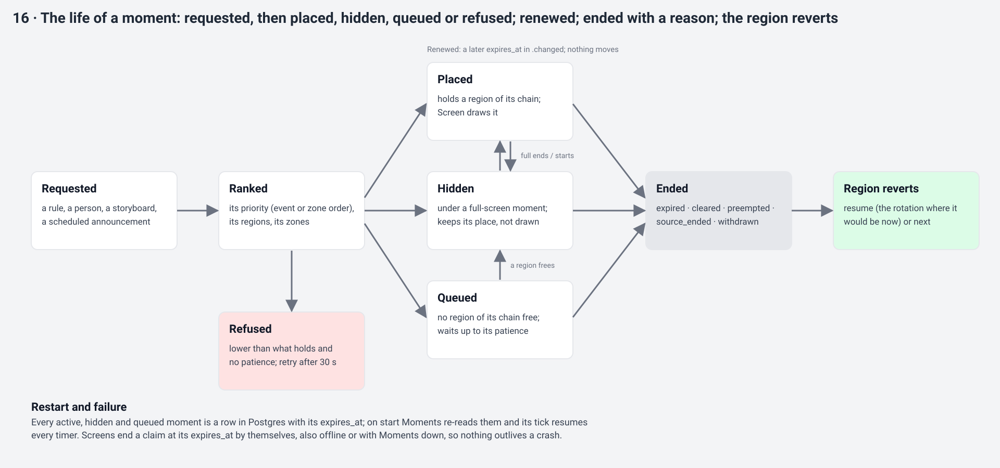

### On air (organiser, crew at a desk)
Studio → Moments opens on On air during the event: a column per zone with what is live, hidden and queued and why; the next two hours of scheduled moments; the crew actions and the emergency button (U9, O5).

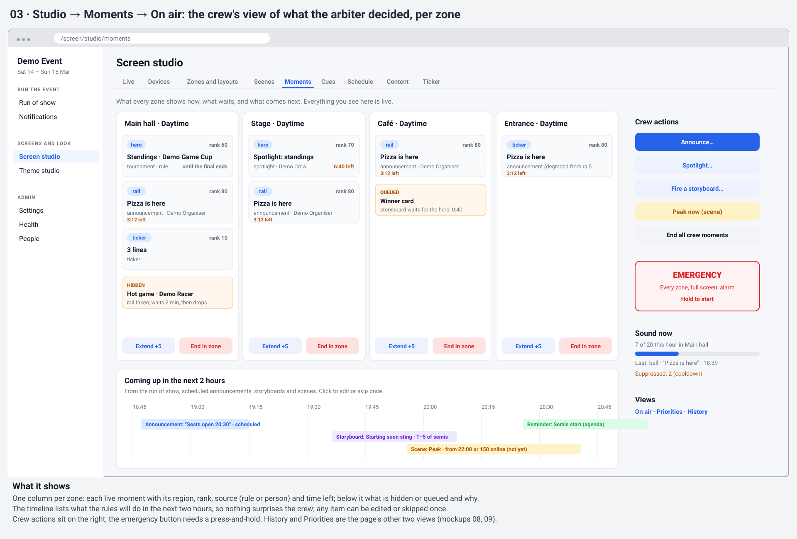

### The crew remote (organiser and crew on the floor)
The phone's Screens tab: what is on air, the four crew moments (announce, spotlight, storyboard, Peak now) and emergency; announce with a template, the channels, a preview per zone, then edit or withdraw while it is live (U1, U2, U6).

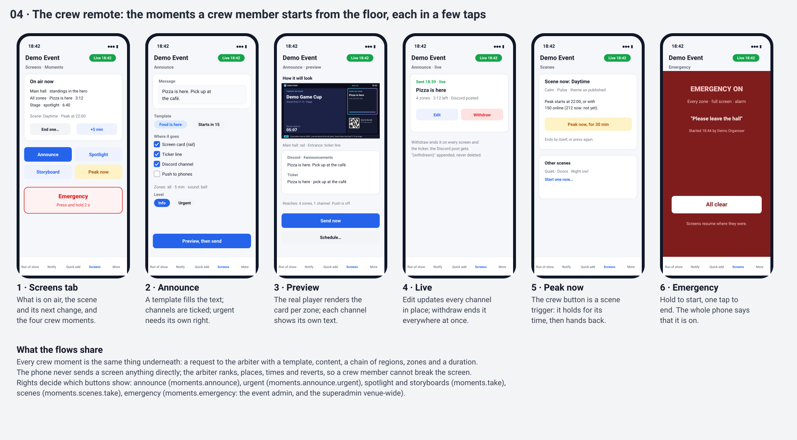

### Announcing (organiser)
One form: a template filled from the run-of-show, the level (info, urgent, emergency), the channels (screen card, ticker line, Discord, push), the zones, and when (now, at a time, or with a run-of-show item, following its delays). A preview with the real player and the event's theme, a preview of each channel, and who will hear about it (U3, U5, D4, D11, D12, D13, E15, E16).

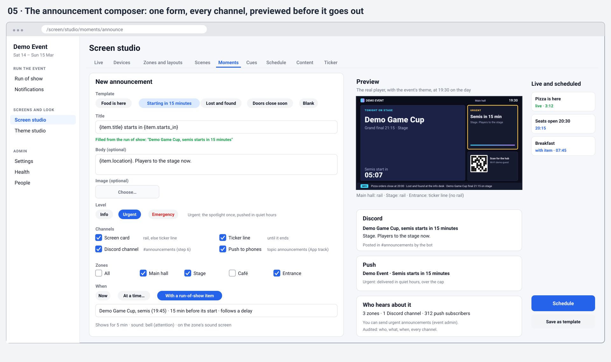

On screen, the three levels, an edit and a withdraw (L2, L3, L13):

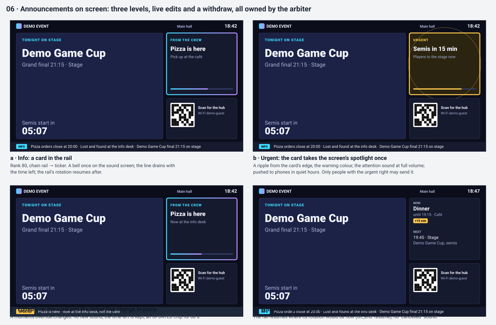

### Emergency (event admin, superadmin)
Hold for 2 s, full screen on every chosen zone with the alarm looping and an urgent push; it survives reloads, restarts and a lost uplink; one tap ends it and every screen comes back where it was (U4, E1, E10).

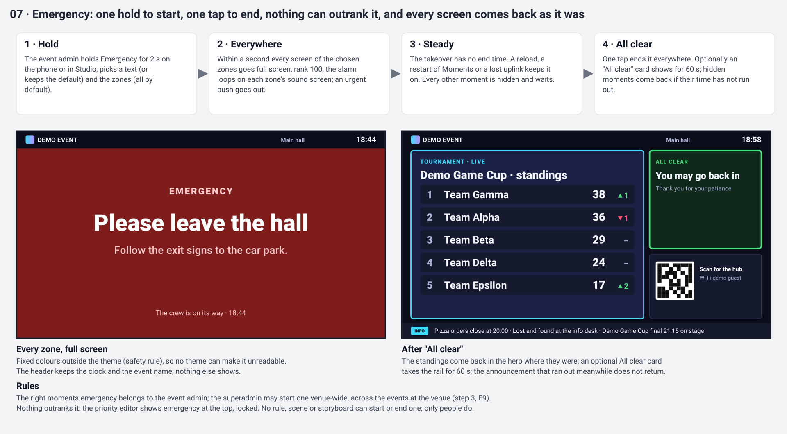

### Priorities (organiser)
The default order ships (emergency > stream > announcement > spotlight > storyboard > tournament > finals > hot game > reactions > ticker); the organiser drags it per event, and per zone where a zone needs its own, and sees a preview of what a zone would show before saving; every change is audited (U9, E8).

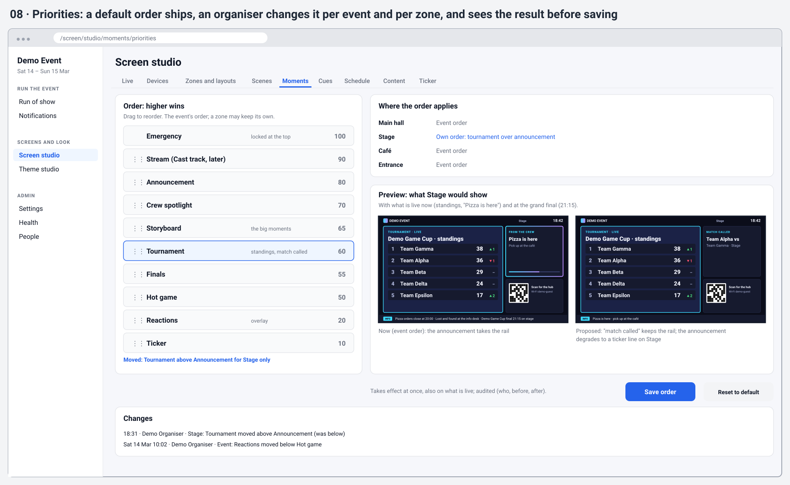

### History (organiser, after the fact)
Per zone, lanes of what held each region, and a table of every moment: why it started, what it displaced and how it ended; filters and an export (D21).

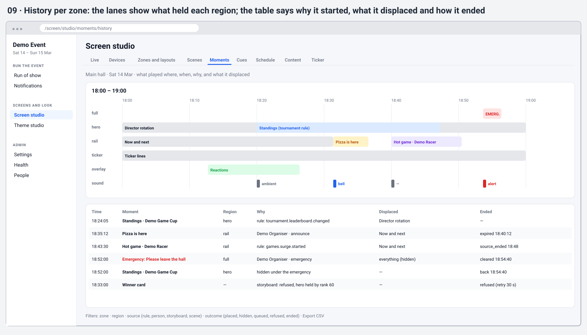

### Storyboards (organiser before the event; attendees at the peaks)
A storyboard is a list of steps (template, content with placeholders, duration, transition, sound), triggered by a run-of-show item, a domain event, a time or a take by hand; preview with a scrubber, test-fire on one zone, and five built-ins to start from (L5, L6, D9, D10, E6).

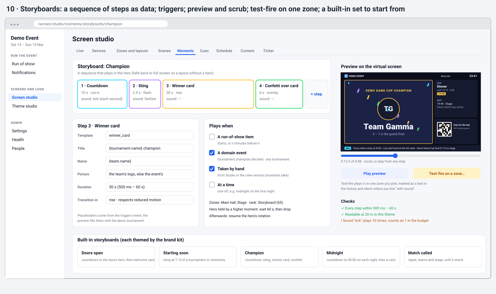

The built-ins on screen: doors open, starting soon, champion, midnight (the fifth, match called, is the design's `match_called` widget with a ripple):

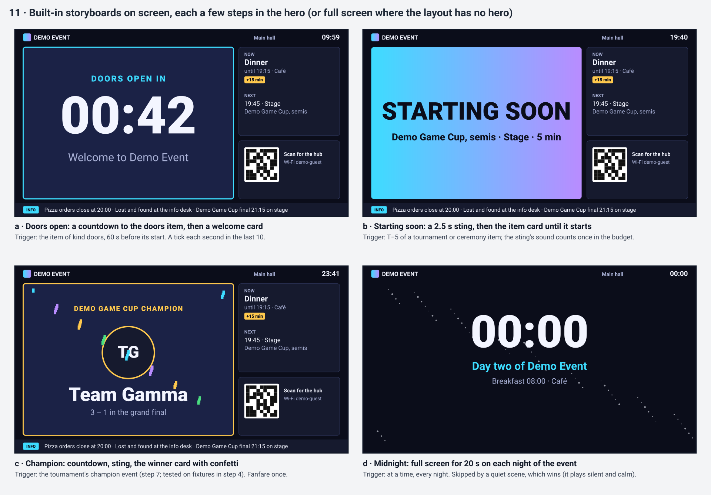

### Sound (organiser, crew)
Per zone, a budget for the hour; the legacy engine's six categories with their sounds, cooldowns and levels; master switch, a timed mute and a sound check; and a log of every decision with its reason (L9, D14–D17, D23, E12, E13). How each sound is decided, on the server, the same on every screen of a zone:

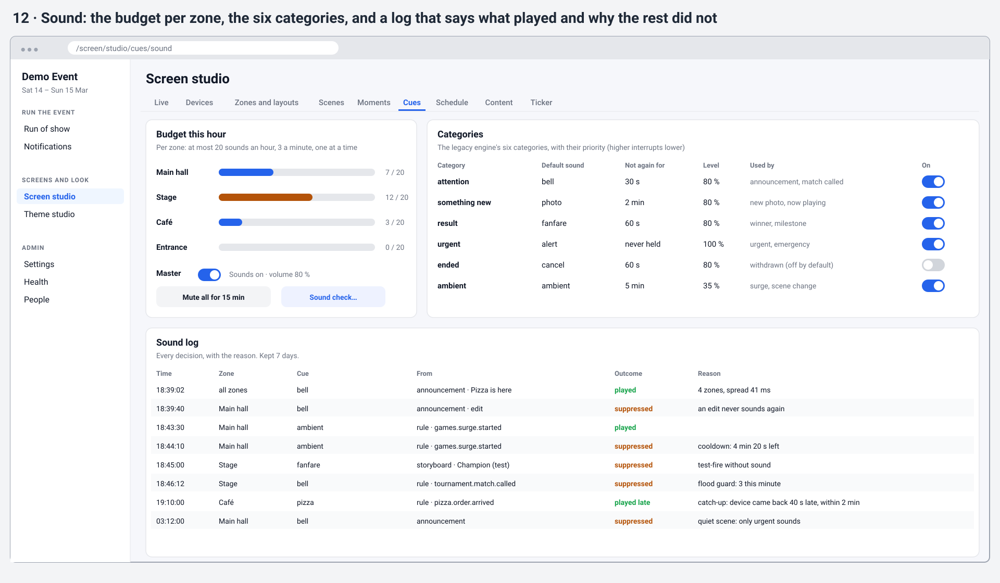

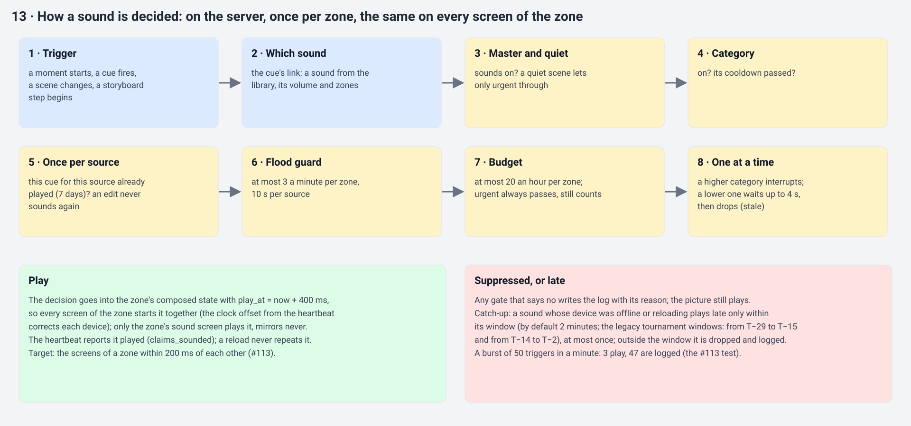

The screen effects of a cue (the pools, the hold time, the random pick) are design sheet 14's "Screen effects" section, unchanged (L7, L8).

### Scenes (organiser before the event; crew on the floor)
Where scenes sit among the other layers, and the scene on the crew remote with the "Peak now" button. The Scenes editor itself is design sheet 12 (D5, D6, L14, E7).

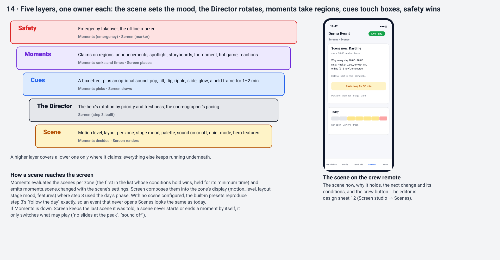

### Reactions (attendees, crew)
A fixed set sent from the hub floats up the large panel's edge, at most one a second per screen, off in quiet scenes, with a crew switch; drawn here so the session can decide whether step 4 builds the Moments side of it or the App track does (P4, D19, O1).

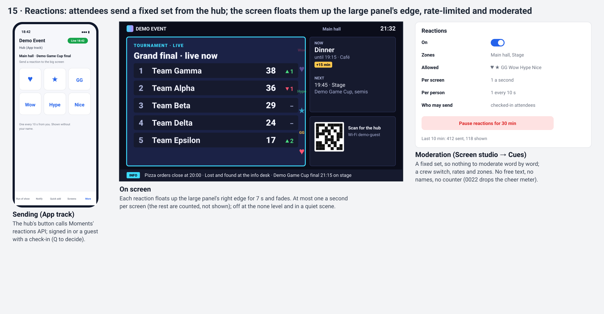

## Port, drop or invent
Verdicts follow [0020](../decisions/0020-best-of-old-freely-new.md) and the [canccusignage port table](../legacy-inventory/canccusignage.md#port-recommendation).

### Port as is (code and its tests, with clock, zone and storage injected)
| Legacy | Into | Why |
|---|---|---|
| Sound engine core (`engine.ts`): one at a time, category priority, dedupe, cooldown, ambient gap, stale queue (4 s), flood guard (per source 10 s, per minute), coalescing (2 s), emergency pre-emption | Moments' sound decision, per zone, on the server | Pure and tested (28 + 25 tests); it was bundled for the kiosk, so it already has no I/O |
| Categories and priorities (`categories.ts`): attention 40, something new 30, result 50, urgent 70, ended 20, ambient 10 | Moments' sound categories | The design's six names (bell, fanfare, alert, pizza, photo, ambient) are sounds; the legacy categories are the right axis for rules ([D16](step-4-moments/questions.md#d16-sound-categories-the-legacy-six-or-the-designs-six)) |
| Catch-up (`catch-up.ts`): a missed pre-start cue plays late within a window, at most once (T−29 to T−15, T−14 to T−2) | Moments' catch-up, generalised to any cue with a window | Pure; 11 tests; its windows become the tournament cues' defaults |
| Once per source (7 days) | Moments, server-side per event | The rule is right; its home (the kiosk's local storage) was wrong |
| Directive ranking rules: rank bands, TTL default 120 s and maximum 7200 s, re-posting the same content extends the TTL, a lower card refused with a 30 s retry, an announcement over a stream becomes an overlay | The arbiter | 10 + 10 tests (`directive-store`, `directive-precedence`); the bands become the adjustable priority list |
| Directive history: set, clear, expire, reject, with actor | The history, plus "displaced" and "why" | 6 tests; the shape is right, the detail grows |

### Port with changes
| Legacy | Change | Why |
|---|---|---|
| Directives: one row per source and label, global | Per event and per zone, in Postgres, several per zone by region | One screen and one slot by design |
| Control API for directives (`POST /api/control/override`, per-sender tokens) | The Moments API with central sign-in and rights; the bot (step 6) calls it as a module | Tokens per sender dropped (0010) |
| Ops directive presets in `/admin/ops` | Crew moments: announce, spotlight, storyboard, Peak now, emergency | The presets were URLs of embedded pages |
| Spotlight (pin one photo full screen; refused while a directive is up) | The crew spotlight: a ranked moment in the hero with live content (standings, bracket, a photo, a message), design sheet 13 | A takeover rather than its own pin (port table) |
| Sound settings, sound log, uploads (MP3 and OGG, length parsers) | Postgres per event; uploads as Screen's `audio` assets; PATCH validated; the log's reasons as codes | Known problem 11: unvalidated PATCH, reasons mixed with sentences |
| Sound board commands (preview, sound check, stop), kiosk presence | Per device on the server, delivered on the screen's stream | They lived in process memory |
| Bot trigger settings (hot-game banner time 120 s and cooldown 900 s, announce default 60 s, poll times) | Moments' rule settings; the bot keeps only its own thresholds | The flow 4 split in the inventory summary |
| Bot `/signage-announce` with `sfx` and duration; clear; reset | The one announce action (#115); the bot's commands call it in step 6 | The roadmap's "grows from today's announce command" |
| The cue-test page | A test fixture that sends synthetic triggers, never a production page | Port table |

### Drop
| Legacy | Why |
|---|---|
| Sound decisions in the kiosk, by diffing successive screen states | The server decides once per zone; every screen of a zone agrees |
| Cue messages from embedded pages (`canccu:screen-cue`), the display page's `view` and `sfx` URL parameters | 0010: no page embedding, no `postMessage` |
| Reads that write: directive expiry, mute timers and catch-up run on every state read | A server-side tick per event |
| Poll directives and their bands (`poll_active`, `poll_result`) | No module plans polls; a band comes back with a module that emits one |
| The stream directive kind | Never built; its rank stays reserved for the Cast track |
| `/admin/triggers` as a page | Rule settings live with the rules (Studio → Moments) |
| The cue-id migration | Nothing is migrated (0004) |
| The ten placeholder sounds (four distinct files copied) | A licensed default pack (L9) |

### Invent
| New | Where | Why |
|---|---|---|
| Regional arbitration: share by region first, queue second, with patience | Moments, with Screen's placement | The step's core idea; the legacy had one slot |
| Scenes, the autopilot, with presets that reproduce step 3's "follow the day" | Moments; Screen renders | Design sheet 12; nobody directs at 03:00 |
| Cues: effect pools picked at random, never twice running, held 60–120 s | Moments picks, Screen draws | Design sheet 14 |
| The adjustable priority list per event and zone, with a preview | Studio → Moments | #112; the legacy bands were constants |
| On air: per zone what is live, hidden, queued and why; the next two hours | Studio → Moments | Explain every decision |
| History with "why" and "displaced" | Studio → Moments | The automation trace |
| The announcement composer: levels, channels, templates, attach to an item, edit and withdraw everywhere | Moments; bot and Notify consume | 0022's one announce action |
| Storyboards as data, with a preview, a scrubber and test-fire | Moments; Screen plays `steps` | #114 |
| Server-side sound sync: `play_at` in the composed state | Moments decides, Screen plays | #113's 200 ms target |
| A sound log with a reason for every decision | Studio → Cues | Known problem 11; explain every decision |
| One-hold emergency with an "All clear" | Moments | Safety is simple |
| Reactions from a fixed set, rate-limited | Moments (if P4 keeps it in step 4) | Design sheet 16 |

## The lead's step 2 notes
1. **Who may mark an announcement urgent** (Notify's urgent exception relies on it): a separate right, `moments.announce.urgent`, granted with the event admin role and grantable to crew; the announce API answers 403 when a request without it asks for `urgent`, and the event carries `urgent` only when the sender held it ([U3](step-4-moments/questions.md#u3-who-may-mark-an-announcement-urgent)).
2. **How an override that held several zones (or `zones: []`) reports a partial end:** when an override leaves only some of its zones, Moments first emits `moments.override.changed` with `zones` narrowed to the explicit list it still holds (also for `zones: []`), then `moments.override.ended` for the zones it left; `.ended` gains an additive `final` boolean, `true` only when the override is gone from every zone. A consumer tells a partial end from a full one by `final` alone ([D3](step-4-moments/questions.md#d3-a-partial-end-of-an-override-that-held-several-zones)).

## Proposed issue changes
For the lead to apply after the session; each assumes the recommendation of the questions it names.

### A contract change that comes first (new, high, if D2 is B)
`docs(contracts): several overrides of a kind per zone`: the event catalog's "at most one override of each kind is active on a zone" ([events.md](../../contracts/events.md#screen-overrides)) forbids two blocks at once, which region sharing needs (standings in the hero and an announcement in the rail are both `block`). Screen already places any number by rank, but a consumer may rely on the guarantee, so lifting it is treated as a breaking change: its own PR, merged first, with the maintainer's accept (AGENTS.md, Contracts). No code; Screen needs no change.

### #112 the Moments engine (keep, rewrite; normal)
- Rename: "the Moments engine: the arbiter, priorities, history, the crew spotlight and emergency".
- **Who places:** replace "the engine places concurrent moments" with: Moments ranks, times, queues and refuses; Screen places (as built in step 3) and reports placement in `screen.claims.changed`, which Moments follows (D1).
- `contracts/moments.md` and `moments.openapi.yaml`, engine part: moment requests, the default priority order, per-event and per-zone orders, patience, refusal with retry, history, the rights; additive to events.md: `.ended`'s `final` and the narrowing rule (D3).
- Persistence: every active, hidden and queued moment in Postgres; a server-side tick owns every TTL and revert; a test proves a takeover reverts on time across a restart (already a criterion; keep).
- Add the **crew spotlight** (design sheet 13): content (standings, bracket, a photo, a message), duration, zones, live updates through `.changed`; the phone flow on the Screens tab.
- Add the **emergency flow** ([mockup 07](step-4-moments/07-flow-emergency.svg)): `moments.emergency`, hold to start, one action to end, the optional "All clear", the superadmin venue-wide.
- Add the pages: **On air**, **Priorities** with the preview (through Screen's zone preview path), **History** with filters and export.
- Add the built-in **rules** for catalog events that already have emitters or provisional contracts (tournament, pizza, games surge), each with on/off, rank, regions, duration and zones (D7, D8); tested on fixture events.
- Keep: "interactive and lively" (QR targets and live data bindings), history, an emergency always wins.

### New: `feat(moments): scenes, the venue's autopilot` (normal)
- Scenes as data (design sheet 12): conditions (time per event day, agenda kind, check-ins, the crew button; presence and games when their emitters land; the outside signal stays planned), changes (motion level, layout per zone, stage mood, palette, sound on or off, quiet mode, hero features), the priority list (first match wins), hold and blend times, five presets.
- `moments.scene.changed` per zone; Screen composes it into `display` where it uses the day's phase today; with no scene configured the presets reproduce "follow the day" exactly, and a CI test proves the two agree (D5, D6).
- The Scenes page in Screen studio (sheet 12), the band chart's data, "Peak now" on the crew remote.
- The visual heartbeat's rate (from check-ins and the agenda now, presence later), drawn by Screen (L10).

### #113 cues and sound (keep, rewrite; normal)
- Rename: "cues: picture and sound, with a budget".
- **Cues:** effect pools per kind of event, a random pick never repeated twice running, the hold time per kind (design sheet 14 "Screen effects").
- **Sound:** the legacy engine ported with its tests (above); categories, cooldowns, flood guard, hourly budget per zone, once per source, catch-up windows; links from any trigger to any sound with volume, cooldown and zones (sheet 14 "Sound").
- The library: uploads as Screen's `audio` assets (MP3 or OGG, at most 10 s), preview, and a licensed default pack covering every built-in moment and storyboard (L9, D23).
- Sync: `play_at` in the composed state; a test on the demo stack shows the screens of a zone start within 200 ms (D14).
- The sound log with reason codes, master switch, timed mute, sound check.
- Keep the test: a burst of 50 triggers in a minute stays within the budget.

### #114 storyboards (keep, sharpen; normal)
- A storyboard compiles to an Override with `steps`; add the additive step field `transition` to the screen contract (D9).
- Triggers: a run-of-show item at its start or n minutes before (the agenda module, which replaces the old #103 reference), a domain event, a time, a take by hand; patience when the region is held (E6).
- The built-in five: doors open, starting soon, champion, midnight, match called. The full set is still designed with the product owner when the package starts.
- Preview with a scrubber on the virtual screen; test-fire on one zone, silent unless chosen, marked as a test in the history.
- CI screenshots of each built-in through `scripts/demo-screenshots.mjs` and its groups file, named as the test (O3).

### #115 the announcement composer (keep, sharpen; normal)
- Event names: `moments.announcement.sent`, `.changed`, `.withdrawn` instead of `announce.*` (D4): the catalog names an event by its emitter.
- Notify's `announcements` topic: owner `moments`, trigger `moments.announcement.sent`, urgent from `data.urgent` (an additive change to notify.md in this package).
- Levels: info and urgent here; emergency hands over to #112's flow. Urgent needs `moments.announce.urgent` (U3).
- The ticker line is a claim in the `ticker` role owned by Moments, not a write to Screen's manual ticker (D13).
- Templates with a fixed set of run-of-show placeholders (D11); attach to an item and follow its delay; an item cancelled withdraws the announcement (E15).
- The composer's home: Run the event → Announcements, plus a quick action on the phone and "Announce this" on a run-of-show item (U5).

### Out of step 4 (proposed)
- **Reactions:** the Moments side waits for the App track's hub, which sends them; designed here (P4). A `Roadmap note:` for the App track.
- **Memories** (named by tenants.md as Moments'): an App track item, not this step (P10).
- **A director desk with preview and program monitors:** later, as 0022 says.

### Order (a sketch for the planner)
1. The contract change above, if D2 is B (merged first, maintainer's accept).
2. #112 the engine.
3. In parallel: scenes; #113 cues and sound.
4. In parallel: #114 storyboards; #115 the announcement composer.
5. The exit on the demo tenant, then the health pass and the checkpoint.

**Proposed additions to the exit criteria:** on the demo tenant, three moments share the main hall at once and the portrait zone degrades the announcement to a ticker line; a priority change takes effect live; an emergency takes every zone and "All clear" brings each screen back as it was; a restart of Moments loses nothing; a burst of 50 triggers stays within the budget and the log says why; the screens of a zone start a sound within 200 ms; the scene presets reproduce step 3's look exactly; each built-in storyboard has a CI screenshot.

## Open questions
All of them are in the [question bank](step-4-moments/questions.md). Decide first: **L1** (the direction), **P1** (the issue set: scenes and cues in step 4?), **D1** (who places), **D2** (the catalog's one-of-each-kind rule), **U1** (who runs Moments on the day), **U3** (the urgent right), **D4** (the announcement event names), **P4** (reactions now or with the hub), **D16** (sound categories).
