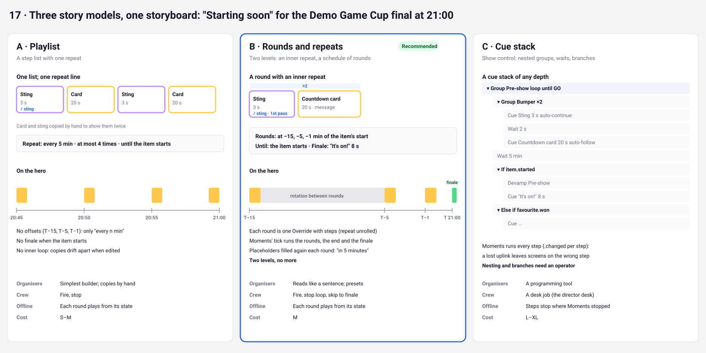
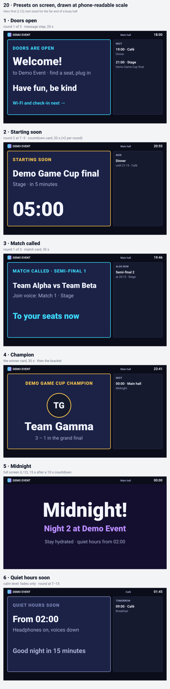
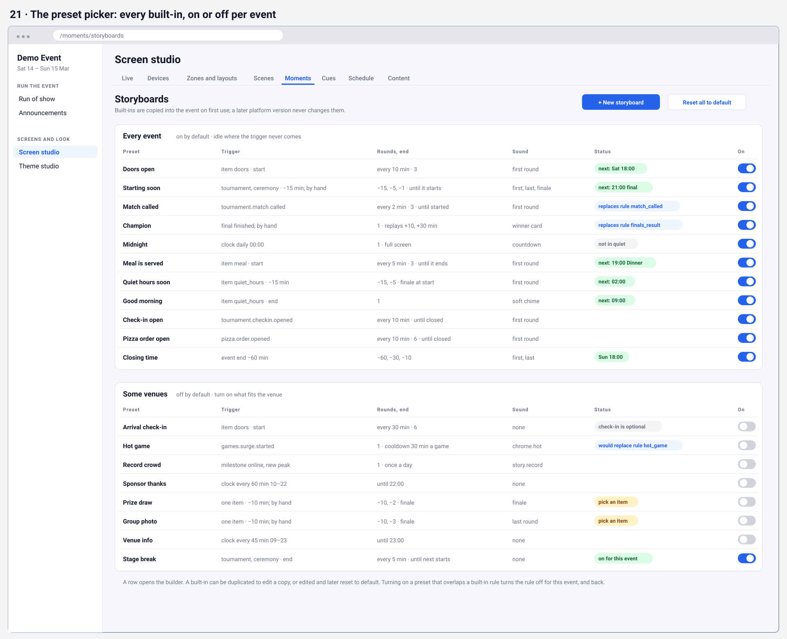
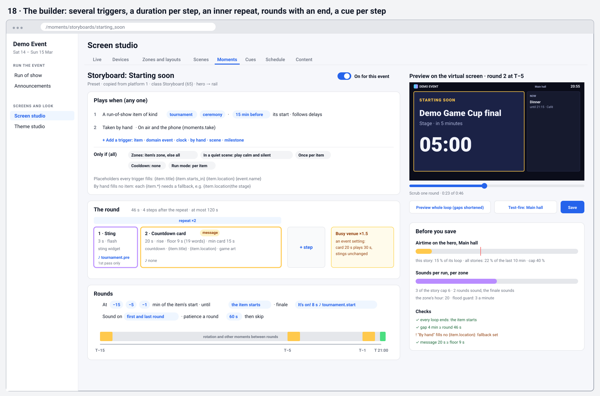
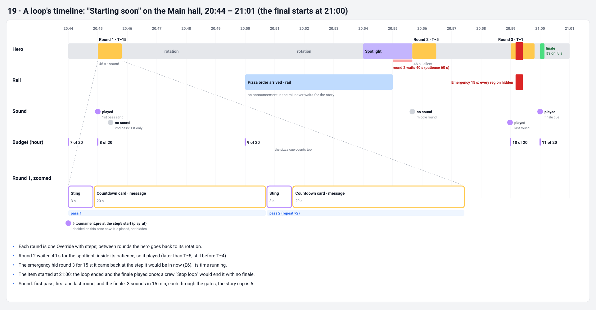

# Step 4 brief: storyboards (research pack)

A research pack for the product owner's brainstorming session on storyboards, issue #596, before #114 is built. It follows the [outline of a research pack](../README.md#outline-of-a-research-pack) for one feature of [step 4](../step-4-moments.md): the step's [Plan](../step-4-moments.md#plan) stands, and this pack only reopens what the product owner asked to rethink on 2026-11-17. After it merges, the lead runs the session over as many rounds as it takes, writes the final plan into this file (`## Plan`) and rewrites #114 from it before it gets `ready`.

**In this pack**
- This file: the goal and the input, what was read, how others solve it, three directions and the recommended one, the trigger, timing and sound models, the preset catalogue, the contract impact, port / drop / invent, the question bank, and the proposed changes to #114.
- Mockups 17–21 in this folder, drawn new with the demo event only. Mockups [10](10-storyboard-builder.svg) and [11](11-storyboards-on-screen.svg) of the step pack stay as they are; 18 and 20 are drawn to replace them if the session takes this pack's recommendation.

| Mockup | Shows |
|---|---|
| [17](17-storyboard-directions.svg) | The three directions, one storyboard ("Starting soon") drawn in each model |
| [18](18-storyboard-builder.svg) | The builder: triggers with their conditions, step durations, an inner repeat and the rounds, a cue per step, the airtime and sound meters |
| [19](19-storyboard-loop-timeline.svg) | One loop's timeline on the main hall: rounds, inner repeats, the rotation between rounds, sounds against the budget, an announcement, an emergency, the end when the item starts |
| [20](20-storyboard-presets-on-screen.svg) | Six presets on screen, drawn at phone-readable scale |
| [21](21-storyboard-preset-picker.svg) | The preset picker: every built-in, on or off per event, grouped as "every event" and "some venues" |

## Goal
Storyboards are the sequences for the peaks of the event (#114): a doors-open welcome, "starting soon" before the final, the champion, midnight. They are data an organiser edits without code, and Moments plays them through the same arbiter, sound gates and history as every other moment.

### The product owner's input (2026-11-17)
- **More presets.** Five built-ins are too few. Not every venue needs every one: where the doors are open all the time, "Doors open" is off. Every built-in is optional per event.
- **Longer holds.** The venue is busy, and people may not look up during a 2–3 s part. A story's content stays up long enough to be seen; consider a minimum time on screen and repeats ("Starting soon" at T−15, T−5 and T−1).
- **Triggers made explicit.** Every trigger kind with its parameters and conditions (zones, scene or energy level, only once, a cooldown), several triggers per story, and how the builder shows them.
- **A length for every part.** Each step has its own duration, which the organiser sets.
- **Loops.** Inner and outer loops, with waits between them and a way to end them: after n rounds, after a time, at a clock time, or when something happens (the item starts, a crew tap). Example: an outer loop every 5 min until the item starts; inside it, the card and a short sting repeat twice.
- **Sound in the story.** Every step can carry a cue (sound and recorded voice line), under the sound model's gates (D16).

Out of scope, as the issue says: code, text to speech (#578), the director desk, a rehearsal mode with a movable clock (U10 B).

## What was read
- **The step 4 Plan and its decisions:** [step-4-moments.md](../step-4-moments.md#plan) and [decisions.md](decisions.md): L5 (the five built-ins), L6 (motion per energy level), L12 (hero first, full screen only where the story says so), E6 (an interrupted story comes back at the step it would be in now), E11 (a quiet scene plays it calm and silent, or skips it), D9 (an Override with `steps`, plus `transition`), D10 (a fixed placeholder vocabulary per trigger kind), D16 (the sound model). The design principles, above all 2 (share before you queue), 4 (subtle but not brief) and 5 (sound is a budget, not a right).
- **#114** as rewritten by the Plan, with the lead's correction from #580 (until scenes land a story reads the quiet state from the day's phase), and mockups [10](10-storyboard-builder.svg) and [11](11-storyboards-on-screen.svg).
- **What is merged:** the engine and arbiter (#112, PR #588), scenes (#582, PR #591), cues and sound (#113, PR #593) and announcements (#115, PR #595), as [moments.md](../../../contracts/moments.md) describes them: classes and ranks (`storyboard` is 65, between the spotlight and tournament), TTL, patience, refusal with retry, revert, the tick (every second), the six sound categories and the gates, cues with several sounds and a voice line, templates with placeholders and free variables, items followed through their delays.
- **What Screen does with `steps` today** ([screen.md](../../../contracts/screen.md#moments-drive-it-claims), `modules/screen/player/src/claims.ts`): it plays the steps in order from the claim's `starts_at` on the server clock, each 500 ms to 60 s, then holds the last step until the claim ends; a hidden claim shows the step it would be in now when it comes back (so E6 already works); a step's `sound` field is in the schema but no player plays it, and sound reaches the screens only as Moments' `moments.sound.played`.
- **The event catalogue** ([events.md](../../../contracts/events.md)) for the domain events a trigger can name, and [agenda.md](../../../contracts/agenda.md) for items, kinds (the starter set `doors`, `ceremony`, `tournament`, `meal`, `quiet_hours`, `activity`, `other`), delays and cancels. The event's own `starts_at` and `ends_at` ([tenants.md](../../../contracts/tenants.md)).
- **How polished products do it** (next section): esports and sports broadcast graphics packages, stadium and arena show control, digital signage playlist schedulers, live show cue stacks, and home automation's trigger model.

Two things in mockup 10 do not survive the merged work: its trigger `tournament.champion.decided` is not in the catalogue (a champion is `tournament.match.finished` of a final, as the `finals_result` rule reads it), and its countdown "tick (each second)" would be ten sounds in ten seconds, which the flood guard (3 a minute per zone) refuses after the third; a countdown is one sound of its whole length.

## How polished products do it
| Field | What they do | What we take |
|---|---|---|
| **Esports broadcast packages** (starting-soon, BRB and break scenes, stingers, lower thirds, sponsor bumpers) | A pre-show "starting soon" scene loops a countdown with sponsor bumpers and highlights for 10–30 minutes; stingers are 1–2 s transitions between scenes, never content of their own; a lower third holds 8–12 s; the same bumper comes round every few minutes | Long pre-show loops with short stings between holds; a sting is a transition, never the message; repeats over minutes rather than one long hold |
| **Sports broadcast graphics** (template playout: take in, continue, take out; a rundown) | Each graphic is a template with fields; a rundown orders them; "continue" steps a multi-part graphic; a graphic stays until it is taken out | Templates with fields (our widgets and placeholders); a step that holds "until taken out" (until the item starts, a crew tap) |
| **Stadium and arena show control** (game-day scripts, timed and triggered segments, a show-control timeline over the board, ribbons and sound) | A minute-by-minute script for the pre-game (T−30 doors, T−10 intros, T−2 anthem) and triggered packages for in-game events (a goal: sting, horn, replay, sponsor); every board plays the package at once; sponsor reads are counted against a contract | Offsets from an anchor (T−15, T−5, T−1) as the outer loop; event-triggered packages across zones; airtime counted, so one package never owns the board |
| **Digital signage schedulers** (playlists with a duration per item, day-parting, plays per hour, interrupt layouts, priority campaigns) | Every item has its own duration; dwell times of about 8–15 s for a message; frequency ("6 plays an hour") rather than one long play; an interrupt campaign returns to the playlist when it ends; share of voice per campaign | A duration per step with a readable minimum; repeats spread over time; the rotation always comes back between rounds; an airtime cap per story and for all of them |
| **Live show cue stacks** (QLab and similar: GO, auto-continue, auto-follow, pre- and post-waits, group cues, loops and devamp, a panic) | A cue list of any depth: groups that fire their children together or in sequence, waits before and after each cue, loops a vamp leaves at the next GO, arbitrary nesting | The vamp idea: a loop that ends when something happens (the item starts, a crew tap), with a finale after it; not the arbitrary nesting, which needs a trained operator |
| **Home automation** (trigger → condition → action, several triggers per automation, run modes single, restart, queued, parallel; repeat count, while and until; wait for a trigger with a timeout) | Any of several triggers starts it; conditions all hold at fire time; a mode says what a second trigger does while it runs; loops end by a count, a condition or a timeout; a trace says why it ran | Triggers OR, conditions AND; a run mode per story; loop ends by count, time, clock or event; the history as the trace |

The lesson: the polished systems **hold a message long and repeat it over minutes** rather than flash it once, **keep stings as transitions**, **let a loop end when the moment it waits for arrives**, and **count airtime** so no package owns the screen. The cue stacks show the cost of unlimited structure: power that needs an operator, which a volunteer-run venue at 03:00 does not have (principle 3).

## Three directions
The same storyboard in each: "Starting soon" for the Demo Game Cup final at 21:00 on the main hall, the product owner's example (an outer loop every 5 minutes until the item starts; inside it the card and a short sting twice).

### A · Playlist: a step list with repeats
A storyboard is one list of steps, each with its duration and cue. One setting repeats the whole list: "play every n minutes, at most m times, until the item starts". No inner loops; a repeat of the card means drawing it twice in the list.
- **Attendees:** the card comes back every few minutes and holds long enough to read.
- **Organisers:** the simplest builder: a row of steps and one repeat line. The product owner's example needs the card and sting copied twice by hand.
- **Venue crew:** fire and stop, nothing else.
- **Trade-offs:** cheap and very hard to misuse, but the offsets (T−15, T−5, T−1) are not "every n minutes", a finale when the item starts is missing, and copied steps drift apart when one is edited.
- **Cost: S–M.** Each round is one Override with `steps`; Moments' tick starts the next.

### B · Rounds and repeats: two levels, no more (recommended)
A storyboard is a **round** of steps, played by a **schedule of rounds**. Inside a round, any run of neighbouring steps can **repeat** n times (the inner loop). The rounds (the outer loop) come at **offsets** from an anchor (T−15, T−5, T−1) or **every n minutes**, and end by **a count, a time, a clock time or an event** (the item starts, a crew tap, a domain event); an optional **finale** plays once when the loop ends by its event. Between rounds the region goes back to its rotation and to other moments. Two levels and no deeper: every example the product owner gave, and every preset below, fits in two.
- **Attendees:** the message stays up, comes back at the moments that matter, and ends with "It's on!" when it starts; between rounds the screen is the screen again.
- **Organisers:** a builder that reads like a sentence ("every 5 minutes from T−15 until the item starts, play: sting, card, twice"), with the timeline drawn under it; presets start every story.
- **Venue crew:** fire a story, stop its loop, skip to its finale.
- **Trade-offs:** more to build than A (the rounds' schedule, end conditions, a finale), and a story's airtime has to be capped. Deeper nesting, branches and variables are left out on purpose.
- **Cost: M.** A round compiles to one Override with `steps` (its inner repeats unrolled); Moments' tick runs the rounds and the ends, as it already runs TTLs and scheduled announcements.

### C · Cue stack: show control with nested groups
A QLab-like cue stack: cues and groups of any depth, each group firing its children together or in sequence, pre- and post-waits, loops at any level, "wait for event" cues, branches ("if the favourite won"), variables.
- **Attendees:** the richest shows, when someone built them well.
- **Organisers:** the power of a show-control tool, and its learning curve; an error in a nested loop is found live.
- **Venue crew:** a desk job: someone who knows the stack follows it; that is the director desk 0022 puts later.
- **Trade-offs:** Moments interprets every story step by step, sending `.changed` per step, so a crash or a lost uplink mid-story leaves the screens on the wrong step (the player can no longer run it from the state alone); airtime and sound caps are hard to reason about; the builder is a programming tool.
- **Cost: L–XL.**

### Recommended: B, rounds and repeats
1. **Two levels is the shape of the need.** The product owner's example, the stadium pre-game script and the esports pre-show are all "a short package, repeated, on a schedule, until it starts". Nothing in the input or the presets needs a third level; every level more is power a volunteer at 03:00 cannot check.
2. **It keeps the screens honest offline.** A round is one Override with `steps` that the player runs from `starts_at` on the server clock, so every screen of a zone agrees, a reload lands on the right step, and a round ends on time while Moments is down. C gives that up; A and B keep it.
3. **The rotation breathes between rounds.** Rounds release the region, so a looping story never turns the hero into a slideshow of itself: share before you queue holds for stories too.
4. **Placeholders stay fresh.** Each round is filled when it starts, so "starts in 15 minutes" becomes "starts in 5 minutes" without a live binding; the `countdown` widget ticks the seconds itself.
5. **Explainable.** "Round 2 of 3, skipped: the emergency held the main hall" is a history line an organiser reads; a nested stack's state is not.

## The trigger model
A storyboard has **one or more triggers** (any one starts it), **conditions** (all must hold when a trigger fires) and a **run mode** (what a trigger does while the story already runs). The builder shows each trigger as one sentence with its parameters as chips ([mockup 18](18-storyboard-builder.svg)).

### Trigger kinds
| Kind | Fires when | Parameters | Placeholders it fills (D10) |
|---|---|---|---|
| `item` | A run-of-show item reaches its anchor | `match`: `kinds` (one or more of the event's kinds) or `item_id` (one item); `anchor`: `start`, `before` (n minutes, 1–240), `end`, `after_end` (n minutes); follows the item's delays and is withdrawn by its cancel (as announcements do, E15); only public, scheduled items | `{item.title}`, `{item.starts_at}`, `{item.starts_in}`, `{item.ends_at}`, `{item.location}`, `{item.kind}`, `{item.game}` (the game of its tournament session, as the Pulse hero reads it) |
| `domain` | A catalogue event arrives | `type` from a fixed list (below) and its filters (`session.is_final`, a session, a game) | the event's public fields, per type (below) |
| `clock` | A time comes | `once` (a date-time), `daily` (HH:MM on every day of the event, past midnight counting as that night), or relative to the event (`event_start` or `event_end`, plus or minus minutes) | `{now.time}`, `{now.day}` |
| `take` | A person fires it | from the builder, On air or the crew remote (`moments.take`); optional free variables asked at the take (D11's free variables) | the free variables |
| `scene` | A zone enters or leaves a scene | `scene_key`, `enters` or `leaves` | `{scene.name}` |
| `milestone` | A count crosses a value | `count`: arrival check-ins, members online, photos on the wall; `at` (a value) or `new_peak` | `{milestone.value}` |

Every trigger also fills `{event.name}`, `{event.ends_at}`, `{now.time}` and `{now.day}`.

**The domain events a trigger may name** (a fixed list, each with its public fields only; personal fields such as `user_ids` are never readable): `tournament.registration.opened`, `.closed`, `tournament.checkin.opened`, `.closed` (session fields and `closes_at`), `tournament.match.called`, `.started`, `.finished` (session, match, results; filter `session.is_final`), `pizza.order.opened`, `.placed`, `.arrived`, `.closed`, `games.surge.started` (game, players), `screen.photo.added`. Their placeholders: `{session.name}`, `{session.game}`, `{match.label}`, `{match.teams}`, `{winner.name}`, `{winner.names}`, `{winner.points}`, `{checkin.closes_at}`, `{order.target_at}`, `{order.pizza_count}`, `{game.name}`, `{game.players}`, each only where its event carries it.

### Conditions
All must hold when a trigger fires; a fire that fails one is written to the history with the condition ("not fired: the Café is in Quiet").
- `zones`: where it plays (empty: every zone), or `item_zone` (the item's own zone, else every zone).
- `scene`: in one of, or not in one of, the event's scenes; `energy`: at least or at most a motion level.
- `window`: between HH:MM and HH:MM; `days`: which days of the event.
- `once`: per event, per day or per source (the item, the session, the order).
- `cooldown`: at least n minutes since this story last started (per zone).
- `quiet`: `calm` (play calm and silent in a quiet scene, the default, E11) or `skip` ("not in quiet").

### Several triggers, and what fires while it runs
- **Several triggers are OR'ed:** "Starting soon" fires on a tournament item 15 minutes before or by hand; "Champion" on a final finishing or by hand. Conditions are the story's, shared by every trigger.
- **Placeholders across triggers:** the builder offers the placeholders every trigger of the story fills; one that only some fill needs a fallback text (`{item.location|the stage}`), else validation fails (D10 extended, [SD3](#sd3-placeholders-a-story-with-several-triggers-can-fill)).
- **Run mode** (home automation's modes, cut to three): `per_source` (the default: a second fire for the same item, session or order while its run is live is ignored and logged; another source starts its own run, which the arbiter places next to or after the first), `restart` (start again from round 1), `ignore` (one run of this story at a time).

## The timing model
### Step durations
- **Each step has its own duration**, set by the organiser, 1 to 60 s (Screen's 500 ms floor is kept for transitions only; a step that shows text is held longer, below).
- **The last step of a round may hold** beyond its duration: until the round's planned end, until the loop's end event (the item starts), or for a fixed time up to the round's limit. The player already holds the last step until the claim ends, so this costs nothing on the wire.
- **A sting is a transition, not a message:** steps of the `sting` template are 1–5 s and never the only step of a round.

### A minimum time on screen
A busy venue does not look up for 2 s. Three rules, from signage practice:
1. **A readable floor per step:** a step that shows text holds at least 3 s plus 1 s per 3 words, and never under 8 s; the builder shows the floor, warns under it, and cannot go below 3 s.
2. **A message floor per round:** the round's main card (the step marked "message"; by default the longest) holds at least the event's *minimum card time*, 15 s by default, 6–60 s.
3. **Busy venue factor:** an event setting, ×1, ×1.5 or ×2, stretches every step that shows text (never stings). It is how an organiser says "my hall is loud" once, rather than per step.

And **repeats beat length:** a message seen three times at T−15, T−5 and T−1 is seen; one held for three minutes is ignored after the first twenty seconds. The presets use rounds rather than long holds.

### Repeats and loops
- **Inner repeat:** a run of neighbouring steps repeats `times` (2–5). Between passes nothing waits: a wait inside a round is a held step, since the round holds its region until it ends. One inner repeat per round.
- **Outer loop, the rounds:** `offsets` from an anchor (minutes before or after the trigger's anchor: −15, −5, −1) or `every` n minutes (2–120) from the first fire; between rounds the region goes back to its rotation.
- **End conditions** (any one ends the loop): `rounds` (after n, 1–20), `for` (after a time), `until_clock` (at HH:MM), `until_event` (the item starts, the item ends, a domain event, the order closes), `crew` (a person taps "Stop loop" on On air). A loop with no end condition is invalid: every story ends.
- **Finale:** an optional short round (one or two steps) that plays once when the loop ends by its event ("It's on!" when the item starts). It does not play when the loop ends by a count, a time or a crew stop, or when its event comes after the loop already ended.
- **Limits:** a round is at most 120 s after unrolling its repeat, and at most 12 steps; a looping story's gap between rounds is at least its round's length (so it never holds a region more than half of its loop).

### Meeting other moments
| It meets | What happens |
|---|---|
| **A higher moment** takes its region mid-round | The arbiter's rules as they are (E6): the round is hidden or waits with its clock running and comes back at the step it would be in now; a round whose time ran out does not come back. The loop's schedule is not moved |
| **Its region held** when a round is due | The round waits at most its patience (default: a quarter of the gap to the next round, at most 60 s; for a one-round story the class's 120 s), then it is **skipped**, written "round 2 of 3 skipped: hero held by the spotlight". Rounds never stack: a skipped round is not played late |
| **An emergency** (E6, E10) | Everything is hidden; a round due while it runs is skipped; when it ends, the running round comes back if its time remains; the loop goes on by its schedule |
| **A quiet scene** (E11) | Rounds play calm and silent, or are skipped with "not in quiet" (`quiet: skip`); the finale too. Until scenes reach a zone, quiet hours stand for the quiet scene (#580's correction) |
| **An energy level** (L6) | Party and lively: full motion and confetti; calm: fades and the cards only; none: cuts. Durations never change with the level (amendment 1) |
| **Another storyboard** | Both are class `storyboard`; ties go by the later start (Screen's rule), so a new story never cuts off a running one's round: it takes the next free region of its chain, or waits |

### How long a story may hold the hero (share before you queue)
- **Per story:** the gap rule above keeps one looping story under half of its loop's time.
- **For all stories, per zone:** storyboards hold a region at most **40 % of any 10 minutes** (an event setting, 20–80 %). A round that would pass it is deferred to the next minute it fits and skipped if its next round comes first ("airtime").
- **Yield:** when a lower moment of the hero's chain (standings, a hot game) has waited 60 s for a region the story's rounds keep taking, the story's next round waits until that moment has had its place. A rule moment's own patience (120 s) would otherwise run out behind a looping story.
- On air shows each story's airtime in the last 10 minutes; the builder shows a story's own share before it is saved ([mockup 18](18-storyboard-builder.svg)).

## Sound in the story
- **A cue per step**, optional: a step names a cue of the event ([moments.md, Cues and sound](../../../contracts/moments.md#cues-and-sound)), with its sounds (picked at random, never the same twice running) and its recorded voice line, played after the sound. The builder's "+ New cue" makes an event cue named `story.<story>.<step>`, in a category the organiser picks (default `attention`), so every story sound lives in the sound desk and its log like any other.
- **Decided per zone when the step starts:** Moments' tick runs each step's sound through the gates when that step begins on a zone where the round is placed and not hidden, with `play_at` the step's planned start. A hidden or waiting round makes no sound (`suppressed`, reason `hidden`). The step's `sound` field of the Override stays null: it would bypass the gates, and no player plays it.
- **Which pass sounds:** each step's cue plays on the **first pass of an inner repeat only**, and on **the first round only**, unless the organiser chooses "every round" or "last round" ("Starting soon" sounds at T−15 and at T−1, silent at T−5). The finale's cue plays when it plays.
- **The budget and the flood guard count every story sound** as any other: 3 a minute per zone, 10 s per source, the hourly budget per zone. A story's source for the flood guard is its run, so one story never makes two sounds in 10 s. On top, a **story cap**: at most 2 sounds per round and 6 per run per zone; the builder shows a story's sounds per hour beside the zone's budget ([mockup 19](19-storyboard-loop-timeline.svg)).
- **Length:** a cue's sound plus its voice line may run past its step (it plays on); one that would still play when the next step's cue starts makes the builder warn, since the next one waits at most 4 s and then drops.
- **Countdowns:** one sound of the countdown's whole length, never one per second.

## The preset catalogue
Nineteen built-ins, platform data an event copies on first use (O7, as scenes do), each on or off per event. **Every event** presets are on by default and idle where their trigger never comes (no `doors` item, no pizza); **some venues** presets are off by default. The five decided in L5 are reworked for longer holds and rounds. Durations are at the busy venue factor ×1; "msg" marks the round's message step; ⟲2 an inner repeat twice.

| # | Preset | Purpose | Trigger | Round (steps, durations) | Rounds, end | Sound | Default |
|---|---|---|---|---|---|---|---|
| 1 | **Doors open** (L5) | Welcome, Wi-Fi, check in | item kind `doors` at start | sting "Doors are open" 3 s · msg "Welcome to {event.name}" 20 s · venue info (Wi-Fi) 20 s · check-in QR 20 s | every 10 min, 3 rounds | `story.doors` first round | every event; on (off where the doors are always open) |
| 2 | **Starting soon** (L5) | Bring people to the next big item | item kinds `tournament`, `ceremony` at 15 min before; take | ⟲2 [sting "Starting soon" 3 s · msg countdown card with {item.title}, {item.location}, game art 20 s] | offsets −15, −5, −1; until the item starts; finale "It's on!" 8 s | `tournament.pre` first and last round; finale `tournament.start` | every event; on |
| 3 | **Match called** (L5) | Get the players to their seats | `tournament.match.called` | msg match card (teams, voice channels) 30 s | every 2 min, 3 rounds; until `tournament.match.started` of the match | `tournament.start` first round | every event; on |
| 4 | **Champion** (L5) | Crown the winner | `tournament.match.finished` with `session.is_final`; take | sting "And the champion is…" 4 s · msg winner card 30 s · bracket 20 s · photo-wall QR "Share your photos" 15 s | 1 round; replays the winner card alone (20 s, silent) at +10 and +30 min | `tournament.post` on the winner card | every event; on |
| 5 | **Midnight** (L5) | Mark the night, full screen | clock daily 00:00 | countdown 10 s · sting "Midnight!" 4 s · msg "Night {now.day} at {event.name}" 15 s; **full screen** (L12) | 1 round | one 10 s countdown sound | every event; on; `quiet: skip` |
| 6 | **Meal is served** | Food is ready | item kind `meal` at start | sting 3 s · msg "{item.title} is served · {item.location}" 20 s | every 5 min, 3 rounds; until the item ends | `story.meal` first round | every event; on |
| 7 | **Quiet hours soon** | Warn before quiet hours | item kind `quiet_hours` at 15 min before | msg "Quiet hours from {item.starts_at}: headphones on" 20 s | offsets −15, −5; finale "Good night" 10 s at start | soft chime first round; finale silent | every event; on |
| 8 | **Good morning** | Restart the day | item kind `quiet_hours` at end | msg "Good morning" 10 s · today's run of show 30 s | 1 round | soft chime | every event; on |
| 9 | **Check-in open** | Tournament check-in reminder | `tournament.checkin.opened` | msg "Check in for {session.name} until {checkin.closes_at}" 20 s | every 10 min; until `tournament.checkin.closed` | `story.checkin` first round | every event; on |
| 10 | **Pizza order open** | Join the group order | `pizza.order.opened` | msg "Pizza order open · order in the hub" with QR 20 s | every 10 min, 6 rounds; until `pizza.order.closed`; finale "Order closed" 6 s | `pizza.open` first round | every event; on |
| 11 | **Closing time** | Pack up, tidy up | clock `event_end` −60 min | msg "{event.name} ends at {event.ends_at}: pack up, take your trash" 20 s · thanks card 15 s | offsets −60, −30, −10 | soft chime first and last round | every event; on |
| 12 | **Arrival check-in** | Venue check-in by QR | item kind `doors` at start | msg check-in QR "Check in at the door" 30 s | every 30 min, 6 rounds | none | some venues; off (check-in is never mandatory, 0027) |
| 13 | **Hot game** | A game surges | `games.surge.started` | sting "Hot right now" 3 s · msg hot game 30 s | 1 round; cooldown 30 min per game | `chrome.hot` | some venues; off (the `hot_game` rule covers it) |
| 14 | **Record crowd** | Celebrate a peak | milestone members online, new peak | sting 3 s · msg "{milestone.value} of us online" 15 s | 1 round; once per day | `story.record` | some venues; off |
| 15 | **Sponsor thanks** | Thank the sponsors | clock every 60 min, 10:00–22:00 | msg sponsor card (image) 15 s | every 60 min; until 22:00 | none | some venues; off |
| 16 | **Prize draw** | A raffle on stage | one item (`item_id`), 10 min before; take | msg "Prize draw at {item.starts_at} · {item.location}" 20 s | offsets −10, −2; finale "Draw now on stage" 10 s | drum roll on the finale | some venues; off |
| 17 | **Group photo** | Gather everyone | one item, 10 min before; take | msg "Group photo · {item.location}" 20 s | offsets −10, −3; finale 8 s | `story.photo` last round | some venues; off |
| 18 | **Venue info** | Wi-Fi, floor plan, rules | clock every 45 min, 09:00–23:00 | msg venue info 20 s · floor plan 15 s | every 45 min; until 23:00 | none | some venues; off |
| 19 | **Stage break** | "Back at …" on the stage zone | item kinds `tournament`, `ceremony` at end; zone `item_zone` | msg "Back at {next.starts_at}" with the next item 30 s | every 5 min; until the next item on the zone starts | none | some venues; off |

Notes for the session:
- **Rules and presets that overlap:** `match_called`, `finals_result` and `hot_game` are built-in rules (#112) on the same events as presets 3, 4 and 13. Turning a preset on turns its rule off for that event, and back ([SD6](#sd6-a-preset-and-a-built-in-rule-on-the-same-event)).
- **Templates:** most steps use widgets Screen already draws (`sting`, `countdown`, `match_called`, `winner_card`, `bracket`, `hot_game`, `venue_info`, `checkin_qr`, `qr`, `agenda_now`, `photo`). The message cards ("Welcome to …", "Quiet hours from …") need a big title card with a subtitle and an optional image, which no widget is today: `announcement` carries level colours and `sting` is short. [SL3](#sl3-a-title-card-template) proposes one additive `title_card` widget.
- `{next.starts_at}` (preset 19) is a placeholder the `item` trigger would add: the next public item on the zone.
- Sounds named `story.*` are new cues each preset brings in the default CC0 pack (L9).

## The builder
[Mockup 18](18-storyboard-builder.svg): Studio → Moments → Storyboards → one story.
- **Plays when:** each trigger as a sentence with chips ("A **tournament** or **ceremony** item · **15 min before** its start"), "+ Add a trigger", and the conditions under them (zones, scene, window, once, cooldown, quiet).
- **The round:** the steps as cards on a strip, their widths by duration, each with its template, duration (and its readable floor), transition and cue; an inner repeat drawn as a bracket over its steps with "×2"; the message step marked.
- **Rounds:** "at **−15, −5, −1** min · until **the item starts** · finale **It's on!**", drawn as a small timeline with the rotation between rounds.
- **Meters:** the story's airtime per zone and its sounds per hour against the zone's budget, before it is saved.
- **Preview** on the virtual screen with a scrubber over one round, and a **compressed timeline** of the whole loop (gaps shortened) ([SU4](#su4-how-is-a-looping-story-rehearsed)); **test-fire** one round on one zone, silent unless chosen, marked as a test in the history (U10).

## Contract impact
D9 compiles a story to an Override with `steps`. With loops:
- **A round is one Override with `steps`:** its inner repeat is unrolled into the list (at most 12 steps, 120 s), its `expires_at` is the round's end (or the hold's), and Screen plays it from `starts_at` as today, offline too. This fits D9 as decided.
- **The rounds, the waits, the end conditions and the finale are run by Moments**, step by step on its tick, not compiled: each round is a new override of the story's run (`<run id>.r<n>`; the run is one moment row with its rounds), and an end condition ends the live round early with `.ended`, reason `source_ended`. Nothing in the Override needs to know about loops.
- **Sound per step is Moments' `moments.sound.played`,** decided at each step's start; the Override step's `sound` stays null and is not removed (removing it would be breaking).

| Change | Where | Additive or breaking |
|---|---|---|
| The storyboards part of the Moments contract: `Storyboard` (triggers, conditions, run mode, round, repeat, rounds, end, finale, airtime), the paths (list, put, delete, take, stop, reset a preset), the preset catalogue, history actions for rounds | `moments.md`, `moments.openapi.yaml` (a `moments/storyboards.openapi.yaml` part, as announcements did), `contracts/moments/storyboard.schema.json` (D9's JSON schema) | additive |
| `transition` on a Step (D9) | `screen.md`, `screen.openapi.yaml`, `events.md` | additive (already planned) |
| `effect` on a Step, so a cue's picture can play per step | the same | additive ([SD5](#sd5-a-cues-picture-per-step)) |
| A `title_card` widget (`title`, `subtitle`, `image_url`) | `screen.md` and the player | additive ([SL3](#sl3-a-title-card-template)) |
| `story.*` cues in the seed | moments.md's cue seed | additive |
| History rows "round started", "round skipped" with a reason, "loop ended" | moments.md, History | additive |
| An `.ended` reason for a loop's end | none: `source_ended` and `cleared` already say it | none |
| The Step's `sound` | unchanged, unused | none (removing it later would be breaking, in its own PR) |

**No breaking change.** Rights stay as they are: `moments.settings.write` edits stories, `moments.take` fires, stops and skips them (U2).

## Port, drop or invent
| Verdict | What | Why |
|---|---|---|
| **Port as is** | The arbiter's rules for each round (TTL, patience, hidden, revert, E6) and the sound gates for each step | Merged in #112 and #113; a round is a moment like any other |
| **Port with changes** | The legacy tournament catch-up windows (T−29 to T−15, T−14 to T−2) | They become "Starting soon"'s offsets; a round missed by a restart is skipped, not caught up, so a screen never plays T−15 at T−3 |
| **Port with changes** | Announcements' item following (delays move `fire_at`, a cancel withdraws) | The `item` trigger's anchors follow the same agenda Moments keeps |
| **Drop** | A countdown tick per second (mockup 10) | The flood guard refuses it; one sound of the countdown's length |
| **Drop** | `tournament.champion.decided` (mockup 10) | Not in the catalogue; the final's `tournament.match.finished` |
| **Invent** | Rounds with offsets or every n minutes, end conditions, a finale | The product owner's loops; stadium scripts and esports pre-shows |
| **Invent** | A readable floor per step, a minimum card time, a busy venue factor | "Longer holds" |
| **Invent** | Story airtime per zone and a yield rule | Share before you queue, for loops |
| **Invent** | 19 presets, on or off per event, in two groups | "More presets"; each event takes what fits its venue |

## Question bank
Grouped by theme; each with options and a recommendation. IDs are used above and in the session.

### Who uses it and how
#### SU1. Who edits stories, and who fires them?
- **A.** `moments.settings.write` edits; `moments.take` fires, stops a loop and skips to the finale (U2 as it is).
- **B.** A new `moments.storyboards.write` right for editing.
- **Recommendation: A.** No new right; a story is a setting like rules and scenes.

#### SU2. Where does the crew fire, stop and skip?
- **A.** On air and the phone's Screens tab: "Storyboards" lists the ones with a `take` trigger, and each running story with "Stop loop" and "Skip to finale".
- **B.** On air only.
- **Recommendation: A.** The crew is on the floor (U6).

#### SU3. May a take ask for values?
- **A.** Yes: a story's free variables are asked at the take, as the composer asks an announcement's (D11).
- **B.** No: a take only fires.
- **Recommendation: A.** "Prize draw" and "Group photo" need a place or a name filled on the day.

#### SU4. How is a looping story rehearsed?
- **A.** Preview one round with the scrubber, a compressed timeline of the whole loop (gaps shortened to a few seconds) on the virtual screen, and test-fire one round on one zone.
- **B.** Also test-fire the whole loop compressed on one zone.
- **C.** A rehearsal mode with a movable clock.
- **Recommendation: A.** C is out of scope (U10 B); B can come later.

#### SU5. Where do stories live in Studio?
- **A.** Studio → Moments → Storyboards (list, preset picker, builder), with the running ones on On air.
- **B.** In the Screen studio's Moments tab only.
- **Recommendation: A**, reached from both, as Scenes is.

### Look and feel
#### SL1. A minimum time on screen
- **A.** A readable floor per text step (3 s plus 1 s per 3 words, at least 8 s), a minimum card time per round (15 s), and a busy venue factor (×1, ×1.5, ×2).
- **B.** One fixed minimum for every step (10 s).
- **C.** No floor; the organiser decides.
- **Recommendation: A.** It follows the words on the card, and one setting fixes a loud hall.

#### SL2. Repeats or long holds?
- **A.** Presets use rounds (T−15, T−5, T−1) with 15–30 s messages.
- **B.** One long hold (2–3 minutes).
- **Recommendation: A.** Seen three times beats held once; the rotation breathes between.

#### SL3. A title card template
- **A.** One new additive widget, `title_card` (title, subtitle, optional image, the theme's look), for message steps.
- **B.** Reuse `announcement` (level colours) and `sting` (short text) for messages.
- **Recommendation: A.** A story's message is neither an announcement nor a sting; the widget is small and the player already has the parts.

#### SL4. Full screen
- **A.** As L12: the hero, full screen only where the story says so; among the presets only Midnight.
- **B.** Also "Champion" full screen.
- **Recommendation: A**, with B as the organiser's choice per story.

#### SL5. What shows between rounds?
- **A.** The region's rotation, as if the story were not there.
- **B.** A small "Starting in 12 min" chip in the hero's corner.
- **Recommendation: A.** The Pulse hero's `chip` already says what starts next.

#### SL6. Transitions
- **A.** A fixed set (`cut`, `fade`, `rise`, `slide`, `flash`), per step, following the energy level (L6) and reduced motion.
- **B.** Free CSS.
- **Recommendation: A** (D9's `transition`).

### Data and integrations
#### SD1. Where do loops run?
- **A.** A round compiles to one Override with `steps` (inner repeats unrolled); Moments runs the rounds, waits, ends and finale.
- **B.** Everything compiled into one long Override (the gaps as blank steps).
- **C.** Moments runs every step (`.changed` per step).
- **Recommendation: A.** B holds the region through the gaps; C loses offline playback.

#### SD2. Trigger kinds
- **A.** `item`, `domain`, `clock`, `take`, `scene`, `milestone`.
- **B.** A without `scene` and `milestone`.
- **C.** A plus `chain` (after another story ends) and `module` (a module fires a story by key).
- **Recommendation: A.** `chain` is the finale; `module` waits for a module that needs it (the bot's commands in step 6 can use `take`).

#### SD3. Placeholders a story with several triggers can fill
- **A.** Only those every trigger fills, plus a fallback text per placeholder (`{item.location|the stage}`).
- **B.** Only those every trigger fills; no fallbacks.
- **C.** Any; a missing one is left empty.
- **Recommendation: A.** C shows broken text (D10); B makes "Starting soon or by hand" impossible.

#### SD4. Several triggers
- **A.** Any number, OR'ed, with the story's conditions shared.
- **B.** One trigger per story.
- **Recommendation: A.**

#### SD5. A cue's picture per step
- **A.** Yes: an additive `effect` on a Step, so a step's cue can draw its frame and glow.
- **B.** No: the round's first cue only, on the claim.
- **Recommendation: A**, cheap and in the spirit of #113.

#### SD6. A preset and a built-in rule on the same event
- **A.** Turning on a preset turns its rule off for that event, and back; the picker says so.
- **B.** Both run; the arbiter sorts it out.
- **C.** The presets replace those three rules.
- **Recommendation: A.** B doubles the screen and the sound; C leaves events that want the plain card without it.

#### SD7. Run mode
- **A.** `per_source` (default), `restart`, `ignore`.
- **B.** Home automation's four (`single`, `restart`, `queued`, `parallel`).
- **Recommendation: A.** A queued story is one the arbiter already queues.

#### SD8. Clone and versions
- **A.** As scenes: built-ins are platform data an event copies on first use; "reset to default" per preset; clone with an event copies the stories and their on/off (D22, O7).
- **Recommendation: A.**

### Edge cases and failure
#### SE1. A round is due while its region is held
- **A.** It waits its patience (a quarter of the gap, at most 60 s), then is skipped and logged; rounds never stack.
- **B.** It waits until the region frees, however long.
- **Recommendation: A.** A T−15 round at T−4 is wrong information.

#### SE2. An emergency during a loop
- **A.** Rounds due during it are skipped; the running round comes back if its time remains; the loop goes on by its schedule.
- **B.** The loop pauses and shifts by the emergency's length.
- **Recommendation: A.** The item's start does not move for an emergency.

#### SE3. The item is delayed or cancelled
- **A.** Offsets follow the delay (rounds already played stay played); a cancel ends the loop silently with the item named in the history (E15).
- **Recommendation: A.**

#### SE4. Moments restarts mid-loop
- **A.** The run is a row; after the restart the tick starts the round that is due now, skips the ones missed, and the live round's Override was never lost (Screen plays it from its state).
- **Recommendation: A** (E2).

#### SE5. A loop whose end never comes
- **A.** Every loop needs an end condition, and every run ends at the latest 6 hours after it started, logged "ended: time limit".
- **B.** No limit.
- **Recommendation: A.**

#### SE6. A quiet scene during a loop
- **A.** As E11: calm and silent, or skipped with `quiet: skip`; the finale too.
- **Recommendation: A.**

#### SE7. Two stories want the hero at once
- **A.** Both class `storyboard`; the later start wins ties (Screen's rule); the other takes the next free region of its chain or waits its patience.
- **B.** A rank per story.
- **Recommendation: A**, with the airtime cap keeping the sum fair.

### Operations and scale
#### SO1. Airtime
- **A.** Per story, the gap rule (at most half of its loop); for all stories, at most 40 % of any 10 minutes per zone (event setting 20–80 %); a yield to a lower moment that waited 60 s.
- **B.** The gap rule only.
- **Recommendation: A.** Nineteen presets on at once must still leave the screen to the event.

#### SO2. Sound per loop
- **A.** First pass of an inner repeat and first round only, unless chosen; at most 2 sounds per round and 6 per run per zone; every sound counts in the zone's budget.
- **B.** Every pass sounds; the flood guard and budget alone limit it.
- **Recommendation: A.** B lets one story eat the hour's budget.

#### SO3. How many stories may an event have?
- **A.** At most 40 (the 19 presets plus the event's own), each at most 12 steps a round.
- **Recommendation: A.**

#### SO4. Tests that prove it
- **A.** A loop's schedule on a fake clock (offsets, every, each end condition, finale), a skipped round on a held region, an emergency mid-loop, a restart mid-loop, the sound cap, the airtime cap, and a CI screenshot of each preset's message step (O3).
- **Recommendation: A.**

### The package
#### SP1. Does #114 split?
- **A.** Two packages in order: (1) the model, the loop runner and the builder, with the five L5 presets; (2) the other fourteen presets with their cues, sounds and screenshots.
- **B.** One package.
- **Recommendation: A.** Each is close to the 4,000-line limit; the second is mostly data, screenshots and the sound pack.

#### SP2. Which presets ship in step 4?
- **A.** All nineteen.
- **B.** The eleven "every event" ones; the eight "some venues" ones later.
- **Recommendation: A**, in the second package.

## Proposed changes to #114
For the lead to apply after the session; each assumes the recommendation of the questions it names.

**Split** into two packages that merge in order (SP1): #114 keeps the first; the second is a new issue the lead files.

### #114 · feat(moments): storyboards: the model, loops and the builder (normal)
- **Goal:** sequences for the peaks as data an organiser edits without code: several triggers, a duration per step, rounds and repeats with their ends, a cue per step, held long enough to be seen.
- **Criteria:**
  - [ ] The storyboards part of the Moments contract and its JSON schema: triggers (`item`, `domain`, `clock`, `take`, `scene`, `milestone`) with their parameters and the placeholders each fills, conditions, run mode, the round with one inner repeat, the rounds (offsets or every n minutes), end conditions, the finale, the limits; additive Step fields `transition` and `effect` and the `title_card` widget in the screen contract (D9, D10, SD1–SD7, SL3).
  - [ ] A round compiles to one Override with `steps` (its repeat unrolled); Moments' tick runs the rounds, their patience and skips, the end conditions and the finale; a test on a fake clock proves the T−15, T−5, T−1 loop with a finale at the item's start, and a delay and a cancel of the item (SE3).
  - [ ] Timing: a duration per step, the readable floor, the minimum card time and the busy venue factor (SL1); the airtime cap per zone and the yield rule (SO1), tested.
  - [ ] Interruptions: a held region skips a round after its patience (SE1); an emergency skips the rounds due and the live round comes back (SE2); a restart starts the round due now (SE4); a quiet scene plays calm and silent or skips (E11, SE6). Each tested.
  - [ ] Sound: a cue per step decided at the step's start on the zones where the round is placed; first pass and first round only unless chosen; at most 2 a round and 6 a run per zone; a test proves a looping story stays within the cap and the budget (SO2).
  - [ ] The builder (mockup 18): triggers as sentences, the step strip with durations and floors, the repeat bracket, the rounds' timeline, the cue per step and "+ New cue", the airtime and sound meters; preview with a scrubber and the compressed loop; test-fire one round on one zone (SU4). Fire, stop loop and skip to finale on On air and the phone (SU2).
  - [ ] The five L5 presets reworked as the catalogue says, platform data copied on first use, with reset to default and clone (SD8); turning one on turns its overlapping rule off (SD6).
  - [ ] History rows for each round started, skipped (with why) and each loop's end.
- **Out of scope:** the other fourteen presets (the next issue); the director desk; a rehearsal mode with a movable clock (U10 B); text to speech (#578).
- **Risk:** normal: module and UI code, additive contract parts.

### New · feat(moments): storyboards: the preset catalogue (normal)
- **Goal:** the fourteen other presets of the catalogue, on or off per event, so each event takes what fits its venue.
- **Criteria:**
  - [ ] Presets 6–19 as the catalogue says, with their default on or off, as platform data copied on first use.
  - [ ] The preset picker (mockup 21): every built-in grouped as "every event" and "some venues", on or off per event, what triggers it, "idle: no matching item in the run of show", duplicate to edit, reset to default.
  - [ ] The `story.*` cues and their CC0 sounds in the default pack, with their credits (L9).
  - [ ] A CI screenshot of each preset's message step through the demo screenshot scripts and their groups file (O3).
- **Out of scope:** new trigger kinds or template widgets beyond the first package's.
- **Risk:** low to normal: data, one page and screenshots.

**Order:** #114 after the step's merged packages (all of them are merged now); the preset catalogue after #114.

## Open questions
All of them are in the bank above. Decide first: **SD1** (where loops run), **SL1** (the minimum time on screen), **SO1** (airtime), **SO2** (sound per loop), **SD6** (presets and rules), **SP1** (the split).
