# Step 5 brief: Pizza

The research pack for the product owner's brainstorming session on [step 5, Pizza](../roadmap.md#5-pizza) (epic #59), issue #116. It follows the [outline of a research pack](README.md#outline-of-a-research-pack) and the lead's comments on #116 (2026-11-07: the step 2 notes; 2026-11-08: a research pack with every key screen mocked up, a full question bank, and the issues as input). After this merges, the lead runs the session over as many rounds as it takes, writes the final plan into this brief (`## Plan`) and rewrites the step's issues; the product owner accepts the plan before any build starts.

**In this pack**
- This file: goal, what was read, what earlier steps already built, how others solve it, three directions and the recommended one, the key flows, port / drop / invent, the lead's notes, proposed issue changes and exit criteria.
- [step-5-pizza/questions.md](step-5-pizza/questions.md): the question bank, 79 questions in six themes, each with options and a recommendation. IDs (U3, D1, …) are used throughout.
- [step-5-pizza/decisions.md](step-5-pizza/decisions.md): the product owner's answers (2026-11-19), the record behind the [Plan](#plan).
- [step-5-pizza/](step-5-pizza/): 19 SVG mockups, drawn new, with the demo event only (09, 11, 12 and 17 redrawn and 18 and 19 added for the Plan). GitHub shows them inline below. Attendee and holder pages are drawn in the demo theme's "Demo night" colours, as the hub takes the event's theme; organiser pages in the admin look.

## Goal
Players order food together and the crew hands it out, end to end ([roadmap](../roadmap.md#5-pizza)). The roadmap's "In it": the ordering flow, ported as it is (no general service-order engine, [0022](../decisions/0022-product-vision.md)), built on the legacy pizza router and its tests; events `pizza.order.*`; a transaction for claims; a scheduler for reminders. Exit: an order runs end to end and shows on the screen.

The step's three build issues: #117 (the contract and the group-order lifecycle), #118 (reminders, the holder's workflow and crew tools), #119 (the attendee's ordering pages, mobile-first). This pack treats them as input ([P2](step-5-pizza/questions.md#p2-the-issue-set)).

## Plan
The product owner answered every question in the [bank](step-5-pizza/questions.md), plus four money questions (M1–M4) that came from their [notes](#the-product-owners-notes-2026-11-19), on 2026-11-19. The record is [step-5-pizza/decisions.md](step-5-pizza/decisions.md). This plan turns those answers into the step's design and issue set. The product owner accepts it by accepting this PR. It bounds the step's build: each issue's Room to design is measured against it ([0026](../decisions/0026-briefs-are-research-packs.md)), not against the pack's recommendations below. The research below this section stays as it was, apart from short pointers where the answers overrode it.

### What the answers changed
Every question took its recommendation, except these:
- **U5 · B, not A:** venue staff get nothing; the delivery asks for the holder. There is no door helper. The crew can still mark an order arrived from the crew's Food page.
- **D7 · B, not A:** the menu carries an optional price per pizza. With prices, each person has an exact amount as soon as they order; the receipt confirms or corrects it; delivery fees and discounts are split evenly.
- **O1 · A, amended:** plan for parties of up to about 60–70 people, not 2,000 (large events have their own food booths). The conditional updates, idempotency and the outbox stay (E1, E2, E12); the planning for a dinner spike of hundreds goes.
- **M1–M4 (new):** settling goes through the organiser by default, and an event may let holders take payment directly (M1); even shares by pizza count unless exact amounts are known (M2); receipts can be scanned and read by machine, always confirmed by a person (M3); the export for the payment system is a contract part (M4).

And these notes amend a recommendation that was taken:
- **U3:** orders the holder forgot to take through the whole chain close by themselves, as the legacy's did ([Forgotten orders](#forgotten-orders)).
- **U4:** one "Everyone got theirs" button ticks the whole hand-out.
- **U12:** paying the holder directly is an event setting, not an order setting; when it is on, the holder chooses it per order. (M1 says the same.)
- **E4:** when an order stalls, the holder is reminded, then the crew.
- **D10:** the paste-a-text import is replaced by a published menu CSV that anyone can produce, by hand or with an AI tool; an optional AI reader reads menus and receipts from photos, always confirmed by a person.
- **D11:** a pizzeria in the profile has a web page.
- **D8:** answered A in the notes already: the bill total stays, and the organisers settle after the event, now through the payment system (M4).

**Mockups.** Redrawn for the plan: [09](step-5-pizza/09-hand-out.svg) (hand-out with "Everyone got theirs"), [11](step-5-pizza/11-pizzerias-and-menus.svg) (the web page, the menu CSV, the AI read), [12](step-5-pizza/12-daily-record.svg) (each person's amount, the export) and [17](step-5-pizza/17-food-settings.svg) (settling up, the AI reader). New: [18](step-5-pizza/18-scan-receipt.svg) (scanning a receipt) and [19](step-5-pizza/19-order-money.svg) (an order's money for the holder). Every page in them is drawn at 390 px; the organiser pages in the organiser shell of the [step 4 polish](step-4-polish/README.md). The others stand, read with two changes: [10](step-5-pizza/10-crew-food-page.svg) loses its door helper (U5 B), and on [04](step-5-pizza/04-menu-and-add.svg) a menu item shows its price when it has one (D7 B).

### Direction
**C, group order, effortless** (P1), as recommended: the legacy model, kept where it worked and fixed at its edges, with one holder per order and no service-order engine (0022).

### Design principles
The pack's eight, kept; principles 7 and 8 amended.
1. **Under a minute from the QR to a pizza in the order:** one list, one menu, one tap; sign-in once per phone, never a token.
2. **The holder is a volunteer; the app does the work:** counting, reading, reminding, chasing, and now the sums.
3. **A time that holds:** the close time is a promise, with a last call before it; nothing stays open by accident.
4. **Close the loop:** every order ends, and a forgotten one closes by itself.
5. **One truth, many surfaces:** the pages, the screen, Notify and (in step 6) Discord read the same events; nothing polls; one happening has one voice on the screen.
6. **Private by default:** who had what, and who owes what, is for the person, the holder and the crew.
7. **Correct under concurrency, sized for a party:** every step is one conditional update in a transaction, with an idempotency key and an event through the outbox; sized for parties of up to about 70 people (O1).
8. **The platform keeps what each order cost and each person's share, and exports them; no money moves through it.** Still one kind of order, never a generic service flow. This refines [0022](../decisions/0022-product-vision.md)'s "no payments": amounts are tracked, no payment is taken.

### Money: what the platform keeps
- **Per order:** the payer (who paid the pizzeria; the holder by default, always set, U13), the **total** (what the pizzeria was paid, typed or read from a confirmed receipt, M3), the **split** (`exact` or `even`) and **settle to** (`organiser`, or `payer` when the event allows it, M1).
- **Per pizza:** a **price**, from the menu when the item has one (D7 B), snapshotted with the row (D15), and overwritten by a confirmed receipt read or by hand. Own pizza: the base's price plus each topping's. "Other" has no price until someone gives it one.
- **Each person's amount.** Exact when the order's split is `exact`: the person's prices plus their share of the **extras**, where the extras are the total less the sum of all prices (delivery fees add, discounts take away), split per pizza. Even when the split is `even`: the total divided by the order's pizzas, times the person's pizzas, which is how the payment system computes it from `units` (M2). The split is `exact` by default when every pizza has a price, otherwise `even`; the holder can always choose even, and exact needs every pizza priced ([mockup 19](step-5-pizza/19-order-money.svg)). Amounts are rounded to the cent by the largest remainder, so they always add up to the total; ties go in the order of the person's name. A split that would give anyone a negative amount stays even.
- **Who may change it:** the holder until the order is done; the crew (`pizza.order.manage`) at any time. A change after close is audited, and the person is told when their amount changes (U14).
- **Who sees it:** the holder, the crew and the organiser (`pizza.record.read`) see every amount; each person sees their own (U12 A). Amounts and receipts never travel on the event bus: they are in the pizza API only, behind these rights.
- **Paid ticks:** only when an order settles to the payer; a memo for the holder, never a payment (U12).
- **Retention:** amounts, payers and receipts are personal data, in the privacy export and anonymised 12 months after the event (O6); totals and counts stay (0027).

### Forgotten orders
The U3 and E4 notes, on the scheduler of #118. Each time is a per-event setting with the legacy value as its default ([mockup 17](step-5-pizza/17-food-settings.svg)).

| The order is | Then |
|---|---|
| open | last call 10 min before its close time; it closes at the time (auto-close, on by default). With auto-close off, the holder is reminded at +30 and the holder and the crew at +60 |
| closed, not called in | the holder is reminded at +30, the holder and the crew at +60; the holder is released at 2 h and the crew told (the legacy rule) |
| called in, not arrived | "Has order 3 arrived?" to the holder 30 min past the estimate (90 min after call-in without one), then to the crew; it leaves the screen's box after 3 h (U11) |
| arrived, not done | done 2 h after arrival (O7) |
| still not done at the event day's turn (06:00) | "Close forgotten orders" (on by default): an order never called in is cancelled (actor null); a called-in one goes straight to done with reason `timer`, so no "it's here" is sent; the record flags both |

The scheduler emits one `pizza.reminder.triggered` per recipient, with that person's `user_id` (D12); "the crew" means the members who hold `pizza.order.manage`.

### Rights
D5, as recommended. Every right is a `pizza.<right>` string, defined and tested in #117 (P5).

| Right | Allows |
|---|---|
| (the order's holder) | Everything on their own order: close, call in, estimate, payer, arrived, hand-out, done; total, prices, split, settle to, receipts; release |
| `pizza.order.open` | Start an order when "crew only" is set (U2) |
| `pizza.order.manage` | Step in on any order: take over, release, cancel, undo, edit after close, correct the payer, mark arrived; its money and receipts |
| `pizza.menu.write` | Pizzerias and menus: edit, import and download the menu CSV, read a menu photo |
| `pizza.record.read` | The daily record, each person's amount, receipts, and the export |
| `admin.settings.write` | Food settings, including settling up and the AI reader (admin's settings API) |

### Contract part: the export for the payment system
The file in [#633](https://github.com/Tammilanit/canccuplatform-next/issues/633), written into `contracts/pizza.md` by #117 (0029: it ships with the code that writes it). The payment system imports it into one cost pool and splits the pool; settling happens there; the file is the only thing that passes between the two systems.

**Columns.** All ten of #633, with their names and in their order. They are kept because the payment system reads them today and each still says what it holds; `units` stays (not `pizzas`) because it counts any menu item, a kebab as well as a pizza.

| Column | Required | What the platform writes |
|---|---|---|
| `order_id` | yes | The event day and the order's number that day, `2026-11-21-3`. The event day turns at 06:00 in the event's time zone (D4), so a 01:00 order belongs to the night it was in. Never changes; unique in the event |
| `ordered_at` | yes | When the order was called in (`placed`), ISO 8601 with the event's offset |
| `pizzeria` | yes | The pizzeria's name as ordered |
| `payer_nick` | yes | The payer's name (the Person's `name`); always set (U13) |
| `order_total` | yes | The order's total, two decimals |
| `settle_to` | no | `organiser` or `payer`, always written by the platform |
| `nick` | yes | The person's name (the Person's `name`); the payment system matches on it |
| `discord_id` | no | The Person's `discord_user_id`, empty when unknown (E13) |
| `units` | yes | How many items the person has in the order (each pizza row counts one) |
| `amount` | no | The person's exact amount when the order's split is `exact`; empty when it is `even`. An order has it on every row or on none |

**Format,** as #633 decided: comma separator, dot decimals, euros with no sign, UTF-8 without a BOM, a header row, LF line ends, and fields with a comma, quote or line break quoted (RFC 4180). Values are written as they are, with no spreadsheet escaping, since the payment system matches names exactly. This format replaces the legacy bytes (BOM, `;`, decimal comma) that O10 named; the rest of O10 stands (per day and for the whole event, `pizza.record.read`, in the tenant's export).

**Rows.** One per person per order, sorted by `order_id` and then by `nick`. `order_id`, `ordered_at`, `pizzeria`, `payer_nick`, `order_total` and `settle_to` repeat on every row of the order.

**Which orders.** Orders called in, arrived or done, with a total, on the chosen event day or in the whole event. Open, closed and cancelled orders are not in it. An order without a total is left out, and the export names it ([mockup 12](step-5-pizza/12-daily-record.svg)).

**Exact amounts** (#633's question 1). The platform knows them when every item in the order has a price, from the menu (D7 B) or a confirmed receipt (M3); then the split is `exact` unless the holder chose even, and `amount` is filled as [Money](#money-what-the-platform-keeps) says. Otherwise it is empty and the payment system splits by `units`.

**Changes after export** (#633's question 2; U14). The platform allows, audited: the holder and the crew edit pizzas after close; the holder (until done) and the crew change the total, prices, split, payer and settle to; the crew cancels an order that was called in. The platform keeps no "exported" flag: every export holds the current state, and the payment system replaces the rows of an order it already has (#633, section 5). A cancelled order is not in a later export, so the daily record flags every order cancelled after call-in, for the treasurer to remove in the payment system.

**Example** (placeholders only; the orders of mockups 09, 12 and 19):
```
order_id,ordered_at,pizzeria,payer_nick,order_total,settle_to,nick,discord_id,units,amount
2026-11-21-1,2026-11-21T17:20:00+02:00,Demo Pizzeria,Player Two,38.00,organiser,Demo Player,,2,
2026-11-21-1,2026-11-21T17:20:00+02:00,Demo Pizzeria,Player Two,38.00,organiser,Player Five,,2,
2026-11-21-1,2026-11-21T17:20:00+02:00,Demo Pizzeria,Player Two,38.00,organiser,Player Six,,1,
2026-11-21-1,2026-11-21T17:20:00+02:00,Demo Pizzeria,Player Two,38.00,organiser,Player Two,,1,
2026-11-21-3,2026-11-21T18:31:00+02:00,Demo Trattoria,Player Three,54.50,payer,Demo Player,,2,20.00
2026-11-21-3,2026-11-21T18:31:00+02:00,Demo Trattoria,Player Three,54.50,payer,Player Four,,2,17.00
2026-11-21-3,2026-11-21T18:31:00+02:00,Demo Trattoria,Player Three,54.50,payer,Player Three,,1,9.00
2026-11-21-3,2026-11-21T18:31:00+02:00,Demo Trattoria,Player Three,54.50,payer,Player Two,,1,8.50
```

### Contract part: the menu import
A CSV that replaces the paste-a-text import (D10), written into `contracts/pizza.md` by #117. It is meant to be produced by anyone: typed by hand, exported from a spreadsheet, or made by any AI tool from a photo or a web page, given this section as the instructions.

| Column | Required | Meaning |
|---|---|---|
| `pizzeria` | yes | The pizzeria's name. Rows with the same name (any case) are one pizzeria; an existing pizzeria of the event is matched by name, otherwise one is added |
| `phone` | no | The pizzeria's phone number |
| `website` | no | The pizzeria's web page, an `http` or `https` URL (D11 note) |
| `service` | no | `delivery` (when empty) or `takeaway` (D6) |
| `kind` | no | `item` (when empty), `base` (the own pizza's base) or `topping` (an own-pizza topping) |
| `number` | for items | The menu number, up to 8 characters (`12`, `12a`); unique within the pizzeria; empty for a base or a topping |
| `name` | yes | The item's, base's or topping's name, up to 80 characters |
| `description` | no | The ingredients or a short description, up to 300 characters; the menu filter searches it |
| `price` | no | The price in euros: a dot decimal with at most two decimals, no sign, 0 to 999.99. For a base, the own pizza's price; for a topping, its extra price |

**Rules.** `phone`, `website` and `service` may be given on any of a pizzeria's rows; given on several, they must agree. A pizzeria has at most one `base`; without one it offers no own pizza. **Format:** UTF-8 (a BOM is ignored), comma separator, a header row with these names in any order, LF or CRLF, RFC 4180 quoting; an unknown column is ignored with a warning; at most 1,000 rows and 512 KiB.

**Importing** ([mockup 11](step-5-pizza/11-pizzerias-and-menus.svg)) needs `pizza.menu.write` and always shows a preview first. An error names its row and column and stops the whole import; a warning (an item without a price, an ignored column) does not. Applying it, for each pizzeria in the file: items matched by number are updated, new ones added, and the pizzeria's items missing from the file are hidden, never deleted (the legacy rule); the base and toppings are replaced as a set; pizzerias not in the file are left alone. Ordered rows keep their snapshot (D15) and an open order offers the new menu for new picks (E7). One audit entry per import, with its counts. **Downloading** gives the same columns for one pizzeria or all, without hidden items. The profile's `pizza` section (D11) carries the same fields, so a profile and a CSV hold the same menu.

**Example** (placeholders only):
```
pizzeria,phone,website,service,kind,number,name,description,price
Demo Trattoria,+000 000 0000,https://trattoria.example,delivery,item,4,Margherita,"tomato, mozzarella",8.00
Demo Trattoria,,,,item,7,Funghi,"mushroom, mozzarella",8.50
Demo Trattoria,,,,item,12,Kebab,"kebab, onion, chili",9.50
Demo Trattoria,,,,base,,Own pizza,"tomato, mozzarella",7.00
Demo Trattoria,,,,topping,,Olives,,1.00
Demo Corner Grill,+000 000 0001,,takeaway,item,1,Demo Burger,"bun, patty, salad",
```

### The optional AI reader
M3 and the D10 note: a reader that turns a photo into data a person then confirms.
- **What it reads.** A **receipt** photo into the total and each line's price, which the platform matches to the order's pizzas by menu number and name ([mockup 18](step-5-pizza/18-scan-receipt.svg)). A **menu** photo (one or more pages) into a menu CSV in the spec above, which goes through the import's preview ([mockup 11](step-5-pizza/11-pizzerias-and-menus.svg)). Nothing else.
- **A person confirms.** A read only suggests (M3 A, not C): nothing changes an order or a menu until the holder, the crew or the organiser confirms it. A price that differs from the menu, a line that matches no pizza and a pizza with no line are shown, never resolved silently.
- **Off unless turned on.** An event setting, off by default, saved with `admin.settings.write` ([mockup 17](step-5-pizza/17-food-settings.svg)). It works only when the platform operator has set the provider's key (a `CANCCU_` secret through the deploy, never in the repo); without it the setting shows "Not set up on this platform".
- **The outside provider is named.** Before a photo is sent, the page says that it goes to an outside provider, and which. Only the photo and fixed instructions are sent: no names, no order data. The photo is shrunk to at most 2,576 px on its long edge first. When the reader is on, the event's privacy text names the provider.
- **The model and its cost.** Anthropic's **Claude Haiku 5.5** (`claude-haiku-5-5`), through the Messages API with vision and a structured answer. Its price on Anthropic's [pricing page](https://platform.claude.com/docs/en/about-claude/pricing), read on 2026-11-19: **$0.10 per million input tokens and $0.50 per million output tokens** (prompts up to 100,000 tokens). By the [vision page](https://platform.claude.com/docs/en/build-with-claude/vision), an image costs ⌈width / 28⌉ × ⌈height / 28⌉ tokens and is shrunk to at most 4,784 tokens. So a receipt read (at most about 5,300 tokens in, 1,000 out) costs at most about **$0.001**, and a menu page (about 5,300 in, 3,000 out for some 40 items) about **$0.002**. A busy weekend of 30 receipts and 10 menu pages costs under $0.06. That is cheap enough: the reader is in step 5.
- **Bounded.** At most N reads a day per event (a setting, 100 by default); past it, and when the provider fails or takes over 20 s, the page says so and typing still works. The reader sits behind one small interface, so another vision model can replace it if the price or the provider changes; its cost is checked again then.
- **Stored.** Receipt photos are kept with the order in the shared files volume, seen by the holder, the crew and the organiser only (a receipt can show card digits), with their location data stripped, and deleted at the 12-month anonymisation (M3). Menu photos are not kept.
- **Tested** with a fake reader in CI: no test calls the provider.

### The final issue set
In the order of the [package plan](#order-packages-by-dependency-chain). Each issue below is the text the lead copies into the tracker after this merges: its title, goal, criteria, out of scope and risk. Every issue keeps the standard Room to design: the criteria are the floor, the bound is this plan.

| Issue | Status |
|---|---|
| [#117](https://github.com/Tammilanit/canccuplatform-next/issues/117) the contract, the lifecycle, the rights and both CSV specs | kept, rewritten; takes in [#633](https://github.com/Tammilanit/canccuplatform-next/issues/633) |
| [#118](https://github.com/Tammilanit/canccuplatform-next/issues/118) the scheduler, the holder's tools and the crew's Food page | kept, rewritten; no door helper (U5 B), no money pages |
| [#119](https://github.com/Tammilanit/canccuplatform-next/issues/119) the attendee's Food pages | kept, rewritten |
| New: food on the screens and in alerts | new (P2) |
| New: money and receipts | new (M1–M4, D7 B, D10 note) |

**Money and receipts is its own issue**, not part of #118: #118 is already a whole package (the scheduler, the holder's tools and the crew page), and the money work is high risk (money, personal data and a provider secret) while #118 is normal. High-risk content gets its own package, so #118 merges without a maintainer's accept.

#### #117 · feat(pizza): the pizza contract, the group-order lifecycle, its rights and the two CSV specs
- **Goal:** the pizza module's contract and core. The group-order lifecycle of direction C with its rights; pizzerias and menus; what each order cost and each person's amount; and the two CSV contract parts, the menu import and the export for the payment system ([#633](https://github.com/Tammilanit/canccuplatform-next/issues/633)). Every later issue of the step uses only this API and these rights.
- **Criteria:**
  - [ ] `contracts/pizza.md` and `pizza.openapi.yaml` (shared components), from the legacy API and its status codes, adapted to the conventions (problem bodies, sign-in, tenant). The catalog's pizza events adopted, with additive `closes_at`, `estimate_at` and `pickup` on the Order, the `done` state and `pizza.order.done` with a `reason` (`handed_out`, `holder`, `timer`) (D3). The catalog's "one open order per event" becomes "one open order per pizzeria" (D1; the reviewer confirms it is not breaking).
  - [ ] The lifecycle (open → closed → placed → arrived → done; cancel; reopen and undo; claim, take-over and release; the timer's placed → done), each transition one conditional update in a transaction, with an idempotency key and its event through the outbox; race tests for concurrent joins, claims and each transition (E1, E2, E12). Sized for parties of up to about 70 people (O1).
  - [ ] Several open orders, one per pizzeria; at most N open per event (O5), one held per person, at most N pizzas per person per order (U18, E14).
  - [ ] Members only (central sign-in #52, membership #150); no tokens in URLs; visibility as D9, tested; guests per the info-page mode (U15).
  - [ ] Pizzerias and menus per event: name, phone, web page (D11 note), delivery or takeaway (D6), items with number, name, description and an optional price (D7 B), the own pizza's base and toppings; the legacy validators and menu filter; rows snapshot what was ordered, its price included (D15); the profile's `pizza` section with the same fields (profile.md, additive); clone copies them; two placeholder pizzerias with prices in `events/demo/` (D18).
  - [ ] The **menu import** contract part as this plan specifies it: import with a preview and apply, and download; errors by row and column; tested on the spec's example and on each rule.
  - [ ] **Money on the order**, in the API only, never in events: the payer (U13), the total, a price per pizza, the split and settle to; each person's amount as [Money](#money-what-the-platform-keeps) says, tested with the rounding; who may change what, audited, and the person told when their amount changes after close (U14).
  - [ ] The **export** contract part as this plan specifies it: per event day and for the whole event, with `pizza.record.read`; a byte-exact test of the spec's example; the orders left out named in the response.
  - [ ] Rights `pizza.order.open`, `pizza.order.manage`, `pizza.menu.write` and `pizza.record.read`, defined and tested here for every action of #118, #119 and the money issue (D5, P5); crew overrides audited with before and after (D16); no hard delete (D17).
  - [ ] `GET /api/pizza/me/orders`, and `me/summary` if the App track takes its D18 (D14).
  - [ ] Data classes, the privacy export and delete, and the 12-month anonymisation; totals and counts stay (O6).
  - [ ] The legacy pizza tests ported as the spec (`pizza-db`, `pizza-routes`, `pizza-orders`, `pizza-validate`, `pizza-menu-filter`, `pizza-summary`, and `pizza-report` for its grouping, in the new format).
- **Out of scope:** the scheduler and the pages (#118, #119); receipts, the AI reader and the money pages (the money issue); the bot (step 6); moving any money.
- **Risk:** high: rights, personal data and money data; one accept for the step's core. If it passes about 4,000 changed lines, the package plan says so and the lead splits it at its link: the lifecycle and the rights first; pizzerias, menus, money and both CSVs second; both high.

#### #118 · feat(pizza): the scheduler, the holder's tools and the crew's Food page
- **Goal:** the holder is a volunteer and the app does the work: reminders and forgotten orders, the holder's checklist from prepare to hand-out, and one Food page for the crew.
- **Criteria:**
  - [ ] The module's scheduler (O2): due steps as rows in Postgres, a tick every 30 s, each taken with `FOR UPDATE SKIP LOCKED` and marked sent only after delivery; last call (`pizza.order.closing`) and auto-close (U3); [Forgotten orders](#forgotten-orders) as this plan's table says, each time a per-event setting with the legacy default; one `pizza.reminder.triggered` per recipient with their `user_id` (D12, additive); a restart and a second replica tested; its lag in `/health` (O8).
  - [ ] The holder's pages ([mockups 07–09](step-5-pizza/07-holder-checklist.svg)): the checklist with the pizzeria's phone and web page, call mode (the ported summary), called in with the estimate and the payer, it's here with the pickup place, the hand-out list with **"Everyone got theirs"** (one press, with undo) and single ticks (U4), the nudge, Done, release, take-over, cancel with a reason, undo.
  - [ ] The crew's Food page, desktop and phone: the day's orders with what needs the crew, stepping in with a reason (marking arrived included), the order's history; **no door helper** (U5 B). Pizzerias and menus with the menu CSV's preview, apply and download ([mockup 11 A–C](step-5-pizza/11-pizzerias-and-menus.svg)). Food settings for ordering and times ([mockup 17 A, B](step-5-pizza/17-food-settings.svg)) through admin's settings API.
  - [ ] Finnish and English; CI screenshots of each page next to its mockup; Playwright for the holder's and the crew's flows.
- **Out of scope:** defining rights (#117); money: totals, amounts, the Paid column, the record, the export, receipts and the reader (the money issue); the bot's posts (step 6).
- **Risk:** normal: module and page code on #117's API and rights.

#### #119 · feat(pizza): the attendee's Food pages, mobile-first
- **Goal:** from the screen's QR to a pizza in an order in under a minute, and the order's state live on the phone until it is collected.
- **Criteria:**
  - [ ] The Food page (open orders, nothing open, guest, not a member, ordering off), the menu with its filter and each item's price when it has one (D7 B), own pizza, other and the same again; add and edit until close; my order's steps with the estimate and the pickup place; "I've got mine" (U9) ([mockups 02–06, 16](step-5-pizza/02-flow-qr-to-order.svg)).
  - [ ] Live by server-sent events from `pizza.order.*`, no polling; reconnect and catch up (D13, E16).
  - [ ] Drawn in the hub's frame from `packages/ui` with the event's theme, if the App track takes its D2; phone first, then desktop; Finnish and English.
  - [ ] Playwright for the whole attendee flow; CI screenshots named as the tests, with demo orders made by the stack's script (D18).
  - [ ] The step's gate (below), run on the demo stack, with the screen issue.
- **Out of scope:** the hub's shell and push permission (App track); the screen's box (the new issue); the person's amount on My order (the money issue).
- **Risk:** normal.

#### New · feat(screen,notify): food on the screens and in alerts
- **Goal:** the hall sees food happen, and the people in an order hear about it, from the pizza events alone.
- **Criteria:**
  - [ ] Screen feeds `food_status` from `pizza.order.*` and `pizza.item.*`, with additive `orders` for several orders (D2); hidden when nothing is open or on the way (L3); a placed order leaves after 3 h (U11); holder names follow the event's setting (L8); CI screenshots.
  - [ ] Notify's `food` topic: `pizza.order.closing` in the event part; `pizza.order.cancelled`, `pizza.reminder.triggered` (the holder's reminders and the crew's, E4 note) and the hand-out nudge in the personal part (D12).
  - [ ] Moments' "Pizza orders ready" (preset 21) may also end on `pizza.order.done`; a `done` with reason `timer` starts nothing.
  - [ ] A stack test: an order's events show on a screen's box and reach a subscribed member.
- **Out of scope:** the bot's posts (step 6); new sounds (L9).
- **Risk:** normal: two modules' code and additive contract fields.

#### New · feat(pizza): money and receipts: amounts, settling up, receipts and the AI reader
- **Goal:** the platform keeps what each order cost and each person's share, and exports them; no money moves through it (principle 8). The holder's money page, receipts with an optional machine read, the daily record with the export, and their settings.
- **Criteria:**
  - [ ] The holder's money step and page ([mockups 18 A, D, E](step-5-pizza/18-scan-receipt.svg) and [19](step-5-pizza/19-order-money.svg)): type the total on an amount pad, or scan; exact or even; settle to the organiser or "me directly" per order when the event allows it (M1, U12 note); who owes you, with Paid ticks (U12 A); a pizza without a price.
  - [ ] The amounts and the Paid column in #118's hand-out list when an order settles to the payer ([mockup 09](step-5-pizza/09-hand-out.svg)); the person's own amount on #119's My order once the order has one.
  - [ ] **Receipts:** several photos per order (JPEG, PNG or WebP, up to 10 MB, location data stripped) in the shared files volume, per tenant; seen by the holder, the crew and the organiser only; deleted at the 12-month anonymisation; the endpoints as an additive part of `contracts/pizza.md`.
  - [ ] **The AI reader** as [this plan](#the-optional-ai-reader) specifies: off by default, the event setting and the operator's key; the notice before a photo is sent; a receipt read suggests the total and the prices, matched to the pizzas, and counts only once confirmed ([mockup 18 B, C](step-5-pizza/18-scan-receipt.svg)); a menu read gives a menu CSV for #118's preview ([mockup 11 D](step-5-pizza/11-pizzerias-and-menus.svg)); the daily cap; a fake reader in CI.
  - [ ] The daily record and the export page ([mockup 12](step-5-pizza/12-daily-record.svg)): the day's orders with total, split, payer, settle to and flags (no total yet, edited after call-in, released, cancelled after call-in, closed by the timer); one order's amounts; the export with the orders left out named.
  - [ ] The settling-up and AI reader section of Food settings ([mockup 17 C](step-5-pizza/17-food-settings.svg)).
  - [ ] Tests: a read never changes an order before it is confirmed; amounts always add up to the total; amounts, ticks and receipts reach only whom U12 A and this plan name; CI screenshots next to mockups 12, 18 and 19.
- **Out of scope:** taking or moving money, payment links, reminders to pay; transfers in the payment system; reading anything but receipts and menus; keeping menu photos.
- **Risk:** high: money, personal data (a receipt can show card digits) and a provider secret.

### Out of step 5
- The bot's channel posts and the rebuilt `/pizza` commands (step 6, consuming the events).
- Taking, moving or settling money, payment links and reminders to pay: the payment system's job, after the event (M1, M4).
- A door helper for venue staff (U5 B).
- Planning for events of hundreds ordering at once (O1): large events have food booths.
- Sizes, and any pizzeria's own online-ordering integration (P6).
- Reading anything but receipts and menus from photos.

### Order: packages by dependency chain
Workflow v2: one package per dependency chain, up to about 4,000 changed lines; chains that share nothing run in parallel. High-risk work is in packages of its own.

| # | Package | Issues | Risk | Starts after |
|---|---|---|---|---|
| 1 | `pkg-5-core` | #117 | high (maintainer's accept) | — |
| 2 | `pkg-5-holder` | #118 | normal | 1 merged |
| 3 | `pkg-5-attendee` | #119 and food on the screens and in alerts | normal | 1 merged; parallel with 2 |
| 4 | `pkg-5-money` | money and receipts | high (maintainer's accept) | 2 and 3 merged (it adds to their pages) |

Package 3 bundles two issues because they share the demo script and the gate's run. If #117 passes the size limit, it is split as its Risk line says, and its two links merge in order before 2 and 3 start. Then the gate on the demo tenant, the health pass and the checkpoint.

### The step 5 gate
The roadmap's exit criterion stands: an order runs end to end and shows on the screen (P3). On the demo stack, the product owner also sees:
- An order opened, joined by several members, closed, called in, marked arrived, handed out with "Everyone got theirs" and done; each step publishes its `pizza.order.*` event (contract-tested).
- The venue screen shows it: Moments' "Pizza order open" and "Pizza orders ready" stories and Screen's food box, with CI screenshots.
- The people in the order get "pizza is here" through Notify; a stalled order reminds the holder, then the crew.
- A menu CSV with prices imports through the preview, and the spec's example imports as it is.
- An order's total typed in, and another's read from a receipt by the fake reader and confirmed; exact amounts and even shares both add up to the total; the day's export matches the export spec on the demo data, byte for byte.
- With the reader on and a key set on the dev host, a demo receipt scanned and confirmed (outside CI).
- The race tests and the scheduler's restart test pass; the ported legacy tests pass.

## What was read
- **Decisions:** [0022](../decisions/0022-product-vision.md) (the vision: no payments, "a service-order engine" not planned, "the pizza flow is ported as it is"; the large event of 1,000–2,000), [0027](../decisions/0027-product-decisions-2026-11-07-08.md) (joining by venue, link or QR; every account a Discord account; 12-month anonymisation), [0020](../decisions/0020-best-of-old-freely-new.md) (the best of the old, freely new), [0013](../decisions/0013-multi-tenant-core.md) (every singleton per tenant), [0010](../decisions/0010-scope.md) (no tokens in URLs), [0003](../decisions/0003-event-content-scrubbed.md) (menus are event content), [0026](../decisions/0026-briefs-are-research-packs.md) and [0029](../decisions/0029-additive-contracts-ship-with-consumers.md).
- **The roadmap:** [step 5](../roadmap.md#5-pizza), and order change OC2 ("shows on the screen" needs Screen's pizza consumer, step 9) under [Changes of order](../roadmap.md#building-on-the-legacy).
- **Legacy inventories:** the [signup site](../legacy-inventory/signup-site.md) (P1–P13, the pizza API table, the order log's entry kinds, the reminder cron, the tests, known problems 9, 14, 15 and 16), the [summary](../legacy-inventory/README.md) (the port rows, TA3, TB1, TG12, TH3, DR3, DR11, N6, N7, N8, flow 1, OC2), [canccusignage](../legacy-inventory/canccusignage.md) (the pizza ticker and cues), [canccubot](../legacy-inventory/canccubot.md) (`/pizza order`, `/pizza claim`).
- **The legacy itself** (read-only): the signup site's pizza context, its v1 plan and design rules (one open order, the holder, the note versus the comment, menu numbers, one size, no prices, the bill system's CSV), `src/lib/pizza/` (router, validate, menu filter, summary, reminders, report), the orderer page's checklist, and the tests' names and coverage.
- **Contracts it builds on:** [events.md](../../contracts/events.md#pizza) (the provisional Order and `pizza.*` events, Person, personal events), [moments.md](../../contracts/moments.md) (the `pizza` rule, presets 10, 20 and 21, domain triggers), [screen.md](../../contracts/screen.md#widgets) (`food_status`, names on a screen), [notify.md](../../contracts/notify.md) (the `food` topic; "Your order" in the hub), [tenants.md](../../contracts/tenants.md) (members, guests, info-page mode, rights, clone, privacy and retention, audit), [admin.md](../../contracts/admin.md#settings) (settings), [profile.md](../../contracts/profile.md) (the event profile), [bot.md](../../contracts/bot.md) (commands under a module's flag).
- **Briefs and design:** step 4's plan and its [storyboards](step-4-moments/storyboards.md) (the pizza presets and "one happening has one owner"), the [App track pack](track-app.md) (D2 module pages in the hub's frame, L2 no Food tab, D18 `me/summary`), the [design guideline](../design/README.md) (sheet 7 for attendee pages, [widgets.md](../design/widgets.md) `food_status`).
- **The epic and its issues:** #59, #116 with the lead's two comments, #117, #118, #119.

## What earlier steps already built
More of step 5 is waiting for it than the roadmap's text suggests.
- **Moments (step 4)** has the built-in `pizza` rule (a rail card and the `pizza.placed` cue on `pizza.order.placed`) and three stories that fire on pizza events: preset 10 "Pizza order open" (with a QR to the hub), preset 20 "Pizza last call" (waits for `pizza.order.closing`, which the catalog added for it) and preset 21 "Pizza orders ready" (on `pizza.order.arrived`). They are on by default and idle until the pizza module emits.
- **Screen (step 3)** has the `food_status` widget's template, its slot in the layouts and its view-model in the contract, but nothing feeds it yet.
- **Notify (step 3)** registers the `food` topic: its event part on `pizza.order.opened` and `.closed`, its personal part on `.arrived`.
- **The catalog** has the provisional Order, ten `pizza.order.*` events, two `pizza.item.*` events and `pizza.reminder.triggered`, with examples on the demo event.
- **The kit** has the outbox (events sent only after the write commits), the settings client, the rights check and tenant transactions. **The tenants contract** already lists pizzerias among what clone-the-last-event copies. **The demo profile** turns the pizza module on and has an `ordering_open` setting.
- **Not built:** the pizza module itself (an empty folder), its contract, the central sign-in's PWA round trip (#52) and joining (#150), and the bot (step 6).

So the step's exit, "an order shows on the screen", is in reach in step 5 itself ([P3](step-5-pizza/questions.md#p3-the-exit-criterion)).

## How comparable products solve it
| Field | What they do | What we take |
|---|---|---|
| **Group ordering in delivery apps** (a shared cart one person opens) | A host starts a cart and shares a link; each person adds their own items; the host locks the cart and checks out; a deadline shows on the cart | The legacy already had this shape: an opener who holds, people add their own rows, a close. We add the deadline that holds (U3), the lock with a last call, and "the same again" (U6) |
| **Office lunch tools and chat bots** (daily lunch rounds) | Fixed rounds ("orders close at 11:00"), a summary for whoever calls, reminders to latecomers | The summary for the call is the legacy's best part (call mode, L7); fixed rounds become a setting, not the default (U2) |
| **Delivery tracking** | A status timeline with an estimate: confirmed, preparing, on the way, delivered; a push at each step that matters | Four plain steps and "about 19:31" (U8), pushes only for last call and arrival (D12) ([mockup 05](step-5-pizza/05-my-order.svg)) |
| **Order-ready boards and pagers** (food courts, cafés) | A number on a board and a buzz when it is ready; collection at one counter | "Pizza is here: order 2" on the screens (preset 21, built) and a pickup place in the push ([mockup 09](step-5-pizza/09-hand-out.svg)) |
| **Bill-splitting apps** | Who paid, who owes whom, settle up | Only the smallest part: the payer and a "paid me" tick, no amounts or settling (0022, U12). The Plan keeps amounts and exports them ([Money](#money-what-the-platform-keeps)) |
| **Stadium in-seat ordering** | Order from a seat through a QR, pay in the app, collect | The QR to a page that works at once; not the payment or the shop (0022) |

The lesson across them: the good ones make **one person's job easy** (the host's cart, the caller's summary), **say when it ends** (a deadline that holds), and **close the loop** (an estimate, "it's here", collected). The legacy did the first well and stopped before the other two.

## Three directions
The same moment in each: 18:10 on Saturday, two groups want food from two pizzerias, and order 1 has just arrived at the door.

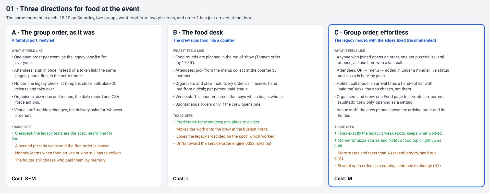

### A · The group order, as it was
A faithful port of the legacy, restyled: one open order per event, an attendee who holds it, the legacy pages phone-first in the hub's frame, sign-in instead of token links, events instead of webhooks and polling.
- **Attendees:** the familiar flow; when a second group wants another pizzeria, they wait until the first order is called in. Nobody learns when food arrives except by watching the door.
- **Organisers and crew:** pizzerias and menus, the daily record and CSV, force release and cancel.
- **Venue staff:** nothing changes; a delivery at the door asks for "whoever ordered".
- **Trade-offs:** the cheapest, and the legacy tests are the spec nearly line for line. But it keeps the legacy's weak spots that were not bugs: the one-at-a-time queue, no estimate, no hand-out, and the holder chasing payments from memory.
- **Cost: S–M.**

### B · The food desk
The crew runs food like a counter: food rounds are planned in the run of show ("Dinner: order by 17:30"), a crew member holds every order, calls it, receives it and hands it out by number; attendees only pick.
- **Attendees:** predictable times and one place to collect; no one has to be the volunteer.
- **Organisers and crew:** full control, and all the work, at the hours they are busiest.
- **Venue staff:** a counter view of which bag is whose.
- **Trade-offs:** loses the legacy's "decided on the spot", which worked at real events; moves the load onto the crew; drifts toward the service-order engine 0022 rules out (rounds, a counter, a queue).
- **Cost: L.**

### C · Group order, effortless
The legacy model, kept where it worked and fixed at its edges. Anyone who joined opens an order; a holder calls it; the app does the rest of the work.
- **Attendees:** from the screen's QR to a pizza in the order in under a minute; several orders at once (one per pizzeria); a close time that holds, with a last call; live status with an estimate; "pizza is here" on the phone and the screens.
- **Holder:** a checklist from prepare to hand-out, call mode in large type, an estimate at call-in, a hand-out list with "paid me" ticks, a nudge to latecomers. Reminders reach them first, then the crew.
- **Organisers and crew:** one Food page for the day: what needs them, stepping in (audited), pizzerias and menus, the record and CSV, settings. "Crew only" opening for events that want fixed rounds.
- **Venue staff:** the crew phone's door helper: the delivery says the pizzeria, the order and its holder appear, and the crew marks it arrived. (Dropped in the Plan: U5 B.)
- **Trade-offs:** more states and tests than A (several orders, a timer, hand-out, an estimate); one catalog sentence changes ([D1](step-5-pizza/questions.md#d1-one-open-order-per-event-or-several)). It builds no engine: still one kind of thing, a group food order with one holder.
- **Cost: M.**

## Recommended direction: group order, effortless
**C.** The legacy flow was proven at real events and #117 calls it "adequate for our kind of event"; what hurt was never its shape but its edges: one order at a time, a deadline nobody kept, nobody knowing when the food came, payments chased from memory, tokens in links, comments shown to anyone, and transitions that could run twice. C fixes exactly those and nothing else. A would ship the edges again with a new coat of paint; B would solve problems the legacy did not have by giving the crew a job they never wanted.

C also costs less than it looks, because the platform has done half of it already: Moments' three pizza stories and its `pizza` rule, Notify's food topic and Screen's food box exist and wait for events. Step 5 builds the module that emits them, and the venue lights up.

**Design principles**
1. **Under a minute from the QR to a pizza in the order** (#119's goal): one list, one menu, one tap; sign-in once per phone, never a token.
2. **The holder is a volunteer; the app does the work.** Counting (the summary), reading (call mode), reminding (the scheduler), chasing (hand-out and paid ticks).
3. **A time that holds.** The close time is a promise, with a last call before it; nothing stays open by accident (U3).
4. **Close the loop.** Every order ends: called in, on the way, here, collected, done; and a forgotten one is asked about (U11).
5. **One truth, many surfaces.** The pages, the screen, Notify and (in step 6) Discord read the same events; nothing polls; one happening has one voice on the screen (step 4's rule).
6. **Private by default.** Who had what is for the person, the holder and the crew; everyone else sees counts and kinds (D9).
7. **Safe under load.** Every step is one conditional update in a transaction, with an idempotency key and an event through the outbox (E1, E2, E12).
8. **No money, no engine.** A payer and a "paid me" tick, never amounts settled in the app; one kind of order, never a generic service flow (0022). (Amended in the Plan's [principles](#design-principles).)

## Key flows
Each flow names its users and its mockup. The mockups use the demo event's names only (Demo Pizzeria, Demo Trattoria, Demo Corner Grill, Demo Player, Player Two …).

### From the screen to a pizza in the order (attendee)
Moments' "Pizza order open" story shows the QR; the Food page lists the open orders; the menu filters by name or ingredient; "Added" shows the steps ahead ([L6](step-5-pizza/questions.md#l6-where-does-the-screens-qr-land), [D9](step-5-pizza/questions.md#d9-who-sees-what-in-an-order)).

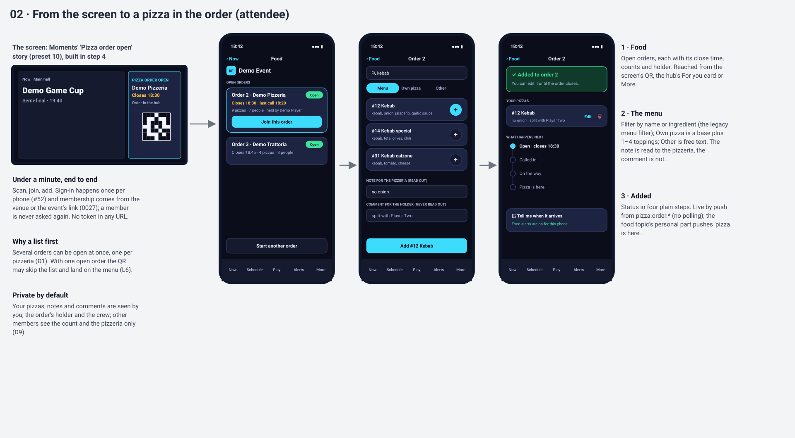

### Food: the open orders (attendee, guest)
Two open orders, nothing open, a guest, and ordering turned off ([U2](step-5-pizza/questions.md#u2-who-may-start-an-order), [U15](step-5-pizza/questions.md#u15-what-does-a-guest-see), [O3](step-5-pizza/questions.md#o3-turning-ordering-off)).

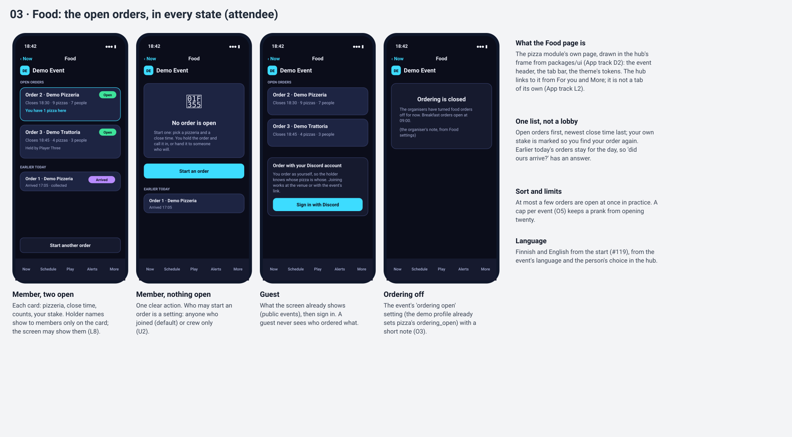

### Picking a pizza (attendee)
The menu, own pizza (a base and 1–4 toppings), other (free text), and the same again ([U6](step-5-pizza/questions.md#u6-the-same-again)).

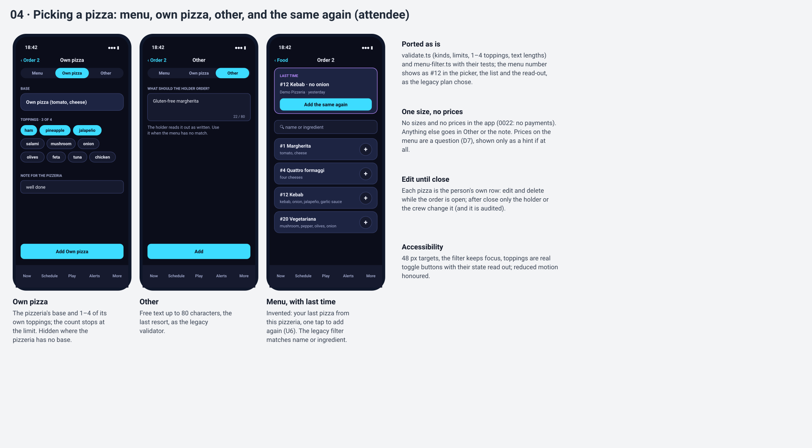

### My order (attendee)
Closed and being called, on the way with the estimate, here with the pickup place, and the two pushes ([U8](step-5-pizza/questions.md#u8-the-pizzerias-estimate-at-call-in), [D12](step-5-pizza/questions.md#d12-which-pushes-does-food-send)).

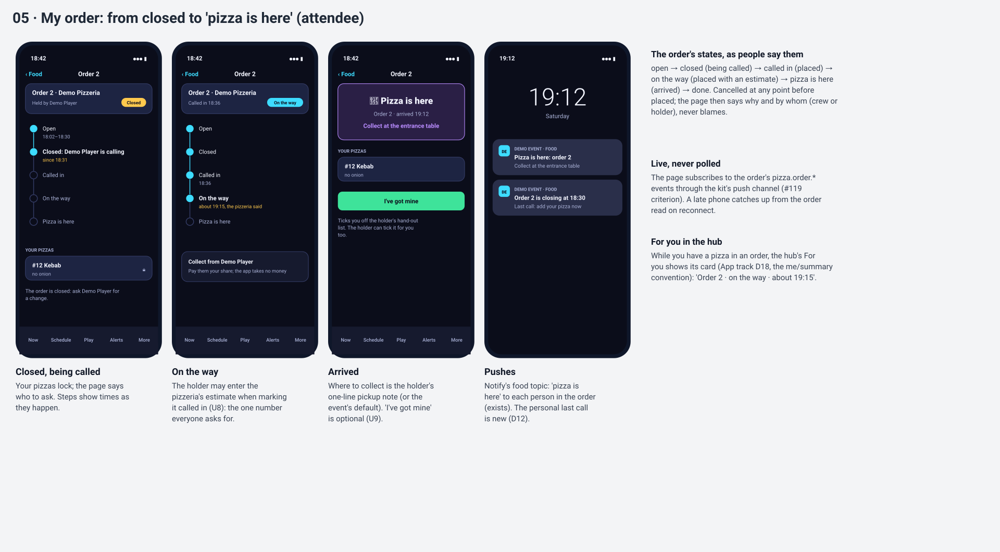

### Starting an order (attendee becomes the holder)
Pick a pizzeria (one with an open order offers "join it instead"), a close time, a pickup place ([D1](step-5-pizza/questions.md#d1-one-open-order-per-event-or-several), [U3](step-5-pizza/questions.md#u3-what-does-an-orders-time-mean), [D6](step-5-pizza/questions.md#d6-delivery-or-takeaway)).

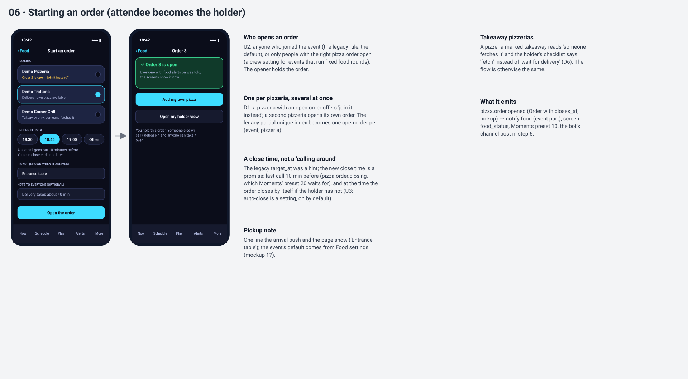

### Holding an order (holder)
The checklist from prepare to hand-out; release, take-over and a lost race ([E1](step-5-pizza/questions.md#e1-two-people-claim-or-take-over-at-once)).

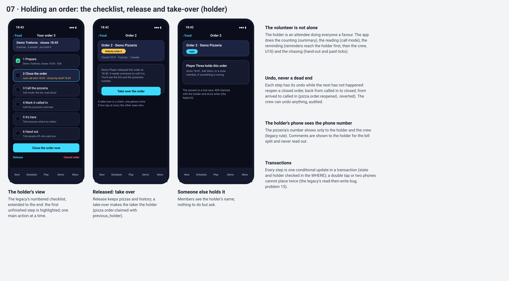

### Call mode (holder)
The legacy summary in large type, tick as you read, then "called in" with the estimate and the payer ([L7](step-5-pizza/questions.md#l7-call-mode), [U13](step-5-pizza/questions.md#u13-who-paid-the-pizzeria-the-payer)).

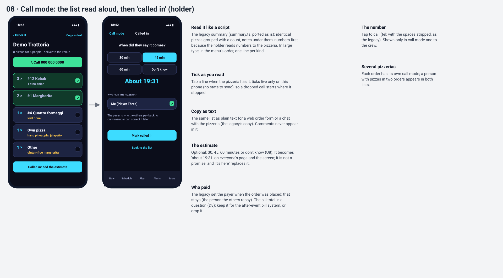

### It's here: hand-out (holder)
Everyone told; "Everyone got theirs" ticks the whole order, and the holder ticks who paid them when the order settles to them; a nudge to latecomers; done (redrawn for the Plan: U4 and U12 notes; [U4](step-5-pizza/questions.md#u4-hand-out-who-and-when-is-an-order-done), [U12](step-5-pizza/questions.md#u12-who-sees-the-paid-the-holder-tick), [D3](step-5-pizza/questions.md#d3-a-done-state)).

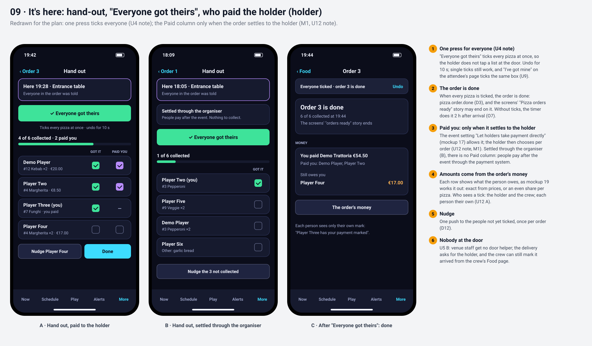

### The crew's Food page (organiser, crew, venue staff)
Every order of the day, what needs the crew, stepping in with a reason, the order's history; the same page on a crew phone with the door helper, which the Plan drops (U5 B) ([U5](step-5-pizza/questions.md#u5-what-do-venue-staff-get), [D5](step-5-pizza/questions.md#d5-which-rights), [D16](step-5-pizza/questions.md#d16-history-of-an-order)).

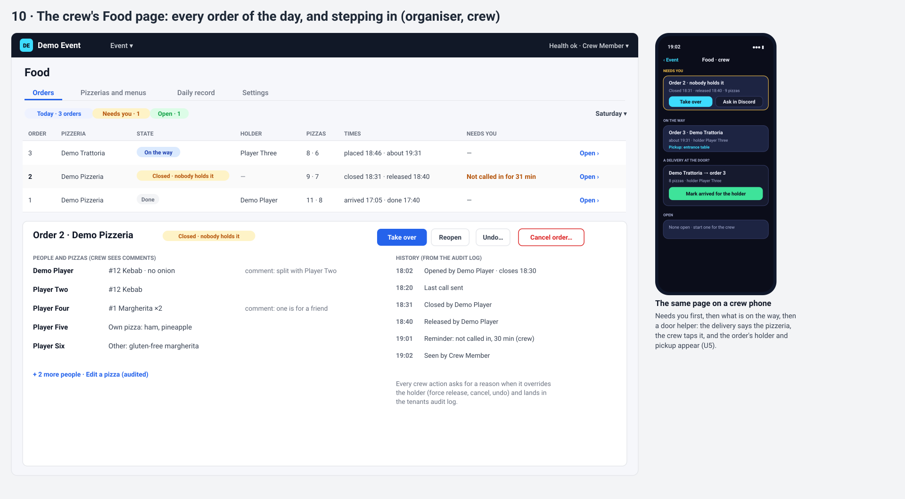

### Pizzerias and menus (organiser)
Loaded from the profile with its web page, imported as a menu CSV with prices through a preview, or read from a photo by the optional AI reader; rows keep what was ordered (redrawn for the Plan: D7 B, D10 and D11 notes; [D11](step-5-pizza/questions.md#d11-pizzerias-in-the-event-profile), [D15](step-5-pizza/questions.md#d15-snapshots-of-menu-items)).

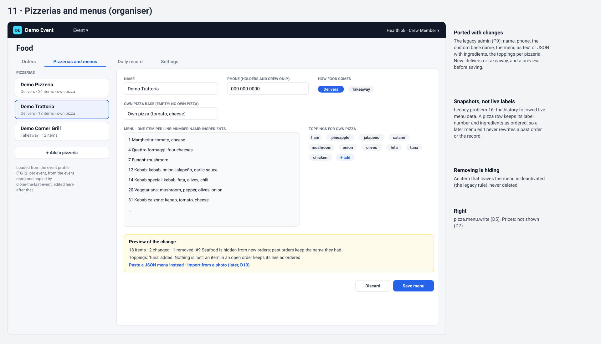

### The daily record (organiser)
Orders by day with flags, each person's amount, who paid the pizzeria, and the export for the payment system (redrawn for the Plan: M1–M4; [D8](step-5-pizza/questions.md#d8-the-bill-total), [O10](step-5-pizza/questions.md#o10-the-after-event-record)).

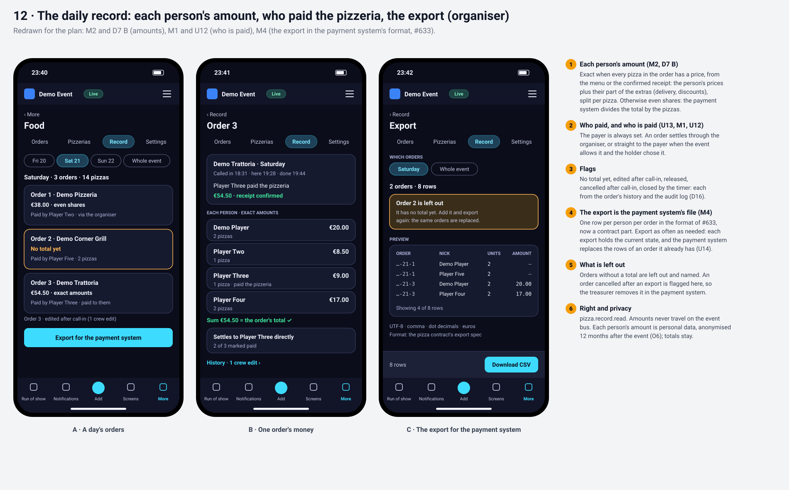

### The lifecycle (everyone, implicitly)
The states, the holder beside them, who may do what, and what each step emits.

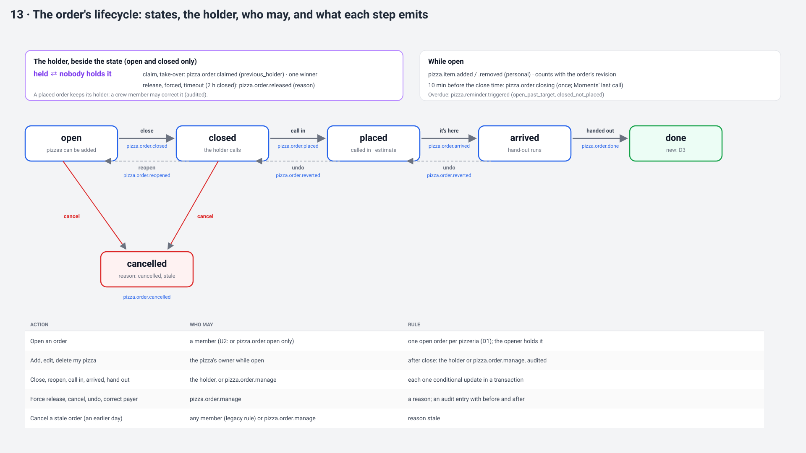

### Food on the venue screen (attendees in the hall)
The steady food box with two orders and the moments step 4 built, each happening with one owner ([D2](step-5-pizza/questions.md#d2-the-screens-food_status-with-several-orders), [L3](step-5-pizza/questions.md#l3-the-screens-food-box-when-nothing-is-happening), [P3](step-5-pizza/questions.md#p3-the-exit-criterion)).

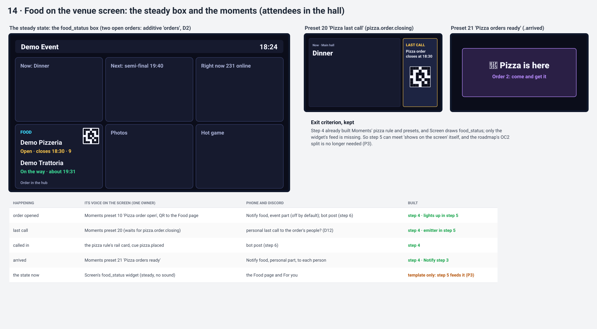

### Reminders, last call and auto-release (holder, crew)
Four orders on a time line: on time, a stalling holder, auto-close off, and a called-in order that never arrives ([U10](step-5-pizza/questions.md#u10-who-hears-a-reminder), [U11](step-5-pizza/questions.md#u11-a-called-in-order-that-never-arrives), [O2](step-5-pizza/questions.md#o2-the-scheduler)).

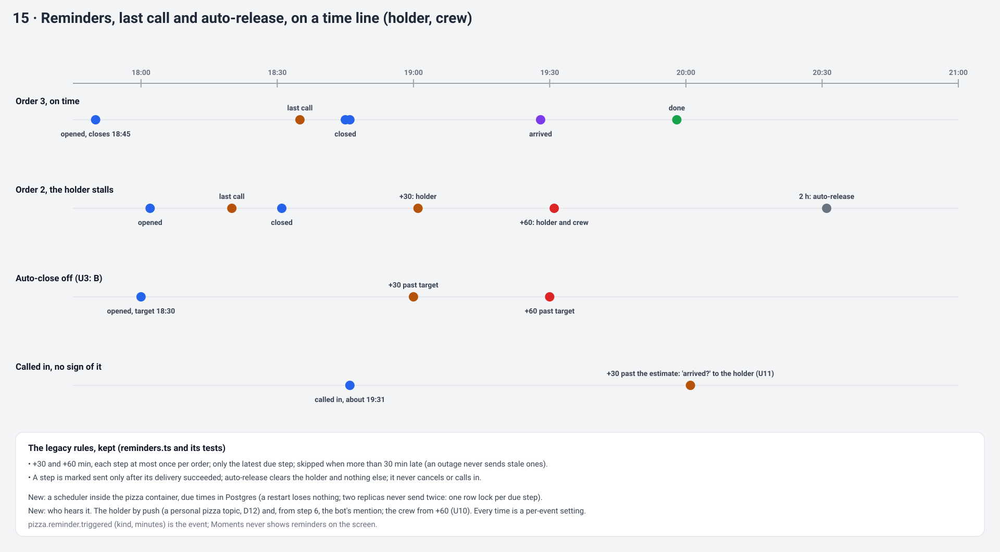

### Edge states (attendee, holder)
Closed while you chose, offline, cancelled, left from an earlier day, not a member, released by the timer ([E3](step-5-pizza/questions.md#e3-the-order-closes-while-someone-is-choosing)–[E16](step-5-pizza/questions.md#e16-offline-for-a-moment)).

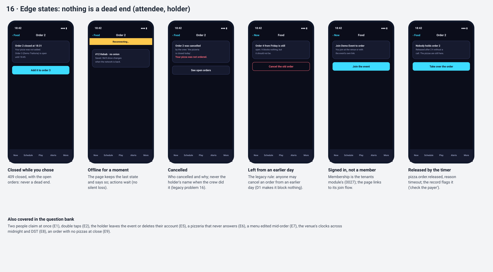

### Food settings (organiser)
Every time and rule per event, with the legacy values as defaults, settling up and the AI reader (redrawn for the Plan: U12 note, M3; [O5](step-5-pizza/questions.md#o5-how-many-open-orders-at-once), [L8](step-5-pizza/questions.md#l8-holder-names-on-the-venue-screen)).

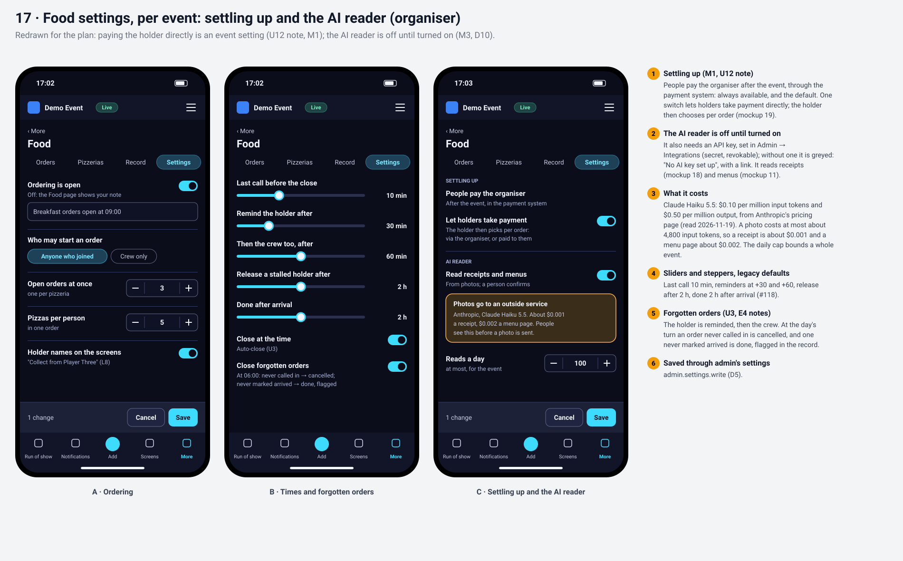

### Scanning a receipt (holder; new for the Plan)
The money step after arrival: the photo, the machine read, the holder confirming the total and each pizza's price; or the total typed in ([M3](#the-optional-ai-reader)).

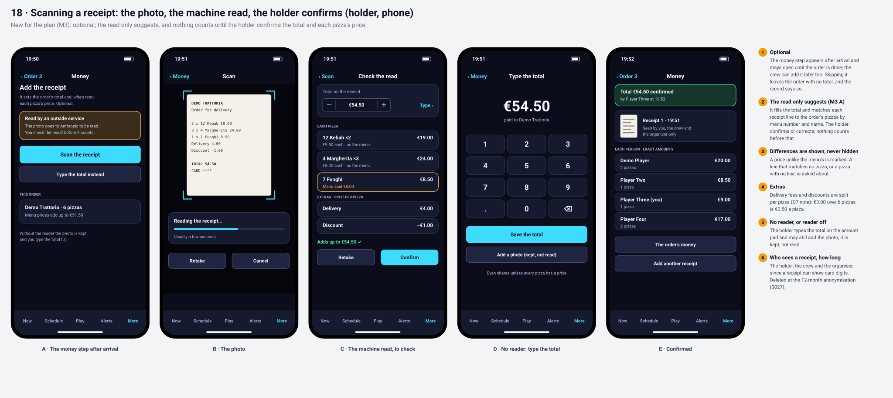

### An order's money (holder; new for the Plan)
Even shares or exact amounts, who is paid, who owes what, and a pizza without a price ([Money](#money-what-the-platform-keeps)).

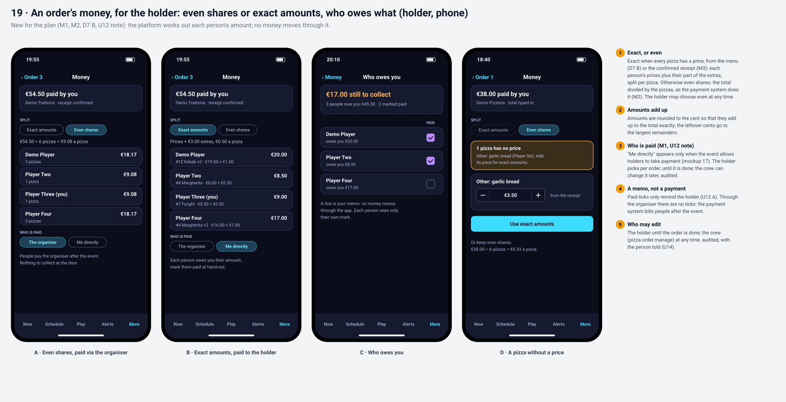

### Every mockup
| File | What it shows | For whom |
|---|---|---|
| [01-directions.svg](step-5-pizza/01-directions.svg) | The three directions side by side | the session |
| [02-flow-qr-to-order.svg](step-5-pizza/02-flow-qr-to-order.svg) | Screen QR → Food → menu → added | attendee |
| [03-open-orders.svg](step-5-pizza/03-open-orders.svg) | The Food page: two open, none open, guest, ordering off | attendee, guest |
| [04-menu-and-add.svg](step-5-pizza/04-menu-and-add.svg) | Own pizza, other, the menu with "last time" | attendee |
| [05-my-order.svg](step-5-pizza/05-my-order.svg) | My order: closed, on the way, here; the pushes | attendee |
| [06-start-order.svg](step-5-pizza/06-start-order.svg) | Starting an order; the holder's first screen | attendee, holder |
| [07-holder-checklist.svg](step-5-pizza/07-holder-checklist.svg) | The checklist; release and take-over; a lost race | holder |
| [08-call-mode.svg](step-5-pizza/08-call-mode.svg) | Call mode; called in with the estimate and the payer | holder |
| [09-hand-out.svg](step-5-pizza/09-hand-out.svg) | Hand-out with "Everyone got theirs", paid ticks when it settles to the holder; done (redrawn for the Plan) | holder |
| [10-crew-food-page.svg](step-5-pizza/10-crew-food-page.svg) | The crew's orders of the day, stepping in, history; the crew phone and the door helper | organiser, crew, venue staff |
| [11-pizzerias-and-menus.svg](step-5-pizza/11-pizzerias-and-menus.svg) | Pizzerias with their web page, the menu CSV import and its preview, the optional AI read (redrawn for the Plan) | organiser |
| [12-daily-record.svg](step-5-pizza/12-daily-record.svg) | The daily record, each person's amount, the export for the payment system (redrawn for the Plan) | organiser |
| [13-lifecycle.svg](step-5-pizza/13-lifecycle.svg) | States, holder, who may, events | everyone |
| [14-screen-and-moments.svg](step-5-pizza/14-screen-and-moments.svg) | The food box and the pizza moments on the venue screen | attendees in the hall |
| [15-reminders.svg](step-5-pizza/15-reminders.svg) | Last call, reminders, auto-release on a time line | holder, crew |
| [16-edge-states.svg](step-5-pizza/16-edge-states.svg) | Six edge states | attendee, holder |
| [17-food-settings.svg](step-5-pizza/17-food-settings.svg) | Food settings, settling up and the AI reader (redrawn for the Plan) | organiser |
| [18-scan-receipt.svg](step-5-pizza/18-scan-receipt.svg) | Scanning a receipt: the photo, the read, confirming; or typing the total (new for the Plan) | holder |
| [19-order-money.svg](step-5-pizza/19-order-money.svg) | An order's money: even or exact, who is paid, who owes what (new for the Plan) | holder |

## Port, drop or invent
Each with its reason ([0020](../decisions/0020-best-of-old-freely-new.md)).

### Port as is (code and its tests, with clock, zone and storage injected)
| Legacy | Where it goes | Why |
|---|---|---|
| `validate.ts` (kinds menu, custom, text; 1–4 toppings; text limits) and `pizza-validate` | the pizza API's input checks | Pure rules, tested, still right |
| `menu-filter.ts` (name or ingredient, case-insensitive) and its test | the menu page's filter | Pure, tested |
| `summary.ts` (grouped lines, counts, notes, "copy as text", no comments) and `pizza-summary` | call mode | The legacy's best part; call mode only draws it larger |
| `report.ts` (the daily record, the CSV's bytes: BOM, `;`, decimal comma, placed orders, one row per participant) and `pizza-report` | the daily record | The after-event bill system reads exactly this. (The Plan keeps its grouping; the bytes follow the [export spec](#contract-part-the-export-for-the-payment-system), M4) |
| The router's rules and status codes (`another_open`, `claimed` with holder and since, `closed`, `not_owner`, `has_pizzas`, `not_placed`) and `pizza-orders`, `pizza-routes`, `pizza-db` | the lifecycle's spec | Proven behaviour; the tests become the spec of #117, adapted to sign-in and tenants |
| `reminders.ts` (+30 and +60; latest step only; a 30-minute send window; logged only after delivery; auto-release after 2 h clears the holder only) and `pizza-reminders` | the scheduler | The rules held at real events |

### Port with changes
| Legacy | Becomes | Why |
|---|---|---|
| One open order site-wide (a partial unique index) | One open order per pizzeria per event (D1) | TB1 makes it per tenant; two pizzerias should not queue |
| `target_at`, a "calling around" hint | `closes_at`, a close time with a last call and auto-close (U3) | A time people can trust; Moments' last call already waits for it |
| The registration token in `?token=` links (P2, P3) | The central sign-in and membership (0027) | Tokens in URLs are dropped (0010); identity is the person |
| Comments and notes returned to anyone; orders enumerable by id (problem 9) | D9's visibility, checked on every read; ids not guessable | #117: comments only for the order's members and crew (narrowed to the holder and crew) |
| Read-then-write transitions; only open and claim atomic (problem 15) | Every transition one conditional update in a transaction, with an idempotency key | #117; a double "placed" posted twice |
| The admin's hard delete in three statements, unaudited | No hard delete (D17); crew overrides audited (D16) | N6 |
| The order log (`pizza_order_log`, 19 entry kinds) | The order's history, and the seeds of `pizza.order.*` | The entry kinds map to the events almost one to one |
| Discord webhook posts (P6) | `pizza.order.*` events; the bot posts them in step 6 | One bus; the webhook goes |
| The cron every 5 minutes | A scheduler in the container, due rows in Postgres (O2) | No cron in a container; survives restarts and replicas |
| The pizza block and status URL polled by the display and signage (P11, P12) | Screen's `food_status` fed by events; Moments' stories (built) | Nothing polls |
| The admin pages behind one password (P8, P9) | The crew's Food page behind `pizza.*` rights | Rights from sign-in |
| History labels that follow live menu data (problem 16) | Rows that keep what was ordered (D15) | A menu edit must not rewrite the record |
| A forced release that names the holder; an admin "placed" that leaves the payer empty (problem 16) | Crew actions say "the crew"; the payer is always set (U13) | Small bugs, fixed in passing |
| One local date per order, one fixed time zone in code | `seq` per event day turning at 06:00; the event's time zone (D4, E8) | TA1, TA3 |
| Pizzerias and menus as global rows | Per event, from the profile, copied by clone (D11) | TG12, DR11 |

### Drop
| Legacy | Why |
|---|---|
| Registration tokens and the `/pizza order` and `/pizza claim` link commands as they were | Sign-in replaces tokens; the bot's commands are rebuilt in step 6 to link to the Food page |
| The retired per-day pages and their redirect (P13), and the spreadsheet fallback | Gone already in the legacy; the spreadsheet links were secrets to rotate |
| The pizza line in the ticker lane | DR3: the ticker is manual (0018); food has its own box and moments |
| The legacy pizza theme (mascot, banner, fonts) | An event's brand belongs in its theme, not in the module (L1) |
| `GET /api/pizza/status` with `CORS *` | Public facts travel as events; pages read the module's API with the caller's session |

### Invent
| New | Why |
|---|---|
| Several open orders, one per pizzeria (D1) | Two groups, two pizzerias, no queue |
| A close time that holds, with a last call and auto-close (U3) | The deadline people can trust; the screen's last call needs it |
| An estimate at call-in, "about 19:31" (U8) | The question everyone asks the holder |
| "It's here" with a pickup place, and the hand-out list (U4) | The roadmap's "the crew hands it out"; the legacy stopped at "placed" |
| "Paid me" ticks for the holder (U12, #118) | Replaces chasing from memory; no money handled. (In the Plan: only when the order settles to the holder, M1) |
| `done` (D3) | Every order ends; the screen and the hub can let go |
| Call mode with ticks (L7) | The summary, readable in a noisy hall |
| The same again (U6) | Most people order the same thing twice |
| The crew's door helper (U5) | Venue staff meet food at the door. (Dropped in the Plan: U5 B) |
| Escalation to the crew and "has it arrived?" (U10, U11) | The volunteer is not alone; nothing is forgotten |
| A per-person cap and one held order per person (U18, E14) | Pranks cost a phone call |
| Snapshots of ordered items (D15) | Records that do not change under you |
| Live pages by server-sent events (D13) | #119's push without polling |
| The caller's own orders and a For you card (D14) | The lead's step 2 note; the App track's For you |

## The product owner's notes (2026-11-19)
Given while reading the pack. They change the money questions and come before the recommendations where the two differ. The session turned them into M1–M4 ([decisions](step-5-pizza/decisions.md#the-m-questions)); the [Plan](#money-what-the-platform-keeps) settles them.

- **How a pizza is paid for today.** The holder, who calls the order in, pays the pizzeria. They pay either when ordering (for example a Wolt order) or when the pizza arrives.
- **Settling up, the default.** The money goes through the organiser. After the event, the cost of each order is divided evenly among the people who ordered in it.
- **Settling up, an organiser option.** The organiser can instead let attendees pay the holder directly.
- **Exact prices.** There must be a way to record each person's exact price in an order, instead of an even share.
- **Receipts.** The holder or the crew can add photos of an order's receipts to the order. A receipt can also be the source for entering the real cost per attendee later.

**What this changes in the pack.**
- Principle 8 ("no money, no engine") becomes: the app keeps what each order cost and what each person owes. No money moves through the app, and there is still no generic service engine.
- [D8](step-5-pizza/questions.md#d8-the-bill-total) is answered A: settling food after the event is still done, through the organiser.
- [D7](step-5-pizza/questions.md#d7-prices-on-the-menu) (prices on the menu), [U12](step-5-pizza/questions.md#u12-who-sees-the-paid-the-holder-tick) (the "paid the holder" tick) and [U13](step-5-pizza/questions.md#u13-who-paid-the-pizzeria-the-payer) (the payer) are reopened for the session, in the light of these notes.
- New for the session:
  - the settle-up setting (through the organiser, or directly to the holder);
  - an even share or exact prices per person;
  - receipt photos: who adds them, who sees them, how long they are kept;
  - what each person owes, and to whom, in the record and the CSV.
- [Decision 0022](../decisions/0022-product-vision.md) says "no payments". The plan records how these notes refine it: amounts are tracked, and no payment is taken in the app.

## The lead's step 2 notes
- **"The pizza contract gives the phone hub a read of the caller's own orders":** `GET /api/pizza/me/orders`, and `me/summary` cards if the App track takes its D18 ([D14](step-5-pizza/questions.md#d14-the-callers-own-orders-the-leads-step-2-note)); proposed for #117.
- **"Add a demo pizzeria and orders to `events/demo/`":** two placeholder pizzerias in the demo profile, and demo orders made by the stack's screenshot script through the API ([D18](step-5-pizza/questions.md#d18-demo-data)); proposed for #117 (the pizzerias) and #119 (the orders in CI).

## Proposed issue changes
Superseded by the Plan's [final issue set](#the-final-issue-set). The lead applies these after the session; the pack's author creates and edits no issues. Every contract item below is additive and ships with the code that uses it ([0029](../decisions/0029-additive-contracts-ship-with-consumers.md)); D1's sentence is discussed there. Risk follows [P5](step-5-pizza/questions.md#p5-risk-classes).

### #117 · the contract, the lifecycle and the rights (keep, rewrite; high)
Proposed title: `feat(pizza): the pizza contract, the group-order lifecycle and its rights`.
- [ ] `contracts/pizza.md` and `pizza.openapi.yaml`, written from the legacy API and its status codes, adapted to the conventions (problem bodies, sign-in, tenant); the catalog's pizza events adopted, with additive `closes_at`, `estimate_at`, `pickup` on the Order, the `done` state and `pizza.order.done` (D3); the catalog's "one open order per event" becomes "one open order per pizzeria" (D1)
- [ ] The lifecycle (open → closed → placed → arrived → done; cancel; reopen and undo; claim, take-over and release) with every transition one conditional update in a transaction, idempotency keys, events through the outbox; race tests for concurrent joins, claims and each transition (E1, E2)
- [ ] Several open orders, one per pizzeria; at most N open per event and one held per person; at most N pizzas per person per order (D1, O5, E14, U18)
- [ ] Members only (central sign-in #52, membership #150); no tokens in URLs; visibility as D9, tested; guests per the info-page mode (U15)
- [ ] Pizzerias and menus per event with the legacy validators and menu filter; delivery or takeaway (D6); rows snapshot what was ordered (D15); a `pizza` section in the profile (D11); clone with the event; two placeholder pizzerias in `events/demo/`
- [ ] Rights `pizza.order.open`, `pizza.order.manage`, `pizza.menu.write`, `pizza.record.read`, defined and tested here for every action of #118 and #119 (D5, P5); crew overrides audited with before and after (D16); no hard delete (D17)
- [ ] `GET /api/pizza/me/orders` (and `me/summary` if the App track takes D18) (D14)
- [ ] Data classes, privacy export and delete, and 12-month anonymisation (O6)
- [ ] The legacy pizza tests ported as the spec (`pizza-db`, `pizza-routes`, `pizza-orders`, `pizza-validate`, `pizza-menu-filter`, `pizza-summary`)

Out of scope: the scheduler and the pages (#118, #119); the bot (step 6); payments.

### #118 · the scheduler, the holder's tools and the crew's Food page (keep, rewrite; normal)
Proposed title: `feat(pizza): the scheduler, the holder's tools and the crew's Food page`.
- [ ] The module's scheduler (O2): last call (`pizza.order.closing`) and auto-close (U3), reminders +30 and +60 with the legacy rules, escalation to the crew (U10), auto-release after 2 h, "has it arrived?" (U11), done after arrival (O7); all per-event settings with the legacy defaults; a restart and a second replica tested; its lag in `/health` (O8); `pizza.reminder.triggered` gains the holder's `user_id` (D12, additive)
- [ ] The holder's pages: the checklist, call mode (the ported summary), called in with the estimate and the payer, it's here with the pickup place, the hand-out list with paid ticks and the nudge, release, take-over, cancel with a reason, undo ([mockups 07–09](step-5-pizza/07-holder-checklist.svg))
- [ ] The crew's Food page, desktop and phone: the day's orders with what needs the crew, stepping in with a reason, the order's history, the door helper (U5); pizzerias and menus with a preview; the daily record and CSV (the ported report); Food settings through admin's settings ([mockups 10–12, 17](step-5-pizza/10-crew-food-page.svg))
- [ ] Finnish and English; CI screenshots of each page next to its mockup; Playwright for the holder's and the crew's flows

Out of scope: defining rights (#117); the bot's posts (step 6); payments.

### #119 · the attendee's Food pages (keep, rewrite; normal)
Proposed title: `feat(pizza): the attendee's Food pages, mobile-first`.
- [ ] The Food page (open orders, nothing open, guest, not a member, ordering off), the menu with its filter, own pizza, other and the same again; add and edit until close; my order's steps with the estimate and the pickup place; "I've got mine" (U9) ([mockups 02–06, 16](step-5-pizza/02-flow-qr-to-order.svg))
- [ ] Live by server-sent events from `pizza.order.*`, no polling; reconnect and catch up (D13, E16)
- [ ] Drawn in the hub's frame from `packages/ui` with the event's theme, if the App track takes its D2; phone first, then desktop; Finnish and English
- [ ] Playwright for the whole attendee flow; CI screenshots named as the tests, with demo orders made by the stack's script (D18)
- [ ] The step's exit check (see below), run on the demo stack

Out of scope: the hub's shell and push permission (App track); the screen's box (the new issue).

### New · food on the screens and in alerts (normal)
Proposed title: `feat(screen,notify): food on the screens and in alerts`.
- [ ] Screen feeds `food_status` from `pizza.order.*` and `pizza.item.*`, with additive `orders` for several orders (D2); hidden when nothing is open or on the way (L3); a placed order leaves after 3 h (U11); CI screenshots
- [ ] Notify's `food` topic: `pizza.order.closing` in the event part; `pizza.order.cancelled`, the holder's reminders and the hand-out nudge in the personal part (D12)
- [ ] Moments' "Pizza orders ready" (preset 21) may also end on `pizza.order.done`
- [ ] A stack test: an order's events show on a screen's box and reach a subscribed member

Out of scope: the bot's posts (step 6); new sounds.

### Out of step 5 (proposed)
The bot's channel posts and the rebuilt `/pizza` commands (step 6, consuming the events); prices, sizes, payments and settling (0022, D7); reading menus from photos (D10); any pizzeria's own ordering integration. (The Plan takes prices and the reader in: [Out of step 5](#out-of-step-5).)

### Order (a sketch for the planner)
Superseded by the Plan's [package order](#order-packages-by-dependency-chain).
1. **#117** first, alone: high risk, one accept; its contract and rights unblock the rest.
2. Then, in parallel: **#119 with the new screen and notify issue** (the attendee's side and what the hall sees; they share the demo script and the exit check), and **#118** (the holder's and the crew's side). Both use only #117's API and rights. If #118 and #119 share too many page files, the planner bundles them in order instead.

## Proposed exit criteria
The roadmap's "an order runs end to end and shows on the screen", made checkable ([P3](step-5-pizza/questions.md#p3-the-exit-criterion)). The Plan's [step 5 gate](#the-step-5-gate) amends them:
- On the demo stack, an order is opened, joined by several members, closed, called in, marked arrived, handed out and done; every step publishes its `pizza.order.*` event (contract-tested).
- The venue screen shows it: Moments' "Pizza order open" and "Pizza orders ready" stories and Screen's food box, with CI screenshots.
- The people in the order get "pizza is here" through Notify.
- The race tests and the scheduler's restart test pass; the ported legacy tests pass.

## Open questions
None left: the product owner answered all of them on 2026-11-19 ([decisions](step-5-pizza/decisions.md)). The [question bank](step-5-pizza/questions.md) holds every open question found: 79 in six themes, each with options and a recommendation. **Decide first:** P1 (the direction), D1 (several open orders), U3 (a close time that closes), U4 (hand-out and done), D8 (the bill total), D9 (who sees what), P2 (the issue set), P3 (the exit criterion).
