# Step 6 brief: Bot

The research pack for the product owner's brainstorming session on [step 6, Bot](../roadmap.md#6-bot) (epic #60), issue #120. It follows the [outline of a research pack](README.md#outline-of-a-research-pack) and is built like [step 5's](step-5-pizza.md). After this merges, the lead runs the session over as many rounds as it takes, writes the final plan into this brief (`## Plan`) and rewrites the step's issues; the product owner accepts the plan before any build starts.

**In this pack**
- This file: goal, what was read, what earlier steps already built, how others solve it, three directions and the recommended one, the key flows, port / drop / invent, where the issues and the contracts disagree, proposed issue changes and exit criteria.
- [step-6-bot/questions.md](step-6-bot/questions.md): the question bank, 61 questions in six themes, each with options and a recommendation. IDs (U3, D3, …) are used throughout.
- [step-6-bot/decisions.md](step-6-bot/decisions.md): the product owner's answers (2026-11-20), the record behind the [Plan](#plan).
- [step-6-bot/](step-6-bot/): 16 SVG mockups, drawn new, with the demo event only (several fixed and 16 added for the Plan, see [Mockups](#what-the-answers-changed)). Organiser pages are in the organiser shell's look (`packages/ui`, the dark shell of the grids sheets), the venue screen in the screen look, and Discord as a plain dark chat client, drawn simply. Collections follow [design amendment 3](../design/README.md#3--grids-scale-with-their-content-2026-11-19): one auto-fill grid of cards, three columns at 1280 px, one on a phone.

## Goal
The Discord side of the platform comes from the new bot ([roadmap](../roadmap.md#6-bot)). The roadmap's "In it": a bot built on the best of canccubot, storage on Postgres, presence, voice, game and stats, polls dropped; one module with a pool of clients; slash commands per guild from feature flags; events and role-to-rights sync; easy guild setup; the Discord side of the one announce action; the ticker commands kept; the bot reports activity counts and Games detects surges; the legacy bot data migration built and tested here. Exit: dashboard data and rights come from the new bot on the test server; the migration passes its test on a copy of the legacy data.

The step's five build issues: #121 (the module, the pool, commands and rights by role id), #122 (presence, voice, games and stats), #123 (screen, food and tournament commands), #124 (guided guild setup), #125 (the legacy bot data migration). This pack treats them as input ([P2](step-6-bot/questions.md#p2-the-issue-set)).

## Plan
The product owner answered every question in the [bank](step-6-bot/questions.md) on 2026-11-20 on the decisions page, and the switch (O5) the same day in chat. The record is [step-6-bot/decisions.md](step-6-bot/decisions.md). This plan turns those answers into the step's design and issue set. The product owner accepts it by accepting this PR. It bounds the step's build: each issue's Room to design is measured against it ([0026](../decisions/0026-briefs-are-research-packs.md)), not against the pack's recommendations below. The research below this section stays as it was, apart from short pointers where the answers overrode it.

### What the answers changed
Every question took its recommendation, except one:
- **D6 · B, not A: messages per hour, counts only.** The bot counts the messages posted in the event's server, per hour, for a new chat activity graph ([Chat activity](#chat-activity-d6-b)). It keeps no content, no author and no channel names. The message-content intent stays off (D5): Discord sends the bot a message without its text, and the bot only counts it.

And these answers move or reshape work the pack placed elsewhere:
- **O5 · A, moved: the switch leaves step 11.** The legacy bot is mostly unused now, between events, but its `/finals` is in use (P8 note). The import moves the legacy bot's identity, so the legacy bot stops at the switch. Step 6 builds and tests the import; the switch runs as soon as the Finals track's `/finals` is live on the new bot, not in step 11. The legacy bot runs untouched until then ([The switch](#the-switch)).
- **P2 · A, reshaped: three large tickets.** Workflow v2: very big tickets, one full review each, no sub-epics. #121 takes in #124 (the module and the Discord page), #122 takes in #123 (the living server), #125 stays (the import). #123 and #124 close into them ([The final issue set](#the-final-issue-set)).

And these notes amend a recommendation that was taken:
- **U12 · A, with a note:** in step 6 only the crew sends a photo to the screen. Members' photos through a queue the crew moderates, with the crew told when something waits, is a later feature ([Roadmap notes](#roadmap-notes)).
- **D10 · A, answered:** "the import" is the one-time move of the legacy bot into the platform at the switch: its Discord identity (its token), its server and channels, its admin role, its two settings and its finals state (D9). Nothing else.
- **D12 · A, confirmed:** the platform decides who is told what (Notify, the person's own choices and quiet hours); the bot only delivers it as a Discord DM.
- **P8 · A, with a note:** `/finals` is a live command on the legacy bot today, outside the platform: people use it to open their page, sign up and withdraw. The Finals track builds it for the new bot under its own flag, on #121's command framework, and that is what the switch waits for. [What `/finals` needs from the framework](#what-finals-needs-from-the-framework) says what #121 must give it.

And the legacy bot moved after the pack was written (lead round, 2026-11-20). The product owner asks that packs and plans rest on the current legacy code. The pack read the canccubot inventory of 30 Oct; the repo has seven commits since (`3e7030fbbe..12f2b03`), all about `/finals`. They are re-read at `main` and change the plan in four places; no decision changes:
- `/finals` exists, with its provider client: the command count is 35, not 34, and P8 above says what it is.
- The mention and link **guard** (`bot/utils/tourney_guard.py`) is a port row, in #121 (the default) and #122 (the posts).
- **Link buttons** (`bot/utils/link_button.py`) are a port row: [#122](#122--featbot-the-living-server-counts-commands-living-messages-and-dms) names the replies and posts that use one.
- The tourney watcher's announcements now point to `/finals` instead of carrying a link; that is the Finals track's, noted in the [roadmap notes](#roadmap-notes).

**Mockups.** Fixed for the plan, in the pack's style and the [mockup rules](README.md#outline-of-a-research-pack): [02](step-6-bot/02-setup-connect.svg) and [13](step-6-bot/13-bot-health.svg) call the bot by the event's name (L6); [03](step-6-bot/03-channels-and-roles.svg), [04](step-6-bot/04-permission-check.svg), [06](step-6-bot/06-commands.svg) and [13](step-6-bot/13-bot-health.svg) reach the Discord page's five tabs the same way on a phone, through a tab menu (13 shows it open); 03 shows Tournaments and Match voice as grey "Not on" rather than "Missing"; 04's fixes and 06's ticker commands and photo menus are whole on the phone; 09's menu stays inside its frame; 11's "Hide my activity" is no longer red, and 11 counts messages per hour (D6 B); 12 is alive with the [widget catalogue](../design/widgets.md) (trend arrows, a pulse, the context background, a full Next panel) and has no internal words on its faces; 13's history never names a person who hid. Added: phone views of [07](step-6-bot/07-attendee-commands.svg) (attendee commands) and [10](step-6-bot/10-living-messages.svg) (living messages) in Discord's phone layout, and a new [16](step-6-bot/16-chat-activity.svg) (chat activity, D6 B). The others stand as drawn.

### Direction
**C, the living server** (P1), as recommended: Discord mirrors the event and is a quick way in; the platform is where things are done. Few commands, each a door with a private answer; living messages that are always true; setup in minutes with a check; rights by role id mapped to presets; counts, not people.

### Design principles
The pack's eight, kept; principle 5 amended for D6 B.
1. **Discord is a window; the platform is the source.** A command calls the owning module's API with the person's rights; a post comes from an event. Nothing is decided in the bot (D1, D2, D12).
2. **One message per thing, kept true.** A board, an order, an announcement: each one message, edited in place, re-synced after a gap (L1, E1).
3. **Set up in minutes, with a check.** Four steps, then a check that names each gap and its one-line fix.
4. **Rights by role id, mapped to presets; the event admin never from Discord.** One source of rights per person, shown in People with where each came from (D3, U9).
5. **Counts, not people.** The bot stores counts: presence, voice, games and now messages per hour. Who plays what lives only in memory, live, and never for someone who hid; who wrote what is never read at all (D5, D6, D7).
6. **Few commands, each a door.** Private answers, a link to the page; three crew commands for speed (U1, U2).
7. **One event's trouble stays its own.** As the contract says: per-client failures, per-event queues, no retries in a loop.
8. **The event's voice, the event's language.** The bot's nickname, colour and language are the event's (L6, L8, U5).

### Chat activity (D6 B)
A third metric, `messages`, on Screen's existing `activity_graph` widget (beside `online` and `in_voice`): how busy the event's Discord is, hour by hour. It is not a new widget.
- **What is counted.** Each message posted in a channel of the bound server that everyone in it can read. The bot needs the guild messages intent (not a privileged one) and never the message-content intent (D5), so Discord sends no text. Messages from bots, from webhooks and from people who hid their activity are dropped before counting (E7): the author's id is read only for that filter and never stored. Private channels, the crew channel among them, are not counted.
- **What is kept.** A count per minute, folded per hour on Postgres with the other counts (D7). No content, no author, no channel id or name. The counts stay with the event as anonymous statistics, like the presence counts.
- **What is published.** `bot.messages.counted` every interval (`counted_at`, `interval_seconds`, `messages`), event-wide and `public` like `bot.presence.counted`, and a `messages` value per hour in the series of `GET /api/bot/stats`. Both are additive and ship with #122.
- **The metric.** `activity_graph` gets `metric: messages` (additive in `contracts/screen.md`, Widgets: `online`, `in_voice` or `messages`), drawn with the same scale, labels and animation as the other two, and "Collecting…" under 3 hours. [Mockup 16](step-6-bot/16-chat-activity.svg) draws it beside the online graph, quiet and busy, and [the widget catalogue](../design/widgets.md) lists `messages` in `activity_graph`'s metrics. #122 adds it once the product owner has seen mockup 16.

### The switch
- **What moves:** the import moves the legacy bot's token, its server and channels, its admin role, its two settings and its finals state, and nothing else (D9, D10).
- **When:** as soon as the Finals track's `/finals` is live on the new bot (P8). Not in step 11. The legacy bot runs untouched until then, its `/finals` with it.
- **How:** the runbook in the bot module's README, written and tested in #125: check that `/finals` answers on the new bot on a test server; stop the legacy bot; the dry run and its report; the import; finish the bind in the Discord page's setup (D11); the check; `/finals` once on the real server. The import refuses while the legacy bot still holds its gateway session, so the two never answer at once.
- **Who:** the operator who holds the legacy files (D10), at a quiet time between events.

### What `/finals` needs from the framework
`/finals` is built by the Finals track, not in step 6, but it is the command the switch waits for, so #121's framework is shaped for it. The legacy command at `12f2b03` (`bot/cogs/finals.py`, `bot/services/finals_provider.py`, 22 and 10 tests) is the behaviour to port:
- One command with no subcommands; every reply private and deferred first. The reply is one status line (season name, state, registered of capacity or the champion, or "no season") and a link button to the page; the URL is not in the text.
- While registration is open for an individual-mode season, one button: **Register**, or a red **Withdraw registration** for someone already signed up. Register sends the member's server nickname, cleaned and cut to 18 characters; a name that is empty, taken or invalid opens a name form. Withdraw asks Yes or No first and sends nothing on No. Team-mode, running and finished seasons get the link button only.
- It calls the provider with the Discord user id, the server nickname as `discord_username` and the role ids ([finals.md](../../contracts/finals.md): the standalone app takes a bearer secret, the platform's `finals` module none). The provider's error codes become short private replies; any other failure is one "try again later".

What #121 must give it, so the switch after Finals' `/finals` works:
1. **Subcommands and single commands alike**, names and answers in the event's languages, every reply private and deferred at once (E5).
2. **Components that keep no state in the container**: buttons, the Yes/No confirm and the name form are routed by a custom id that carries what the handler needs (the season, the step) and are checked on arrival, so they work after a restart and on any copy of the container. The legacy kept them in memory for 15 minutes; an old button here answers "this button is old, run the command again".
3. **The caller in the handler**: the Discord user id, the server nickname, the role ids and the event.
4. **Link buttons** as a part of any reply or post, with no long URL in the text.
5. **A call helper to a provider**: with the person's acting token for a module (D2), or with a per-event bearer secret for a provider that wants one, held like the bot's other secrets (encrypted, write-only, never in a reply or a log). Which provider an event uses is the Finals track's setting.
6. **Errors as replies**: a provider's code to a private sentence, a timeout to E5's "did not answer in time; nothing was sent", an unreachable provider to "not reachable right now"; never the raw error.
7. **The guard on every send** (the next point of #121's criteria).

#121 proves these with a small test command in the framework's tests, not `/finals`: a deferred reply, a subcommand, a button with a confirm, a form, a link button, a bearer call to a fake provider and an error code, all after a simulated restart.

### The final issue set
Three large tickets, one full review each, no sub-epics (P2). Each issue below is the text the lead copies into the tracker after this merges: its title, goal, criteria, out of scope and risk. Every issue keeps the standard Room to design: the criteria are the floor, the bound is this plan.

| Issue | Status |
|---|---|
| [#121](https://github.com/Tammilanit/canccuplatform-next/issues/121) the bot module and the Discord page | kept, rewritten; takes in [#124](https://github.com/Tammilanit/canccuplatform-next/issues/124) |
| [#122](https://github.com/Tammilanit/canccuplatform-next/issues/122) the living server | kept, rewritten; takes in [#123](https://github.com/Tammilanit/canccuplatform-next/issues/123); adds chat activity (D6 B) |
| [#125](https://github.com/Tammilanit/canccuplatform-next/issues/125) the legacy import | kept, rewritten; adds the switch's runbook (O5) |
| #123, #124 | closed into #122 and #121 |

#### #121 · feat(bot): the bot module and the Discord page
- **Goal:** the bot module and everything an event admin needs to connect a Discord server, set it up, give rights through its roles and see that it works. The pack's #121 and #124 together: the module, the client pool, the command framework, the acting token, rights from Discord roles, the guided setup, channels and roles by purpose, the check, and every tab of the Discord page. Every later issue of the step builds on its API and its framework.
- **Criteria:**
  - [ ] `modules/bot` on the kit, implementing [bot.md](../../contracts/bot.md) as written: connections, own applications with encrypted write-only secrets, the install flow and its checks, routing by guild, per-event queues, clone, unbind and the deletion hooks; health with `checks.discord_shared`; one container with the lease the contract asks for (O2); its tests against a fake Discord (REST and gateway) in the kit's test tools, which #122 and #125 reuse (O3).
  - [ ] The command framework: per-guild bulk registration from the event's feature flags, written only when the set changed, by a hash per server (O4); the flag checked again in the handler; names and answers in the event's languages (U5); every call that reaches a module deferred at once and answered within 10 seconds, with an idempotency key, or "did not answer in time; nothing was sent" (E5). The commands' flags in `contracts/flags.yaml`.
  - [ ] **What `/finals` needs** ([the list](#what-finals-needs-from-the-framework)): subcommands, components that keep no state in the container, the caller's nickname and role ids, link buttons, the provider call helper with its per-event secret, errors as replies; proved by a test command, after a simulated restart. `/finals` itself is the Finals track's.
  - [ ] **The guard** (port of the legacy `tourney_guard`): every send carries no-mentions by default; the one exception is an urgent announcement's picked role (L3), set for that send. A helper strips links to any host other than the event's own from text built from other people's words, for #122's posts. Tested with a name that holds `@everyone` and a foreign link.
  - [ ] Commands act with the person's rights through a short-lived token that admin mints for the bot alone, a minute long (D2); someone without an account, or not a member, gets a sign-in link (U6, U7).
  - [ ] Rights from Discord roles: mappings by role id to presets or single grantable rights, never the event-admin role or role-only rights (U9); written by the event-admin role (U8); kept by admin as their own source and shown in People with where each right came from (D3); applied within a minute from member updates, at sign-in and by a reconcile (D4); members who never signed in shown as a count only (E8); audited; tested, a renamed role and a look-alike role included. New presets for the commands' crew jobs beside `screen_crew`.
  - [ ] Intents: presence and members (privileged) and guild messages (not privileged, for #122's count), never message content (D5); each feed under its flag, dropped first.
  - [ ] The bot's events on the kit's bus with its retries and dead-letter log (D16): `bot.client.changed` and the rest of bot.md's.
  - [ ] The bot's nickname in each server is the event's name, and its embeds take the event's colour (L6, L8).
  - [ ] **The Discord page** (U10, a menu item in the shell), every tab at desktop and phone width, the five tabs reached on a phone through one tab menu:
    - the guided setup: choose the bot, add it to the server, channels and roles, check ([mockups 02–04](step-6-bot/02-setup-connect.svg)); a refused bind says why in words;
    - Channels: each purpose bound to a channel or role, created from a template or picked from a list; a missing one marked "Missing"; a feature that is off marked "Not on"; "create what is missing" makes only channels while the bot's role is too low (E3, E6) ([mockup 03](step-6-bot/03-channels-and-roles.svg));
    - Check: for every feature what the bot needs (permissions, intents, role order), whether it has it, and a whole one-line fix ([mockup 04](step-6-bot/04-permission-check.svg));
    - Roles and rights ([mockup 05](step-6-bot/05-roles-and-rights.svg)) and Commands ([mockup 06](step-6-bot/06-commands.svg));
    - Overview: six cards and a history in words that never names a person who hid (O6, [mockup 13](step-6-bot/13-bot-health.svg));
    - the edge states: not connected, a refused token, removed from the server, archived, Discord down, an intent missing ([mockup 15](step-6-bot/15-edge-states.svg)).
  - [ ] Clone carries the purpose bindings with the server.
  - [ ] Contract parts, all additive: bot.md (commands, flags, intents, events, mappings, the setup endpoints), admin.md (the rights source, the acting token, the new presets), the shell's menu.
  - [ ] Playwright for setup, Channels, Check and Roles and rights against the fake Discord; CI screenshots of each tab and state beside its mockup, at desktop and at 390 px.
- **Out of scope:** counts, the commands' own features, living messages and DMs (#122); the legacy import (#125); the tournament's commands and channels (step 7); `/finals` and the finals posts (the Finals track, on this framework).
- **Risk:** high: tokens and secrets, rights from roles, the acting token. Large by design (P2). If its package passes about 4,000 changed lines, the package plan says so and the lead splits it at its link: the module, the pool, the commands and rights first; the Discord page second; both high.

#### #122 · feat(bot): the living server: counts, commands, living messages and DMs
- **Goal:** Discord as a faithful window on the event and a quick way in. The pack's #122 and #123 together: the counts the screens and graphs read, chat activity among them; the live state the hub reads; the opt-out filter at every output; the crew's and the attendees' commands; living messages; and Notify's DMs.
- **Criteria:**
  - [ ] **Counts, never people** (D7): per minute (members, online, idle, in voice; players per activity; messages), folded per hour on Postgres, with player-minutes per activity; no user id or name stored; built on the legacy trackers and their logic, with a test for each tracker.
  - [ ] **Chat activity** (D6 B) as [this plan](#chat-activity-d6-b) says: messages counted per minute and hour in the channels everyone can read; no content, author or channel kept; bots, webhooks and people who hid dropped; `bot.messages.counted` and the hourly `messages` series in `GET /api/bot/stats`; a test that the database holds no author, channel or text after a burst.
  - [ ] **The `messages` metric on `activity_graph`** (additive, `contracts/screen.md`, Widgets: `metric` is `online`, `in_voice` or `messages`), drawn with the same scale, labels and animation, fed from the hourly `messages` series; added only after the product owner has seen [mockup 16](step-6-bot/16-chat-activity.svg).
  - [ ] **The live state:** who plays what and who is in which public voice room, live only in Valkey, behind `GET /api/bot/presence/playing` and `/voice` as bot.md says; a module path for Screen's `now_playing`.
  - [ ] **Published:** `bot.presence.counted` and `bot.activities.counted` as the catalog outlines; new `bot.voice.counted` for Screen's `voice_rooms` (D8) and `bot.messages.counted`; `GET /api/bot/stats` for the hourly series (online, in voice, messages) and the top games by player-hours. Screen's `voice_rooms` fed (its first user, so its part ships here).
  - [ ] **The guard and link buttons** (ports of the legacy `tourney_guard` and `link_button`): every post and reply that carries other people's words (the announcement post, the ticker commands' replies, the board, a food order's message with its names) goes through #121's guard: no mentions but an urgent announcement's picked role, and no link off the event's host. Where a reply or post points to a page, the link is a link button, never a long URL in the text: the answers of `/food`, `/now`, `/hub` and `/privacy`, the sign-in reply (U6), the food order's "Add a pizza" and "My order", and the announce preview's "Open the composer" ([mockups 07, 08 and 10](step-6-bot/07-attendee-commands.svg) draw them). A test sends a name with `@everyone` and a foreign link through each post and finds neither.
  - [ ] **The opt-out filter:** someone who hid is never listed or counted, from the next read, in every output, messages included; tested at each one (E7).
  - [ ] **Retention:** the live state goes at archiving; the counts stay with the event, anonymous.
  - [ ] **Survives:** a restart of the bot loses no counts and no live state; a soak test with the fake gateway at 2,000 members and a burst of 500 updates a second (O1).
  - [ ] **Crew commands** (U2): `/announce` as a form, a private preview with the level and where, then Send through Moments' API (U3); its post in the announcements channel edited and marked withdrawn from `moments.announcement.*` (L4, L5); an urgent one mentions the role the event picked, none by default, never `@everyone` (L3). The ticker commands (`/ticker set`, `stop`, `status`, `/ticker schedule add`, `list`, `remove`) on Screen's ticker and its windows (0018, D14). "Send to the screen" and "Remove from the screen" on a message, for the crew with the photos right only (U12 A), through Screen's photo API with the legacy naming, `source_ref` and the platform name of the poster (D15); nothing goes to the wall by itself (U13).
  - [ ] **Attendee commands** (U1): `/food`, `/now`, `/hub` and `/privacy`, each a private answer with a link to the page; the kind "no" answers (not connected, feature off, no account, no right, no answer in time) ([mockup 07](step-6-bot/07-attendee-commands.svg)).
  - [ ] **Living messages** (L1, L2): the pinned now-and-next board (now, next and a food line) and one message per food order from `pizza.order.*`, edited in place, at most once a minute per channel, re-synced after a gap and posted again if deleted or unpinned (E1, E2, E4); the food channel names counts and the holder only (L9) ([mockup 10](step-6-bot/10-living-messages.svg)). The run-of-show posts as bot.md and L7 say.
  - [ ] **Notify's DMs** (D12): `notify.dm.requested` delivered as a Discord DM; the platform decides who is told what, the bot only delivers, in order, through the event's queue (E4).
  - [ ] The fake Discord's transcripts of every command, answer and living message, checked against mockups 07–10; a stack test from a pizza and an agenda event to an edited living message.
- **Out of scope:** `/finals` and the finals posts (Finals track); surges, the hot game and covers (Games track, D13); the tournament's commands, board and channels (step 7, P3); crew alert DMs with Acknowledge (step 8, P5); members' photos through a moderated queue (later, U12 note); native Discord scheduled events.
- **Risk:** high: presence, the opt-out filter and the message feed, even with counts only. Large by design (P2). If its package passes about 4,000 changed lines, the lead splits it at its link: counts, the live state and the opt-out filter first; commands, living messages and DMs second; both high.

#### #125 · feat(bot): the legacy bot import, with a dry run, and the switch's runbook
- **Goal:** the one-time move of the legacy bot into the platform (D10), built and tested in step 6, run at the switch as soon as the Finals track's `/finals` is live on the new bot (O5, P8).
- **Criteria:**
  - [ ] A command in the bot module (D10) that reads the legacy `.env` and state files and imports, into one event: the token as the event's own application (checked with Discord, encrypted), the proposed purpose bindings and the admin role's mapping, the two settings, and the finals state for the Finals module (D9). It does not bind the server: the admin finishes the bind in setup with Manage Server (D11).
  - [ ] `--dry-run` with a report: rows per kind, skipped rows and why ([mockup 14](step-6-bot/14-legacy-import.svg)).
  - [ ] It refuses while the legacy bot still holds its gateway session, and says so.
  - [ ] Idempotent: a second run changes nothing; nothing is deleted on the legacy side.
  - [ ] Tested in CI on a scrubbed copy (placeholder ids and names) against the fake Discord: the dry run's report, the import, a second run with no changes, and the refusal.
  - [ ] **The switch's runbook** in the module's README, as [The switch](#the-switch) says: its trigger (`/finals` live on the new bot), its steps and how to go back if a step fails. Its first step holds the legacy `/finals` against the new one on a test server: the link button, Register with the server nickname, Withdraw with its confirm. The finals provider's bearer secret (the legacy's `FINALS_PROVIDER_TOKEN`) is not imported (D10); the operator sets it in the Finals settings.
- **Out of scope:** running the switch (the operator, at the trigger); the signup site's data (D9); a page for the import (D10).
- **Risk:** high: a token import.

### Out of step 6
- The tournament's commands, board, reminders and match voice channels: step 7, built with the tournament contract (P3).
- Crew alert DMs with an Acknowledge button and `/platform status`: step 8 (P5, OC4).
- Surges, the hot game and covers: the Games track (D13, P4).
- `/finals` and the finals posts: the Finals track, on #121's framework (P8).
- Members' photos to the screen through a moderated queue (U12 note).
- Running the switch: an operator's task when `/finals` is live, neither step 6's build nor step 11's (O5).
- Polls, the RSS ticker, `/adminlink`, `/help`, `/stream`, per-person message counts and top chatters (the pack's [Drop](#drop) list).

### Order: packages by dependency chain
Workflow v2: one package per ticket, one full review each (P2). High-risk work is in packages of its own; all three are high.

| # | Package | Issues | Risk | Starts after |
|---|---|---|---|---|
| 1 | `pkg-6-bot` | #121 | high (maintainer's accept) | — |
| 2 | `pkg-6-living` | #122 | high (maintainer's accept) | 1 merged |
| 3 | `pkg-6-import` | #125 | high (maintainer's accept) | 1 merged; parallel with 2 |

#121 goes alone first: its framework, rights, fake Discord and contract parts unblock the rest. #122 and #125 share no files beyond #121's and run in parallel. Beside them runs the Finals track's first package, so `/finals` is soon live on the new bot and the switch can follow; and, if its plan is accepted in time, the Games track's first package, so the hot game meets step 6 at its gate (P4). Then the gate on the demo tenant and a Discord test server, the health pass and the checkpoint.

### The step 6 gate
The roadmap's exit stands: dashboard data and rights come from the new bot on the test server; the migration passes its test on a copy of the legacy data. On a Discord test server and the demo stack, the product owner also sees:
- An event admin connects the server through the guided setup, binds the purposes and gets a clean check.
- A crew member whose rights come from a mapped role sends `/announce`; it reaches the screen, the ticker, the announcements channel and push; removing the role takes the right away within a minute.
- The screen's numbers, graph and voice rooms come from the bot; after a restart of the bot nothing is lost; someone who hid is neither listed nor counted.
- **Chat activity:** messages posted in the test server raise the hour's count in `GET /api/bot/stats` and in `bot.messages.counted`; the database holds no text, author or channel for them; a person who hid is not counted.
- The now-and-next board and a food order's message stay true through an order's life.
- The legacy import passes its test on a scrubbed copy: the dry run's report, the import, a second run with no changes, and the refusal while the legacy session is held.
- The hot game on the screen if the Games track's first package has landed; otherwise the counts only, and the gate says so (P4).

### Roadmap notes
- **Members' photos to the screen** through a queue the crew moderates, with the crew told when something waits (U12 note). A feature of its own: the queue, the notification and the rules.
- **The switch moves out of step 11** and waits for the Finals track's `/finals` on the new bot (O5, P8). Step 11's dress rehearsal no longer holds the bot's cut-over.
- **The Finals track's first package runs beside step 6**, so `/finals` is soon live on the new bot and the legacy bot can stop.
- **For the Finals track, from the legacy's seven new commits:** the watcher's announcements (new season, season started, champion) now end with "Use `/finals` to register or open the tourney page" instead of a link, and the watcher's posts go through the guard; both belong to the finals posts, so step 6 adds no row for them. The legacy note after the link (`TOURNEY_URL_NOTE`, "network only") was added and then dropped from the code with the link; only its env examples remain, so the new bot needs no such note. The legacy sends its bearer on the watcher's reads too; whether the new watcher needs a secret depends on which provider the event uses ([finals.md](../../contracts/finals.md)). On the platform `role_ids` are ignored ([finals.md](../../contracts/finals.md)), and `discord_username` is "for display"; the legacy fills it with the server nickname.
- From the pack, now decided: OC8 reversed, the bot's tournament side in step 7 (P3); the Games track's first package beside step 6 (P4); step 6's "In it" can say "living messages" and "counts, not people" (P1, D7).

## What was read
- **Decisions:** [0022](../decisions/0022-product-vision.md) (the vision: Discord is the second surface after the screen; "easy Discord guild setup" is a core feature; raw presence deleted 30 days after archiving), [0027](../decisions/0027-product-decisions-2026-11-07-08.md) (every account a Discord account; joining by venue, link or QR; 12-month anonymisation), [0020](../decisions/0020-best-of-old-freely-new.md) (the best of the old, freely new), [0013](../decisions/0013-multi-tenant-core.md) (items 10, 12, 14–16, 28–31: the central sign-in, Manage Server, the pool, per-guild commands, intents, observability, secrets, users, GDPR), [0004](../decisions/0004-nothing-migrated.md) and [0005](../decisions/0005-signup-site-stays-outside.md) (the one migration; the signup site stays outside), [0010](../decisions/0010-scope.md) (polls and the RSS ticker dropped), [0018](../decisions/0018-ticker-manual.md) (the manual ticker), [0029](../decisions/0029-additive-contracts-ship-with-consumers.md).
- **The roadmap:** [step 6](../roadmap.md#6-bot), and the order changes OC2, OC4, OC6 and OC8 under [Changes of order](../roadmap.md#building-on-the-legacy).
- **Legacy inventories:** [canccubot](../legacy-inventory/canccubot.md) (all of it: the 34 commands and 4 menus of 30 Oct, now 35 with `/finals`, the gateway handlers, the HTTP calls, the stores, the 16 known problems, the port table, the tenancy questions), the [summary](../legacy-inventory/README.md) (the port rows for presence, voice and game snapshots; TC2, TC4, TC5, TE6, TF2; DR4; OC6), the [signup site](../legacy-inventory/signup-site.md) (the snapshots the bot pushed, the HOT, VOICE and SPIKE chips), [canccuplatform](../legacy-inventory/canccuplatform.md) (the LAN display's thresholds).
- **The legacy itself** (read-only): `bot/services/` (the trackers, the game detector, stats history, the Steam cover cache, the ticker schedule, the carousel naming, the tournament manager, dwell and channels) and `bot/cogs/` (each command's flow). Re-read for the Plan at canccubot `main` (`12f2b03`, the seven commits since the inventory): `bot/cogs/finals.py`, `bot/services/finals_provider.py` and their tests, `bot/utils/tourney_guard.py`, `bot/utils/link_button.py`, and `bot/services/tourney_watcher.py` and its cog.
- **Contracts it builds on:** [bot.md](../../contracts/bot.md) (connections, binding, the client pool, commands per guild, intents, who plays what, run-of-show posts, clone), [events.md](../../contracts/events.md#bot) (the bot's provisional events; "a command is a call, not an event"), [finals.md](../../contracts/finals.md) (the provisional provider interface `/finals` calls), [games.md](../../contracts/games.md) (catalogue, matching, surges), [screen.md](../../contracts/screen.md) (the ticker and its windows, photos, the `stats`, `activity_graph`, `now_playing` and `voice_rooms` widgets), [moments.md](../../contracts/moments.md#announcements-115) (the composer and its Discord channel), [notify.md](../../contracts/notify.md) (Discord DMs), [agenda.md](../../contracts/agenda.md) (`discord_channel`), [tenants.md](../../contracts/tenants.md) (identities, membership, privacy flags and data classes, audit, clone), [admin.md](../../contracts/admin.md#granting-rights) (granting rights and presets), the pizza events in the catalog.
- **Briefs and design:** step 5's pack and plan (the food channel, who sees whom), step 4's plan (D12: the bot posts, edits and marks withdrawn announcements), the [App track pack](track-app.md) (the hub's Play and privacy pages), the [design guideline](../design/README.md) and its amendment 3, [widgets.md](../design/widgets.md).
- **The epic and its issues:** #60, #121, #122, #123, #124, #125.

## What earlier steps already built
More of step 6 is waiting for it than the issues suggest.
- **The bot contract (step 2)** already fixes the hard parts of #121 and #124: the client pool, own applications with encrypted, write-only secrets, the install flow with its Manage Server proof, routing by guild, per-event rate-limit queues, per-guild command registration from flags, clone, the who-plays-what read API and the run-of-show posts. What it leaves to the port: the commands and their flags, the intents, role-to-rights sync, guided setup and the provisional events ([bot.md, Not in this contract](../../contracts/bot.md#not-in-this-contract)).
- **Screen (step 3)** draws `stats` and `activity_graph` from `bot.presence.counted` and keeps 24 hours of counts itself; `now_playing` waits for a module path to the bot's read API; `voice_rooms` waits for per-room counts. The ticker (`PUT /api/screen/ticker`) and its weekly windows, and the photo wall (`POST /api/screen/photos` with `source_ref`), are built and wait for the bot's commands.
- **Moments (step 4)** has the announcement composer with a `discord` channel carried in `moments.announcement.*` events, waiting for the bot to post, edit and mark withdrawn.
- **Notify (step 3)** has `discord_dm` as a channel on every topic and emits `notify.dm.requested`; nobody delivers it yet.
- **The agenda (step 3)** has `discord_channel` and emits reminders and announcements for the bot.
- **Pizza (step 5, its plan accepted)** will emit `pizza.order.*`, where the catalog already names the bot as a consumer; #123's food messages wait for it.
- **Not built:** the bot module (an empty folder), and the Games module the hot game needs (a parallel track not yet started, [P4](step-6-bot/questions.md#p4-the-games-catalogue-and-surges)).

So step 6 is less "port a bot" than "plug Discord into a platform that already speaks events": most of its surfaces wait for it.

## How comparable products solve it
| Field | What they do | What we take |
|---|---|---|
| **Multi-purpose community bots with a web dashboard** (moderation and utility bots) | Invite with a permissions link, then a web dashboard per server; features as modules switched on and off; per-command role permissions | Setup on the web, features as switches that add and remove their commands (flags), rights by role ([mockups 02–06](step-6-bot/02-setup-connect.svg)). Not their sprawl of settings |
| **Event and scheduling bots** | One message per event that updates itself (going, maybe, time left); reminders before the start | Living messages: one per thing, edited in place ([L1](step-6-bot/questions.md#l1-new-posts-for-each-change-or-living-messages), [mockup 10](step-6-bot/10-living-messages.svg)) |
| **Server statistics bots** | Member, online and voice counts over time, top games; channels renamed to show a number | Counts over time without storing people ([D7](step-6-bot/questions.md#d7-what-does-the-bot-store-about-presence)); the numbers go on the screen, not into channel names |
| **Tournament platforms' Discord integrations** | Match channels created per match and cleaned up; check-in by button; results posted | The legacy already did the channels well; it moves to step 7 with its contract ([P3](step-6-bot/questions.md#p3-the-tournament-side-oc8)) |
| **Discord's own server templates and onboarding** | A server shape copied in one go; roles picked at join | "Create what is missing" from a template; the roles stay the server's, the rights stay the platform's ([mockup 03](step-6-bot/03-channels-and-roles.svg)) |
| **Workplace chat apps** (forms in a dialog, a private reply, a link to the full app) | A slash command opens a small form; the answer is private; anything long opens the app | `/announce` as a form, a private preview and "Open the composer" ([mockup 08](step-6-bot/08-announce.svg)) |

The lesson across them: the good ones **set up in minutes with a checklist** (what is missing, how to fix it), **keep one message true** instead of posting a log, and **keep chat small**: a quick command, a private answer, a link to the real page. The legacy bot did the opposite on all three, for good reasons at the time: one server, set up by hand from `.env`, a new post per change, and every feature in Discord because there was no hub.

## Three directions
The same moment in each: 20:00 on Saturday, order 2 closes and the crew announces the next match ([mockup 01](step-6-bot/01-directions.svg)).

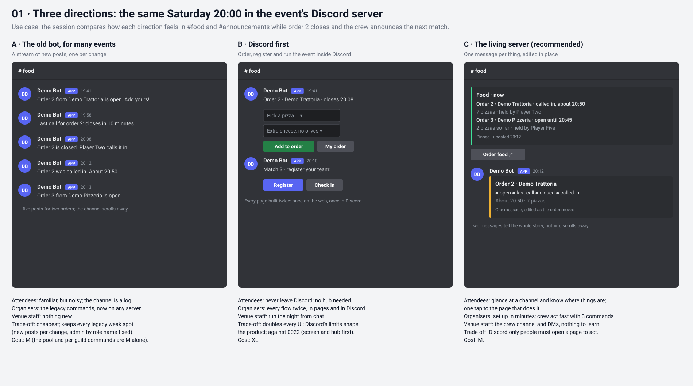

### A · The old bot, for many events
The legacy bot, ported faithfully to the platform: the pool and per-guild commands, its commands minus polls under new APIs, a new post for each change, rights by role id.
- **Attendees:** the familiar commands and posts; channels read as logs that scroll away.
- **Organisers and crew:** the legacy commands, now on any server; setup by a form that takes channel ids.
- **Venue staff:** nothing new.
- **Trade-offs:** the legacy tests carry over best; but it keeps the legacy's weak spots that were not bugs: noise, setup by ids, people stored in snapshots, and features split between Discord and the pages.
- **Cost: M** (the pool, routing and per-guild commands are M alone, whatever the direction).

### B · Discord first
The event runs in Discord: pizza ordering with menus and buttons, team registration, check-in, follows, the announce composer with every option, the crew's tools, all inside Discord.
- **Attendees:** never need to leave Discord; the hub becomes optional.
- **Organisers and crew:** every flow twice, on the pages and in Discord, each with its own limits and bugs.
- **Venue staff:** could run the night from chat.
- **Trade-offs:** doubles every user interface; Discord's limits (five buttons a row, 25 options a menu, a 3-second answer, edit rate limits) shape the product; against 0022's order of surfaces (the screen, then Discord, then the hub as the attendee's home).
- **Cost: XL.**

### C · The living server
Discord mirrors the event and is a quick way in; the platform is where things are done. Few commands, each a door with a private answer; living messages that are always true; setup in minutes with a check; rights by role id mapped to presets; counts, not people.
- **Attendees:** glance at a channel and know where things are; `/food`, `/now`, `/hub` answer privately and link to the page; `/privacy` hides them everywhere.
- **Organisers and crew:** a Discord page with a four-step setup and a check that names every gap and its fix; roles mapped to presets; `/announce`, `/ticker` and the photo menu for speed.
- **Venue staff:** nothing to learn; crew among them use the crew channel and their DMs.
- **Superadmin:** the shared bot's health on the stack's health; the legacy import at the switch.
- **Trade-offs:** people who live in Discord must open a page to act (one tap, signed in once per phone); living messages need care with Discord's edit limits and with people deleting them (E2, E4).
- **Cost: M.**

## Recommended direction: the living server
**C.** The platform already speaks events, and the screen, the hub and Notify already listen. What Discord needs is not a second copy of the product but a faithful window on it, with a few fast doors for the crew. C gives the organiser what 0022 calls a core feature, "easy Discord guild setup", and gives attendees a server that reads like a noticeboard rather than a log.

A would port the legacy's shape into a world that no longer needs it: the legacy put everything in Discord because there was no hub and no pages. B would chase that shape further and pay for every feature twice. C costs about what A costs, because the expensive parts (the pool, routing, per-guild commands, secrets) are the same in every direction, and the contract already designed them.

C also takes the hardest part of #122 off the table. The legacy stored snapshots and message counts per person; C stores counts that name nobody and keeps who-is-where only live. The privacy rules then hold by design, not by a deletion job, and a restart loses nothing.

**Design principles**
1. **Discord is a window; the platform is the source.** A command calls the owning module's API with the person's rights; a post comes from an event. Nothing is decided in the bot (D1, D2).
2. **One message per thing, kept true.** A board, an order, an announcement: each one message, edited in place, re-synced after a gap (L1, E1).
3. **Set up in minutes, with a check.** Four steps, then a check that names each gap and its one-line fix (#124, [mockups 02–04](step-6-bot/02-setup-connect.svg)).
4. **Rights by role id, mapped to presets; the event admin never from Discord.** One source of rights per person, shown in People with where each came from (D3, U9).
5. **Counts, not people.** The bot stores counts; who plays what lives only in memory, live, and never for someone who hid (D7).
6. **Few commands, each a door.** Private answers, a link to the page; three crew commands for speed (U1, U2).
7. **One event's trouble stays its own.** As the contract says: per-client failures, per-event queues, no retries in a loop.
8. **The event's voice, the event's language.** The bot's nickname, colour and language are the event's (L6, L8, U5).

## Key flows
Each flow names its users and its mockup. The mockups use the demo event's names only (Demo Event, Demo Community, Demo Trattoria, Demo Player, Player Two, Crew One …) and fictional games (Demo Arena, Space Racer, Block Builder).

### Connecting the server (event admin)
The Discord page's first step picks the bot (the platform's, or the event's own application with its token and secret), the second sends the admin to Discord's install page and back; a refused bind says why in words ([U10](step-6-bot/questions.md#u10-where-does-the-discord-page-live), bot.md Binding a guild).

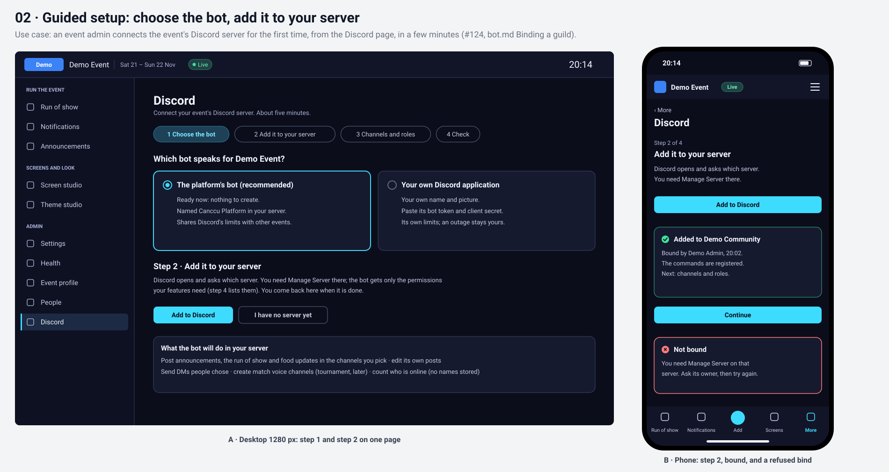

### Channels and roles (event admin)
Each purpose (Announcements, Now and next, Food, Photos, Crew, Tournaments, Match voice) is bound to a channel of the server, created from a template or picked from a list; the roles likewise ([E3](step-6-bot/questions.md#e3-a-bound-channel-or-role-is-deleted-in-discord), [E6](step-6-bot/questions.md#e6-create-what-is-missing-when-the-bots-role-is-too-low)).

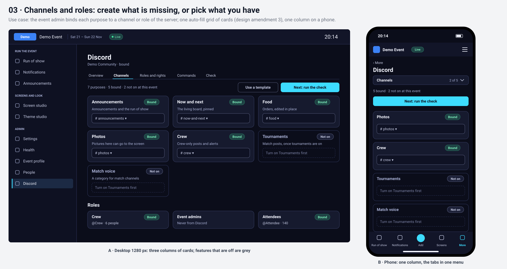

### The permission check (event admin)
For every feature: what the bot needs, whether it has it, and the fix. Re-run after fixing ([D5](step-6-bot/questions.md#d5-which-privileged-intents-does-the-shared-application-hold)).

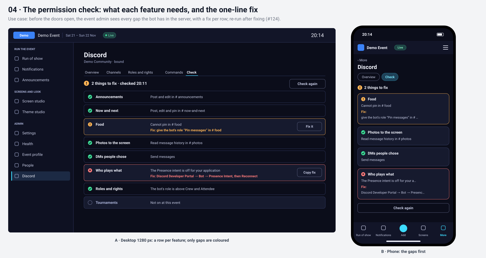

### Roles and rights (event admin, crew)
A role grants presets to holders who signed in and joined; People shows where each right came from ([D3](step-6-bot/questions.md#d3-where-do-rights-from-discord-roles-live), [D4](step-6-bot/questions.md#d4-how-fast-does-a-role-change-take-effect), [U6–U9](step-6-bot/questions.md#u6-must-a-person-have-a-platform-account-to-use-crew-commands)).

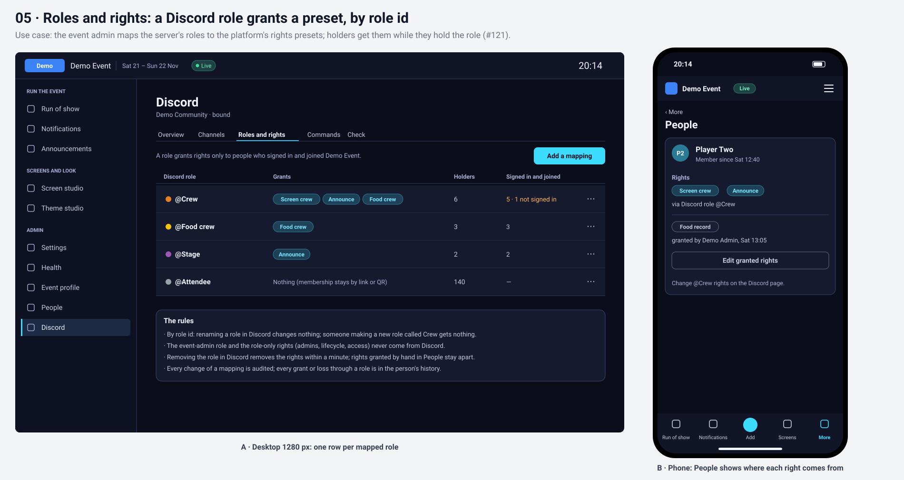

### Commands per feature (event admin)
The event's feature flags decide which commands the server has; turning a feature off removes its commands within a minute ([U4](step-6-bot/questions.md#u4-command-names-the-legacys-or-new), [U5](step-6-bot/questions.md#u5-which-languages-do-the-commands-speak), [O4](step-6-bot/questions.md#o4-command-registration-on-a-new-platform-version)).

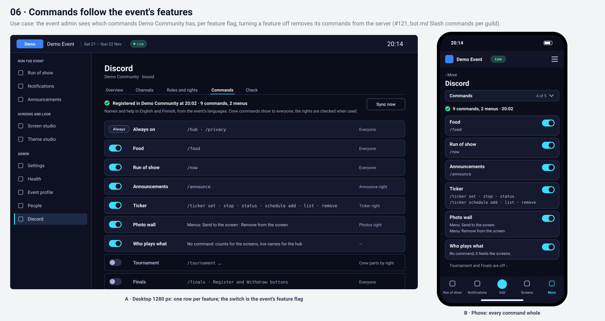

### Attendees in Discord (attendee)
`/food`, `/now`, `/hub`, privately answered with a link; and the replies that say no, kindly: not connected, feature off, no account, no right, no answer in time ([U1](step-6-bot/questions.md#u1-what-does-an-attendee-do-in-discord), [E5](step-6-bot/questions.md#e5-the-3-second-answer-limit)).

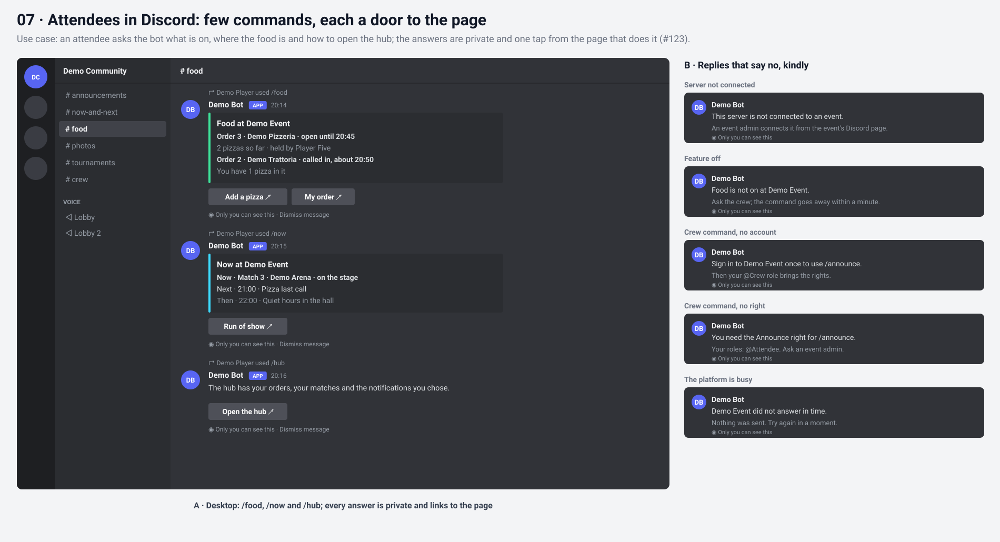

### Announcing from Discord (crew)
`/announce` opens a small form, then a private preview with the level and where, then Send; the post in the announcements channel lives with the announcement: edited, then marked withdrawn ([U3](step-6-bot/questions.md#u3-announce-a-form-in-discord-or-a-link-to-the-composer), [L3–L5](step-6-bot/questions.md#l3-does-an-urgent-announcement-ping-anyone)).

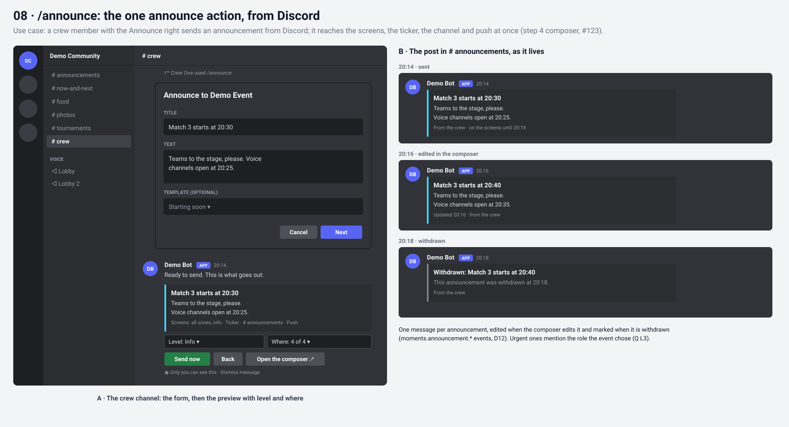

### The ticker and the photo wall (crew)
`/ticker set`, `status` and `schedule add` call Screen's ticker; "Send to the screen" on a message in the photos channel puts its picture on the wall ([D14](step-6-bot/questions.md#d14-ticker-windows-from-discord), [D15](step-6-bot/questions.md#d15-whose-name-goes-on-a-photo-from-discord), [U12](step-6-bot/questions.md#u12-who-may-send-a-photo-to-the-screen), [U13](step-6-bot/questions.md#u13-do-photos-posted-in-the-photos-channel-go-to-the-wall-by-themselves)).

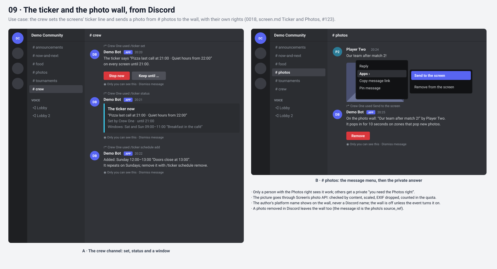

### Living messages (everyone in the server)
The pinned now-and-next board through an evening, and one food order's message from open to "it's here" ([L1](step-6-bot/questions.md#l1-new-posts-for-each-change-or-living-messages), [L2](step-6-bot/questions.md#l2-which-living-messages-in-step-6), [L9](step-6-bot/questions.md#l9-who-is-named-in-the-food-channel), [E2](step-6-bot/questions.md#e2-someone-deletes-or-unpins-a-living-message)).

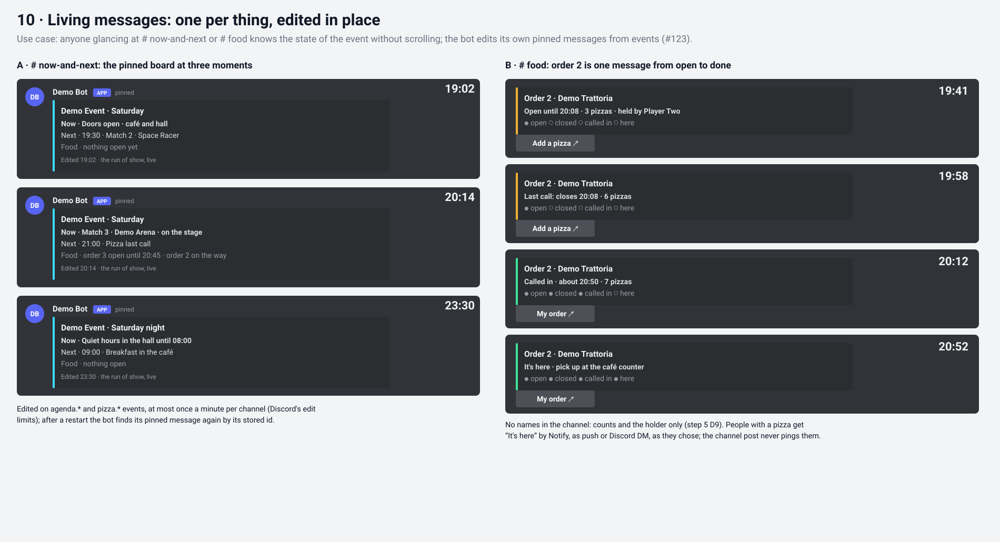

### Presence, privacy first (everyone)
What the bot reads, what it drops before anything, what it keeps live and what it keeps as counts; the data classes; `/privacy` in Discord and the hub's privacy page ([D7](step-6-bot/questions.md#d7-what-does-the-bot-store-about-presence), [D6](step-6-bot/questions.md#d6-message-counts-and-the-top-chatters), [E7](step-6-bot/questions.md#e7-someone-hides-their-activity-mid-event)).

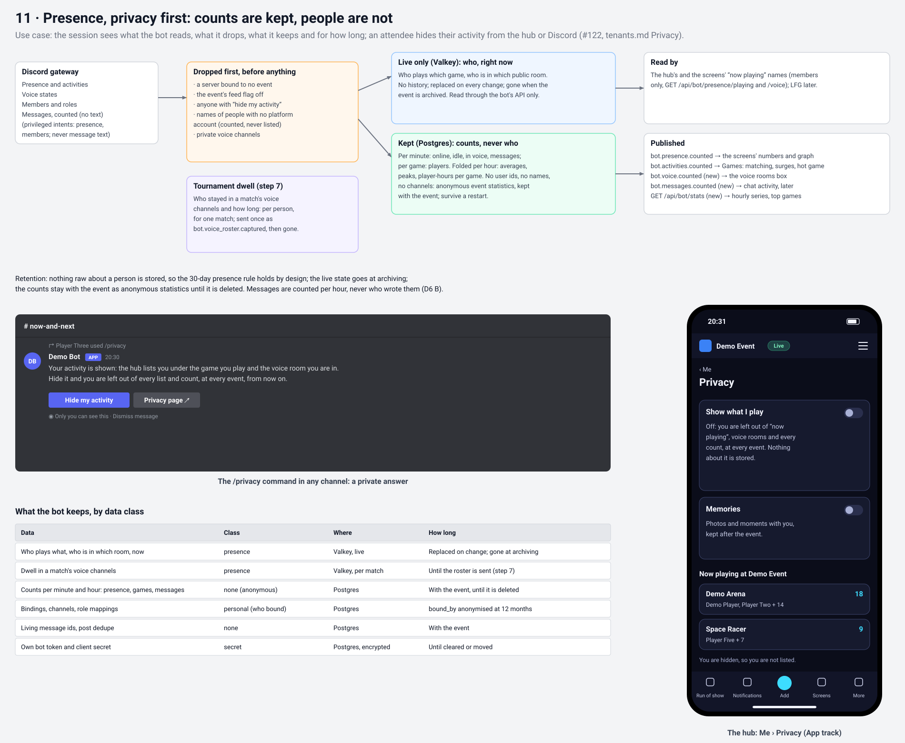

### On the screen and the hub (attendees in the hall)
The dashboard layout fed by the bot's counts, Games' catalogue and surges; the hub's "now playing" with names for members ([D8](step-6-bot/questions.md#d8-voice-rooms-on-the-screen-an-event-or-a-read), [P4](step-6-bot/questions.md#p4-the-games-catalogue-and-surges)).

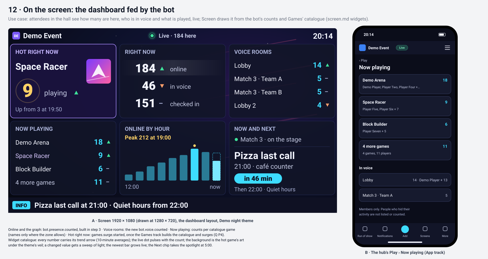

### The bot's health (crew)
Six cards and a history, in words: ready, slowed, what to fix ([O6](step-6-bot/questions.md#o6-who-watches-the-bot-on-the-night)).

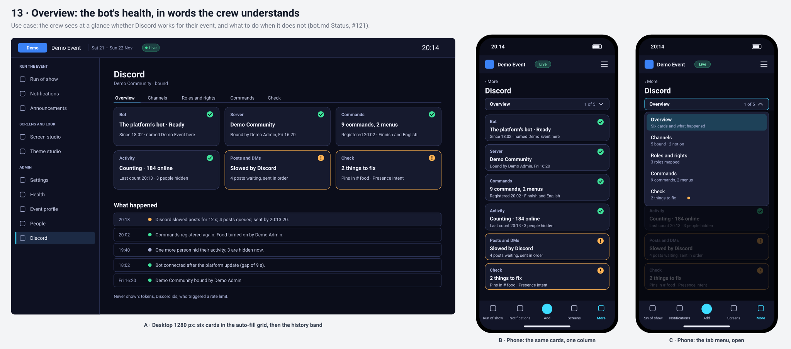

### The legacy import (operator, at the switch)
A dry run with a report, the import, and a second run that changes nothing ([D9–D11](step-6-bot/questions.md#d9-what-does-the-legacy-import-move-oc6-te6), [O5](step-6-bot/questions.md#o5-the-switchs-runbook)).

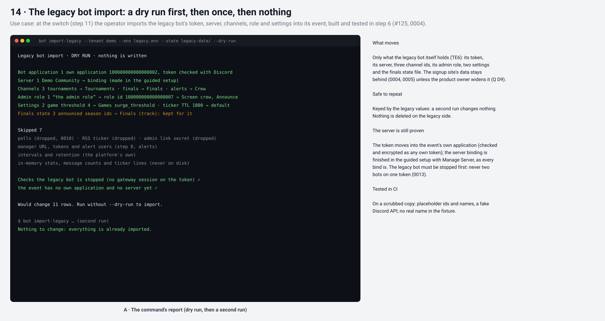

### Edge states (organiser, attendee)
Not connected, a refused token, removed from the server, archived, Discord down, an intent missing ([E1](step-6-bot/questions.md#e1-discord-down-or-the-client-not-ready)).

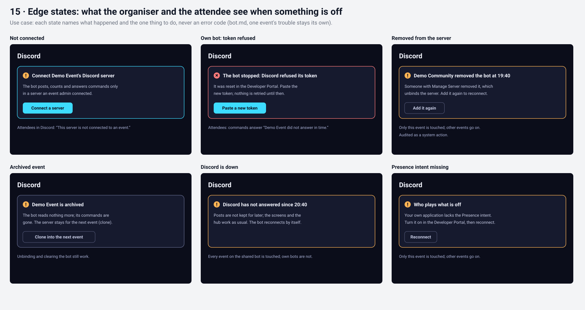

### Every mockup
| File | What it shows | For whom |
|---|---|---|
| [01-directions.svg](step-6-bot/01-directions.svg) | The three directions in one channel at the same moment | the session |
| [02-setup-connect.svg](step-6-bot/02-setup-connect.svg) | Setup steps 1 and 2: choose the bot, add it; bound and refused | event admin |
| [03-channels-and-roles.svg](step-6-bot/03-channels-and-roles.svg) | Purposes bound to channels and roles; create what is missing | event admin |
| [04-permission-check.svg](step-6-bot/04-permission-check.svg) | The check: a row per feature with its fix | event admin |
| [05-roles-and-rights.svg](step-6-bot/05-roles-and-rights.svg) | Roles mapped to presets; People shows the source of each right | event admin, crew |
| [06-commands.svg](step-6-bot/06-commands.svg) | Features and the commands they register | event admin |
| [07-attendee-commands.svg](step-6-bot/07-attendee-commands.svg) | `/food`, `/now`, `/hub` and five "no" answers; the same on a phone (Plan) | attendee |
| [08-announce.svg](step-6-bot/08-announce.svg) | `/announce`: form, preview, send; the post edited and withdrawn | crew, everyone in the server |
| [09-ticker-and-photos.svg](step-6-bot/09-ticker-and-photos.svg) | The ticker commands; "Send to the screen" | crew |
| [10-living-messages.svg](step-6-bot/10-living-messages.svg) | The now-and-next board; one food order's message; both on a phone (Plan) | everyone in the server |
| [11-presence-and-privacy.svg](step-6-bot/11-presence-and-privacy.svg) | What is read, dropped, kept live, kept as counts; data classes; `/privacy`; the hub's privacy page | everyone |
| [12-on-the-screen.svg](step-6-bot/12-on-the-screen.svg) | The dashboard layout fed by the bot, alive with the widget catalogue (Plan); the hub's now playing | attendees in the hall |
| [13-bot-health.svg](step-6-bot/13-bot-health.svg) | The Overview tab: six cards and what happened; the phone's tab menu, open (Plan) | crew |
| [14-legacy-import.svg](step-6-bot/14-legacy-import.svg) | The import's dry run and its second run | operator |
| [15-edge-states.svg](step-6-bot/15-edge-states.svg) | Six states, each with its one action | event admin, attendee |
| [16-chat-activity.svg](step-6-bot/16-chat-activity.svg) | New for the Plan: `activity_graph` with `metric: messages` beside the online graph; quiet, busy and collecting (D6 B) | attendees in the hall |

## Port, drop or invent
Each with its reason ([0020](../decisions/0020-best-of-old-freely-new.md)). "Tests" means the legacy test file comes along as the spec, adapted.

### Port as is (code and its tests, with clock, zone and storage injected)
| Legacy | Reason |
|---|---|
| Steam cover lookup and its cache (`steam_cover.py`, 86 %) | Pure, tested; it moves to **Games**, which owns covers (D13), not to the bot |
| Carousel photo naming (`carousel_photo_naming.py`, 10 tests) | Pure; names the photo and its `source_ref` |
| The surviving validators and formatters (`utils/`): durations, game names, links | Pure; the poll and admin-role parts go |

### Port with changes
| Legacy | Change | Reason |
|---|---|---|
| Presence, voice and game trackers (`presence_tracker.py`, `voice_tracker.py`, `game_detector.py` counting) | Counts per minute folded per hour on Postgres; who only live in Valkey; feeds dropped first by flag, binding and opt-out; a test for each tracker (presence had 25 %) | D7; legacy known problem 1 (lost on restart) |
| Time-weighted play duration (`game_play_duration.py`) | Becomes player-minutes per activity in the hourly counts | "Top games by player-hours" with no person stored |
| Stats history (`stats_history.py`) | Built from the hourly counts, served by `GET /api/bot/stats`; the 24-hour series Screen already keeps stays Screen's | D7; one source per number |
| Health (`health_server.py`) | The kit's health shape, `checks.discord_shared` | bot.md Status |
| Ticker commands (`cogs/ticker.py`, `ticker_ops.py`) | Call `PUT /api/screen/ticker` and the ticker windows with the person's rights; `schedule add` takes days and times | 0018; D14 |
| Photo carousel menus (`cogs/photo_carousel.py`) | "Send to the screen" and "Remove from the screen" call `POST` and `DELETE /api/screen/photos`; no separate token | Known problem: tokens in env; one API |
| `/signage-announce` and `/signage-clear` | `/announce` calls Moments' composer API; withdrawing is the composer's | One announce action (0022) |
| `/pizza order`, `/pizza claim` | `/food`: a private answer with the open orders and a link; no tokens | 0010 drops tokens in links |
| Per-guild command sync at start-up | Per-guild bulk overwrite from flags, only when the set changed (O4) | bot.md; Discord's daily limits |
| Admin check by role name (`has_admin_role`) | Rights from role ids mapped to presets, in admin as their own source | Known problem 2; D3 |
| The legacy's `.env` and two state files | Read once by the legacy import | #125, D9 |
| Mention and link guard (`utils/tourney_guard.py`: no-mentions, links only on the event's host) | Applied by the new bot to every post and reply that carries other people's words (announcements, ticker replies, the board, food orders); the allowed host is the event's, not one tourney URL; an urgent announcement's picked role is the one exception (L3). Its tests come along | Posts that relay people's text must not ping or link out; #121 (default, helper) and #122 (the posts) |
| Link buttons (`utils/link_button.py`: a link-style button instead of a long URL) | The label comes from the event's language; used by the private answers, the sign-in reply, the food order and the announce preview ([#122](#122--featbot-the-living-server-counts-commands-living-messages-and-dms)) | Short, tidy replies; the URL stays out of the text |

### Drop
| Legacy | Reason |
|---|---|
| Polls, their screen views and ticker line | [0010](../decisions/0010-scope.md) |
| The RSS ticker | 0010 |
| `/adminlink`, the HMAC login link | The central sign-in replaces it (0013 item 10) |
| `/help` | Discord lists the commands, localised (U5) |
| `/stream` stubs | Cast is its own track |
| Message counts per person, nicks and top chatters | Per-person data kept forever, for a board nobody used (D6). The Plan counts messages per hour after all, with no person kept ([D6 B](#chat-activity-d6-b)) |
| The signage control client, directive labels and LAN-display URLs | Moments ranks and draws; Screen serves (0010) |
| The hot-game episode and cool-down in the bot | Games detects surges (D13) |
| The manager heartbeat watcher | 0010; step 10's watchdog |
| The signup site's API client and `TournamentMemoryStore` | Each call becomes a module's API or an event |
| `message_content` intent | Never used (known problem 4, D5) |
| The worker stub, the LXC scripts, the systemd unit as root | Containers (0010) |

### Moved to another step
| Legacy | To | Reason |
|---|---|---|
| Tournament commands, reminders, match voice channels, dwell roster, cleanup and backstop | Step 7 | P3: built with the tournament module's events, not twice |
| Manager alerts with Acknowledge, `/platform status` | Step 8 | OC4, P5 |
| Mini-tourney watcher posts and finals cards | Finals track | The `finals` module emits; the bot posts under the Finals flag (P8). The legacy posts now carry no link, point to `/finals` and go through the guard ([Roadmap notes](#roadmap-notes)) |
| `/finals` (link, Register, Withdraw through the provider API) | Finals track | Live on the legacy bot; the Finals track builds it on #121's framework ([what it needs](#what-finals-needs-from-the-framework)) |

### Invent
| New | Why |
|---|---|
| The Discord page: guided setup, channels and roles by purpose, the permission check with fixes, commands per feature, Overview | "Easy Discord guild setup" (0022); the legacy was set up by hand from `.env` |
| Rights from Discord roles as admin's own source, shown in People | One place for rights; no fight between sync and hand grants (D3) |
| Commands acting with the person's rights through a short-lived token | Every module keeps checking its own rights (D2) |
| Living messages (now and next, food orders, announcements) | A channel that is always true (L1) |
| `/now`, `/hub`, `/privacy` | Doors to the run of show, the hub and the privacy flag (U1) |
| Counts without people, hourly, on Postgres; `bot.voice.counted`; `GET /api/bot/stats` | D7, D8 |
| Commands in the event's languages; the bot's nickname and colour per event | U5, L6, L8 |
| The legacy import with a dry run, idempotent | #125, 0004 |
| A fake Discord (REST and gateway) for tests | O3; the legacy mocked Discord ad hoc |

## Where the issues and the contracts disagree
The issues were written before several contracts and steps landed. The pack follows the contracts and proposes the issue text to match.
1. **#122's hot-game detection and Steam covers:** [games.md](../../contracts/games.md#surges) gives surges and covers to Games; the roadmap's step 6 text says so too. The bot only counts (D13).
2. **#122's "shown as hidden":** the tenants contract says an opted-out person is **absent**: neither listed nor counted. The pack follows the contract ([mockup 11](step-6-bot/11-presence-and-privacy.svg)).
3. **#122's "raw snapshots deleted 30 days after archiving":** with counts only there are no raw snapshots of people; the live state goes at archiving, earlier than the rule (D7).
4. **#123's title, "commands through events":** the catalog says a command is a call to the owning module with the person's rights; posts consume events (D1).
5. **#121's "a `bot.client.*` event per client":** the contract has one event, `bot.client.changed`, with a status and an error code, debounced per event. The pack keeps the contract's.
6. **#121's "a tenant switches between clients without a restart":** already in the contract (the shared bot or an own application, opened and closed live).

## Proposed issue changes
The Plan replaces this section: three tickets, #123 into #122 and #124 into #121 ([The final issue set](#the-final-issue-set)). The pack's text stays as the research.

The lead applies these after the session; the pack's author creates and edits no issues. Every contract item below is additive and ships with the code that uses it ([0029](../decisions/0029-additive-contracts-ship-with-consumers.md)). Risk follows [P6](step-6-bot/questions.md#p6-risk-classes).

### #121 · the bot module, the pool, commands and rights from roles (keep, rewrite; high)
Proposed title: `feat(bot): the bot module: the client pool, commands per server and rights from Discord roles`.
- [ ] `modules/bot` on the kit, implementing [bot.md](../../contracts/bot.md) as written: connections, own applications with encrypted write-only secrets, the install flow and its checks, routing by guild, per-event queues, clone, unbind and the deletion hooks; its tests against a fake Discord (O3)
- [ ] The command framework: per-guild bulk registration from flags, written only when the set changed (O4); the flag checked again in the handler; localised names and answers (U5); every call deferred and answered within 10 seconds with an idempotency key (E5)
- [ ] Commands act with the person's rights through a short-lived token from admin (D2); someone without an account, or not a member, gets a sign-in link (U6)
- [ ] Rights from Discord roles: mappings by role id to presets or single grantable rights, never the event-admin role or role-only rights (U9); written by the event-admin role (U8); kept by admin as their own source, shown in People (D3); applied within a minute from member updates, at sign-in and by a reconcile (D4); audited; tested, including a renamed role and a look-alike role
- [ ] Intents: presence and members, never message content (D5); each feed under its flag, dropped first
- [ ] The commands' flags in `contracts/flags.yaml`; the bot's events (`bot.client.changed` and the rest) on the kit's bus with its retries and dead-letter log (D16)
- [ ] The Discord page's Overview tab and the menu item (U10, [mockup 13](step-6-bot/13-bot-health.svg)); health with `checks.discord_shared`
- [ ] Contract parts: bot.md (commands, flags, intents, events, mappings), admin.md (the rights source, the acting token, new presets), the shell's menu

Out of scope: presence and counts (#122); the commands' own features (#123); the setup wizard and the check (#124).

### #122 · presence, voice and games as counts, privacy first (keep, rewrite; high)
Proposed title: `feat(bot): presence, voice and games as counts, privacy first`.
- [ ] Counts per minute (online, idle, in voice, members; players per activity) folded per hour on Postgres; player-minutes per activity; no user id or name stored (D7), built on the legacy trackers and their logic, with a test for each
- [ ] Who plays what and who is in which public room, live only in Valkey, behind `GET /api/bot/presence/playing` and `/voice` as bot.md says; a module path for Screen's `now_playing`
- [ ] `bot.presence.counted` and `bot.activities.counted` as the catalog outlines; new `bot.voice.counted` for Screen's `voice_rooms` (D8); `GET /api/bot/stats` for the hourly series and the top games (D7)
- [ ] The opt-out filter: someone who hid is never listed or counted, from the next read; tested at every output (E7)
- [ ] Retention: the live state goes at archiving; the counts stay with the event, anonymous
- [ ] Restart test: counts and the live state survive a restart of the bot
- [ ] Screen's `voice_rooms` fed (its first user, so its part ships here)

Out of scope: surges, the hot game and covers (Games track, D13); message counts (D6; the Plan counts them per hour, [D6 B](#chat-activity-d6-b)); the screen's other widgets (built).

### #123 · the commands and the living messages (keep, rewrite; normal)
Proposed title: `feat(bot): announce, ticker, photos and food commands, and living messages`.
- [ ] `/announce`: a form, a private preview with level and where, Send through Moments' API (U3); the post in the announcements channel edited and marked withdrawn from `moments.announcement.*` (L4, L5); urgent mentions the event's chosen role (L3)
- [ ] The ticker commands (`/ticker set`, `stop`, `status`, `/ticker schedule add`, `list`, `remove`) calling Screen's ticker and its windows (0018, D14)
- [ ] "Send to the screen" and "Remove from the screen" on messages, through Screen's photo API, with the legacy naming and `source_ref` (D15, U12)
- [ ] `/food`, `/now`, `/hub`, `/privacy` with private answers and links (U1)
- [ ] Living messages: the now-and-next board and one message per food order from `pizza.order.*`, edited in place, re-synced after a gap and re-posted if deleted (L1, L2, E1, E2, E4); the run-of-show posts as bot.md and L7
- [ ] Notify's `notify.dm.requested` delivered as DMs (D12)
- [ ] CI screenshots of the Discord page's views; the fake Discord's transcripts for the Discord side

Out of scope: tournament commands and channels (step 7, P3); crew alert DMs (step 8, P5); native Discord scheduled events (later).

### #124 · guided guild setup and the check (keep, rewrite; normal)
Proposed title: `feat(bot): guided Discord setup, channels and roles by purpose, and the permission check`.
- [ ] The setup steps on the Discord page: choose the bot, add it, channels and roles, check ([mockups 02–04](step-6-bot/02-setup-connect.svg))
- [ ] Purposes bound to channels and roles; "create what is missing" from a template; pick existing ones; missing ones shown (E3, E6)
- [ ] The check: for every feature what the bot needs (permissions, intents, role order) and a one-line fix
- [ ] The Roles and rights tab and the Commands tab (calling #121's API)
- [ ] Clone carries the purpose bindings with the server
- [ ] Phone and desktop, the grid of amendment 3; CI screenshots beside the mockups; tests against the fake Discord for create, bind and the check

Out of scope: enforcing rights (#121).

### #125 · the legacy bot import (keep, rewrite; high)
Proposed title: `feat(bot): the legacy bot import, with a dry run`.
- [ ] A command that reads the legacy `.env` and state files and imports, into one event: the token as its own application (checked with Discord, encrypted), the proposed purpose bindings and the admin role's mapping, the two settings, and the finals state for the Finals module (D9, D11)
- [ ] `--dry-run` with a report: rows per kind, skipped rows and why ([mockup 14](step-6-bot/14-legacy-import.svg)); refuses while the legacy bot still holds its gateway session
- [ ] Idempotent: a second run changes nothing; nothing deleted on the legacy side
- [ ] Tested in CI on a scrubbed copy (placeholder ids and names) against the fake Discord
- [ ] The cut-over steps in the module's README (O5; the Plan's [switch](#the-switch) waits for `/finals`, not step 11)

Out of scope: running it (step 11; the Plan moves the switch out of step 11, [The switch](#the-switch)); the signup site's data (D9).

### Moved out of step 6 (proposed)
The tournament side of #123 to step 7 (P3, order change OC8 reversed); crew alert DMs with Acknowledge to step 8 (P5, with OC4); the hot game and covers of #122 to the Games track (D13); `/finals` to the Finals track (P8).

### Order (a sketch for the planner)
The Plan's [order](#order-packages-by-dependency-chain) replaces this sketch: #121 alone, then #122 and #125 in parallel.

1. **#121** first, alone: high risk, one accept; its command framework, rights and contract parts unblock the rest.
2. Then, in parallel: **#122** (high, its own accept; touches no page) and **#123 with #124** (normal, both on the Discord page and the commands; one package if they share too many files).
3. **#125** last: it builds on #121's connection and #124's purposes.

## Proposed exit criteria
The Plan's [step 6 gate](#the-step-6-gate) takes these and adds the chat activity count.

The roadmap's "dashboard data and rights come from the new bot on the test server; the migration passes its test", made checkable:
- On a Discord test server, an event admin connects the server through the guided setup, binds the purposes and gets a clean check.
- A crew member whose rights come from a mapped role sends `/announce`; it reaches the screen, the ticker, the announcements channel and push; removing the role takes the right away within a minute.
- The screen's numbers, graph and voice rooms come from the bot; after a restart of the bot nothing is lost; someone who hid is neither listed nor counted.
- The now-and-next board and a food order's message stay true through an order's life.
- The legacy import passes its test on a scrubbed copy: the dry run's report, the import, and a second run with no changes.

## Roadmap notes
The Plan's [roadmap notes](#roadmap-notes) take these and add the switch and the photo queue.

- **OC8 reversed:** the bot's tournament side moves to step 7, built with the tournament contract (P3).
- **The Games track's first package** (catalogue, matching, surges) is worth running beside step 6, or the hot game and the screens' "now playing" names wait for it (P4).
- **Step 6's "In it"** could say "living messages" and "counts, not people" once P1 and D7 are decided.

## Open questions
The [question bank](step-6-bot/questions.md) holds every open question found: 61 in six themes, each with options and a recommendation. **Decide first:** P1 (the direction), D3 (rights from Discord roles), D2 (how a command acts for its person), D7 (counts, not people), L1 (living messages), P3 (the tournament side), P4 (the Games catalogue), D9 (what the legacy import moves).
