# Step 7 brief: Tournament (research pack)

The research pack for the product owner's brainstorming session on [step 7, Tournament](../roadmap.md#7-tournament) (epic #61), issue #126. It follows the [outline of a research pack](README.md#outline-of-a-research-pack), the issue's criteria and the lead's comments on #126 (2026-11-07: the step 2 notes; 2026-11-08: a research pack with every key screen mocked up, a question bank, and the issues as input; 2026-11-12: the design guideline for the leaderboard and bracket widgets). It is built like [step 5's pack](step-5-pizza.md). After this merges, the lead runs the session over as many rounds as it takes, writes the final plan into this brief (`## Plan`) and rewrites the step's issues; the product owner accepts the plan before any build starts.

> **Source update (2026-11-20, #677).** The [canccubot](../legacy-inventory/canccubot.md) and [mini tourney](../legacy-inventory/thefinals_mini_tourney.md#refresh-2026-11-20) inventories were refreshed to their current code; nothing this pack takes from the signup site changed. What it touches, with no decision of this pack changed:
> - [U18](step-7-tournament/questions.md#u18-what-the-bot-needs-from-the-module) and [U7](step-7-tournament/questions.md#u7-giving-up-a-place): the legacy bot now has a working sign-up from Discord, `/finals`: one private reply with a status line, a personal link button, and **Register** (the server nickname, cleaned, with a name dialog when it is taken) or a red **Withdraw** behind a Yes / No confirm, allowed until teams are formed. A ready model for recommendation A's `/tournament register` and "I can't make it".
> - [D11](step-7-tournament/questions.md#d11-pushes-and-dms): every bot message built from names now goes out with mentions off and only the tourney's own links; the same rule fits the tournament's posts and DMs.
> - [E9](step-7-tournament/questions.md#e9-a-session-cancelled-or-ended-early): the mini tourney now cancels a running season and keeps it in history as `cancelled`, with no ranking effect, as recommendation A does for sessions.
> - [E13](step-7-tournament/questions.md#e13-the-format-mix-up-bug-and-other-legacy-bugs): the `four`/`fourqc` mix-up is still in the mini tourney and in the extracted [finals-core](https://github.com/glyzer/finals-core) v1.0.1, so recommendation A (that test belongs to the Finals track) holds.

> **Revised for 0030 (2026-11-20, #682) and the lead round (2026-11-21, decision 0031, recorded in #695).** [Decision 0030](../decisions/0030-finals-integrated-one-tourney-core.md) integrates the Finals app as it is and makes one tourney core the engine of the cup. The product owner's lead round decided two more things: **mini tournaments for any game wait until after version 1**, and **things planned in time are a day schedule, not a card grid**. So this pack now holds:
> - the direction is **C**, as first recommended, with the general core as its engine: finals-core 2.0.0 is still built fully general in step 7 and the cup runs on it. The core's design is #681's core plan (`docs/plans/tourney-core.md`, in PR #688 while this is written; "the core plan" below). A Finals champion adds no Tournament points, and THE FINALS mini tourney is integrated from day 1 as the Finals track's, unchanged;
> - [Re-weighed for 0030](#re-weighed-for-0030): what the core gives directions A, B and C; [Games, Finals and Tournament](#games-finals-and-tournament-since-0030);
> - the day schedule rule (design principle 11) and five redrawn mockups: [05](step-7-tournament/05-sessions.svg), [06](step-7-tournament/06-session-desk.svg), [15](step-7-tournament/15-day-schedule.svg) (which replaces the grids sheet), [02](step-7-tournament/02-flow-register.svg) and [14](step-7-tournament/14-follow-and-champions.svg); mockup [18](step-7-tournament/18-finals-and-tournament.svg) shows the cup and THE FINALS only;
> - [Later: mini tournaments (after version 1)](#later-mini-tournaments-after-version-1): their flows and mockups [16](step-7-tournament/16-mini-player.svg) and [17](step-7-tournament/17-mini-crew.svg), kept and marked later, and their questions, kept and not asked now;
> - in the [question bank](step-7-tournament/questions.md): 5 new questions (D18, P9, F1 for 0030; U19 and D20 for the lead round), 12 changed by the core, 8 back to their accepted answers and 9 changed by the lead round (U5, U7, U10, E7, D11, E2, D2, D12, P3); updated [port, drop or invent](#since-0030-from-the-core), [contract gaps](#what-the-built-contracts-get-wrong), [proposed issues](#proposed-issue-changes), exit criterion and [roadmap notes](#roadmap-notes-found).

> **Lead round of 2026-11-21 (the second, #682).** The product owner reviewed the plan against that day's tournament and made six decisions, folded into direction C, the flows, port / drop / invent, the proposed issue changes, the question bank and the mockups. One is a removal; the other five are kept or added:
> 1. **No waiting list.** Dropped everywhere: `waiting_count`, the waitlisted and promoted events, the "moved up" push and replacing no-shows from a list. Places per session stay optional and off by default; a full session shows "Full" ([U5](step-7-tournament/questions.md#u5-capacity)).
> 2. **Reopen registration for a while.** A crew action until a time or for N minutes, and "Close now"; it closes by itself through the scheduler; registrants and followers get a push; the screen and hub show it; the History records it ([U19](step-7-tournament/questions.md#u19-reopening-registration-for-a-while), [mockup 20](step-7-tournament/20-reopen-and-delay.svg)).
> 3. **Delay sessions by hand.** Following `agenda.item.delayed` stays, and a crew action delays one session or it and every later one that day ([E2](step-7-tournament/questions.md#e2-a-session-moves), [mockup 20](step-7-tournament/20-reopen-and-delay.svg)).
> 4. **A tournament lead and helpers.** The lead holds every tournament right and is the named contact; the crew runs the desk, check-in, results and awards, and can reopen or delay, but changes no settings, scoring, final or crew ([D12](step-7-tournament/questions.md#d12-rights), [mockups 13](step-7-tournament/13-settings-and-rights.svg) and [19](step-7-tournament/19-crew-scoring-awards.svg)).
> 5. **Named awards.** MVP and other award types with default points, given by the crew, added to the session's points, shown in the standings breakdown and on the champions page ([D20](step-7-tournament/questions.md#d20-awards), mockups [19](step-7-tournament/19-crew-scoring-awards.svg), [07](step-7-tournament/07-results-and-corrections.svg), [08](step-7-tournament/08-standings-and-final.svg), [14](step-7-tournament/14-follow-and-champions.svg)).
> 6. **An editable scoring system.** The lead edits the points table (more places can be added, a per-rank table is available); a change after results exist recalculates, asks for a reason and is recorded ([D2](step-7-tournament/questions.md#d2-formats-and-points), [mockup 19](step-7-tournament/19-crew-scoring-awards.svg)).
>
> The recommendation is still **C**; the legacy paragraph and the directions change only where they named the waiting list.

> **Lead rounds 3 to 5 (2026-11-21, #682).** The pack was revised three more times, each folded into the flows, the mockups, the question bank, the contract gaps and the proposed issues:
> - **Round 3:** the season is individual, and a team lives for one session.
> - **Round 4:** sign-up is one "My sessions" page for any number of sessions, with nudges (a closing chip, a bell "Remind me", last call, Ask to join) ([U20](step-7-tournament/questions.md#u20-signing-up-without-missing-out), mockups [21](step-7-tournament/21-my-sessions.svg) and [22](step-7-tournament/22-signup-nudges.svg)); scoring from a screenshot with three sources for who played ([D21](step-7-tournament/questions.md#d21-scoring-from-a-screenshot-three-sources-and-a-reveal), [23](step-7-tournament/23-scoring-screenshot.svg)); the hall screen around the tournament ([L10](step-7-tournament/questions.md#l10-the-screens-around-the-tournament), [24](step-7-tournament/24-screens-around-tournament.svg)); clips and photos ([D22](step-7-tournament/questions.md#d22-clips-and-photos-from-participants), [25](step-7-tournament/25-clips-and-photos.svg)); PC and phone are equal ([L11](step-7-tournament/questions.md#l11-pc-and-phone-are-equal), [26](step-7-tournament/26-pc-layout.svg)).
> - **Round 5 (the last):** the mockups say only what people read: no code or event names, delay minutes are quick picks (+5, +10, +15, +30, Other), every time and point on them follows the decisions (the 3 / 2 / 1 / 0 default table, a close 30 minutes before the start, an overlap warning only where two sessions overlap), and contacts are demo names. New widgets are named in the brief, not on the mockups.

> **Lead round 6 (2026-11-21, #682): the product owner reviewed every sheet.** Folded into the principles, the flows, the mockups, the question bank, the proposed issues and the recommendation:
> - **The tournament runs itself** (new design principle 1, [O12](step-7-tournament/questions.md#o12-the-tournament-runs-itself)): the crew defines the sessions in advance and the schedule does the rest; the desk and the phone show what happens next and when, with an override ([06](step-7-tournament/06-session-desk.svg), [09](step-7-tournament/09-crew-phone.svg)).
> - **The session form** holds game art found from the game's name (the legacy's cover-art chain) or a Steam store link, an optional instructions link, and voice rooms made automatically ([D23](step-7-tournament/questions.md#d23-the-session-form), [05](step-7-tournament/05-sessions.svg)).
> - **Sign-up by day** ([21](step-7-tournament/21-my-sessions.svg), [26](step-7-tournament/26-pc-layout.svg)); a bell button **"Remind me"** ([22](step-7-tournament/22-signup-nudges.svg)); reopening is one number of minutes ([20](step-7-tournament/20-reopen-and-delay.svg)).
> - **Awards are given on the player row while scoring** ([19](step-7-tournament/19-crew-scoring-awards.svg), [23](step-7-tournament/23-scoring-screenshot.svg)).
> - **The screens are loud:** six key moments as full 1920×1080 frames ([24](step-7-tournament/24-screens-around-tournament.svg)); the player card ([D24](step-7-tournament/questions.md#d24-the-player-card), [08](step-7-tournament/08-standings-and-final.svg)); a champions page that is a hero and a ranked list ([14](step-7-tournament/14-follow-and-champions.svg)).
> - **Clips and photos:** no consent ticks for game captures, links as well as uploads, and rules for when and how often things are shown ([25](step-7-tournament/25-clips-and-photos.svg)). **Teams** are one panel with one invite line ([03](step-7-tournament/03-teams.svg)). **The finalist default is 4**, a setting, everywhere. **Two waves** (decision 14) are written into the recommendation and the proposed issues.
> - The ten leftovers of the review at 7fac8f3 are fixed, and every sheet was rendered in headless Chromium at its drawn size: no text overlaps another or leaves its box.

**In this pack**
- This file: goal, what was read, what earlier steps already built, how others solve it, three directions and the recommended one, the key flows, port / drop / invent, the lead's notes, what the built contracts get wrong, proposed issue changes and exit criteria.
- [step-7-tournament/questions.md](step-7-tournament/questions.md): the question bank, 89 questions asked now in seven themes (76 in six themes before the 0030 revision), each with options and a recommendation, and 17 more kept under Later, not asked now. IDs (U3, D1, …) are used throughout.
- [step-7-tournament/](step-7-tournament/): 26 SVG mockups (15, with 16–17 kept for later, 18 added for 0030, 19–21 for the lead round and 22–26 for its fourth round; thirteen of them redrawn for the sixth), drawn new, with the demo event only. GitHub shows them inline below. Organiser pages are drawn in the dark organiser shell of `packages/ui` with the Demo night tokens (as the step 4 polish and grids sheets); attendee pages in the hub's frame; the venue screen in the screen look. Each sheet states its use case. Every sheet was rendered in headless Chromium at its drawn size, and no text overlaps another or leaves its box (see [Every mockup](#every-mockup)).

## Goal
Players register, play and follow a tournament on the platform ([roadmap](../roadmap.md#7-tournament)). The roadmap's "In it": the tournament system ported and polished ([0022](../decisions/0022-product-vision.md)): check-in, no-shows, result corrections with an audit trail, seeding; scoring, leaderboard and final, built on the signup site's code; registration inside the module; the bot's voice-channel handshake through events; concurrency with row locks (`SELECT … FOR UPDATE`). The mini tourney is not part of it: it is the `finals` module of the Finals track ([0025](../decisions/0025-finals-and-games-modules.md)). Exit: a test tournament runs end to end.

**Since [0030](../decisions/0030-finals-integrated-one-tourney-core.md) and the lead round (decision 0031)** step 7 holds the official tournament as above, on the one tourney core: finals-core generalised, with THE FINALS as one preset, taken as a pinned dependency and still built fully general in step 7, so the cup runs on it. The Finals app stays the Finals track's, integrated as it is from day 1, and adds no Tournament points. Mini tournaments for any game, and with them Games' per-game competition rules and the rosters and rounds for casual play, wait until after version 1; the roadmap's step 7 text is updated by the lead with decision 0031. Exit: a test tournament runs end to end, with one session played as a bracket from the core.

The step's three build issues: #127 (the contract, sessions and registration), #128 (scoring, leaderboard and the final), #129 (check-in, no-shows, result corrections and seeding). This pack treats them as input ([P2](step-7-tournament/questions.md#p2-the-issue-set)).

## What was read
- **Decisions:** [0022](../decisions/0022-product-vision.md) (the tournament "ported and polished"; one standings table is backlog), [0020](../decisions/0020-best-of-old-freely-new.md) (the best of the old, freely new), [0027](../decisions/0027-product-decisions-2026-11-07-08.md) (check-in never mandatory: optional, off by default, per tournament with a per-session switch; matches inside a session optional; joining by venue, link or QR; every account a Discord account; 12-month anonymisation), [0025](../decisions/0025-finals-and-games-modules.md) (the tournament builds on the signup site's code, not the tourney core), [0005](../decisions/0005-signup-site-stays-outside.md) (tournament registration moves into the module), [0004](../decisions/0004-nothing-migrated.md) (no tournament history is migrated), [0013](../decisions/0013-multi-tenant-core.md), [0010](../decisions/0010-scope.md) (no tokens in URLs), [0003](../decisions/0003-event-content-scrubbed.md), [0026](../decisions/0026-briefs-are-research-packs.md), [0029](../decisions/0029-additive-contracts-ship-with-consumers.md) and [0024](../decisions/0024-additive-contract-docs-normal-risk.md).
- **The roadmap:** [step 7](../roadmap.md#7-tournament), step 9 (feeds), order change OC8 (the bot's tournament side is built in step 6 against the catalog and goes live with step 7), and the reuse table's signup-site and canccubot rows.
- **Legacy inventories:** the [signup site](../legacy-inventory/signup-site.md) (tournament features, the route table, the scheduled jobs, the tests, known problems), the [summary](../legacy-inventory/README.md) (T1–T11, X13, flow 2, TB4, N10 and N11), [canccubot](../legacy-inventory/canccubot.md) (the tournament cog, reminders, voice channels, dwell), [canccusignage](../legacy-inventory/canccusignage.md) (the tournament band and the leaderboard asset) and [the mini tourney](../legacy-inventory/thefinals_mini_tourney.md) (only to keep it apart, and for the later mini tournaments).
- **The legacy itself** (read-only): the signup site's tournament schema, its API routes, the 1,433-line session admin page, `roster.ts` (autofill), `score-merge.ts`, `scores.ts` (the leaderboard), `final.ts`, `final-photos.ts`, `display-tournament.ts`, `vc-plan.ts`, the rules page; the bot's `tournament_manager.py`, `tournament_dwell.py`, `tournament_discord_channels.py` and the tournament cog, with their ADRs and tests.
- **Contracts it builds on:** [events.md](../../contracts/events.md#tournament) (the Session, Match and Result outlines and the 17 `tournament.*` events; the bot's `bot.voice_channels.*` and `bot.voice_roster.captured`), [agenda.md](../../contracts/agenda.md#tournament-sessions) (the session mirror and delays), [notify.md](../../contracts/notify.md) (the `tournament` topic; check-in by the rotating QR with `tournament:<ref>`), [moments.md](../../contracts/moments.md) (the `tournament` and `finals` classes, three built-in rules, the crew spotlight), [screen.md](../../contracts/screen.md#widgets) (`bracket`, `leaderboard`, `checkin_qr`, `match_called`, `winner_card`), [tenants.md](../../contracts/tenants.md) (roles, presets, series and clone, retention), [admin.md](../../contracts/admin.md#settings) (settings and rights), [bot.md](../../contracts/bot.md) (who plays what), [games.md](../../contracts/games.md) (the catalogue) and [finals.md](../../contracts/finals.md) (to keep it apart).
- **Briefs and design:** step 3's pack (D17, the agenda's tournament mirror), step 4's plan and [storyboards](step-4-moments/storyboards.md) (presets 2, 3, 4, 9, 19, 22, 24; "one happening has one owner"), [step 5's pack and plan](step-5-pizza.md) (the shape of this pack; the scheduler, rights and `me/summary` patterns), the [App track pack](track-app.md) (P4: the tournament owns its pages in the hub's frame; mockups 09, 10 and 12), the [design guideline](../design/README.md) (amendment 3, grids that scale), [experience-map.md](../design/experience-map.md) and [widgets.md](../design/widgets.md) (the leaderboard and bracket widgets, the animated match called, the crew spotlight).
- **The epic and its issues:** #61, #126 with the lead's three comments, #127, #128, #129; the related #52 (sign-in), #123 (the bot's tournament side), #139 (optional check-in and matches) and #150 (members, series and clone).
- **For the 0030 revision (#682):** [0030](../decisions/0030-finals-integrated-one-tourney-core.md) and the roadmap's [step 7](../roadmap.md#7-tournament), [Finals](../roadmap.md#finals) and [Games](../roadmap.md#games) sections; the core plan of #681 (PR #688: the parameters, formats as data, the API of 2.0.0, THE FINALS preset, the equivalence tests, who uses it, tickets C1–C5); the [mini tourney inventory](../legacy-inventory/thefinals_mini_tourney.md) again, as the model for the later mini tournaments; [moments.md](../../contracts/moments.md#classes-and-the-priority-order) (the `finals` class) and [finals.md](../../contracts/finals.md) (the provider contract the hub's Finals link uses); [`modules/agenda/src/canccu_agenda/day_view.py`](../../modules/agenda/src/canccu_agenda/day_view.py) for the day schedule rule.

## What earlier steps already built
More of step 7 waits for it than any step so far. The consumers are built; only the emitter is missing.
- **The catalog (#137, #139)** outlines the Session (`status` from `scheduled` to `finished`, `checkin_enabled`, `matches`, `voice_plan`, counts with a `revision`), the Match, the Result and 17 `tournament.*` events, with the rule that the module's contract "takes over these names and fields and may add". Check-in and matches are already optional there, as 0027 decided.
- **Agenda (step 3)** mirrors sessions into the run of show (`managed_by: tournament`), applies them by `revision`, refuses organiser edits with `item_managed`, and publishes `agenda.item.delayed`, which the tournament is to follow. Its fixtures validate against the catalog's Session, so a change there shows in its tests.
- **Moments (step 4)** has the `tournament` class (rank 60) and the `finals` class, the built-in rules `match_called`, `standings` and `finals_result`, the cues `tournament.pre`, `.start`, `.post` and `strip.tournament_next` with catch-up, the crew spotlight (`show: standings | bracket`), live `leaderboard` and `session` sources ("Collecting standings…" until fed), and seven presets: Starting soon, Match called, Champion, Check-in open, Stage break, Round start and Champion replay. All are on and idle until the module emits.
- **Screen (step 3)** draws the `bracket`, `leaderboard`, `match_called` and `winner_card` templates and the `checkin_qr` widget, and its Director already orders `bracket` and `leaderboard` first when a tournament runs. Nothing feeds the two widgets yet; `checkin_qr` fetches only the `arrival` purpose.
- **Notify (step 3)** declares the `tournament` topic (the event part on `registration.opened`, the personal part on `match.called`, urgent, and `checkin.opened`) and records check-ins for any `tournament:<ref>` purpose (tested with `tournament:s_12`), emitting `notify.checkin.recorded`.
- **Admin** lists the module ("Matches and brackets") in health. **The kit** has the outbox, the settings client, the rights check and tenant transactions. **The demo profile** turns `tournament` on but holds no tournament data.
- **Not built:** the tournament module (an empty folder), its contract, the central sign-in (#52) and joining (#150), the bot (step 6, #123) and the games catalogue's module.

So the exit, "a test tournament runs end to end", can include the screens and the phones in step 7 itself ([P5](step-7-tournament/questions.md#p5-the-screen-and-hub-feed-in-step-7)).

## How comparable products solve it
| Field | What they do | What we take |
|---|---|---|
| **Esports bracket platforms** | Brackets of every shape, seeding, team rosters with invites, check-in windows, self-reported scores with confirmation, disputes to an admin | Team invites by link or code (U3), a check-in window (U9), seeding (D7); not the bracket engine or self-reporting by default (P4, U8) |
| **Matchmaking services with ready-up** | A ready-up timer per match, auto-forfeit when it runs out, a lobby id handed to the players | "Match called" with a place, a voice room and a lobby id ([mockup 04](step-7-tournament/04-session-evening.svg)); no auto-forfeit by default (E6) |
| **Sports league and fantasy apps** | Season standings, points per result, tie-breakers stated up front, movement arrows | The legacy season stays the spine; a tie-break chain the legacy lacked (D3); ▲▼ on the standings (widgets.md) |
| **Quiz and party-game scoreboards** | One host enters scores fast, a big board shows rank changes, the room cheers | The crew's quick result on a phone ([mockup 09](step-7-tournament/09-crew-phone.svg)); the standings takeover on the screen ([mockup 10](step-7-tournament/10-venue-screen.svg)) |
| **Conference and venue check-in** | A QR at a desk, a badge scan, a list the staff can override | Notify's rotating QR (built) with purpose `tournament:<session>`, and the crew's "mark present" for guests (U12) |
| **Arena screens** | A call to the floor, a countdown, a champion moment with a photo | Moments' Match called and Champion (built), fed by this module (L4, L5) |

The lesson across them: the good ones **tell players where to be and when** (a call, a place, a countdown), **make the host's job one tap** (enter a result, advance the winners), and **make the rules visible before they matter** (points, ties, no-shows). The legacy got the season and the scoring rules right and left the rest to Discord DMs and a 1,433-line admin page.

## The legacy in one paragraph
The signup site's tournament is **one implicit season of sessions**, each one game at a fixed time (about ten over a weekend, mostly team shooters and arena games, one casual solo game, then a final). A session gives coarse placements: 1st, 2nd, participant, no-show, worth 3, 2, 1 and 0 points (plus an optional bonus); in a team game the whole first team gets 1st. Players register one by one through a token link from the bot; teams form by which voice channel a player sits in. The bot drives the timeline by polling: a post at T−60, close and a DM at the deadline, voice channels at T−15 with a screen pin until T+10, a DM at T, and cleanup on the first score save or at T+3 h. Scoring freezes the bot's dwell tracking (10 minutes in a channel qualifies), and the admin page autofills placements from the roster. The leaderboard sums points with no tie-break; the final is one flagged session whose ranks lead the leaderboard once scored, with four photo slots. There are no brackets, capacities, teams, check-in, seeding or audit; corrections are whole-session replaces ([legacy summary, flow 2](../legacy-inventory/README.md#flow-2-a-tournament-session-from-schedule-to-leaderboard)).

## Three directions
The same moment in each: 19:30 on Saturday, the Demo Arena 5v5 semi-finals, the standings tight before Sunday's final.

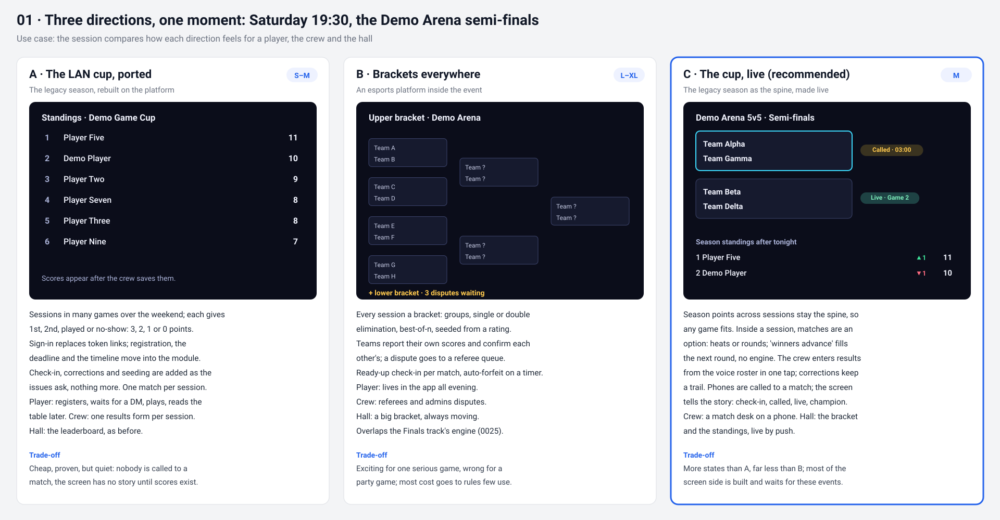

### A · The LAN cup, ported
The legacy season rebuilt on the platform: sessions in many games, coarse placements and points, a final. Sign-in replaces token links; registration, the deadline and the timeline move into the module with a scheduler; the issues' polish is added as written (check-in, no-shows, corrections, seeding) and nothing more. One match per session.
- **Attendees:** register, wait for a DM, play, read the table later. Nobody is called to a match; nobody knows where to be except from Discord.
- **Organisers and crew:** one results form per session, much like the legacy, but safe (locks, audit).
- **Venue staff:** nothing changes.
- **Trade-offs:** the cheapest; the legacy tests are the spec. But the screen and the phones stay quiet: Moments' Match called and Round start never fire, the `bracket` widget stays empty, and the step's polish is only on paper.
- **Cost: S–M.**

### B · Brackets everywhere
An esports platform inside the event: every session a bracket (groups, single or double elimination, best of n), seeded from a rating; teams report their own scores and confirm each other's; disputes go to a referee queue; ready-up check-in per match with auto-forfeit.
- **Attendees:** live in the app all evening; exciting for one serious game, overkill for a party game.
- **Organisers and crew:** referees and dispute admins, at the hours they are busiest.
- **Venue staff:** a big bracket on the screen, always moving.
- **Trade-offs:** most of the cost goes to rules few sessions use; it rebuilds what the Finals track gets from the shared tourney core, which 0025 keeps out of this module; self-reporting invites disputes the legacy never had.
- **Cost: L–XL.**
- **Since 0030:** the cost "it rebuilds what the Finals track gets from the shared tourney core" no longer holds; the core is this module's engine. See [Re-weighed for 0030](#re-weighed-for-0030). Mockup 01 shows the directions as first weighed.

### C · The cup, live
The legacy season kept as the spine and made live. Season points across sessions stay, so any game fits. Inside a session, matches are an option (0027): heats or rounds, filled by "winners advance" with one tap, no bracket engine. The crew enters results from the bot's voice roster in one pass; corrections keep a trail. Phones are called to a match; the screen tells the story: check-in, called, live, champion.
- **Attendees:** register solo or as a team in under a minute from the hub; a For you card and a push at the moments that matter (check in, your match is called, registration is open again); a match page with the place, the voice room and a lobby id; the standings and a champions page.
- **Team leaders:** a team with a name, invites by link or code, a leader who can hand over.
- **Organisers and crew:** a Tournament page as a day schedule, a session desk that says what to do next, results from the roster with awards, a crew phone that runs check-in and matches at the stage, settings with the legacy values as defaults. A tournament lead (the named contact) and helpers; reopen registration for a while and delay sessions by hand.
- **Venue staff:** the stage desk QR and a phone list of who is in.
- **Since lead round 6:** the night runs itself on the schedule the crew set in advance; the crew changes things and scores ([principle 1](#recommended-direction-the-cup-live)).
- **Trade-offs:** more states and tests than A (teams, matches, rounds, awards); a few additive contract fields ([D8](step-7-tournament/questions.md#d8-the-built-contracts-gaps)). It builds no bracket engine and no self-reporting.
- **Cost: M.**

### Re-weighed for 0030
0030 makes the core this module's engine, and the lead round keeps that: the core is still built fully general in step 7 and the cup runs on it. From the core plan, step 7 gets, pure and pinned to 2.0.0: formats as data built from templates (`heats` with winners advance, `single_elimination` with seeding, byes, best of *n* and a third-place game, `groups_knockout`, `open_heats`, and a preset's formats), `draw`, `next`, `validate_result`, `champion`, `bands`, `points` (scoring tables), `standings` (a tie-break chain), `build_teams` (balanced teams of any size) and a seeded random source whose seed is stored with each draw.

| Direction | What the core gives it | What the module still builds | Cost now |
|---|---|---|---|
| **A · The LAN cup, ported** | The season's points and standings as tested functions (D2, D3); nothing else, since A has one match per session | Everything A built before | S–M, unchanged |
| **B · Brackets everywhere** | The whole bracket engine: every format, seeding, byes, series, the team builder. The cost "it rebuilds what the Finals track gets from the core" is gone | Self-reporting with confirmation and a dispute queue; ready-up with auto-forfeit; referees; a format that fits every session's game, party games included | M–L, from L–XL |
| **C · The cup, live** | "Winners advance" becomes the core's `next` instead of a module helper; points and standings as for A; the crew's balanced fill from the team builder (U6); a session may choose a bracket instead of placements only (P4) | The season and the night, as before: registration, teams, check-in, the call, the desk, corrections, the screen | M, unchanged: the helper it no longer writes pays for the bracket choice |

**Does the recommendation change? No: still C**, with the general core as its engine. With the engine free, what is left against B is the night, not the code: a bracket for every session forces party games into formats; self-reporting every official match brings disputes the legacy never had; and auto-forfeit fits matchmaking more than a LAN hall (E6). One of B's parts now costs little and joins C where it fits:
- **Brackets become a per-session choice:** placements only (the default, as the legacy) or a bracket from the core ([P4](step-7-tournament/questions.md#p4-brackets-in-step-7), changed).

The rest of B waits. Player-run competition, mini tournaments for any game with their reports and a crew queue for disputes, and two-side reporting as a session switch come after version 1 (decision 0031): see [Later: mini tournaments](#later-mini-tournaments-after-version-1). The core is built general now so that they need no new engine then.

### Games, Finals and Tournament since 0030
- **Games' role waits.** Competition rules in the catalogue (team size, teams per match, a default format) and the rosters and rounds for casual play belong to the mini tournaments, so they wait with them. **The cup needs none of it:** an official session sets its team size and format by hand, with or without a linked game (D15), and a bracket from the core takes its team size and teams per match from the session. The Games track's competition-rules issue and the rewrite of games.md's opening paragraph come with the mini tournaments (contract gap 7).
- **Finals stays apart.** The Finals app keeps its own data, look and champions; no Finals result adds Tournament points, and no data is synced (0030's Consequences). Where they meet ([F1](step-7-tournament/questions.md#f1-where-finals-and-tournament-meet), [mockup 18](step-7-tournament/18-finals-and-tournament.svg)):
  - **On the screen:** never in one widget. A live cup session leads the Pulse; a THE FINALS card, in the app's own graphics and theming, is its own claim below it.
  - **In Moments:** the cup final's Champion stays Tournament's (`finals_result`, the `finals` class, built); a Finals champion is a moment of its own through the app's connection (the Apps track's hooks, #193), never from a `tournament.*` event. The built `finals` class means the cup's final, not the Finals app: a name clash noted below.
  - **In the hub:** one Play list with the cup and a THE FINALS tile that opens the app with the platform's sign-in link (the Finals track's); separate champions pages.

## Recommended direction: the cup, live
**C.** The legacy tournament worked at real events because of its season: any game, coarse placements, a final that everyone can reach. What hurt was never that shape but the night around it: nobody knew where to be, the bot's DMs were the only voice, the crew scored in a giant form with the first team pre-picked as the winner, corrections overwrote the past, and a down bot left registration open. C keeps the season and fixes exactly the night.

B is tempting because the screen design already draws a bracket, but a bracket is just matches in rounds, and C gets that picture from data the catalog already has (`matches`, `tournament.round.started`) with a "winners advance" helper instead of an engine. The serious bracket game belongs to the Finals track, which has the engine. A would ship the legacy's silence with a new coat of paint, and leave the screen, the phones and Moments' seven tournament presets idle.

**Since 0030** the recommendation holds: C, with a bracket from the core as a session's choice ([Re-weighed for 0030](#re-weighed-for-0030)). "The serious bracket game belongs to the Finals track, which has the engine" above no longer holds: the engine is the core, which this module pins, and a session may choose a bracket from it.

**Two waves (decision 14, lead round 4; split confirmed by the lead in round 6).** Step 7 is built in two waves inside the step. Nothing is cut, and the step's gate needs both waves:
- **Wave 1: the tournament end to end.** Sign-up (the tick list for the whole weekend, Remind me, last call, Ask to join, the overlap warning); the schedule that runs the night by itself (principle 1); the session form (game art, instructions link, voice rooms); the crew roles, reopen and delay; scoring, **including the screenshot reader**, the three sources, remembered in-game names, tap to place and awards while scoring; the standings, the final with **the player card as the finalist intro card**, and the champion; and the core screen moments: last call, match called, the result reveal with awards, the race to the final, the finalist intro and the champion. The screenshot reader is the heart of scoring, so it is wave 1. It carries the exit criterion's run.
- **Wave 2: the show.** Player spotlights, game-stat highlights, rivalries and the biggest climber; session recaps; best moments, and clips and photos (uploads, links, the crew's moderation and the showing rules). The player card is built once in wave 1 for the finalist intro; wave 2 reuses it for the spotlights. Wave 2 needs nothing wave 1 does not already emit, so it ships in packages after wave 1 without a contract change.

**The season is individual (lead, 2026-11-21).** Season standings, the final cut and the champions are per person; a team exists for one session ([U2](step-7-tournament/questions.md#u2-solo-teams-or-both), [U3](step-7-tournament/questions.md#u3-how-teams-form), [D3](step-7-tournament/questions.md#d3-standings-and-tie-breaks)). The mockups were checked: the standings on sheets 08, 10 and 14 list players only; team names appear only in a session's bracket and match (10, 14), and the "Players and teams" tab is a roster, not a standing.

C also costs less than it looks, because the platform has done the far end already: the agenda mirror, Moments' rules, presets and cues, Screen's templates, Notify's topic and check-in all exist and wait for `tournament.*` events. Step 7 builds the module that emits them, and the venue lights up.

**Design principles**
1. **The tournament runs itself (lead round 6).** The crew defines the sessions in advance, preferably before the LAN. On its own schedule, without a button, the module opens and closes registration, sends the reminders and last calls, runs check-in, makes the voice channels at the planned time, calls the matches, plays the screen moments and cleans up. The crew acts only to change something (reopen, delay, rename a team, an exception) and to score. The desk and the crew phone show what happens next and when ("Check-in opens automatically at 19:40"), with an override, and the next action is usually "Nothing to do". No button exists only to start a step the schedule already starts ([O12](step-7-tournament/questions.md#o12-the-tournament-runs-itself)).
2. **Where and when, always.** Every registered player knows their next time, place and room; a called match reaches the phone and the screen at once.
3. **The season is the spine.** Points across sessions, the legacy table as the default, a final for the top of the standings; any game fits because placements are coarse. **The season is individual:** the standings, the final cut and the champions are always per person, as the legacy's `collapseLeaderboardRows` does ("one person once"). A team lives for one session only: each member gets the team's placement points plus any awards of their own, and nothing carries from one session to the next. Team names belong to a session's matches and results, never to the season standings.
4. **Matches are optional, rounds are data.** One match for everyone by default; heats and rounds when wanted; "winners advance" fills the next round, the crew can always edit (P4).
5. **The crew taps once.** The desk and the crew phone lead with the next action; results come from the voice roster; nothing is pre-picked.
6. **Trust the results.** A correction needs a reason, is shown to the players it touches and stays in the session's history; nothing is deleted.
7. **The bot helps, never blocks.** Voice rooms, rosters and DMs are welcome; every step has a manual path when the bot is down (E3).
8. **Safe under load.** Every write is one transaction under a row lock with an idempotency key; events through the outbox; race tests for the last place and the last team member (E1).
9. **Private by default.** Who plays is public inside the event; check-ins and voice rosters are presence data, the opt-out is respected, and names on the screen follow a setting (D5, L7).
10. **One engine (0030).** The cup's rounds, brackets, points, standings and balanced fills come from the one core, its formats frozen per competition (D18); the module builds the night around it.
11. **Planned in time, a day schedule (decision 0031).** Things with a time (sessions, matches, the run of a day) are one day at a time, times down the side, in time order, like the agenda's run of show (`modules/agenda/src/canccu_agenda/day_view.py`), with a day picker; at phone width it is the same list. A card grid stays only for like items with no time order (photo slots).
12. **Nobody misses out (lead round 4).** Signing up for several sessions a day is one page and one tap each; the platform nudges (a closing chip, a star, a last call) and the crew can add a latecomer ([U20](step-7-tournament/questions.md#u20-signing-up-without-missing-out)).
13. **PC and phone are equal (amendment 5, #707).** Every attendee page works fully in a PC browser, with a desktop layout at 1280 px and wider, and on a phone; alerts go through app push or browser notifications, plus Discord ([L11](step-7-tournament/questions.md#l11-pc-and-phone-are-equal)).

## Key flows
Each flow names its users and its mockup. The mockups use the demo event's names only (Demo Event, Demo Game Cup, Demo Arena, Demo Party, Demo Racer, Team Alpha …, Demo Player, Player Two …).

### From the screen to a place in the session (player)
The Tournament page in the hub with the For you card; a session; registered with the timeline; full ("Full", no waiting list); registration open again after a reopening; giving up a place ([U2](step-7-tournament/questions.md#u2-solo-teams-or-both), [U5](step-7-tournament/questions.md#u5-capacity), [U7](step-7-tournament/questions.md#u7-giving-up-a-place), [U19](step-7-tournament/questions.md#u19-reopening-registration-for-a-while)).

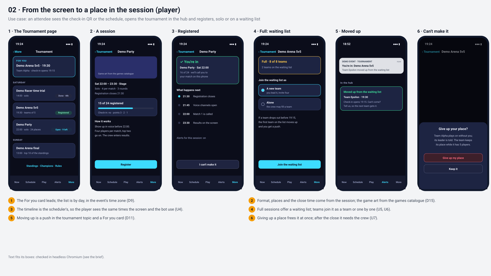

**Many sessions, one page (lead round, 8; by day since round 6).** The hub's Tournament page has a **"My sessions"** list: every session of the weekend on one screen, divided by days: on a PC the whole weekend on one page with a section per day, on a phone one scrolling list with sticky day headings and a day jump bar; time order inside each day (decision 0031, amendment 4), each row with a tick to join or leave ([U4](step-7-tournament/questions.md#u4-what-the-player-sees-of-the-timeline), [U7](step-7-tournament/questions.md#u7-giving-up-a-place)). One tap saves that session; the page has no Save button. A row shows the time, the game, solo or team, the close time, and "Full" or "Closed" when it cannot be ticked; a reopened session says when it closes again. Ticking a team session signs you up as a solo player to be placed in a team ([U6](step-7-tournament/questions.md#u6-solo-players-in-a-team-session)); the row's small "Create or join a team" link is for a group. Unticking works until the close; after it, "I can't make it" asks the crew. The session page and Discord's `/tournament register` stay as other ways in.

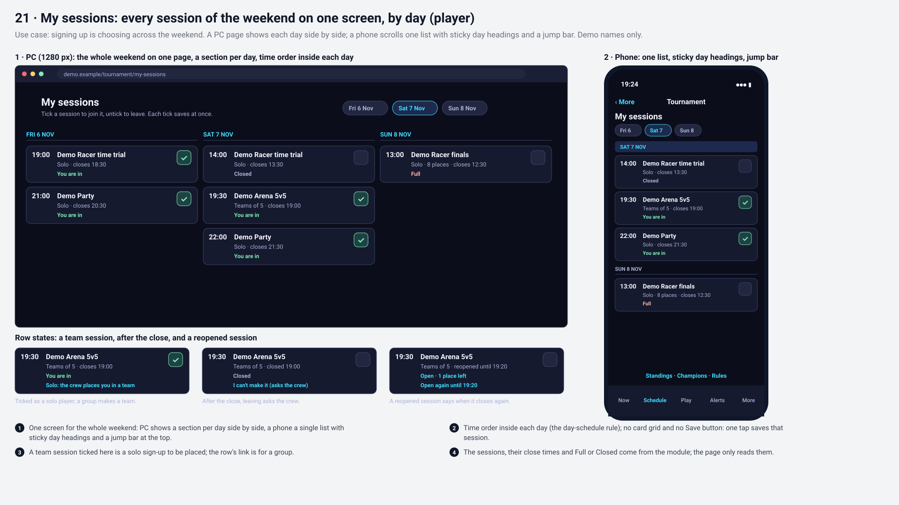

**Sign-up: easy, and nobody misses out (lead round 4, 9).** Several sessions a day is the normal case, so the tick list, the hub and the screen work by day ([U20](step-7-tournament/questions.md#u20-signing-up-without-missing-out)).
- **"Closes in N min"** chip on rows near the close.
- **Remind me:** a bell button per session (it replaces "Interested"). Pressed, it sends you one reminder 30 minutes before sign-up closes, only for a session you have not joined; the first time it is pressed, and on hover, it says "We'll remind you 30 min before sign-up closes". Nothing is sent without the bell.
- **Last call:** on the hall screen, the hub and as a Discord channel post ("Last call: {game} closes {time}").
- **Ask to join** on a closed session: the request lands in the crew's queue and the crew adds the person with one tap. It is in addition to reopening registration ([U19](step-7-tournament/questions.md#u19-reopening-registration-for-a-while)).
- An **overlap warning** when two ticked sessions overlap ([E10](step-7-tournament/questions.md#e10-overlapping-sessions)): a warning, never a block.

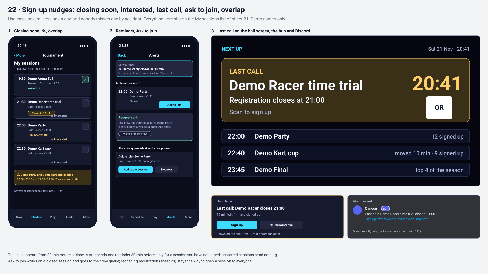

### Teams (team leader, player)
Name a team, invite by link or code, join, the full team, short at the close, a solo player placed by the crew ([U3](step-7-tournament/questions.md#u3-how-teams-form), [U6](step-7-tournament/questions.md#u6-solo-players-in-a-team-session)).

### The evening of a session (player)
Check-in opens, checked in, the match is called, in play with the voice room and lobby id, the result, a missed check-in ([U9](step-7-tournament/questions.md#u9-the-check-in-window), [U10](step-7-tournament/questions.md#u10-no-shows), [U13](step-7-tournament/questions.md#u13-the-match-page)).

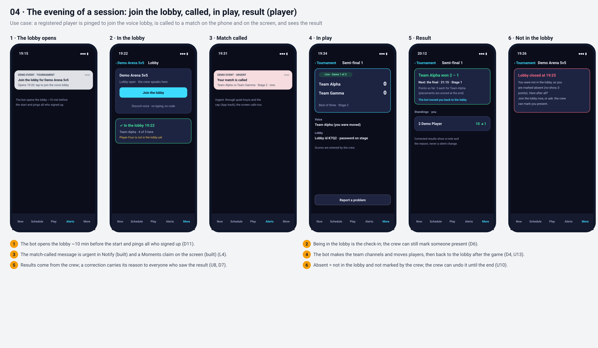

### The sessions and a new session (organiser)
The Tournament page as a day schedule, one day at a time with times down the side and a day picker, each row saying what the schedule does next; the new-session form with the game and its art (found from the game's name, or a Steam store link), an optional instructions link, the format, places, close, check-in, matches, points and voice rooms made automatically ([D23](step-7-tournament/questions.md#d23-the-session-form), [D1](step-7-tournament/questions.md#d1-tournaments-sessions-matches), [D2](step-7-tournament/questions.md#d2-formats-and-points)).

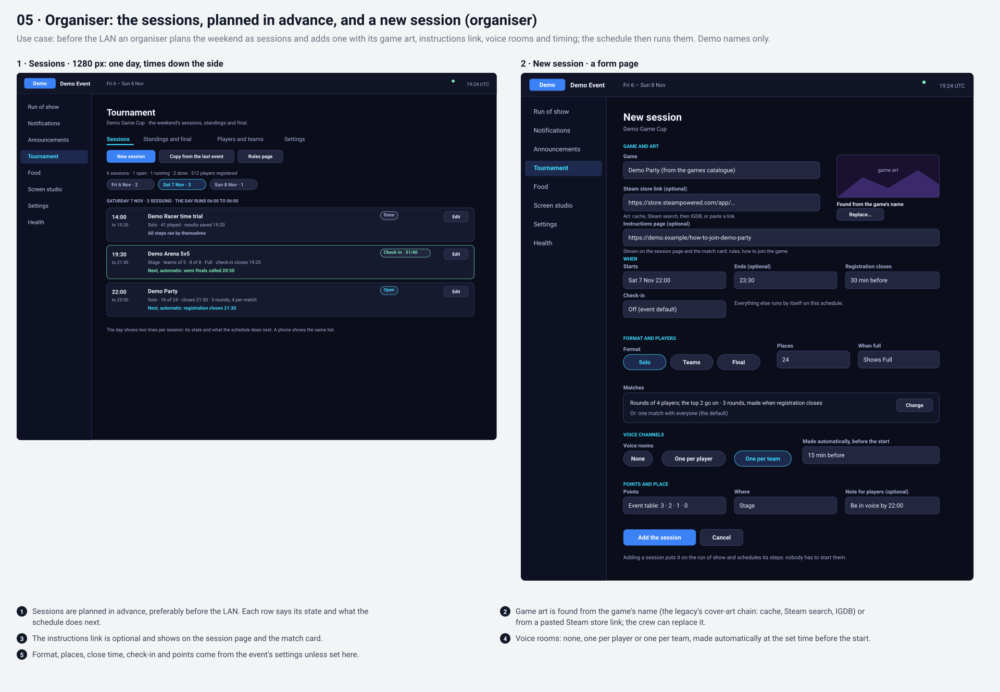

### The session desk (organiser, crew)
The scheduler's timeline of what runs by itself, one card that says "Nothing to do" and what happens next and when (with a small override), one band of changes (Reopen registration, Delay by…, End early), live counts, the matches as a list in time order with the called and the live match framed, the players as a table ([O12](step-7-tournament/questions.md#o12-the-tournament-runs-itself), [U13](step-7-tournament/questions.md#u13-the-match-page), [O1](step-7-tournament/questions.md#o1-the-scheduler)).

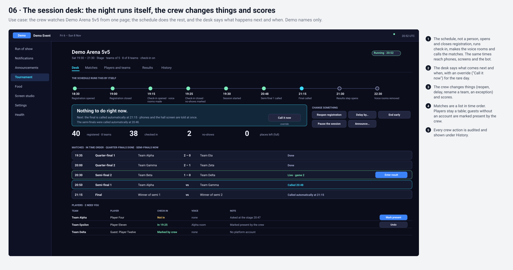

### Results and corrections (crew, organiser)
The result from the voice roster with nothing pre-picked; an award given to a participant; a correction with a reason; the session's history ([D20](step-7-tournament/questions.md#d20-awards), [U8](step-7-tournament/questions.md#u8-who-enters-results), [D4](step-7-tournament/questions.md#d4-the-voice-handshake), [D7](step-7-tournament/questions.md#d7-corrections-and-the-history)).

### Standings, the final cut and the final (organiser)
The standings with the placing + awards breakdown, a tie-break chain and the cut (4 finalists by default, a setting); the final's ranks and the champions' photos (no consent tick); and the player card: nickname, a motto the player sets, avatar, achievement badges, season points and best result, which is also the finalist intro on the screen ([D24](step-7-tournament/questions.md#d24-the-player-card), [D3](step-7-tournament/questions.md#d3-standings-and-tie-breaks), [U11](step-7-tournament/questions.md#u11-the-final), [D9](step-7-tournament/questions.md#d9-photos)).

### The crew phone (crew, venue staff)
Now (usually "Nothing to do"), a match called by the schedule, the stage desk QR, mark present, a quick result with awards on the player row, the champion photo ([U13](step-7-tournament/questions.md#u13-the-match-page), [U14](step-7-tournament/questions.md#u14-the-crew-phone)).

### The venue screen (attendees in the hall)
The Pulse with the bracket hero, the standings and the check-in QR; Match called; the standings takeover; the champion ([L3](step-7-tournament/questions.md#l3-the-screen-during-a-session), [L4](step-7-tournament/questions.md#l4-match-called-on-the-screen), [L5](step-7-tournament/questions.md#l5-the-champion-moment), [P5](step-7-tournament/questions.md#p5-the-screen-and-hub-feed-in-step-7)).

### A session's life (everyone, implicitly)
The states, the check-in branch, what each step emits, and the timeline from T−24 h to T+3 h for the scheduler, the phone, the screen, the bot and the crew ([O1](step-7-tournament/questions.md#o1-the-scheduler), [O3](step-7-tournament/questions.md#o3-timeline-defaults)).

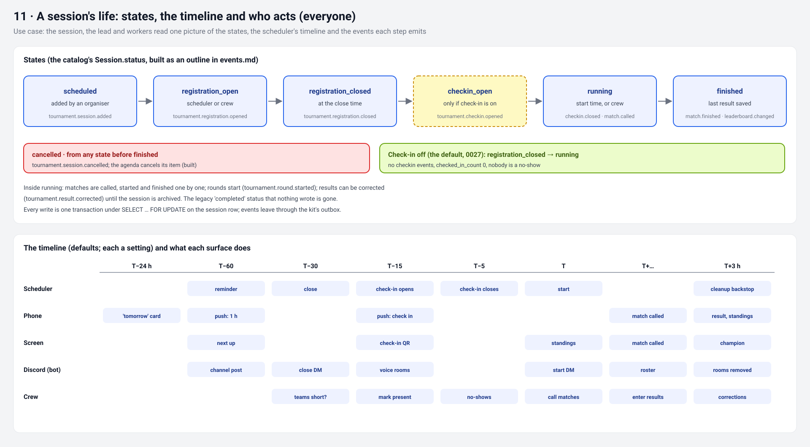

### Edge states (player, crew)
Moved by a delay, overlapping sessions, the bot down, a presence opt-out, a cancelled session, not a member ([E2](step-7-tournament/questions.md#e2-a-session-moves), [E3](step-7-tournament/questions.md#e3-the-bot-is-down), [D5](step-7-tournament/questions.md#d5-presence-opt-out-and-check-in)).

### Settings and rights (organiser)
Every rule per event with the legacy values as defaults; the rights, the lead and the crew presets ([O3](step-7-tournament/questions.md#o3-timeline-defaults), [D12](step-7-tournament/questions.md#d12-rights)).

### Follow along (attendees, spectators)
The standings as a leader hero and a ranked list with the cut line, a live session, the champions as a hero for the champion then a ranked list (never a grid of cards: amendment 3 keeps cards for collections of like items), their awards, the rules with the lead as contact, the player's own summary after the event ([U15](step-7-tournament/questions.md#u15-spectators), [U10](step-7-tournament/questions.md#u10-no-shows)).

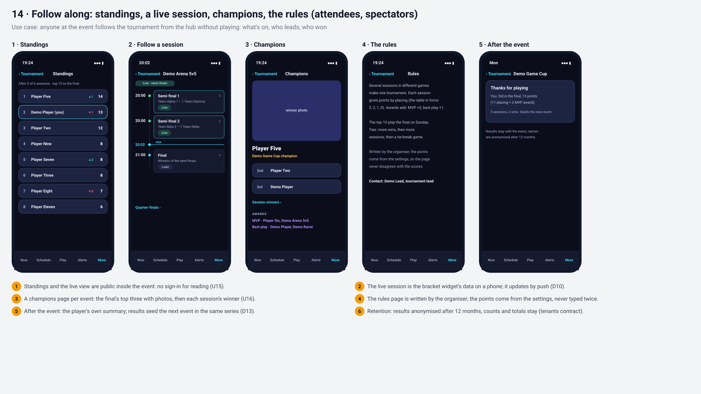

### The crew, the scoring system and awards (tournament lead)
The crew list (the lead and helpers), the points table with its change-and-recalculate step, the award types, and giving an award on the player row while scoring ([D12](step-7-tournament/questions.md#d12-rights), [D2](step-7-tournament/questions.md#d2-formats-and-points), [D20](step-7-tournament/questions.md#d20-awards)).

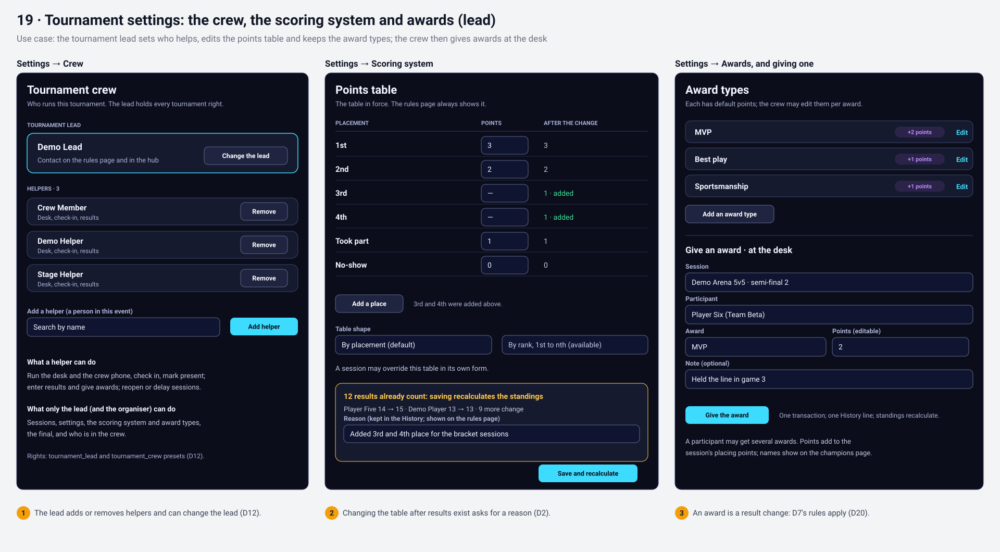

### Scoring: as easy and fun as possible (crew) · lead round 4, 10
How the crew turns a played session into a result ([D21](step-7-tournament/questions.md#d21-scoring-from-a-screenshot-three-sources-and-a-reveal)).
- **Screenshots, crew only.** The crew adds the game's score screen. An optional AI reader (the same provider setting, consent notice and "a person confirms" pattern as pizza's receipt reader, #644) reads placements, names and per-player game stats. The crew checks before anything counts, and typing by hand always works.
- **Who played comes from three sources together:** registration, voice presence and the screenshot, side by side per person.

  | Registration | Voice | Screenshot | The form |
  |---|---|---|---|
  | yes | yes | yes | filled in automatically |
  | yes | no | yes | took part, with a warning that voice is missing |
  | no | yes | yes | took part, with a warning that they are not registered; one tap adds them as registered |
  | no | no | yes | listed for the crew to decide; one tap adds them as registered |
  | yes | yes | no | the crew decides |
  | yes | no | no | suggested as a no-show |
  | no | yes | no | not listed: voice alone never decides (the crew can add them by hand) |

  Voice alone never decides. Nothing is final until the crew saves.
- **In-game names:** the first time the crew links a screenshot name to a person, the platform remembers it for that game (per person, per game), so the next screenshot matches by itself.
- **Tap to place:** tap a team or player for 1st, the next for 2nd, and so on; everyone else is "took part".
- **Awards on the player row, with a live preview:** each player row has an award button (⭐); tap it, pick an award (MVP, best play, …) and the points prefill (editable); the award chip appears on the row and the standings preview updates at once ("Nova 3rd → 1st ▲2"). One Save covers placements and awards together; changing an award later keeps the same history and reason rule ([D20](step-7-tournament/questions.md#d20-awards)).
- **Save is a reveal:** saving shows the result on the hall screen (see the next flow).
- **The crew names the teams for each session**, for example to fit the game, when teams are formed or revealed. Team names appear on the match, the screen reveal and the results, never in the season standings.

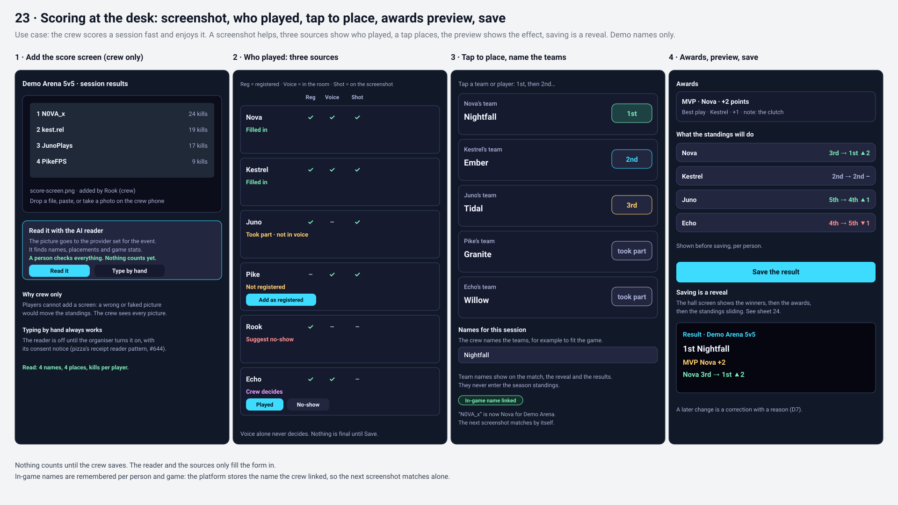

### Reopen registration and delay a session (crew)
A closed session reopened for N minutes (a number box and quick picks 5, 10, 15, 30), the push, "Close now", the History, and a delay of one session or of it and every later one that day ([U19](step-7-tournament/questions.md#u19-reopening-registration-for-a-while), [E2](step-7-tournament/questions.md#e2-a-session-moves)).

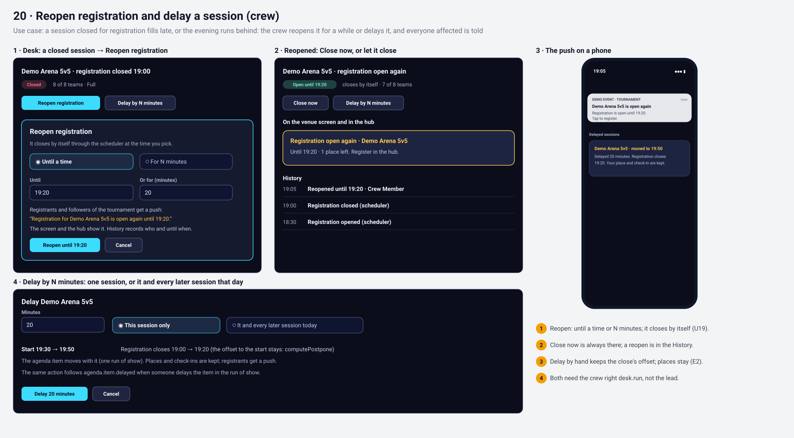

### The screens live around the tournament (attendees in the hall) · lead round 4, 11
The screen follows a session from its first card to its recap, then the evening, then the final ([L10](step-7-tournament/questions.md#l10-the-screens-around-the-tournament)). It reuses what Moments and Screen already have (presets, video cues, story pages, [widgets.md](../design/widgets.md), the pulse effects, game art as the background); each new widget or preset is named in the table below. **The look is loud and celebratory (lead round 6):** the key moments are full 1920×1080 frames with the game art as the background, big type, the player's avatar, motion notes (glow, pulse, confetti, slide-in, count-up) and a hold time; the small tiles on the sheet are only an index.
- **A session's life:** "Today" or "Tonight" cards with the game art, the live sign-up count and a QR (`session_cards`); last call with a countdown (`last_call`); the teams revealed (`teams_reveal`); check-in "Waiting for 3: names" (`checkin_waiting`, with the built `checkin_qr`); match called (Moments' `match_called`); now playing (`session_now`: game art background, stage, round timer, with `bracket` between rounds); the result reveal (`result_reveal`: winners, then awards "MVP: Nova +2", then the standings sliding ▲▼ on `leaderboard`); a session recap of approved clips and photos (`session_recap`).
- **All evening:** the race to the final with the cut line and "Nova needs 2 points to make the final" (`final_race`); player spotlights such as "3 podiums in a row", "first win ever", "most MVPs tonight" (`player_spotlight`, promoted from widgets.md's proposals for later); game-stat highlights from the screenshots such as "Highest score of the night" and "Most eliminations" (`stat_highlight`); rivalries such as "Kestrel vs Juno: 2–2 tonight" (`rivalry`); the biggest climber (`climber`); best moments (`best_moments`, over `photo`); a "Next up" strip carrying several sessions, delays and last calls (`next_up`). When sessions overlap, the screen alternates between them.
- **The final:** several finalists (a setting, default 4) and one winner. Finalist intro cards with season points, podiums, MVPs and best result (`finalist_cards`), the final, the final ranking 1–N on screen (`final_ranking`), then the champion moment and the champion photos (`champion_moment`, with Moments' `winner_card`). Places 2–N are celebrated as finalists.

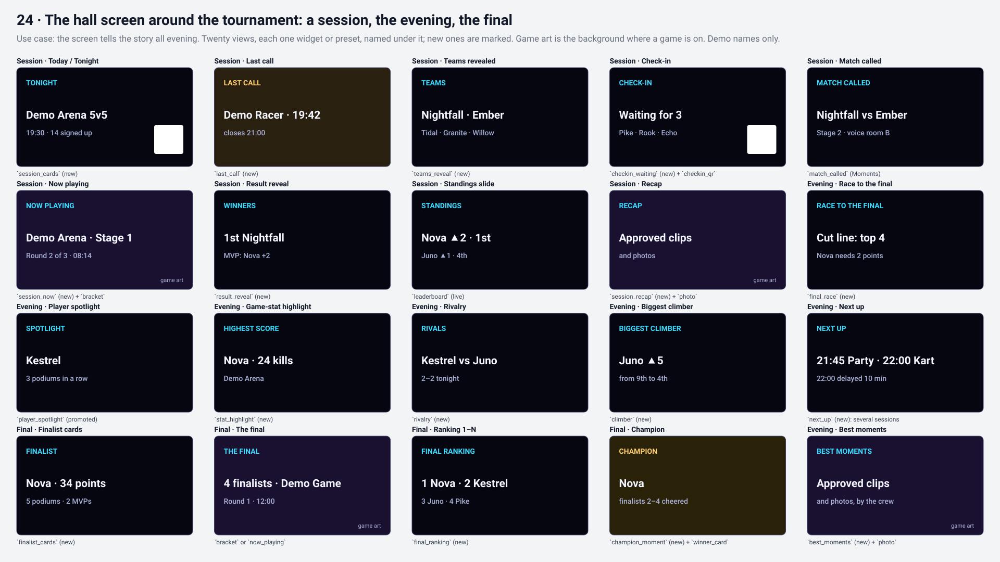

The widgets behind the twenty views (the mockup shows only what people read; "new" means a widget this step builds):

| View | Widget |
|---|---|
| Session · Today / Tonight | `session_cards` (new) |
| Session · Last call | `last_call` (new) |
| Session · Teams revealed | `teams_reveal` (new) |
| Session · Check-in | `checkin_waiting` (new) with `checkin_qr` |
| Session · Match called | `match_called` (Moments) |
| Session · Now playing | `session_now` (new) with `bracket` |
| Session · Result reveal | `result_reveal` (new) |
| Session · Standings slide | `leaderboard` (live) |
| Session · Recap | `session_recap` (new) with `photo` |
| Evening · Race to the final | `final_race` (new) |
| Evening · Player spotlight | `player_spotlight` (promoted) |
| Evening · Game-stat highlight | `stat_highlight` (new) |
| Evening · Rivalry | `rivalry` (new) |
| Evening · Biggest climber | `climber` (new) |
| Evening · Next up | `next_up` (new): several sessions, with a `last_call` card |
| Final · Finalist cards | `finalist_cards` (new) |
| Final · The final | `bracket` or `session_now` |
| Final · Ranking 1–N | `final_ranking` (new) |
| Final · Champion | `champion_moment` (new) with `winner_card` |
| Evening · Best moments | `best_moments` (new) with `photo` |

### Clips and photos from anyone taking part (players, crew) · lead round 4, 12
Participants upload from the hub, the session page or a PC browser (drag and drop a clip recorded on the gaming PC), or **paste a link**, tag the session and the people, and the crew approves or rejects in a queue on the desk and the crew phone. **No consent ticks:** game captures are game footage; the crew's moderation and a tagged person's removal request are the gates. Only approved items reach the screen and the recaps ([D22](step-7-tournament/questions.md#d22-clips-and-photos-from-participants)).

**Link kinds accepted** (hosts the event allows; the crew can add one): a Steam screenshot or recording page (`steamcommunity.com/sharedfiles/…`), a Steam content link (`cdn.steamusercontent.com/ugc/…`), and clip pages of the usual capture services (Medal, Twitch clips, Xbox share pages, Streamable). The platform fetches the link on its own and keeps a copy for the screen, within size, type and time limits; why a host list: the platform fetches only from places the event trusts, a deleted or private link leaves no hole in the recap, and the crew moderates the copy like an upload. Any other link is refused with a clear message.

**When and how often things are showcased:** in the session recap right after its results; in the between-sessions rotation; before the final. Each approved item is shown at most a few times an hour (default 3, a setting), newest and least-shown first, spread fairly across players. The crew can pin one or push one now. Clips play muted for about 30 s at most unless the crew allows sound.

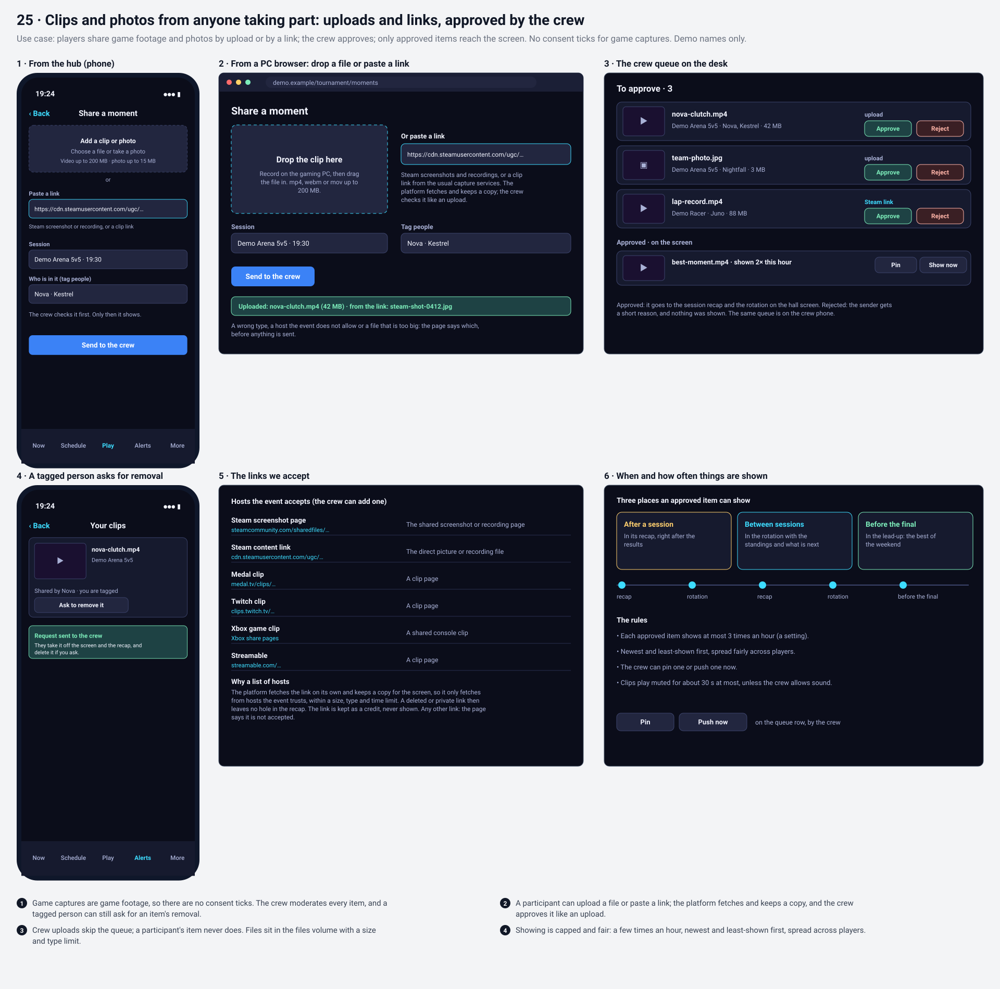

### PC and phone are equal (attendees) · lead round 4, 13
Every attendee page works fully in a PC browser and on a phone, with a desktop layout at 1280 px and wider (amendment 5, #707, being written in parallel; this pack links it once it merges). Alerts go through app push or browser notifications, plus Discord ([L11](step-7-tournament/questions.md#l11-pc-and-phone-are-equal)). The four pages item 13 names have a desktop version: the tick list (sheet 26, panel 1, the Tournament page with "My sessions"), the session page (sheet 26, panel 2), the standings (sheet 26, panel 4, with the champions) and the upload (sheet 25, panel 2, from a PC browser by drag and drop). Sheet 26 also draws check-in and the match (panel 3). The phone views stay as drawn on sheets 02, 04, 14, 21 and 22, so each of these pages now has both.

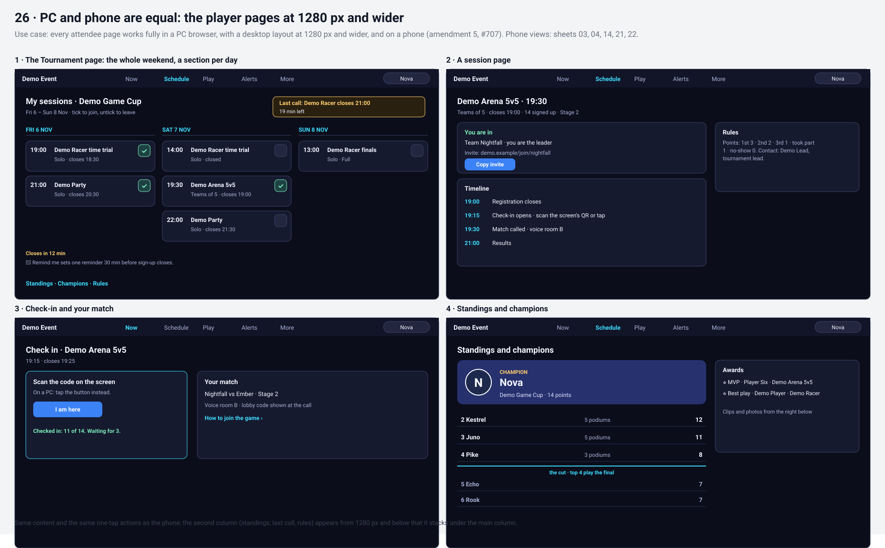

### The day schedule at any width (organiser)
The Sessions page as a day schedule with 3 and 12 sessions at 1280, 1920 and 390 px: a longer list, never more columns; at 1920 px the selected session sits beside the list ([L2](step-7-tournament/questions.md#l2-the-organiser-pages)).

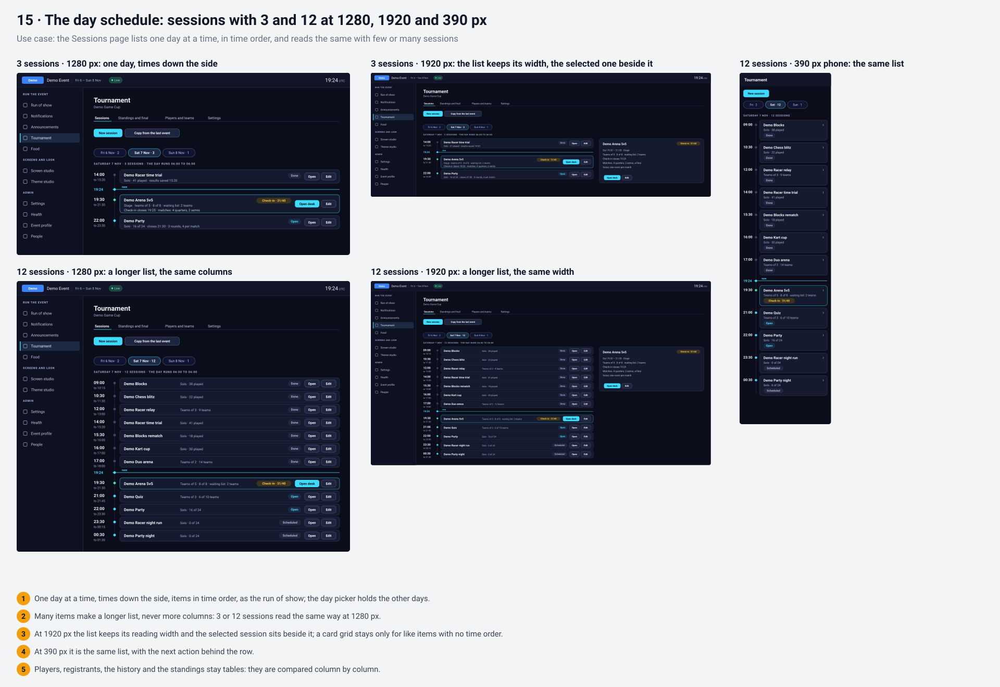

### Where Finals and Tournament meet (attendees, crew) · 0030
The Pulse with a cup session and a THE FINALS card; two champions with two owners; the hub's Play list with the Finals tile ([F1](step-7-tournament/questions.md#f1-where-finals-and-tournament-meet)).

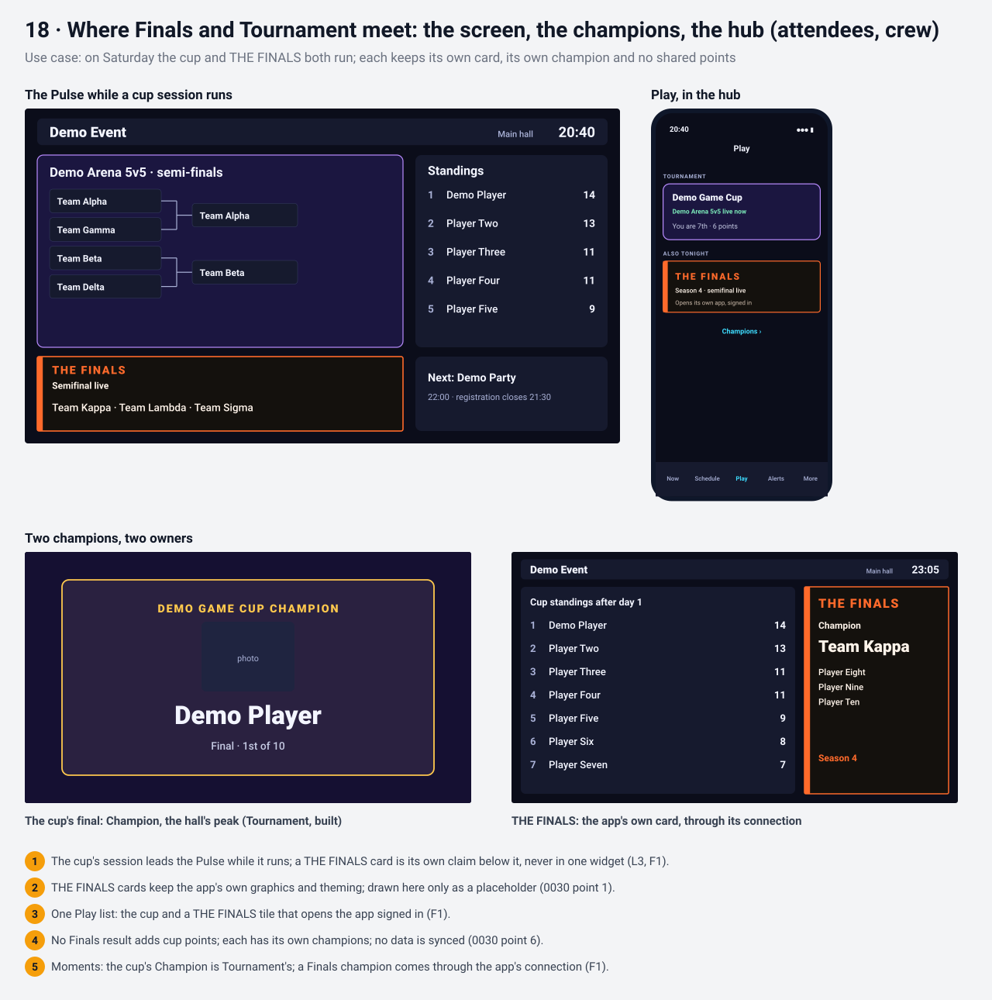

### Every mockup
| File | What it shows | For whom |
|---|---|---|
| [01-directions.svg](step-7-tournament/01-directions.svg) | The three directions side by side | the session |
| [02-flow-register.svg](step-7-tournament/02-flow-register.svg) | Tournament page (a day schedule) → session → registered; full; registration open again; giving up | attendee |
| [03-teams.svg](step-7-tournament/03-teams.svg) | One team panel: name, members as a list, one invite line with a QR that opens the invite link, join, placed by the crew | team leader, player |
| [04-session-evening.svg](step-7-tournament/04-session-evening.svg) | Check-in, called, in play, result, missed check-in | player |
| [05-sessions.svg](step-7-tournament/05-sessions.svg) | The sessions as a day schedule (each row says what runs next); the new-session form with game art, instructions link and voice rooms | organiser |
| [06-session-desk.svg](step-7-tournament/06-session-desk.svg) | The session desk at 1920 px: what runs by itself, "Nothing to do", changes, matches by time | organiser, crew |
| [07-results-and-corrections.svg](step-7-tournament/07-results-and-corrections.svg) | A result from the voice roster with an award; a correction and the history | crew, organiser |
| [08-standings-and-final.svg](step-7-tournament/08-standings-and-final.svg) | Standings with the placing + awards breakdown, tie-breaks and the cut of 4; the final and photos; four player cards | organiser |
| [09-crew-phone.svg](step-7-tournament/09-crew-phone.svg) | The crew phone: now (nothing to do), a match called by the schedule, stage QR, mark present, result with awards, photo | crew, venue staff |
| [10-venue-screen.svg](step-7-tournament/10-venue-screen.svg) | Bracket, standings, check-in QR, match called, champion | attendees in the hall |
| [11-lifecycle.svg](step-7-tournament/11-lifecycle.svg) | States, events, the timeline per surface | everyone |
| [12-edge-states.svg](step-7-tournament/12-edge-states.svg) | Six edge states | player, crew |
| [13-settings-and-rights.svg](step-7-tournament/13-settings-and-rights.svg) | Tournament settings; rights, the lead and the crew presets | organiser, event admin |
| [14-follow-and-champions.svg](step-7-tournament/14-follow-and-champions.svg) | Standings as a hero and a ranked list, a live session's matches by time, champions as a hero and a ranked list with awards, rules with the lead as contact, after the event | attendees, spectators |
| [15-day-schedule.svg](step-7-tournament/15-day-schedule.svg) | The sessions as a day schedule with 3 and 12 at 1280, 1920 and 390 px | organiser |
| [16-mini-player.svg](step-7-tournament/16-mini-player.svg) | **Later (after version 1), not redrawn:** a mini tournament: start, sign up, the draw, the match card, report, champion | player |
| [17-mini-crew.svg](step-7-tournament/17-mini-crew.svg) | **Later (after version 1), not redrawn:** the crew queue, what runs, rules for one tournament, settings, at 1920 px and on the crew phone | crew, organiser |
| [18-finals-and-tournament.svg](step-7-tournament/18-finals-and-tournament.svg) | The cup and THE FINALS on the Pulse, two champions, the hub's Play list (0030) | attendees, crew |
| [19-crew-scoring-awards.svg](step-7-tournament/19-crew-scoring-awards.svg) | The crew list with the lead, the editable points table and its change step, award types and giving an award on the player row (lead round, round 6) | tournament lead, crew |
| [20-reopen-and-delay.svg](step-7-tournament/20-reopen-and-delay.svg) | Reopen for N minutes (quick picks), Close now, the push, the History, delay one session or it and later ones (lead round, round 6) | crew |
| [21-my-sessions.svg](step-7-tournament/21-my-sessions.svg) | "My sessions": the whole weekend by day (a section per day on a PC, sticky day headings and a jump bar on a phone), a tick per session, Full and Closed rows, a team session ticked as solo, "I can't make it", a reopened row (lead round, round 6) | player |
| [22-signup-nudges.svg](step-7-tournament/22-signup-nudges.svg) | "Closes in N min", the Remind me bell and its reminder, an overlap warning, Ask to join and the crew queue, last call on the hall screen, the hub and Discord (lead round 4, round 6) | player, crew |
| [23-scoring-screenshot.svg](step-7-tournament/23-scoring-screenshot.svg) | The score screen and the AI reader, who played from three sources, tap to place, ⭐ awards on the player row, team names, the standings preview, save as a reveal (lead round 4, round 6) | crew |
| [24-screens-around-tournament.svg](step-7-tournament/24-screens-around-tournament.svg) | Six key moments as full 1920×1080 frames (result reveal, MVP, race to the final, spotlight, finalist card, champion) and an index of the twenty views (lead round 4, round 6) | attendees in the hall |
| [25-clips-and-photos.svg](step-7-tournament/25-clips-and-photos.svg) | Upload or paste a link from the phone and a PC browser, the crew queue on the desk and the phone, a removal request, the link kinds, when and how often things are shown (lead round 4, round 6) | players, crew |
| [26-pc-layout.svg](step-7-tournament/26-pc-layout.svg) | The player pages at 1280 px: the tick list for the whole weekend, session, check-in and match, standings and champions; the upload's desktop view is sheet 25, panel 2 (lead round 4, redrawn in round 6) | attendees on a PC |

The sheets were drawn by a throwaway script kept out of the repo, as in step 5. Sheets 02, 05, 06, 14, 15 and 18 were redrawn for the first lead round, 02–09 and 13–15 edited and 19–20 drawn for the second, 22–26 drawn for the fourth, and for the sixth lead round sheets 03, 05, 06, 08, 09, 14, 19, 20, 21, 22, 23, 24, 25 and 26 were drawn again (16–17 are kept as drawn at the 0030 revision, marked later). On sheet 18 the THE FINALS cards are placeholders that only mark where the app's own card sits: they keep the app's graphics and theming and are not redrawn (0030 point 1). Each text that sits in a box carries `data-box` (its box's left and right edge). After drawing, every sheet was rendered in headless Chromium (the playwright image's fonts) at its drawn size, and the check found no text that overlaps other text and none outside its box or the sheet; the PR body lists each sheet checked. **Timed items are a day schedule** (principle 11): the sessions and a session's matches are one day at a time, times down the side, in time order, with a day picker. Card grids ([amendment 3](../design/README.md#3--grids-scale-with-their-content-2026-11-19)) stay only for like items with no time order, such as the final's photo slots; players, the history and the standings stay tables.

## Port, drop or invent
Each with its reason ([0020](../decisions/0020-best-of-old-freely-new.md)).

### Port as is (code and its tests, with clock, zone and storage injected)
| Legacy | Where it goes | Why |
|---|---|---|
| The points rule (first 3, second 2, participant 1, no-show 0; base + a non-negative bonus; no-show exactly 0) and `tournament-scores-bonus` | the module's scoring, as the default of an editable table (D2); the non-negative bonus becomes named awards (D20) | Proven at real events; the tests are the spec |
| `score-merge.ts` (match by id, else by name; `fill_no_show`; `add_as_registered`) and its tests | saving a result | The careful part of the legacy; only the replace-all write changes |
| `scores.ts` and `collapseLeaderboardRows` (sum, distinct sessions, no-shows excluded, one person once) and `tournament-leaderboard-collapse` | the standings | Proven; the tie-break is added on top (D3) |
| `final.ts` (finalists validated against the standings; ranks 1..N all set or all null; finalists lead once scored; points never change; clearing restores) and its tests | the final | A good rule that kept the season fair |
| `vc-plan.ts` (`none`, `solo`, `team`; ordered unique channel names) and `tournament-vc-plan` | the session's `voice_plan` (already in the catalog) | Pure and tested |
| The bot's `build_dwell_roster` rules (10 minutes qualifies, longest channel wins, ties flagged, `registered_not_qualified`, `present_not_registered`) and `test_tournament_dwell.py` | the bot (step 6) builds the roster; the tournament reads its flags | The best part of the handshake; the bot keeps it (OC8) |
| `computePostpone` (the close keeps its offset to the start) | following `agenda.item.delayed` and the crew's manual delay (E2) | The same rule, now driven by the run of show or by a crew action |

### Port with changes
| Legacy | Becomes | Why |
|---|---|---|
| One implicit season per database (TB4) | Tournaments per event (usually one), sessions with a `tournament_id` (D1) | Per tenant; a second cup in one event is cheap later |
| Registration through a 7-day token link from the bot | The central sign-in and membership (0027) | Tokens in URLs are dropped (0010) |
| The register page (signup-site T4): one list of all the open sessions, a checkbox each, saved per checkbox | The hub's "My sessions" list: the same ease, as the day schedule with a tick per session, one tap saves it, no Save button; the token link becomes sign-in. The session page and `/tournament register` stay as other ways in ([U4](step-7-tournament/questions.md#u4-what-the-player-sees-of-the-timeline)) | The product owner wants exactly that ease back |
| Individual registration only; teams by voice channel | Solo or team sessions; a team entity with a leader and invites (U2, U3) | N10's team invites; a team must exist before the voice room does |
| No capacity, no waiting list | Places per session, optional and off by default; a full session shows "Full"; no waiting list (U5) | The product owner keeps the list out; the reopen fills a late place |
| The admin page's reopen (T5): a closed session takes registrations again | "Reopen registration" until a time or for N minutes, and "Close now": the legacy's reopen logic ported; it closes by itself through the scheduler, registrants and followers get a push, the screen and hub show it, the History records it (U19) | A late place needs a way; the close must still hold (a due row) |
| `computePostpone` run on a hand-made postpone from the admin page | The crew's "Delay by N minutes" for one session or it and every later one that day, beside following `agenda.item.delayed` (E2) | One rule, two triggers; the agenda item moves too |
| Points fixed in code; one non-negative bonus number | The lead edits the points table in settings, with a reason and a recalculation when results exist; named awards with default points (D2, D20) | The lead owns the rules; an award says what it was for |
| The deadline enforced by the bot changing `status` | The module's scheduler, due rows in Postgres (O1) | A down bot left registration open; the close must hold |
| Close at T−60 from the site, T−30 from the bot, a T−60 post saying "30 minutes" | One setting, 30 minutes by default; every surface reads the same times (O3) | The legacy's three numbers disagreed |
| The bot's flag handshake by polling (`vc_created`, `scoring_started`, `roster_json`, `cleanup_requested`, `vc_cleaned`) | Events: `tournament.scoring.started` → `bot.voice_roster.captured`; `bot.voice_channels.created` and `.removed` (catalog, built) | Nothing polls; flow 2's event handshake |
| Autofill that pre-selects channel 0 as the winner | Nothing pre-picked; the crew picks the winner (U8) | A default that silently crowned the first team |
| Scores saved by delete-then-insert, no transaction; corrections by re-saving | Results per match in one transaction under `FOR UPDATE`; a correction is a new version with a reason (D7) | #129; the audit trail |
| No tie-break; positional ranks | A tie-break chain, with a crew-recorded game as the last step (D3) | The rules page asked for tie-break games the code never knew |
| The schedule page and a modal of scores | The hub's Tournament page and session pages; the run of show for the schedule (built) | One frame (App track); the agenda is the one run of show |
| `display-tournament.ts` polled by the LAN display and signage | `tournament.leaderboard.changed`, the match events and Screen's widgets (P5) | Nothing polls; Moments owns the peaks |
| The T−15 to T+10 leaderboard pin | Moments' rules and presets (built): Starting soon, Match called, standings | One happening, one owner (step 4) |
| Four JPEG photo slots in a BLOB column | Four slots in the tenant's files volume, no consent tick, a removal request on file (D9) | Containers keep no state; photos are personal data |
| The signup site's cover-art chain (T12: cache, Steam search, IGDB) and a Steam store link per session | The session form's game art, found from the game's name or a pasted Steam store link, replaceable by the crew (L6, D23) | Every session and screen look like the game; the chain is proven |
| The 1,433-line string-built admin page | The Tournament pages in the organiser shell: sessions, the desk, results, standings and final, settings (L2) | T5–T6 rebuilt; its postpone, reopen and candidate logic kept |
| Bot DMs at close and start | Notify's tournament topic (push) plus the bot's DMs in step 6 (D11) | People choose their channels (App track) |

### Drop
| Legacy | Why |
|---|---|
| Registration and admin tokens, `/tournament admin` links | Sign-in and rights replace them |
| The `completed` status nothing wrote | `finished` in the catalog |
| Debug flags (create-now, cleanup-now in the UI) and `DELETE /internal/clear` | A crew action with a right and an audit replaces "create now"; nothing wipes everything |
| The 60 s leaderboard refresh and the signage adapter's 180 s poll | Push |
| Hard-coded time zones, the site URL in DMs | The event's time zone and the hub's links |
| Name-keyed identity for id-less players (`lower(name)`) | A guest Person row with its own id (U12); two people with one nickname never merge |

### Invent
| New | Why |
|---|---|
| Teams with a leader, invites by link or code, substitutes (U3) | Teams must exist before the match is called |
| A tournament lead and a crew of helpers (D12) | One responsible person named to players; helpers who run the night without changing the rules |
| Named awards: MVP and others, with points and a note (D20) | Recognises play beyond placing; shown in the standings breakdown and on the champions page |
| An editable scoring system with a change step (D2) | The rules can follow the event; a change is explained and recorded |
| Matches and rounds as data, with "winners advance" (P4) | The bracket on the screen without an engine; Round start (built) fires |
| Match called with a place, voice rooms and a lobby id (U13) | Where and when, always |
| The session desk and the crew phone (U13, U14) | The crew taps once |
| A tie-break chain and the final cut (D3, U11) | Fair finals |
| Corrections with a reason and the session's history (D7) | #129; results people trust |
| Seeding from the series' earlier results (D7) | #129; the next event starts from the last |
| A champions page per event (U10) | #128; the legacy had only a badge |
| `me/matches` and `me/summary` for the hub (D10) | The lead's step 2 note; For you |
| Overlap warnings across sessions (E10) | Players play several things a night |
| Sign-up nudges: a closing chip, the Remind me bell with one reminder, last call, Ask to join (U20) | Nobody misses a session by accident, and a latecomer has a way in |
| Scoring help: a crew-only score-screen reader, three sources for who played, remembered in-game names, tap to place, an award preview, save as a reveal (D21) | The crew scores fast and the room sees it |
| The screens around the tournament: a session's life, the evening, the final (L10) | The screen tells the story all evening, from game art to the champion |
| Clips and photos from participants, by upload or link, approved by the crew, with showing rules (D22) | The night's moments come from the people in it |
| The player card with a motto and badges (D24) | The finalist intro and the spotlight look alive |
| A schedule that runs the night by itself, with the next step and an override on the desk (O12) | The crew watches and scores instead of pressing buttons |
| The Result's `game_stats` and `scores` from the score screen (D21) | Highlights such as "Highest score of the night" need per-player stats |

### Since 0030: from the core
The core, not the Finals app, is what this module takes; the app's code stays its own (0030). The Finals app's features as the model for mini tournaments wait with them (Later).
| From | Becomes | Choice and why |
|---|---|---|
| The core (finals-core generalised, 2.0.0): formats as data, `draw`, `next`, `validate_result`, `champion`, `bands`, `points`, `standings`, `build_teams`, `rate`, a seeded random source | The engine of sessions with rounds or a bracket, of the season's points and standings and of the crew's balanced fill | **Reuse as is**, pinned to a tag, with its licence (ISC) and its author's attribution named in the module's README; the format and the seed stored per competition (D18). Built fully general in step 7, so mini tournaments later need no new engine |
| The Finals app (its sign-up, team builder, lobby id, team reports, cancel, champions page) | Mini tournaments for any game, after version 1 | **Later:** kept in the Later section, not planned now. The app itself is integrated from day 1 by the Finals track |

## The lead's notes (2026-11-07 and 2026-11-12)
- **The hub reads the caller's own matches and the module consumes `notify.checkin.recorded` for `tournament:<ref>`:** yes. `GET /api/tournament/me/matches` and `GET /api/tournament/me/summary` (For you cards, as step 5 settled for pizza), and a consumer of `notify.checkin.recorded` that checks the purpose, the session's state and the registration, then emits `tournament.player.checked_in` ([D10](step-7-tournament/questions.md#d10-the-hubs-reads), [D6](step-7-tournament/questions.md#d6-check-in-through-notify)).
- **The per-tournament `checkin` setting with a per-session override, the API to give a session matches, and following `agenda.item.delayed` (#139):** the setting and override as the catalog says (off by default); `PUT /api/tournament/sessions/{id}/matches` while none has started, plus "winners advance" for rounds ([P4](step-7-tournament/questions.md#p4-brackets-in-step-7)); a consumer of `agenda.item.delayed` that moves the session and its close only while the times still match, as agenda.md says ([E2](step-7-tournament/questions.md#e2-a-session-moves)).
- **Presence opt-out:** opted-out players are not in `bot.voice_roster.captured`, so the crew ticks them by hand ([mockup 12](step-7-tournament/12-edge-states.svg)). Whether a tournament check-in counts as presence data under the opt-out (review finding 1 of #137) is [D5](step-7-tournament/questions.md#d5-presence-opt-out-and-check-in); the pack recommends that a check-in the player makes is not blocked by the opt-out, but is kept as presence data (deleted 30 days after archiving).
- **Checking in a registrant without a platform account:** the crew marks them present ("Mark present", right `tournament.players.manage`); `tournament.player.checked_in` carries `user_id: null` and the Person, as the catalog's Person already allows ([U12](step-7-tournament/questions.md#u12-players-without-an-account)).
- **Demo tournament data in `events/demo/`:** a Demo Game Cup with five sessions (solo, team, rounds, a final), demo players and teams, loaded by the profile ([O7](step-7-tournament/questions.md#o7-demo-data)).
- **The design guideline (2026-11-12):** the leaderboard and bracket widgets, the animated match called and the crew spotlight are drawn to [widgets.md](../design/widgets.md) in [mockup 10](step-7-tournament/10-venue-screen.svg); experience-map.md calls the old drawings placeholders for "the Games system", and this pack proposes that the tournament owns its `bracket` and `leaderboard` feed in step 7 ([P5](step-7-tournament/questions.md#p5-the-screen-and-hub-feed-in-step-7)).

## What the built contracts get wrong
Found while reading the consumers against the catalog; each fix is additive and ships with #127's contract ([D8](step-7-tournament/questions.md#d8-the-built-contracts-gaps)).
1. Moments fills `{session.name}` from `session.name`, which the Session outline does not have: add `name` (the game's name plus a label, for example "Demo Arena 5v5").
2. `{winner.name}` reads `name` on a Result, which has `people` only: add `name` to the Result (the team's name or the player's).
3. The Session has `tournament_id` but no tournament name, and no event names the tournament itself: add `tournament: {id, name}` to the Session.
4. Screen's `teams_left` waits for a count the outline does not give: add `teams_left` to the Session (teams or players not yet out).
5. Moments' `match_called` content sends `voice_channels: []`: the module adds `voice_channels` (names) to the Match once `bot.voice_channels.created` arrives, so Moments and Screen need not consume bot events.
6. The Match needs `where` and `lobby_id` (both optional) for the call and the match page.

No name or field is removed or renamed, so none is a breaking change.

**Found for the 0030 revision.** None is changed here (docs only); each is noted for the issue whose code needs it:
7. [games.md](../../contracts/games.md)'s opening still says that rosters, rounds and Play sessions join that contract with the Games track, and that the mini tourney's seasons, brackets and team builder are the `finals` module's. Since 0030 competitions are Tournament's and the `finals` module is gone. The competition rules and the rewrite of that paragraph wait with the mini tournaments (the Games track's competition-rules issue, additive, 0029); the cup needs neither.
8. Moments' `finals` class (rank 55) and its `finals_result` rule mean the cup's final, not the Finals app. A Finals app moment needs its own class or source; the Finals track decides, and its contract work settles it ([F1](step-7-tournament/questions.md#f1-where-finals-and-tournament-meet)).
9. *(Later, with the mini tournaments.)* They need their own outline and events ([D17](step-7-tournament/questions.md#d17-mini-tournaments-in-the-contract)) and a Moments rule on `tournament.mini.finished` ([M11](step-7-tournament/questions.md#m11-mini-tournaments-on-the-screen)): additive, in `contracts/tournament.md` then.

**Found for the second lead round (2026-11-21).** All additive, shipped with #127's contract and the code that uses them ([D8](step-7-tournament/questions.md#d8-the-built-contracts-gaps)):
10. A reopening: `registration_reopened_until` on the Session and the event `tournament.registration.reopened` (a trigger of Notify's `tournament` topic), with reopen and close endpoints ([U19](step-7-tournament/questions.md#u19-reopening-registration-for-a-while)). The catalog's `tournament.registration.closed` is reused for the automatic close.
11. A manual delay: `POST …/delay` (`minutes`, `scope`); it emits the catalog's `tournament.session.changed` ([E2](step-7-tournament/questions.md#e2-a-session-moves)).
12. Awards and the breakdown: `awards` and `points_placing` on the Result (`points` stays the total), `award_types` and the scoring table in the tournament's settings ([D20](step-7-tournament/questions.md#d20-awards), [D2](step-7-tournament/questions.md#d2-formats-and-points)).
13. The lead and the crew: `tournament.settings.write` and `tournament.crew.manage`, the presets `tournament_lead` and `tournament_crew`, and a crew endpoint ([D12](step-7-tournament/questions.md#d12-rights)).
14. What the waiting list would have added is never added: no `waiting_count` on the Session and no `tournament.player.waitlisted` or `.promoted`; the catalog has neither, so nothing is removed.
15. Registration as a toggle: one idempotent `PUT /sessions/{id}/registration/me` (`{registered: bool}`, with the usual idempotency key) joins or leaves a session for the signed-in player, so a tick is one call; a team session joins as a solo player (U6). It reuses the register and give-up rules and emits the same registration events; no new event ([U4](step-7-tournament/questions.md#u4-what-the-player-sees-of-the-timeline)). Additive, shipped with #127's contract and the player's pages.
16. Sign-up helpers: `PUT`/`DELETE /sessions/{id}/interest/me` (the star) with a scheduler row for the reminder 30 minutes before the close, only for a starred, not-joined session; a "last call" read on the session and an event for it (`tournament.registration.last_call`, consumed by Screen, the hub and the bot's channel post, with Notify's topic gaining the trigger); `POST /sessions/{id}/join-requests` and a crew list and decision (`tournament.join_request.created`, for the crew queue and its push; adding the person goes through the normal register rule and emits the usual registration event). Additive ([U20](step-7-tournament/questions.md#u20-signing-up-without-missing-out)).
17. Scoring: `POST /sessions/{id}/score-screens` (a file in the files volume, crew only, right `tournament.results.write`), an optional `POST …/read` that calls the provider set for the event and returns a draft, never a Result; a per-person, per-game in-game name (`PUT /players/{id}/game-names/{game}`); `game_stats` and the `sources` (registration, voice, screenshot) on a Result's participant; a preview of the standings change (`POST /sessions/{id}/results/preview`); the team name per session on a team. Additive ([D21](step-7-tournament/questions.md#d21-scoring-from-a-screenshot-three-sources-and-a-reveal)).
18. Clips and photos: `POST /moments` (a file or a `link`, the session, tagged people; no consent tick), a crew queue (`GET /moments?state=pending`, `PUT /moments/{id}/state`) and a removal request by a tagged person. The module may hold these or ask Moments to; the pack proposes the tournament keeps its own queue for step 7 and hands approved items to Moments through an event (`tournament.moment.approved`). Additive ([D22](step-7-tournament/questions.md#d22-clips-and-photos-from-participants)).
19. The finals' size: `final_size` in the tournament's settings (the number of finalists, **default 4 everywhere**), replacing "the top N" wherever the contract assumes a single winner and a podium. Additive ([L10](step-7-tournament/questions.md#l10-the-screens-around-the-tournament)).

## Proposed issue changes
The step's issues are input ([P2](step-7-tournament/questions.md#p2-the-issue-set)). Proposed, not applied: the lead applies them after the session.
- **#127 · rewrite: the tournament contract, model, registration and rights.** `contracts/tournament.md` and OpenAPI written from the real legacy API and the catalog outlines, with the additive fixes above; tournaments, sessions, teams and registrations per tenant under RLS (places optional, no waiting list); the scheduler (due rows, `FOR UPDATE SKIP LOCKED`) with the timeline of [mockup 11](step-7-tournament/11-lifecycle.svg); following `agenda.item.delayed`; rights and the `tournament_lead` and `tournament_crew` presets; the organiser's Sessions pages and settings; `me/export` and `DELETE me`; race tests (the last place, the last team member). Risk: high (sign-in, rights, personal data), as today.
- **#128 · rewrite: matches, results, standings and the final.** Matches and rounds with "winners advance"; calling a match; the voice handshake through events (`scoring.started` → `voice_roster.captured`), results from the roster with nothing pre-picked; the standings with the tie-break chain; the final, its cut, photos and the champions page; `tournament.leaderboard.changed`; the session desk and the crew phone; an end-to-end test with a fake bot. The Moments criterion shrinks to "emit what the built rules and presets wait for" (built in step 4). Risk: normal.
- **#129 · rewrite: check-in, no-shows, corrections and seeding.** Check-in through Notify's QR and the button, the crew's mark present (guests), no-shows marked at the close (nobody replaced from a list), undo; corrections with a reason and the session's history; seeding from the series' earlier results (#150), manual or random. Drop "results agreed by both sides" as a default ([U8](step-7-tournament/questions.md#u8-who-enters-results)), and replace the "format mix-up" regression test, which is the mini tourney's bug (the Finals track's), with regression tests for this module's own legacy bugs ([E13](step-7-tournament/questions.md#e13-the-format-mix-up-bug-and-other-legacy-bugs)). Risk: normal.
- **New · the player's pages in the hub's frame.** The Tournament page, a session, register solo or as a team, invites, check-in, the match page, results, standings, champions and rules, in the hub's frame (App track P4), on a phone and a PC alike (principle 13), with `me/matches` and `me/summary`. Moved out of #127 as step 5 did with #119, so #127's high-risk package stays small. Risk: normal.
- **New · the tournament on the screens and in Notify.** Register the `tournament` topic with Notify; feed Screen's `bracket` and `leaderboard` widgets and `checkin_qr` with the session's purpose, and the Pulse hero's `game` and `teams_left`; demo tournament data in `events/demo/`; screenshots of every view. Pulled forward from step 9, as step 5 did for food ([P5](step-7-tournament/questions.md#p5-the-screen-and-hub-feed-in-step-7)). Risk: normal.

**Since 0030** ([P2](step-7-tournament/questions.md#p2-the-issue-set), changed):
- **The lead round of 2026-11-21 (six decisions):**
  - **#127, also:** the crew list and the lead (D12, `tournament.settings.write`, `tournament.crew.manage`, the two presets) and the editable scoring table and award types in settings (D2, D20); the reopen and delay actions with their scheduler rows, endpoints and the `tournament.registration.reopened` event (U19, E2); no waiting list (U5). Its risk stays high.
  - **#128, also:** awards on results in the same transaction, History and correction rules as D7; the standings breakdown (placing + awards); a recalculation with a reason when the table changes; the champions page shows award names.
  - **#129, also:** no-shows are marked, not replaced; the crew's reopen fills a place.
  - **The player's pages issue, also:** "Full" instead of a waiting list; the reopening card and push target; the lead as the contact on the rules page and the hub; award names on the player's and the champions pages.
  - **Notify:** the reopening trigger in the `tournament` topic's declaration (D11).
- **#127, also:** the module pins the core's 2.0.0 (D18) and stores formats and seeds per competition. Its Out of scope "brackets for any game (the Games track)" goes: brackets come from the core, here.
- **#128, also:** rounds and "winners advance" through the core's `next`; a session chooses placements only or a bracket from the core (P4); the points and the standings through the core's `points` and `standings` (D2, D3); the crew's balanced fill through `build_teams` (U6).
- **#129, also:** the "format mix-up" test is the core's ticket C1 (its 1.1.0), as the core plan says (E13).
- **The lead round 4 of 2026-11-21 (five decisions, 9–13):**
  - **#127, also:** the sign-up helpers' endpoints, scheduler row and event (gaps 16), and `final_size` (gap 19). Its risk stays high.
  - **#128, also:** the score-screen file, the optional AI reader behind the event's provider setting and consent notice (a person confirms; a new secret, so a high-risk part that the package plan keeps with the other high-risk work), the three sources, remembered in-game names, `game_stats`, the preview and the save as a reveal event (gap 17); the finals with `final_size` finalists.
  - **The player's pages issue, also:** "My sessions" with the closing chip, the star, last call, Ask to join and the overlap warning; the clip and photo upload; every page at 1280 px and wider and on a phone (principle 13); browser notifications beside app push.
  - **The screens and Notify issue, also:** the twenty views of sheet 24 and their widgets, by day; last call on Notify's `tournament` topic; the crew queue for clips and photos on the desk and the crew phone (gap 18).
  - **No new issue:** the lead may split the screens' widgets by widget kind when the plan is written ([P2](step-7-tournament/questions.md#p2-the-issue-set)); the pack does not.
- **The day schedule rule (decision 0031)** applies to every issue that draws the Tournament pages: the sessions, a session's matches and the hub's list are a day schedule with a day picker, not a card grid ([mockups 05](step-7-tournament/05-sessions.svg), [06](step-7-tournament/06-session-desk.svg), [15](step-7-tournament/15-day-schedule.svg)); the player's pages issue and the organiser's Sessions pages in #127 carry it.
- **Two waves (decision 14, lead round 4):** nothing is cut; the step's gate needs both waves.
  - **Wave 1 (the tournament end to end):** #127, #128, #129 and the player's pages issue in full: sign-up (tick list by day, Remind me, last call, Ask to join, overlap), the scheduler that runs the night by itself ([O12](step-7-tournament/questions.md#o12-the-tournament-runs-itself)), the session form's art chain, instructions link and voice plan ([D23](step-7-tournament/questions.md#d23-the-session-form)), crew roles, reopen and delay, scoring with the score-screen file and reader (a high-risk part, kept with the other high-risk work by the package plan), the three sources, in-game names, tap to place and awards while scoring, the standings and the final with `final_size` (default 4), the player card as the finalist intro ([D24](step-7-tournament/questions.md#d24-the-player-card)) and the champion; and from the screens-and-Notify issue the core moments: last call, match called, the result reveal with awards, the race to the final, the finalist intro and the champion.
  - **Wave 2 (the show):** the rest of the screens-and-Notify issue: player spotlights (reusing the player card), game-stat highlights, rivalries, the biggest climber, session recaps and best moments; and clips and photos with uploads, link fetch, the crew's moderation and the showing rules (gap 18). Each wave is packaged under the package plan; wave 2 starts after wave 1 merges.
- **The lead round 6 additions to wave 1's issues:** #127 also holds the scheduler's steps as due rows (registration, reminders, last calls, check-in, voice rooms, match called, cleanup), `art_url` and `instructions_url` on the Session and the reopen's minutes-only endpoint; #128 awards on the player row in the same transaction as placements; the player's pages issue the whole weekend by day, the Remind me bell and the team panel with its invite QR; the desk and the crew phone show the next automatic step with an override.
- **No issue for mini tournaments.** They wait until after version 1 (decision 0031); the proposal that stood in the first 0030 revision is kept under [Later](#later-mini-tournaments-after-version-1).
- **Not step 7 issues:** the core's tickets C1–C5 live in the core's repo; the Finals app's connection, hub link, screen cards and Moments are the Finals track's. The Games track's competition rules wait with the mini tournaments.

**Order sketch:** #127 (contract and core, high, alone) → #128 and the hub pages in parallel → #129 → the screens and Notify. The bot's side (#123, step 6) builds against the catalog with contract tests and goes live with #128 (OC8); until then #128's end-to-end test uses a fake bot.

**Order sketch since 0030:** the core's 2.0.0 tagged first ([P9](step-7-tournament/questions.md#p9-the-core-before-the-first-build-package)) → #127 (high, alone) → #128 and the hub pages in parallel → #129 → the screens and Notify.

**Proposed exit criteria** ([P3](step-7-tournament/questions.md#p3-the-exit-criterion)): on the demo event, a Demo Game Cup runs end to end with a fake bot: sessions scheduled, players and a team registered, a full session reopened for a while, check-in by the QR, a match called on a phone and on a screen, results from the roster with an award, a correction with its trail, the standings live on the screen, a final crowned with its winner card; every write race-tested.

**Proposed exit criteria since 0030** ([P3](step-7-tournament/questions.md#p3-the-exit-criterion), changed): the run above, with one session played as a bracket from the core. The exit has no mini tournament line: decision 0031 moved it to after version 1.

## Roadmap notes found
- *(Settled by 0030 for brackets: they come from the core, in this module; experience-map.md's wording is still to change.)* Step 7's "Out of scope: brackets for any game (the Games track)" in #127 and experience-map.md's "Games system: tournament roster and bracket (to be planned later)" overlap with the catalog's matches and rounds, which 0027 already allows. The pack proposes that the tournament draws its own sessions' brackets from matches and rounds (P4), and that experience-map.md says so once decided.
- Step 9's "wire pizza, tournament and bot events into Screen" shrinks again: food moved to step 5, and this pack proposes the tournament's feed for step 7 (P5).
- #129's "format mix-up" regression test belongs to the Finals track (the mini tourney's `four`/`fourqc` capacity lookup, summary N10) (E13). *(Since 0030: it is the core's ticket C1, then the app's own fix.)*
- **Since 0030:** experience-map.md's "Games system: tournament roster and bracket (to be planned later)" belongs to Tournament for its brackets; its mini tournaments and casual rounds wait until after version 1.
- **Since 0030:** Moments' `finals` class names the cup's final; with the Finals app integrated, the name invites confusion. The Finals track decides how a Finals app moment is classed (contract gap 8).
- **Since 0030:** the core's 2.0.0 must be tagged before step 7's first build package (P9); its ticket C4 takes its defaults from this step's accepted plan.
- **Since the second lead round (2026-11-21):** #127's "limits and a waiting list" becomes "optional places, no waiting list"; the roadmap's step 7 text and the catalog (`contracts/events.md`, `notify.md`) gain the reopening event, the awards and the lead's rights additively, with #127's contract, and need no change before then. The `tournament_crew` preset of the first draft of D12 is now two presets.
- **Since 0031 (decision 0031, #695):** mini tournaments for any game wait until after version 1. The roadmap's step 7 "In it" and exit lose the mini tournament line, and the Games track's competition rules and the rosters and rounds for casual play move with them; the lead updates the roadmap with the decision. The core stays fully general in step 7.
- **Since 0031:** the design rule "things planned in time are a day schedule, not a card grid" is now this pack's principle 11; #695 adds the rule to the design guideline as amendment 4, and amendment 3 (grids that scale) still holds for like items with no time order. Once #695 merges, principle 11 can link amendment 4 as the brief links amendment 3.
- **Since the fourth lead round (2026-11-21):** the roadmap's step 7 gains sign-up helpers, scoring from a screenshot with an optional AI reader, a screen that follows the evening and the final, and clips and photos from participants. They are larger than the first plan; the lead decides after the plan whether the screens' widgets (sheet 24) stay in step 7 or move to step 9, where Screen's tournament feed was first planned. Amendment 5 (#707, PC and phone equal) applies to every attendee page of the step; sheet 26 is the 1280 px counterpart, and the older phone-only sheets stay as phone views.
- **Since the fourth lead round:** the score-screen reader repeats pizza's receipt reader (#644) for a second feature; if a third arrives, the reader's provider setting and consent notice belong in the kit. Not asked now.

## Later: mini tournaments (after version 1)
The product owner decided on 2026-11-21 (decision 0031, recorded in #695) that mini tournaments for any game wait until after version 1. This section keeps what the 0030 revision found, so it need not be redone then; none of it is part of step 7's plan, issues or exit, and its questions are not asked now ([the Later section of the question bank](step-7-tournament/questions.md#later-mini-tournaments-after-version-1)). THE FINALS mini tourney is not part of it: it is integrated from day 1 as the Finals track's, unchanged. The core is built fully general in step 7, so they run on it later.

### A mini tournament for any game (player) · later
Start one for a catalogue game with its rules shown, pick a format from cards, sign up solo, the balanced draw and the left-out list, the match card with the lobby code, report placements, the champion and the rating change ([M1](step-7-tournament/questions.md#m1-who-starts-a-mini-tournament), [M3](step-7-tournament/questions.md#m3-sign-up-and-the-draw), [M5](step-7-tournament/questions.md#m5-the-format-placements-only-or-a-bracket), [M7](step-7-tournament/questions.md#m7-the-match-card-and-the-lobby-code), [M8](step-7-tournament/questions.md#m8-self-reported-placements)). Mockup 16, as drawn at the 0030 revision, not redrawn.

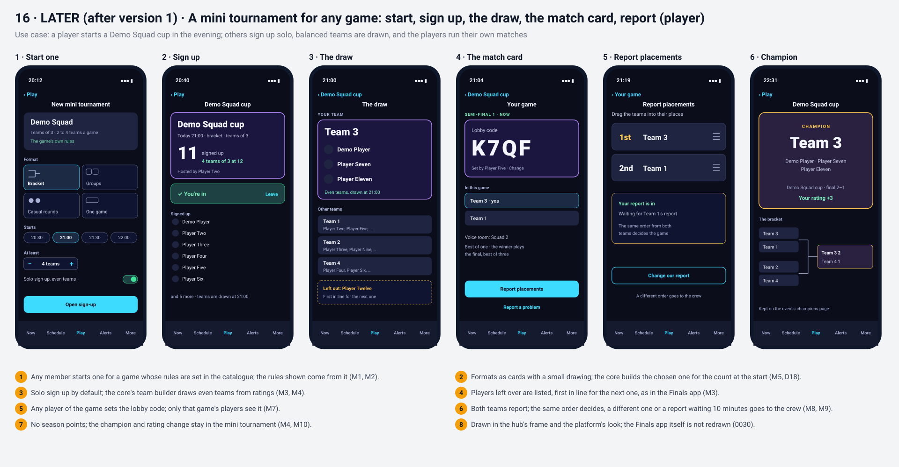

### Mini tournaments for the crew (crew, organiser) · later
The queue of differing reports, lone reports and problem notes; what runs and what is open; the history; the crew phone's queue; rules for a game the catalogue lacks, for one tournament; the settings ([M2](step-7-tournament/questions.md#m2-which-games), [M9](step-7-tournament/questions.md#m9-the-crew-queue), [M14](step-7-tournament/questions.md#m14-rights-for-mini-tournaments), [O11](step-7-tournament/questions.md#o11-many-mini-tournaments-at-once)). Mockup 17, as drawn at the 0030 revision, not redrawn.

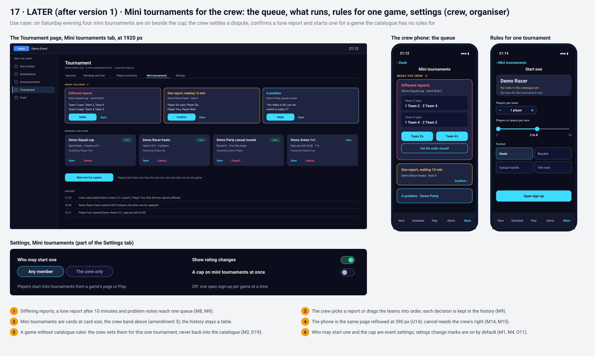

### What the later mini tournaments take from the Finals app and the core
| From | Becomes | Choice and why |
|---|---|---|
| The Finals app's sign-up and its team builder from a 0–100 roster | Solo sign-up with a balanced draw from ratings per game across the series; a left-out list (M3, M4) | **Reuse with changes:** ratings per game, not one roster per app; sign-in, not a browser token |
| The app's lobby id (4 characters, set by a team, kept for a series) | The match card's lobby code (M7) | **Reuse with changes:** 4–8 characters, any player of the match or the crew |
| The app's team reports: two matching reports from different teams decide; differing ones wait for the admin | Self-reported placements and the crew queue (M8, M9) | **Reuse with changes:** a lone report reaches the queue after 10 minutes; every decision is in the history |
| The app's cancel (kept as `cancelled`, no ranking effect) and champions page with trophies | A mini tournament's cancel (M15); mini tournament champions under the cup's | **Reuse with changes** |
| The app's public start in month windows, vote to start early, availability voting | — | **Drop** for mini tournaments: they serve the app's off-LAN seasons, which it keeps (M6) |
| The app's shared admin password, browser edit tokens, debug fillers | — | **Drop:** sign-in and rights (as the app itself already did) |
| — | "Casual rounds": rosters and rounds for casual play as a format (M13), moved here from the Games track | **New** |
| — | Rules for one tournament set by the crew when the catalogue has none (M2) | **New**, so the mini tournaments never wait for the Games track |

### What the later mini tournaments would build
- **Issue (later).** A mini tournament for any catalogue game whose rules allow it, run by the players: start (any member, or the crew only by setting), the game's rules read from the catalogue and kept with it, or set by the crew for one tournament; the format from cards, built and frozen by the core at the start; solo sign-up with a balanced draw from ratings per game across the series, or team sign-up; the match card with the lobby code; self-reported placements, two matching reports deciding; the crew queue on the Tournament page and the crew phone; cancel; ratings in export and delete; the MiniTournament outline and its events in `contracts/tournament.md` (D17, additive); the pages in the hub's frame, as day schedules where they list things in time; race tests. Risk: normal; its right, `tournament.minis.manage`, joins the `tournament_crew` preset (D12 would change then, M14).
- **With it.** A running mini tournament's bracket on the Pulse when no session runs, and a Moments rule for its champion's winner card (M11); two-side reporting as a session switch through the same reports and queue (U8, later); Games' competition rules (D19, D15 changed then).
- **Exit line (later).** On the demo event a player starts one for a catalogue game with rules, others sign up solo, balanced teams are drawn, a lobby code is set, two teams report matching placements, a differing report reaches the crew queue and is settled, a champion is crowned with a winner card on the screen, and no season points change.
- **Later, not in version 1: a team season.** Fixed teams scored across sessions are not in version 1. It would limit the games, because solo games and different team sizes do not fit a fixed roster.
