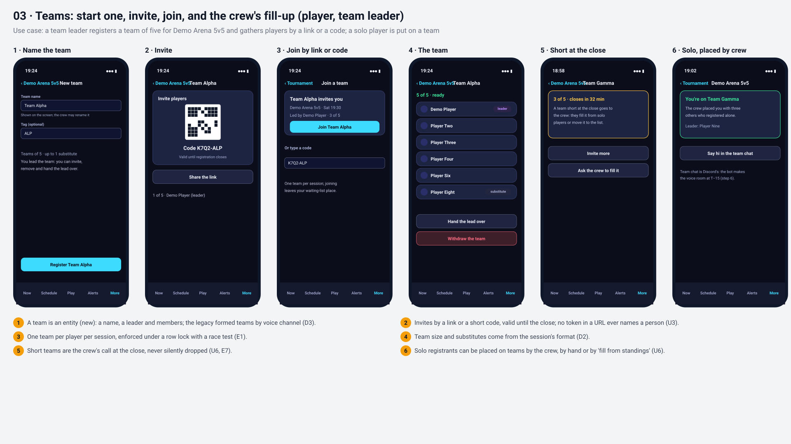
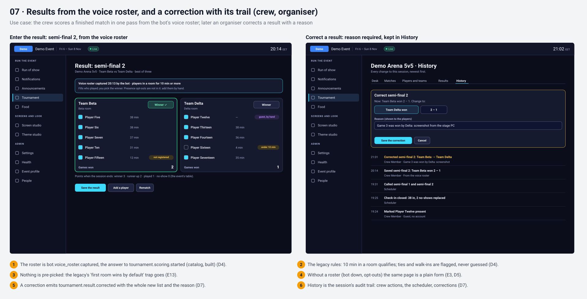
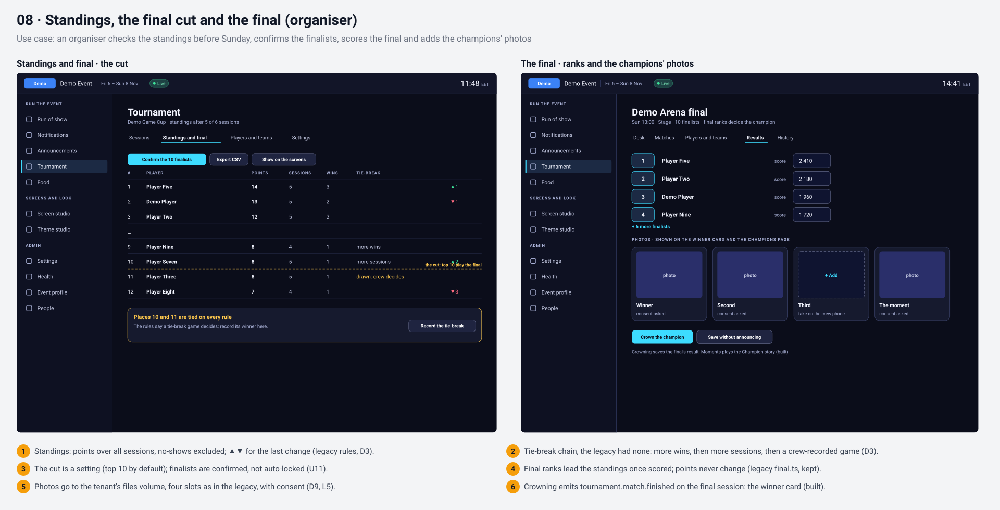
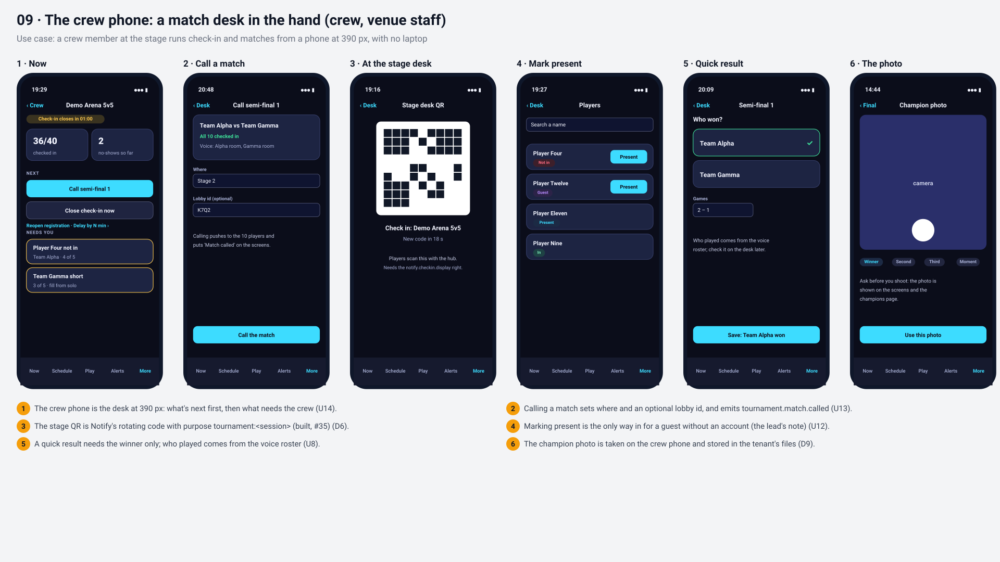
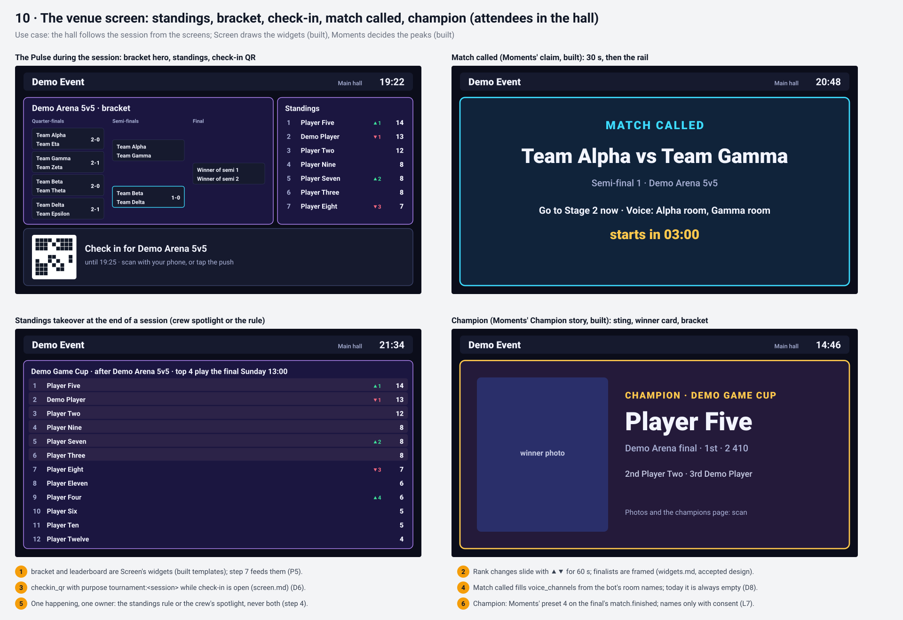
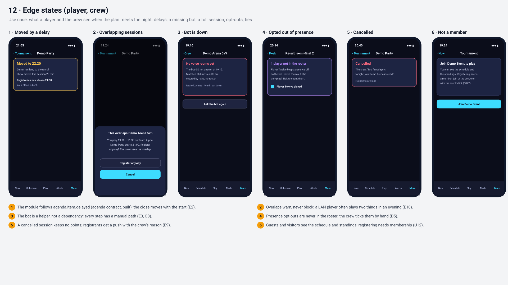
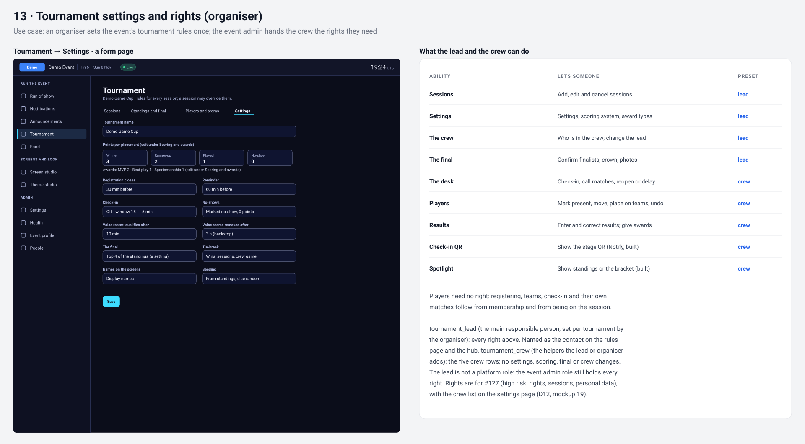
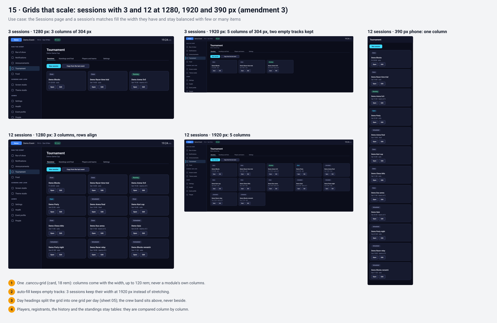

# Step 7 brief: Tournament (research pack)

The research pack for the product owner's brainstorming session on [step 7, Tournament](../roadmap.md#7-tournament) (epic #61), issue #126. It follows the [outline of a research pack](README.md#outline-of-a-research-pack), the issue's criteria and the lead's comments on #126 (2026-11-07: the step 2 notes; 2026-11-08: a research pack with every key screen mocked up, a question bank, and the issues as input; 2026-11-12: the design guideline for the leaderboard and bracket widgets). It is built like [step 5's pack](step-5-pizza.md). After this merges, the lead runs the session over as many rounds as it takes, writes the final plan into this brief (`## Plan`) and rewrites the step's issues; the product owner accepts the plan before any build starts.

> **Source update (2026-11-20, #677).** The [canccubot](../legacy-inventory/canccubot.md) and [mini tourney](../legacy-inventory/thefinals_mini_tourney.md#refresh-2026-11-20) inventories were refreshed to their current code; nothing this pack takes from the signup site changed. What it touches, with no decision of this pack changed:
> - [U18](step-7-tournament/questions.md#u18-what-the-bot-needs-from-the-module) and [U7](step-7-tournament/questions.md#u7-giving-up-a-place): the legacy bot now has a working sign-up from Discord, `/finals`: one private reply with a status line, a personal link button, and **Register** (the server nickname, cleaned, with a name dialog when it is taken) or a red **Withdraw** behind a Yes / No confirm, allowed until teams are formed. A ready model for recommendation A's `/tournament register` and "I can't make it".
> - [D11](step-7-tournament/questions.md#d11-pushes-and-dms): every bot message built from names now goes out with mentions off and only the tourney's own links; the same rule fits the tournament's posts and DMs.
> - [E9](step-7-tournament/questions.md#e9-a-session-cancelled-or-ended-early): the mini tourney now cancels a running season and keeps it in history as `cancelled`, with no ranking effect, as recommendation A does for sessions.
> - [E13](step-7-tournament/questions.md#e13-the-format-mix-up-bug-and-other-legacy-bugs): the `four`/`fourqc` mix-up is still in the mini tourney and in the extracted [finals-core](https://github.com/glyzer/finals-core) v1.0.1, so recommendation A (that test belongs to the Finals track) holds.

**In this pack**
- This file: goal, what was read, what earlier steps already built, how others solve it, three directions and the recommended one, the key flows, port / drop / invent, the lead's notes, what the built contracts get wrong, proposed issue changes and exit criteria.
- [step-7-tournament/questions.md](step-7-tournament/questions.md): the question bank, 76 questions in six themes, each with options and a recommendation. IDs (U3, D1, …) are used throughout.
- [step-7-tournament/](step-7-tournament/): 15 SVG mockups, drawn new, with the demo event only. GitHub shows them inline below. Organiser pages are drawn in the dark organiser shell of `packages/ui` with the Demo night tokens (as the step 4 polish and grids sheets); attendee pages in the hub's frame; the venue screen in the screen look. Each sheet states its use case. Every text carries the box it sits in, and a headless Chromium check found no text outside its box at any width drawn (see [Every mockup](#every-mockup)).

## Goal
Players register, play and follow a tournament on the platform ([roadmap](../roadmap.md#7-tournament)). The roadmap's "In it": the tournament system ported and polished ([0022](../decisions/0022-product-vision.md)): check-in, no-shows, result corrections with an audit trail, seeding; scoring, leaderboard and final, built on the signup site's code; registration inside the module; the bot's voice-channel handshake through events; concurrency with row locks (`SELECT … FOR UPDATE`). The mini tourney is not part of it: it is the `finals` module of the Finals track ([0025](../decisions/0025-finals-and-games-modules.md)). Exit: a test tournament runs end to end.

The step's three build issues: #127 (the contract, sessions and registration), #128 (scoring, leaderboard and the final), #129 (check-in, no-shows, result corrections and seeding). This pack treats them as input ([P2](step-7-tournament/questions.md#p2-the-issue-set)).

## What was read
- **Decisions:** [0022](../decisions/0022-product-vision.md) (the tournament "ported and polished"; one standings table is backlog), [0020](../decisions/0020-best-of-old-freely-new.md) (the best of the old, freely new), [0027](../decisions/0027-product-decisions-2026-11-07-08.md) (check-in never mandatory: optional, off by default, per tournament with a per-session switch; matches inside a session optional; joining by venue, link or QR; every account a Discord account; 12-month anonymisation), [0025](../decisions/0025-finals-and-games-modules.md) (the tournament builds on the signup site's code, not the tourney core), [0005](../decisions/0005-signup-site-stays-outside.md) (tournament registration moves into the module), [0004](../decisions/0004-nothing-migrated.md) (no tournament history is migrated), [0013](../decisions/0013-multi-tenant-core.md), [0010](../decisions/0010-scope.md) (no tokens in URLs), [0003](../decisions/0003-event-content-scrubbed.md), [0026](../decisions/0026-briefs-are-research-packs.md), [0029](../decisions/0029-additive-contracts-ship-with-consumers.md) and [0024](../decisions/0024-additive-contract-docs-normal-risk.md).
- **The roadmap:** [step 7](../roadmap.md#7-tournament), step 9 (feeds), order change OC8 (the bot's tournament side is built in step 6 against the catalog and goes live with step 7), and the reuse table's signup-site and canccubot rows.
- **Legacy inventories:** the [signup site](../legacy-inventory/signup-site.md) (tournament features, the route table, the scheduled jobs, the tests, known problems), the [summary](../legacy-inventory/README.md) (T1–T11, X13, flow 2, TB4, N10 and N11), [canccubot](../legacy-inventory/canccubot.md) (the tournament cog, reminders, voice channels, dwell), [canccusignage](../legacy-inventory/canccusignage.md) (the tournament band and the leaderboard asset) and [the mini tourney](../legacy-inventory/thefinals_mini_tourney.md) (only to keep it apart).
- **The legacy itself** (read-only): the signup site's tournament schema, its API routes, the 1,433-line session admin page, `roster.ts` (autofill), `score-merge.ts`, `scores.ts` (the leaderboard), `final.ts`, `final-photos.ts`, `display-tournament.ts`, `vc-plan.ts`, the rules page; the bot's `tournament_manager.py`, `tournament_dwell.py`, `tournament_discord_channels.py` and the tournament cog, with their ADRs and tests.
- **Contracts it builds on:** [events.md](../../contracts/events.md#tournament) (the Session, Match and Result outlines and the 17 `tournament.*` events; the bot's `bot.voice_channels.*` and `bot.voice_roster.captured`), [agenda.md](../../contracts/agenda.md#tournament-sessions) (the session mirror and delays), [notify.md](../../contracts/notify.md) (the `tournament` topic; check-in by the rotating QR with `tournament:<ref>`), [moments.md](../../contracts/moments.md) (the `tournament` and `finals` classes, three built-in rules, the crew spotlight), [screen.md](../../contracts/screen.md#widgets) (`bracket`, `leaderboard`, `checkin_qr`, `match_called`, `winner_card`), [tenants.md](../../contracts/tenants.md) (roles, presets, series and clone, retention), [admin.md](../../contracts/admin.md#settings) (settings and rights), [bot.md](../../contracts/bot.md) (who plays what), [games.md](../../contracts/games.md) (the catalogue) and [finals.md](../../contracts/finals.md) (to keep it apart).
- **Briefs and design:** step 3's pack (D17, the agenda's tournament mirror), step 4's plan and [storyboards](step-4-moments/storyboards.md) (presets 2, 3, 4, 9, 19, 22, 24; "one happening has one owner"), [step 5's pack and plan](step-5-pizza.md) (the shape of this pack; the scheduler, rights and `me/summary` patterns), the [App track pack](track-app.md) (P4: the tournament owns its pages in the hub's frame; mockups 09, 10 and 12), the [design guideline](../design/README.md) (amendment 3, grids that scale), [experience-map.md](../design/experience-map.md) and [widgets.md](../design/widgets.md) (the leaderboard and bracket widgets, the animated match called, the crew spotlight).
- **The epic and its issues:** #61, #126 with the lead's three comments, #127, #128, #129; the related #52 (sign-in), #123 (the bot's tournament side), #139 (optional check-in and matches) and #150 (members, series and clone).

## What earlier steps already built
More of step 7 waits for it than any step so far. The consumers are built; only the emitter is missing.
- **The catalog (#137, #139)** outlines the Session (`status` from `scheduled` to `finished`, `checkin_enabled`, `matches`, `voice_plan`, counts with a `revision`), the Match, the Result and 17 `tournament.*` events, with the rule that the module's contract "takes over these names and fields and may add". Check-in and matches are already optional there, as 0027 decided.
- **Agenda (step 3)** mirrors sessions into the run of show (`managed_by: tournament`), applies them by `revision`, refuses organiser edits with `item_managed`, and publishes `agenda.item.delayed`, which the tournament is to follow. Its fixtures validate against the catalog's Session, so a change there shows in its tests.
- **Moments (step 4)** has the `tournament` class (rank 60) and the `finals` class, the built-in rules `match_called`, `standings` and `finals_result`, the cues `tournament.pre`, `.start`, `.post` and `strip.tournament_next` with catch-up, the crew spotlight (`show: standings | bracket`), live `leaderboard` and `session` sources ("Collecting standings…" until fed), and seven presets: Starting soon, Match called, Champion, Check-in open, Stage break, Round start and Champion replay. All are on and idle until the module emits.
- **Screen (step 3)** draws the `bracket`, `leaderboard`, `match_called` and `winner_card` templates and the `checkin_qr` widget, and its Director already orders `bracket` and `leaderboard` first when a tournament runs. Nothing feeds the two widgets yet; `checkin_qr` fetches only the `arrival` purpose.
- **Notify (step 3)** declares the `tournament` topic (the event part on `registration.opened`, the personal part on `match.called`, urgent, and `checkin.opened`) and records check-ins for any `tournament:<ref>` purpose (tested with `tournament:s_12`), emitting `notify.checkin.recorded`.
- **Admin** lists the module ("Matches and brackets") in health. **The kit** has the outbox, the settings client, the rights check and tenant transactions. **The demo profile** turns `tournament` on but holds no tournament data.
- **Not built:** the tournament module (an empty folder), its contract, the central sign-in (#52) and joining (#150), the bot (step 6, #123) and the games catalogue's module.

So the exit, "a test tournament runs end to end", can include the screens and the phones in step 7 itself ([P5](step-7-tournament/questions.md#p5-the-screen-and-hub-feed-in-step-7)).

## How comparable products solve it
| Field | What they do | What we take |
|---|---|---|
| **Esports bracket platforms** | Brackets of every shape, seeding, team rosters with invites, check-in windows, self-reported scores with confirmation, disputes to an admin | Team invites by link or code (U3), a check-in window (U9), seeding (D7); not the bracket engine or self-reporting by default (P4, U8) |
| **Matchmaking services with ready-up** | A ready-up timer per match, auto-forfeit when it runs out, a lobby id handed to the players | "Match called" with a place, a voice room and a lobby id ([mockup 04](step-7-tournament/04-session-evening.svg)); no auto-forfeit by default (E6) |
| **Sports league and fantasy apps** | Season standings, points per result, tie-breakers stated up front, movement arrows | The legacy season stays the spine; a tie-break chain the legacy lacked (D3); ▲▼ on the standings (widgets.md) |
| **Quiz and party-game scoreboards** | One host enters scores fast, a big board shows rank changes, the room cheers | The crew's quick result on a phone ([mockup 09](step-7-tournament/09-crew-phone.svg)); the standings takeover on the screen ([mockup 10](step-7-tournament/10-venue-screen.svg)) |
| **Conference and venue check-in** | A QR at a desk, a badge scan, a list the staff can override | Notify's rotating QR (built) with purpose `tournament:<session>`, and the crew's "mark present" for guests (U12) |
| **Arena screens** | A call to the floor, a countdown, a champion moment with a photo | Moments' Match called and Champion (built), fed by this module (L4, L5) |

The lesson across them: the good ones **tell players where to be and when** (a call, a place, a countdown), **make the host's job one tap** (enter a result, advance the winners), and **make the rules visible before they matter** (points, ties, no-shows). The legacy got the season and the scoring rules right and left the rest to Discord DMs and a 1,433-line admin page.

## The legacy in one paragraph
The signup site's tournament is **one implicit season of sessions**, each one game at a fixed time (about ten over a weekend, mostly team shooters and arena games, one casual solo game, then a final). A session gives coarse placements: 1st, 2nd, participant, no-show, worth 3, 2, 1 and 0 points (plus an optional bonus); in a team game the whole first team gets 1st. Players register one by one through a token link from the bot; teams form by which voice channel a player sits in. The bot drives the timeline by polling: a post at T−60, close and a DM at the deadline, voice channels at T−15 with a screen pin until T+10, a DM at T, and cleanup on the first score save or at T+3 h. Scoring freezes the bot's dwell tracking (10 minutes in a channel qualifies), and the admin page autofills placements from the roster. The leaderboard sums points with no tie-break; the final is one flagged session whose ranks lead the leaderboard once scored, with four photo slots. There are no brackets, capacities, teams, waiting lists, check-in, seeding or audit; corrections are whole-session replaces ([legacy summary, flow 2](../legacy-inventory/README.md#flow-2-a-tournament-session-from-schedule-to-leaderboard)).

## Three directions
The same moment in each: 19:30 on Saturday, the Demo Arena 5v5 semi-finals, the standings tight before Sunday's final.

### A · The LAN cup, ported
The legacy season rebuilt on the platform: sessions in many games, coarse placements and points, a final. Sign-in replaces token links; registration, the deadline and the timeline move into the module with a scheduler; the issues' polish is added as written (check-in, no-shows, corrections, seeding) and nothing more. One match per session.
- **Attendees:** register, wait for a DM, play, read the table later. Nobody is called to a match; nobody knows where to be except from Discord.
- **Organisers and crew:** one results form per session, much like the legacy, but safe (locks, audit).
- **Venue staff:** nothing changes.
- **Trade-offs:** the cheapest; the legacy tests are the spec. But the screen and the phones stay quiet: Moments' Match called and Round start never fire, the `bracket` widget stays empty, and the step's polish is only on paper.
- **Cost: S–M.**

### B · Brackets everywhere
An esports platform inside the event: every session a bracket (groups, single or double elimination, best of n), seeded from a rating; teams report their own scores and confirm each other's; disputes go to a referee queue; ready-up check-in per match with auto-forfeit.
- **Attendees:** live in the app all evening; exciting for one serious game, overkill for a party game.
- **Organisers and crew:** referees and dispute admins, at the hours they are busiest.
- **Venue staff:** a big bracket on the screen, always moving.
- **Trade-offs:** most of the cost goes to rules few sessions use; it rebuilds what the Finals track gets from the shared tourney core, which 0025 keeps out of this module; self-reporting invites disputes the legacy never had.
- **Cost: L–XL.**

### C · The cup, live
The legacy season kept as the spine and made live. Season points across sessions stay, so any game fits. Inside a session, matches are an option (0027): heats or rounds, filled by "winners advance" with one tap, no bracket engine. The crew enters results from the bot's voice roster in one pass; corrections keep a trail. Phones are called to a match; the screen tells the story: check-in, called, live, champion.
- **Attendees:** register solo or as a team in under a minute from the hub; a For you card and a push at the moments that matter (check in, your match is called, you moved up); a match page with the place, the voice room and a lobby id; the standings and a champions page.
- **Team leaders:** a team with a name, invites by link or code, a leader who can hand over.
- **Organisers and crew:** a Tournament page of session cards, a session desk that says what to do next, results from the roster, a crew phone that runs check-in and matches at the stage, settings with the legacy values as defaults.
- **Venue staff:** the stage desk QR and a phone list of who is in.
- **Trade-offs:** more states and tests than A (teams, waiting list, matches, rounds); a few additive contract fields ([D8](step-7-tournament/questions.md#d8-the-built-contracts-gaps)). It builds no bracket engine and no self-reporting.
- **Cost: M.**

## Recommended direction: the cup, live
**C.** The legacy tournament worked at real events because of its season: any game, coarse placements, a final that everyone can reach. What hurt was never that shape but the night around it: nobody knew where to be, the bot's DMs were the only voice, the crew scored in a giant form with the first team pre-picked as the winner, corrections overwrote the past, and a down bot left registration open. C keeps the season and fixes exactly the night.

B is tempting because the screen design already draws a bracket, but a bracket is just matches in rounds, and C gets that picture from data the catalog already has (`matches`, `tournament.round.started`) with a "winners advance" helper instead of an engine. The serious bracket game belongs to the Finals track, which has the engine. A would ship the legacy's silence with a new coat of paint, and leave the screen, the phones and Moments' seven tournament presets idle.

C also costs less than it looks, because the platform has done the far end already: the agenda mirror, Moments' rules, presets and cues, Screen's templates, Notify's topic and check-in all exist and wait for `tournament.*` events. Step 7 builds the module that emits them, and the venue lights up.

**Design principles**
1. **Where and when, always.** Every registered player knows their next time, place and room; a called match reaches the phone and the screen at once.
2. **The season is the spine.** Points across sessions, the legacy table as the default, a final for the top of the standings; any game fits because placements are coarse.
3. **Matches are optional, rounds are data.** One match for everyone by default; heats and rounds when wanted; "winners advance" fills the next round, the crew can always edit (P4).
4. **The crew taps once.** The desk and the crew phone lead with the next action; results come from the voice roster; nothing is pre-picked.
5. **Trust the results.** A correction needs a reason, is shown to the players it touches and stays in the session's history; nothing is deleted.
6. **The bot helps, never blocks.** Voice rooms, rosters and DMs are welcome; every step has a manual path when the bot is down (E3).
7. **Safe under load.** Every write is one transaction under a row lock with an idempotency key; events through the outbox; race tests for the last place and the last team member (E1).
8. **Private by default.** Who plays is public inside the event; check-ins and voice rosters are presence data, the opt-out is respected, and names on the screen follow a setting (D5, L7).

## Key flows
Each flow names its users and its mockup. The mockups use the demo event's names only (Demo Event, Demo Game Cup, Demo Arena, Demo Party, Demo Racer, Team Alpha …, Demo Player, Player Two …).

### From the screen to a place in the session (player)
The Tournament page in the hub with the For you card; a session; registered with the timeline; full with a waiting list; moved up; giving up a place ([U2](step-7-tournament/questions.md#u2-solo-teams-or-both), [U5](step-7-tournament/questions.md#u5-capacity-and-the-waiting-list), [U7](step-7-tournament/questions.md#u7-giving-up-a-place)).

### Teams (team leader, player)
Name a team, invite by link or code, join, the full team, short at the close, a solo player placed by the crew ([U3](step-7-tournament/questions.md#u3-how-teams-form), [U6](step-7-tournament/questions.md#u6-solo-players-in-a-team-session)).

### The evening of a session (player)
Check-in opens, checked in, the match is called, in play with the voice room and lobby id, the result, a missed check-in ([U9](step-7-tournament/questions.md#u9-the-check-in-window), [U10](step-7-tournament/questions.md#u10-no-shows), [U13](step-7-tournament/questions.md#u13-the-match-page)).

### The sessions and a new session (organiser)
The Tournament page as a card grid per day with the crew band above (amendment 3); the new-session form with the format, places, close, check-in, matches, points and voice ([D1](step-7-tournament/questions.md#d1-tournaments-sessions-matches), [D2](step-7-tournament/questions.md#d2-formats-and-points)).

### The session desk (organiser, crew)
The scheduler's timeline, one band of crew actions led by the next one, live counts, the matches as cards with the called and the live match framed, the players as a table ([U13](step-7-tournament/questions.md#u13-the-match-page), [O1](step-7-tournament/questions.md#o1-the-scheduler)).

### Results and corrections (crew, organiser)
The result from the voice roster with nothing pre-picked; a correction with a reason; the session's history ([U8](step-7-tournament/questions.md#u8-who-enters-results), [D4](step-7-tournament/questions.md#d4-the-voice-handshake), [D7](step-7-tournament/questions.md#d7-corrections-and-the-history)).

### Standings, the final cut and the final (organiser)
The standings with a tie-break chain and the cut; the final's ranks and the champions' photos ([D3](step-7-tournament/questions.md#d3-standings-and-tie-breaks), [U11](step-7-tournament/questions.md#u11-the-final), [D9](step-7-tournament/questions.md#d9-photos)).

### The crew phone (crew, venue staff)
Now, call a match, the stage desk QR, mark present, a quick result, the champion photo ([U13](step-7-tournament/questions.md#u13-the-match-page), [U14](step-7-tournament/questions.md#u14-the-crew-phone)).

### The venue screen (attendees in the hall)
The Pulse with the bracket hero, the standings and the check-in QR; Match called; the standings takeover; the champion ([L3](step-7-tournament/questions.md#l3-the-screen-during-a-session), [L4](step-7-tournament/questions.md#l4-match-called-on-the-screen), [L5](step-7-tournament/questions.md#l5-the-champion-moment), [P5](step-7-tournament/questions.md#p5-the-screen-and-hub-feed-in-step-7)).

### A session's life (everyone, implicitly)
The states, the check-in branch, what each step emits, and the timeline from T−24 h to T+3 h for the scheduler, the phone, the screen, the bot and the crew ([O1](step-7-tournament/questions.md#o1-the-scheduler), [O3](step-7-tournament/questions.md#o3-timeline-defaults)).

### Edge states (player, crew)
Moved by a delay, overlapping sessions, the bot down, a presence opt-out, a cancelled session, not a member ([E2](step-7-tournament/questions.md#e2-a-session-moves), [E3](step-7-tournament/questions.md#e3-the-bot-is-down), [D5](step-7-tournament/questions.md#d5-presence-opt-out-and-check-in)).

### Settings and rights (organiser)
Every rule per event with the legacy values as defaults; the rights and the `tournament_crew` preset ([O3](step-7-tournament/questions.md#o3-timeline-defaults), [D12](step-7-tournament/questions.md#d12-rights)).

### Follow along (attendees, spectators)
The standings, a live session, the champions, the rules, the player's own summary after the event ([U15](step-7-tournament/questions.md#u15-spectators), [U10](step-7-tournament/questions.md#u10-no-shows)).

### Grids that scale (organiser)
The Sessions page with 3 and 12 sessions at 1280 and 1920 px and on a phone, one `.canccu-grid` at card size ([L2](step-7-tournament/questions.md#l2-the-organiser-pages)).

### Every mockup
| File | What it shows | For whom |
|---|---|---|
| [01-directions.svg](step-7-tournament/01-directions.svg) | The three directions side by side | the session |
| [02-flow-register.svg](step-7-tournament/02-flow-register.svg) | Tournament page → session → registered; waiting list; moved up; giving up | attendee |
| [03-teams.svg](step-7-tournament/03-teams.svg) | A team: name, invite, join, full, short, placed by the crew | team leader, player |
| [04-session-evening.svg](step-7-tournament/04-session-evening.svg) | Check-in, called, in play, result, missed check-in | player |
| [05-sessions.svg](step-7-tournament/05-sessions.svg) | The sessions grid per day; the new-session form | organiser |
| [06-session-desk.svg](step-7-tournament/06-session-desk.svg) | The session desk at 1920 px | organiser, crew |
| [07-results-and-corrections.svg](step-7-tournament/07-results-and-corrections.svg) | A result from the voice roster; a correction and the history | crew, organiser |
| [08-standings-and-final.svg](step-7-tournament/08-standings-and-final.svg) | Standings, tie-breaks and the cut; the final and photos | organiser |
| [09-crew-phone.svg](step-7-tournament/09-crew-phone.svg) | The crew phone: now, call, stage QR, mark present, result, photo | crew, venue staff |
| [10-venue-screen.svg](step-7-tournament/10-venue-screen.svg) | Bracket, standings, check-in QR, match called, champion | attendees in the hall |
| [11-lifecycle.svg](step-7-tournament/11-lifecycle.svg) | States, events, the timeline per surface | everyone |
| [12-edge-states.svg](step-7-tournament/12-edge-states.svg) | Six edge states | player, crew |
| [13-settings-and-rights.svg](step-7-tournament/13-settings-and-rights.svg) | Tournament settings; rights and the crew preset | organiser, event admin |
| [14-follow-and-champions.svg](step-7-tournament/14-follow-and-champions.svg) | Standings, a live session, champions, rules, after the event | attendees, spectators |
| [15-grids.svg](step-7-tournament/15-grids.svg) | The sessions grid with 3 and 12 at 1280, 1920 and 390 px | organiser |

The sheets were drawn by a throwaway script kept out of the repo, as in step 5. Each text that sits in a box carries `data-box` (its box's left and right edge); rendered in headless Chromium (the playwright image's fonts), no text runs outside its box on any sheet. The grids follow [amendment 3](../design/README.md#3--grids-scale-with-their-content-2026-11-19): collections (sessions, matches, photo slots) are one auto-fill grid at card size with the crew band above; players, the history and the standings stay tables.

## Port, drop or invent
Each with its reason ([0020](../decisions/0020-best-of-old-freely-new.md)).

### Port as is (code and its tests, with clock, zone and storage injected)
| Legacy | Where it goes | Why |
|---|---|---|
| The points rule (first 3, second 2, participant 1, no-show 0; base + a non-negative bonus; no-show exactly 0) and `tournament-scores-bonus` | the module's scoring, as the default of a setting (D2) | Proven at real events; the tests are the spec |
| `score-merge.ts` (match by id, else by name; `fill_no_show`; `add_as_registered`) and its tests | saving a result | The careful part of the legacy; only the replace-all write changes |
| `scores.ts` and `collapseLeaderboardRows` (sum, distinct sessions, no-shows excluded, one person once) and `tournament-leaderboard-collapse` | the standings | Proven; the tie-break is added on top (D3) |
| `final.ts` (finalists validated against the standings; ranks 1..N all set or all null; finalists lead once scored; points never change; clearing restores) and its tests | the final | A good rule that kept the season fair |
| `vc-plan.ts` (`none`, `solo`, `team`; ordered unique channel names) and `tournament-vc-plan` | the session's `voice_plan` (already in the catalog) | Pure and tested |
| The bot's `build_dwell_roster` rules (10 minutes qualifies, longest channel wins, ties flagged, `registered_not_qualified`, `present_not_registered`) and `test_tournament_dwell.py` | the bot (step 6) builds the roster; the tournament reads its flags | The best part of the handshake; the bot keeps it (OC8) |
| `computePostpone` (the close keeps its offset to the start) | following `agenda.item.delayed` (E2) | The same rule, now driven by the run of show |

### Port with changes
| Legacy | Becomes | Why |
|---|---|---|
| One implicit season per database (TB4) | Tournaments per event (usually one), sessions with a `tournament_id` (D1) | Per tenant; a second cup in one event is cheap later |
| Registration through a 7-day token link from the bot | The central sign-in and membership (0027) | Tokens in URLs are dropped (0010) |
| Individual registration only; teams by voice channel | Solo or team sessions; a team entity with a leader and invites (U2, U3) | N10's team invites; a team must exist before the voice room does |
| No capacity, no waiting list | Places per session and a waiting list that moves up (U5) | #127; a full session should not be a dead end |
| The deadline enforced by the bot changing `status` | The module's scheduler, due rows in Postgres (O1) | A down bot left registration open; the close must hold |
| Close at T−60 from the site, T−30 from the bot, a T−60 post saying "30 minutes" | One setting, 30 minutes by default; every surface reads the same times (O3) | The legacy's three numbers disagreed |
| The bot's flag handshake by polling (`vc_created`, `scoring_started`, `roster_json`, `cleanup_requested`, `vc_cleaned`) | Events: `tournament.scoring.started` → `bot.voice_roster.captured`; `bot.voice_channels.created` and `.removed` (catalog, built) | Nothing polls; flow 2's event handshake |
| Autofill that pre-selects channel 0 as the winner | Nothing pre-picked; the crew picks the winner (U8) | A default that silently crowned the first team |
| Scores saved by delete-then-insert, no transaction; corrections by re-saving | Results per match in one transaction under `FOR UPDATE`; a correction is a new version with a reason (D7) | #129; the audit trail |
| No tie-break; positional ranks | A tie-break chain, with a crew-recorded game as the last step (D3) | The rules page asked for tie-break games the code never knew |
| The schedule page and a modal of scores | The hub's Tournament page and session pages; the run of show for the schedule (built) | One frame (App track); the agenda is the one run of show |
| `display-tournament.ts` polled by the LAN display and signage | `tournament.leaderboard.changed`, the match events and Screen's widgets (P5) | Nothing polls; Moments owns the peaks |
| The T−15 to T+10 leaderboard pin | Moments' rules and presets (built): Starting soon, Match called, standings | One happening, one owner (step 4) |
| Four JPEG photo slots in a BLOB column | Four slots in the tenant's files volume, with consent (D9) | Containers keep no state; photos are personal data |
| The 1,433-line string-built admin page | The Tournament pages in the organiser shell: sessions, the desk, results, standings and final, settings (L2) | T5–T6 rebuilt; its postpone, reopen and candidate logic kept |
| Bot DMs at close and start | Notify's tournament topic (push) plus the bot's DMs in step 6 (D11) | People choose their channels (App track) |

### Drop
| Legacy | Why |
|---|---|
| Registration and admin tokens, `/tournament admin` links | Sign-in and rights replace them |
| The `completed` status nothing wrote | `finished` in the catalog |
| Debug flags (create-now, cleanup-now in the UI) and `DELETE /internal/clear` | A crew action with a right and an audit replaces "create now"; nothing wipes everything |
| The 60 s leaderboard refresh and the signage adapter's 180 s poll | Push |
| Hard-coded time zones, the site URL in DMs | The event's time zone and the hub's links |
| Name-keyed identity for id-less players (`lower(name)`) | A guest Person row with its own id (U12); two people with one nickname never merge |

### Invent
| New | Why |
|---|---|
| Teams with a leader, invites by link or code, substitutes (U3) | Teams must exist before the match is called |
| A waiting list that moves up, with a push (U5) | Full sessions; no-shows replaced at the close of check-in (U10) |
| Matches and rounds as data, with "winners advance" (P4) | The bracket on the screen without an engine; Round start (built) fires |
| Match called with a place, voice rooms and a lobby id (U13) | Where and when, always |
| The session desk and the crew phone (U13, U14) | The crew taps once |
| A tie-break chain and the final cut (D3, U11) | Fair finals |
| Corrections with a reason and the session's history (D7) | #129; results people trust |
| Seeding from the series' earlier results (D7) | #129; the next event starts from the last |
| A champions page per event (U10) | #128; the legacy had only a badge |
| `me/matches` and `me/summary` for the hub (D10) | The lead's step 2 note; For you |
| Overlap warnings across sessions (E10) | Players play several things a night |

## The lead's notes (2026-11-07 and 2026-11-12)
- **The hub reads the caller's own matches and the module consumes `notify.checkin.recorded` for `tournament:<ref>`:** yes. `GET /api/tournament/me/matches` and `GET /api/tournament/me/summary` (For you cards, as step 5 settled for pizza), and a consumer of `notify.checkin.recorded` that checks the purpose, the session's state and the registration, then emits `tournament.player.checked_in` ([D10](step-7-tournament/questions.md#d10-the-hubs-reads), [D6](step-7-tournament/questions.md#d6-check-in-through-notify)).
- **The per-tournament `checkin` setting with a per-session override, the API to give a session matches, and following `agenda.item.delayed` (#139):** the setting and override as the catalog says (off by default); `PUT /api/tournament/sessions/{id}/matches` while none has started, plus "winners advance" for rounds ([P4](step-7-tournament/questions.md#p4-brackets-in-step-7)); a consumer of `agenda.item.delayed` that moves the session and its close only while the times still match, as agenda.md says ([E2](step-7-tournament/questions.md#e2-a-session-moves)).
- **Presence opt-out:** opted-out players are not in `bot.voice_roster.captured`, so the crew ticks them by hand ([mockup 12](step-7-tournament/12-edge-states.svg)). Whether a tournament check-in counts as presence data under the opt-out (review finding 1 of #137) is [D5](step-7-tournament/questions.md#d5-presence-opt-out-and-check-in); the pack recommends that a check-in the player makes is not blocked by the opt-out, but is kept as presence data (deleted 30 days after archiving).
- **Checking in a registrant without a platform account:** the crew marks them present ("Mark present", right `tournament.players.manage`); `tournament.player.checked_in` carries `user_id: null` and the Person, as the catalog's Person already allows ([U12](step-7-tournament/questions.md#u12-players-without-an-account)).
- **Demo tournament data in `events/demo/`:** a Demo Game Cup with five sessions (solo, team, rounds, a final), demo players and teams, loaded by the profile ([O7](step-7-tournament/questions.md#o7-demo-data)).
- **The design guideline (2026-11-12):** the leaderboard and bracket widgets, the animated match called and the crew spotlight are drawn to [widgets.md](../design/widgets.md) in [mockup 10](step-7-tournament/10-venue-screen.svg); experience-map.md calls the old drawings placeholders for "the Games system", and this pack proposes that the tournament owns its `bracket` and `leaderboard` feed in step 7 ([P5](step-7-tournament/questions.md#p5-the-screen-and-hub-feed-in-step-7)).

## What the built contracts get wrong
Found while reading the consumers against the catalog; each fix is additive and ships with #127's contract ([D8](step-7-tournament/questions.md#d8-the-built-contracts-gaps)).
1. Moments fills `{session.name}` from `session.name`, which the Session outline does not have: add `name` (the game's name plus a label, for example "Demo Arena 5v5").
2. `{winner.name}` reads `name` on a Result, which has `people` only: add `name` to the Result (the team's name or the player's).
3. The Session has `tournament_id` but no tournament name, and no event names the tournament itself: add `tournament: {id, name}` to the Session.
4. Screen's `teams_left` waits for a count the outline does not give: add `teams_left` to the Session (teams or players not yet out).
5. Moments' `match_called` content sends `voice_channels: []`: the module adds `voice_channels` (names) to the Match once `bot.voice_channels.created` arrives, so Moments and Screen need not consume bot events.
6. The Match needs `where` and `lobby_id` (both optional) for the call and the match page.

No name or field is removed or renamed, so none is a breaking change.

## Proposed issue changes
The step's issues are input ([P2](step-7-tournament/questions.md#p2-the-issue-set)). Proposed, not applied: the lead applies them after the session.
- **#127 · rewrite: the tournament contract, model, registration and rights.** `contracts/tournament.md` and OpenAPI written from the real legacy API and the catalog outlines, with the additive fixes above; tournaments, sessions, teams, registrations and the waiting list per tenant under RLS; the scheduler (due rows, `FOR UPDATE SKIP LOCKED`) with the timeline of [mockup 11](step-7-tournament/11-lifecycle.svg); following `agenda.item.delayed`; rights and the `tournament_crew` preset; the organiser's Sessions pages and settings; `me/export` and `DELETE me`; race tests (the last place, the last team member). Risk: high (sign-in, rights, personal data), as today.
- **#128 · rewrite: matches, results, standings and the final.** Matches and rounds with "winners advance"; calling a match; the voice handshake through events (`scoring.started` → `voice_roster.captured`), results from the roster with nothing pre-picked; the standings with the tie-break chain; the final, its cut, photos and the champions page; `tournament.leaderboard.changed`; the session desk and the crew phone; an end-to-end test with a fake bot. The Moments criterion shrinks to "emit what the built rules and presets wait for" (built in step 4). Risk: normal.
- **#129 · rewrite: check-in, no-shows, corrections and seeding.** Check-in through Notify's QR and the button, the crew's mark present (guests), no-shows at the close with the waiting list moving up, undo; corrections with a reason and the session's history; seeding from the series' earlier results (#150), manual or random. Drop "results agreed by both sides" as a default ([U8](step-7-tournament/questions.md#u8-who-enters-results)), and replace the "format mix-up" regression test, which is the mini tourney's bug (the Finals track's), with regression tests for this module's own legacy bugs ([E13](step-7-tournament/questions.md#e13-the-format-mix-up-bug-and-other-legacy-bugs)). Risk: normal.
- **New · the player's pages in the hub's frame.** The Tournament page, a session, register solo or as a team, invites, the waiting list, check-in, the match page, results, standings, champions and rules, mobile-first in the hub's frame (App track P4), with `me/matches` and `me/summary`. Moved out of #127 as step 5 did with #119, so #127's high-risk package stays small. Risk: normal.
- **New · the tournament on the screens and in Notify.** Register the `tournament` topic with Notify; feed Screen's `bracket` and `leaderboard` widgets and `checkin_qr` with the session's purpose, and the Pulse hero's `game` and `teams_left`; demo tournament data in `events/demo/`; screenshots of every view. Pulled forward from step 9, as step 5 did for food ([P5](step-7-tournament/questions.md#p5-the-screen-and-hub-feed-in-step-7)). Risk: normal.

**Order sketch:** #127 (contract and core, high, alone) → #128 and the hub pages in parallel → #129 → the screens and Notify. The bot's side (#123, step 6) builds against the catalog with contract tests and goes live with #128 (OC8); until then #128's end-to-end test uses a fake bot.

**Proposed exit criteria** ([P3](step-7-tournament/questions.md#p3-the-exit-criterion)): on the demo event, a Demo Game Cup runs end to end with a fake bot: sessions scheduled, players and a team registered, a waiting list moved up, check-in by the QR, a match called on a phone and on a screen, results from the roster, a correction with its trail, the standings live on the screen, a final crowned with its winner card; every write race-tested.

## Roadmap notes found
- Step 7's "Out of scope: brackets for any game (the Games track)" in #127 and experience-map.md's "Games system: tournament roster and bracket (to be planned later)" overlap with the catalog's matches and rounds, which 0027 already allows. The pack proposes that the tournament draws its own sessions' brackets from matches and rounds (P4), and that experience-map.md says so once decided.
- Step 9's "wire pizza, tournament and bot events into Screen" shrinks again: food moved to step 5, and this pack proposes the tournament's feed for step 7 (P5).
- #129's "format mix-up" regression test belongs to the Finals track (the mini tourney's `four`/`fourqc` capacity lookup, summary N10) (E13).
