# Step 8 brief: Admin operations

The research pack for the product owner's brainstorming session on [step 8, Admin operations](../roadmap.md#8-admin-operations) (epic #62), issue #167. It follows the [outline of a research pack](README.md#outline-of-a-research-pack) and is built like step 5's ([step-5-pizza.md](step-5-pizza.md)). After this merges, the lead runs the session over as many rounds as it takes, writes the final plan into this brief (`## Plan`) and writes the step's issues; the product owner accepts the plan before any build starts.

**In this pack**
- This file: goal, what was read, what earlier steps already built, how others solve it, three directions and the recommended one, the key flows, port / drop / invent, proposed issues and exit criteria.
- [step-8-admin-operations/questions.md](step-8-admin-operations/questions.md): the question bank, 77 questions in six themes, each with options and a recommendation. Its IDs (U3, D10, …) are used throughout.
- [step-8-admin-operations/](step-8-admin-operations/): 13 SVG mockups, drawn new in the shipped look, with the demo event only. GitHub shows them inline below. Organiser pages are drawn in the dark organiser shell of the [step 4 polish](step-4-polish/README.md), at 1280 px and at 390 px. The superadmin console is the same shell with a purple "Platform" mark. Discord is drawn simply as a chat, not in Discord's own look. Each sheet states its use case under its title. Collections follow design amendment 3 ([grids that scale](../design/README.md#3--grids-scale-with-their-content-2026-11-19)): 18 rem card grids, side panels in a band below, tables where rows are compared.
- **Text fits its boxes.** Every text in every sheet carries a `data-box` (the left and right edge of its box). As for the [grid sheets](../design/grids/README.md), each sheet was rendered in headless Chromium with DejaVu Sans (wider than the shell's system fonts, so a harder test), and no text runs outside its box at the widths drawn.

## Goal
"The crew sees problems and fixes them from admin, and the next event starts from the last one" ([roadmap](../roadmap.md#8-admin-operations)). The roadmap's "In it":
- operations built on the best of canccumanager: debounce, alerts as events consumed by the bot, ack and mute, a restart policy, and an executor designed new;
- event series with clone-the-last-event, and a venue profile built on the venues of the tenants contract ([0022](../decisions/0022-product-vision.md)).

Exit: an alert reaches Discord and can be acked. The epic has no child issues yet: the issue set below is a proposal ([P2](step-8-admin-operations/questions.md#p2-the-issue-set)).

## What was read
- **Decisions:** [0022](../decisions/0022-product-vision.md) (series and clone, the venue profile, the superadmin over Tailscale only, the core features), [0027](../decisions/0027-product-decisions-2026-11-07-08.md) (joining, accounts, 12-month anonymisation), [0013](../decisions/0013-multi-tenant-core.md) (items 2, 13, 22, 23, 25, 28, 31, 33, 34: health outside tenant resolution, superadmin hardening, the deploy hold, observability per tenant, GDPR, venues, devices), [0007](../decisions/0007-stateless-containers.md), [0010](../decisions/0010-scope.md) (ssh and the manager's dead-man's switch dropped), [0011](../decisions/0011-hosting-on-remote-vm.md), [0020](../decisions/0020-best-of-old-freely-new.md), [0026](../decisions/0026-briefs-are-research-packs.md) and [0029](../decisions/0029-additive-contracts-ship-with-consumers.md).
- **The roadmap:** [step 8](../roadmap.md#8-admin-operations), step 10 (the outside watchdog, pre-flight checks, observability), the porting table's canccumanager row, and the order changes OC4 (the bot's alert relay and `/platform status` land in step 8) and OC8.
- **Legacy inventories:** [canccumanager](../legacy-inventory/canccumanager.md) (features F1–F18, the API, the alert rules, the 9 test files and 95 tests, known problems P1–P13, the port recommendation and its nine tenancy questions); the [summary](../legacy-inventory/README.md) (flow 8, "Platform alerts"; T-I, "Platform health, alerts and operations", TI1–TI8; TC9, TD1, TE3–TE5, TG6, TH4–TH6; D14 and D16 of the signup site; N2, N15, N24; gap 11); [canccubot](../legacy-inventory/canccubot.md) (the alert DM and its Acknowledge button); the [signup site](../legacy-inventory/signup-site.md) (D16, the LAN reset).
- **The legacy itself** (read-only, through the inventory's file table): canccumanager's debounce state machine, incident rules, reminders, mute, ack, auto-restart engine and guard, redaction patterns, and the tests that pin them.
- **Contracts it builds on:** [admin.md](../../contracts/admin.md) (health, the Health note, settings and their declarations, rights and presets, events), [tenants.md](../../contracts/tenants.md) (venues and the venue profile's copy-in, series and clone, the superadmin, support windows, the audit log, the storage quota, retention, the venue IP check), [screen.md](../../contracts/screen.md) (device health, `screen.device.online` and `.offline`, the flags, the `reload` and `identify` commands, the device registry), [bot.md](../../contracts/bot.md) (one client per application, back-off and refused tokens, its clone that moves the binding), [agenda.md](../../contracts/agenda.md#clone-with-an-event) (the one module clone contracted today; quiet hours), [notify.md](../../contracts/notify.md) (crew and system events never reach phones).
- **Briefs and design:** the [step 5 plan](step-5-pizza.md#plan) (Admin → Integrations and the write-only secret with `admin.integrations.write`, reused here for the webhook), the [step 4 polish](step-4-polish/README.md) (the dark shell), the [design guideline](../design/README.md) with amendment 3 and its [grid sheets](../design/grids/README.md).
- **The epic and its issues:** #62, #167; the related open issues #52 (central sign-in), #150 (series and clone in the tenants module), #124 (guild setup), #121 (the bot module), #644 (the Integrations page).
- **The built admin module:** its [README](../../modules/admin/README.md): the Health view, settings declarations, People and sign-in.

## What earlier steps already built
More of step 8 is in place than the roadmap's text suggests, and some of it waits for other tracks.
- **Health (steps 1 and 3):** admin checks itself and every part every 10 seconds, shows count tiles and every part with "What to check", and every organiser page's menu says "Health 1 down" (#478). It has no history, no ack, no mute and no alerts: it is the page this step grows.
- **Screens (step 3):** each device's health (online within 45 s, last seen, `clock_drift` and `shared_token` flags), `screen.device.online` and `.offline` events, and the typed commands `reload` and `identify` on the push channel. The kiosk restart the legacy did by ssh is a device command here, and the device facts arrive as events.
- **Tenants (step 2b):** venues with addresses and a profile copied into each event, the series and clone rules, the audit log, support windows and the storage quota are contracted. The tenants module's core (#50) is built; users, series and clone are #150, which waits for the central sign-in (#52).
- **Settings:** declarations, groups and the save bar, so alert settings are one more declared group.
- **Secrets in admin:** step 5's plan designs Admin → Integrations, a write-only, encrypted secret with an audit trail, for the AI reader's key (#644). The webhook fallback reuses it.
- **Not built:** the bot (step 6, #121), so no alert can reach Discord through the bot until it is; the central sign-in (#52), so no session is a superadmin yet; #150; any clone endpoint except the contracted agenda one.

So step 8 can start with the alert engine and the event crew's Health. Its Discord half waits for step 6, and its superadmin, series and venue pages for the Go-public track ([P4](step-8-admin-operations/questions.md#p4-series-and-clone-overlap-with-the-go-public-track)).

## How comparable products solve it
| Field | What they do | What we take |
|---|---|---|
| **Incident response tools** (paging, on-call) | Group alerts into one incident; ack stops escalation; reminders until acked; a resolve notice; schedules and escalation chains | One incident per subject, ack, reminders, the recovery notice. Not the rotas or chains (U18): the volunteer crew is a Discord role |
| **Chat-ops integrations** | One message per incident, edited in place as it changes; Acknowledge and Resolve buttons; threads for updates | The edited message and its buttons, reminders as replies ([mockup 04](step-8-admin-operations/04-discord.svg), L4) |
| **Uptime monitors and status pages** | Confirm from several checks before alerting; recovery messages; maintenance windows; a public status page | Confirmation over time (D2), recovery, an automatic deploy grace (E5). Not a public status page (U9) |
| **Container orchestrators** | Liveness and readiness probes; restart with back-off; a crash loop is a state of its own | Auto-fix with a wait, a cap and "gave up" (legacy F14); "keeps changing" (E4) |
| **Digital-signage fleet tools** | Offline alerts after a few minutes; remote reboot; a thumbnail of each screen | `screen_dark` after 2 min, Reload and Identify as typed commands; a thumbnail is Screen's later work (N15) |
| **Event platforms** | "Duplicate event" with dates shifted; saved venues; per-part choices of what to copy | Copy from the last event with a date shift and parts to leave out (U12–U14); the venue profile (D15) |

The lesson across them: the good ones **say a problem once and keep that one message current**, **tell the person who can act, in words they can act on**, and **close the loop** with a recovery notice. The legacy did the first only after it cut its own noise (commit `3754623`), never did the second (raw `check: message` text), and lost recovery notices that failed to send (P7).

## Three directions
The same moment in each: 21:31 on Saturday, a Main hall screen has gone dark and the platform's render queue is slow.

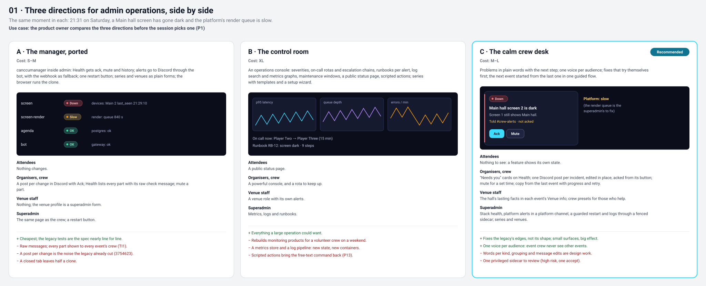

### A · The manager, ported
canccumanager inside admin: Health gets ack, mute and history; alerts go to Discord through the bot, with the webhook as fallback; one restart button; series and venues as plain forms; the browser runs the clone.
- **Attendees:** nothing changes.
- **Organisers and crew:** a Discord post per change with Ack; Health lists every part with its raw check message; mute a part.
- **Venue staff:** nothing; the venue profile is a superadmin form.
- **Superadmin:** the same page as the crew, and a restart button.
- **Trade-offs:** the cheapest, and the legacy's tests are its spec nearly line for line. But it shows every shared part to every event's crew (TI1 says not to), speaks in check names, posts once per change (the noise the legacy already had to cut), and leaves half a clone when a laptop lid closes.
- **Cost: S–M.**

### B · The control room
An operations console: severities, on-call rotas and escalation chains, runbooks per alert, log search and metrics graphs, maintenance windows, a public status page, scripted actions; series with templates and a setup wizard.
- **Attendees:** a public status page.
- **Organisers and crew:** a powerful console, and a rota to keep up.
- **Venue staff:** a venue role with its own alerts.
- **Superadmin:** metrics, logs and runbooks.
- **Trade-offs:** everything a large operation could want, built again for a volunteer crew at a weekend event. It needs a metrics store and a log pipeline (new state, new containers), and its scripted actions bring back the free-text command the inventory flags (P13).
- **Cost: XL.**

### C · The calm crew desk
Problems in plain words with the next step; one voice per audience; fixes that try themselves first; the next event started from the last one in one guided flow.
- **Attendees:** nothing to see. A feature that is down shows its own state on its own page.
- **Organisers and crew:** "Needs you" cards on Health; one Discord post per incident, edited in place and acked from its button; mute for a set time, never forever; "Copy from the last event" with progress per part and retry.
- **Venue staff:** the hall's lasting facts (house rules, Wi-Fi, floor plan, crew notes) in each event's Venue info. Those who help the crew get crew presets.
- **Superadmin:** Stack health; platform alerts in a platform channel; a guarded restart and log lines through a fenced sidecar; series and venues.
- **Trade-offs:** more design than A: words per alert kind, grouping, message edits and a server-side clone job. One privileged sidecar to review. No rota and no metrics.
- **Cost: M–L.**

## Recommended direction: the calm crew desk
**C.** The legacy manager's rules were right and its tests prove it; what hurt was everything around them. It spoke in check names. It showed one event's machines to whoever held a token. It posted every change until someone cut it down. It lost recovery notices, and it let anything on the tailnet restart anything. Its guarded restart could never run, and its confirm dialog never showed. C keeps the rules and fixes exactly those edges. A would ship the edges again behind sign-in. B would turn a weekend crew into an operations team and add two stateful systems to a stack that keeps none.

C also costs less than it looks, because the platform has done much of the groundwork. Health checks every part every 10 seconds already, and Screen reports its devices as events. Reload and identify are typed commands already. The tenants contract already says what a venue holds and what a clone copies. Step 8 joins them up, adds the voice, and gives the next event a button.

**Design principles**
1. **Say it once, keep it current.** One incident per subject, one Discord message per incident, edited in place; reminders reply under it; the recovery always closes it.
2. **Words, then the way on.** Every alert says what is wrong, what still works and what to check, in the event's language; the raw check is one line below, for whoever needs it.
3. **The right ears.** Event problems go to the event's crew; platform problems to the superadmins; nobody sees another event (TI1, TI3).
4. **Fix first, then tell.** A stuck screen reloads and a dropped bot reconnects by itself, each within a wait and a cap. It gives up loudly, never in a loop.
5. **No free text with power.** Every action is typed: it has a name, a right, a guard and an audit entry. The Docker socket is fenced to restart, inspect and logs.
6. **Quiet by design, never by accident.** Mutes end. Quiet hours come from the run of show. A draft event pages nobody. A deploy has a short grace. A flapping subject speaks once. And whatever cannot be delivered says so.
7. **The next event is one flow.** The superadmin makes the draft; its admins copy from the last event, part by part, on the server, with a result for each part.
8. **The venue keeps what lasts.** Each event gets a copy; a venue's change reaches an event only when the event asks for it.

## Key flows
Each flow names its users and its mockup.

### Health: what needs you (event crew)
The built Health page gains a "Needs you" band of incident cards, the event's own parts in words, and one coarse word for the platform ([U2](step-8-admin-operations/questions.md#u2-what-event-crew-see-of-the-platform), [L1](step-8-admin-operations/questions.md#l1-the-health-page), [L2](step-8-admin-operations/questions.md#l2-an-incident-in-words)).

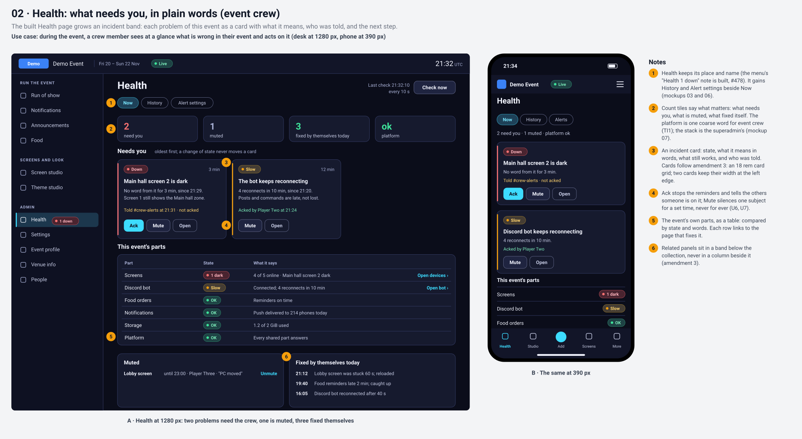

### An incident, mute and history (event crew)
The incident's timeline, what to check and what still works; actions that cannot work now say why; mute for a set time with a note; the day's history ([L3](step-8-admin-operations/questions.md#l3-the-incident-page), [U5](step-8-admin-operations/questions.md#u5-what-ack-means), [U6](step-8-admin-operations/questions.md#u6-mute-for-how-long), [U7](step-8-admin-operations/questions.md#u7-mute-what-it-silences)).

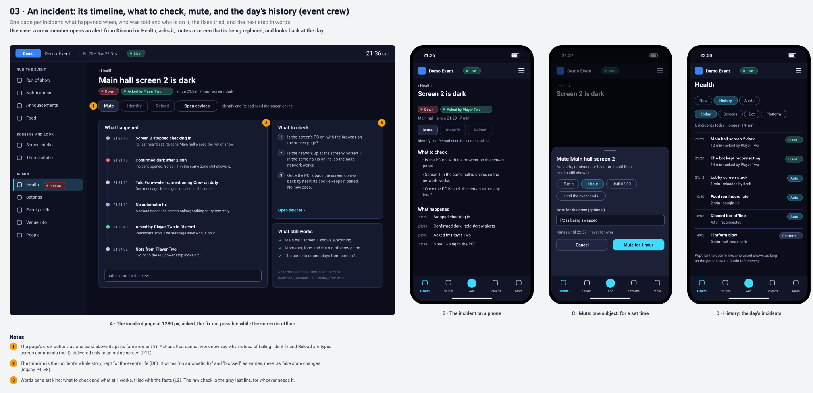

### Alerts in Discord (event crew, superadmin)
One message per incident, edited in place, with Acknowledge, Mute 1 h and Open in admin; reminders as replies; the webhook fallback with a link; an unknown Discord user; `/platform status` for an event and for the stack ([U3](step-8-admin-operations/questions.md#u3-who-hears-an-alert-in-discord), [U4](step-8-admin-operations/questions.md#u4-who-may-ack), [L4](step-8-admin-operations/questions.md#l4-the-discord-message), [D5](step-8-admin-operations/questions.md#d5-ack-from-discord), [E1](step-8-admin-operations/questions.md#e1-the-bot-is-down-or-is-the-subject), [U16](step-8-admin-operations/questions.md#u16-platform-status)).

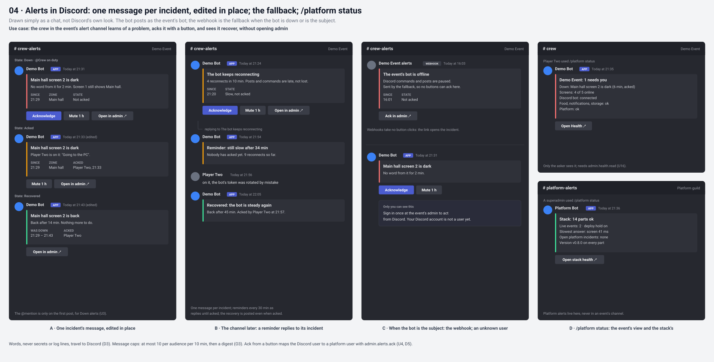

### Alert settings (organiser)
Where alerts go (the bot's channel, the role to mention, the fallback webhook as a write-only secret), what alerts and how soon, reminders and quiet hours ([D4](step-8-admin-operations/questions.md#d4-where-the-alert-channel-lives), [D6](step-8-admin-operations/questions.md#d6-the-webhook-fallback), [O7](step-8-admin-operations/questions.md#o7-settings-per-event)).

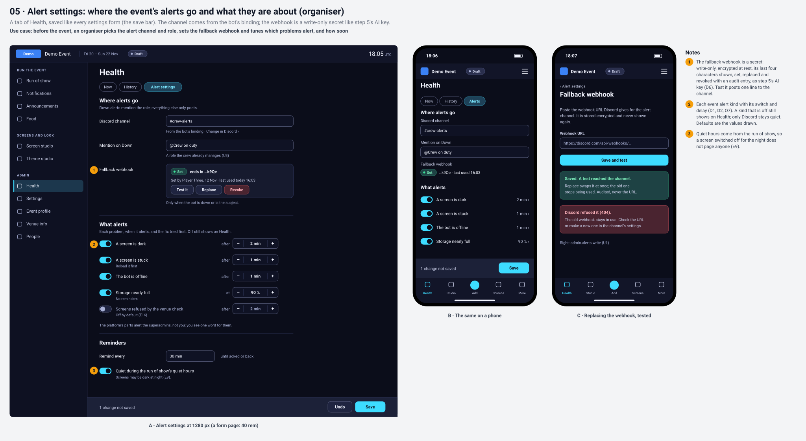

### Stack health (superadmin)
Every part with its version and answer time, platform incidents, live events and the deploy hold, and a restart that names the live events it touches and needs the part's name typed ([U10](step-8-admin-operations/questions.md#u10-the-superadmin), [E8](step-8-admin-operations/questions.md#e8-a-restart-while-an-event-is-live), [L8](step-8-admin-operations/questions.md#l8-the-superadmin-console)).

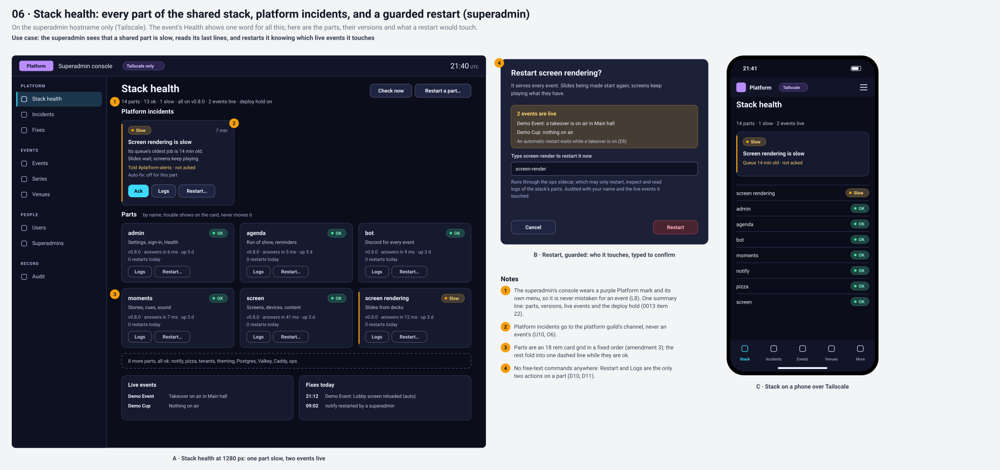

### Fixes (superadmin)
Three auto-fix rules, the log of every fix by people and by rules, a part's last lines redacted, and a fix that gave up ([D10](step-8-admin-operations/questions.md#d10-the-executor), [D11](step-8-admin-operations/questions.md#d11-the-action-catalog), [D12](step-8-admin-operations/questions.md#d12-logs), [E7](step-8-admin-operations/questions.md#e7-auto-fix-loops)).

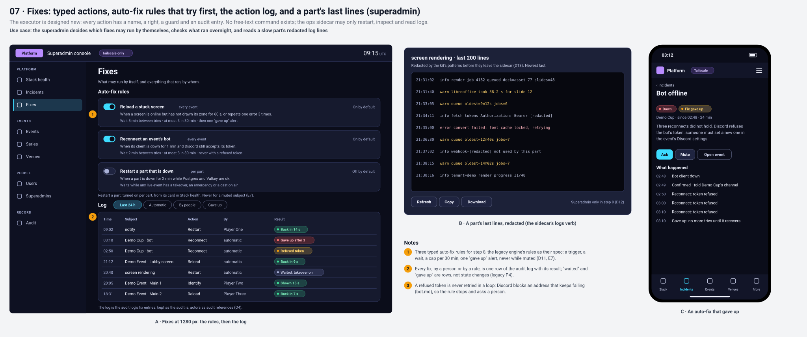

### A screen goes dark, end to end (venue, crew, everyone)
The exit criterion as a story: the hall, the Discord ping, the ack on a phone, the kiosk finding its way home, the recovery ([P3](step-8-admin-operations/questions.md#p3-the-exit-criterion), [D2](step-8-admin-operations/questions.md#d2-timings)).

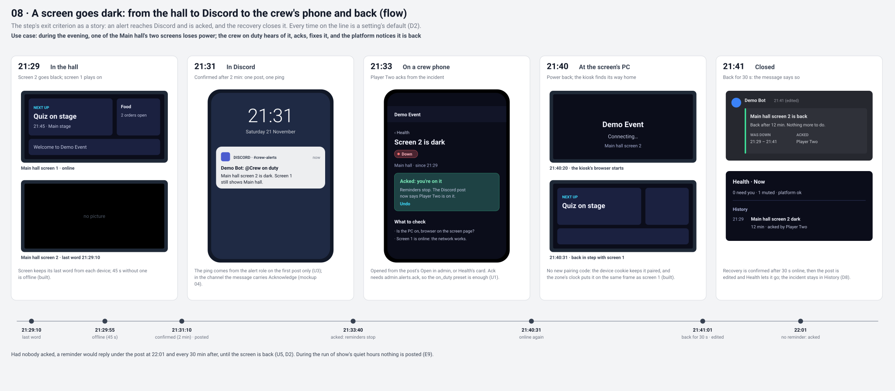

### The next event (superadmin)
A series and its events; "New event in this series" filled from the last one; the new draft's first page for its admins ([U11](step-8-admin-operations/questions.md#u11-who-starts-the-next-event), [D17](step-8-admin-operations/questions.md#d17-the-next-events-dates)).

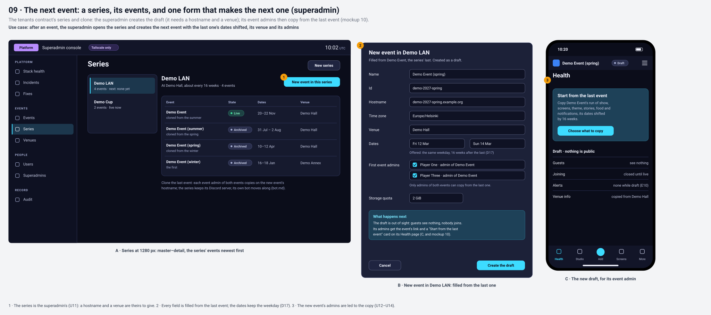

### Copy from the last event (event admin)
From, dates, parts, run; progress per part on the server; one failed part retried alone; Discord's move waiting for the last event to end ([U12](step-8-admin-operations/questions.md#u12-what-a-copy-takes), [U13](step-8-admin-operations/questions.md#u13-who-runs-a-clone), [U14](step-8-admin-operations/questions.md#u14-dates), [D14](step-8-admin-operations/questions.md#d14-clone-parts), [E11](step-8-admin-operations/questions.md#e11-a-clone-part-fails), [E17](step-8-admin-operations/questions.md#e17-the-bot-moves-while-the-last-event-is-live)).

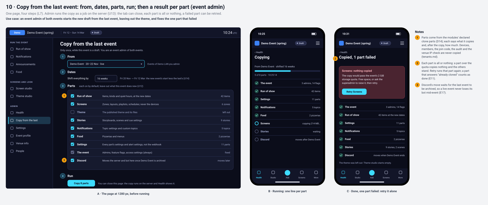

### Venues (superadmin, event admin)
A venue's addresses with a "you are here" check, its screens, house rules, Wi-Fi, floor plan and the new crew notes; venues on a phone; an event's Venue info copying the hall's profile again ([U15](step-8-admin-operations/questions.md#u15-who-edits-the-venue-profile), [D15](step-8-admin-operations/questions.md#d15-new-venue-profile-fields), [D16](step-8-admin-operations/questions.md#d16-the-venues-screens-on-the-venue-page)).

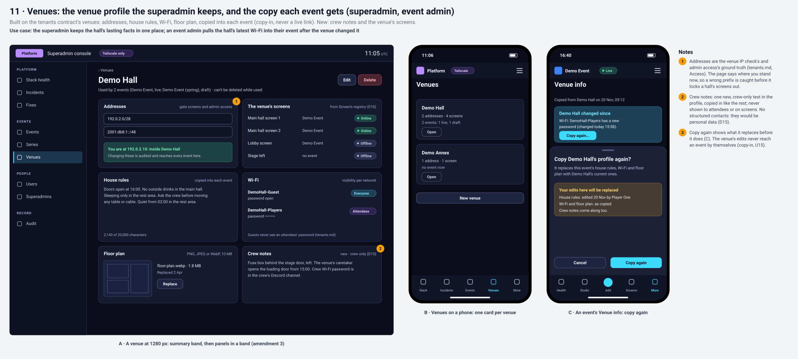

### The lifecycle and who hears what (everyone, implicitly)
The incident's states, the alert kinds with their audience, delay and fix, and the events admin emits ([D1](step-8-admin-operations/questions.md#d1-the-alert-kinds), [D3](step-8-admin-operations/questions.md#d3-events)).

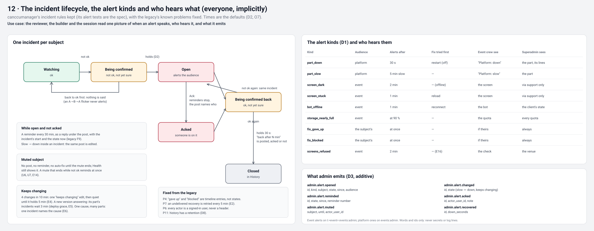

### Edge states (event crew, superadmin)
Not delivered, one cause for many parts, deploy grace, keeps changing, several screens in one zone, a draft event, admin itself down, a mute that ends while still dark ([E2](step-8-admin-operations/questions.md#e2-no-route-takes-the-message)–[E14](step-8-admin-operations/questions.md#e14-a-mute-ends-while-the-subject-is-still-not-ok), [O8](step-8-admin-operations/questions.md#o8-a-large-event)).

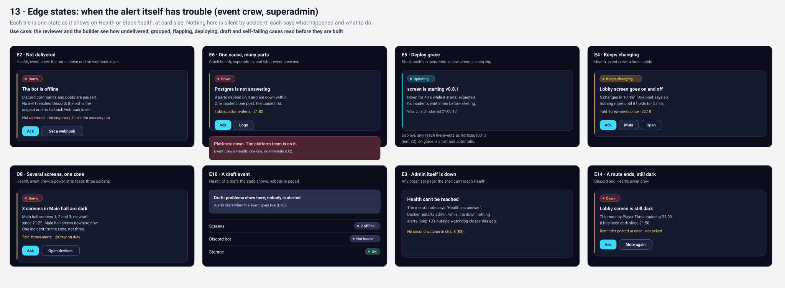

### Every mockup
| File | What it shows | For whom |
|---|---|---|
| [01-directions.svg](step-8-admin-operations/01-directions.svg) | The three directions side by side | the session |
| [02-health-needs-you.svg](step-8-admin-operations/02-health-needs-you.svg) | Health with incident cards, the event's parts, muted and fixed panels; desk and phone | event crew |
| [03-incident.svg](step-8-admin-operations/03-incident.svg) | An incident's page, on a phone, the mute sheet, the day's history | event crew |
| [04-discord.svg](step-8-admin-operations/04-discord.svg) | The edited message, a reminder reply, the webhook fallback, an unknown user, `/platform status` | event crew, superadmin |
| [05-alert-settings.svg](step-8-admin-operations/05-alert-settings.svg) | Where alerts go, what alerts, reminders; desk, phone, replacing the webhook | organiser |
| [06-stack-health.svg](step-8-admin-operations/06-stack-health.svg) | Every part, platform incidents, the guarded restart; desk and phone | superadmin |
| [07-fixes.svg](step-8-admin-operations/07-fixes.svg) | Auto-fix rules, the fix log, a part's redacted lines, a fix that gave up | superadmin |
| [08-screen-dark-flow.svg](step-8-admin-operations/08-screen-dark-flow.svg) | A dark screen from the hall to Discord to a phone and back, on a time line | venue, crew |
| [09-next-event.svg](step-8-admin-operations/09-next-event.svg) | A series, the new event form, the new draft's first page | superadmin, event admin |
| [10-copy-from-last.svg](step-8-admin-operations/10-copy-from-last.svg) | Copy from the last event: the page, running, done with one part failed | event admin |
| [11-venues.svg](step-8-admin-operations/11-venues.svg) | A venue's page, venues on a phone, an event's Venue info copying again | superadmin, event admin |
| [12-lifecycle.svg](step-8-admin-operations/12-lifecycle.svg) | Incident states, the alert kinds and who hears them, the events | everyone |
| [13-edge-states.svg](step-8-admin-operations/13-edge-states.svg) | Eight edge states at card size | event crew, superadmin |

## Port, drop or invent
Each with its reason ([0020](../decisions/0020-best-of-old-freely-new.md)). The legacy's names are canccumanager's (F1–F18, P1–P13) unless noted.

### Port as is (code and its tests, with clock and storage injected)
| Legacy | Where it goes | Why |
|---|---|---|
| F2 the debounce state machine (`state.ts`) and `state.test.ts` | admin's alert engine | Pure, small, tested; the counts become settings (D2) |
| Log redaction (`redactLine` and its four patterns) and its tests | both kits (D13) | Pure and generic; every log view and action output needs it |
| F7 and F9 the incident rules and reminders, with `alerts.test.ts` (29 tests) as the spec | the alert engine | Start, first escalation, recovery, reminders every 30 min, silenced by ack: the rules that held at real events, after the noise cut |
| F14 the auto-restart engine (trigger, cooldown, cap per 30 min, gave up, fail-closed guard) and `autorestart.test.ts` | the auto-fix rules (D11) | The engine is sound; it now runs on typed actions and receives its facts |

### Port with changes
| Legacy | Becomes | Why |
|---|---|---|
| F1 polling five tailnet health URLs every 30 s | admin's built checks every 10 s, plus event facts from events (D9) | The kit's health shape is already there; events scale with the number of events |
| F3 state-change rows | incidents in Postgres, per event under RLS or global (D7), and `admin.alert.*` events (D3) | The bus and tenancy |
| F8 the bot's `POST /alert`, the webhook as fallback | the bot consumes `admin.alert.*`; the webhook is a per-audience secret (D6) | Alerts as events (roadmap); a secret has its own home |
| F6 ack and F10 mute, by `X-Caller` | signed-in users with `admin.alerts.ack` and `.mute`; mutes end (U6) | P6; a forever mute hides outages |
| F5 the status API | the admin contract's incidents API and `/platform status` | The shapes are a fair start (inventory) |
| F4 the status page | Health (event) and Stack health (superadmin) | TI1; fixes P1 (the confirm dialog that never ran) |
| F12 and F13 the ssh action catalog and its log | typed actions; the log is the audit log (D10, D11, O4) | P13: no free-text remote command |
| F11 journald over ssh | a part's last lines through the sidecar, redacted (D12) | Containers log to the runtime |
| The kiosk restart by an ssh script on the venue laptop | Screen's `reload` command and the "Reload a stuck screen" rule | Devices are Screen's (built) |
| The live-cast guard (two vocabularies, P3) | one guard reading live facts: a Moments takeover or emergency, a cast | P2: the facts never arrived |
| Signup site D16, the LAN reset | dropped (U17) | Each event is its own tenant |

### Drop
| Legacy | Why |
|---|---|
| F15 and F16 the heartbeat push to the signup site | 0010 drops the dead-man's switch; step 10's outside watchdog replaces it (E3) |
| The hosted worker's log source | The signup site stays outside (0005) |
| The cast relay's entry and its forever mute | Cast is its own track; a part not deployed is not watched |
| Bearer tokens and `X-Caller` | Sign-in and the kit's service identity |
| F17 the tailnet-only bind, F18 the systemd unit | Caddy, Compose and the superadmin hostname over Tailscale |
| A post for every state change | Cut in the legacy already (`3754623`); one edited message instead (L4) |

### Invent
| New | Why |
|---|---|
| Alert kinds with words, "what still works" and "what to check" (D1, L2) | Plain words, so the crew can act on them |
| Event and platform audiences, with a coarse platform word for event crew (U2, U10) | TI1 and TI3; no event sees another |
| One Discord message per incident, edited in place, reminders as replies (L4) | Say it once, keep it current |
| An alert role to mention (U3) | One ping, kept in Discord |
| Mutes that end, and kind mutes in settings (U6, U7) | Quiet by design |
| Deploy grace, "keeps changing", one cause for many parts, one incident per zone (E4–E6, O8) | The storms the legacy met |
| Not-delivered state and retries, the recovery included (E2) | P7 |
| The `ops` sidecar fenced to restart, inspect and logs (D10) | Fixing a part that is up but wrong, without a free-text command |
| Rights `admin.health.read`, `admin.alerts.ack`, `admin.alerts.mute`, `admin.alerts.write` and the `on_duty` preset (U1) | A crew member acks without settings rights |
| Copy from the last event as a server-side job with parts, progress and retry (U12–U14) | A closed tab never leaves half an event |
| Declared clone parts (D14) | Each module says what it copies |
| Discord's move that waits for the last event to end (E17) | A live event keeps its bot |
| Crew notes in the venue profile (D15) | What the crew always asks the caretaker |
| "You are here" on a venue's addresses | A wrong prefix locks a hall's screens out |

## Proposed issue changes
The epic has no child issues; these five are proposed for the session ([P2](step-8-admin-operations/questions.md#p2-the-issue-set)). The lead writes them after the session; the pack's author creates and edits no issues. Every contract item below is additive and ships with the code that uses it ([0029](../decisions/0029-additive-contracts-ship-with-consumers.md)), except possibly E17, which the session classes. Risk follows [P5](step-8-admin-operations/questions.md#p5-risk-classes).

### New · feat(admin): alerts and incidents (high)
- [ ] `contracts/admin.md` and `admin.openapi.yaml`: incidents (list, read, history), ack, mute and unmute, the internal ack for the bot, the alert settings group, and the `admin.alert.*` events (D3)
- [ ] The engine: the ported debounce and incident rules with canccumanager's `state` and `alerts` tests as the spec; reminders; mutes that end; deploy grace, keeps changing, one cause, one incident per zone (E4–E6, O8); incidents and timers in Postgres, one engine at a time by a Valkey lease (E15)
- [ ] The alert kinds of D1 from the built health checks and from events (`screen.device.*`, the storage count; the bot's client events once step 6 emits them), with the words of L2
- [ ] Rights `admin.health.read`, `admin.alerts.ack`, `admin.alerts.mute`, `admin.alerts.write` and the `on_duty` preset (U1); audited (O4); event incidents under RLS, platform incidents in an allow-listed global table (D7); retention (D8)
- [ ] Health: Now with "Needs you", History, Alert settings, at 1280 px and 390 px ([mockups 02, 03, 05](step-8-admin-operations/02-health-needs-you.svg)); the event's parts and one coarse platform word (U2); CI screenshots next to the mockups
- [ ] Stack health on the superadmin hostname, read-only, with platform incidents ([mockup 06](step-8-admin-operations/06-stack-health.svg)); its pages wait for #52's superadmin sessions

Out of scope: Discord delivery (the next issue); fixes and logs (the fixes issue); series and venues.

### New · feat(bot,admin): alerts in Discord, the webhook fallback and `/platform status` (high)
- [ ] The bot consumes `admin.alert.*` and posts one message per incident in the binding's alert channel, edited in place, reminders as replies, the role mentioned on Down (U3, L4, L5); the platform binding for platform alerts (O6); `alert_channel_id` and `alert_role_id` on the binding (bot contract, additive, D4)
- [ ] Acknowledge and Mute 1 h buttons through admin's internal ack with the mapped user's rights; an unknown user answered privately (D5, E13)
- [ ] The webhook fallback per audience as a write-only secret in Admin → Integrations (D6; built here or by #644, whichever lands first), with a link button; not-delivered and retries (E1, E2); message caps (O3)
- [ ] `/platform status`: the event's view and the stack's, private answers (U16)
- [ ] The stack smoke of the exit criterion with a fake Discord (O5)

Blocked by step 6's bot module (#121). Out of scope: alert kinds and their rules (the first issue).

### New · feat(admin,deploy,kit): fixes: the ops sidecar, typed actions and auto-fix (high)
- [ ] The `ops` sidecar in `deploy/`: the only container with the Docker socket, through a proxy that allows only `restart`, `inspect` and `logs` of containers labelled `canccu.part`; admin calls it on the internal network with its service identity (D10)
- [ ] Typed actions with their right, guard and audit entry: part Restart and Logs (superadmin), screen Identify and Reload (built commands), bot Reconnect (bot contract, additive), Retry of a clone part (D11)
- [ ] The three auto-fix rules on the ported engine with `autorestart.test.ts` as the spec; the guard reads live takeovers, emergencies and casts in every event; "waited" and "gave up" as timeline entries (E7, E8)
- [ ] Redaction in both kits with the legacy tests (D13); the Fixes page and the restart dialog ([mockups 06, 07](step-8-admin-operations/07-fixes.svg))

Out of scope: per-event log lines (D12 B, a `Roadmap note:`); host scripts in `setup/`.

### New · feat(admin): the next event: series pages and copy from the last event (high)
- [ ] The superadmin's Series pages and "New event in this series" filled from the last event ([mockup 09](step-8-admin-operations/09-next-event.svg))
- [ ] Clone parts declared by each module (D14); admin's clone job: parts, progress, retry, "already cloned" as done (U12–U14, E11); its endpoint in `contracts/admin.md`
- [ ] The clone endpoints that are missing, each with its module's contract: screen (zones, layouts, playlists, schedules), theming (the published theme), moments (storyboards, scenes, cue settings), notify (topic settings and custom topics); agenda's is contracted, pizza's comes with step 5
- [ ] Discord's move after the last event ends (E17), as the session classes it
- [ ] "Copy from the last event" with the draft's start card ([mockup 10](step-8-admin-operations/10-copy-from-last.svg)); a stack test cloning the demo event

Blocked by #150 (the tenants part of clone) and #52. If it passes about 4,000 changed lines, the package plan splits it at its links (the job and admin's pages; each module's clone part).

### New · feat(admin): venues and the venue profile (high)
- [ ] The superadmin's Venues pages: addresses with "you are here", house rules, Wi-Fi, floor plan, crew notes, the venue's screens from Screen's registry, the events at it ([mockup 11](step-8-admin-operations/11-venues.svg))
- [ ] `crew_notes` in the venue profile and the event's venue info, crew only (tenants contract, additive, D15)
- [ ] The event's Venue info page with "Copy again" showing what it replaces (U15)

Blocked by #52 (superadmin sessions). Related high-risk work of the same area as the next-event issue: the planner may put the two in one package (one accept).

### Dropped and noted
- **The LAN reset (D16):** dropped (U17); no issue.
- **Pre-flight checks:** step 10's; a `Roadmap note:` that they can reuse the alert kinds (P6).
- **Per-event log lines, an on-duty switch, a public status line:** `Roadmap note:` candidates (D12, U18, U9).

### Order (a sketch for the planner)
1. **Alerts and incidents** first: its contract and events unblock the rest.
2. Then in parallel: **fixes** (needs only the first) and **alerts in Discord** (once step 6's bot exists).
3. **The next event** and **venues** once #150 and #52 have merged, as one package or two in order.

## Proposed exit criteria
The roadmap's "an alert reaches Discord and can be acked", made checkable ([P3](step-8-admin-operations/questions.md#p3-the-exit-criterion)):
- On the demo stack, stopping a part opens an incident; the fake Discord gets one message; its Acknowledge button acks it as a member with `admin.alerts.ack`; no reminder follows; starting the part again edits the message to "back after N min".
- A dark screen on the demo stack opens `screen_dark` after its delay, and a stuck one is reloaded by its rule.
- The demo event's next draft is copied from it with every chosen part reporting done, and one part failed and retried in a test.
- canccumanager's ported tests pass (debounce, alerts, auto-restart, redaction).

## Open questions
Every open question found is in the [question bank](step-8-admin-operations/questions.md): 77 in six themes, each with options and a recommendation. **Decide first:** P1 (the direction), U2 (what event crew see of the platform), U3 (who hears an alert), D1 (the alert kinds), D10 (the executor), U13 (who runs a clone), P2 (the issue set) and P3 (the exit criterion).
