# Step 9 brief: Feeds and LAN display

The research pack for the product owner's brainstorming session on [step 9, Feeds and LAN display](../roadmap.md#9-feeds-and-lan-display) (epic #63), issue #168. It follows the [outline of a research pack](README.md#outline-of-a-research-pack) and is built like [step 5's pack](step-5-pizza.md). After this merges, the lead runs the session over as many rounds as it takes, writes the final plan into this brief (`## Plan`) and rewrites the step's issues; the product owner accepts the plan before any build starts.

> **Source update (2026-11-20, #677).** The [canccubot](../legacy-inventory/canccubot.md), [mini tourney](../legacy-inventory/thefinals_mini_tourney.md#refresh-2026-11-20) and [canccuplatform](../legacy-inventory/canccuplatform.md#refresh-2026-11-20) inventories were refreshed; what this pack read on the trackers and the stats push is unchanged. For the finals cards and the tourney watcher, with no decision of this pack changed:
> - The watcher's season posts no longer carry a link; they point to `/finals`. It still pushes the open season to the site with the plain season link and registered/capacity counts (players, not teams, in individual mode), and reads the tourney with a bearer through its new read gate; the tourney's stream now sends a ping every 30 s, and seasons gained the state `cancelled`.
> - [L11](step-9-feeds-lan-display/questions.md#l11-the-finals-cards-look): the public tourney pages now show nothing without a session from a `/finals` link, so a QR on the "season open" card that opens the season page would land on a sign-in note. On the platform the QR goes to the hub; worth saying when the cards are drawn.
> - [D12](step-9-feeds-lan-display/questions.md#d12-the-finals-cards-which-step-builds-them): unaffected; the cards still wait for the Finals track's events.

**In this pack**
- This file: goal, what was read, where step 9 starts, how others solve it, three directions and the recommended one, the key flows, port / drop / invent, proposed issue changes and exit criteria.
- [step-9-feeds-lan-display/questions.md](step-9-feeds-lan-display/questions.md): the question bank, 67 questions in six themes, each with options and a recommendation. IDs (U2, D4, …) are used throughout.
- [step-9-feeds-lan-display/](step-9-feeds-lan-display/): 11 SVG mockups, drawn new, with the demo event only. GitHub shows them inline below. Screens are drawn in the demo theme's "Demo night" colours at 1920 × 1080 (no text under 33 px); organiser pages in the dark organiser shell of the [step 4 polish](step-4-polish/README.md) at 1280 px and 390 px, with grids as [design amendment 3](../design/README.md#3--grids-scale-with-their-content-2026-11-19) sets them. Each sheet states its use case.

## Goal
Live data on the screen ([roadmap](../roadmap.md#9-feeds-and-lan-display)). The roadmap's "In it": wire pizza, tournament and bot events into Screen; the LAN display page comes last. Exit: live data on the Main screen.

The epic's only build issue so far is #389 (the bot's presence, voice and game history, from the legacy event site into the platform, for the statistics widgets; high risk, tier plan). This pack treats it and the roadmap's text as input ([P2](step-9-feeds-lan-display/questions.md#p2-the-issue-set)).

## What was read
- **Decisions:** [0022](../decisions/0022-product-vision.md) (the screen is the heart: a "Pulse" screen, push-driven, composed of widgets, with Moments at the peaks and a QR handoff; no offline-first player; the large event of 1,000–2,000), [0027](../decisions/0027-product-decisions-2026-11-07-08.md) (raw presence deleted 30 days after archiving, other personal data anonymised after 12 months; check-in never mandatory; finals and games as separate concerns), [0010](../decisions/0010-scope.md) (no embedded pages, no frame protocol), [0018](../decisions/0018-ticker-manual.md) (the ticker is manual), [0013](../decisions/0013-multi-tenant-core.md) (every singleton per tenant), [0020](../decisions/0020-best-of-old-freely-new.md), [0025](../decisions/0025-finals-and-games-modules.md), [0026](../decisions/0026-briefs-are-research-packs.md) and [0029](../decisions/0029-additive-contracts-ship-with-consumers.md).
- **The roadmap:** [step 9](../roadmap.md#9-feeds-and-lan-display), steps 5–7, the Finals and Games tracks, the porting table's "LAN display views last (step 9)", and order change OC2.
- **Legacy inventories:** the [signup site](../legacy-inventory/signup-site.md) (D1–D16: the LAN display page, its views, the alive chrome, the stats fold, the URL thresholds; P11, T10, T12; known problems 1, 7 and 23), [canccubot](../legacy-inventory/canccubot.md) (the presence, voice and game trackers, the stats history push, open question 8 on the legacy bot data), [canccusignage](../legacy-inventory/canccusignage.md) (the adapter snapshot that "becomes events, step 9"), the [summary](../legacy-inventory/README.md) (flows 2, 4, 5 and 7; N16, the widget library; N7, the event report).
- **The legacy itself** (read-only): the LAN display's pure helpers (the alive thresholds and their defaults, the trend window, the finals card phases) and its two mockups.
- **Contracts it builds on:** [screen.md](../../contracts/screen.md#widgets) (every widget type and its view-model, trend arrows, peaks, names on a screen, reading other modules as a module, one source two surfaces, what Screen consumes), [events.md](../../contracts/events.md) (the tournament and bot outlines), [bot.md](../../contracts/bot.md#who-plays-what) (who plays what, live only, opt-out), [games.md](../../contracts/games.md#surges) (the catalogue, covers, surges), [moments.md](../../contracts/moments.md#built-in-rules-d7-d8) (the built-in rules, the presets, the `milestone` trigger, scenes that set a layout), [finals.md](../../contracts/finals.md) (the provisional provider stub, no events yet), [tenants.md](../../contracts/tenants.md#privacy-and-retention) (privacy and retention).
- **Briefs and design:** step 3's pack (Pulse, "the LAN display page is step 9", the now-playing board's module path), step 4's storyboards (the 24 presets, Record crowd, Hot game), step 5's plan ("food on the screens and in alerts"), the [design guideline](../design/README.md) with its three amendments, [widgets.md](../design/widgets.md) ("New in this proposal" and "Proposals for later") and the [experience map](../design/experience-map.md) ("Tournament … wired to screens in step 9", "Bot … plus #389 in step 9").
- **The epic and its issues:** #63, #389; the bot's #122 and #125 (step 6) and the tournament's #128 (step 7), whose out-of-scope lines name step 9.

## Where step 9 starts
Much of step 9 is already built or planned elsewhere. What is left is mostly the **consumers** in Screen, a few **new widgets**, the **LAN board**, and the organiser's view of it all ([mockup 02](step-9-feeds-lan-display/02-feed-map.svg)).

| Feed | Its emitter | On the screen today | Left for step 9 |
|---|---|---|---|
| Food (`pizza.order.*`, `pizza.item.*`) | pizza, step 5 | `food_status` drawn, fed by step 5's plan ("food on the screens and in alerts") | Nothing ([P6](step-9-feeds-lan-display/questions.md#p6-pizza-leaves-step-9)) |
| Presence counts (`bot.presence.counted`) | bot, step 6 (#122) | `stats`, `activity_graph`, `today_numbers` built in step 3; they wait for counts | Trusting counts across outages (E14); voice rooms (D3) |
| Who plays what (the bot's read API) | bot, step 6 | `now_playing` defined, `empty` until the bot gives a module path | The module path and the consumer (D2), names opt-in (U4) |
| Statistics history | bot, step 6 (#122) and #389 | Widgets designed, "Collecting…" until it exists (design Q16) | The read (D4, D5), `top_games`, the new graph metrics (L3, L4); the import's home (D7) |
| Tournament (`tournament.*`) | tournament, step 7 | `bracket`, `leaderboard`, the hero's game drawn against fixtures; Moments' match called, standings and champion built | The consumer with a catch-up read (D8), several tournaments (D9), progress (D10) |
| Surges and covers (`games.*`) | games, Games track | `hot_game`, the stage's tint and card art drawn against fixtures; Moments' hot game built | Wiring, and HOT from surges (D15); light up when the module is on (O6) |
| Finals (`finals.*`) | finals, Finals track | Nothing: the events do not exist yet | Proposed out of step 9 (D12) |
| Agenda, Notify, photos, ticker | step 3 | Live | Nothing |

So the step's honest size is: Screen's tournament and bot consumers, the history read and its widgets, the alive chips and milestones, the LAN board, and Live data. The legacy LAN display's polls are dropped ([0005](../decisions/0005-signup-site-stays-outside.md)), its announce and finals views became Moments takeovers in step 4, and its embedding protocol is gone (0010).

## How comparable products solve it
| Field | What they do | What we take |
|---|---|---|
| **Esports broadcast graphics** (standings, bracket, lower thirds from a data feed) | One data feed drives many graphics; an operator chooses what airs; corrections update quietly | One feed, many boxes; Moments decides what airs; a correction slides rows without a new moment (E7) |
| **Stadium boards and ribbon displays** | A steady scoreboard plus short celebrations on a milestone or a goal; never two celebrations at once | The steady boxes and Moments' one spotlight; milestones by energy level (L7) |
| **Airport and station status boards** | Honest freshness: a time "as of", a status word, never a blank board | "As of" when a feed is late, hide after a while, never a technical message (E1, [mockup 11](step-9-feeds-lan-display/11-edge-states.svg)) |
| **Digital signage data apps** (dashboards as widgets, data-source health) | A widget per source, a source-health page for the operator, sample data while setting up | Live data in Screen studio (U5, [mockup 09](step-9-feeds-lan-display/09-live-data.svg)), "Preview with sample data" (O3) |
| **Stream overlays and alert services** | Events trigger short alerts through a queue with a cool-down; thresholds per channel | Chips and milestones with thresholds per event and a hold time (O7, L6) |
| **Discord activity dashboards and game launchers** ("friends playing") | What is played now, by game, with art; who only for friends | Now playing by game with covers; names only where a zone opts in (U4); folding small counts (E4) |

The lesson across them: **one feed, many surfaces**, a **steady base with rare peaks**, and **honest freshness**. The legacy LAN display had the first and the peaks, but polled every 30 s, hid its staleness, and lived outside the screen's own rendering.

## Three directions
The same moment in each: Saturday 19:52, heat 2 of the Demo Cup is about to start and one game is surging.

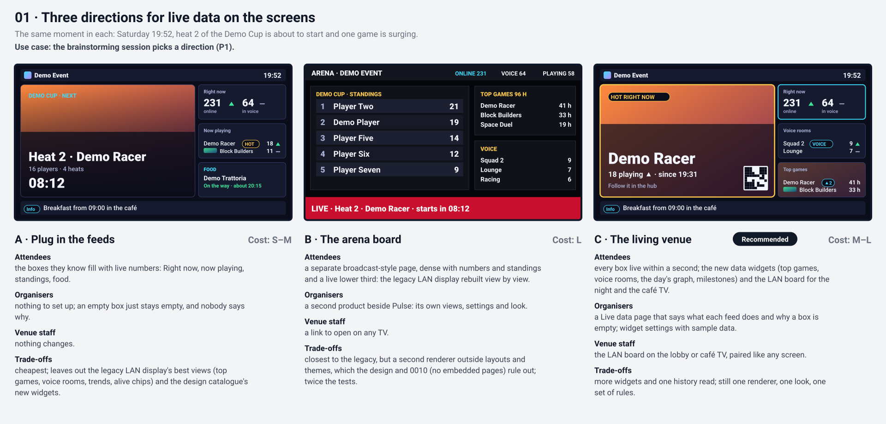

### A · Plug in the feeds
Connect each existing widget to its source and stop there.
- **Attendees:** the boxes they know fill with live numbers: Right now, now playing, standings, food.
- **Organisers:** nothing to set up; an empty box just stays empty, and nobody says why.
- **Venue staff:** nothing changes.
- **Trade-offs:** the cheapest. It leaves out the legacy LAN display's best views (top games, voice rooms, the trends, the alive chips), the design catalogue's new widgets, and any answer to "why is that box empty?". The roadmap's "LAN display page" is not delivered.
- **Cost: S–M.**

### B · The arena board
Rebuild the legacy LAN display as its own broadcast-style page beside Pulse: dense standings, top games, voice, a live lower third.
- **Attendees:** a familiar, information-dense board.
- **Organisers:** a second product to set up: its own views, settings and look.
- **Venue staff:** a link to open on any TV.
- **Trade-offs:** closest to the legacy, and fast to recognise. But it is a second renderer outside layouts and themes, which the accepted design and 0010 (no embedded pages) rule out; every theme and every screenshot doubles; and a public link raises an access question the venue screens solved with pairing.
- **Cost: L.**

### C · The living venue
Every box live within a second from its own feed, the design's new data widgets, honest states, and the LAN display reborn as a built-in layout. Nothing outside the one renderer.
- **Attendees:** Pulse and the Dashboard come alive (Right now with arrows and peaks, now playing with HOT, standings that slide, food); the new widgets: top games with art, voice rooms, the day's graph, tournament progress; chips and milestones that follow the energy level; the LAN board on the café TV and, by a night scene, on the Main screen.
- **Organisers:** Live data says what each feed is doing and why any box is empty; each data box has its settings with sample data before the bot runs; the LAN board is one tile in the layout gallery.
- **Venue staff:** the LAN board on the lobby or café TV, paired like any screen.
- **Trade-offs:** more widgets and one new history read than A; two module reads and a handful of additive contract fields. Still one renderer, one look, one rule set; the finals cards wait for their emitter.
- **Cost: M–L.**

## Recommended direction: the living venue
**C.** The screen is the heart of the platform (0022) and step 9 is the step where it gets its blood: A would wire the veins and leave the heart still, B would build a second heart beside the first. C costs less than it looks because the hard parts exist: Screen already computes arrows and peaks from counts, Moments already owns match called, standings, hot game, champion and record crowd, step 5 feeds the food box, and steps 6 and 7 emit the events. Step 9 adds the consumers, the history read, a few widgets, one layout and one organiser page, and the venue lights up.

And it delivers the roadmap's "LAN display page" the way the platform works now: the legacy page's views were widgets in disguise, its chips were the best idea in it, and its embedding was the worst. The LAN board keeps the first two and drops the third.

**Design principles**
1. **One feed, one truth, many surfaces.** Every number comes from its owner's event or module read; the hub and the screens read the same answer; nothing polls a page.
2. **Live within a second, calm on the eye.** Pushed at once, rolled, never jumped; at most one change a second per zone; the hero's pace never changes (amendment 1).
3. **Honest freshness.** "As of" when late, hidden when gone, "Collecting…" when young; never a zero that is really an outage (E1, E14).
4. **The hall reads, the crew knows.** Screens carry nothing crew-only; Live data tells the crew what each feed does and why a box is empty (U1, U5).
5. **Counts by default, names by choice.** Presence stays counts on the bus; names only where a zone opts in, never who is in a voice room, small counts folded (U4, E4).
6. **Steady base, rare peaks.** Boxes show the state; Moments owns every celebration and every sound, within one budget (L7, L12, D14).
7. **One renderer.** The LAN board is a layout, the finals cards are widgets, sample data is the same template with a mark: nothing is drawn outside layouts and themes (U2, L1).

## Key flows
Each flow names its users and its mockup. The mockups use the demo event's names only (Demo Event, Main hall, Café, Demo Cup, Demo Racer, Block Builders, Space Duel, Pixel Arena, Tower Siege, Demo Player, Player Two …).

### The feed map (the session, the planner)
Which module feeds which box, solid for events and dashed for module reads, coloured by who builds each part ([P5](step-9-feeds-lan-display/questions.md#p5-building-before-every-source-exists), [O6](step-9-feeds-lan-display/questions.md#o6-order-against-the-other-steps-and-tracks)).

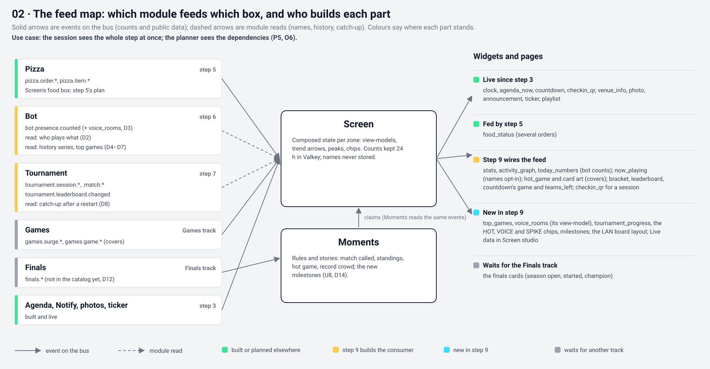

### The Main screen with live data (attendees in the hall)
Pulse at 19:52: the hero with the session's game, Right now, now playing with HOT, food; the six-box Dashboard steady and during a hot-game showcase ([L9](step-9-feeds-lan-display/questions.md#l9-the-tournament-on-pulse), [U4](step-9-feeds-lan-display/questions.md#u4-whose-names-may-a-screen-show)).

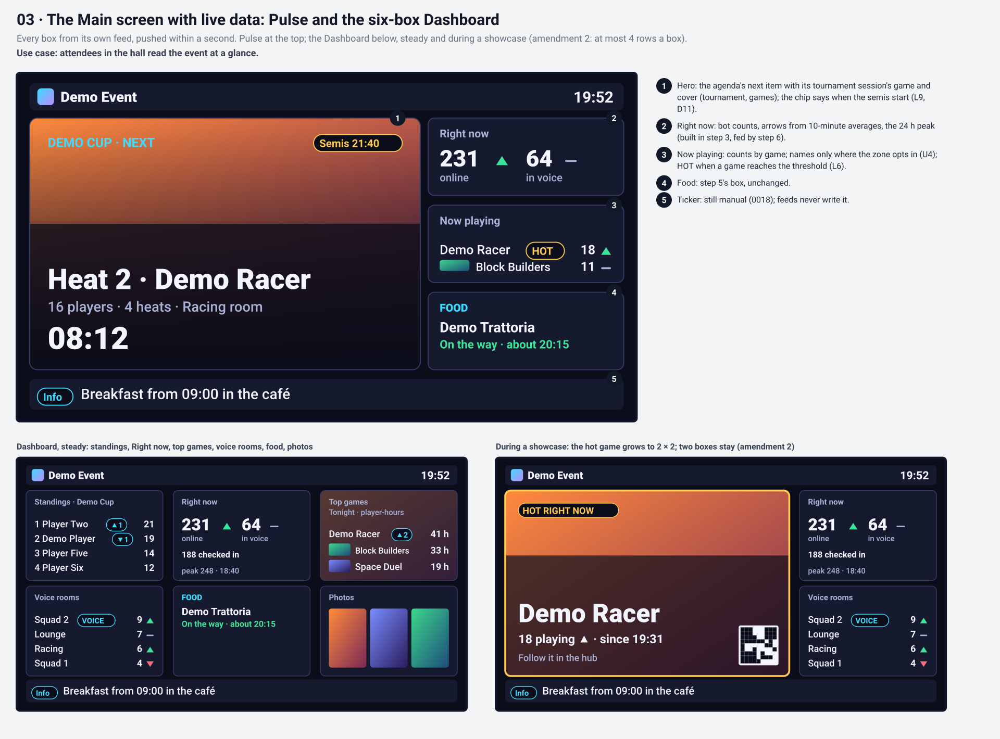

### A Saturday on the Main screen (attendees, organiser)
Doors, dinner, a heat called and the night: what the feeds change hour by hour with no hand scheduling ([U3](step-9-feeds-lan-display/questions.md#u3-what-do-the-screens-show-when-nothing-is-scheduled-and-at-night)).

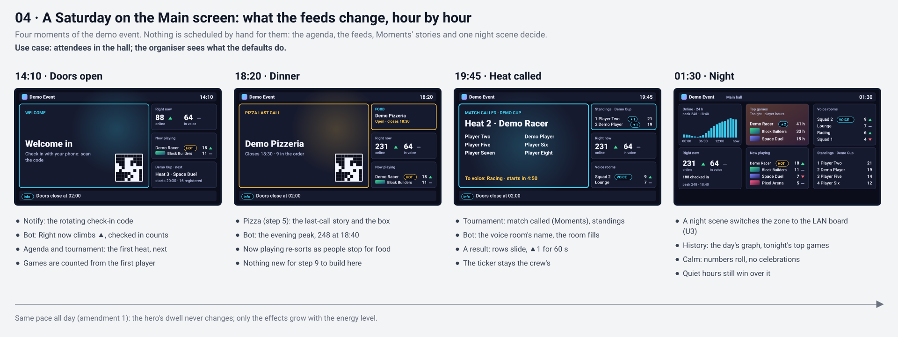

### The LAN board (attendees, venue staff)
The legacy LAN display reborn as a built-in layout, landscape and portrait, with the alive chips in its header ([U2](step-9-feeds-lan-display/questions.md#u2-what-is-the-lan-display-page-now), [L1](step-9-feeds-lan-display/questions.md#l1-the-lan-boards-look), [L2](step-9-feeds-lan-display/questions.md#l2-how-many-boxes-on-the-lan-board)).

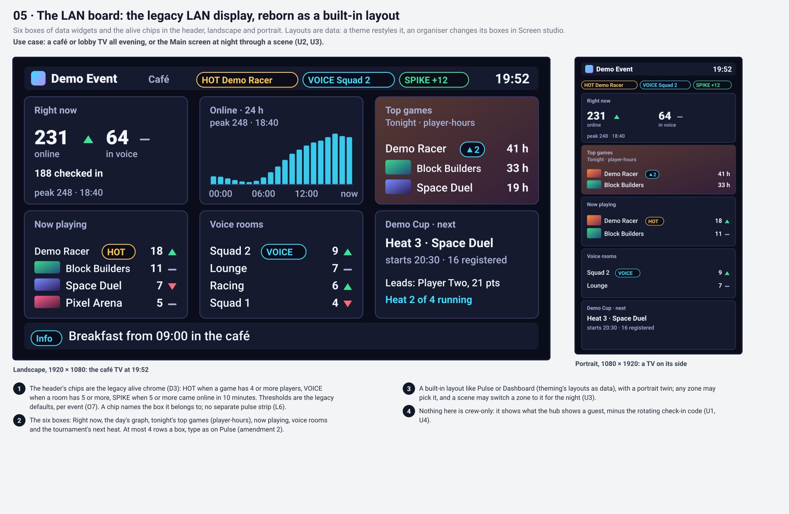

### The data widgets (attendees; the organiser picks them)
Top games now and tonight, collecting, the graph's games metric and whole-event window, voice rooms, now playing with names, tournament progress, a new peak, the day in numbers, stale, and standings before the first result ([L3](step-9-feeds-lan-display/questions.md#l3-top-games-which-windows), [L4](step-9-feeds-lan-display/questions.md#l4-the-activity-graph-which-metrics-and-windows), [D5](step-9-feeds-lan-display/questions.md#d5-the-history-read-which-shape)).

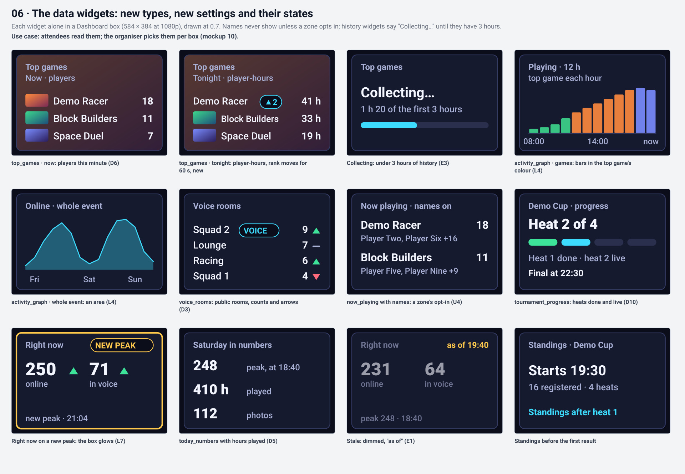

### A tournament session on the screens (players, the hall)
Registration open, check-in (only when on), match called, a result in, the champion; the standings and heats boxes closer ([D8](step-9-feeds-lan-display/questions.md#d8-the-tournament-feed-events-only-or-a-catch-up-read), [L10](step-9-feeds-lan-display/questions.md#l10-the-tournaments-matches-a-bracket-tree-or-a-list-of-heats), [E7](step-9-feeds-lan-display/questions.md#e7-a-result-is-corrected)).

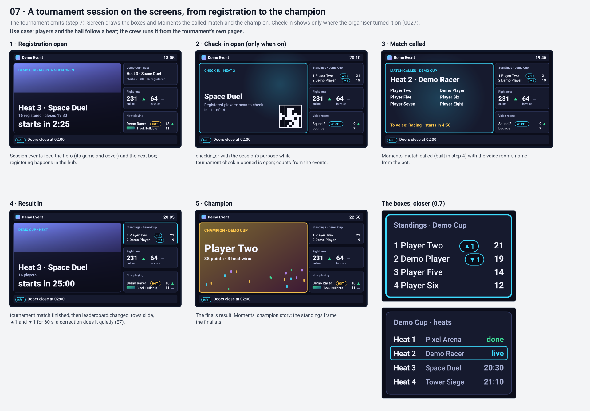

### Alive chips, milestones and the finals cards (attendees)
HOT, VOICE and SPIKE on their boxes; a new peak at calm, lively and party; the finals cards drawn for the Finals track ([L6](step-9-feeds-lan-display/questions.md#l6-the-legacy-alive-chrome-chips-pulse-strip-cover-wash), [L7](step-9-feeds-lan-display/questions.md#l7-milestones-at-each-energy-level), [U8](step-9-feeds-lan-display/questions.md#u8-milestones-which-and-who-sets-them), [D12](step-9-feeds-lan-display/questions.md#d12-the-finals-cards-which-step-builds-them)).

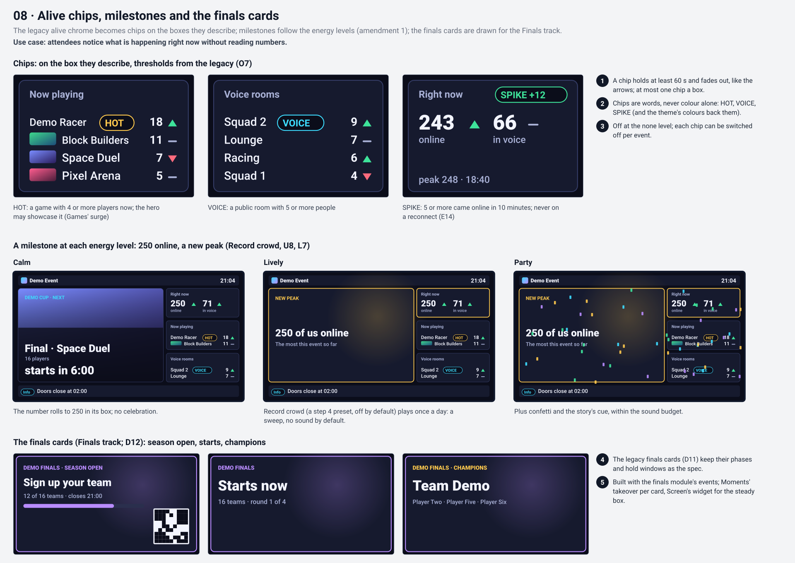

### Live data (organiser, crew)
Screen studio's new page: a card per feed in the shared card grid, the boxes showing nothing and why, and recent changes; the same on a phone ([U5](step-9-feeds-lan-display/questions.md#u5-what-does-the-organiser-get-for-the-feeds), [O4](step-9-feeds-lan-display/questions.md#o4-watching-the-feeds)).

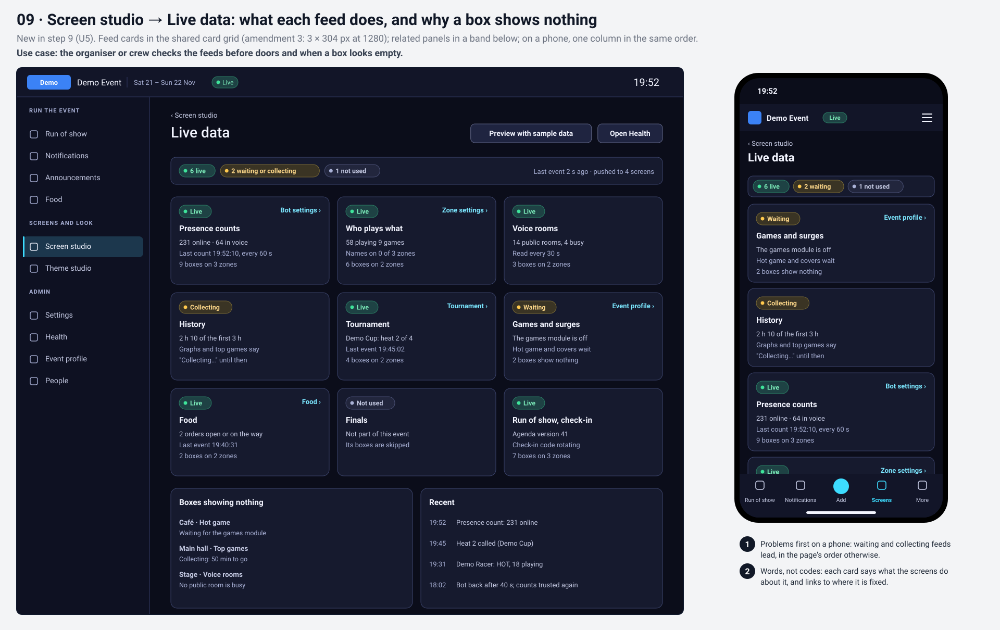

### A data box's settings and the layout gallery (organiser)
The zone editor with the Top games box picked: window, rows, the minimum count, the chip, names, the QR, and a preview with sample data; the LAN board in the layout gallery on a phone ([O3](step-9-feeds-lan-display/questions.md#o3-data-for-demos-ci-and-setup), [O7](step-9-feeds-lan-display/questions.md#o7-where-do-the-thresholds-live), [E4](step-9-feeds-lan-display/questions.md#e4-privacy-at-a-small-event)).

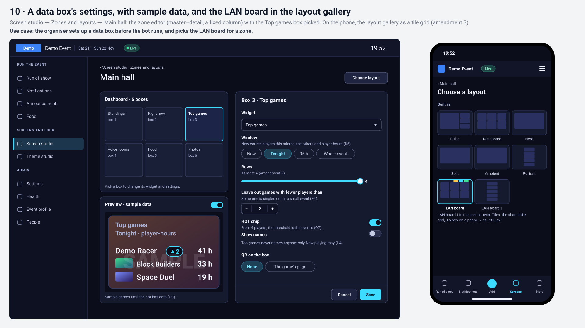

### Edge and failure states (attendees; the crew reads why)
Slow and gone feeds, no Discord server, an opt-out, a game with one player, a correction, a cancelled heat, an offline screen and a Discord outage ([E1](step-9-feeds-lan-display/questions.md#e1-the-bot-is-slow-or-gone)–[E14](step-9-feeds-lan-display/questions.md#e14-a-discord-outage-looks-like-an-empty-hall)).

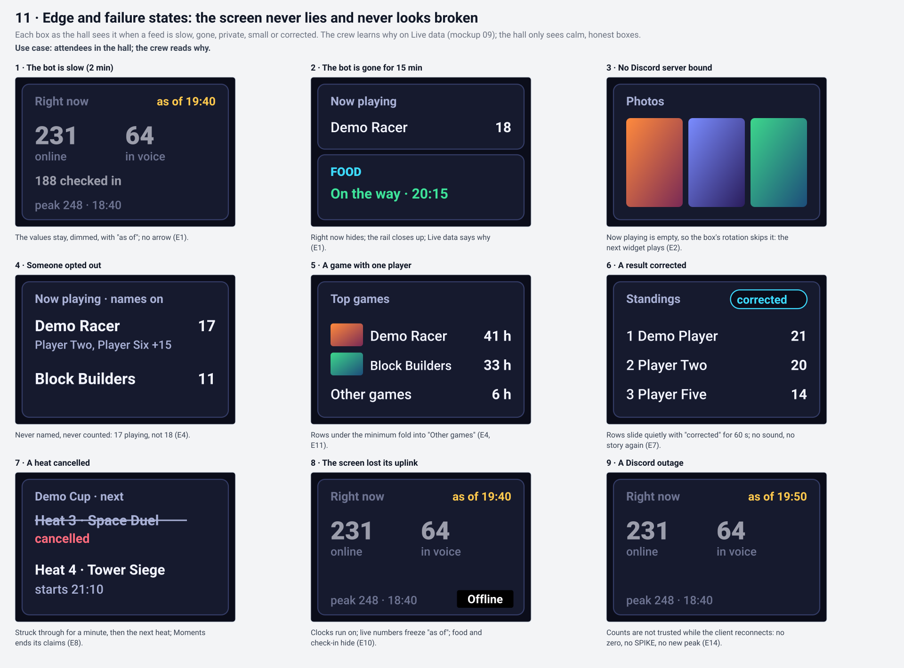

### Every mockup
| File | What it shows | For whom |
|---|---|---|
| [01-directions.svg](step-9-feeds-lan-display/01-directions.svg) | The three directions side by side | the session |
| [02-feed-map.svg](step-9-feeds-lan-display/02-feed-map.svg) | Sources, events and reads, widgets, and who builds each part | the session, the planner |
| [03-main-screen-live.svg](step-9-feeds-lan-display/03-main-screen-live.svg) | Pulse with live data; the Dashboard steady and during a showcase | attendees in the hall |
| [04-a-saturday.svg](step-9-feeds-lan-display/04-a-saturday.svg) | Four moments of a Saturday on the Main screen | attendees, organiser |
| [05-lan-board.svg](step-9-feeds-lan-display/05-lan-board.svg) | The LAN board, landscape and portrait | attendees, venue staff |
| [06-data-widgets.svg](step-9-feeds-lan-display/06-data-widgets.svg) | Twelve data widgets and states in a Dashboard box | attendees, organiser |
| [07-tournament.svg](step-9-feeds-lan-display/07-tournament.svg) | A session from registration to the champion; standings and heats closer | players, the hall |
| [08-alive-milestones-finals.svg](step-9-feeds-lan-display/08-alive-milestones-finals.svg) | Chips, a milestone at three energy levels, the finals cards | attendees |
| [09-live-data.svg](step-9-feeds-lan-display/09-live-data.svg) | Screen studio → Live data at 1280 px and 390 px | organiser, crew |
| [10-box-settings-and-layouts.svg](step-9-feeds-lan-display/10-box-settings-and-layouts.svg) | A data box's settings with sample data; the layout gallery on a phone | organiser |
| [11-edge-states.svg](step-9-feeds-lan-display/11-edge-states.svg) | Nine edge and failure states | attendees, crew |

## Port, drop or invent
Each with its reason ([0020](../decisions/0020-best-of-old-freely-new.md)).

### Port as is (pure code and its tests, with clock and settings injected)
- **The alive thresholds** (`lan-display-alive`): HOT 4, busy voice 5, spike 5 and their parsing as the defaults of the event's settings (O7). Proven at real events.
- **The trend window and arrow helpers** (`trend-window`, `trend-arrow`): only where they match Screen's built arrow rule; Screen's rule wins where they differ.
- **The finals card phases and hold windows** (`lan-display-finals-card`): the spec for the Finals track's cards (D12).

### Port with changes
- **The stats view** (D2) becomes the LAN board's six boxes (U2), each a widget of its own.
- **The stats fold** (D9) becomes the bot's hourly aggregates and the two history reads (D4, D5): SQL over samples, not a JSON blob refreshed by a request.
- **Top games 96 h** becomes `top_games` with a window, 96 h one of four (L3).
- **The chips** (D3) move onto the boxes they describe and into the LAN board's header; HOT follows Games' surge (L6, D15).
- **The demo overlays** (D6) become the demo feed for CI and "Preview with sample data" (O3).
- **The tournament screen payload** (T10) becomes the tournament consumer with a catch-up read (D8) and the heats list (L10).
- **The cover chain** (T12) is the games module's covers; Screen only blurs and caches (D11).
- **The stale rule** (`snapshot-freshness`, voice only in the legacy) becomes one rule for every live widget (E1).

### Drop
- **The page and its iframe protocol** (D1, D5): a layout and Moments replace them (0010).
- **Polls and the polls RSS** (D7, D13): dropped with the legacy site's polls (0005).
- **The browser's trend memory** (D12, a public write): arrows are computed on the server.
- **The pulse strip and the cover wash** (D3): the countdown's chip, Moments and the stage's art layer do their jobs (L6).
- **URL parameters as configuration**: settings per event (O7).
- **The 15-minute snapshot retention and the singleton blob** (D9, D10): D1 workarounds.

### Invent
- **The LAN board:** a built-in layout and its portrait twin (U2, L2).
- **Live data:** feed health in words for the crew (U5).
- **Honest freshness for every live widget,** and outage-proof counts (E1, E14).
- **`top_games`, `voice_rooms`' view-model, `tournament_progress`,** and the graph's games metric and whole-event window (L3, L4, D10).
- **Milestones on more counts** (in voice, hours played, one game's players) for Moments' trigger (U8).
- **Folding small counts** on screens (E4).
- **A night scene preset** that switches chosen zones to the LAN board (U3).

## Proposed issue changes
The step's existing issue (#389) is input, not a fixed scope. The lead applies these after the session; the pack's author creates and edits no issues. Every contract item below is additive and ships with the code that uses it ([0029](../decisions/0029-additive-contracts-ship-with-consumers.md)); none is breaking. Risk follows [P4](step-9-feeds-lan-display/questions.md#p4-risk-classes).

### Add · the plan issue
`docs(briefs): step 9 (feeds and LAN display): plan`, blocked by #168; the build issues below are blocked by it ([P8](step-9-feeds-lan-display/questions.md#p8-the-plan-issue)).

### New · the tournament on the screens (normal)
Proposed title: `feat(screen): the tournament on the screens`.
- [ ] Screen consumes `tournament.*` into `bracket` (a session's heats, L10), `leaderboard` (rank moves, finalists, corrections quietly, E7), the hero's game, cover and `teams_left`, and `checkin_qr` with the session's purpose; a catch-up read for restarts and new zones (D8, additive in the tournament contract); several tournaments with an optional pin (D9)
- [ ] `tournament_progress` (D10, additive on the Session if step 7's plan agrees)
- [ ] Stack test with the demo feed: a session's events reach a zone's boxes by push; CI screenshots next to [mockup 07](step-9-feeds-lan-display/07-tournament.svg)

Out of scope: Moments' tournament moments (built in step 4); elimination brackets (Finals track).

### New · the bot's counts, voice rooms and now playing on the screens (high: presence names)
Proposed title: `feat(screen,bot): now playing, voice rooms and trusted counts on the screens`.
- [ ] The bot's module path for who plays what (D2) and Screen's `now_playing` consumer; names only with the zone's opt-in, never to a guest (U4)
- [ ] `voice_rooms` with an additive `voice_rooms` on `bot.presence.counted`: public rooms, counts only (D3)
- [ ] Counts not trusted while the client is not ready: no zero, no SPIKE, no new peak (E14); small counts folded on screens (E4)
- [ ] HOT from Games' surges when the module is on (D15); VOICE and SPIKE chips with the event's thresholds (O7, L6)
- [ ] Tests: opted-out members are never named or counted; a guest never gets names; CI screenshots next to [mockups 03 and 08](step-9-feeds-lan-display/03-main-screen-live.svg)

Out of scope: the history (below); names of play-time leaders (U4).

### #389 · the statistics history: keep, rewrite (high: personal data)
Proposed title: `feat(bot,screen): the statistics history and its widgets`.
- [ ] The bot's two history reads, counts and hours only (D4, D5, additive in the bot contract), from #122's samples, with the retention of 0027
- [ ] Screen's `top_games` with its windows (L3, D6), the graph's games metric and whole-event window (L4), `today_numbers`' hours played; "Collecting…" under 3 hours (E3)
- [ ] The legacy import goes into #125's migration (D7 A), or stays here if the session picks D7 B
- [ ] CI screenshots next to [mockup 06](step-9-feeds-lan-display/06-data-widgets.svg)

Out of scope: records across a series (U10); the event report (N7).

### New · the LAN board, Live data and milestones (normal)
Proposed title: `feat(screen,moments): the LAN board, Live data and milestones`.
- [ ] The LAN board and its portrait twin as built-in layouts; a night scene preset, off by default (U2, U3, L1, L2; [mockup 05](step-9-feeds-lan-display/05-lan-board.svg))
- [ ] Screen studio → Live data (U5; [mockup 09](step-9-feeds-lan-display/09-live-data.svg)); each consumer's lag in `/health` (O4)
- [ ] The data boxes' settings and "Preview with sample data"; the demo feed for the stack and CI (O3; [mockup 10](step-9-feeds-lan-display/10-box-settings-and-layouts.svg))
- [ ] Moments' `milestone` trigger gains in voice, hours played and one game's players (U8, D14, additive); milestones by energy level (L7); `top_games` and `today_numbers` in the crew spotlight (U9); the new counts-only types in `GET /api/screen/now` (U7)
- [ ] The step's exit check (below), run on the demo stack

Out of scope: a public live link (P7); the finals cards (D12).

### Out of step 9 (proposed)
The food box (step 5's plan, P6); the finals cards (the Finals track, D12, a `Roadmap note:`); a public live link or stream overlay (P7); play-time leaders by name (U4); records across a series (U10); hour-by-day graphs (L4).

### Order (a sketch for the planner)
1. **The tournament on the screens** and **the bot's counts and now playing**: in parallel, after steps 6 and 7 merge; the second is high and gets its own package.
2. **#389, the history:** after #122 (step 6); high, its own package, parallel with the first two.
3. **The LAN board, Live data and milestones** last, as the roadmap says: it places the widgets the others build. If the session picks D7 A, #389 is smaller and may join the bot's package as one high-risk package (one accept).

## Proposed exit criteria
The roadmap's "live data on the Main screen", made checkable ([P3](step-9-feeds-lan-display/questions.md#p3-the-exit-criterion)):
- On the demo stack with the demo feed, each live box of the Main screen (Right now, now playing, standings, the hero's game, food, top games, voice rooms) updates by push within about a second of its event; a stack test asserts it and CI screenshots show it.
- The LAN board plays on a second zone, landscape and portrait, with CI screenshots next to mockup 05.
- Live data shows every feed's state, and a box without a feed is explained there.
- A stale feed dims with "as of" and a Discord outage shows no zero and fires no SPIKE (tests).
- On the test server with the real bot, Right now and now playing follow real counts.

## Open questions
All of them are in the [question bank](step-9-feeds-lan-display/questions.md): 67 in six themes, each with options and a recommendation. **Decide first:** P1 (the direction), U2 (what "the LAN display" is now), P6 (pizza leaves step 9), D4 and D7 (where the history lives, and the legacy import), U4 (names on the screen), D12 (the finals cards), P2 (the issue set), P3 (the exit criterion).
