# App track brief: the phone hub (research pack)

The research pack for the product owner's brainstorming session on the [App track](../roadmap.md#app) (epic #160), issue #171. It follows the [outline of a research pack](README.md#outline-of-a-research-pack), the product owner's decisions of 2026-11-14 on #160 (the Wi-Fi password for members; following one run-of-show item), and the lead's note on #171 that points this track at the accepted design guideline ([docs/design](../design/README.md)). After this merges, the lead runs the session over as many rounds as it takes, writes the final plan into this brief (`## Plan`) and rewrites the track's issues; the product owner accepts the plan before any build starts.

**In this pack**
- This file: goal, what was read, what step 3 already built, how others solve it, three directions and the recommended one, the key flows, port / drop / invent, proposed issue changes.
- [track-app/questions.md](track-app/questions.md): the question bank, 79 questions in six themes, each with options and a recommendation. IDs (U3, D4, …) are used throughout.
- [track-app/](track-app/): 19 SVG mockups, drawn new, with the demo event only. GitHub shows them inline below. Attendee pages are drawn in the demo theme's "Demo night" colours, as the hub takes the event's theme; organiser pages in the admin look.

## Goal
Attendees follow the event on their phone, and organisers reach admin safely from anywhere ([0022](../decisions/0022-product-vision.md), roadmap). The phone hub is a PWA only, no store app; guests get event-wide notifications without signing in; it opens to the public only after the go-public checklist.

The roadmap lists six items in order: the hub shell (reached from the Pulse screen's QR), notifications on the `notify` module, the signed-in hub (joining at the venue or with the event's link; admin from the internet behind a switch), Play (the player's side), the privacy centre (before the dress rehearsal, step 11) and memories (opt-in). Its exit criteria are "set when the track is planned": [P8](track-app/questions.md#p8-the-tracks-exit-criteria-the-roadmap-says-set-when-the-track-is-planned) proposes them.

## What was read
- **Decisions:** [0022](../decisions/0022-product-vision.md) (the vision and the App track's rules), [0027](../decisions/0027-product-decisions-2026-11-07-08.md) (joining by venue, link or QR; every account a Discord account; 12-month anonymisation; check-in never mandatory; the Go-public track), [0013](../decisions/0013-multi-tenant-core.md) (the tenant from the hostname; privacy items 30 and 31), [0010](../decisions/0010-scope.md) (no page embedding; polls dropped), [0011](../decisions/0011-hosting-on-remote-vm.md) (the remote VM), [0020](../decisions/0020-best-of-old-freely-new.md), [0023](../decisions/0023-step-design-briefs.md) and [0026](../decisions/0026-briefs-are-research-packs.md) (briefs), [0029](../decisions/0029-additive-contracts-ship-with-consumers.md) (additive contracts ship with their code).
- **The roadmap:** the [App track](../roadmap.md#app), the parallel tracks' start rule, and the dress rehearsal's "the App track's privacy centre is in place before it" (step 11).
- **The design guideline:** [docs/design/README.md](../design/README.md) (decisions 3, 5 and 6: one delay badge, the bar ends in More, one continuous run of show; Q6 and Q7), sheet 7 "The event up front, one task per page" in `mockups.html` (the attendee pages' style, built for check-in in #441), and the App track's rows in [experience-map.md](../design/experience-map.md#app-track-160--171) (reactions; the crew spotlight's phone side).
- **Contracts it builds on:** [notify.md](../../contracts/notify.md) (topics, Web Push, the inbox, check-in, the hub's table and privacy page), [tenants.md](../../contracts/tenants.md) (joining, info-page mode, admin access, privacy flags and retention, hostnames, series), [contracts/README.md](../../contracts/README.md#privacy-export-and-delete) (the export and delete convention), [agenda.md](../../contracts/agenda.md) (now and next, visibility, quiet changes), [screen.md](../../contracts/screen.md) (the hub QR, `GET /api/screen/now`, the widgets' QR targets), [theming.md](../../contracts/theming.md#the-phone-hub) (the hub's manifest and tokens), [bot.md](../../contracts/bot.md) (who plays what), [games.md](../../contracts/games.md) (the catalogue and follows), [events.md](../../contracts/events.md) (people in events, the tournament's check-in).
- **Legacy inventories:** the [summary](../legacy-inventory/README.md)'s opportunities N8 (one event hub on the phone), N9 (notifications people choose) and N13 (privacy self-service); the [signup site](../legacy-inventory/signup-site.md) (the pizza and tournament pages reached by `?token=` links from Discord, the public schedule and leaderboard); the [mini-tourney](../legacy-inventory/thefinals_mini_tourney.md) (lobby ids on pending matches; in-page dialogs because phones block native ones, P13); [canccubot](../legacy-inventory/canccubot.md) (fixed DMs with no opt-out).
- **The epic and its issues:** #160 and its planned items A1–A6 (no issues yet), the product owner's decisions on #160 (2026-11-14), the lead's comment on #171; the issues the hub depends on or touches: #52 (central sign-in, with the PWA round-trip criterion), #150 (users, members, privacy flags, retention), #51 (the go-public checklist), #294 (no check-ins for presence opt-outs), #119 (pizza's attendee pages, "ready to sit inside the phone hub"), #122 (the bot's presence), #112 and #115 (step 4's crew remote and announcements), #193 (the Apps track).
- **Step 4's pack and plan:** reactions handed to this track ([P4](step-4-moments/questions.md#p4-reactions-step-4-or-the-app-track), mockup [15](step-4-moments/15-reactions.svg)), memories left here ([P10](step-4-moments/questions.md#p10-memories)), and the crew remote on the organiser shell's Screens tab (mockup [04](step-4-moments/04-crew-remote.svg)).

## What step 3 already built
The hub has no pages yet, but most of what sits under them exists, which changes what the track's issues must do.

- **Notify's backend is complete** ([modules/notify](../../modules/notify/README.md)): the topic registry and every event's configuration, Web Push with VAPID and encrypted payloads, guest and member subscriptions with tokens and claim, the inbox, each person's channels and follows, quiet hours, the hourly cap, Discord DM requests and the fallback, privacy export and delete, and the archive and retention deletions. The epic's A2 ("Web Push with topics, Discord DM fallback, quiet hours and caps") is therefore mostly built; what is missing is the phone's side: the service worker, the permission flow, the alerts page and the inbox.
- **Check-in exists** as a server-rendered page (`/notify/check-in`, design sheet 7, #441) with every state, the venue's Wi-Fi and now and next on its done page, and a short privacy text page (`/notify/privacy`).
- **The hub's address is taken by admin.** `deploy/Caddyfile` redirects `/notify` and `/notify/` to the admin topic list, while every Pulse screen's hub QR points at `/notify/` (screen.md, Header and hub QR). Today a guest who scans the QR lands on the admin sign-in. The hub must take `/notify/`; the topic list stays at `/notify/admin/topics`, where admin's menu already links.
- **The Theme studio draws a sample of the hub** (what is on now, Turn on alerts) to preview a brand kit on a phone (step 3 screenshot book, A2).
- **Not built yet:** joining (`POST /api/tenants/me/membership`, the join code; #150), the central sign-in and its PWA round trip (#52), the privacy flags' reads (#150, #294), the bot's read API (step 6), Moments' announcements (step 4), the tournament and pizza modules (steps 7 and 5). Until #150 lands, Notify treats every valid session as a member.

## How comparable products solve it
| Field | What they do | What we take |
|---|---|---|
| **Conference and festival apps** (schedule, my agenda, push, maps) | A schedule with "follow this session", live changes pushed, an offline copy; most attendees never create an account | Schedule and item pages, following one item (decided), a cached copy (D19). Not the account wall: guests first (U1) |
| **Stadium and arena apps** | Live scores and in-seat ordering, but low install rates, so the best of them work as a web page from a seat QR first | The QR handoff to a page that works at once; install offered later (U5); ordering stays in the pizza module's pages inside one frame (D2) |
| **Transit and airline apps** | A delay or gate change on the lock screen in seconds; the app shows the same state; urgent alerts are rare and trusted | One delay badge everywhere (design decision 3); the inbox holds everything pushed or not; urgent only for a called match or an emergency ([mockup 07](track-app/07-notifications.svg)) |
| **Ticketing and access apps** | Rotating QR codes that a screenshot cannot reuse; one tap to show the pass | Check-in by the rotating code exists; the hub adds its scanner and nothing that makes it look required (U9) |
| **Web apps that use push well** | Their own "get alerts?" question before the browser's; on iPhones, a guide to add the app to the home screen first; a clear way to turn alerts off | The pre-prompt (U4), the iPhone install guide (E3), a per-topic alerts page and "turn off all alerts on this phone" ([mockups 02](track-app/02-flow-qr-handoff.svg), [05](track-app/05-install-guide.svg), [06](track-app/06-alerts.svg)) |
| **Community chat apps** (Discord itself) | Where people already talk, join voice and get DMs | The hub does not chat: it links into Discord's voice channels (Play) and uses DMs as a fallback channel; Discord stays the second surface (0022) |
| **Account privacy dashboards** | "Download your data", "delete your data", per service, with what each holds | The privacy centre: what each module keeps, one download, delete per event, leave, delete the account ([mockup 13](track-app/13-privacy-centre.svg)) |

The lesson across them: the polished ones **work before they ask** (a page first, an install and an account later), **push rarely and predictably**, and **keep one truth** (the app and the alert never disagree). The hub's contracts already give it one truth: the hub, the screens and the bot read the same answers ([screen.md](../../contracts/screen.md#widgets), One source, two surfaces).

## Three directions
The same moment in each: 18:42 on Saturday, a guest scans the main hall screen's QR while dinner runs and the semi-final has just slipped ten minutes.

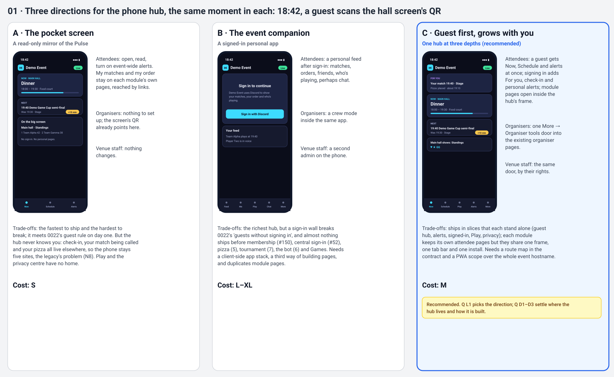

### A · The pocket screen
A read-only mirror of the Pulse: now and next, what the big screen shows, the latest announcement, venue facts and event-wide alerts. No sign-in anywhere; personal things stay on each module's own pages, reached by links.
- **Attendees:** open, read, turn on alerts; nothing knows them, so "your match is called" and "your pizza is here" never reach the hub.
- **Organisers:** nothing to set up; the screen's QR already points at it.
- **Venue staff:** no change.
- **Trade-offs:** the fastest and safest, and it meets 0022's guest rule on day one. But the phone stays five sites, the legacy's very problem (N8); Play and the privacy centre have no home, and the track's later items would have to be bolted on.
- **Cost: S.**

### B · The event companion
A signed-in personal app: a feed of your matches, orders, friends and who is playing, perhaps chat, with a crew mode inside.
- **Attendees:** the richest experience, after a sign-in wall.
- **Organisers:** a second admin on the phone.
- **Venue staff:** the same, by rights.
- **Trade-offs:** a sign-in wall breaks 0022 ("guests get event-wide notifications without signing in"), and almost nothing ships before #52, #150, steps 5–7 and the Games track. It needs a client-side app stack, a third way of building pages, and it duplicates the modules' pages.
- **Cost: L–XL.**

### C · Guest first, grows with you
One hub at three depths. A **guest** gets Now, Schedule and alerts at once. Signing in and joining add **For you** (your match, your order, your check-in), personal alerts, follows and the privacy centre. Anyone with a right sees one **Organiser tools** door into the organiser pages that already exist. Each module keeps its own attendee pages, drawn inside the hub's frame (one header, one tab bar, one install), so the phone is one app however many modules the event runs.
- **Attendees:** useful in the first three seconds, and more useful the more they let it know them.
- **Organisers:** nothing to build per event: the hub follows the run of show, the topics and the theme they already set; one door to admin on the phone.
- **Venue staff:** the same door, by their rights.
- **Trade-offs:** it needs a route map in the contract and a PWA scope over the whole event hostname (D3), and each module's attendee pages must use the frame's markup (D2). More moving parts than A, but each slice stands alone and ships when its data exists.
- **Cost: M.** Much of it is paid: Notify's backend, the check-in pages, the theme's manifest rules and the tokens exist.

## Recommended direction: guest first, grows with you
**C, with A's discipline for guests and nothing of B's wall.**

Why, boldly:
1. **The first three seconds decide everything.** A person who scans a hall screen gives the hub one glance. Now must answer "what's on, what's next, did anything change" before any question is asked; the install and the account come later, when they are worth something ([mockup 02](track-app/02-flow-qr-handoff.svg)).
2. **The screen is the heart; the hub is its pocket edition.** The hub reads exactly what the screens read (the agenda's now, Screen's view-models, Moments' announcements), so the hall and the hand never disagree. It does not compete with the screen for attention: it is calm, quick and readable in a dark hall (L3).
3. **One frame, many owners.** The legacy's failure was five sites reached by token links. The cure is not one giant app that owns everything (B) but one frame that every module draws its pages in: pizza keeps its ordering flow, the tournament its matches, and the attendee sees one app ([mockup 09](track-app/09-more.svg)).
4. **Grow with what exists.** Each slice of C ships when its data exists: the guest hub and alerts now, the signed-in hub with Go public, Play with the bot, reactions with Moments. Nothing waits for everything.
5. **Privacy is a feature, not a page at the end.** The person who gives the hub more (sign-in, check-in, follows) sees at every step what it keeps and can take it back, and a guest is never anything more than a push address.
6. **Regulars matter most.** Recurring events at one venue (0022) mean the same people come back several times a year. An installed hub that survives to the next event (D4 B) turns a one-off page into the event's app.

**Design principles for the track** (proposed for the session to keep, change or drop):
1. **Useful before it asks.** Every page a guest may read works without sign-in, install or permission.
2. **One truth.** The hub reads the same answers as the screens and the bot; it keeps no copy of any module's data.
3. **Push rarely, and say why.** Event-wide alerts are few, the cap and quiet hours are visible, and urgent means a called match or an emergency.
4. **One frame, many owners.** The hub draws the frame; each module draws its own attendee pages in it.
5. **Never a gate.** Joining, check-in and install are offers; no page hides behind one it does not need (0027).
6. **Calm in the hand.** The screen is the show; the hub uses the event's look and moves only when something changes.
7. **Take it back in one place.** Every opt-in has its opt-out on the same page, and the privacy centre shows and removes everything the event keeps on you.

## Key flows
Each flow for the user who meets it, with its mockup. Questions that change a flow are named.

### From the screen to the phone (guest)
The venue rail's QR opens Now on the event's primary hostname; a quiet card offers alerts; our own sheet explains them; the browser asks; the guest subscription is made, its token kept on the phone (U1, U3, U4, E3, D5).

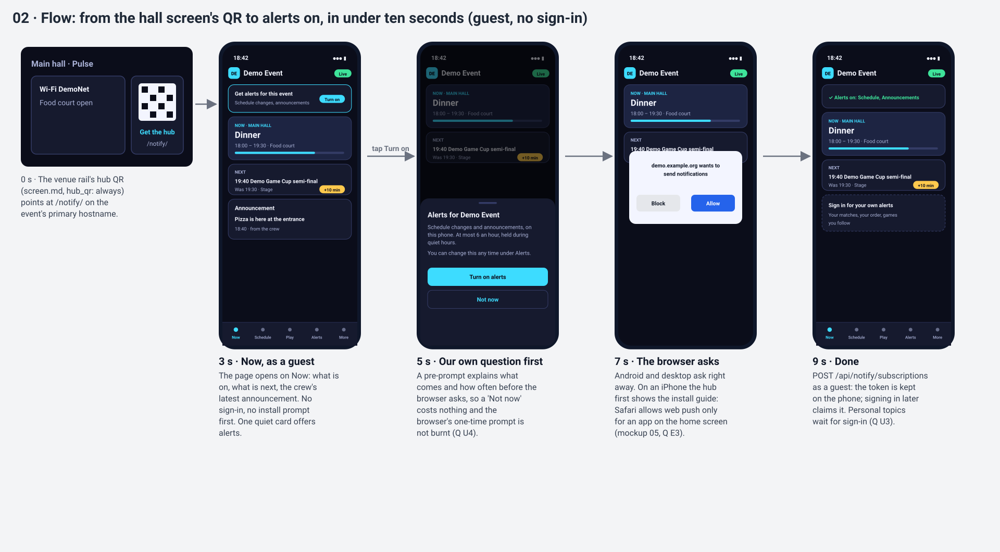

### Now (guest, member, at night)
What is on and next for the zone, the big screen as text with reactions, the latest announcement, venue facts; For you on top for a member; the quiet-hours card at night (U2, U7, L3, D5, D6, D16, D17, D18).

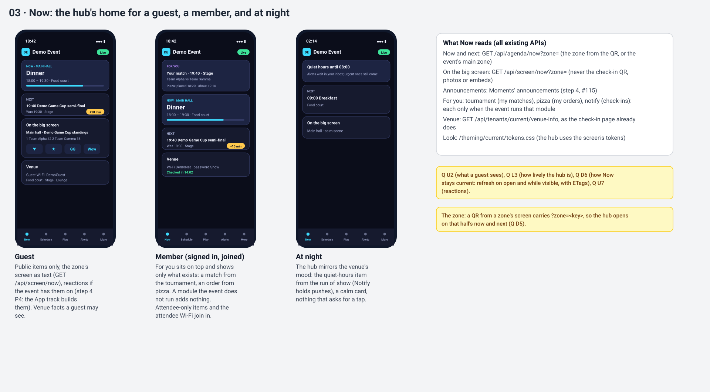

### Schedule (everyone)
The run of show as one continuous list with the day switch, the delay badge and cancellations; one item's page, which every schedule notification opens, with **Follow this item** (decided on 2026-11-14); a filter by kind and zone kept on the phone (D7, D8).

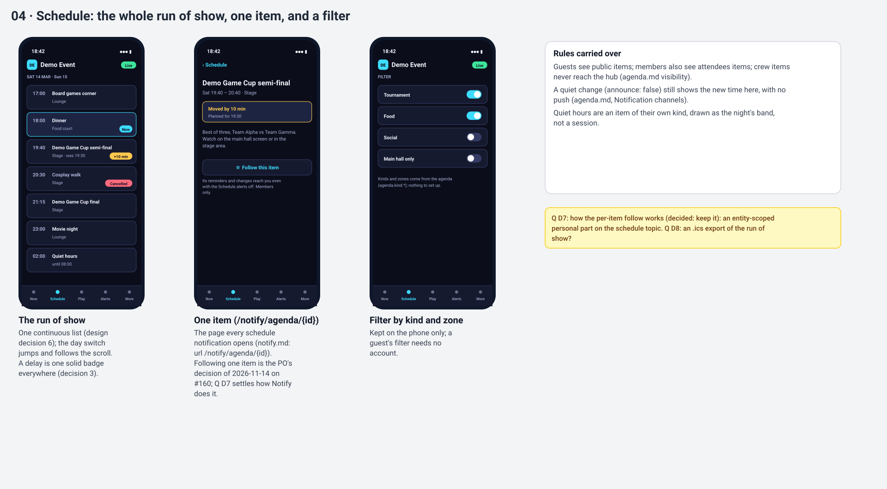

### Installing (attendees)
Chrome's own prompt after the first useful moment; the iPhone guide, because Safari allows push only from the home screen; the warning inside Discord's in-app browser; the splash from the theme (U5, L5, E3, E4).

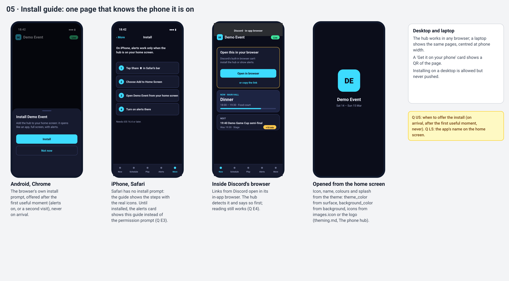

### Alerts (guest, member)
Per-topic switches on this phone; for a member, push and Discord DM per topic and part, the DM fallback and followed games; the blocked state (U3, U6, D9).

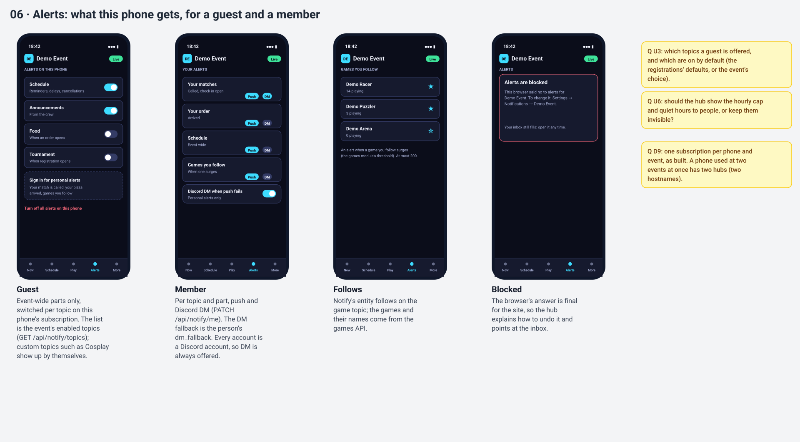

### Notifications (everyone)
The lock screen (only an id travels through the push service; the details load from Notify), the inbox with "held" and "not pushed" tags, the page a tap opens, the generic text off-site in `venue_only` (L2, L4, E6, O3).

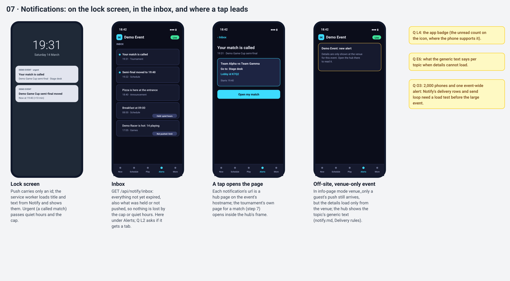

### Signing in and joining (guest → member)
Sign in with Discord from any page that needs it; one tap to join at the venue or with the event's link; the guest subscription is claimed; the refusal when neither applies (U8, E5).

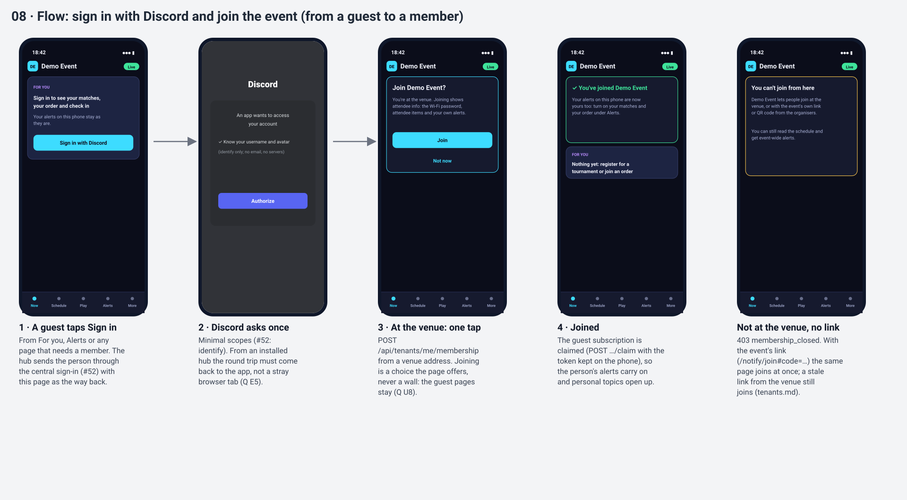

### More, and module pages in the frame (member)
You, your event, the doors to Privacy, the install guide and Organiser tools; the tournament's and pizza's own pages inside the hub's frame (L2, D2, U13).

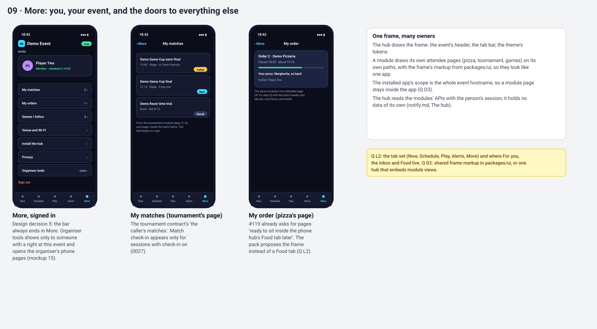

### Check-in (member)
The door screen's rotating code scanned in the hub or by the camera; the done page with the venue's Wi-Fi (every member's, check-in or not); a match check-in where a session has it on (U9, D10, E8).

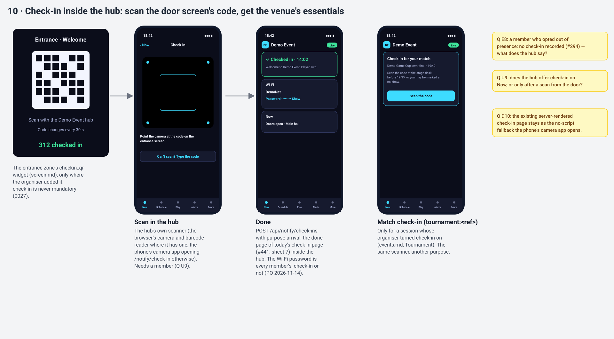

### Play (member, guest)
Now playing by game with names for members and counts for guests, who is in voice with a link into Discord, one game's page and its follow (U10, D11, E9, P3).

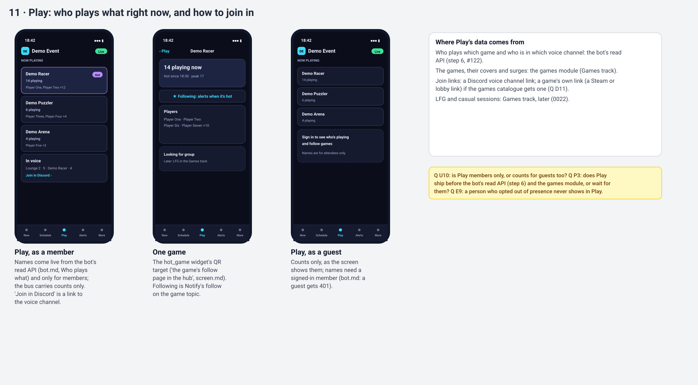

### Your match is called (player)
The urgent push through quiet hours and the cap, the match page in the hub's frame with the lobby id, the match in play; scores stay manual (P4).

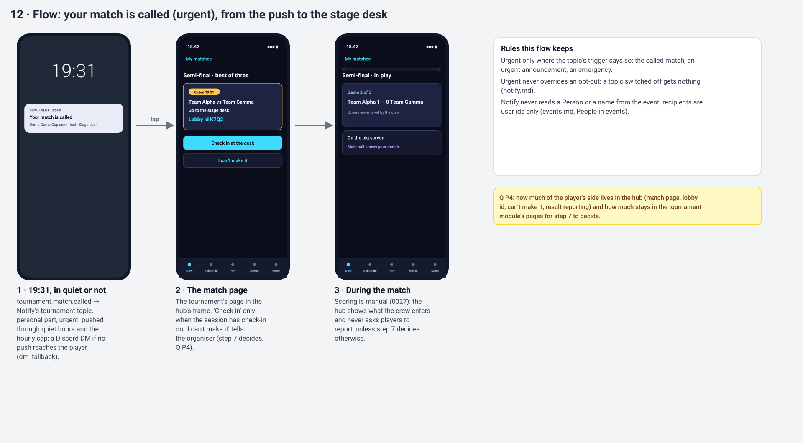

### The privacy centre (member)
What the event keeps per module, the presence opt-out, download, delete at this event with a hold, leave, delete the account (U11, U12, D12, D13, E10, O5, P6).

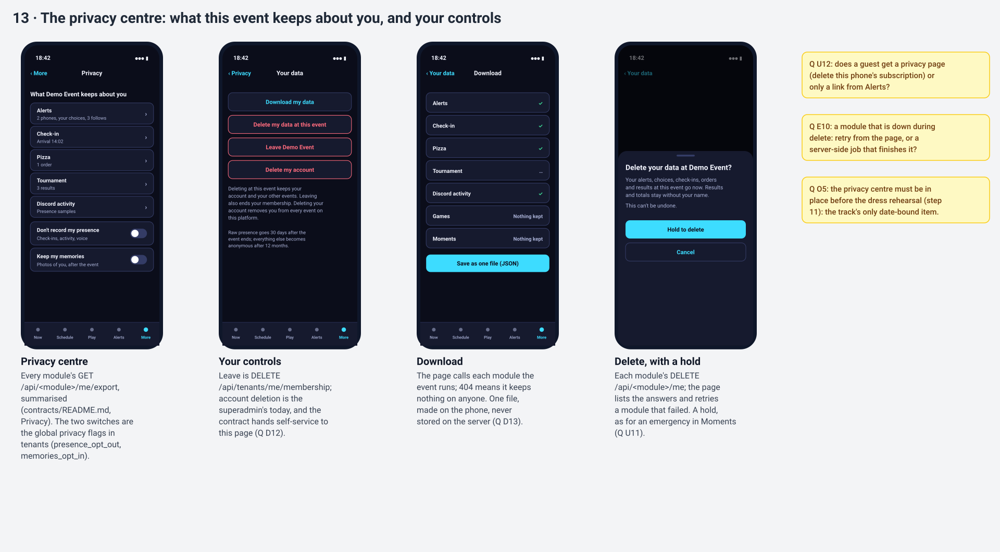

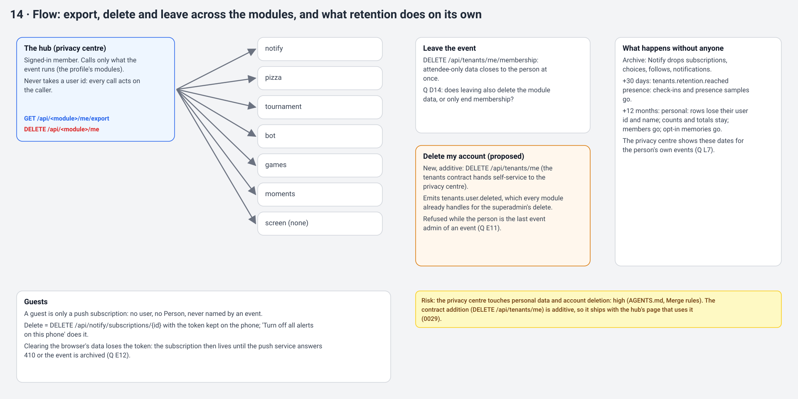

### Organisers from anywhere (organiser, crew)
The Organiser tools door by rights, the organiser shell's phone pages, the refusal off-site while `admin_access` is `restricted`, and the access settings in plain words (U13, U14, D15, P7).

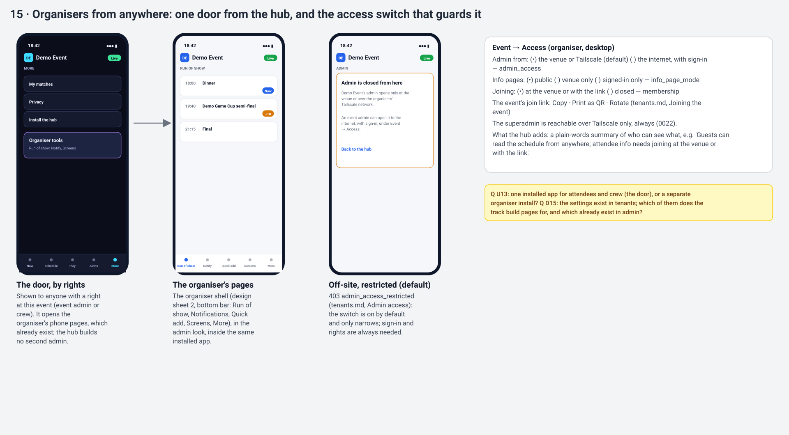

### Memories (member, after the event)
The opt-in switch that exists today, a recap after the event, and the open problem of who is in a photo (P6).

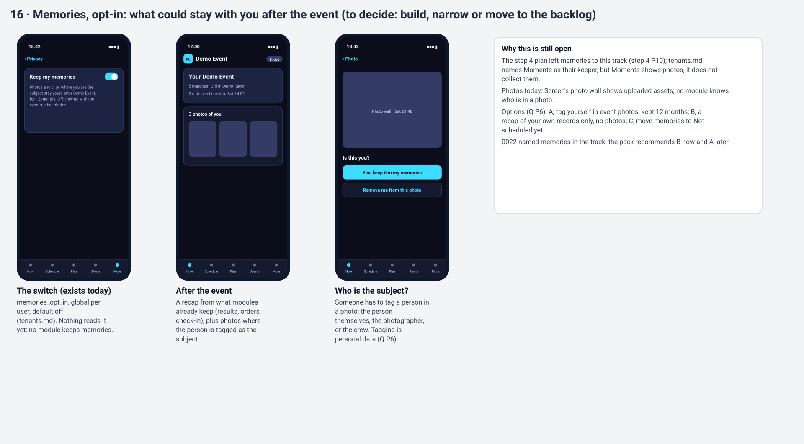

### States (everyone)
Offline, pages closed, venue only, before the start, after the event, a module down (E1, E2, E14, D4).

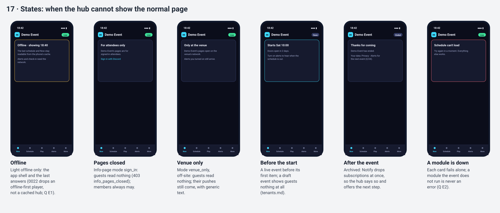

### The next event (regulars)
Why an installed hub dies with its event's hostname, and three ways out (D4).

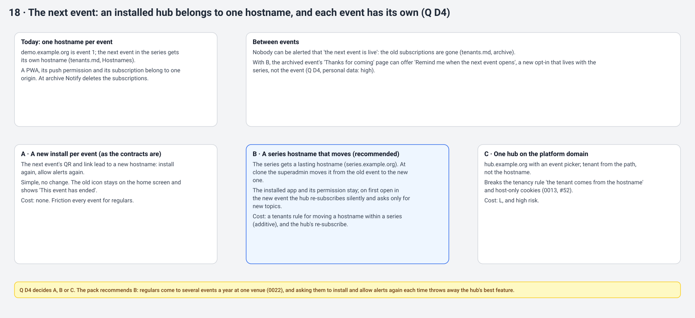

### The hub's map
Tabs, pages and paths under `/notify/`, what each reads, the pages without a tab, and what changes in what exists (D1, D3).

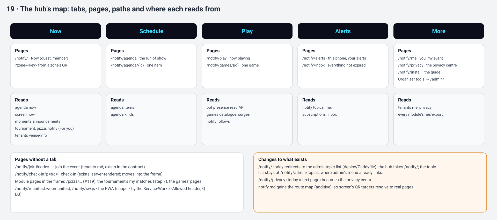

### Every mockup
| # | File | Shows |
|---|---|---|
| 01 | [01-directions.svg](track-app/01-directions.svg) | The three directions side by side |
| 02 | [02-flow-qr-handoff.svg](track-app/02-flow-qr-handoff.svg) | From the hall screen's QR to alerts on, as a guest |
| 03 | [03-now.svg](track-app/03-now.svg) | Now for a guest, a member and at night |
| 04 | [04-schedule.svg](track-app/04-schedule.svg) | The run of show, one item with Follow, the filter |
| 05 | [05-install-guide.svg](track-app/05-install-guide.svg) | Installing on Android, iPhone, inside Discord, and the splash |
| 06 | [06-alerts.svg](track-app/06-alerts.svg) | Alerts for a guest and a member, follows, blocked |
| 07 | [07-notifications.svg](track-app/07-notifications.svg) | Lock screen, inbox, a tap's page, off-site generic text |
| 08 | [08-flow-sign-in-join.svg](track-app/08-flow-sign-in-join.svg) | Sign in with Discord and join, and the refusal |
| 09 | [09-more.svg](track-app/09-more.svg) | More, my matches and my order inside the frame |
| 10 | [10-check-in.svg](track-app/10-check-in.svg) | Check-in in the hub, done, match check-in |
| 11 | [11-play.svg](track-app/11-play.svg) | Play for a member, one game, Play for a guest |
| 12 | [12-flow-match-called.svg](track-app/12-flow-match-called.svg) | Your match is called, from push to the desk |
| 13 | [13-privacy-centre.svg](track-app/13-privacy-centre.svg) | The privacy centre, controls, download, delete |
| 14 | [14-flow-privacy-data.svg](track-app/14-flow-privacy-data.svg) | Export, delete, leave across modules; retention; guests |
| 15 | [15-organiser-access.svg](track-app/15-organiser-access.svg) | The organiser door, the shell, the refusal, the access settings |
| 16 | [16-memories.svg](track-app/16-memories.svg) | Memories: the switch, a recap, tagging |
| 17 | [17-states.svg](track-app/17-states.svg) | Six states when the normal page cannot show |
| 18 | [18-flow-next-event.svg](track-app/18-flow-next-event.svg) | The installed hub and the next event: A, B, C |
| 19 | [19-hub-map.svg](track-app/19-hub-map.svg) | Tabs, pages, paths and their sources |

## Port, drop or invent
Verdicts follow [0020](../decisions/0020-best-of-old-freely-new.md). The legacy had no hub, so most of the track is new; what the legacy teaches is mostly what not to do.

### Port as is
| Legacy or existing | Into | Why |
|---|---|---|
| In-page dialogs instead of native `confirm` and `prompt`, because phones block those (mini-tourney P13) | Every hub page | A proven rule; the platform already follows it (N1) |
| The check-in page and its states (#441, design sheet 7) | The hub's check-in, in the frame (D10) | Built, accepted and tested; it keeps working without scripts |
| Notify's hub reads (`hub.py`: venue info and now and next with the person's cookie) | Now and the done page | Already reads the right sources the right way |

### Port with changes
| Legacy | Change | Why |
|---|---|---|
| The public tournament schedule with "Next up" and a details view (signup site T1) | The hub's Schedule over the agenda, for the whole event, with one item's page | The agenda is now the one run of show (0022) |
| Pizza and tournament pages reached by `?token=` links from Discord (P2, T4) | Module pages in the hub's frame, reached by sign-in, For you and notifications (#119, step 7) | Token links in URLs are dropped (0010); one frame instead of five sites (N8) |
| Bot DM reminders, fixed and without opt-out | Notify's topics with per-person channels; the DM as a chosen channel or a fallback | N9: notifications people choose. Built in step 3 |
| The lobby id on a pending match (mini-tourney P8) | Shown on the match page in the hub's frame | The tournament owns it; the hub shows it where the player looks (P4) |
| The Theme studio's hub sample (step 3) | The hub's first real look, from the same tokens | One look on the screen, the hub and the studio |

### Drop
| Legacy | Why |
|---|---|
| Registration and admin tokens in page URLs, and player rights kept in one browser's storage | Central sign-in and membership replace them (0010, #52, #150) |
| Five separate sites for one event | One hub per event (N8) |
| The `/notify/` redirect to the admin topic list | The hub takes the address the screens already print |
| Polls | Dropped by 0010; P9 keeps them out of this track |

### Invent
| New | Where | Why |
|---|---|---|
| The guest hub: Now, Schedule, alerts without an account | Notify's pages | 0022's guest rule |
| The pre-prompt, the install guide per phone, the in-app browser warning | The hub | Push that people accept and keep (U4, U5, E3, E4) |
| One frame for every module's attendee pages, with a PWA scope over the hostname | `packages/ui` and the hub | One app, many owners (D2, D3) |
| For you from a shared `me/summary` convention | contracts/README.md, each module | New modules appear with no hub change (D18) |
| Following one run-of-show item | Notify and the agenda's registration | The product owner's decision of 2026-11-14 (D7) |
| The privacy centre and self-service account deletion | The hub; tenants | N13; tenants.md hands self-service deletion to the hub (D12) |
| A hostname that follows the series to its next event | Tenants | The installed hub survives to the next event (D4) |
| Reactions from the hub | Moments, Screen, the hub | Step 4 handed them here (P5) |
| A personal recap after the event | The hub, from the modules' own records | Memories without new storage (P6) |
| Lost-token recovery by proof of possession | Notify | A guest who cleared their storage can manage alerts again (E12) |

## Proposed issue changes
For the lead to apply after the session; each assumes the recommendation of the questions it names. The epic's six planned items (A1–A6) have no issues yet, so each is written here as the issue it would become. Every contract change named is additive and ships in the package of the code that uses it ([0029](../decisions/0029-additive-contracts-ship-with-consumers.md)); none is breaking.

### A1 · the hub shell (rewrite; normal)
`feat(notify): the hub shell: Now, Schedule, install and the screen's handoff`
- The hub takes `/notify/` (deploy/Caddyfile: the bare redirect goes; the topic list stays at `/notify/admin/topics`).
- The manifest from the theme (theming.md, The phone hub) with scope `/` and start URL `/notify/`; a service worker with scope `/notify/` for push and the offline pages (D3, D19).
- Now (agenda now for the zone, Screen's now as text, Moments' announcements once step 4 has them, venue facts by audience), Schedule and one item's page at `/notify/agenda/{id}`, More with the install guide and venue info (D5, D6, D16, D17).
- **Following one item** (decided 2026-11-14): the `schedule` topic's personal entity part and the Follow button, members only (D7). Contract: notify.md and the agenda's registration.
- The frame's markup in `packages/ui` (the event header and the hub's tab bar) for module pages to use (D2).
- The route map in notify.md (additive), so Screen's widget QR targets resolve to real pages; `?zone=` on the hub QR (screen.md, additive) if D5 is A.
- The states of mockup 17; the page-weight budget (O1); phone screenshots of every page (O9).

### A2 · alerts in the hub (rewrite; normal)
`feat(notify): alerts in the hub: subscribe, choose, inbox`
The backend exists (Notify, step 3); this is the phone's side.
- The pre-prompt and the browser's permission, the guest subscription and its token on the phone, the claim on sign-in (U3, U4, D20).
- The alerts page (per topic and part; push and DM for members; the DM fallback; followed games), the inbox with its tags, the badge (U6, L4, D9).
- The service worker's push handler: load the details, show the topic's generic text when it cannot (E6), open the notification's page.
- The iPhone install gate and the in-app browser warning (E3, E4); the guest privacy page (U12).
- Lost-token recovery by proof of possession (E12). Contract: notify.md, Web Push.
- The fan-out test at 2,000 subscriptions with a fake push service (O3).

### A3 · the signed-in hub (rewrite; high)
`feat(notify): the signed-in hub: join, For you, personal alerts and check-in`
High: it carries the sign-in round trip inside an installed app and the join flow (sessions, membership).
- Blocked by #52 (its PWA round-trip criterion, tested on iOS and Android first, E5) and #150 (membership and the join code).
- The join page `/notify/join#code=` and joining at the venue, as an offer (U8, mockup 08).
- For you on Now from `GET /api/<module>/me/summary` (D18); Notify's check-in is its first card. Contract: contracts/README.md.
- Check-in in the frame and the hub's scanner; the presence opt-out's message (E8, with #294).
- The Organiser tools door by rights (U13) and the access summary in plain words (D15).

### A4 · Play (keep, sharpen; normal)
`feat(notify): Play: now playing, voice and followed games`
- Blocked by the bot's read API (step 6, #122); games and follows when the games module's catalogue exists (P3).
- Names for members, counts for guests (U10); voice channel links (D11); one game's page and its follow; the presence opt-out note (E9).

### A5 · the privacy centre (keep, rewrite; high)
`feat(notify): the privacy centre: see, download, delete, leave`
- Before the dress rehearsal (step 11, O5); after A3.
- What each module keeps (every `me/export`), one download made on the phone (D13), delete at this event with a hold (U11), leave (D14), the presence opt-out, retention dates (L7).
- **Self-service account deletion:** `DELETE /api/tenants/me`, refused for the last admin of an event (D12, E11). Contract and code in tenants, in this package.
- Shows the memories switch only once something reads it (P6).

### A6 · memories (narrow; normal)
`feat(notify): your event: a personal recap after the event`
- A recap from the person's own records (matches, results, orders, check-in) for a member, after the event and until its anonymisation (P6 B).
- Photos with tagging go to "Not scheduled yet" with a `Roadmap note:`.

### New · reactions from the hub (normal)
`feat(moments): reactions from the hub`
- Moments' reactions API: the fixed set, one every 10 s per member, off in a quiet scene, the crew switch (U7, P5). Contract: moments.md.
- The drawing on the screen as step 4's [mockup 15](step-4-moments/15-reactions.svg) has it, where Screen does not have it yet.
- The buttons on Now's "On the big screen" card.
- Blocked by A3 (members) and step 4's engine (#112).

### New, if D4 is B · a series hostname (high)
`feat(tenants): a series hostname that follows the current event`
- A series may hold a lasting hostname; the superadmin moves it to the new event at clone; the old event keeps its own hostname. Contract: tenants.md (additive). High: tenancy.
- The hub subscribes again silently on its first open in the new event and offers only new topics. Its home is the lead's call: this track or the Go-public track.

### Existing issues
- **#119** (pizza's attendee pages, step 5): keep; replace "ready to sit inside the phone hub's Food tab later" with "drawn in the hub's frame (`packages/ui`), with a `me/summary` card", if L2 and D18 are taken.
- **#52** (central sign-in): keep; its "works from an installed PWA" criterion is A3's first dependency (E5).
- **#150** (users, members, privacy flags): keep; A3 and A5 depend on it.
- **#294** (no check-ins for presence opt-outs): keep; A3's message depends on it.
- **#112** (step 4's engine and crew remote): keep; it builds the crew spotlight's phone flow, which the experience map gave this track (U14).

### Order (a sketch for the planner)
1. A1 and A2 as one package (normal): needs nothing beyond step 3 (P10).
2. A3 (high), once #52 and #150 merge; A5 (high) after it, before step 11. Related high-risk issues of one area may share one package if the two stay under about 4,000 lines.
3. Reactions, once A3 and step 4's engine exist.
4. A4 Play, once step 6's bot read API exists.
5. A6 the recap, last.
6. The series hostname, if D4 is B, whenever the lead places it; the hub's re-subscribe follows it.

**Proposed exit criteria** (P8): on the demo stack, a guest scans the Pulse's QR, sees now and next, turns on alerts and gets a delay's push within 10 s; a member joins with the link, follows an item, checks in and gets an urgent push during quiet hours; export and delete work across every module the demo runs; the 2,000-subscription fan-out passes; every hub page has its phone screenshot.

## Open questions
All of them are in the [question bank](track-app/questions.md). Decide first: **L1** (the direction), **D1** (who serves the hub), **D4** (the next event), **P1** (the issue set), **P2** (the order), **U7** (who sends reactions), **D12** (self-service account deletion), **P6** (memories).
