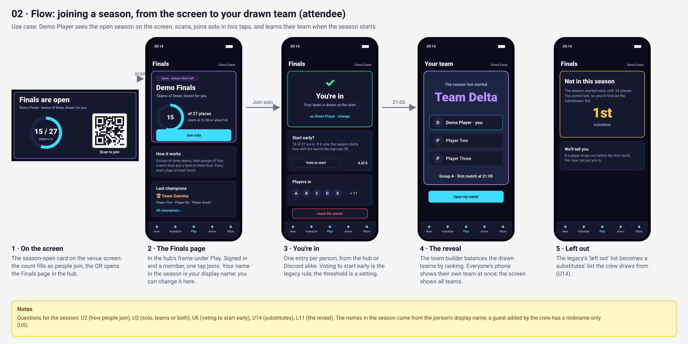
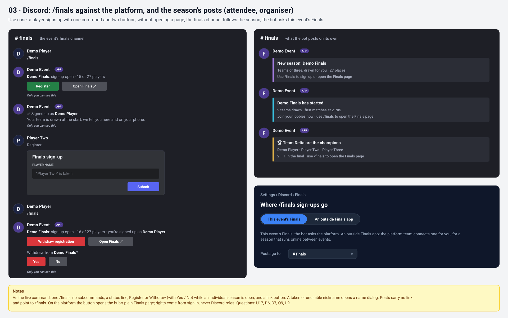
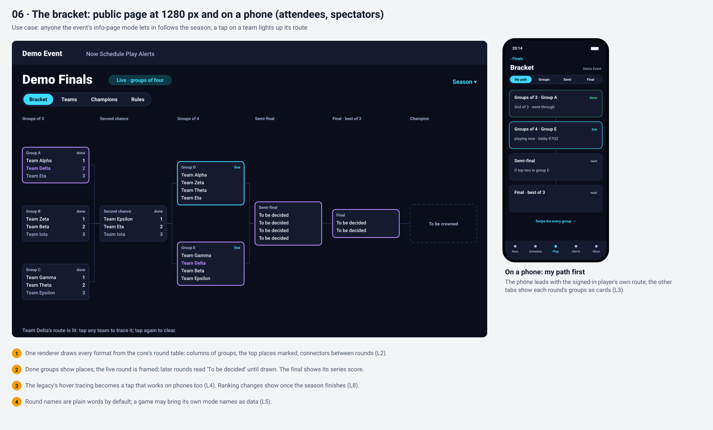
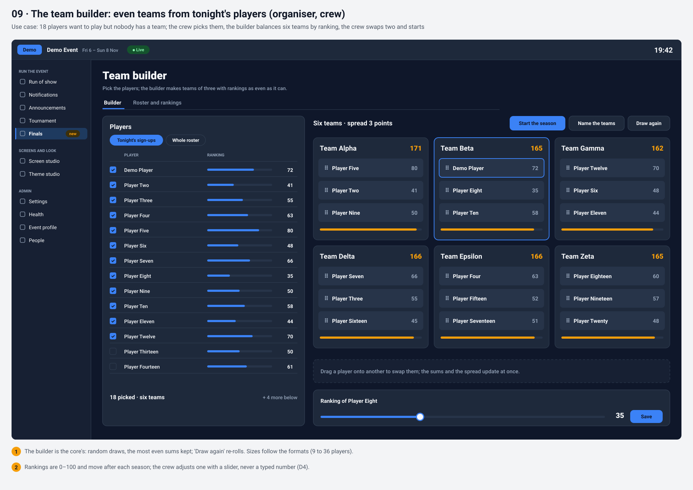
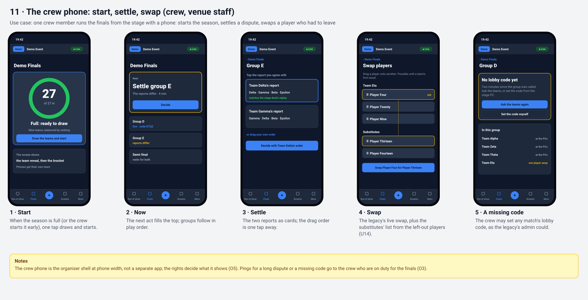
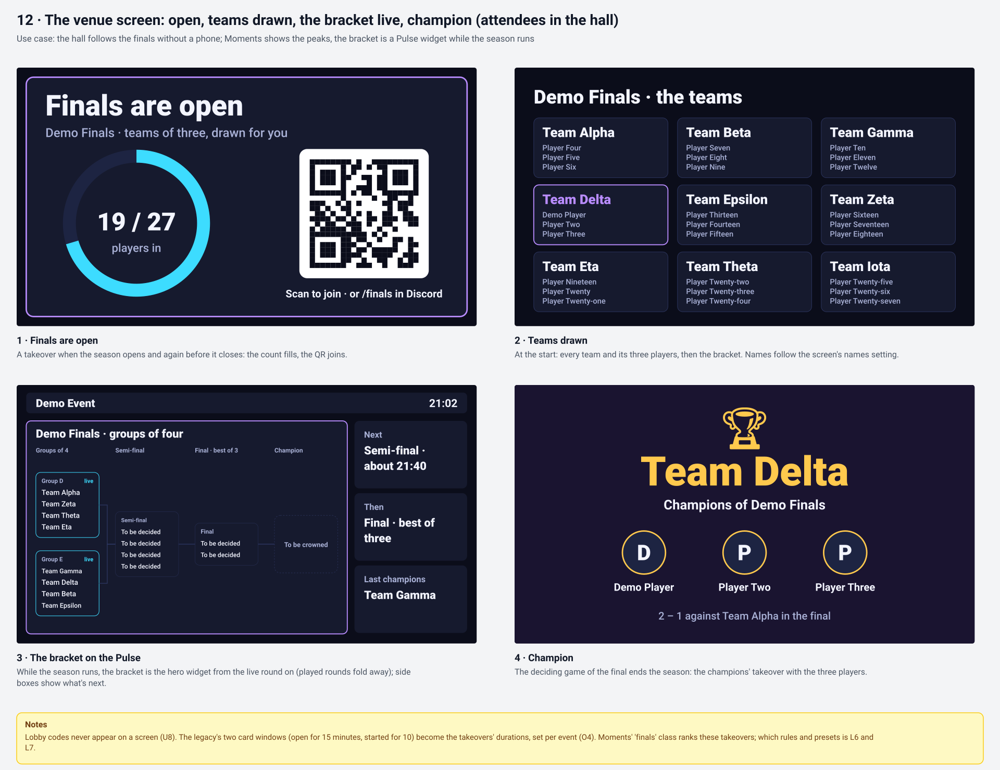
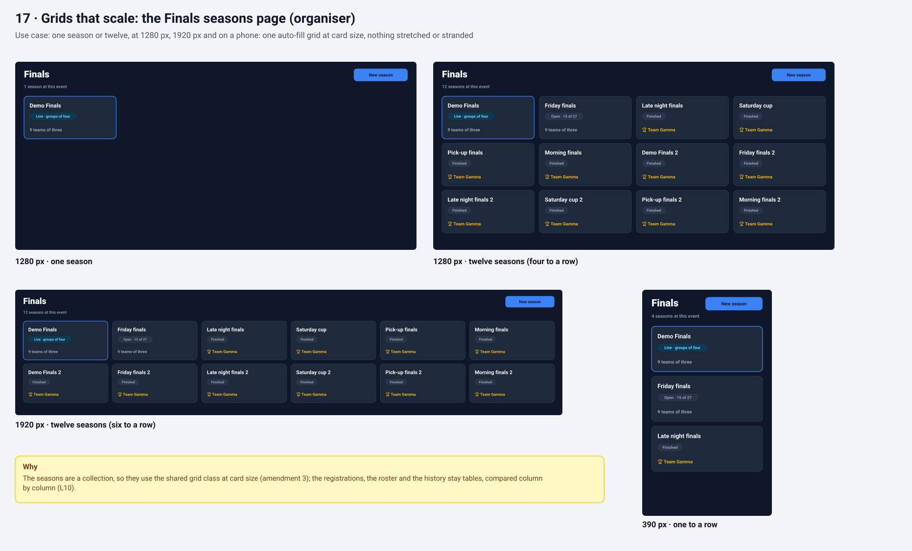

# Finals track brief (research pack)

The research pack for the product owner's brainstorming session on the [Finals track](../roadmap.md#finals) (epic #161), issue #172. It follows the [outline of a research pack](README.md#outline-of-a-research-pack) and its mockup rules, and is built like [step 7's pack](step-7-tournament.md), the nearest relative. After this merges, the lead runs the session over as many rounds as it takes, writes the final plan into this brief (`## Plan`) and writes the track's issues; the product owner accepts the plan before any build starts.

**In this pack**
- This file: goal, what was read, what the platform already has, how others solve it, the legacy in one paragraph, three directions and the recommended one, the key flows, port / drop / invent, what the stub and the built contracts need, proposed issues and exit criteria, roadmap notes.
- [track-finals/questions.md](track-finals/questions.md): the question bank, 78 questions in six themes, each with options and a recommendation. IDs (U3, D6, …) are used throughout.
- [track-finals/](track-finals/): 17 SVG mockups, drawn new, with the demo event only. Organiser pages are drawn in the organiser shell with `packages/ui`'s default tokens and its Event menu (Finals marked new), each also at phone width; attendee pages in the hub's frame with the demo theme's "Demo night" colours; the venue screen in the screen look. Each sheet states its use case. Every text that sits in a box carries `data-box` (its box's left and right edge), and a headless Chromium check found no text outside its box (see [Every mockup](#every-mockup)).

## Goal
The Finals mini tourney runs on the platform for an event: players and teams register, the bracket runs, and champions are crowned ([roadmap](../roadmap.md#finals)). In it: the `finals` module (seasons, registration of teams and individuals on the hub and by Discord through the bot's `/finals`, brackets, rankings, champions and the team builder), result reporting and correction, the full `finals` contract replacing the provisional provider stub, and the finals cards on the screen. It builds on the shared tourney core, a public library the standalone off-LAN app also uses, taken as a pinned dependency; storage, API, sign-in and the frontend are built new on the kit. Exit: a season runs end to end on the demo tenant, with a sign-up through the bot's `/finals` against the platform as its provider.

The epic's planned items: the full `contracts/finals.md`; the module on the kit with the core as a pinned dependency; screen widgets and Moments for brackets and the final. No child issues exist yet; this pack proposes them ([P2](track-finals/questions.md#p2-the-issue-set)).

## What was read
- **Decisions:** [0025](../decisions/0025-finals-and-games-modules.md) (finals and games apart; the shared core, its licence and how it is pinned; the off-LAN app independent with no sync; the provider contract), [0027](../decisions/0027-product-decisions-2026-11-07-08.md) (joining by venue, link or QR; Discord accounts; 12-month anonymisation; Finals as the Apps track's possible first app), [0022](../decisions/0022-product-vision.md) (the screen is the heart; the phone hub; 1,000–2,000 attendees), [0020](../decisions/0020-best-of-old-freely-new.md), [0004](../decisions/0004-nothing-migrated.md), [0010](../decisions/0010-scope.md) (no tokens in URLs), [0013](../decisions/0013-multi-tenant-core.md), [0015](../decisions/0015-dependency-auditing.md), [0026](../decisions/0026-briefs-are-research-packs.md), [0029](../decisions/0029-additive-contracts-ship-with-consumers.md) and [0024](../decisions/0024-additive-contract-docs-normal-risk.md).
- **The roadmap:** the [Finals track](../roadmap.md#finals), its neighbours (Games, App), step 7 ("the mini tourney is not part of it") and the reuse table's mini-tourney and canccubot rows.
- **Legacy inventories:** [the mini tourney](../legacy-inventory/thefinals_mini_tourney.md) in full (features P1–P13 and A1–A18, the seven formats, the 48 routes, data, tests, the 13 known problems, the port table and the tenancy questions), [canccubot](../legacy-inventory/canccubot.md) (the tourney watcher's posts, the finals cards and their 15 and 10 minute windows), the [summary](../legacy-inventory/README.md).
- **The four Finals repos at their current `main`** (read-only; everything that changed since the inventories was read in full):
  - `finals-core` at `9d65a84` (12 Nov, release v1.0.1): the ladder, rankings and team builder as pure ESM functions with typings and their own tests, ISC with its `LICENSE`, released only by a manual workflow as git tags.
  - The off-LAN app (`thefinals_mini_tourney`) at `1a4fe2a` (16 Nov), 37 commits past the inventory's `87d7c81004`: the provider API and the Discord link session (`src/provider.js`, `test/provider.test.js`), Discord sign-in, admins by Discord role, the read gate (`READ_GATE`), individual-only seasons (`INDIVIDUAL_ONLY`), the nickname prefill, availability voting, cancelling and renaming running seasons, fixing names in finished seasons, the registration status line, the SSE keepalive, write and body limits, finals-core at a pinned tag with a pin check and a daily bump workflow, deploy on every merge to `main`. Also its `src/service.js`, `src/app.js`, `src/db.js`, the README and every new test.
  - The legacy bot (`canccubot`) at `12f2b03` (11 Nov), the seven commits past the inventory's 30 Oct read, all about `/finals`: `bot/cogs/finals.py`, `bot/services/finals_provider.py` and their tests, `bot/utils/link_button.py`, `bot/utils/tourney_guard.py`, the watcher's changes, `docs/ai/areas/finals-commands.md`, and its `finals_cards.py` from the first read.
  - The legacy platform repo (`canccuplatform`) at `0dff5d0` (13 Nov), the 17 commits past the inventory's `d5e3bb4d01`: `docs/contracts/finals-provider-api.md` (the provider API as written) and `tourney-api.md` (the read gate's 401), the plans `issue-157.md` (provider API and link session), `issue-163.md` (extracting finals-core) and the hosting plans (#159, #160, #186, #194), the off-LAN, hosting, deploy and staging runbooks, and `docs/upstream/thefinals_mini_tourney.md` (the upstream CI gate and the core's tag-pin rule). Hosting and deploy files are used as facts only; the pack names no host, domain or id from them.
- **Contracts it builds on:** [finals.md](../../contracts/finals.md) (the provider stub), [tenants.md](../../contracts/tenants.md) (users and identities, joining, series and clone, retention, the info-page mode), [README.md](../../contracts/README.md) (internal paths and the kit's service identity, privacy export and delete), [bot.md](../../contracts/bot.md) (commands per flag), [moments.md](../../contracts/moments.md) (the `finals` class and the `finals_result` rule), [screen.md](../../contracts/screen.md#widgets) (`bracket`), [notify.md](../../contracts/notify.md) (topics), [admin.md](../../contracts/admin.md) (settings, rights, presets) and [games.md](../../contracts/games.md) (the catalogue to come).
- **Briefs and design:** step 7's pack (the tournament kept apart; its #129 "format mix-up" test sent here), step 6's pack (P8: `/finals` under its own flag; D9: the legacy import), step 9's pack (D12 and L11: the finals cards are this track's; L-question: "the tree waits for the Finals track"), the App track pack (P4: modules own their pages in the hub's frame), the [design guideline](../design/README.md) with amendment 3's grids, [widgets.md](../design/widgets.md).
- **The epic and its issues:** #161, #172, the closed #148 (the split and the stub) and #158.

## What the platform already has
- **Built and waiting:** Moments' `finals` class (rank 55) and its `finals_result` rule (today fed by the tournament's final); Screen's `bracket` template (heats, step 9 proposes); Notify's topic registry; the organiser shell and its menu; the kit's outbox, settings client, rights check, tenant transactions and service identity; sign-in and rights (#52).
- **Not built:** the `finals` module (no folder yet), its contract beyond the stub, the bot module (step 6: the `/finals` command framework), the hub's frame (App track) and the games catalogue (Games track).
- **Live outside the platform:** the shared tourney core is **released** (finals-core v1.0.1, git tags, pinned by the off-LAN app), so the track pins it rather than waits for it. The off-LAN app now runs on its own host on the internet, outside any event: every visitor signs in through a 15-minute link from `/finals` that the page swaps for a 7-day session, admins are people holding a listed Discord role, the read gate closes every page and read to anyone without a session, seasons are individual-only there, and it answers the provider API. The legacy bot has a working `/finals` against that API, and its watcher posts the season's news.

So most of the track (the module, its organiser pages, its screen moments) can start on what exists; the hub pages and `/finals` light up when their hosts land ([P5](track-finals/questions.md#p5-order-against-the-bot-and-the-hub)).

## How comparable products solve it
| Field | What they do | What we take |
|---|---|---|
| **Esports bracket platforms** | Every bracket shape, check-in, team invites, self-reported scores confirmed by the opponent, a dispute queue for admins | Invites by link, QR or code (U4); two matching reports decide, a queue for the rest (U7, E2); not every bracket shape (U1) |
| **Custom lobbies in team games** | A host makes a private lobby and shares a short code with the other teams | The lobby code on the match's phones, never on a public screen (U8) |
| **Team balancer bots in game communities** | Pick tonight's players, balance teams by a rating, re-roll, swap | The team builder, which the core already has (U13) |
| **Club ladders and rating systems** | A rating per player that moves after each event, with the rule shown | Rankings with "why it moved" (L8, [mockup 13](track-finals/13-champions-and-rankings.svg)) |
| **Sports league apps** | A hall of champions across seasons, titles per player | Champions of the series, carried by the clone (D4) |
| **Arena screens and broadcast overlays** | A draw reveal, a live bracket, a champion moment | The reveal, the bracket as the Pulse hero, the champion takeover (L6, L11) |

The lesson across them: the good ones **let players run their own matches** (codes, reports) and keep a referee for the disputes, **show the bracket as the story** (where am I, who is next, who won), and **make the draw feel fair** (balanced teams, rules shown). The legacy got the first and the third right in a small app; the platform adds the stage.

## The legacy in one paragraph
A small Node app for one team game with teams of three ([inventory](../legacy-inventory/thefinals_mini_tourney.md), read at an older commit; this paragraph is the current head). One season is open at a time; an admin creates it with a format of 3 to 12 teams and a mode: players sign up solo and are drawn into balanced teams, or captains register teams of three nicknames (the off-LAN host allows solo seasons only). Solo players can vote to start early (6 votes) and tick the days they can play over the next three weeks. The app draws the opening groups; teams report the order of each match, two matching reports decide, differing ones wait for the admin; a team sets a 4-character lobby code; later rounds are built automatically and a best-of-three final crowns a champion. A finished season moves each nickname's 0–100 ranking; a team builder forms even teams from that global roster; a champions page counts titles. The bracket engine, the rankings and the builder now come from finals-core at a pinned tag. Since the inventory the app has left the LAN: it runs on the internet, everyone signs in through a link from `/finals` (the shared password is gone; admins by Discord role), writes are rate-limited, a running season can be cancelled and stays in history, a season can be renamed while it runs, and names can be fixed after the finish. Live updates are still a payload-less SSE ping plus polling. It works and is loved; its open problems are rankings and titles keyed by nickname, captains' rights in one browser, no result correction, no audit and an in-process write queue, and the inventory's two real bugs are still open (a full solo `fourqc` season becomes `four`; foreign keys not enforced), with the `eight` round 2 reshuffle still unbounded. The legacy bot's `/finals` signs players up through the app's provider API; its watcher posts new seasons, starts and champions, and it showed two screen cards.

### The inventory's known problems at the current head
| # | Problem (inventory) | Now | Here |
|---|---|---|---|
| 1 | A full solo `fourqc` season becomes `four` | Open: the app still finds the format by team count, and the core's `CAPACITY` lists `four` before `fourqc` | The module stores the chosen format and never looks it up by count ([E9](track-finals/questions.md#e9-the-format-mix-up-and-the-reshuffle)) |
| 2 | Foreign keys not enforced | Open (the app's SQLite start-up) | Postgres enforces them; nothing to port |
| 3 | Results cannot be corrected | Open; deleting a finished season still keeps its ranking changes; a cancelled season is now kept, not deleted | E4, E5 |
| 4 | In-process write queue | Open | D3, E1 |
| 5 | Unbounded `eight` reshuffle | Open, and now in the core (v1.0.1) | An upstream core fix (E9) |
| 6 | Identity is a nickname | Partly: solo sign-ups carry the Discord id; roster, rankings and titles still go by nickname, so a name fixed in one finished season splits a champion's titles | D5, E15 |
| 7 | Weak admin auth | Fixed: no password; admin by Discord role in a signed link, or a link made on the host; 30 writes a minute per address, 10 kb bodies. Still no audit | O5, O6, O10 |
| 8 | Player rights in one browser | Partly: a Discord session stands in for a solo player's token; a team's captain still holds a browser token | U4 |
| 9 | Public start open and on by default | Open: still on by default in the month windows; the read gate now asks for a session | U12 |
| 10 | Untargeted SSE plus polling | Open, with a keepalive ping added | O1, O2 |
| 11 | Schema upgrades in code | Open, with two more rebuild steps | D3 |
| 12 | Small issues | Mixed: the core still exports the unused `TEAMS_PER_SEASON` and gives `nine` the `eight` ranking table by fallback; rankings and the builder now have their own tests in the core | E9, L8 |
| 13 | Code markers | Unchanged | — |

## Three directions
The same moment in each: 20:40, the groups of four are being played, the final is next.

### A · The mini tourney, moved in
The legacy rebuilt one-to-one on the kit: the public page (season picker, bracket, sign-up, reporting) in the hub, the three admin pages in the shell, sign-in instead of tokens and the password, one open season per event, the provider endpoints for `/finals`, the step 9 cards on the screen.
- **Attendees:** the same pages they know, now signed in; the bracket on the phone.
- **Organisers and crew:** the legacy's admin pages, safe (locks, audit) but as dense as before.
- **Venue staff:** the screen shows the open and started cards and nothing while the bracket runs.
- **Trade-offs:** the cheapest; the legacy tests are the spec. But the screen stays quiet for the hour that matters, the seven renderers come along with their fragility, and correction is the minimum the roadmap asks.
- **Cost: S–M.**

### B · One app, two homes
Finals as the first app of the Apps track (0027): one codebase that runs as the off-LAN app and as an installed module, through an app interface the platform offers (sign-in, storage, events, pages); seasons, rankings and champions follow the app wherever it runs.
- **Attendees:** one Finals online between events and at the LAN, the same look in both.
- **Organisers:** one tool all year.
- **Venue staff:** as C on the screen.
- **Trade-offs:** it designs the Apps track's interface before that track has had its session; it has two sign-in models (a bearer secret off-LAN, the platform's sign-in at the event); the off-LAN app's author owns half the code; 0025 says the off-LAN app stays independent with no sync, so B needs a new record first.
- **Cost: L–XL**, and it waits for the Apps track.

### C · Finals night
The module on the kit with the shared core, made into the night's show. Sign-ups from the screen's QR, the hub, Discord or the crew; a balanced draw revealed on every phone and on the screen; the bracket as the Pulse hero while the season runs; lobby codes and "your match is on" on the phones; teams report by dragging the order, the crew settles disputes and corrects with a reason; rankings that move and say why, carried to the next event; champions on the screen, in Discord and in the series' hall.
- **Attendees:** join in seconds; see their own team the moment it is drawn; one match card with the code; report from their own phone; a champion moment.
- **Organisers and crew:** a season desk led by the next action, the team builder, a queue of what needs them, corrections that show their impact, a crew phone at the stage.
- **Venue staff:** the screen tells the story: open (count and QR), teams drawn, the bracket live, champion.
- **Trade-offs:** more than A: events, three Moments rules, a tree view-model for Screen's `bracket`, a correction rule, invites and guests. Parts wait for the bot (`/finals`) and the hub's frame.
- **Cost: M.**

## Recommended direction: Finals night
**C.** The mini tourney is already the best-loved thing in the legacy because it gives a group of friends a real bracket in ten minutes. What it never had was the room: the screen showed two cards and went dark, the phones had a page you had to refresh, Discord had a bot polling a URL. The platform has spent seven steps building exactly that room (Pulse, Moments, Notify, the hub, the bot), and all of it is waiting for an emitter. C plugs the mini tourney into it.

A would ship the legacy's silence on a new stack and port its most fragile code (seven renderers) while dropping the chance to fix its two real gaps (identity and correction). B is the right question asked too early: it would design the Apps track's interface from one app, before that track's own session, and against 0025's "no sync". C does not close B's door: the core stays pure and shared, the provider contract stays clean, and a later Apps track can host the same core ([D15](track-finals/questions.md#d15-the-apps-track)).

C also costs less than it looks. The bracket engine, the rankings and the builder come from the core with their tests; Moments, Screen, Notify, the shell, the kit's transactions and rights exist. The track builds the module that holds seasons per event and emits `finals.*`, its pages, and three Moments rules.

**Design principles**
1. **Players run their own matches.** Codes and reports are on the players' phones; the crew is the referee, not the scorer (U7, U8).
2. **The draw is fair and visible.** Balanced teams from the core, revealed at once, the rules on the page (U13, L11).
3. **The bracket is the story.** One renderer for every format, on the phone ("my path"), the desk and the Pulse (L2, L3, L6).
4. **Trust the results.** Two matching reports or the crew decide; a correction needs a reason, shows its impact first and stays in History; rankings follow corrections (E4, E5, O6).
5. **A person, not a nickname.** Entries, rankings and titles belong to people; guests have ids; renaming never starts a new player (D5).
6. **Everything stays in the event.** Seasons, roster and rankings are per tenant under RLS; the clone carries rankings and champions to the next event of the series (D4).
7. **The bot helps, never blocks.** `/finals` is one more door; the hub, the QR and the crew work without it (E7).
8. **Lean.** No app interface, no run-of-show mirror, no second game until someone needs them (D11, D15, U1).

## Key flows
Each flow names its users and its mockup. The mockups use the demo event's names only (Demo Event, Demo Finals, Arena North, Arena South, Team Alpha … Team Iota, Demo Player, Player Two …).

### Joining a season (attendee)
The season-open card on the screen, the Finals page in the hub, joined with the vote to start early, the reveal of the drawn team, left out as a substitute ([U2](track-finals/questions.md#u2-how-people-join-a-season), [U6](track-finals/questions.md#u6-voting-to-start-early), [L11](track-finals/questions.md#l11-the-reveal), [U14](track-finals/questions.md#u14-substitutes-and-the-left-out-list)).

### Discord (attendee, organiser)
**What the live command does today** (the legacy bot against the off-LAN app): one `/finals`, no subcommands, every reply visible only to the caller. Each call reads the status and makes a fresh page link (sending the caller's id, server nickname and role ids). The reply is one status line (season, state, signed up of places or the champion, "you're signed up as …", or "team sign-up is on the page") and a link button, "Open The Finals Tourney", that opens the page already signed in; the URL is never in the text. While a solo season is open it adds **Register**, or a red **Withdraw registration** that asks "Withdraw from …?" with Yes / No. Register sends the server nickname cleaned to the app's name rules (letters, digits, spaces, `_ - .`, 18 at most); a taken or unusable name opens a name dialog. "Already signed up", "registration is closed", "no season" and "you can't withdraw now" are plain sentences; anything else, the provider down included, is one "try again later". Buttons expire with the link after 15 minutes. Every reply and post is sent with no mentions and keeps only links to the Finals page. The channel posts (new season, started, champion) carry no link and end with "use `/finals`".

**On the platform** ([U17](track-finals/questions.md#u17-the-finals-command)): **keep** the one command, the private status line, Register and Withdraw with its Yes / No, the name dialog, the link button, the guard and posts that point to `/finals`; **change** the link (the hub's plain Finals page, where the person signs in with Discord: no token, no role ids, [D7](track-finals/questions.md#d7-how-the-bot-reaches-this-events-finals)), the provider (this event's Finals by default, an outside app set up by the superadmin, [O9](track-finals/questions.md#o9-the-provider-switch)), and who may sign up (a person who never signed in is held, [D6](track-finals/questions.md#d6-a-discord-sign-up-by-someone-who-never-signed-in)); **add** the person's team and next match to the status line once teams are drawn, and the Notify topic beside the posts (U9).

### Registering a team (captain, teammates)
Name the team, invite by QR, link or code, a teammate joins, the full team, short at the start ([U3](track-finals/questions.md#u3-solo-teams-or-both), [U4](track-finals/questions.md#u4-how-teams-form-in-a-teams-season)).

### My match (player)
The match card with the lobby code as its hero, setting the code, reporting by dragging, decided, disputed ([U7](track-finals/questions.md#u7-who-enters-results), [U8](track-finals/questions.md#u8-the-lobby-code)).

### The bracket (attendees, spectators)
The public page at 1280 px with a team's route traced; "my path" on a phone ([L2](track-finals/questions.md#l2-one-bracket-renderer), [L3](track-finals/questions.md#l3-the-bracket-on-a-phone), [L4](track-finals/questions.md#l4-tracing-a-teams-route), [U10](track-finals/questions.md#u10-spectators)).

### The season desk (organiser, crew)
The crew band led by the next action, live counts, the bracket with crew marks, the "Needs you" queue; the same at phone width ([L10](track-finals/questions.md#l10-the-organiser-pages), [E2](track-finals/questions.md#e2-a-dispute-nobody-settles)).

### A new season (organiser)
The form with the size chosen by picture, arenas as chips, a time picker and a vote stepper; at phone width ([U3](track-finals/questions.md#u3-solo-teams-or-both), [D13](track-finals/questions.md#d13-the-game-and-its-arenas)).

### The team builder (organiser, crew)
Tonight's players with their rankings, six balanced teams with their sums, drag to swap, a ranking slider ([U13](track-finals/questions.md#u13-the-team-builder), [D4](track-finals/questions.md#d4-where-rankings-live)).

### Results, disputes and corrections (crew, organiser)
Two differing reports side by side; a correction with its reason and what it changes; the season's History ([E4](track-finals/questions.md#e4-correcting-a-result), [O6](track-finals/questions.md#o6-audit)).

### The crew phone (crew, venue staff)
Start when full, Now, settle a dispute, swap in a substitute, a missing lobby code ([U14](track-finals/questions.md#u14-substitutes-and-the-left-out-list), [O3](track-finals/questions.md#o3-crew-pings)).

### The venue screen (attendees in the hall)
Finals are open, teams drawn, the bracket as the Pulse hero from the live round on, champion ([L6](track-finals/questions.md#l6-what-the-venue-screen-shows), [L7](track-finals/questions.md#l7-moments-finals-class), [D10](track-finals/questions.md#d10-the-screens-bracket-widget)).

### Champions and rankings (attendees, players)
Champions of the series and most titles; "My finals" with the ranking, its move and why ([D4](track-finals/questions.md#d4-where-rankings-live), [L8](track-finals/questions.md#l8-ranking-changes-on-show), [U16](track-finals/questions.md#u16-a-players-own-view-after-the-event)).

### A season's life (everyone, implicitly)
The states, what each surface does in each, the events emitted, and the two providers behind `/finals` ([D9](track-finals/questions.md#d9-events), [D14](track-finals/questions.md#d14-two-providers-one-contract)).

### Edge states (player, crew)
Not a member, a taken name, a cancelled season, swapped in, a long dispute, too late ([E13](track-finals/questions.md#e13-not-a-member), [E8](track-finals/questions.md#e8-names), [E11](track-finals/questions.md#e11-a-cancelled-season), [E12](track-finals/questions.md#e12-late-arrivals), [E7](track-finals/questions.md#e7-the-bot-is-down-or-cannot-reach-finals)).

### Settings and rights (organiser, event admin)
Every rule per event with the legacy's values as defaults; the "Finals crew" role; at phone width ([O4](track-finals/questions.md#o4-settings-and-their-defaults), [O5](track-finals/questions.md#o5-rights), [U12](track-finals/questions.md#u12-public-start)).

### Grids that scale (organiser)
The seasons page with one and twelve seasons at 1280 and 1920 px and on a phone ([L10](track-finals/questions.md#l10-the-organiser-pages)).

### Every mockup
| File | What it shows | For whom |
|---|---|---|
| [01-directions.svg](track-finals/01-directions.svg) | The three directions side by side | the session |
| [02-flow-join.svg](track-finals/02-flow-join.svg) | Screen card → Finals page → joined → the reveal; left out | attendee |
| [03-discord.svg](track-finals/03-discord.svg) | `/finals` with its status line and buttons, the name dialog, withdraw, the channel posts, the provider switch | attendee, organiser |
| [04-teams.svg](track-finals/04-teams.svg) | Name a team, invite, join, full, short at the start | captain, teammates |
| [05-my-match.svg](track-finals/05-my-match.svg) | Match card and lobby code, setting the code, reporting, decided, disputed | player |
| [06-bracket.svg](track-finals/06-bracket.svg) | The public bracket at 1280 px with a traced route; my path on a phone | attendees, spectators |
| [07-season-desk.svg](track-finals/07-season-desk.svg) | The season desk at desktop and phone width | organiser, crew |
| [08-new-season.svg](track-finals/08-new-season.svg) | The new-season form at 1280 px and on a phone | organiser |
| [09-team-builder.svg](track-finals/09-team-builder.svg) | Players and rankings, balanced teams, swap, ranking slider | organiser, crew |
| [10-results-and-corrections.svg](track-finals/10-results-and-corrections.svg) | A dispute, a correction with its impact, History | crew, organiser |
| [11-crew-phone.svg](track-finals/11-crew-phone.svg) | Start, Now, settle, swap, a missing code | crew, venue staff |
| [12-venue-screen.svg](track-finals/12-venue-screen.svg) | Open, teams drawn, the bracket on the Pulse, champion | attendees in the hall |
| [13-champions-and-rankings.svg](track-finals/13-champions-and-rankings.svg) | Champions of the series, most titles, My finals | attendees, players |
| [14-lifecycle.svg](track-finals/14-lifecycle.svg) | States, surfaces, events, the two providers | everyone |
| [15-edge-states.svg](track-finals/15-edge-states.svg) | Six edge states | player, crew |
| [16-settings-and-rights.svg](track-finals/16-settings-and-rights.svg) | Finals settings and the crew role, desktop and phone | organiser, event admin |
| [17-grids.svg](track-finals/17-grids.svg) | The seasons grid with one and twelve seasons at three widths | organiser |

The sheets were drawn by a throwaway script kept out of the repo, as in earlier packs. Rendered in headless Chromium (the Playwright image's fonts), no text with `data-box` runs outside its box on any sheet. Screens carry no question numbers, event or path names, ids or typed numbers; notes for the reader sit in captions and note boxes outside the screens (the [mockup rules](README.md#outline-of-a-research-pack)). The lifecycle sheet is a diagram for the reader, so it names events and paths.

## Port, drop or invent
Each with its reason ([0020](../decisions/0020-best-of-old-freely-new.md)). The pure parts come through the shared core (0025), not as copied code.

### Take finals-core at a pinned tag
| Legacy | Where it goes | Why |
|---|---|---|
| The bracket engine (`finals-core/ladder`): the seven formats, draws, next rounds, result validation, the champion | `finals-core` pinned as `github:…/finals-core#vX.Y.Z` (a release tag, never a branch or a sha), bumped in its own PR (O8) | Released (v1.0.1), pure, tested per format, every draw takes an optional random source; the off-LAN app pins the same. Two fixes go upstream first (E9) |
| The ranking table and clamp (`finals-core/rankings`) | the same pin | The legacy's numbers are the rules players know (L8) |
| The team builder (`finals-core/teambuilder`) | the same pin, with the module's seeded random source | Pure balancing, used by the builder and the solo draw (U13) |

### Port as is
| Legacy | Where it goes | Why |
|---|---|---|
| The bot's link button (a button that opens the page instead of a long URL in the text) | The bot module's `/finals` reply, opening the hub's Finals page | Short replies; the URL is never copied around (U17) |
| The bot's guard: no mentions in any message built from Finals data, and only links to the Finals page | A rule of the bot module for every message it builds from module data | Season, team and player names are typed by players; a name must never ping a room or carry a link (U17) |

### Port with changes
| Legacy | Becomes | Why |
|---|---|---|
| The service rules (registration, early start, votes, reports, lobby code, arena locks, cancel, live swap) | Each operation one Postgres transaction with row locks, per tenant | Known problems 2 and 4; RLS (D3, E1) |
| Two matching team reports, admin override | Every signed-in player reports for their team; the crew's queue; a season may set "crew enters every result" | Tokens in one browser were problem 8 (U7) |
| Solo and team modes | Both, plus filling short teams from the solo list, invites, guests | U3, U4, U5 |
| Vote to start early (6) | A setting, 0 turns it off | U6 |
| The "left out" list | The substitutes' list for live swaps | U14 |
| Public start in two month windows, on by default | "Members may start a season when none is open", off | Event-specific windows dropped, open door closed (U12) |
| Global roster and rankings by nickname | Per event, by person, carried by the clone | Problem 6; everything in the tenant (D4, D5) |
| Champions page and trophy counts | Champions of the series and titles per person | D4, [mockup 13](track-finals/13-champions-and-rankings.svg) |
| Settings table (four booleans) | Per-event settings with the legacy's defaults | O4 |
| The arena constant | A setting, then the games catalogue | D13 |
| The SSE `update` ping and 5 s polling | `finals.*` events; Screen and the hub's live channel | Problem 10 (D9, O1) |
| The bot's two finals cards (polled every 30 s, 15 and 10 minute windows) | Moments rules and presets: open, drawn, champion; the windows as durations | One happening, one owner (L6, L7) |
| The bot's tourney watcher posts, which now carry no link and point to `/finals` | The bot posts on `finals.*` events under the Finals flag, with no link, ending with "use `/finals`" | Nothing polls; one door for sign-up and the page (U9) |
| The live `/finals`: one command, a private status line, Register or Withdraw with Yes / No, the name dialog | The same on step 6's framework, against the provider switch; the status line also shows the person's team and next match | It is what players know; the platform adds what it knows (U17) |
| The bot's name cleaning (letters, digits, spaces, `_ - .`, 18 at most) | The module cleans and checks every name itself; the bot sends the nickname and shows the module's reason | The hub and Discord must agree on one rule (E8) |
| `INDIVIDUAL_ONLY` (one switch for the whole server) | The season's mode, solo first in the form; no server-wide switch | The live host runs solo only, but an event may want a teams season (U3) |
| Cancelling a running season, kept in history with no ranking change | Cancel at any time before Finished, with a reason, everyone told, kept in History | E11 |
| Renaming a running season | Rename at any time before Finished, audited | E15 |
| Fixing player names in a finished season | The crew fixes a person's display name in a season; rankings and titles follow the person, so nothing splits | The legacy's rename splits titles (E15, D5) |
| The registration status line ("You're already registered as …") and the nickname prefill from Discord | The join card's "You're in as …" state with change name and withdraw; the name field starts with the person's display name | [mockup 02](track-finals/02-flow-join.svg), E8 |
| Write limits (30 writes a minute per address, 10 kb bodies) | Limits per signed-in person, not per address | A hall shares a few addresses behind the venue's router; a per-address limit would block the room (E1) |
| The tag-pin check and the daily bump workflow for finals-core | The module's tests fail on a pin that is not a release tag; bumps as their own PRs | O8 |
| Seven bracket renderers | One renderer from round data | L2 |
| In-page dialogs instead of native ones (the legacy's P13) | The shared dialog of `packages/ui` | Phones block native dialogs |
| Debug fill and votes | Demo data and tests only, behind the superadmin | E10, O7 |

### Drop
| Legacy | Why |
|---|---|
| The shared admin password, team and individual tokens | Sign-in and rights replace them |
| The two month windows and the season-name words | Event-specific; the name comes from the event |
| Deleting a finished season without reverting rankings | E5 |
| The health endpoint, the systemd example, the coding-agent config, `TEAMS_PER_SEASON` | The kit's health; containers; not product; unused |
| Availability voting (each solo player ticks days over three weeks; leading days and voters shown; the crew can lock it; it closes at the first result) | An event's season is played on the night; the off-LAN app keeps it for seasons that span weeks (U18) |
| The Discord link session (a 15-minute signed `#d=` token swapped for a 7-day cookie) and the link made on the host | The platform's sign-in with Discord; no tokens in URLs (0010) |
| Admins by Discord role (`ADMIN_ROLE_IDS`, fixed when the link is made) | Rights come only from the platform's roles (O5, O10) |
| `READ_GATE` | The event's info-page mode decides who reads (U10) |
| The SSE keepalive ping | No module stream (O2) |
| The bot's link note (`TOURNEY_URL_NOTE`, "LAN only" after a link) | It went with the links in the posts; the hub's link needs no note |
| Deploy on merge and the host runbooks | The off-LAN app's; the platform deploys its own way |

### Invent
| New | Why |
|---|---|
| Team invites by QR, link or code; guests added by the crew | Every player is a person with their own phone (U4, U5) |
| The Discord sign-up held until the person signs in | The exit criterion's `/finals` path (D6) |
| The reveal on phones and the screen | The legacy's "name revealed at start", paid off (L11) |
| "My path" and a tap-to-trace bracket | The phone's view of the bracket (L3, L4) |
| Corrections with their impact, History, rankings that follow | The legacy's missing feature (E4, E5, O6) |
| The season desk, the "Needs you" queue and the crew phone | The crew runs nine teams from the stage (L10) |
| A "Finals crew" role | People who run the finals need not be event admins (U11, O5) |
| The `finals` Notify topic | Pushes people choose (U9) |
| A tree view-model for Screen's `bracket` | The bracket as the Pulse hero (D10) |
| Champions and rankings carried by the clone | The series' history without a global table (D4) |
| "My finals" with "why it moved" | The ranking explained (U16) |

## What the stub and the built contracts need
Found while reading the consumers against the stub; each is a proposal for the session, not a change made here.

### The provider contract, four sides
The written contract in the legacy platform repo (`finals-provider-api.md`), the off-LAN app's `src/provider.js` with `test/provider.test.js`, the legacy bot's client (`finals_provider.py`) with its `/finals` cog, and our [finals.md](../../contracts/finals.md), row by row. Our stub copies the written contract word for word except the platform's auth, so the two share a column.

| Part | Written contract · our stub | Off-LAN app (live) | Legacy bot (live) | For the platform |
|---|---|---|---|---|
| Base | Off-LAN `…/api/provider`; platform `<event host>/api/finals` | Mounted at `/api/provider` | One root setting, and the client always adds `/api/provider` | One full base per provider in the bot module; the platform's is `/internal/finals/provider` ([D7](track-finals/questions.md#d7-how-the-bot-reaches-this-events-finals)) |
| Auth | Bearer off-LAN; platform: "none, the bot calls it internally" · stub: "the bot module's service auth" | Bearer, compared in constant time; no token set → every route `401` (fails closed); the bot is exempt from the write limit | Sends the bearer when one is set, none otherwise | The kit's service header and `tenant_id` on an internal path (D7) |
| Commands named | `/finals`, `/finals register`, `/finals cancel` · stub: status, register, cancel, link; `name_taken` "asks for `/finals register name:`" | — | One `/finals`, no subcommands; buttons and a name dialog | Name the one command; `name_taken` opens the name dialog (U17) |
| `GET /status`: which season | Newest not finished, else newest finished | Newest `register` or `active`, else newest `finished`; a cancelled season is never current | Shows what it gets | As the app: the newest Open or Started season, else the newest Finished; Cancelled never |
| `state` | `register`, `active`, `finished` | The same three on the wire (the app's `cancelled` never reaches it) | Unknown states printed as they come | The same three; the module maps its own states onto them |
| `registered`, `capacity` | Players or teams; places | After the start, still every solo sign-up, left-out players included | Prints `registered/capacity` unless finished | Say it in the contract: sign-ups, substitutes included |
| `POST …/entries` body | `discord_user_id` a string; `name` the cleaned nickname | `discord_user_id` must be 17–20 digits; `name` 1–18 characters, else `invalid_request`; a teams season → `registration_closed` | Sends the nickname cleaned to letters, digits, spaces, `_ - .`, 18 at most | The 17–20 digit rule and the name rule in the contract and its fixtures (E8) |
| Repeat sign-up | `200`, `created: false`, the name ignored | The same; the page's own repeat gets a `409` | "You're already signed up" | The same |
| `GET` and `DELETE …/by-discord/{id}` | `no_season`, `not_registered`; delete only while in `register` | A season id that is not a number → `no_season`; delete also `registration_closed` once the player is in a team | Reads the entry only while a solo season is open; asks Yes / No before the delete | The same |
| `POST /links` body | `discord_username` "the Discord username"; `role_ids` optional | `discord_username` required, not empty; `role_ids` an array of strings; admin decided when the link is made | Sends the **server nickname** as `discord_username`, and every role id, on every `/finals` | Rename the field's meaning to "the name to show" (wording only); `role_ids` ignored (stub) |
| Link URL | `#d=<token>` off-LAN, ~15 min · stub: a plain hub URL on the platform | HMAC-signed token in the fragment; `POST /api/session` swaps it for a 7-day `HttpOnly` cookie; a missing link secret → `500` | A link button, dropped when the URL is not on its public origin | A plain hub URL (stub); the bot module needs the provider's public origin for its guard (O9) |
| Error codes | Seven, `rate_limited` among them | Adds `internal` (`500`) and `invalid_request` with `413` for a body over 10 kb; never `rate_limited` to the bot | Branches on five codes; everything else, a body without a code and a transport failure → "try again later" | Add `internal`; keep `rate_limited` for the platform's own limits |
| Reads outside the provider | `tourney-api.md`: the read gate's `401` is a plain string `error` | The gate on the reads and the live stream; the bot passes with its bearer | The watcher polls and listens with the bearer | Not needed: the bot module reacts to `finals.*` events (D9) |
| "Verified against" | "Not yet implemented" · stub: "copies the shapes exactly" | — | — | Our full contract records the off-LAN commit its fixtures pass against (D14) |

None of these is two providers disagreeing on a shape: the code moved on and the written documents stayed behind. The platform's base and auth are the one real change, and our stub marks them provisional.

1. **The platform's provider base.** The stub has the bot call `https://<event host>/api/finals` and the module answer the entries and links paths only for the bot module. The live bot can't call that path: its client always adds `/api/provider` to one root. The kit's service identity proves "a module of this stack", not which one, and guards internal paths. Proposed: the bot module holds one full base per provider; on the platform it calls `/internal/finals/provider/…` with `tenant_id` and the service header, and the off-LAN app's row is unchanged ([D7](track-finals/questions.md#d7-how-the-bot-reaches-this-events-finals)). The legacy bot never calls the platform's module: the switch to the new bot (#121) comes first. The stub is provisional, so this is not a breaking change to a released contract, but it is a change to a published row and the review should look at it.
2. **A Discord user who never signed in.** The stub leaves it to this track; tenants creates a user only at sign-in and offers modules no lookup by Discord id. Proposed: the entry holds the Discord id until the person signs in, with an additive internal lookup in tenants ([D6](track-finals/questions.md#d6-a-discord-sign-up-by-someone-who-never-signed-in)).
3. **Moments' `finals` class** is already used by the tournament's final. Proposed: one class for both, new rules beside `finals_result`, nothing renamed ([L7](track-finals/questions.md#l7-moments-finals-class)).
4. **Screen's `bracket`** draws heats only. Proposed: an additive tree view-model ([D10](track-finals/questions.md#d10-the-screens-bracket-widget)).
5. **The bot's provider setting** (one base URL per event) needs an organiser-facing switch and a superadmin-held secret for an outside app ([O9](track-finals/questions.md#o9-the-provider-switch)).

All other parts of the full contract (API, events, rights, settings, clone, privacy) are new, so additive; each part ships with the package whose code first uses it ([0029](../decisions/0029-additive-contracts-ship-with-consumers.md)).

## Proposed issue changes
The epic's planned items are input ([P2](track-finals/questions.md#p2-the-issue-set)). Proposed, not applied: the lead writes the issues after the session.
- **Epic #161 · keep**, its Planned list rewritten to the issues below. "The full `contracts/finals.md`" is not an issue of its own: its parts travel with the issues that use them (0029). "The module on the kit" becomes issues 1–3; "Screen widgets and Moments" becomes issue 5.
- **New 1 · `feat(finals)`: the finals contract, seasons, sign-ups and rights.** The module on kit-ts with the core pinned (D1, D2); storage per tenant under RLS (D3); seasons (open, change size, start early by votes or by the crew, cancel; one open at a time); entries solo, as teams with invites, fill from solo, guests (U3–U6); the provider part on internal paths with the Discord hold (D6, D7) and its fixtures (D14); rights and the "Finals crew" preset (O5); settings (O4); `me/export`, `DELETE me`, the clone (D4, D16); the seasons page and the new-season form; race tests (E1). Risk: **high** (sign-in, rights, personal data, service auth).
- **New 2 · `feat(finals)`: matches, results, corrections and rankings.** Matches from the core; reports by players, the crew's queue and decisions, the crew-only setting (U7); lobby codes (U8); live swaps and substitutes (U14, E3); corrections with their impact and History (E4, O6); rankings and their reverts (E5); champions; the season desk and the crew phone (L10). Risk: normal.
- **New 3 · `feat(finals)`: the roster and the team builder.** The roster per event with ranking sliders, the builder page, the solo draw's balancing (U13, D4). Risk: normal. Could share a package with 2 (same files).
- **New 4 · `feat(finals)`: the player's pages in the hub.** The Finals page, join, teams and invites, my match and reporting, the bracket ("my path", tracing), champions and My finals, mobile-first in the hub's frame (L1–L4, U16). Waits for the hub's frame. Risk: normal.
- **New 5 · `feat(finals,screen,moments,notify)`: Finals on the screens and in Notify.** The tree view-model for `bracket` (D10), the `finals_open`, `finals_drawn` and `finals_champion` rules and presets (L6, L7), the `finals` topic (U9), demo data in `events/demo/` (O7), screenshots. Risk: normal.
- **New 6 · `feat(bot,finals)`: `/finals` and the finals posts.** The live command's shape under the Finals flag on step 6's framework (U17): the status line, Register and Withdraw, the name dialog, the link button and the guard; the provider switch with the outside app's base, public origin and secret (O9); the channel posts on `finals.*` events (U9); the bot's provider tests run against both providers (D14). Waits for the bot module. Risk: **high** (a secret; acting for a Discord user).

**Order sketch:** 1 (high, alone) → 2 and 3 (one package) → 5 → 4 when the hub's frame exists → 6 when the bot's command framework exists. Before 2: the core's two fixes (E9) in a new finals-core tag, agreed with the app's author (P4, a `Follow-up:` for the lead); 1 can start on v1.0.1.

## Proposed exit criteria
On the demo event: a Demo Finals season opens and shows on the screen with its count and QR; 27 demo players join (one through `/finals` and its Register button against the platform as the provider, a team through an invite, a guest added by the crew); the season starts early by vote with balanced teams revealed on phones and the screen; groups are reported by the teams, one dispute is settled and one result corrected with its trail; the bracket runs live on the Pulse; the final crowns Team Delta on the screen, in Discord and in the hub; rankings move, and a clone of the event carries them and the champions; every write race-tested ([P3](track-finals/questions.md#p3-the-exit-criterion)).

## Roadmap notes found
- The Finals track's plan issue ("docs(briefs): Finals track: plan") does not exist yet, so nothing waits for it ([P6](track-finals/questions.md#p6-the-plan-issue)).
- The game and its arenas live in a module setting until the Games track's catalogue holds them; then the catalogue replaces the setting ([D13](track-finals/questions.md#d13-the-game-and-its-arenas)).
- Finals seasons are not mirrored into the run of show; if wanted, it is a later addition like the tournament's mirror ([D11](track-finals/questions.md#d11-the-run-of-show)).
- Step 7's #129 lists the "format mix-up" regression test; it belongs here. The mix-up lives in the consumer's lookup by team count, so the module guards it; the reshuffle's bound goes into the core ([E9](track-finals/questions.md#e9-the-format-mix-up-and-the-reshuffle)).
- **For #121 (the bot module) and the switch to the new bot:** step 6 puts `/finals` under its own flag (P8), and the switch happens once Finals' `/finals` runs on the new bot. So that the switch loses nothing players use today, the new bot module carries from the live command: one `/finals` with no subcommands and private replies; the status line; Register and a red Withdraw with a Yes / No check; the name dialog on a taken or unusable name; a link button, never a URL in the text; no mentions and only the provider's own links in any message built from Finals data; channel posts with no link that point to `/finals`; one provider client that alone knows the paths and auth, with a full base per provider, and turns transport failures and unknown errors into one "try again later"; the off-LAN app as the provider (its base, bearer and public origin) until this track's module is on. The live cog's tests (the cases in `tests/bot/test_finals_cog.py`) are its checklist ([U17](track-finals/questions.md#u17-the-finals-command), [O9](track-finals/questions.md#o9-the-provider-switch)).
- The legacy platform repo's written provider contract still says "not yet implemented" and names `/finals register` and `/finals cancel`; its off-LAN runbook still says a cancelled season is deleted. They belong to that repo (a `Follow-up:` for the lead), not to this pack.
- 0027 leaves Finals as the Apps track's possible first app; this pack builds per 0025 and keeps that door open without an interface ([D15](track-finals/questions.md#d15-the-apps-track)).

## The question bank
All of them are in the [question bank](track-finals/questions.md): 78 in six themes, each with options and a recommendation. **Decide first:** P1 (the direction), U1 (what Finals is at an event), D4 (where rankings live), D6 (the Discord sign-up), D7 (how the bot reaches this event's Finals), U7 (who enters results), E4 (corrections), P2 (the issue set), P5 (the order).
