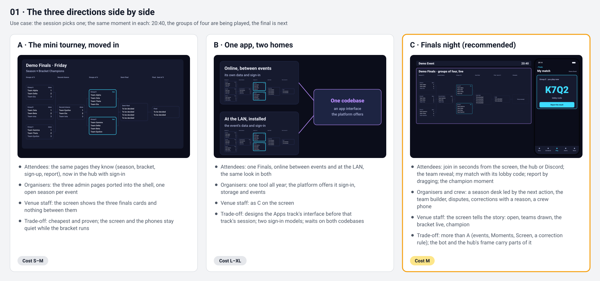
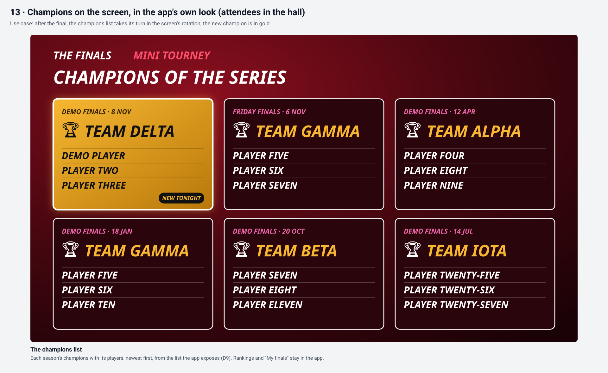
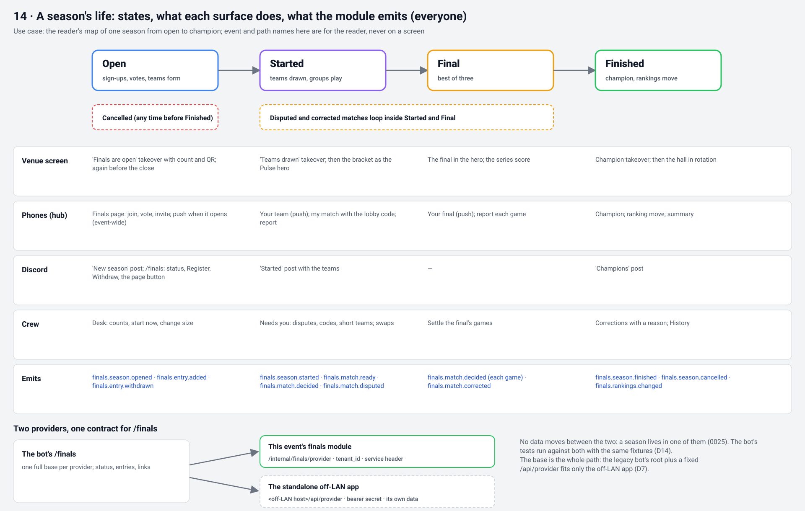
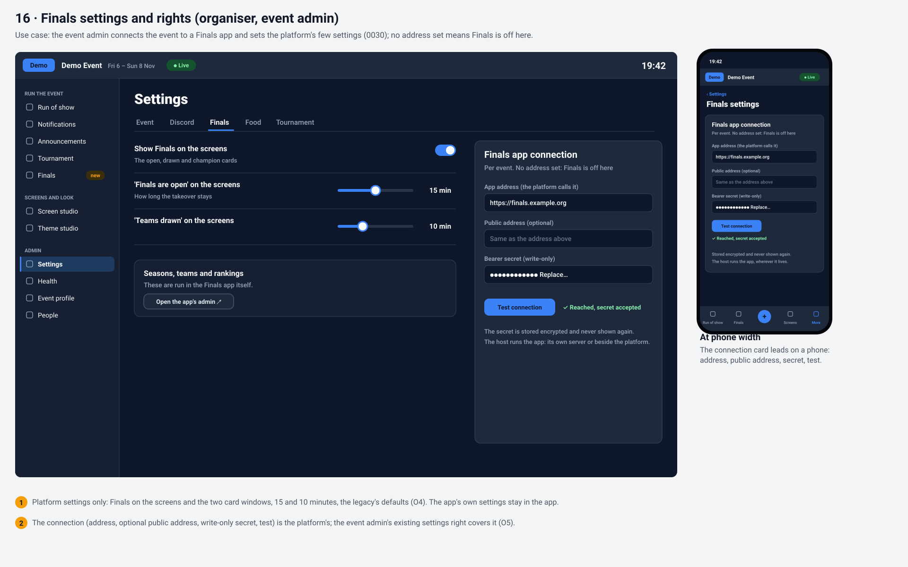

# Finals track brief (research pack)

The research pack for the product owner's brainstorming session on the [Finals track](../roadmap.md#finals) (epic #161), issue #172. It follows the [outline of a research pack](README.md#outline-of-a-research-pack) and its mockup rules, and is built like [step 7's pack](step-7-tournament.md), the nearest relative. After this merges, the lead runs the session over as many rounds as it takes, writes the final plan into this brief (`## Plan`) and writes the track's issues; the product owner accepts the plan before any build starts.

**Revised on 2026-11-20** after the product owner's direction (below): the recommended direction is now **integration**, not the rebuild the first version of this pack proposed. What still holds is kept: the research, the four-way contract table and the facts of the port table. Everything about redesigning the app is marked dropped, with the record of what was weighed left in place.

**In this pack**
- This file: the product owner's direction, goal, what was read, what the platform already has, how others solve it, the legacy in one paragraph, the directions weighed and the recommended one (integration), the platform's flows, what the platform adds around the app, what the stub and the built contracts need, proposed issues and exit criterion, roadmap notes.
- [track-finals/questions.md](track-finals/questions.md): the question bank, 80 questions in six themes, each with options and a recommendation: 47 marked "Dropped (0030)", 31 kept or reworded, 2 new. IDs (U2, D9, …) are used throughout.
- [track-finals/](track-finals/): 17 SVG mockups, drawn with the demo event only. Six show the platform's side and stay; eleven show redesigned app pages and are marked dropped (see [Every mockup](#every-mockup)). Every text that sits in a box carries `data-box` (its box's left and right edge), and a headless Chromium check found no text outside its box.

## Product owner's direction (2026-11-20)
Recorded as decision 0030 in #680, written in parallel. The product owner's words, in short: the mini tourney is made for one game, THE FINALS; the group uses it at our LAN events and between them; its look, its feel and most of its features stay; it becomes an optional add-on.

- **Finals is integrated as it is, not rebuilt.** The pack's first recommendation, direction C (the module rebuilt on the kit as "the night's show", with new pages and a new look), is not what the product owner wants.
- **Where it runs (1A, sharpened in #683):** hosting is the host's choice: on its own server elsewhere (as we do, off-LAN), or on the same host as the platform as a container beside it; we never host it for other events. The platform talks to it as an external app (the Apps track's level 3, the pilot of #193) and connects per event: an event admin sets the app's address and its bearer secret (encrypted, write-only); no app set means Finals is off for that event.
- **The core:** finals-core becomes the general engine for Tournament and Games later, as its own issue. The Finals app stays on its current core until it chooses to move.
- **Finals and Tournament stay apart.** A champion shows on the screen and in Moments; no Tournament points.
- **What this changes here:** no `finals` module on the kit, no storage, no pages of our own.

## Goal
Finals stays what it is, an optional add-on, and the platform grows the doors around it ([roadmap](../roadmap.md#finals)). In it: Discord sign-in through the platform; `/finals` on the new bot through the provider contract; the bracket and the champion as screen cards and Moments rules; a link or tile in the hub; what the app must expose for those (events or reads, through the provider contract or an app interface); the provider contract replacing the provisional stub. Exit: a season runs end to end on the app (the demo event points at a test instance), with a `/finals` sign-up through the new bot, its bracket on a venue screen and the champion in Moments.

The epic's planned items (the module on the kit, the full contract, screen widgets and Moments) are rewritten to the integration; no child issues exist yet, and this pack proposes them ([P2](track-finals/questions.md#p2-the-issue-set)).

## What was read
- **Decisions:** [0025](../decisions/0025-finals-and-games-modules.md) (finals and games apart; the shared core, its licence and how it is pinned; the off-LAN app independent with no sync; the provider contract), [0027](../decisions/0027-product-decisions-2026-11-07-08.md) (joining by venue, link or QR; Discord accounts; 12-month anonymisation; Finals as the Apps track's possible first app), [0022](../decisions/0022-product-vision.md) (the screen is the heart; the phone hub; 1,000–2,000 attendees), [0020](../decisions/0020-best-of-old-freely-new.md), [0004](../decisions/0004-nothing-migrated.md), [0010](../decisions/0010-scope.md) (no tokens in URLs), [0013](../decisions/0013-multi-tenant-core.md), [0015](../decisions/0015-dependency-auditing.md), [0026](../decisions/0026-briefs-are-research-packs.md), [0029](../decisions/0029-additive-contracts-ship-with-consumers.md) and [0024](../decisions/0024-additive-contract-docs-normal-risk.md).
- **The roadmap:** the [Finals track](../roadmap.md#finals), its neighbours (Games, App), step 7 ("the mini tourney is not part of it") and the reuse table's mini-tourney and canccubot rows.
- **Legacy inventories:** [the mini tourney](../legacy-inventory/thefinals_mini_tourney.md) in full (features P1–P13 and A1–A18, the seven formats, the 48 routes, data, tests, the 13 known problems, the port table and the tenancy questions), [canccubot](../legacy-inventory/canccubot.md) (the tourney watcher's posts, the finals cards and their 15 and 10 minute windows), the [summary](../legacy-inventory/README.md).
- **The four Finals repos at their current `main`** (read-only; everything that changed since the inventories was read in full):
  - `finals-core` at `9d65a84` (12 Nov, release v1.0.1): the ladder, rankings and team builder as pure ESM functions with typings and their own tests, ISC with its `LICENSE`, released only by a manual workflow as git tags.
  - The off-LAN app (`thefinals_mini_tourney`) at `1a4fe2a` (16 Nov), 37 commits past the inventory's `87d7c81004`: the provider API and the Discord link session (`src/provider.js`, `test/provider.test.js`), Discord sign-in, admins by Discord role, the read gate (`READ_GATE`), individual-only seasons (`INDIVIDUAL_ONLY`), the nickname prefill, availability voting, cancelling and renaming running seasons, fixing names in finished seasons, the registration status line, the SSE keepalive, write and body limits, finals-core at a pinned tag with a pin check and a daily bump workflow, deploy on every merge to `main`. Also its `src/service.js`, `src/app.js`, `src/db.js`, the README and every new test.
  - The legacy bot (`canccubot`) at `12f2b03` (11 Nov), the seven commits past the inventory's 30 Oct read, all about `/finals`: `bot/cogs/finals.py`, `bot/services/finals_provider.py` and their tests, `bot/utils/link_button.py`, `bot/utils/tourney_guard.py`, the watcher's changes, `docs/ai/areas/finals-commands.md`, and its `finals_cards.py` from the first read.
  - The legacy platform repo (`canccuplatform`) at `0dff5d0` (13 Nov), the 17 commits past the inventory's `d5e3bb4d01`: `docs/contracts/finals-provider-api.md` (the provider API as written) and `tourney-api.md` (the read gate's 401), the plans `issue-157.md` (provider API and link session), `issue-163.md` (extracting finals-core) and the hosting plans (#159, #160, #186, #194), the off-LAN, hosting, deploy and staging runbooks, and `docs/upstream/thefinals_mini_tourney.md` (the upstream CI gate and the core's tag-pin rule). Hosting and deploy files are used as facts only; the pack names no host, domain or id from them.
- **Contracts it builds on:** [finals.md](../../contracts/finals.md) (the provider stub), [tenants.md](../../contracts/tenants.md) (users and identities, joining, series and clone, retention, the info-page mode), [README.md](../../contracts/README.md) (internal paths and the kit's service identity, privacy export and delete), [bot.md](../../contracts/bot.md) (commands per flag), [moments.md](../../contracts/moments.md) (the `finals` class and the `finals_result` rule), [screen.md](../../contracts/screen.md#widgets) (`bracket`), [notify.md](../../contracts/notify.md) (topics), [admin.md](../../contracts/admin.md) (settings, rights, presets) and [games.md](../../contracts/games.md) (the catalogue to come).
- **Briefs and design:** step 7's pack (the tournament kept apart; its #129 "format mix-up" test sent here), step 6's pack (P8: `/finals` under its own flag; D9: the legacy import), step 9's pack (D12 and L11: the finals cards are this track's; L-question: "the tree waits for the Finals track"), the App track pack (P4: modules own their pages in the hub's frame), the [design guideline](../design/README.md) with amendment 3's grids, [widgets.md](../design/widgets.md).
- **The epic and its issues:** #161, #172, the closed #148 (the split and the stub) and #158.
- **The direction:** the product owner's of 2026-11-20 (decision 0030, in #680) and the Apps track's level 3, the pilot of #193 (named in the direction; the pilot's own interface is not yet written).

## What the platform already has
- **Built and waiting:** Moments' `finals` class (rank 55) and its `finals_result` rule (today fed by the tournament's final); Screen's `bracket` template (heats, step 9 proposes); Notify's topic registry; the kit's outbox, settings client and service identity; sign-in and rights (#52).
- **Not built:** the bot module (step 6: the `/finals` command framework), the hub's frame (App track) and the Apps track's level 3 (#193).
- **Live outside the platform:** the shared tourney core is **released** (finals-core v1.0.1, git tags, pinned by the app). The Finals app runs on its own host on the internet, outside any event: every visitor signs in through a 15-minute link from `/finals` that the page swaps for a 7-day session, admins are people holding a listed Discord role, the read gate closes every page and read to anyone without a session, seasons are individual-only there, and it answers the provider API. The legacy bot has a working `/finals` against that API, and its watcher posts the season's news. Under 0030 this is the instance that serves the LAN events too.

So the screen and Moments part can start on what exists (with a demo feed, [O7](track-finals/questions.md#o7-demo-data)); `/finals` lights up when the bot's framework lands, and the hub tile and the sign-in with the pilot ([P5](track-finals/questions.md#p5-order-against-the-bot-the-hub-and-the-apps-track)).

## How comparable products solve it
| Field | What they do | What we take |
|---|---|---|
| **Esports bracket platforms** | Every bracket shape, check-in, team invites, self-reported scores confirmed by the opponent, a dispute queue for admins | Invites by link, QR or code (U4); two matching reports decide, a queue for the rest (U7, E2); not every bracket shape (U1) |
| **Custom lobbies in team games** | A host makes a private lobby and shares a short code with the other teams | The lobby code on the match's phones, never on a public screen (U8) |
| **Team balancer bots in game communities** | Pick tonight's players, balance teams by a rating, re-roll, swap | The team builder, which the core already has (U13) |
| **Club ladders and rating systems** | A rating per player that moves after each event, with the rule shown | Rankings with "why it moved" (L8, [mockup 13](track-finals/13-champions-and-rankings.svg)) |
| **Sports league apps** | A hall of champions across seasons, titles per player | Champions of the series, carried by the clone (D4) |
| **Arena screens and broadcast overlays** | A draw reveal, a live bracket, a champion moment | The reveal, the bracket as the Pulse hero, the champion takeover (L6, L11) |

The lesson across them: the good ones **let players run their own matches** (codes, reports) and keep a referee for the disputes, **show the bracket as the story** (where am I, who is next, who won), and **make the draw feel fair** (balanced teams, rules shown). The legacy got the first and the third right in a small app; the platform adds the stage.
Under integration the app keeps its own pages, so these lessons are not ours to apply there; what the platform takes is the last row's side: the bracket as the story on the screen, and the champion moment.

## The legacy in one paragraph
A small Node app for one team game with teams of three ([inventory](../legacy-inventory/thefinals_mini_tourney.md), read at an older commit; this paragraph is the current head). One season is open at a time; an admin creates it with a format of 3 to 12 teams and a mode: players sign up solo and are drawn into balanced teams, or captains register teams of three nicknames (the off-LAN host allows solo seasons only). Solo players can vote to start early (6 votes) and tick the days they can play over the next three weeks. The app draws the opening groups; teams report the order of each match, two matching reports decide, differing ones wait for the admin; a team sets a 4-character lobby code; later rounds are built automatically and a best-of-three final crowns a champion. A finished season moves each nickname's 0–100 ranking; a team builder forms even teams from that global roster; a champions page counts titles. The bracket engine, the rankings and the builder now come from finals-core at a pinned tag. Since the inventory the app has left the LAN: it runs on the internet, everyone signs in through a link from `/finals` (the shared password is gone; admins by Discord role), writes are rate-limited, a running season can be cancelled and stays in history, a season can be renamed while it runs, and names can be fixed after the finish. Live updates are still a payload-less SSE ping plus polling. It works and is loved; its open problems are rankings and titles keyed by nickname, captains' rights in one browser, no result correction, no audit and an in-process write queue, and the inventory's two real bugs are still open (a full solo `fourqc` season becomes `four`; foreign keys not enforced), with the `eight` round 2 reshuffle still unbounded. The legacy bot's `/finals` signs players up through the app's provider API; its watcher posts new seasons, starts and champions, and it showed two screen cards.

### The inventory's known problems at the current head
Under integration they stay the app's own; the platform neither fixes nor inherits them, except where a fix touches what it reads or sends.

| # | Problem (inventory) | Now | Under integration |
|---|---|---|---|
| 1 | A full solo `fourqc` season becomes `four` | Open: the app still finds the format by team count, and the core's `CAPACITY` lists `four` before `fourqc` | The app's; a `Follow-up:` to its author (E9, dropped) |
| 2 | Foreign keys not enforced | Open (the app's SQLite start-up) | The app's |
| 3 | Results cannot be corrected | Open; a cancelled season is kept, not deleted | The app's; no platform part (E4, dropped) |
| 4 | In-process write queue | Open | The app's |
| 5 | Unbounded `eight` reshuffle | Open, and now in the core (v1.0.1) | The core's and the app's author; a `Follow-up:` |
| 6 | Identity is a nickname | Partly: solo sign-ups carry the Discord id; roster, rankings and titles still go by nickname | The app's; the platform sends the Discord id and display name only (D16) |
| 7 | Weak admin auth | Fixed: admin by Discord role in a signed link; 30 writes a minute per address, 10 kb bodies; still no audit | Stays the app's (O10, dropped) |
| 8 | Player rights in one browser | Partly: a Discord session stands in for a solo player's token | The app's |
| 9 | Public start open and on by default | Open | The app's |
| 10 | Untargeted SSE plus polling | Open, with a keepalive ping added | The platform reads once per change and caches (O1, D17) |
| 11 | Schema upgrades in code | Open | The app's |
| 12 | Small issues | Mixed (the core's unused `TEAMS_PER_SEASON`, a fallback ranking table) | The core's author |
| 13 | Code markers | Unchanged | — |

## Directions weighed
The first version of this pack weighed three directions, drawn side by side below, for the same moment: 20:40, the groups of four are being played, the final is next. The product owner chose none of them as drawn: [integration](#recommended-direction-integration) is the app as it is, plus doors around it. A, B and C stay as the record of what was weighed.

### A · The mini tourney, moved in
The legacy rebuilt one-to-one on the kit: the public page (season picker, bracket, sign-up, reporting) in the hub, the three admin pages in the shell, sign-in instead of tokens and the password, one open season per event, the provider endpoints for `/finals`, the step 9 cards on the screen.
- **Attendees:** the same pages they know, now signed in; the bracket on the phone.
- **Organisers and crew:** the legacy's admin pages, safe (locks, audit) but as dense as before.
- **Venue staff:** the screen shows the open and started cards and nothing while the bracket runs.
- **Trade-offs:** the cheapest; the legacy tests are the spec. But the screen stays quiet for the hour that matters, the seven renderers come along with their fragility, and correction is the minimum the roadmap asks.
- **Cost: S–M.**

### B · One app, two homes
Finals as the first app of the Apps track (0027): one codebase that runs as the off-LAN app and as an installed module, through an app interface the platform offers (sign-in, storage, events, pages); seasons, rankings and champions follow the app wherever it runs.
- **Attendees:** one Finals online between events and at the LAN, the same look in both.
- **Organisers:** one tool all year.
- **Venue staff:** as C on the screen.
- **Trade-offs:** it designs the Apps track's interface before that track has had its session; it has two sign-in models (a bearer secret off-LAN, the platform's sign-in at the event); the off-LAN app's author owns half the code; 0025 says the off-LAN app stays independent with no sync, so B needs a new record first.
- **Cost: L–XL**, and it waits for the Apps track.
- **Why not chosen:** it still rebuilds, and 0030 keeps the app as it is. The part that survives is the app interface, which becomes the Apps track's level 3.

### C · Finals night (not chosen)
The module on the kit with the shared core, made into the night's show. Sign-ups from the screen's QR, the hub, Discord or the crew; a balanced draw revealed on every phone and on the screen; the bracket as the Pulse hero while the season runs; lobby codes and "your match is on" on the phones; teams report by dragging the order, the crew settles disputes and corrects with a reason; rankings that move and say why, carried to the next event; champions on the screen, in Discord and in the series' hall.
- **Attendees:** join in seconds; see their own team the moment it is drawn; one match card with the code; report from their own phone; a champion moment.
- **Organisers and crew:** a season desk led by the next action, the team builder, a queue of what needs them, corrections that show their impact, a crew phone at the stage.
- **Venue staff:** the screen tells the story: open (count and QR), teams drawn, the bracket live, champion.
- **Trade-offs:** more than A: events, three Moments rules, a tree view-model for Screen's `bracket`, a correction rule, invites and guests. Parts wait for the bot (`/finals`) and the hub's frame.
- **Cost: M.**
- **Why not chosen:** the product owner does not want the module rebuilt with new pages and a new look (0030). Of C's parts, what stays is the platform's side: the screen's four moments, the Moments rules and the `/finals` command.

## Recommended direction: integration
**The existing app unchanged, plus what the platform adds around it.** The mini tourney is the best-loved thing in the legacy because it gives a group of friends a real bracket in ten minutes, and the group already knows its look and its feel. What it never had was the room: the screen showed two cards and went dark, and Discord had a bot polling a URL. The platform has spent seven steps building that room (Pulse, Moments, Notify, the hub, the bot), and all of it is waiting for an emitter. Integration plugs the app into the room and touches nothing inside it.

**What the platform adds**
1. **Discord sign-in through the platform.** The platform's sign-in hands the app who the person is, under the Apps track's level 3 interface (pilot #193); the app's own link session stays for people who come from outside ([D18](track-finals/questions.md#d18-sign-in-through-the-platform)).
2. **`/finals` on the new bot, through the provider contract.** The live command keeps its shape; only the provider behind it is configured, by the event's connection ([U17](track-finals/questions.md#u17-the-finals-command), [D7](track-finals/questions.md#d7-how-the-bot-reaches-the-finals-app), [O9](track-finals/questions.md#o9-the-provider-switch)). The checklist for #121 stays (see [Roadmap notes](#roadmap-notes-found)).
3. **The bracket and the champion on the screen and in Moments.** Finals' open and started cards, the bracket as the Pulse hero while a season runs, the champion takeover; each a Moments rule with a preset, the bracket a tree view-model of Screen's `bracket` widget ([L6](track-finals/questions.md#l6-what-the-venue-screen-shows), [L7](track-finals/questions.md#l7-moments-finals-class), [D10](track-finals/questions.md#d10-the-screens-bracket-widget), [mockup 12](track-finals/12-venue-screen.svg)).
4. **A link or tile in the hub** to the app's page, plus the QR on the screen's open card ([U2](track-finals/questions.md#u2-how-people-join-a-season)).
5. **What the app must expose for those.** The events and reads of [D9](track-finals/questions.md#d9-what-the-app-must-expose) (season opened, started, finished with the champion, cancelled, match decided; the bracket and the champions list), carried to the platform by a read now and a push from the pilot ([D17](track-finals/questions.md#d17-how-the-platform-gets-the-apps-news)). They go to the app's author as an agreed request and into the provider contract as additive fields.

**What the platform does not do:** build a `finals` module on the kit, store a season, a team or a ranking, draw any page of the app, or give Tournament points for a champion.

**Design principles**
1. **The app stays itself.** Its look, its feel and most of its features are what the group loves; nothing here redraws it.
2. **The platform is a door and a stage.** It leads people to the app (hub, `/finals`, QR) and shows what happens in it (screen, Moments, Discord posts).
3. **The bot helps, never blocks.** `/finals` is one more door; the hub, the QR and the app's own page work without it ([E7](track-finals/questions.md#e7-the-bot-is-down-or-the-app-cannot-be-reached)).
4. **Public data only on the platform's surfaces.** Names, places and counts; never a lobby code or a Discord id on a screen ([U10](track-finals/questions.md#u10-spectators)).
5. **Lean.** One contract, no app interface of our own beyond the pilot's, no second game, no mirror into the run of show.

The order of the pieces and what waits for the bot, the hub and the pilot is [P5](track-finals/questions.md#p5-order-against-the-bot-the-hub-and-the-apps-track).

## Key flows
Each flow names its users and its mockup. The mockups use the demo event's names only (Demo Event, Demo Finals, Arena North, Arena South, Team Alpha … Team Iota, Demo Player, Player Two …). Only the platform's flows are kept; the app's own pages are listed under [Every mockup](#every-mockup) as dropped.

### Discord (attendee, organiser)
**What the live command does today** (the legacy bot against the app): one `/finals`, no subcommands, every reply visible only to the caller. Each call reads the status and makes a fresh page link (sending the caller's id, server nickname and role ids). The reply is one status line (season, state, signed up of places or the champion, "you're signed up as …", or "team sign-up is on the page") and a link button, "Open The Finals Tourney", that opens the page already signed in; the URL is never in the text. While a solo season is open it adds **Register**, or a red **Withdraw registration** that asks "Withdraw from …?" with Yes / No. Register sends the server nickname cleaned to the app's name rules (letters, digits, spaces, `_ - .`, 18 at most); a taken or unusable name opens a name dialog. "Already signed up", "registration is closed", "no season" and "you can't withdraw now" are plain sentences; anything else, the provider down included, is one "try again later". Buttons expire with the link after 15 minutes. Every reply and post is sent with no mentions and keeps only links to the Finals page. The channel posts (new season, started, champion) carry no link and end with "use `/finals`".

**On the platform** ([U17](track-finals/questions.md#u17-the-finals-command)): **keep** all of it: the one command, the private status line, Register and Withdraw with its Yes / No, the name dialog, the link button, the guard and the posts that point to `/finals`. **Change** only the provider behind it: the app's full base, bearer and public origin, taken from the event's connection ([O9](track-finals/questions.md#o9-the-provider-switch), [D7](track-finals/questions.md#d7-how-the-bot-reaches-the-finals-app)); and, once the pilot lands, the link's sign-in ([D18](track-finals/questions.md#d18-sign-in-through-the-platform)). **Add** the Notify topic beside the posts ([U9](track-finals/questions.md#u9-notifications)).

The sheet was drawn for the rebuild: its provider switch offers "This event's Finals" as the default, which is dropped (the platform has no provider of its own), and its status line adds the person's team and next match, which is optional (U17). The rest holds.

### The venue screen (attendees in the hall)
Finals are open, teams drawn, the bracket as the Pulse hero from the live round on, champion ([L6](track-finals/questions.md#l6-what-the-venue-screen-shows), [L7](track-finals/questions.md#l7-moments-finals-class), [D10](track-finals/questions.md#d10-the-screens-bracket-widget)). Each moment needs what the app exposes ([D9](track-finals/questions.md#d9-what-the-app-must-expose)); without it the screen shows the open and champion cards only. The sheet's "in the hub" mentions of the champion are the tile (U2).

### Champions (attendees in the hall)
The champion takeover and the champions list in rotation ([L9](track-finals/questions.md#l9-the-champion-moment)). Only the champions half of the sheet applies; its rankings and "My finals" half is the app's own and dropped.

### A season's life (everyone, implicitly)
The states, what each platform surface does in each, the events, and the provider behind `/finals` ([D9](track-finals/questions.md#d9-what-the-app-must-expose), [D14](track-finals/questions.md#d14-the-provider-contract-and-its-tests)). Read it for the platform's side: the sheet's second provider (the module) is dropped.

### Settings (organiser, event admin)
Only the platform's few settings apply: the connection (the app's address, its bearer secret write-only, a "test connection" check; no address means Finals is off for the event), the card windows, the hub tile ([O4](track-finals/questions.md#o4-settings-and-their-defaults), [O9](track-finals/questions.md#o9-the-provider-switch)). The sheet shows the connection card on the right; its rights, the "Finals crew" role and the season rules are dropped.

### Every mockup
| File | What it shows | Status |
|---|---|---|
| [01-directions.svg](track-finals/01-directions.svg) | The three directions side by side | the record of what was weighed; C not chosen |
| [02-flow-join.svg](track-finals/02-flow-join.svg) | Screen card → Finals page → joined → the reveal | dropped: the app keeps its own pages (the screen card is in 12) |
| [03-discord.svg](track-finals/03-discord.svg) | `/finals` with its status line and buttons, the name dialog, withdraw, the channel posts, the provider switch | kept, with the two changes above |
| [04-teams.svg](track-finals/04-teams.svg) | Name a team, invite, join | dropped: the app keeps its own pages |
| [05-my-match.svg](track-finals/05-my-match.svg) | Match card, lobby code, reporting | dropped: the app keeps its own pages |
| [06-bracket.svg](track-finals/06-bracket.svg) | The public bracket and my path | dropped: the app keeps its own pages (the screen's bracket is in 12) |
| [07-season-desk.svg](track-finals/07-season-desk.svg) | The season desk | dropped: the app keeps its own pages |
| [08-new-season.svg](track-finals/08-new-season.svg) | The new-season form | dropped: the app keeps its own pages |
| [09-team-builder.svg](track-finals/09-team-builder.svg) | Players, balanced teams, swap | dropped: the app keeps its own pages |
| [10-results-and-corrections.svg](track-finals/10-results-and-corrections.svg) | A dispute, a correction, History | dropped: the app keeps its own pages |
| [11-crew-phone.svg](track-finals/11-crew-phone.svg) | The crew phone | dropped: the app keeps its own pages |
| [12-venue-screen.svg](track-finals/12-venue-screen.svg) | Open, teams drawn, the bracket on the Pulse, champion | kept |
| [13-champions-and-rankings.svg](track-finals/13-champions-and-rankings.svg) | Champions, most titles, My finals | kept for the champion moment; rankings and My finals dropped |
| [14-lifecycle.svg](track-finals/14-lifecycle.svg) | States, surfaces, events, the two providers | kept for the platform's side |
| [15-edge-states.svg](track-finals/15-edge-states.svg) | Six edge states | dropped: the app keeps its own pages |
| [16-settings-and-rights.svg](track-finals/16-settings-and-rights.svg) | Finals settings and the crew role | kept for the card windows, tile and provider; the rest dropped |
| [17-grids.svg](track-finals/17-grids.svg) | The seasons grid at three widths | dropped: no organiser pages on the platform |

The sheets were drawn by a throwaway script kept out of the repo, as in earlier packs, and are not redrawn: the app is not drawn again. Rendered in headless Chromium (the Playwright image's fonts), no text with `data-box` runs outside its box on any sheet. Screens carry no question numbers, event or path names, ids or typed numbers; notes for the reader sit in captions and note boxes outside the screens (the [mockup rules](README.md#outline-of-a-research-pack)). The lifecycle sheet is a diagram for the reader, so it names events and paths.

## Port, drop or invent
Each with its reason ([0020](../decisions/0020-best-of-old-freely-new.md)). Under 0030 most of the old code is not ported at all: it keeps running where it is.

### Reuse as is
| Legacy | Where it goes | Why |
|---|---|---|
| The whole Finals app: pages, bracket engine, rankings, team builder, reporting, admin pages, season rules | It stays the app, unchanged, where its host runs it; the platform adds doors around it | The product owner's direction: its look, feel and most of its features stay (0030) |
| finals-core at the app's pinned tag | The app's own dependency; it stays on its current core until it chooses to move | The general core for Tournament and Games is its own later issue (0030) |
| The bot's link button (a button that opens the page instead of a long URL in the text) | The bot module's `/finals` reply | Short replies; the URL is never copied around (U17) |
| The bot's guard: no mentions in any message built from Finals data, and only links to the Finals page | A rule of the bot module for every message it builds from the app's data | Season, team and player names are typed by players; a name must never ping a room or carry a link (U17) |
| The bot's name cleaning (letters, digits, spaces, `_ - .`, 18 at most) | The bot cleans and sends; the app judges and gives the reason | One rule, owned by the app (E8) |

### Reuse with changes
| Legacy | Becomes | Why |
|---|---|---|
| The live `/finals`: one command, a private status line, Register or Withdraw with Yes / No, the name dialog | The same on step 6's framework; only the provider is configured (base, bearer, public origin), from the event's connection | It is what players know (U17, O9) |
| The bot's tourney watcher posts (new season, started, champion), which carry no link and point to `/finals` | The bot posts on the app's news under the Finals flag, with no link, ending with "use `/finals`" | Nothing polls from the bot; one door for sign-up and the page (U9, D17) |
| The bot's two finals cards (polled every 30 s, 15 and 10 minute windows) | Moments rules and presets: open, started (teams drawn), champion; the windows as durations | One happening, one owner (L6, L7) |
| The app's Discord link session (a 15-minute link swapped for a 7-day cookie) | Stays for people from outside; the platform's sign-in hands the app who the person is, from the pilot | "Discord sign-in through the platform" (D18) |
| `READ_GATE` on the app's reads | Stays; the platform reads what it shows through the bot's bearer or the pilot's connection, and shows only public data | The screen has no viewer to sign in (U10, D9) |

### Drop
| Legacy | Why |
|---|---|
| Everything the first version of this pack rebuilt: a `finals` module on the kit, its storage under RLS, its API, per-event rankings and rosters by person, the clone, the crew role and rights, settings, audit, corrections, teams with invites and guests, the reveal, the season desk, the crew phone, one bracket renderer, "My finals", the games catalogue's arenas | Dropped (0030): the app keeps its own pages and features; the 47 questions about them are marked dropped |
| The bot's link note (`TOURNEY_URL_NOTE`, "LAN only" after a link) | It went with the links in the posts; the hub's link needs no note |
| The health endpoint, the systemd example, the coding-agent config, `TEAMS_PER_SEASON` | The app's own; not product |
| Deploy on merge and the host runbooks | The app's own |

### Invent
| New | Why |
|---|---|
| The provider contract as the external app's contract, with fixtures from the app's tests | The stub described a platform provider that will not exist; the live one is the real one (D8, D14) |
| What the app exposes: events and reads for the open season, the bracket and the champion | The screen and Moments need them; today the app gives the bot only a status (D9) |
| A way for the platform to get that news: a read now, a push from the pilot | The screen must not poll through viewers (D17, O1) |
| Moments rules `finals_open`, `finals_drawn` and `finals_champion` with presets, beside the tournament's `finals_result` | The screen is the heart; one class, nothing renamed (L7) |
| A tree view-model for Screen's `bracket` | The bracket as the Pulse hero (D10) |
| The `finals` Notify topic | Pushes people choose (U9) |
| A tile or link in the hub and a QR on the open card | The doors to the app (U2) |
| The sign-in handoff | Discord sign-in through the platform (D18) |
| A demo feed of the app's events and reads in `events/demo/` | Screens and screenshots without the live app (O7) |

## What the stub and the built contracts need
Found while reading the consumers against the stub; each is a proposal for the session, not a change made here.

### The provider contract, four sides
The written contract in the legacy platform repo (`finals-provider-api.md`), the off-LAN app's `src/provider.js` with `test/provider.test.js`, the legacy bot's client (`finals_provider.py`) with its `/finals` cog, and our [finals.md](../../contracts/finals.md), row by row. Our stub copies the written contract word for word except the platform's auth, so the two share a column.

| Part | Written contract · our stub | Off-LAN app (live) | Legacy bot (live) | For the platform |
|---|---|---|---|---|
| Base | Off-LAN `…/api/provider`; platform `<event host>/api/finals` | Mounted at `/api/provider` | One root setting, and the client always adds `/api/provider` | One full base per provider in the bot module: the app's only; the stub's platform base is removed ([D7](track-finals/questions.md#d7-how-the-bot-reaches-the-finals-app)) |
| Auth | Bearer off-LAN; platform: "none, the bot calls it internally" · stub: "the bot module's service auth" | Bearer, compared in constant time; no token set → every route `401` (fails closed); the bot is exempt from the write limit | Sends the bearer when one is set, none otherwise | The app's bearer, held by the superadmin; no platform provider (D7) |
| Commands named | `/finals`, `/finals register`, `/finals cancel` · stub: status, register, cancel, link; `name_taken` "asks for `/finals register name:`" | — | One `/finals`, no subcommands; buttons and a name dialog | Name the one command; `name_taken` opens the name dialog (U17) |
| `GET /status`: which season | Newest not finished, else newest finished | Newest `register` or `active`, else newest `finished`; a cancelled season is never current | Shows what it gets | The app's rule, written into the contract |
| `state` | `register`, `active`, `finished` | The same three on the wire (the app's `cancelled` never reaches it) | Unknown states printed as they come | The same three |
| `registered`, `capacity` | Players or teams; places | After the start, still every solo sign-up, left-out players included | Prints `registered/capacity` unless finished | Say it in the contract: sign-ups, left-out players included |
| `POST …/entries` body | `discord_user_id` a string; `name` the cleaned nickname | `discord_user_id` must be 17–20 digits; `name` 1–18 characters, else `invalid_request`; a teams season → `registration_closed` | Sends the nickname cleaned to letters, digits, spaces, `_ - .`, 18 at most | The 17–20 digit rule and the name rule in the contract and its fixtures; the app judges (E8) |
| Repeat sign-up | `200`, `created: false`, the name ignored | The same; the page's own repeat gets a `409` | "You're already signed up" | The same |
| `GET` and `DELETE …/by-discord/{id}` | `no_season`, `not_registered`; delete only while in `register` | A season id that is not a number → `no_season`; delete also `registration_closed` once the player is in a team | Reads the entry only while a solo season is open; asks Yes / No before the delete | The same |
| `POST /links` body | `discord_username` "the Discord username"; `role_ids` optional | `discord_username` required, not empty; `role_ids` an array of strings; admin decided when the link is made | Sends the **server nickname** as `discord_username`, and every role id, on every `/finals` | Rename the field's meaning to "the name to show" (wording only); `role_ids` ignored (stub) |
| Link URL | `#d=<token>` off-LAN, ~15 min · stub: a plain hub URL on the platform | HMAC-signed token in the fragment; `POST /api/session` swaps it for a 7-day `HttpOnly` cookie; a missing link secret → `500` | A link button, dropped when the URL is not on its public origin | The app's link as live; from the pilot, the platform's sign-in hands the app who the person is (D18); the bot module needs the app's public origin for its guard (O9) |
| Error codes | Seven, `rate_limited` among them | Adds `internal` (`500`) and `invalid_request` with `413` for a body over 10 kb; never `rate_limited` to the bot | Branches on five codes; everything else, a body without a code and a transport failure → "try again later" | Add `internal`; the rest as the app answers |
| Reads outside the provider | `tourney-api.md`: the read gate's `401` is a plain string `error` | The gate on the reads and the live stream; the bot passes with its bearer | The watcher polls and listens with the bearer | Needed for the screen: the app exposes what D9 lists, through the bearer (D9, D17) |
| "Verified against" | "Not yet implemented" · stub: "copies the shapes exactly" | — | — | The contract records the app commit its fixtures pass against (D14) |

None of these is two providers disagreeing on a shape: the code moved on and the written documents stayed behind. Under integration the stub's platform base and auth are never built, so removing them is the one change to a published row; the stub marks them provisional.

1. **The stub's platform provider goes.** The stub has the bot call `https://<event host>/api/finals` and a module answer the entries and links paths; there will be no module, and the live bot could not call that path anyway (its client always adds `/api/provider` to one root). Proposed: the bot module holds one full base per provider, the app's, with its bearer and public origin taken from the event's connection ([D7](track-finals/questions.md#d7-how-the-bot-reaches-the-finals-app), [O9](track-finals/questions.md#o9-the-provider-switch)). The stub is provisional, so this is not a breaking change to a released contract, but it is a change to a published row and the review should look at it.
2. **A Discord user who never signed in** no longer arises: the app holds the Discord id itself, as today ([D6](track-finals/questions.md#d6-a-discord-sign-up-by-someone-who-never-signed-in) is dropped), so tenants needs no lookup for it.
3. **Moments' `finals` class** is already used by the tournament's final. Proposed: one class for both, new rules beside `finals_result`, nothing renamed ([L7](track-finals/questions.md#l7-moments-finals-class)).
4. **Screen's `bracket`** draws heats only. Proposed: an additive tree view-model fed by the app's bracket read ([D10](track-finals/questions.md#d10-the-screens-bracket-widget)).
5. **The app's reads and events** for the screen, and how they reach the platform ([D9](track-finals/questions.md#d9-what-the-app-must-expose), [D17](track-finals/questions.md#d17-how-the-platform-gets-the-apps-news)); and **the sign-in handoff** under the Apps track's level 3 ([D18](track-finals/questions.md#d18-sign-in-through-the-platform)).
6. **The bot's provider setting** (off, or the app) follows the event's connection: the address and a write-only secret the event admin sets, none meaning off ([O9](track-finals/questions.md#o9-the-provider-switch)).

All other parts of the contract (the reads and events, the platform's republished events, the settings) are new, so additive; each part ships with the package whose code first uses it ([0029](../decisions/0029-additive-contracts-ship-with-consumers.md)).

## Proposed issue changes
The epic's planned items are input ([P2](track-finals/questions.md#p2-the-issue-set)). The integration only: no `finals` module on the kit, no storage, no pages of our own. Proposed, not applied: the lead writes the issues after the session.
- **Epic #161 · keep**, its Planned list rewritten to the issues below. "The module on the kit" and "the full `contracts/finals.md`" are replaced by issue 1 (the contract is the provider contract plus what the app exposes); "screen widgets and Moments" becomes issue 2.
- **New 1 · `feat(finals)`: the external app's contract.** `contracts/finals.md` as the contract of an external Finals app: the provider part as the app answers it today with fixtures from its tests (D14), the reads and events the app exposes (D9), the events the platform republishes, the settings (O4); the stub's platform base removed (D7). The app's own additions are an agreed request to its author in its repo (P4), not part of this PR. Risk: normal (additive; it removes only provisional rows, which the review looks at).
- **New 2 · `feat(screen,moments,notify)`: Finals on the screens and in Notify.** The way the platform gets the app's news (a read, D17), the tree view-model for `bracket` (D10), the `finals_open`, `finals_drawn` and `finals_champion` rules and presets (L6, L7, L9), the `finals` topic (U9), the demo feed in `events/demo/` (O7), screenshots. Risk: normal.
- **New 3 · `feat(bot)`: `/finals` and the finals posts.** The live command's shape under the Finals flag on step 6's framework (U17): the status line, Register and Withdraw, the name dialog, the link button and the guard; the provider setting with the app's base, public origin and secret (O9); the channel posts on the app's news (U9); the provider tests run against the app at a pinned commit (D14). The #121 checklist (see Roadmap notes) is its acceptance list. Waits for the bot module. Risk: **high** (a secret; acting for a Discord user).
- **New 4 · `feat(finals,hub)`: the hub tile and Discord sign-in through the platform.** The tile or link and the QR (U2), the sign-in handoff under the Apps track's level 3 (D18), the privacy page's line (D16). Waits for the hub's frame and the pilot (#193). Risk: **high** (sign-in, personal data).

**Order sketch:** 1 → 2 → 3 when the bot's command framework exists → 4 when the hub's frame and the pilot exist. In parallel with 2: the lead agrees D9's reads and events with the app's author ([P4](track-finals/questions.md#p4-aligning-with-the-apps-author), a `Follow-up:`); 2 can start on the demo feed. The exit waits for 3 and the app's additions.

## Proposed exit criteria
A season runs end to end on the app (the demo event points at a test instance of it), with a `/finals` sign-up through the new bot (its Register button, against the app as the provider), its bracket on a venue screen and the champion in Moments ([P3](track-finals/questions.md#p3-the-exit-criterion)). The CI demo runs the same screen and Moments path on the demo feed.

## Roadmap notes found
- **A general core for Tournament and Games** (0030): finals-core becomes the general engine for both later, as its own issue; the Finals app stays on its current core until it chooses to move.
- **Mini tournaments for any game in Tournament** (0030): a roadmap note for the Tournament module, apart from this track; Finals and Tournament stay apart, with no Tournament points for a champion.
- The Finals track's plan issue ("docs(briefs): Finals track: plan") does not exist yet, so nothing waits for it ([P6](track-finals/questions.md#p6-the-plan-issue)).
- **For #121 (the bot module) and the switch to the new bot** (the checklist stays): step 6 puts `/finals` under its own flag (P8), and the switch happens once Finals' `/finals` runs on the new bot. So that the switch loses nothing players use today, the new bot module carries from the live command: one `/finals` with no subcommands and private replies; the status line; Register and a red Withdraw with a Yes / No check; the name dialog on a taken or unusable name; a link button, never a URL in the text; no mentions and only the provider's own links in any message built from Finals data; channel posts with no link that point to `/finals`; one provider client that alone knows the paths and auth, with a full base per provider, and turns transport failures and unknown errors into one "try again later"; the app as the provider (its base, bearer and public origin). The live cog's tests (the cases in `tests/bot/test_finals_cog.py`) are its checklist ([U17](track-finals/questions.md#u17-the-finals-command), [O9](track-finals/questions.md#o9-the-provider-switch)).
- The app and the core still hold three open bugs the inventory named: a full solo `fourqc` season becomes `four` (a lookup by team count), the `eight` round 2 reshuffle is unbounded, and `TEAMS_PER_SEASON` is unused. They go to the app's author as a `Follow-up:`; a new finals-core release would carry the reshuffle's bound. Step 7's #129 lists the "format mix-up" regression test; it belongs to the app, not to Tournament or to this track.
- The legacy platform repo's written provider contract still says "not yet implemented" and names `/finals register` and `/finals cancel`; its off-LAN runbook still says a cancelled season is deleted. They belong to that repo (a `Follow-up:` for the lead), not to this pack.
- Superseded by 0030: 0027 leaves Finals as the Apps track's possible first app, and the first version of this pack kept that door open without an interface; 0030 makes Finals the level-3 pilot (#193), so the interface is the Apps track's, not this track's.

## The question bank
All of them are in the [question bank](track-finals/questions.md): 80 in six themes, each with options and a recommendation; 47 are marked "Dropped (0030)". **Decide first:** D18 (sign-in through the platform), D17 (how the platform gets the app's news), D9 (what the app must expose), D7 (how the bot reaches the app), U17 (the `/finals` command), P2 (the issue set), P5 (the order).
