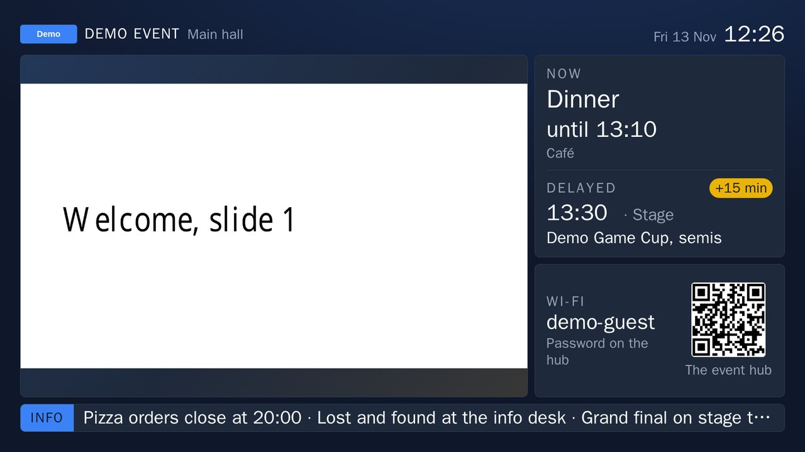
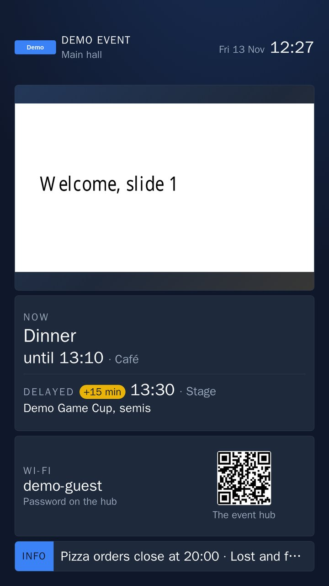
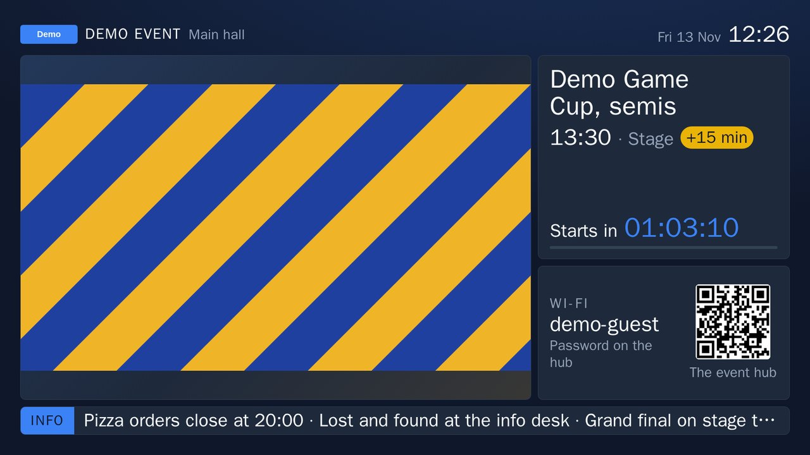
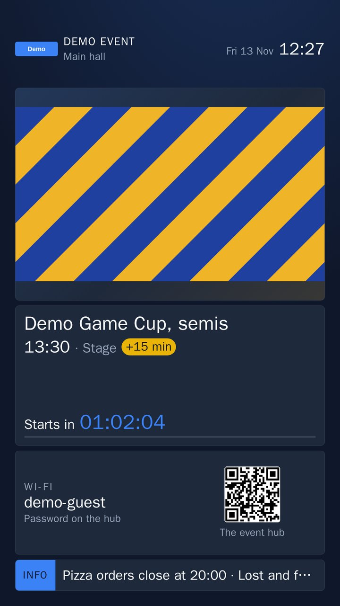
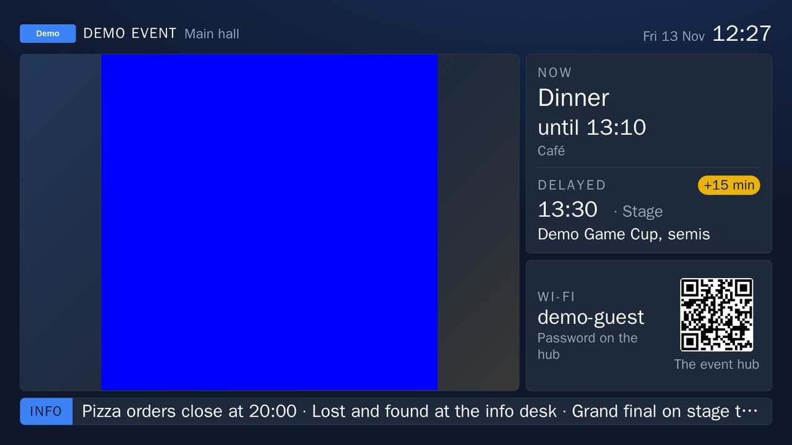
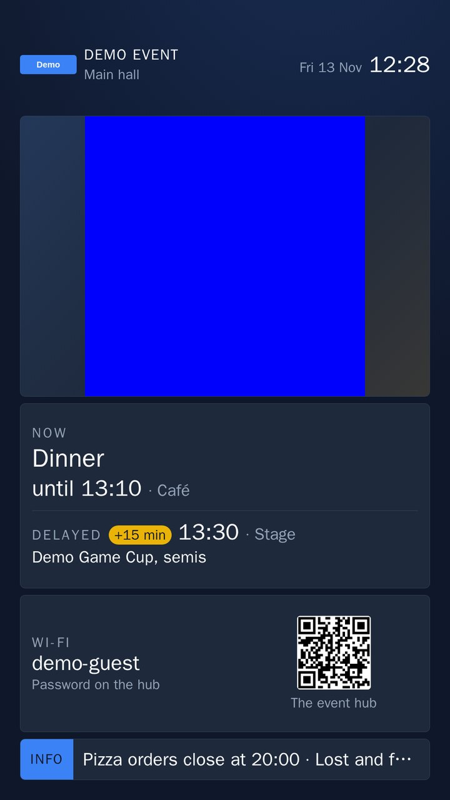
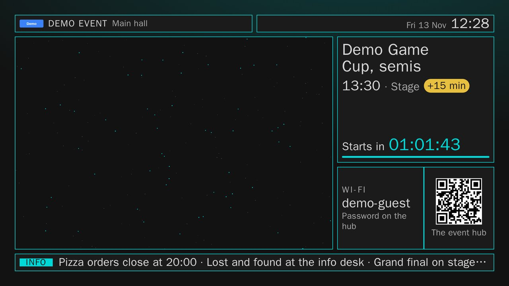

# Step 3 screenshot book: every surface with its use case

Issue #386. Every page, state and screen a person meets on the demo stack at main `07ea9ac` (2026-11-13), after #383, #384, #385, #375 and, since the first version of this book, #411, #413, #424, #426 and #427 merged. Each image has one short paragraph: who uses it, when, what they do there, and the mockup it follows. The book is grouped by person: [the organiser](#the-organiser), [the crew](#the-crew), [the attendee](#the-attendee) and [the room](#the-room). The product owner reads it before the step 3 checkpoint. The lead adds [an evaluation and a plan](#leads-evaluation) at the end.

## How it was made

- **Source:** the artifact `demo-screenshots` of the demo-stack run for main `07ea9ac`, the push run after #427 merged ([43414841370](https://github.com/Tammilanit/canccuplatform-next/actions/runs/43414841370), green). The content widgets (R14–R20) are not in that artifact: they exist only locally, taken the same way on a local demo stack of the same commit (`deploy/compose.ci.yml`), with the CI fixture's library and its "Welcome loop" pushed to every zone, as for O34; each of their paragraphs says so. `scripts/demo-screenshots` took the rest: Chromium with the demo event and its fixture, signed in with the CI session stub, which holds every right the pages check ([docs/ci.md](../ci.md#demo-stack)). The run fails if a page does not answer, if a screen does not draw the event or if a screen's text does not pass the readability check, so each image shows a working page, not an error caught by accident.
- **Data:** the demo profile; a run of show around the time of the run, over two days, with Dinner on now and the semi-final 15 min late; a ticker line; two zones, Main hall (landscape) and Entrance (portrait), each with a screen paired; five assets in the Screen studio and, for its playlist and schedule shots, four playlists with schedule windows and a break. For the Pins shots the stack freezes its screens for an hour. A screen state the stack cannot reach on its own (refused, moved, archived, a claim, a photo) is the player's own answer to that state, handed to the page.
- **Sizes:** desktop pages at 1280 px wide (Settings, Devices and Schedule also at 1440 px, and the schedule's window editor and What plays at… only at 1440 px; the playlist editor at 1920 px), phone pages at 390 px; all shown 1:1, as full pages. Screens at 1920×1080, 3840×2160, 1080×1920 and 2160×3840, scaled down here to 720 px on the short side (JPEG), with one 1:1 crop of a 4K screen. The full set (167 PNGs, every theme at every size) is in the artifact.
- **Time:** the run ran at about 11:20 UTC, so the clocks show 11:2x and the countdowns about an hour; R14–R20 were taken at about 12:27 UTC on 13 November, so their clocks and run of show sit an hour later.
- **Mockups:** "sheet N" is sheet N of the accepted design guideline [docs/design/mockups.html](../design/mockups.html) (PO, 2026-11-12); "mockup NN" is the step 3 brief's mockup in [docs/briefs/step-3-screen/](../briefs/step-3-screen/).

## Contents

| Person | Surfaces | Images |
|---|---|---|
| Organiser, desktop | Sign-in, Settings, Health, Event profile, People, errors, Run of show, Notifications, Theme studio, Screen studio | [O1–O37, O53–O59](#organiser-at-the-desk) |
| Organiser, phone | The same pages in one column with the bottom bar | [O38–O52, O60–O64](#organiser-on-a-phone) |
| Crew | Sign-in, run of show and Screen studio on a phone; the kiosk frames | [C1–C18](#the-crew) |
| Attendee | Check-in, the phone hub's preview | [A1–A2](#the-attendee) |
| The room | The Pulse at 1080p, 4K and portrait; the other layouts, widgets, claims, offline, the end, the other themes, the Dashboard waiting for statistics | [R1–R43](#the-room) |

The IDs of the first version stay with their screens, so comments on them still hold; the pages added in the refresh for main `07ea9ac` take the next free number of their group (O53–O64, R43) and stand where they belong.

## The organiser

The organiser runs the event from a laptop before and during it, and from a phone on the floor. Every organiser page sits in one shell (sheet 2): the event's name, dates and Live badge on top, the clock on the right, the Event menu on the left (Run the event · Screens and look · Admin) and the person at its foot. On a phone the menu becomes the bottom bar with Quick add in the middle.

### Organiser at the desk

#### O1 · Sign-in

The organisers and crew open the event's address on the day they start working on it. Here they sign in with Discord; before the installer has switched Discord on, the card says so and offers the first-run code instead. The event's name, dates and venue greet them on the left. Mockup: sheet 3.

#### O2 · Settings

An event admin sets the event up and comes back when something should behave differently: one row per part (General, Run of show, Games, Notifications, Screens), each with its current values and when it last changed. A row opens that part's settings. Mockup: sheets 2 and 4.

#### O3 · Settings at 1440 px

The same page on a wide screen: Last changes stands beside the list, so an admin sees who changed what, newest first, across every part, for example when a screen setting changed during the event. Mockup: sheets 2 and 4.

#### O4 · Settings of one part (General)

The admin changes the event's time zone or language before the event and saves; every page and screen follows. Mockup: sheet 4.

#### O5 · Health

An admin or the installer checks that every part of the platform runs, its version and its log name, when something looks wrong or after an update; Check now asks again. Mockup: sheet 4.

#### O6 · Event profile

An admin saves the whole event (name, modules, settings and look) to the event folder as one profile, or replaces the event's setup from it, for example to start next year's event from this one's. The replace action is red and asks first. Mockup: sheet 4.

#### O7 · People

The owner hands out roles to the people who have signed in. Before anyone else has signed in, the page says so and why. Mockup: sheet 4.

#### O8 · Not found

Anyone who follows an old or cut-short link lands here, inside the shell, with one way on: Open Run of show. Mockup: sheet 8.

#### O9 · Run of show, empty

An organiser opens the run of show for the first time when planning the event: nothing on the day yet, with Add the first item, Full form and Quick add. Mockup: sheet 5.

#### O10 · Run of show, the day

During the event the organiser keeps this open: on top what is on now (Dinner, 10 min late, with Delay by +5/+10/+15/Other and Show on screens now), below it the day with the now line, each item's time, its old time when it moved, where and for whom. Day chips switch days; Jump to now scrolls back. Mockup: sheet 5, mockup 11.

#### O11 · Run of show at 1440 px

On a wide screen the now card also shows what people see: a live miniature of the main zone. Picking an item opens it beside the day, so the organiser can delay, push it to screens, edit or cancel it without leaving the day. Mockup: sheet 5, mockup 11.

#### O12 · An item beside the day

At 1280 px the item opens as a panel over the day: when, where, who is told and on which channels, quick delays, On screens now, Edit or move, its change history and Cancel this item. The organiser uses it to answer "what happened to the semi-final?" and act on it. Mockup: sheet 5.

#### O13 · Delay confirm over the day

After the organiser taps a delay chip, this asks before anything changes: whether to move the items after it too, whether to tell people, and what each choice will do on screens, Discord and phones. Mockup: sheet 5, mockup 11.

#### O14 · Delay page, moving the items after it

The full Delay page, opened from Other… or a link: any number of minutes (negative brings it forward), with the following items moved and people told. The summary lists each item's new time and who gets which message. Mockup: sheet 5, mockup 11.

#### O15 · Delay page, quietly

The same delay for a typo-sized fix: nothing else moves and nobody is told; the screens and the hub still show the new time. Mockup: sheet 5.

#### O16 · New item

An organiser plans the programme before the event, one item at a time: title, kind, start and end, who sees it, where, which screen zone shows it first, reminders and channels; or starts from a template (Food, Ceremony, Game session). Mockup: sheet 5.

#### O17 · Edit an item

The organiser corrects or moves an item. At the foot, Tell people decides whether the change is announced or a quiet fix. Mockup: sheet 5.

#### O18 · Notifications, no topics

An organiser sets up the topics attendees can follow. In the demo event no module that sends notifications is on, so the page says topics appear when one is. Mockup: sheet 2 (shell); no sheet of its own.

#### O19 · New topic, nothing to base it on

The organiser tries to add a topic; with no module offering one, the page explains why and offers Back. Mockup: sheet 2 (shell), sheet 8's empty-state pattern.

#### O20 · Theme studio, no draft

An event admin gives the event its look, usually weeks before. With no draft, the screens show the published theme; the admin starts a draft from the current theme or from a platform theme. Previews show the real venue screen, the phone hub, the organiser pages and Discord. Mockup: sheet 6, mockup 12.

#### O21 · Theme studio, a draft

The admin uploads a logo, picks a primary and an accent colour, a scheme and a font, and sees every preview change at once. "Ready to publish: all text reads clearly on every surface" checks contrast before anything goes live. Publish makes it live on every screen without a reload; Discard draft asks first. Mockup: sheet 6, mockup 12.

#### O22 · Theme studio, preview at full size

The admin judges the draft on the real player at full size, zone by zone, before publishing. Mockup: sheet 6, mockup 12.

#### O23 · Theme studio, Advanced with a draft

A designer or a technical admin goes past the brand kit: the publish check, a theme package upload, the draft's files and every token (colours, fonts, sizes, motion). Mockup: sheet 6.

#### O24 · Theme studio, Advanced with no draft

The same page before a draft exists: only the package upload, which starts a draft from a whole theme. Mockup: sheet 6.

#### O25 · Theme studio, History

The admin looks back at what was published and when. Here nothing is published yet, so the screens show the platform's default look. Mockup: sheet 6.

#### O26 · Screen studio, Live

During the event the organiser sees what every zone shows right now, as live miniatures, with how many of its screens are online; a tap opens the zone. Set the ticker and Pair a screen are one tap away. Here Main hall's hero plays the pushed playlist's test video, a plain blue frame (see R18). Mockup: mockups 07 and 13.

#### O27 · Screen studio, Devices

The organiser or crew lead checks the fleet: a summary line on top (how many screens, online, offline, and the player bundle they run), then each screen's live miniature, online dot, zone, sound, orientation and size, what it shows now, when it was last seen and whether it is up to date, with Identify, Reload and Assign. Clear open codes drops pairing codes nobody used. Mockup: mockup 07.

#### O28 · Devices at 1440 px

On a wide screen, Recent stands beside the screens: pairings and screens going offline, newest first, so the crew lead sees which screen dropped and when without opening each one. Mockup: mockup 07.

#### O29 · Zones and layouts

Before the event the organiser groups screens into zones (a zone shows one thing on all its screens) and adds a zone with a name and a key the run of show uses. Mockup: mockup 08, sheet 10.

#### O30 · Zone editor, the Pulse

The organiser composes what Main hall shows: picks a built-in layout from the gallery (Dashboard says its statistics come with the bot's data), clicks a box to choose its widgets, their order, rotation and what shows when all are empty, sets the header, hub QR and sound, and previews the real player before going live. Changes list what will change; undo stays for 10 minutes after going live. Mockup: mockup 08, sheet 10.

#### O31 · Zone editor, boxes resized and one hidden

The organiser drags a box's handles or uses Narrower/Wider/Shorter/Taller to give the side rail more room and hides the Venue card: its space goes to the boxes beside it, and it waits under Hidden boxes with Show Venue card to bring it back. The change list names each change before Go live; Reset to the built-in layout… undoes them all. Mockup: mockup 08, sheet 10.

#### O32 · Zone editor, the Dashboard

The organiser switches Main hall to the six-box Dashboard: the hero, Online, In voice, Top games, Right now and the side rail. A note says the statistics come with the bot's data, and until it arrives those boxes give their space to the boxes beside them on the screens (R43). Below the boxes, Which box is the hero? moves the hero role with a click, and Grow for a showcase decides whether the hero grows to four cells when something is showcased (R9). Mockup: sheet 10 (README change 1).

#### O33 · Content

Before and during the event the organiser drops in images, videos, slide decks and sounds, or links a web page or video, within the event's storage quota. Each asset shows its kind, size and use, with Replace and Delete; a deck shows its rendered slides and warns of a stand-in font. Push now plays something on chosen zones until a set time. Mockup: mockup 10.

#### O34 · Content with a playlist, at 1920 px

The organiser builds a playlist from the assets (slides per deck, seconds per image, a video at its own length), sees its run order and pushes it to every zone now; Playing now shows what is pushed and until when. Mockup: mockup 10.

#### O35 · Schedule, one zone

The organiser plans what each zone's playlist widget plays on the event's days: windows per day with the now line, breaks that interrupt them, and a list of conflicts and gaps, such as hours with no window. Beside the calendar, Now says what plays and what comes next, and What plays at… answers for any time (O59). Add window, or a drag on a day, adds a window (O58); a drag moves one or changes its end. A tap on a window shows its details. Mockup: mockup 09.

#### O36 · Schedule, all zones

The same plan for every zone side by side, where a window that loses to a higher priority is greyed. Mockup: mockup 09.

#### O37 · Ticker

An organiser or crew member sets the one calm line across the bottom of every screen, for 15 min, 1 h, 4 h, until a time or with no end, and clears it. Mockup: mockup 13.

#### O53 · Pins

An event admin checks which player bundle and theme revision every screen draws (In effect) and whether they follow the platform version and the published theme or are held (Pinned). Shortly before the doors open, Freeze for the event holds both until the event ends, so no update or publish changes the screens mid-event; the freeze ends by itself. Here nothing is pinned yet. Mockup: none draws it; the step 3 brief's operations item O5 ("freeze for the event") asks for it, in sheet 2's shell.

#### O54 · Pins, frozen

After the freeze: a banner says the screens are frozen, what is held, until when and by whom; Pinned lists the held bundle and theme revision, the end, and what follows afterwards. Unfreeze puts back what was pinned before the freeze. The demo stack freezes for an hour. Mockup: none draws it; the step 3 brief's operations item O5 ("freeze for the event") asks for it, in sheet 2's shell.

#### O55 · Live, frozen

While a freeze holds, the same banner stands on every Screen studio page, here Live, so whoever runs the screens during the event knows that a new theme or update will not reach them until it ends. Mockup: mockups 07 and 13, with O54's banner.

#### O56 · Zone editor, a resize leaves a gap

The organiser resizes the boxes and one column right of the hero is left uncovered: it is shaded on the map, and Changes warns "1 column on the right of Hero is empty" with Fill the gap, which grows the box beside it into the space. The organiser can still go live with the gap. Mockup: mockup 08, sheet 10; no mockup draws the warning (#422).

#### O57 · Zone editor, a saved layout with a gap

The same warning when the zone's saved layout already has a gap, for example from an earlier edit: nothing has changed yet, and Fill the gap turns the fix into a change to go live. Mockup: mockup 08, sheet 10; no mockup draws the warning (#422).

#### O58 · Schedule, a new window

The organiser adds a window with Add window or a drag on a day: the zone, the playlist, a priority (0 to 999; where windows overlap, the higher plays), a layout (the zone's own or another), and when it plays, every week on chosen days from and until, or while a run-of-show item runs. Saving checks that nobody else changed the window meanwhile. Mockup: mockup 09.

#### O59 · Schedule, what plays at…

Before the event, or when someone asks "what will the hall show during dinner?", the organiser picks a day, a time and a zone: the answer says box by box what plays (the hero's playlist and its item, the rail's now and next, the ticker's line), which window wins and why, how a run-of-show delay moved things, the next break and the next change, with a link to see it on a virtual screen. Mockup: mockup 09.

### Organiser on a phone

#### O38 · Settings

An admin checks or changes a setting on the floor. Mockup: sheets 2 and 4.

#### O39 · Health

An admin checks that every part runs when someone reports a problem on the floor. Mockup: sheet 4.

#### O40 · Event profile

Saving or replacing the profile, rarely done on a phone but available. Mockup: sheet 4.

#### O41 · People

The owner gives a newly signed-in crew member a role, standing next to them. Mockup: sheet 4.

#### O42 · Notifications

The topics page in one column. Mockup: sheet 2.

#### O43 · Theme studio, no draft

The admin checks the look on the go: the venue screen preview on top, a tap opens it full size, and the Screen/Phone/Pages/Discord switch replaces the desktop's four previews. Mockup: sheet 6, mockup 12.

#### O44 · Theme studio, a draft

The brand kit in one column, with Preview and Publish in a bar at the foot. Mockup: sheet 6, mockup 12.

#### O45 · Zones

The zone list and the new-zone form in one column. Mockup: mockups 08 and 13.

#### O46 · Zone editor

The whole zone editor in one column: layout gallery, boxes, the selected box, the zone's settings, then the preview and the change list at the foot. Mockup: mockup 08.

#### O47 · Zone editor, boxes resized

Resizing and hiding boxes on a phone, with the same buttons as at the desk. Mockup: mockup 08.

#### O48 · Content

Assets and Push now in one column, for pushing something from the floor. Mockup: mockups 10 and 13.

#### O49 · Content with a playlist

The playlist editor in one column, under the asset library. Mockup: mockup 10.

#### O50 · Schedule

One zone and one day at a time, with breaks and conflicts below. Mockup: mockup 09.

#### O51 · Schedule, a window's details

A tap on a window shows its playlist, time and priority. Mockup: mockup 09.

#### O52 · Not found

The error page with the bottom bar. Mockup: sheet 8.

#### O60 · Pins

The Pins page in one column, so an admin can freeze the screens from the floor. Mockup: none draws it; the step 3 brief's operations item O5 ("freeze for the event") asks for it, in sheet 2's shell.

#### O61 · Pins, frozen

The frozen banner, what is held and Unfreeze in one column. Mockup: none draws it; the step 3 brief's operations item O5 ("freeze for the event") asks for it, in sheet 2's shell.

#### O62 · Zone editor, a gap

The gap warning and Fill the gap in the change list at the foot of the one-column editor. Mockup: mockup 08; no mockup draws the warning (#422).

#### O63 · Schedule, editing a window

A tap on a window, then Edit window, opens the same editor as a full-height sheet, here for the Welcome loop window, with Delete window… at its foot. Mockup: mockup 09.

#### O64 · Schedule, what plays at…

What plays at… under the day's calendar, for answering a crew member's question on the spot. Mockup: mockup 09.

## The crew

The crew works on the floor with a phone in hand: keeps the run of show honest, gets screens working, sets the ticker. The Screen studio on a phone is their "crew remote" (mockup 13): the same pages in one column with big targets. At a screen, the kiosk frames tell them what is wrong and what to do.

### On a phone

#### C1 · Sign-in

A crew member opens the event's address on their phone at the start of a shift and signs in. Mockup: sheet 3.

#### C2 · Run of show

The crew checks what is on now and next, and delays the current item with one tap when it runs late. Items are rows with time, where and kind; the now line and late badges show at a glance. Mockup: sheet 5, mockup 11.

#### C3 · An item

A tap on an item opens it as a sheet: when, where, who is told, quick delays, On screens now, Edit or move, its changes and Cancel. Mockup: sheet 5.

#### C4 · Delay confirm

The delay's confirm as a bottom sheet, with the same choices and summary as at the desk and full-width buttons. Mockup: sheet 5, mockup 11.

#### C5 · Quick add

Something unplanned happens (food arrives, a session starts): the crew adds it in seconds with a title, a kind chip, Now / In 30 min / At, and a place. Mockup: sheet 5.

#### C6 · Screen studio, Live

The crew checks from anywhere in the venue what every zone shows. Mockup: mockup 13.

#### C7 · Devices

A crew member standing at a screen finds it in the list, identifies it, reloads it or assigns it to a zone. Mockup: mockups 07 and 13.

#### C8 · Pair a screen

A crew member opens this with Pair a screen, or from the kiosk's pairing link with the code already filled in, enters the 8 characters a new screen shows (C10), names the screen and picks a zone (or later): a new screen plays in under a minute. Mockup: mockups 06 and 17.

#### C9 · Ticker

The crew puts a line on every screen ("Pizza orders close at 20:00") from the floor. Mockup: mockup 13.

### At the kiosk

These frames show on the screen itself, before or instead of the event's content. They speak to the crew who set it up.

#### C10 · Pairing

A new screen shows this the first time it opens the event's screen address: its code, large, and how long the code lasts. An organiser pairs it with the code (C8). Mockup: mockups 05 and 06, sheet 9.

#### C11 · Pairing, portrait

The same on a portrait screen. Mockup: mockup 05, sheet 9.

#### C12 · Paired, waiting for a zone

A screen that is paired but has no zone shows its name and says an organiser assigns it; it starts by itself. Mockup: mockup 05, sheet 9.

#### C13 · Kiosk check

The crew installing a kiosk opens this check to see that the screen size, clock, pairing, sound, offline mode and player version are right, and how to fix what is not (for example sound blocked until a tap). Mockup: sheet 9; the kiosk guide [docs/screen-kiosk.md](../screen-kiosk.md).

#### C14 · Identify

When the crew taps Identify on Devices, the screen shows its name, zone and version for 15 s, so they know which physical screen is which. Mockup: mockup 05, sheet 9.

#### C15 · Identify, portrait

The same on the portrait Entrance screen. Mockup: mockups 03 and 05.

#### C16 · Not at the venue

A screen outside the venue's network is refused and shows nothing of the event; it tells the crew to check the uplink or ask about the emergency switch, and tries again every 30 s. Mockup: mockup 05, sheet 9.

#### C17 · No connection yet

A screen that has never reached the event (cable, Wi-Fi) says so and keeps trying. Mockup: mockups 05 and 16, sheet 9.

#### C18 · Moved

After the platform admin moves the venue's screens to the next event, a screen shows this and takes itself there; the crew can update the kiosk's start address later. Mockup: mockups 05 and 15, sheet 9.

## The attendee

Attendees mostly meet the event on the screens (see [the room](#the-room)). On their phone, step 3 has only check-in; the hub's own pages are the App track's.

#### A1 · Check in

An attendee arriving at the venue scans the QR on the entrance screen (R5) and lands here: the event up front, one tap to check in, and a line saying check-in is optional. Mockup: sheet 7, mockup 14.

#### A2 · The phone hub, preview

Not a page attendees open yet: the Theme studio's sample of the hub (what is on now, Turn on alerts), so the admin sees the brand kit on a phone. The real hub is the App track's. Mockup: sheet 6, mockup 12.

## The room

Everyone in the venue sees the screens: attendees in passing, from across the hall. The default layout is the Pulse (mockup 02): header with the event's name, zone and clock, a large hero, a rail with now and next, the Wi-Fi and hub card, and the ticker. Unless named, the images show the platform's default theme.

### The Pulse at every size

#### R1 · Pulse, 1080p

The main-hall screen all day: the next big thing (the semi-final, 15 min late) with a countdown, what is on now and next, how to get online and to the hub, and the ticker. People glance at it to know where to be and when. Mockup: mockup 02, sheet 9.

#### R2 · Pulse, 4K

The same screen on a 4K panel, scaled down here: the layout keeps its proportions. Mockup: mockup 02.

#### R3 · Pulse, 4K, 1:1 detail

The top-left quarter of R2 at full resolution, to show how sharp text and the QR are on a 4K screen. Mockup: mockup 02.

#### R4 · Pulse, portrait

A portrait screen in a corridor or café: the same content stacked. Mockup: mockup 03, sheet 9.

#### R5 · Entrance, portrait with the check-in QR

At the door, the Entrance zone's hero is the check-in QR (with its refresh bar) that leads to A1; below it, now and next, Wi-Fi and the ticker. Mockup: mockups 03 and 14.

### The other layouts and widgets

#### R6 · Hero

One big message across the screen with a now/next strip at the foot, for a stage screen where the next big moment matters most. Mockup: sheet 10.

#### R7 · Split

The hero and a two-card rail, for a screen that should carry both the main moment and practical info. Mockup: sheet 10.

#### R8 · Dashboard

Six boxes for a busy hall: the hero box holds the next item with its countdown, the side rail now and next, the three statistics boxes members, online and in voice, and Top games what people play now, each figure with its trend arrow. The demo stack feeds them sample statistics, the same in each statistics box; the bot sends the real ones in a later step. Mockup: sheet 10.

#### R9 · Dashboard, a showcase

When something is showcased (here an announcement), the hero grows to 2 × 2 and the other boxes shrink aside. Mockup: sheet 10, README change 1 and amendment 2.

#### R10 · Ambient

A calm screen for a chill-out area or the night: a big clock and the date, with now and the delayed next item. Mockup: sheet 10.

#### R11 · Photo in the hero

A photo from the event plays in the hero with its caption, album and author; the rail shows now and the delayed item. Mockup: mockup 03, sheet 16.

#### R12 · Photo, portrait

The café's portrait screen with a photo. This shot was taken while the player was marked offline, so the offline marker shows top right (see R29). Mockup: mockup 03.

#### R13 · Rail with nothing to show

When the run of show has nothing beyond the item the hero already shows, the rail's now-and-next box shows the event's logo instead of repeating the hero or standing empty. Mockup: sheet 9.

#### R14 · Playlist in the hero: a deck slide

What the room sees once the organiser pushes "Welcome loop" to every zone (O34): the `playlist` widget takes the hero and plays the deck's rendered slides, here the first; the rail keeps now and next. Slides, posters and sponsor loops between the peaks are the content a screen shows on most evenings. Mockup: mockup 02 (the hero's playlist), mockup 10 (the push), sheet 9. This image exists only locally: it was taken on a local demo stack of main `07ea9ac`, since the CI artifact has no screen with a pushed playlist or an embed (see [How it was made](#how-it-was-made)).

#### R15 · Playlist in the hero, portrait: a deck slide

The same push on a portrait screen: the 16:9 slide fits the hero's width, with the run of show below it. Mockup: mockup 03, mockup 10. This image exists only locally: it was taken on a local demo stack of main `07ea9ac`, since the CI artifact has no screen with a pushed playlist or an embed (see [How it was made](#how-it-was-made)).

#### R16 · Playlist in the hero: an image

The playlist's next item, a poster image (the stack's two-colour test poster), shown for its 15 seconds. The rail has turned to its countdown to the semi-final. A break playlist plays in this same box (see [Not in this book](#not-in-this-book)). Mockup: mockup 02, mockup 10, sheet 9. This image exists only locally: it was taken on a local demo stack of main `07ea9ac`, since the CI artifact has no screen with a pushed playlist or an embed (see [How it was made](#how-it-was-made)).

#### R17 · Playlist in the hero, portrait: an image

The poster on the portrait screen. Mockup: mockup 03, mockup 10. This image exists only locally: it was taken on a local demo stack of main `07ea9ac`, since the CI artifact has no screen with a pushed playlist or an embed (see [How it was made](#how-it-was-made)).

#### R18 · Playlist in the hero: a video

The playlist's last item, a video played at its own length, muted unless the screen is the zone's sound device. The video is the stack's test clip, a plain blue frame a few pixels wide, so the hero shows a blue box where a trailer would play. Mockup: mockup 02, mockup 10, sheet 9. This image exists only locally: it was taken on a local demo stack of main `07ea9ac`, since the CI artifact has no screen with a pushed playlist or an embed (see [How it was made](#how-it-was-made)).

#### R19 · Playlist in the hero, portrait: a video

The video on the portrait screen. Mockup: mockup 03, mockup 10. This image exists only locally: it was taken on a local demo stack of main `07ea9ac`, since the CI artifact has no screen with a pushed playlist or an embed (see [How it was made](#how-it-was-made)).

#### R20 · Terminal, a theme embed in the hero

The `embed` widget: a page that ships in the theme package and runs sandboxed, here the Terminal theme's moving starfield, set as the main zone's hero. A theme designer uses it for an ambient background between the peaks, and a zone lists it in a box like any other widget. The screen leaves it out when the device asks for reduced motion. Mockup: none draws a theme embed; [contracts/theming.md](../../contracts/theming.md#embeds-custom-html-and-js) defines it. This image exists only locally: it was taken on a local demo stack of main `07ea9ac`, since the CI artifact has no screen with a pushed playlist or an embed (see [How it was made](#how-it-was-made)).

#### R43 · Dashboard, waiting for statistics

A Dashboard zone before any statistics arrive, as at an event whose bot is not connected yet: the statistics and top-games boxes give their cells to the boxes beside them, so the next item and now fill the screen instead of four empty cards or four logos. When the statistics come, the screen turns into R8 by itself. Mockup: sheet 10; [contracts/screen.md](../../contracts/screen.md) (Boxes waiting for their source, #426).

### Claims

A claim is something that briefly takes over part of the screen: an announcement, a game that is hot right now, a match being called, an emergency. In step 3 the Screen draws them; Moments decides them in step 4.

#### R21 · Claim on the rail

An announcement ("Dinner is served") takes the rail's now-and-next box for a while. Mockup: mockup 04.

#### R22 · Claim on the rail, portrait

The same on a portrait screen. Mockup: mockup 04.

#### R23 · Claim on the hero

A game that is hot right now takes the hero, with how many are playing; the rail moves the delayed item up. Mockup: mockup 04.

#### R24 · Claim on the hero, portrait

The same on a portrait screen. Mockup: mockup 04.

#### R25 · Overlay claim

A match is called: a band over the foot of the screen says who plays and where to go, while the rest keeps playing. Mockup: mockup 04.

#### R26 · Overlay claim, portrait

The same on a portrait screen. Mockup: mockup 04.

#### R27 · Takeover

An emergency takes the whole screen in fixed red with one instruction, on every screen, whatever the theme. Mockup: mockup 04, sheet 9.

#### R28 · Takeover over Ambient

The same takeover on a zone with the Ambient layout: it looks the same, so nobody has to read a different screen in an emergency. Mockup: mockup 04, sheet 10.

### Offline and the end

#### R29 · Offline

When the venue's uplink drops, every screen keeps playing what it has and marks "offline since" in a corner, so the crew sees it and attendees still see the programme. Mockup: mockup 16, sheet 9.

#### R30 · Offline, portrait 4K

The same on a portrait 4K screen. Mockup: mockups 03 and 16.

#### R31 · The event has ended

After the event is archived, its screens thank people for coming; the platform admin moves them to the next event. Mockup: mockup 05, sheet 9.

#### R32 · The event has ended, portrait

The same on a portrait screen. Mockup: mockup 05.

### The other demo themes

The same screens in the demo event's two other themes, to show that a theme changes the look but not the layout or the content.

#### R33 · Level-up, Pulse

The Pulse in the Level-up theme: its logo, accent lines on the cards, a framed clock and a pill-shaped ticker. Mockup: mockup 02 in the theme's colours.

#### R34 · Level-up, Pulse portrait

The same on a portrait screen. Mockup: mockup 03.

#### R35 · Level-up, Dashboard

The Dashboard in Level-up; the logo boxes draw without a card. Mockup: sheet 10.

#### R36 · Level-up, Ambient

Ambient in Level-up, with the clock in a card. Mockup: sheet 10.

#### R37 · Level-up, offline

The offline marker in Level-up. Mockup: mockup 16.

#### R38 · Terminal, Pulse

The Pulse in the Terminal theme: outlined boxes, a cyan accent and a flat dark ground. Mockup: mockup 02 in the theme's colours.

#### R39 · Terminal, Pulse portrait

The same on a portrait screen. Mockup: mockup 03.

#### R40 · Terminal, Dashboard

The Dashboard in Terminal. Mockup: sheet 10.

#### R41 · Terminal, Split

Split in Terminal. Mockup: sheet 10.

#### R42 · Terminal, waiting for a zone

A device frame in a theme: a screen paired but not yet assigned follows the published theme. Mockup: mockup 05.

## Not in this book

What a person can meet on main that the demo stack cannot show, and what is drawn but not built in step 3:

- **"No access" pages:** the CI session holds every right, so pages for a signed-in person without the right are not shot. The [UX audit](ux-audit-step3.md) has them as they were before #383.
- **Discord sign-in itself:** Discord cannot run in CI, so sign-in shows its "isn't switched on yet" state, not the Discord button.
- **The superadmin's device registry** (mockup 15): an API on the superadmin hostname, with no page yet.
- **The hub's own pages:** the App track's; A2 is only the Theme studio's preview of one.
- **Screens in motion, scenes, the Director, cues and the two backgrounds** (sheets 11–16): the screenshots are still images of the step 3 player; motion and these features are later steps' work.
- **A full-screen break:** a `break` playlist set to `full` plays inside the hero's playlist widget on main, as R16 does, because the screen's composed state has no full-screen place for it yet (`modules/screen/src/compose/playing.ts`). A break inside the hero looks like R14–R19, so it has no shot of its own.
- **A web page or a video link as a playlist item:** the screen frames only `https://` pages on the event's `web_allowlist` and YouTube's no-cookie player, and the demo stack serves neither, so these items are not shot. The theme embed (R20) is the framed page the stack can show.
- **Every theme at every size:** the book shows a selection; the artifact holds each demo theme's Pulse, frames and layouts at every size it was shot.

## Lead's evaluation
