# Step 4 screenshot book: every Moments surface with its use case

Issue #620. Every page, state and screen that step 4 (Moments) added or changed, on the demo stack at main `7213f83` (17 November 2026), after the last step 4 package merged: #112–#115, #582, #602 and the polish #611 (PR #614). Each image has one short paragraph: who uses it, when, what they do there, and the mockup it follows. The book is grouped by person: [the organiser](#the-organiser), [the crew](#the-crew), [the attendee](#the-attendee) and [the room](#the-room), and ends with [the gate's sequences](#the-gates-sequences), [what was seen while shooting](#seen-while-shooting) and the lead's evaluation. The product owner reads it at the step 4 checkpoint (#618).

## How it was made

- **Two sources, both main `7213f83`:**
  - **CI:** the artifact `demo-screenshots` of the Demo stack run on the push of `7213f83` ([44179900469](https://github.com/Tammilanit/canccuplatform-next/actions/runs/44179900469), green). `scripts/demo-screenshots` took these in Chromium with the demo event and its fixture, signed in with the CI session stub, which holds every right the pages check ([docs/ci.md](../ci.md#demo-stack)). The book marks them *CI*.
  - **Local:** what the CI run does not shoot (the 4K and portrait screens, the sound tools, scheduled announcements and templates, Fire and Test-fire, the split zone, the cue pictures, the gate's sequences) comes from the same stack built locally from `7213f83` with the same CI overlay (`deploy/compose.yml` + `deploy/compose.ci.yml`), the same fixture (`seedScreens`) and the same Playwright image, by a one-off script built on the CI scripts' helpers. The screens are real paired players on `/screen/`, each with its device cookie, so they draw what Screen places, as an installed screen would. The book marks them *local*.
- **After the shots,** the step 4 health pass (#619, a refactor with no user-visible change meant) merged as `9461d03`. Nothing here was shot on it.
- **Data:** the demo profile and the screens' fixture: a run of show around the time of the run (Dinner on now, the semis 5 to 11 minutes late), a ticker line, two zones, Main hall (landscape) and Entrance (portrait, with the check-in QR in its hero). On top of that, per shot, what the shot says: crew spotlights, announcements, storyboard test-fires, run-of-show items added for Starting soon and Premiere (the demo film uploaded to Screen), and an emergency. Everything was ended, withdrawn or removed afterwards.
- **Sizes:**
  - Desktop pages are 1280 px wide; phone pages 390 px wide, as tall as the page. Pages are shown 1:1, as full pages; a few local ones show only the top of the page (the window, 1280×800), where the change is.
  - Screens were shot at 1920×1080 (the main hall), 3840×2160 (the main hall in 4K) and 1080×1920 (the entrance, portrait). Here they are scaled to 720 px on the short side (JPEG), with one 1:1 crop of a 4K screen.
  - Sequences are rows of numbered frames. Each frame's label says when it was taken, in UTC, which is also the event's time zone, so it matches the clock on the screen.
- **Time:** CI took its shots about 21:31–21:36 UTC, the local ones 22:48–23:06 UTC, and the Midnight sting from 23:59:48 to 00:00:18 UTC, 17–18 November.
- **Mockups:** "mockup NN" is the step 4 brief's mockup in [docs/briefs/step-4-moments/](../briefs/step-4-moments/) (01–16 in [the brief](../briefs/step-4-moments.md), 17–22 in [the storyboards pack](../briefs/step-4-moments/storyboards.md)); "sheet N" is sheet N of the design guideline [docs/design/mockups.html](../design/mockups.html).

## Contents

| Person | Surfaces | Images |
|---|---|---|
| Organiser, desk | On air, Priorities and the built-in rules, History, Scenes, Cues and sound (the desk, a cue, the timed mute, the sound check), Announcements (every channel, full screen, templates, live, scheduled, withdrawn), Storyboards (the catalogue, the builder, loops, triggers, Test-fire, Fire) | [O1–O23](#the-organiser-at-the-desk) |
| Organiser, phone | Priorities, Scenes, History, Storyboards, Cues in one column | [O24–O30](#the-organiser-on-a-phone) |
| Crew | On air and the crew spotlight remote on a phone, Peak now, emergency, a live loop, announcing, the mute | [C1–C8](#the-crew) |
| Attendee | The entrance screen (portrait) with each moment class | [A1–A8](#the-attendee) |
| The room | The main hall at 1080p and 4K: spotlight, announcements, cue pictures, scenes, emergency, a split zone, a storyboard round and its title card, every preset | [R1–R22](#the-room) |
| The gate | Starting soon at T−15, T−5, T−1 and its finale; the Midnight sting at 00:00:00; Premiere on two screens in sync | [S1–S3](#the-gates-sequences) |

## The organiser

The organiser sets Moments up before the event and watches it during the event. Every Moments page sits in the organiser shell (sheet 2): Studio → Moments is the Screen studio's Moments area, with its own tabs (On air, Priorities, Scenes, Storyboards, History, Cues) and a "Screen studio" crumb back. Announcements is its own page under Run the event.

### The organiser at the desk

#### O1 · On air
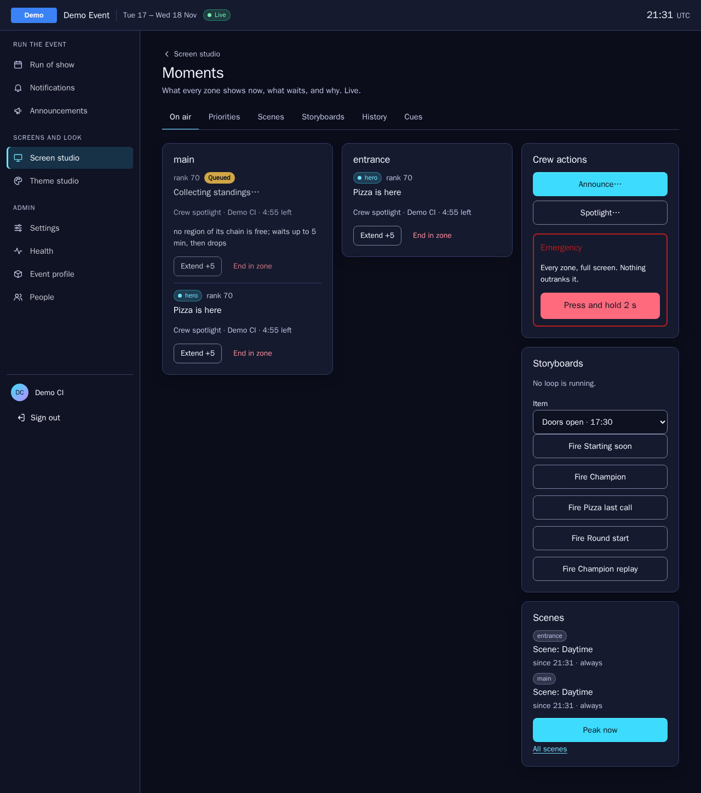

*CI.* The page the organiser keeps open while the event runs. One card per zone says what each region shows now and what waits, with why: here "Pizza is here" holds main's hero, and the standings spotlight is Queued because "no region of its chain is free; waits up to 5 min, then drops". Each moment has Extend +5 and End in zone. On the right are the crew actions (Announce, Spotlight, Emergency), the storyboards that can be fired by hand and the zones' scenes with Peak now. Mockup 03.

#### O2 · On air, a storyboard fired by hand
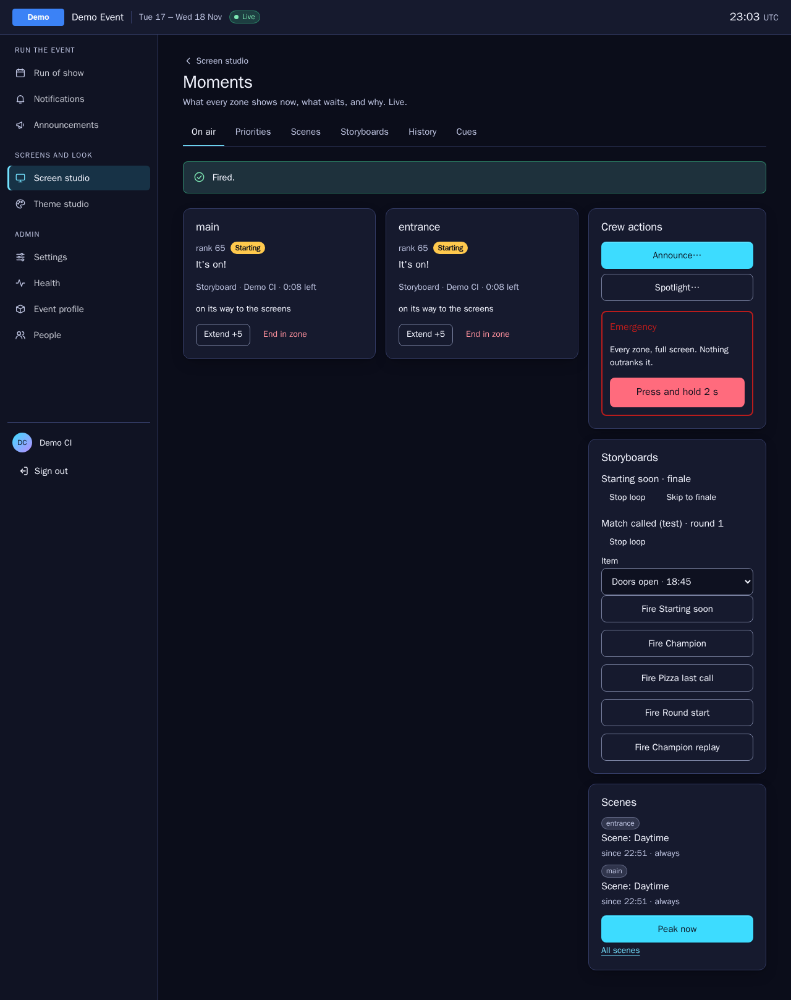

*Local.* The organiser picked an item and pressed Fire Starting soon. The page says Fired; both zones show the storyboard as Starting, and the Storyboards card shows the run with Stop loop and Skip to finale. Here the item list's first entry, Doors open at 18:45, was already past, so the storyboard went straight to its finale, "It's on!" (see [Seen while shooting](#seen-while-shooting)). Mockups 03 and 19.

#### O3 · On air, a loop running
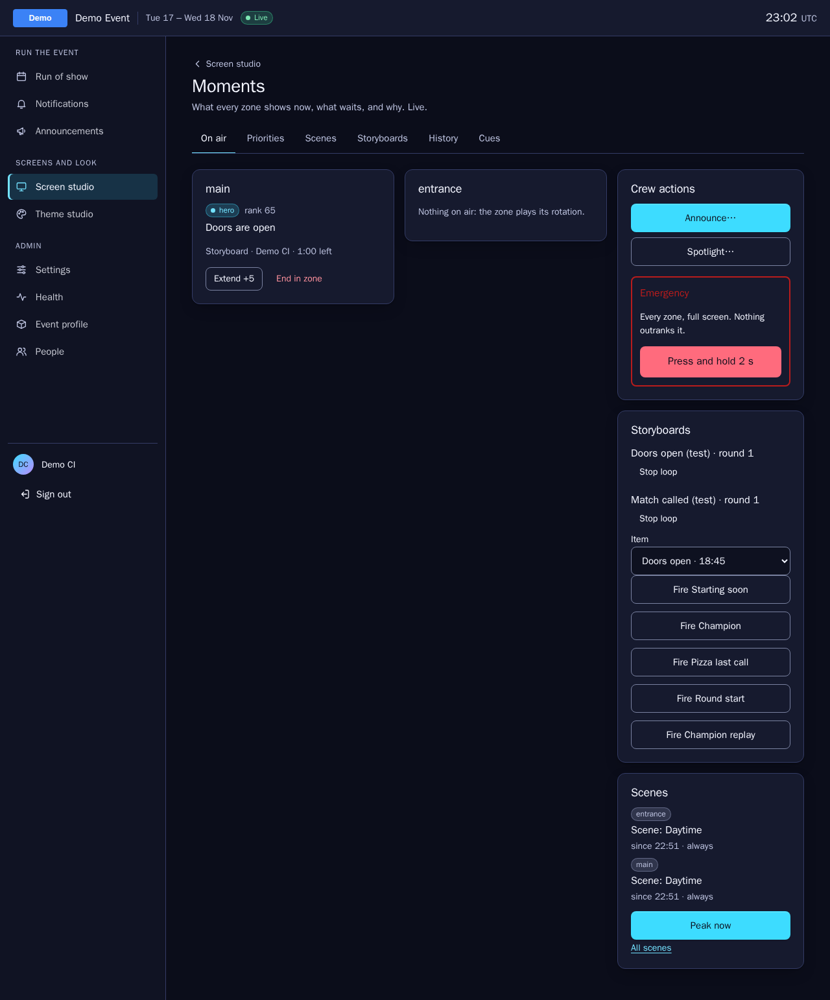

*Local.* A storyboard loop is on air: Doors open (test), round 1, holds main's hero at rank 65. The Storyboards card lists each live run with Stop loop. This is where the crew ends a loop early. Mockups 03 and 19.

#### O4 · On air in an emergency
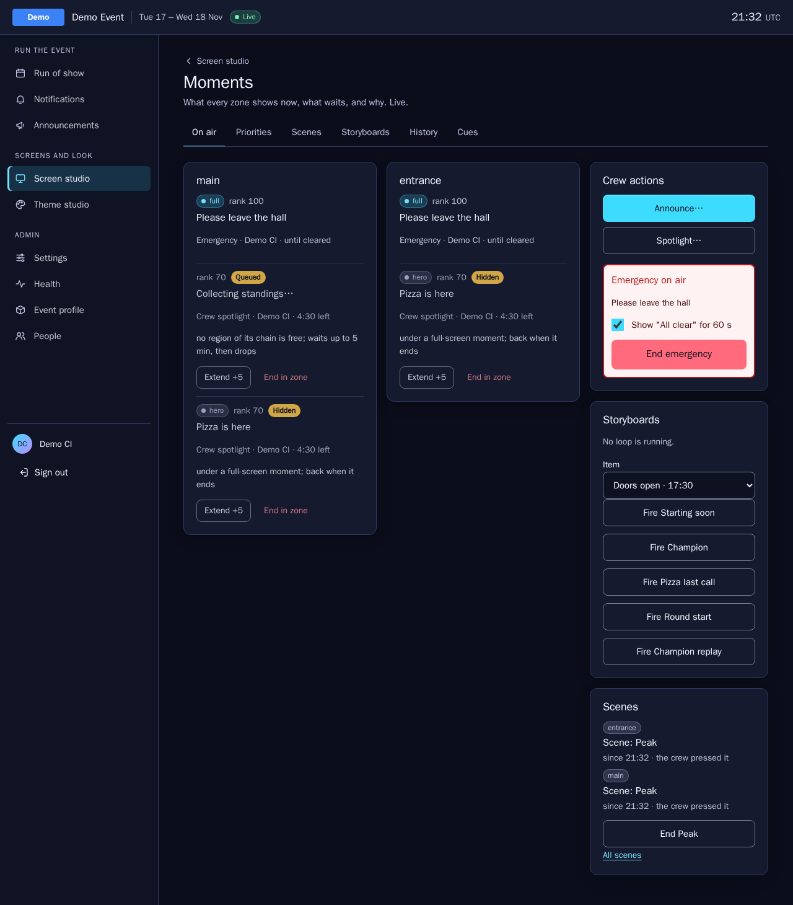

*CI.* The emergency is on: every zone shows "Please leave the hall" full screen at rank 100, and what was on air waits, marked Hidden or Queued, so it comes back afterwards. The red card becomes "Emergency on air" with End emergency and the option to show "All clear" for 60 s. The scenes card shows Peak, pressed by the crew. Mockup 07.

#### O5 · Priorities and the built-in rules
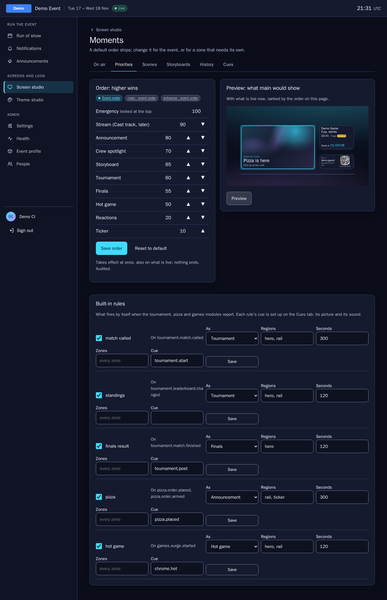

*CI.* An event admin sets which class wins when two want the same region: Emergency locked at the top, then Stream, Announcement, Crew spotlight, Storyboard, Tournament and the rest, for the event or for one zone. The preview draws what main would show now with this order, in the real player. Below, the built-in rules: what fires by itself when the tournament, pizza and games modules report (match called, standings, finals result, pizza, hot game), each with its class, regions, seconds, zones and cue. Mockup 08.

#### O6 · History
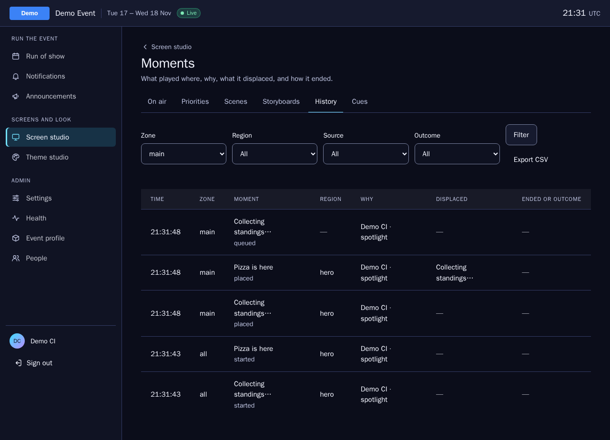

*CI.* After something looked wrong on a screen, the organiser filters by zone, region, source and outcome and reads what played where, why it started, what it displaced and how it ended, or exports a CSV. Here: the two crew spotlights, one placed, one queued. Mockup 09.

#### O7 · Scenes
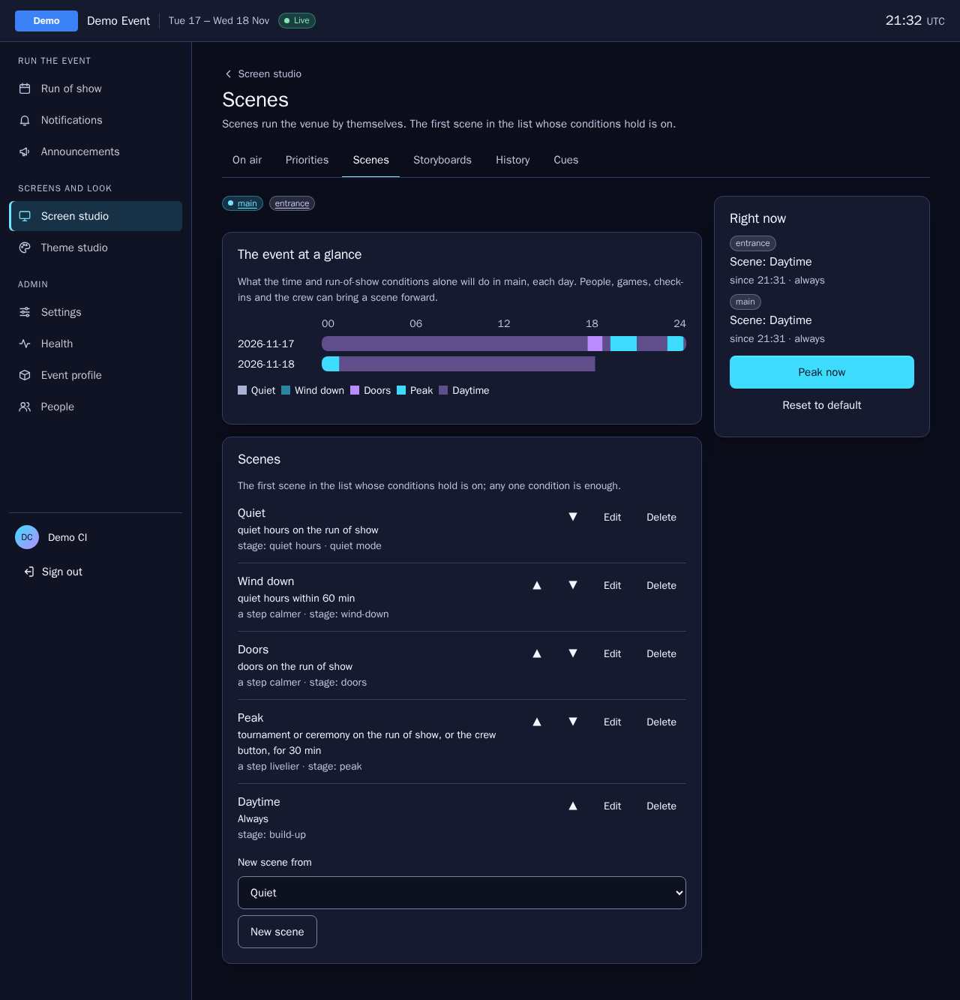

*CI.* Scenes are the venue's autopilot: the first scene whose conditions hold sets the zone's look and pace. The chart shows what time and the run of show alone will do in main, day by day (Quiet, Wind down, Doors, Peak, Daytime). Below, the list in order, each with Edit and Delete; on the right, what each zone is in right now, Peak now and Reset to default. Mockup 14, sheet 12.

#### O8 · A scene's editor
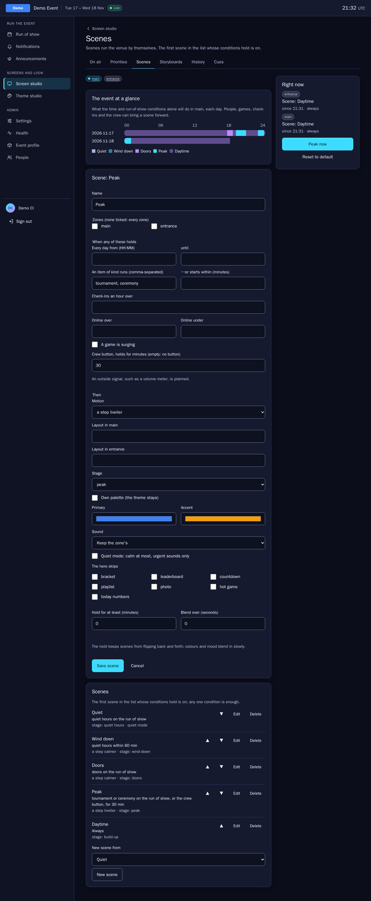

*CI.* An organiser opens Peak to change when it holds: every day from–until, an item of a kind running or starting soon, check-ins, people online, a game surging, or the crew button with how long it holds; then what it changes (motion, energy, the background). Mockup 14, sheet 12.

#### O9 · Cues: the sound desk
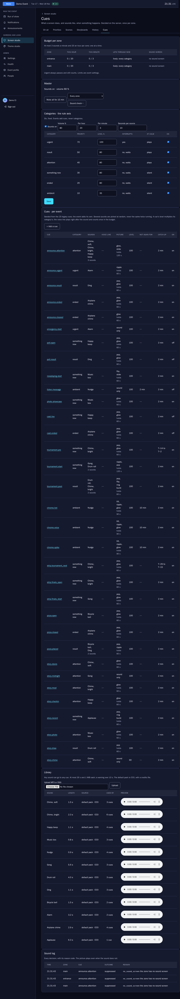

*CI.* The organiser sets up what screens sound and look like when something happens. From the top: the budget per zone (sounds this hour and this minute, what passes now), the master (volume, Mute all for 15 min, Sound check), the six categories with their levels and limits, every cue (its category, sounds, voice line, picture, level and limits), the library of sounds with upload and preview, and the sound log with a reason code for every decision ("no_sound_screen: the zone has no sound screen"). Mockups 12 and 13, sheet 14.

#### O10 · A cue's editor
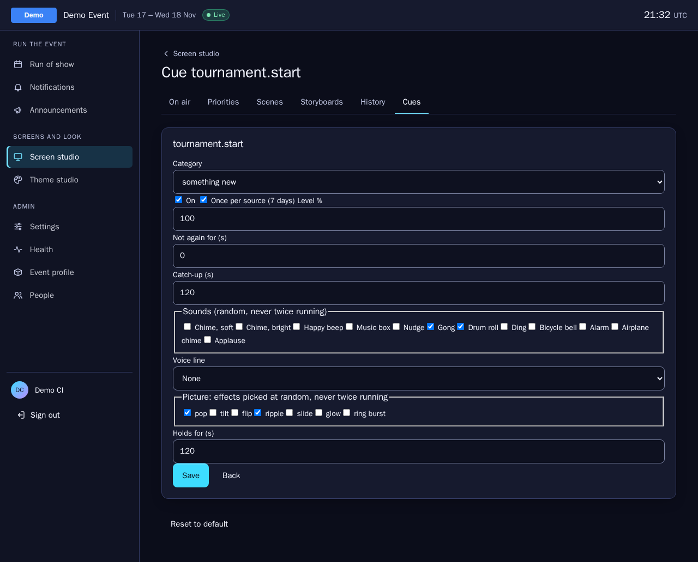

*CI.* One cue: its category, on or off, once per source, its level, not-again-for and catch-up, the sounds picked at random (never twice running), a voice line, the picture effects (pop, tilt, flip, ripple, slide, glow, ring burst) and how long the picture holds. Mockup 12, sheet 14.

#### O11 · Cues, muted for 15 minutes
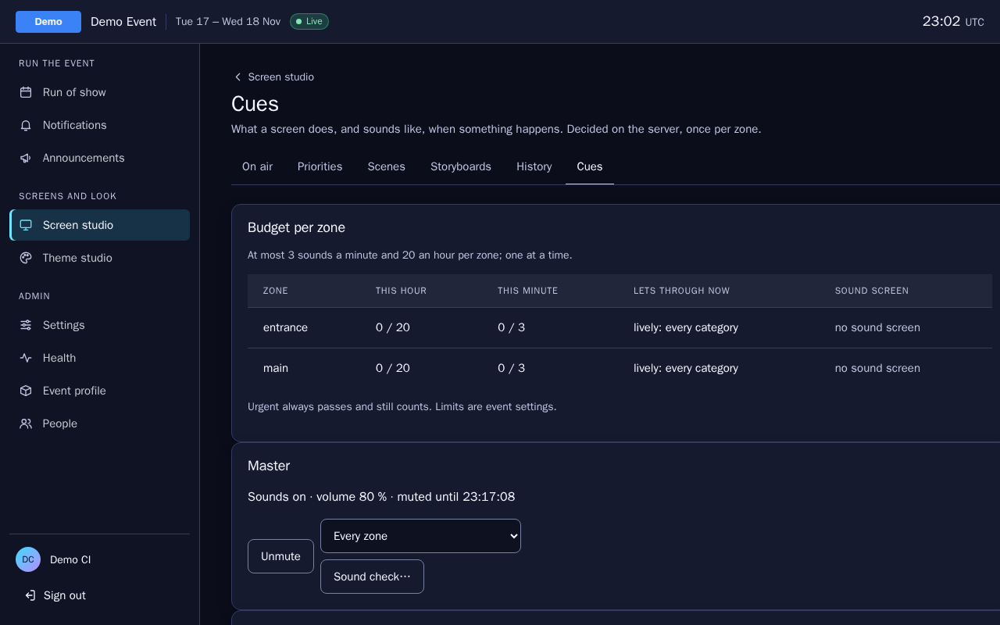

*Local.* A speech starts and the crew presses Mute all for 15 min. The master says "muted until 23:17:08" and the button becomes Unmute. Pictures still play; the mute ends by itself. Top of the page. Mockup 12.

#### O12 · Cues, sound check sent
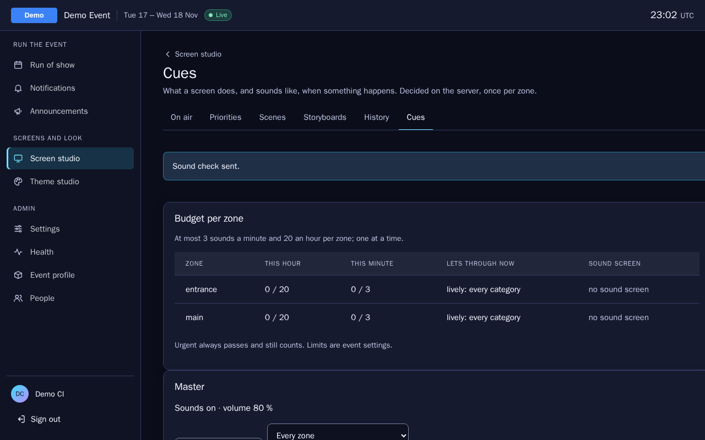

*Local.* Before doors, the organiser checks the speakers: Sound check sends a test sound to every zone or the one picked, and the page says "Sound check sent." Here no zone has a sound screen yet (the budget table says so), so nothing is heard. Top of the page. Mockup 12.

#### O13 · Announcements: the composer
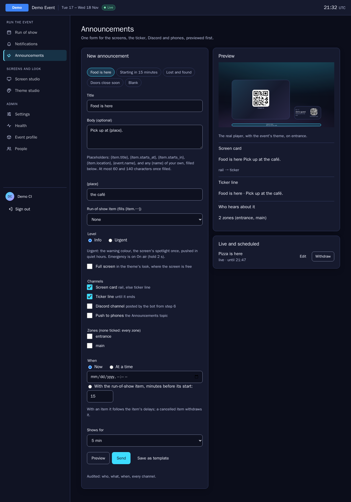

*CI.* Anyone with the announce right writes one announcement for every channel. The organiser picks the template Food is here, fills {place}, ticks the channels and presses Preview: the real player draws it on the entrance, and each channel's text is shown (screen card, ticker line) with who hears it. Live and scheduled ones sit on the right with Edit and Withdraw. Mockup 05.

#### O14 · The composer, every channel
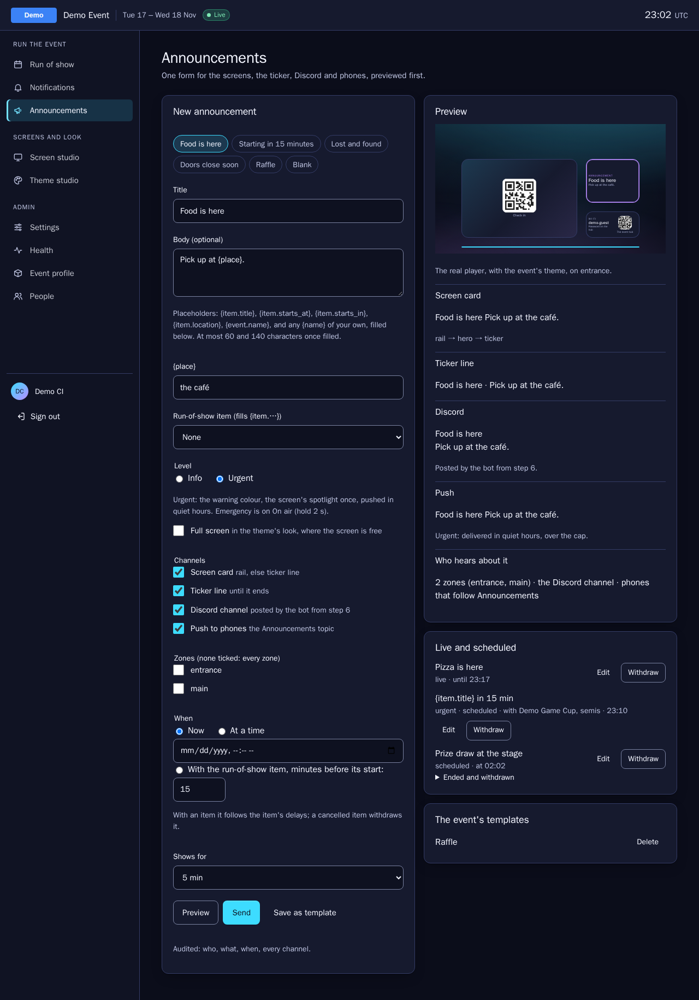

*Local.* The same, urgent, with all four channels ticked. The preview now has a part per channel: the screen card ("rail → hero → ticker", urgent's chain), the ticker line, the Discord post ("posted by the bot from step 6") and the push to phones ("delivered in quiet hours, over the cap"), then who hears about it. Mockup 05.

#### O15 · The composer, full screen
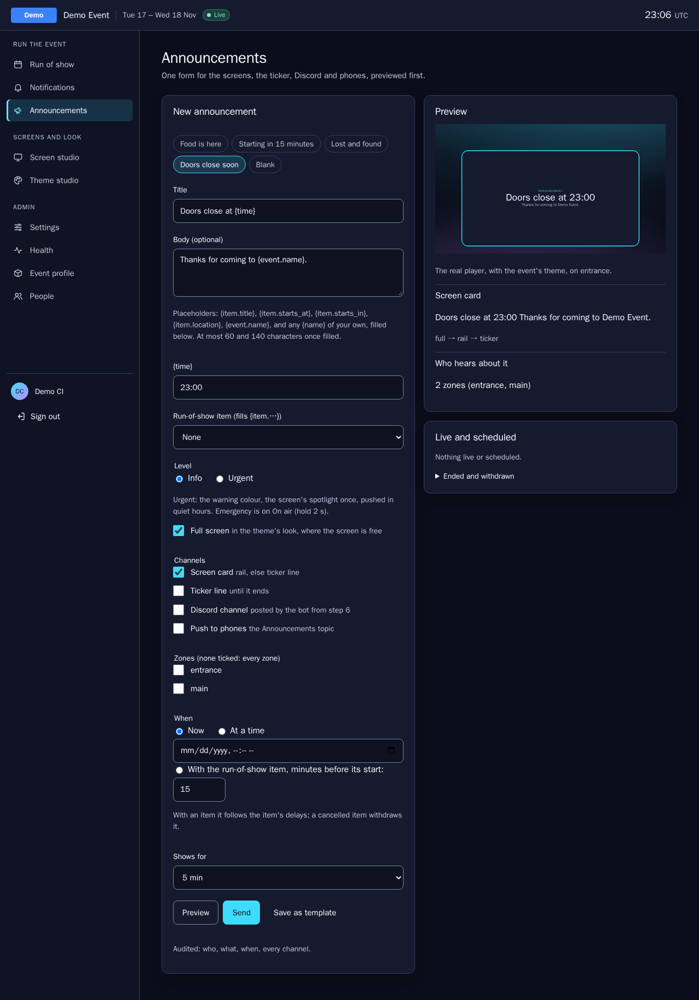

*Local.* Doors close soon, with Full screen ticked: the preview draws it over the whole screen in the theme's look ("full → rail → ticker"). Mockups 05 and 06 (L2).

#### O16 · The composer, the event's own template
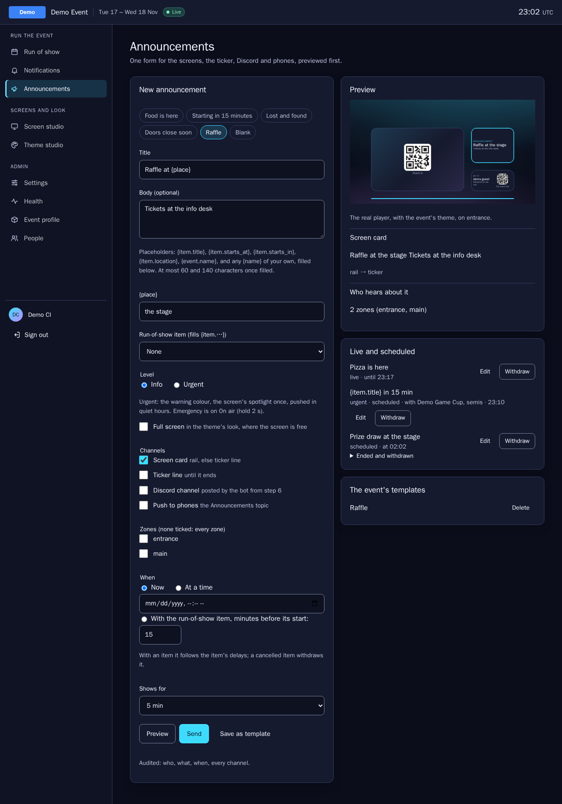

*Local.* An organiser saved Raffle as a template with Save as template. It joins the chips beside the built-in ones and is listed under "The event's templates" with Delete. Here it is opened, {place} filled and previewed. Mockup 05.

#### O17 · Announcements, live and scheduled
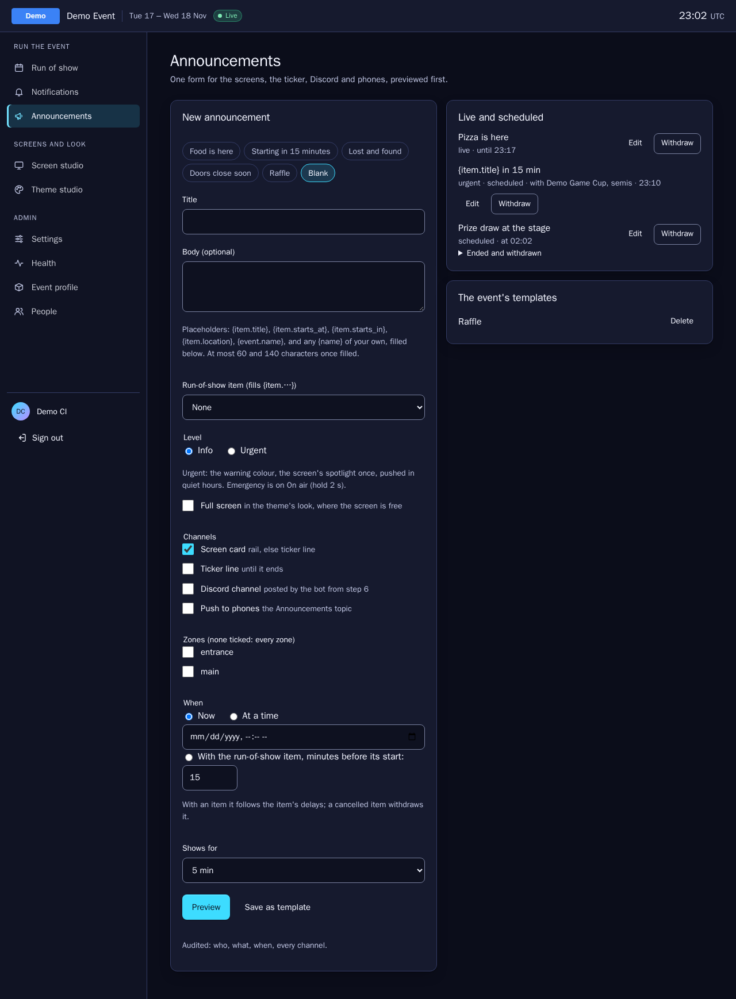

*Local.* The list on the right: Pizza is here, live until 23:17; an urgent one scheduled 15 minutes before the semis ("with Demo Game Cup, semis · 23:10"), which follows the item's delays; Prize draw at the stage, scheduled at 02:02. Ended and withdrawn ones fold away. Mockup 05.

#### O18 · A withdrawn announcement
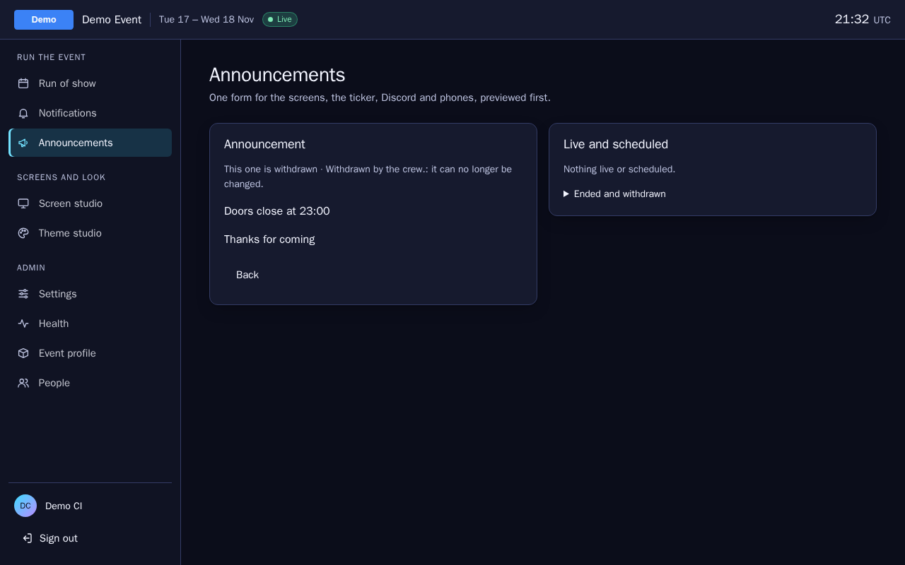

*CI.* An announcement withdrawn from every channel at once, opened again from its Edit link: read-only, with "This one is withdrawn · Withdrawn by the crew.: it can no longer be changed." and Back, so nobody edits something that is gone. Mockup 05.

#### O19 · Storyboards: the catalogue
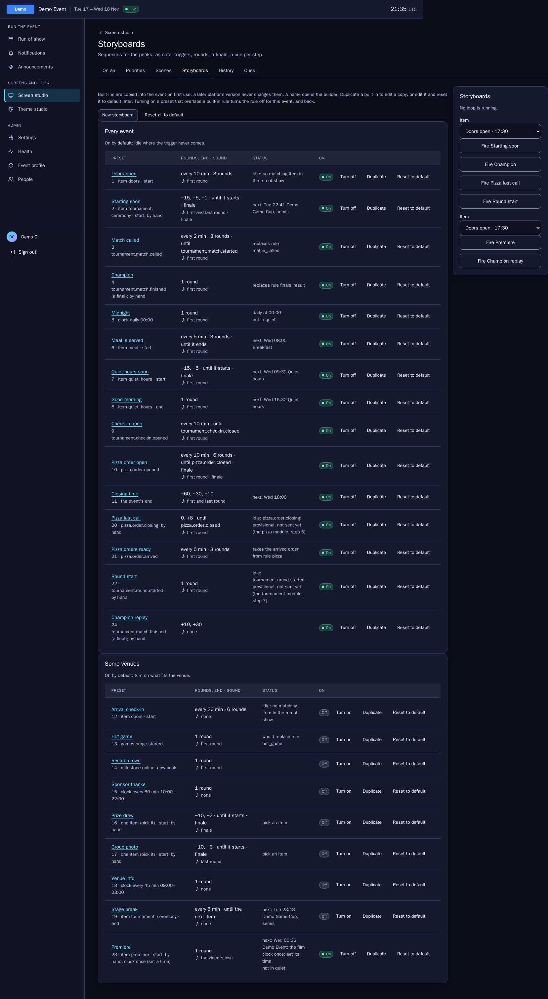

*CI.* Before the event, the organiser sees the 24 presets copied into the event: Every event (on by default), Some venues (off by default) and the rest. Each row says its trigger, its rounds and sound, and its status in plain words ("next: Tue 22:41 Demo Game Cup, semis", "idle: no matching item in the run of show", "replaces rule match_called"), with Turn on/off, Duplicate and Reset to default. The Fire panel is on the right. Mockup 21.

#### O20 · The builder: Starting soon
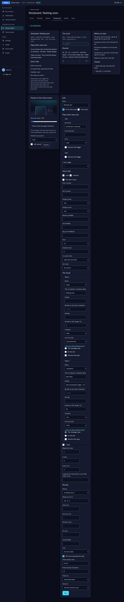

*CI.* An organiser opens a storyboard to read or change it. On top, in words: plays when (a tournament or ceremony item's start, or by hand), only if, the round (46 s, 4 steps) and the rounds ("At −15, −5, −1 min of T · until item starts · finale It's on!"), and Before you save (its share of the airtime, sound caps, the checks). Below, the preview on the virtual screen with a scrubber, Test-fire on one zone (with or without sound) and the editor of triggers, conditions, steps and ends. Mockups 10 and 18.

#### O21 · The builder: a loop
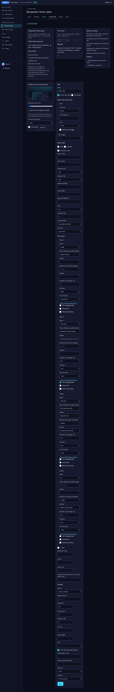

*Local.* Doors open is a loop: every 10 minutes, 3 rounds, from the start of a doors item. Its round is sting, message card, title card and QR. This is where an organiser changes how often a loop comes back and when it ends. Mockups 18 and 19.

#### O22 · The builder: Premiere
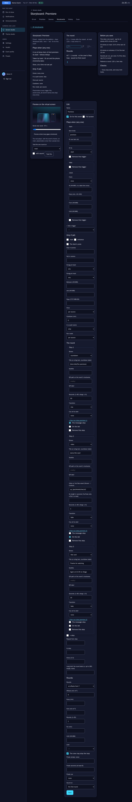

*CI.* Premiere, set up for the demo film: it plays at a premiere item's start or by hand, once; its round is a countdown, the video on the dot, then an after-card. Mockup 22.

#### O23 · The builder after Test-fire
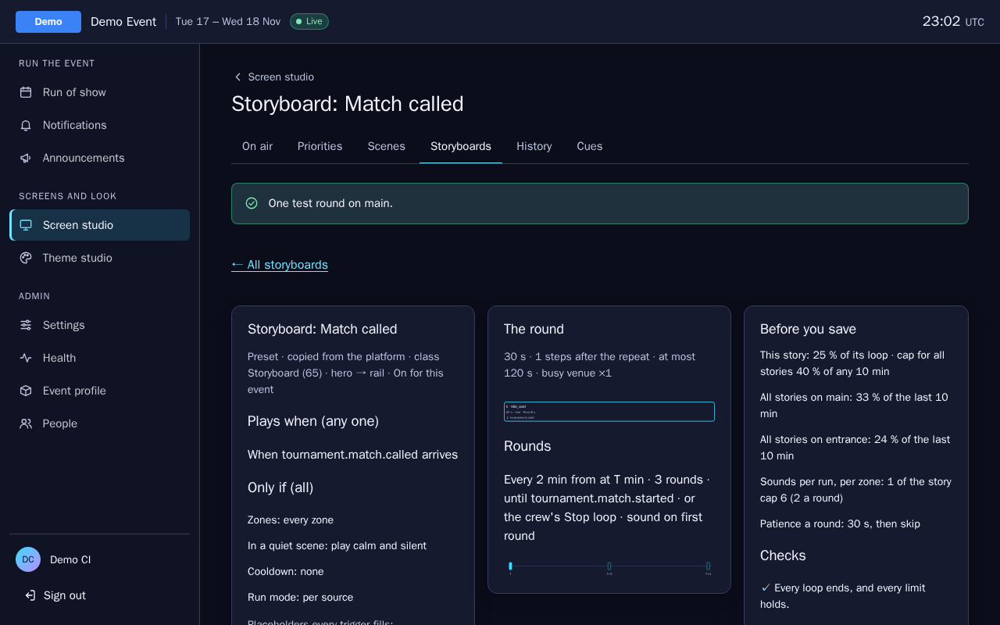

*Local.* The organiser pressed Test-fire on main: "One test round on main." The round plays once, silent unless chosen, and History marks it as a test. Top of the page. Mockup 10 (U10).

### The organiser on a phone

#### O24 · Priorities on a phone
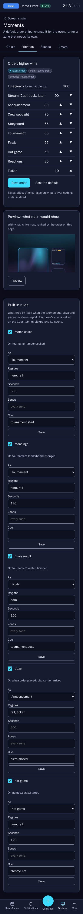

*CI.* The same order, preview and rules in one column, for an organiser away from the desk. Tabs past the third fold into "3 more". Mockup 08.

#### O25 · Scenes on a phone
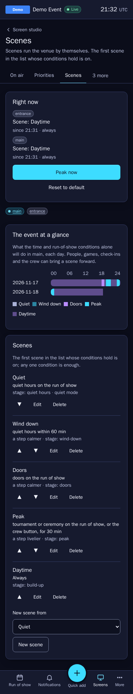

*CI.* Right now and Peak now first, then the chart and the list. Mockup 14.

#### O26 · A scene's editor on a phone
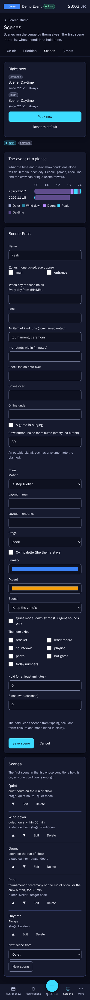

*Local.* Peak's editor in one column. Mockup 14.

#### O27 · History on a phone
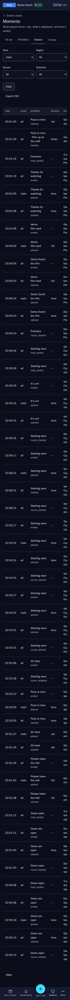

*Local.* The filters stack in pairs; the table keeps its columns, so the right ones run off the screen (see [Seen while shooting](#seen-while-shooting)). Mockup 09.

#### O28 · Storyboards on a phone
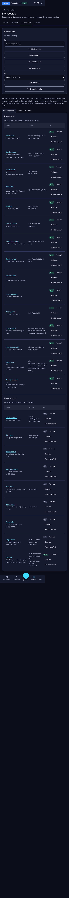

*CI.* The catalogue on a phone. The page is wider than the phone (601 px), so the browser shrinks it and the text gets small (see [Seen while shooting](#seen-while-shooting)). Mockup 21.

#### O29 · The builder on a phone
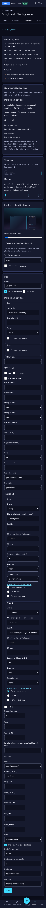

*CI.* Starting soon's builder in one column: Before you save first, then the description, the round, the preview and the editor. Mockup 18.

#### O30 · Cues on a phone

*CI.* The sound desk on a phone. Its tables make the page 883 px wide, so the browser shrinks it to fit (see [Seen while shooting](#seen-while-shooting)). The crew's own sound tools are on On air and in C8. Mockup 12.

## The crew

The crew works the floor with a phone. They open On air, which has the crew actions on top, and act on what they see in the room. Every page is in the organiser shell's phone form, with the bottom bar.

#### C1 · On air on a phone
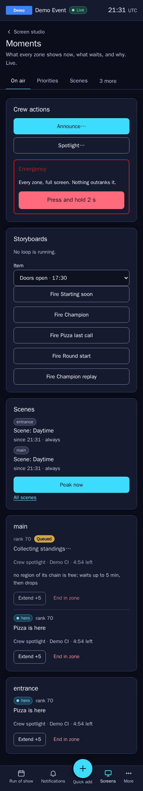

*CI.* Crew actions first (Announce, Spotlight, the emergency button: press and hold 2 s), then the storyboards to fire, the scenes with Peak now, and the zones' cards below. Mockup 04.

#### C2 · The crew spotlight remote
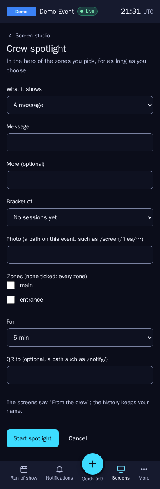

*CI.* A crew member puts something in the hero: a message (or the standings, a bracket, a photo), for some zones or every zone, for a time, with an optional QR. The screens say "From the crew"; the history keeps the name. Mockup 04, sheet 13.

#### C3 · Peak now pressed
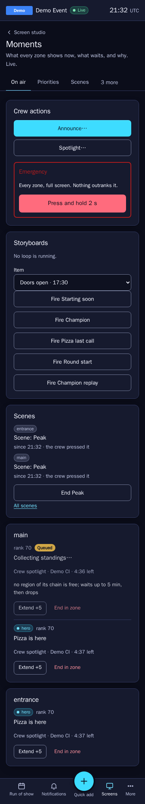

*CI.* The room is full and loud: the crew pressed Peak now. Both zones say "Scene: Peak, since 21:32, the crew pressed it", and the button became End Peak. Mockup 14.

#### C4 · An emergency on a phone
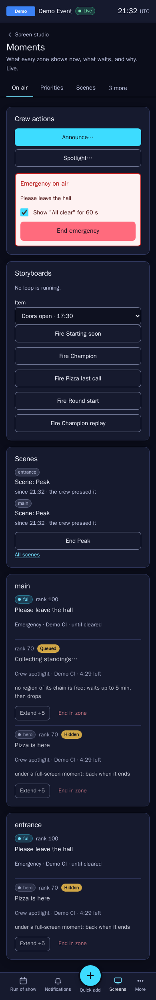

*CI.* After the hold, the red card says Emergency on air with what the screens say, the "All clear" option and End emergency, one tap. Mockup 07.

#### C5 · A loop live on a phone
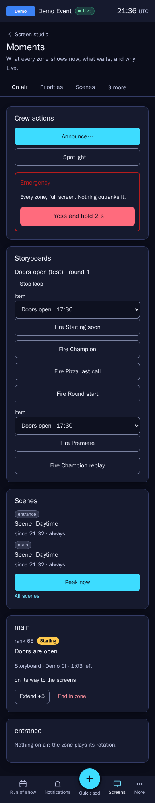

*CI.* Doors open (test) is running; Stop loop ends it. Mockup 04.

#### C6 · Announcing from a phone
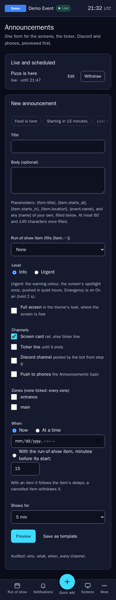

*CI.* The composer in one column, with Live and scheduled on top so the crew sees what is already out. Mockup 05.

#### C7 · Live and scheduled on a phone
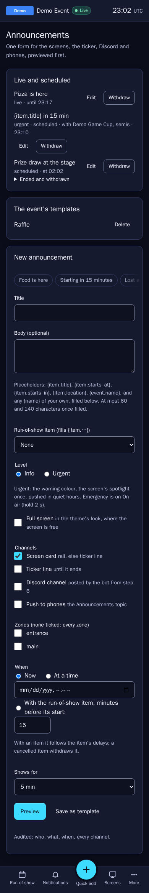

*Local.* The same with one live and two scheduled announcements and the event's template. Mockup 05.

#### C8 · The mute on a phone
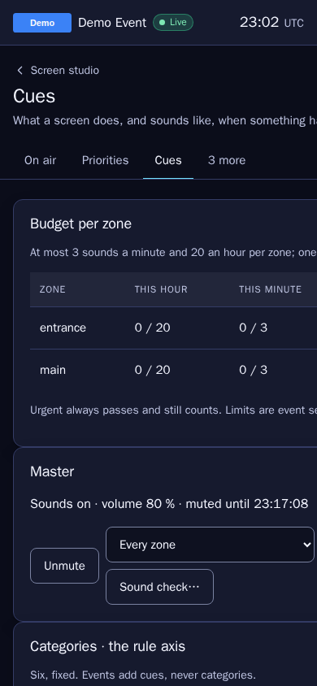

*Local.* "Muted until 23:17:08" with Unmute, the top of the Cues page on a phone. Mockup 12.

## The attendee

The attendee meets Moments on the screens. At the entrance it is a portrait screen they walk past, whose hero holds the check-in QR (mockup 03 of step 3). These are the local portrait shots (1080×1920); A8 is the CI shot of the entrance at 1080p.

#### A1 · A crew spotlight at the entrance
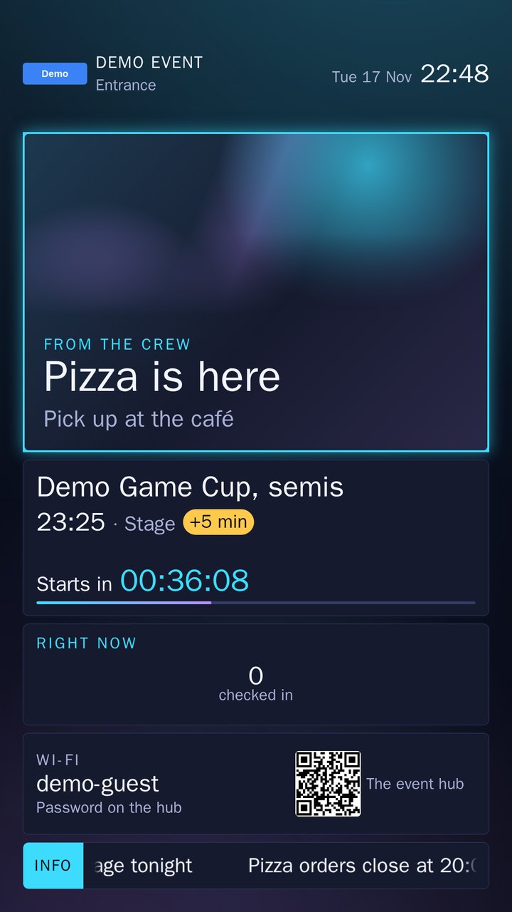

*Local.* "From the crew: Pizza is here, Pick up at the café" takes the hero; the next item, the people in and the Wi-Fi stay below. Mockups 02 and 04.

#### A2 · An announcement at the entrance

*Local.* An info announcement as a card under the QR and as the ticker line. Mockup 06.

#### A3 · An urgent announcement at the entrance
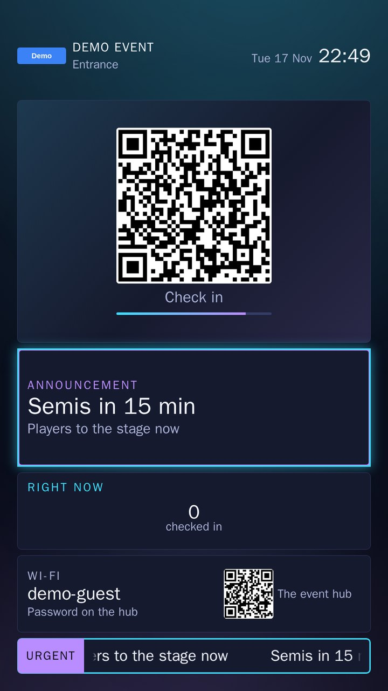

*Local.* Urgent: the card and the ticker in the warning colour, with URGENT on the ticker. Mockup 06.

#### A4 · A full-screen announcement at the entrance
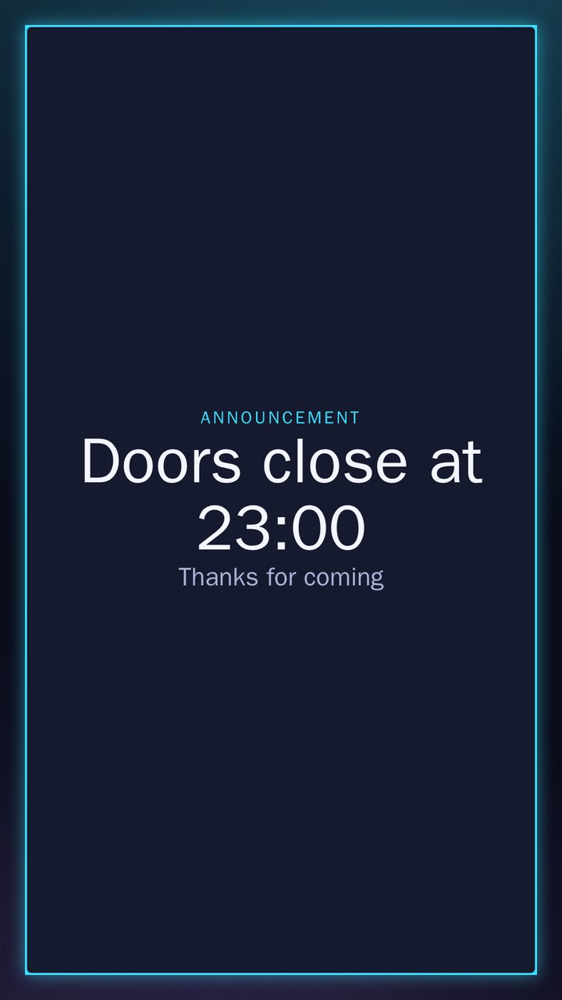

*Local.* "Doors close at 23:00" over the whole screen, in the theme's look. Mockup 06 (L2).

#### A5 · A storyboard at the entrance
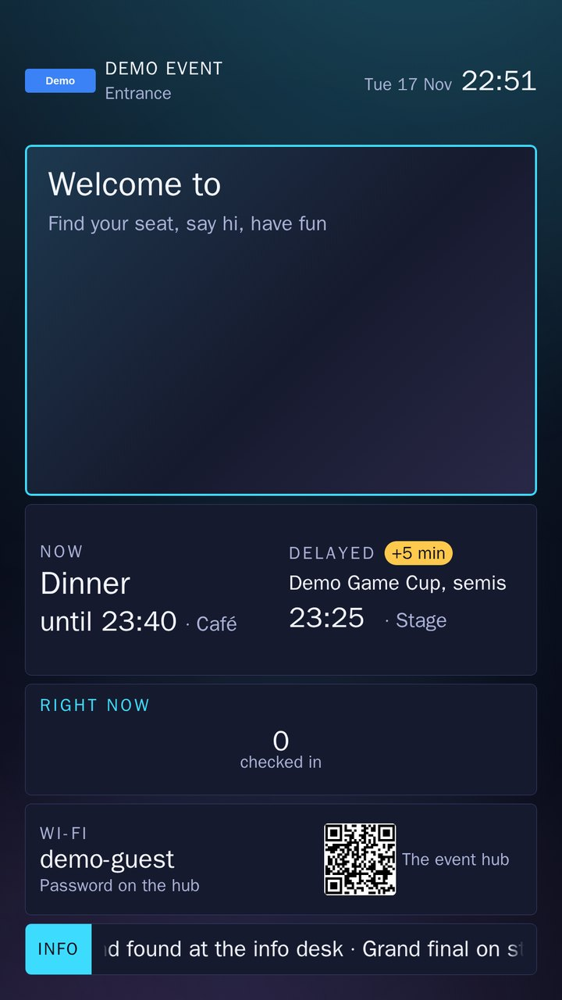

*Local.* Doors open, test-fired on the entrance, at its message step. It reads "Welcome to" without the event's name (see [Seen while shooting](#seen-while-shooting)). Mockup 20.

#### A6 · Peak at the entrance
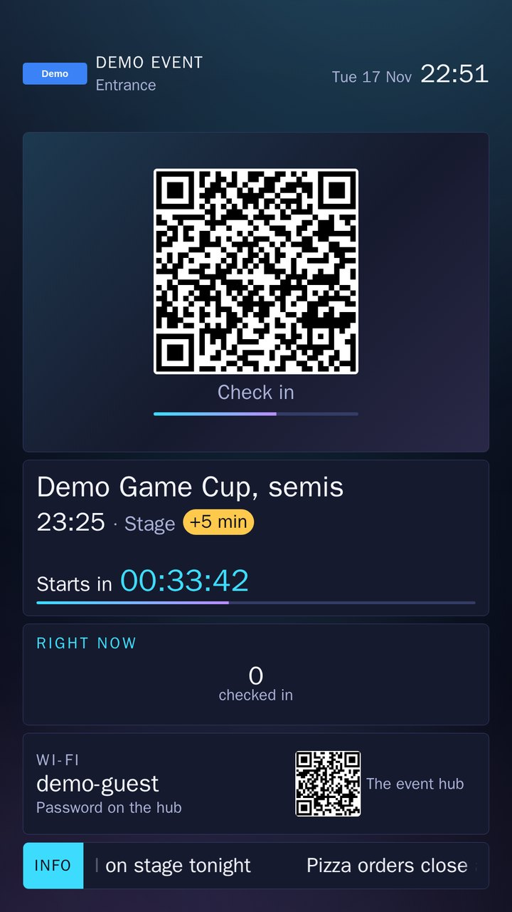

*Local.* Peak pressed: here the entrance looks as it did before it (see [Seen while shooting](#seen-while-shooting)). Mockup 14.

#### A7 · An emergency at the entrance
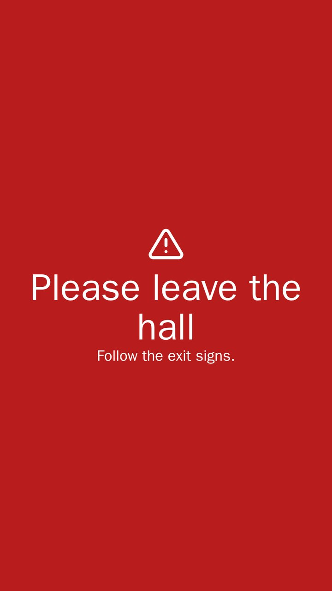

*Local.* "Please leave the hall · Follow the exit signs", red, full screen; nothing outranks it. Mockup 07.

#### A8 · Both lines when the rail is hidden
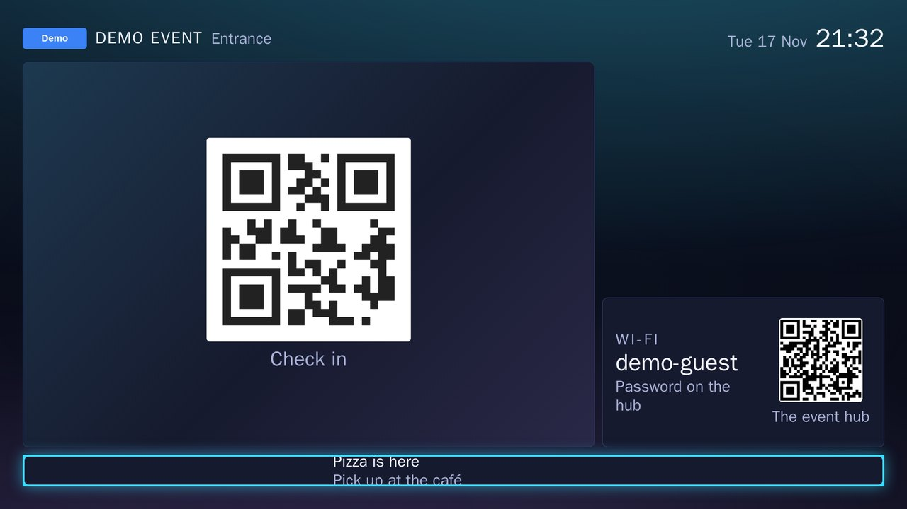

*CI.* The entrance with its rail hidden, at 1080p: the announcement degrades to the ticker and shows both lines there (L4), in two small lines squeezed into the ticker's height. Mockup 06.

## The room

The main hall's screens, seen by everyone in the room. The 1080p shots marked CI are the organiser's live view of the zone (`/screen/zones/main`); the local ones are paired players.

#### R1 · A crew spotlight
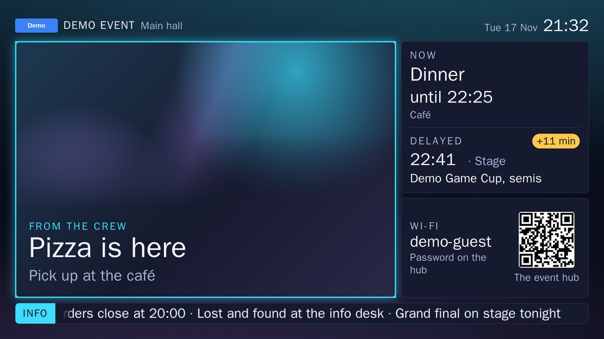

*CI.* "From the crew: Pizza is here" in the hero, the next item in the rail, the ticker below. Mockups 02 and 04, sheet 13.

#### R2 · A crew spotlight in 4K
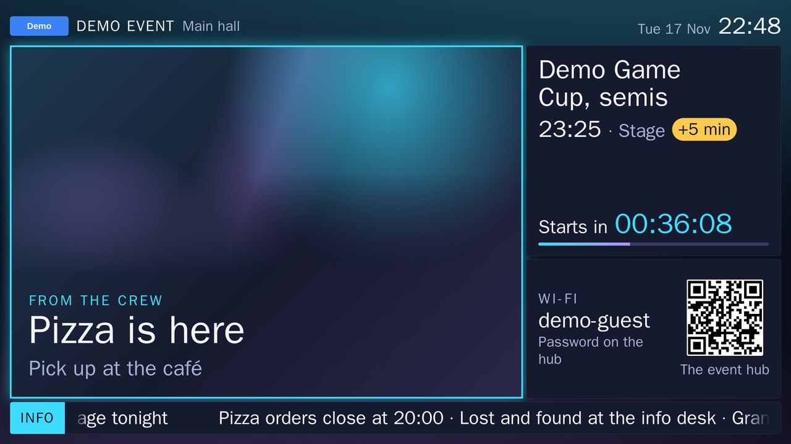

*Local.* The same on a 3840×2160 screen. Mockup 02.

#### R3 · The standings, waiting
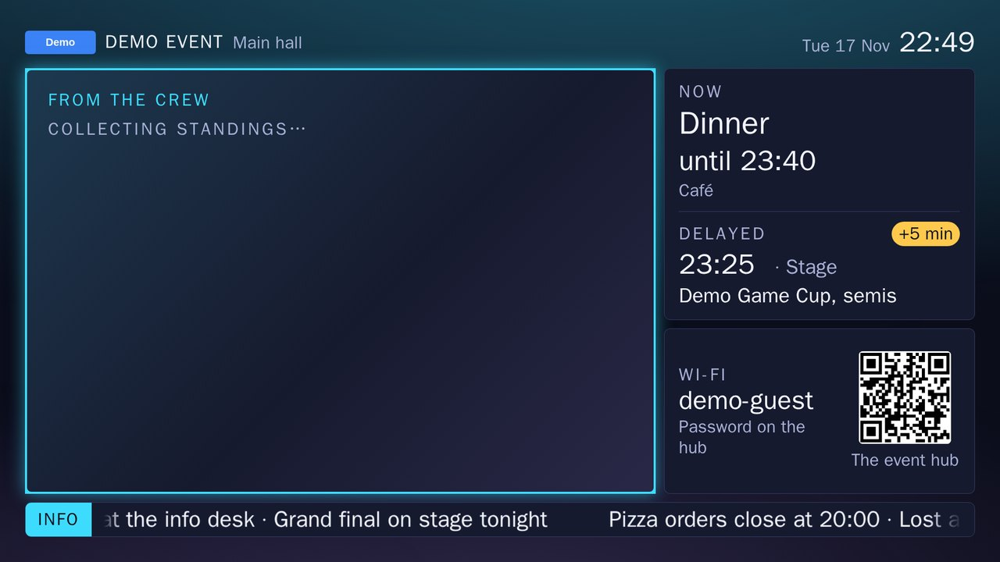

*Local.* A spotlight of the standings while no tournament reports yet: "From the crew · Collecting standings…" over an empty hero. Mockup 04.

#### R4 · An info announcement
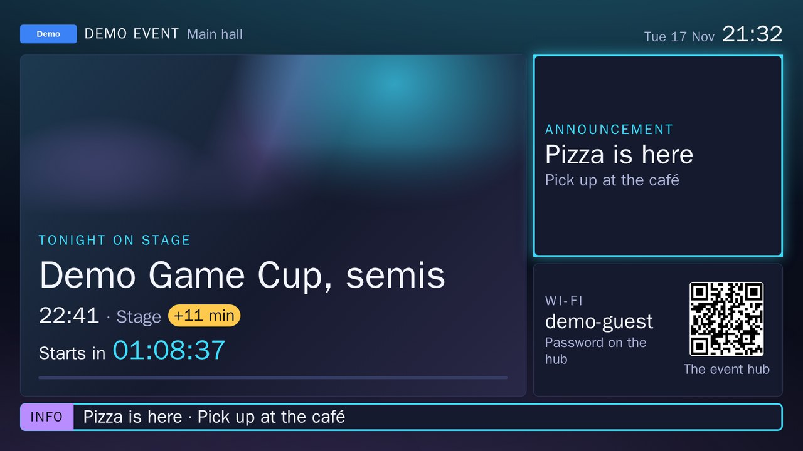

*CI.* "Announcement: Pizza is here" as a card in the rail and as the ticker line. Mockup 06.

#### R5 · An announcement edited
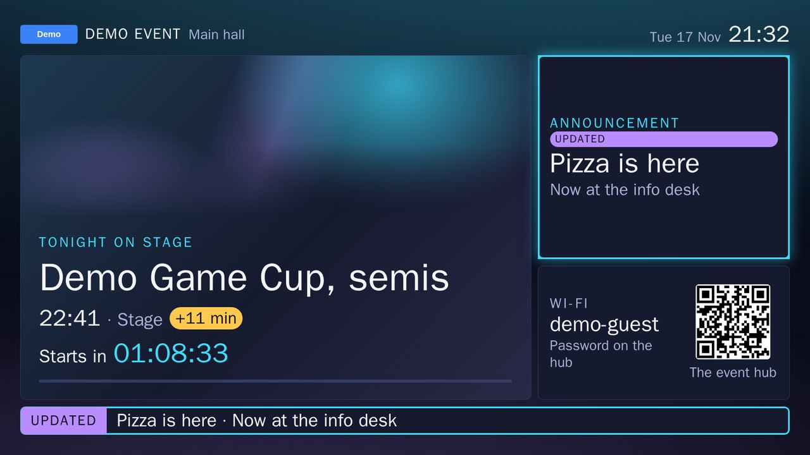

*CI.* The same, edited after it went out ("Now at the info desk"): it changes in place, with an Updated badge on the card and on the ticker. Mockup 06.

#### R6 · An urgent announcement
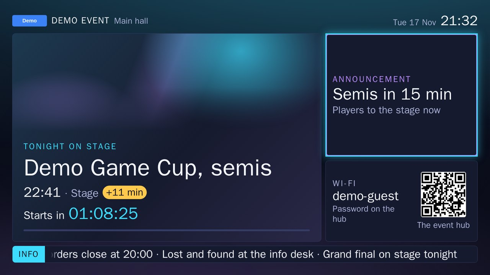

*CI.* "Semis in 15 min", urgent: the card takes the rail first (its chain is rail → hero → ticker), with the label in the urgent colour. Mockup 06 (L3).

#### R7 · A full-screen announcement

*CI.* Full screen where the screen is free. Mockup 06 (L2).

#### R8 · An announcement in 4K

*Local.* R4 on a 4K screen. Mockup 06.

#### R9 · An announcement in 4K, 1:1

*Local.* The rail of R8 at full size, for the type and the edge of the card.

#### R10 · The cue picture of an announcement

*Local.* What the room sees when a cue fires, frame by frame from the moment it is sent: the rail crossfades from the run of show to the card and the card's frame glows (info, top; urgent, below). The sound log says there was no sound screen, so the picture played alone. Sheet 14, mockup 13.

#### R11 · Peak

*CI.* The main hall with the crew's Peak on and the crew spotlight still in the hero. It looks the same as R1, taken before Peak (see [Seen while shooting](#seen-while-shooting)). Mockup 14, sheet 12.

#### R12 · An emergency

*CI.* "Please leave the hall", red, full screen, on every zone. Mockup 07.

#### R13 · An emergency in 4K

*Local.* The same in 4K. Mockup 07.

#### R14 · All clear

*Local.* Half a second after End emergency with "All clear": the screen is back as it was, with "All clear · You may go back in" in the rail for 60 s. Mockup 07.

#### R15 · A split zone

*Local.* Main hall on the split layout: the crew spotlight takes the large region, the announcement and the Wi-Fi the side. Mockup 02.

#### R16 · A split zone in 4K

*Local.* The same in 4K. Mockup 02.

#### R17 · A storyboard round and its transitions

*Local.* Doors open, test-fired on main: the Pulse; the sting "Doors are open" in the hero; the rail crossfading to the next item; the message card; the title card; the QR step. The sting is dark on dark and the QR step drew a white square (see [Seen while shooting](#seen-while-shooting)). Mockups 11 and 20.

#### R18 · The title card

*Local.* Doors open's title card, "Wi-Fi and venue info · Open the hub". Mockup 20.

#### R19 · The title card in 4K

*Local.* Taken 6 s into the round, so the 4K screen is at the message card, "Welcome to", one step before the title card. Mockup 20.

#### R20 · The QR step

*Local.* Doors open's last step, "Check in at the door", as it drew for the 3 s the shot watched it: a white square, no code. Mockup 20.

#### R21 · Every preset on the main hall

*CI.* Each preset test-fired as one round on the main hall and shot at its message step: arrival check-in, champion and its replay, check-in open, closing time, doors open, good morning, group photo, hot game, match called, meal served, Midnight, pizza arrived, pizza last call, pizza order open, prize draw, quiet hours soon, record crowd, round start, sponsor thanks, stage break, Starting soon, venue info. Premiere is in [S3](#s3--premiere-on-two-screens-at-once). Two shots do not show what they name (Midnight, Starting soon; see [Seen while shooting](#seen-while-shooting)). Mockup 20.

#### R22 · Fired by hand: the finale

*Local.* The main hall after O2: "It's on! · Doors open · Entrance", the finale, because the item picked had already started. Mockup 20.

## The gate's sequences

Each sequence is a row of numbered frames. The screen's own clock is in the top right; each label adds the second the frame was taken (UTC, the event's time zone).

#### S1 · Starting soon: T−15, T−5, T−1 and its finale

*Local, real time.* Two tournament items added to the run of show, the quarter-finals at 23:08 and the final at 22:59, and Starting soon left to fire by itself. At T−15 (frames 1–2, the quarter-finals), T−5 (3–4) and T−1 (5–6, the final) a round plays: the sting "Starting soon", then the countdown to the item in the hero ("Starts in 00:14:57", "00:04:54", "00:00:57"). Between rounds the Pulse shows the next item as usual (7, two seconds before T). At T the finale "It's on! · Demo Cup, final · Stage" takes the hero (8). The sting and the finale are small and dim (see [Seen while shooting](#seen-while-shooting)). Mockups 19 and 20.

#### S2 · The Midnight sting at 00:00:00

*Local, real time.* Nothing fired by hand: the main hall at 1080p, from 12 s before the event's midnight (00:00 UTC, the event's time zone) to 18 s after. The Pulse as usual (1); at 23:59:50 the full-screen countdown "Midnight · 00:00 · Starts in…" (2–5); the sting "Midnight!" on the accent colour (6–7); its crossfade into the card (8); "Night 2 at Demo Event · Keep it going" (9–11). Each label is the instant the shot was asked for; the browser takes up to about a second to capture, which is why frame 5, asked at 00:00:00.0, still shows "00:00:01". The sting was on screen by 00:00:01.5. Full-screen steps hide the screen's clock, hence the labels. Mockup 20.

 

*Local, real time.* The entrance (portrait) at the same two instants as frames 5 and 8: at 00:00:00 it showed only its background, with no countdown and no sting (see [Seen while shooting](#seen-while-shooting)); at 00:00:05 "Night 2 at Demo Event", full screen.

#### S3 · Premiere on two screens at once

*Local.* Two players paired into the main hall, side by side, and Premiere test-fired on the demo event's premiere item with the demo film. Each row is one moment on both screens, taken together: the 30 s countdown (1–2), the film full screen at three moments (3–8) and the after-card "Thanks for watching · Again at 21:00 on Stage" (9–10). The label of each film frame gives the video's own position read from both players at the same instant: 1.801 s and 1.777 s, 6.373 s and 6.347 s, 10.909 s and 10.883 s. The two screens stay within 26 ms of each other and do not drift, and the film's own second counter shows the same second on both. Mockup 22.

## Not in this book

- **The classes later modules fire:** Tournament, Finals, Hot game, Reactions and Stream. Their rules are on Priorities (O5), but the tournament, games, pizza and cast modules that send their events are not built yet, so nothing on the stack fires them.
- **Sound.** Screenshots have none, and no demo screen is a sound screen, so the sound log (O9) says every sound was suppressed with `no_sound_screen`.
- **The superadmin's venue-wide emergency:** it needs a superadmin session, which the CI stub does not give.
- **The Starting soon finale's flash transition:** the frames were 1 s apart and the flash is shorter.

## Seen while shooting

Not fixed here (out of scope); for the lead to sort.

**Screens**
- **The sting is unreadable.** Every storyboard sting ("Starting soon", "Doors are open") draws as small dark text in the hero's top-left corner, on a dark ground (R17, S1 frames 1, 3 and 5, and CI's Starting soon shot in R21). Mockup 20 draws stings large, centred and bright. The CI readability check did not catch it, because storyboard steps are shot with the page shot, not the screens' check.
- **Message cards and the finale are small.** Most preset message steps and "It's on!" use small text in the top-left of a large empty hero (R21, S1 frame 8, R22), where mockup 20 fills the hero.
- **The QR step drew a white square.** In the first test-fire of Doors open, its QR step showed a white square with no code for the 3 s it was watched (R20). The QR draws in CI's arrival check-in shot, so this may be a first draw that comes late.
- **The event's name was missing once.** The first test-fire of Doors open read "Welcome to" with no event name, on main and on the entrance (A5, R19). A later test-fire read "Welcome to Demo Event" (R17 frame 4).
- **Midnight on the entrance missed the dot.** At 00:00:00 the portrait entrance showed an empty background while the main hall showed the countdown; the card came at 00:00:05 (S2).
- **Peak looks the same as Daytime.** After Peak now, the main hall and the entrance look as they did before (A6). If Peak is meant to change the look (sheet 12), it does not show here.
- **Match called with no data** reads "Match called:" over an empty hero (R21). A test-fire could fill its placeholders with their sample text, as the builder's preview does.
- **Midnight and Starting soon in R21 are the wrong frame.** CI's Midnight shot waits for the text "Night" and so matched "Tonight on stage" on the Pulse; its Starting soon shot caught the sting. Both shots pass without showing their preset. S2 and S1 show the real ones.
- **Both lines in the ticker are tiny and cramped:** when the rail is hidden, the card's two lines share the ticker's height (A8), well under the size of the ticker's own text.
- **Arrival check-in in R21 overlaps two rail texts:** the shot was taken mid-crossfade.

**Pages**
- **Pages wider than the window:** Storyboards (the Fire panel pushes the page to 1657 px at 1280, O19) and Cues (1291 px at 1280, O9; its cards run off the right edge, O11, O12). On a phone, Storyboards is 601 px and Cues 883 px wide, so the browser shrinks them (O28, O30), and History's table runs off the screen (O27).
- **On air fires on the wrong item by default.** The item list under Fire starts at the first item of the day (Doors open, 18:45, past), whatever the storyboard's kinds; firing Starting soon on it went straight to the finale (O2, R22). It could default to the next item of a kind the storyboard takes.
- **A scheduled announcement shows its raw template** ("{item.title} in 15 min") in Live and scheduled, until it goes out (O17, C7). Its Edit and Withdraw also wrap below it, unlike the other rows.
- **The withdrawn announcement's note reads "Withdrawn by the crew.: it can"** (O18).
- **The preview's screen card joins title and body without a separator** ("Food is here Pick up at the café.", O13, O14).
- **The built-in rules' rows wrap event names mid-word** ("tournament.leaderboard.cha nged") and set Zones and Cue under the other fields unevenly (O5).
- **The library's players are the browser's own,** light grey on the dark page (O9).
- **The cue editor's sound and picture choices** are one wrapped line of small checkboxes in a box (O10).

## Lead's evaluation

**Verdict.** Step 4 works, and most of it looks like the product. The new organiser pages sit cleanly in the shell, and the crew spotlight, announcements and the emergency look right on screen. Premiere plays in sync on two screens. Storyboards are the weak part. They are the step's new picture, and on screen they look much plainer than everything around them. Their text is small, dim and stuck in a corner, where mockup 20 draws it large across the hero. Two of the gate's three sequences show this, so in my view step 4 is not ready for `checkpoint-ok` yet. The polish agreed with the product owner is at the end.

### The organiser at the desk: good, with two broken pages
- **Good:** On air (O1–O4) reads at a glance: one card per zone, what waits and why, and the crew actions on the right. Priorities with its live preview (O5), Scenes with "the event at a glance" (O7), History (O6) and the announcement composer with its real-player preview (O13–O16) follow their mockups and the shell. The withdrawn view (O18) is calm and clear.
- **Falls short:** Storyboards (O19) and Cues (O9, O11, O12) are wider than the window. On Storyboards the Fire panel pushes the page to 1657 px, so the top bar stops halfway across and the panel hangs off the right edge. That looks broken, not just plain. The builder (O20–O23) is one long column of raw fields. Mockup 18 has a round you can see, as a strip of steps, with the form beside it; here the preview is a thumbnail and the round is only words. The cue editor's choices are a box of small checkboxes (O10), the sound library uses the browser's own light-grey players (O9), and the built-in rules wrap event names mid-word (O5).

### The organiser on a phone: falls short
- **Good:** Priorities, Scenes, a scene's editor and the builder fold into one readable column (O24–O26, O29).
- **Falls short:** Storyboards (O28, 601 px) and Cues (O30, 883 px) do not fit the phone. The browser shrinks them until the text is unreadable, and O28 ends in a long empty area. History's table runs off the screen (O27). An organiser on the floor cannot use the two pages step 4 is about.

### The crew: good
- **Good:** On air on a phone (C1) puts the crew actions first, with a real press-and-hold emergency. Peak now, the emergency and Stop loop (C3–C5) are one tap each, and the composer works in one column (C6, C7). The mute (C8) is clear.
- **Falls short:** the spotlight remote (C2) is a plain form that asks for raw paths ("/screen/files/…", "/notify/"). Mockup 04 lets the crew pick a photo instead. Fire defaults to the first item of the day, even one that is past (O2). Firing Starting soon on it put "It's on!" in the room (R22) when nothing was starting.

### Screens, 1080p, 4K and portrait: good, except storyboards
- **Good:** the crew spotlight (R1, R2, A1), announcements as card and ticker (R4, R5, R8, R9, A2), the full-screen announcement (R7, A4) and the emergency (R12, R13, A7) are big, calm and readable from the back of a hall. The split zone (R15, R16) and All clear (R14) work. The cue picture (R10) crossfades and glows, which is the energy we asked for. 4K is sharp (R9).
- **Falls short:**
  - **Storyboard steps.** Every message step is about a quarter of the size mockup 20 asks for, top-left in a big empty hero (R21, R22, A5, the S3 after-card). Stings are dark grey on dark blue, about the same size, and hard to read even on a monitor (R17 frame 2, S1 frames 1, 3 and 5). Next to the crew spotlight on the same screen (R1) they look like a different product.
  - **Urgent.** An urgent announcement reads "ANNOUNCEMENT" in the secondary purple (R6, A3). Mockup 06 says "URGENT" in the warning colour. In the room, urgent and info look almost the same.
  - **Bugs seen on screen:** the QR step drew a white square (R20). The first test-fire showed "Welcome to" with no event name (A5, R19).
  - **Peak.** Peak looks the same as Daytime in stills (A6, R11). I cannot tell from stills whether motion and pace change. I will check it on a live screen, not here.
  - **Rail hidden.** With the rail hidden, the card's two lines are squeezed and clipped in the ticker (A8). This is a rare case.

### The gate's three sequences
- **Starting soon, T−15, T−5 and T−1, with its finale (S1): falls short.** The timing is right: each round plays on time, follows the item and hands over to the Pulse between rounds. The countdowns are readable. But each round opens with the dim, small "Starting soon" sting, and the finale "It's on!" is a small line in the corner (frame 8). This should be the loudest moment on the screen, and it is the quietest. Mockup 20 has the countdown at full hero size.
- **The Midnight sting at 00:00:00 (S2): falls short.** The main hall is on time: the sting was up by 00:00:01.5. But the countdown screen is mostly empty, with "Midnight 00:00" small at the top. The sting is a flat cyan block with black text, not the theme's look. In frame 8 the crossfade draws "Midnight!" and "Night 2 at Demo Event" on top of each other. The entrance (portrait) showed only its background at 00:00:00 and caught up at 00:00:05. So "on the dot" holds on one screen but not both.
- **Premiere on two screens in sync (S3): passes on sync.** The two players stay within 26 ms of each other and do not drift, which is better than the plan asked. Two things to fix. The film plays inside a bordered card with black bars left and right, so it is not truly full screen. The countdown's subtitle says "Starts 02:00" while the counter shows 30 s.

### Did step 3 hold?
Yes, for what step 3 built. The Pulse, rail, ticker, header and clock look as they did at the step 3 gate, on every screen here (R1, R6, S3 frames 1–2). Step 4's own templates are what break the unity. Storyboards did not reuse the hero type that the spotlight and announcements already use.

### The product owner's notes
The PO read the book on 18 November 2026 and added:
- **Priorities (O5):** drag and drop, not arrows; the rank numbers mean nothing on their own (only the order counts), so they go.
- **The sound desk (O9) is one huge page and not user-friendly:** redesign it. The cue editor (O10) does not look professional. Sliders suit levels and times better than typed numbers.
- **The builder (O20–O22):** the fields' boxes are oddly aligned, with one long edit box.
- **History (O27)** does not fit the width.
- **The screens do not use their space:** content should be aligned and fill a larger part of the screen. R2: a crew spotlight's text is small in the lower corner of an empty hero (the hero is meant for a photo, which the remote cannot pick yet).
- **The entrance screen may not exist** at every event, or any screen at all. Moments works without one; the entrance's on-the-dot fix stays a correctness fix but no longer blocks the gate.

### The mockups themselves
Measured against the PO's notes, the step 4 research pack's mockups were strong on behaviour and weak as UX design. Mockup 12 drew the sound desk as one dense console with raw cue ids, and mockup 08 showed the rank numbers: the build copied both. Mockup 08's drag and drop, mockup 18's builder (a strip of steps, a timeline, a scrub preview) and mockup 20's hero scale were good, and the build lost them. From step 5 on, the lead gives a UX verdict on every pack's mockups before the PO reads it, and a build that falls short of its mockup sheet does not pass review.

### Improvement plan (agreed with the PO)
**Redesign first:** new mockups for the PO's accept, then a rebuild (#623):
1. **The sound desk** (O9–O12, O30): sections or sub-pages, plain cue names, sliders, a professional cue editor with chips and themed players. Rebuilt in #626.
2. **The storyboard builder** (O20–O23, O29): mockup 18 in the dark shell, with aligned fields. Rebuilt in #627.
3. **The hero uses the screen** (R1, R2, R17–R22, S1–S3, A5): one rule for every hero template: large, centred, filling the hero; a photo when there is one. Built in #625.

**Build to the existing mockups now** (#624, the organiser pages): drag-and-drop priorities without numbers; chips and sliders in the built-in rules; Storyboards and History fit at 1280 px and on a phone; Fire defaults to the next fitting item; a photo picker in the crew spotlight remote.

**The screens** (#625, after the hero sheet): storyboard steps and stings at hero scale and in the readability check; Midnight with a full-size countdown, a themed sting, no overlap, every zone on the dot; Premiere full bleed with matching countdown text; the QR step and `{event.name}` on the first fire; Urgent reads "URGENT" in the warning colour.

**Later (step 5 polish, or the backlog):** scheduled announcements show the filled text (O17, C7); a separator in the preview card (O13); the withdrawn note's punctuation (O18); test-fire fills placeholders with sample text (R21); the ticker's two-line fallback (A8); Peak checked on a live screen.

**The gate:** once #623–#627 have merged, a fresh book of the changed pages and screens (S1, S2, R2, R17, R21, the sound desk, the builder, O27, O28 and O30 on a phone) goes to the PO, then `checkpoint-ok` on #618.
