# Step 5 screenshot book: the pizza flow at 390 and 1280 px

Issue #769. The key screens of step 5 (Pizza), each at phone width (390 px) and desktop width (1280 px), on the demo stack at main `e828589` (22 November 2026): step 5 complete with its polish (#751, #752) and the deep review's fixes (#759). Each image has one short paragraph: who uses it, when, what they do there, and which mockup or brief it follows. The book is grouped by person: [the attendee](#the-attendee), [the order holder](#the-order-holder), [the crew](#the-crew) and [the room](#the-room), and ends with [what was seen while shooting](#seen-while-shooting) and the lead's evaluation. The product owner reads it at the step 5 checkpoint (#755).

## How it was made

- **Two CI runs, both green:**
  - **The pages** (A1–A7, H1–H6, C1–C6) come from the artifact `demo-screenshots` of the Demo stack run [45060878319](https://github.com/Tammilanit/canccuplatform-next/actions/runs/45060878319) on this PR's first commit `3a6fe90`, which is main `e828589` plus one added shot (below), so every page shows the same order. The Food pages come from the shard `food` (`scripts/demo-screenshots-pizza.mjs`), the front door from the shard `pages`.
  - **The room** (R1–R3) comes from the run on the push of main `e828589` ([45057742410](https://github.com/Tammilanit/canccuplatform-next/actions/runs/45057742410)). The same shots in the PR's run caught the hero between Moments' pizza stories (see [Seen while shooting](#seen-while-shooting)); main's run shows them.
  - `scripts/demo-screenshots` took every shot in Chromium with the demo event, signed in with the CI session stub, which holds every right the pages check ([docs/ci.md](../ci.md#demo-stack)). Players 1–3 are the stub's other sessions, signed in with no role.
- **The added shot:** CI's session holds the order it shoots, so no shot showed what a member who owes the holder sees. This PR adds one to `scripts/demo-screenshots-pizza.mjs`: `pizza-food-pay`, Player 3's order page once the order settles to the holder ([A6](#a6--my-order-the-total-and-pay-me-with)). Every other image is a shot CI already takes on main.
- **The health pass** (#768, a refactor that changes nothing users see) was still open when the shots were taken; nothing here was shot on it.
- **Data:** the demo menus (Demo Pizzeria, with prices) and one order the script runs from open to done: the CI session ("Demo CI") holds it and has three pizzas, Players 1–3 one each. The holder closes it, calls it in with a 45-minute estimate, scans a receipt that CI's fake reader reads (€54.50, with a delivery fee, a discount and a line that matches no pizza), confirms it, settles the order to themself with a MobilePay number and a bank account, marks Players 1 and 2 paid, marks it here at "Entrance table", and hands it out with "Everyone got theirs". Each paragraph starts with the step the shot was taken at.
- **Sizes:** pages are 390 px and 1280 px wide, as tall as the page (full page), shown 1:1 as WebP. The venue screen is 1920×1080, scaled here to 1280×720; it has no phone width, since it is the room's.
- **Time:** the PR's run took the Food pages at 19:29–19:30 UTC, main's run the screens at 18:57–18:58 UTC, on 22 November. The demo event's time zone is UTC, so the clocks on the pages match.
- **Mockups:** "mockup NN" is the step 5 brief's mockup in [docs/briefs/step-5-pizza/](../briefs/step-5-pizza/) (the list is in [the brief](../briefs/step-5-pizza.md#every-mockup)); "the plan" is [the brief's `## Plan`](../briefs/step-5-pizza.md#plan). "Amendment N" is amendment N of the design guideline ([docs/design/README.md](../design/README.md)): 3 choose the form first, 4 things planned in time are a day schedule, 5 equal on PC and phone.

## Contents

| Person | Screens | Images |
|---|---|---|
| Attendee | The event's front door; the Food page; the menu and own pizza; My order with its estimate, then with the total and "Pay me with"; Pizza is here; the notification | [A1–A8](#the-attendee) |
| Order holder | The order's money before the receipt; scanning the receipt; checking the read; paid to the holder: "Pay me with", who owes you, Paid ticks; hand-out; done | [H1–H6](#the-order-holder) |
| Crew | Food's Orders tab (the order list); one order; Settings; the Record; one order's money; the export | [C1–C6](#the-crew) |
| The room | The main hall's food box: open, on the way, here | [R1–R3](#the-room) |

## The attendee

Attendees reach Food from the event's front door or the screen's QR, on their phone or at their own PC (amendment 5). They join an order, see what they owe, and hear when the food is here. Each page below is at 390 px (left) and 1280 px (right).

### A1 · The event's front door

| 390 px | 1280 px |
|---|---|
| 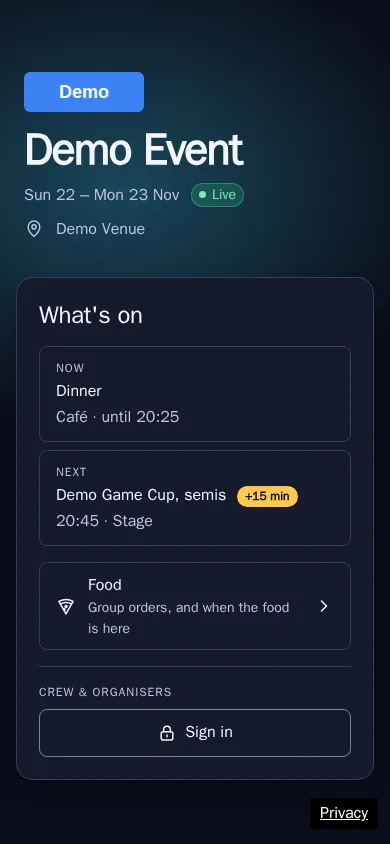 | 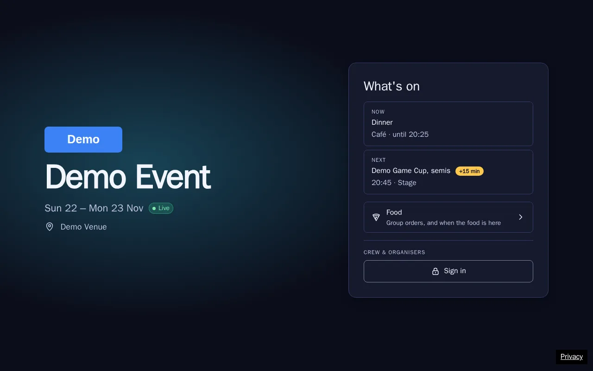 |

*Shot as a guest, not signed in.* The event's base address (`/`, #752): what anyone sees who types the event's address or scans its QR. The event's name, dates, Live and the venue, then What's on: Dinner now, the semis next with their delay, and the Food card, "Group orders, and when the food is here", which opens the Food page. Crew and organisers sign in below. On a desktop the event stands on the left and What's on on the right. It follows the App track's hub and the step 5 plan's entry to Food (mockup 02, the flow from the QR to an order).

### A2 · The Food page

| 390 px | 1280 px |
|---|---|
| 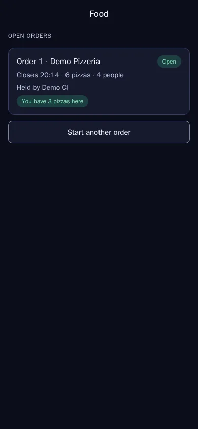 | 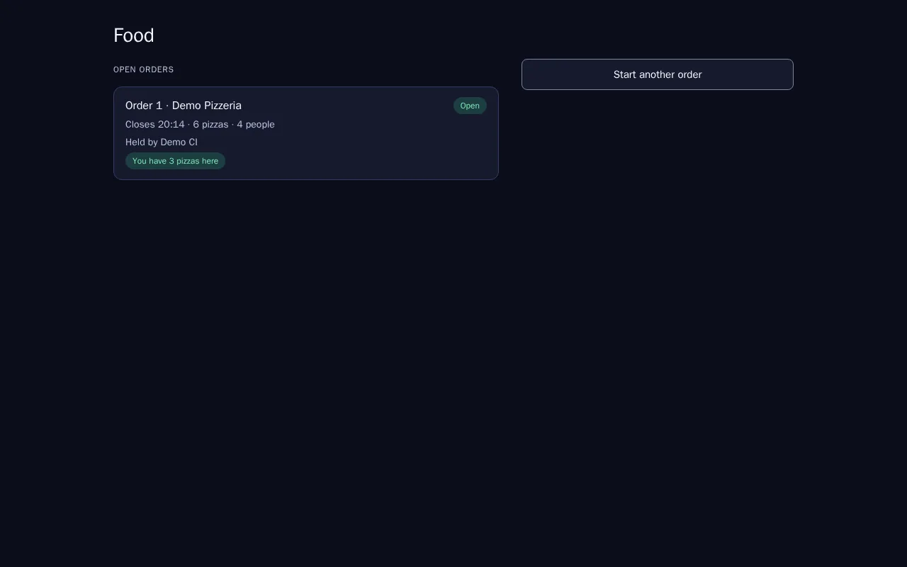 |

*Order open.* Where an attendee picks an order to join. Each open order is a card with its pizzeria, its close time, how many pizzas and people, who holds it, and "You have 3 pizzas here" for one's own; "Start another order" opens a new one at another pizzeria (mockup 06). On a desktop the list and the start button stand side by side. Mockup 03 (the open orders).

### A3 · The menu

| 390 px | 1280 px |
|---|---|
| 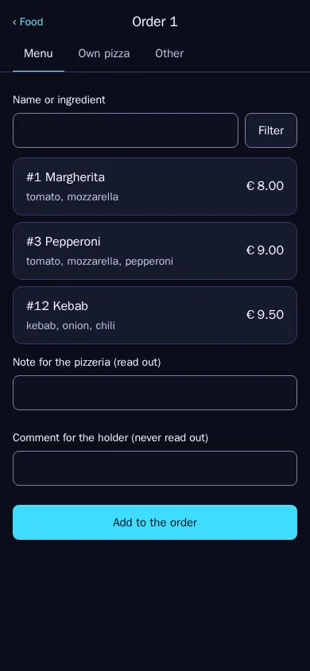 | 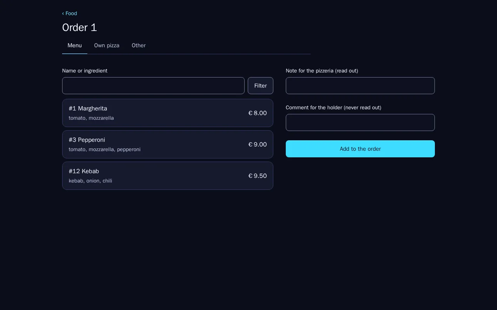 |

*Order open.* Adding a pizza: the attendee taps one of the pizzeria's items (number, name, toppings and, new in the plan, its price, D7 B), may filter by name or ingredient, may add a note the holder reads out to the pizzeria and a comment only the holder sees, and presses "Add to the order". Menu, Own pizza and Other are tabs. On a desktop the menu is on the left and the note and button on the right. Mockup 04.

### A4 · Own pizza

| 390 px | 1280 px |
|---|---|
| 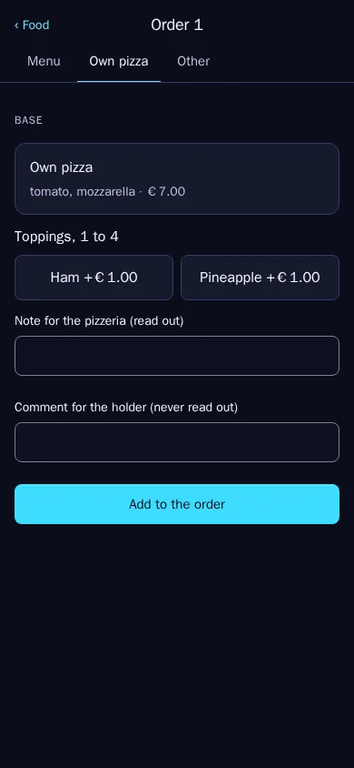 | 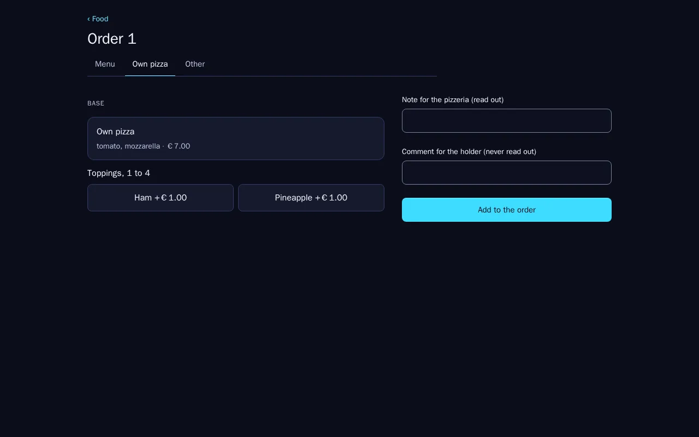 |

*Order open.* The same page's Own pizza tab: the pizzeria's base with its price, then one to four toppings, each with what it adds. The pizza's price is the base's plus its toppings' (the plan, Money). Mockup 04.

### A5 · My order, with its estimated amount

| 390 px | 1280 px |
|---|---|
| 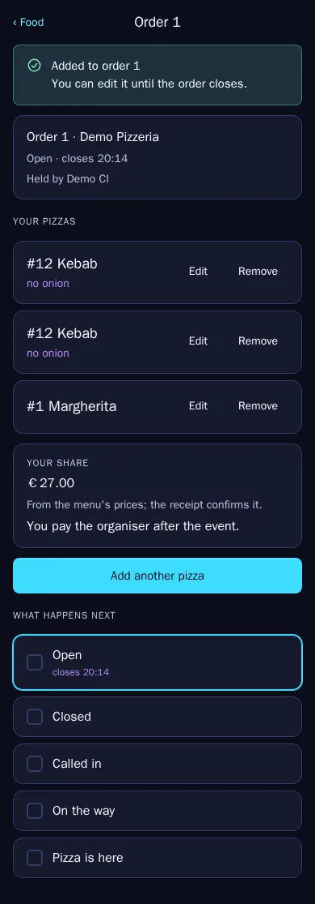 | 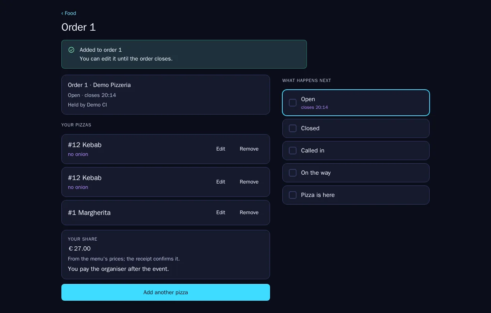 |

*Order open, just after adding a pizza.* "Added to order 1: you can edit it until the order closes." The order, the attendee's pizzas with Edit and Remove, and Your share: €27.00, "From the menu's prices; the receipt confirms it", with who is paid ("You pay the organiser after the event", the default). What happens next lists the order's steps, with Open and its close time current. On a desktop the steps move to the right. Mockup 05 and the plan's Money (D7 B: an exact amount as soon as one orders).

### A6 · My order, the total and "Pay me with"

| 390 px | 1280 px |
|---|---|
| 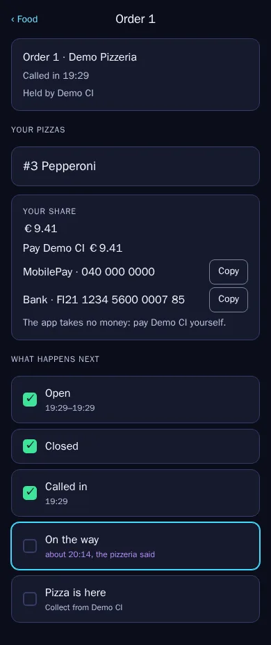 | 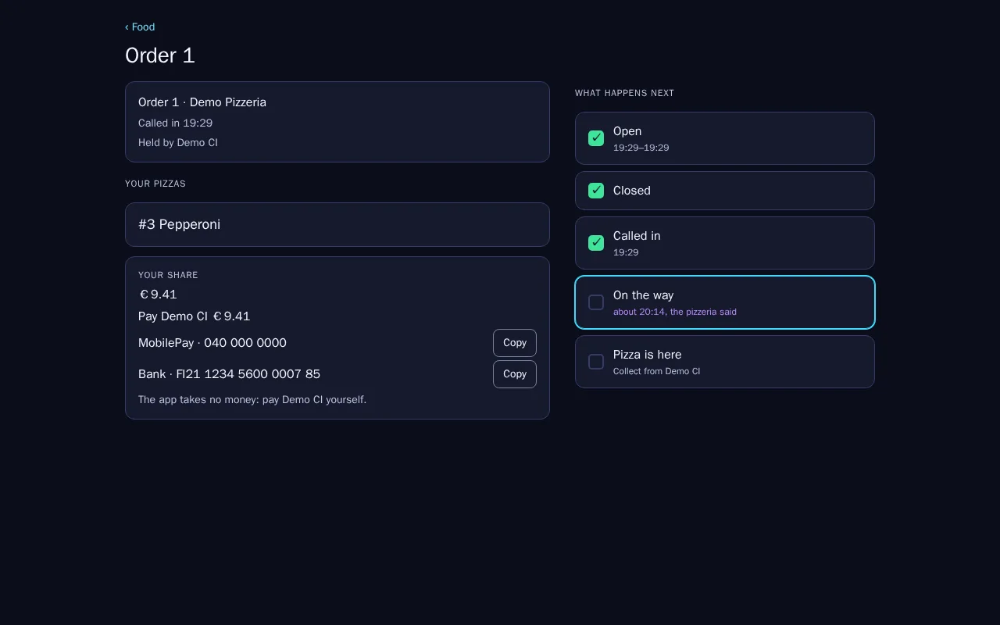 |

*Order on the way, receipt confirmed, settled to the holder; seen by Player 3, not marked paid.* What a member reads once the holder has confirmed the total and chosen "Me directly" (H4). Their one pizza, then Your share: €9.41, their exact amount from the receipt (the menu price plus their share of the extras), "Pay Demo CI €9.41", and the holder's MobilePay number and bank account, each with Copy, under "The app takes no money: pay Demo CI yourself." Only the people in this order and the crew see these details. What happens next has On the way current with the pizzeria's estimate. On a desktop the share stays on the left and the steps go to the right. The plan's "Pay me with" (PO note, 2026-11-19) and mockup 19.

### A7 · Pizza is here

| 390 px | 1280 px |
|---|---|
| 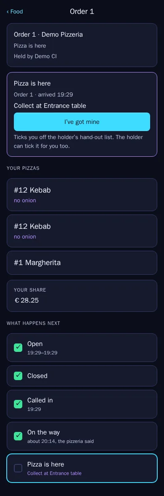 | 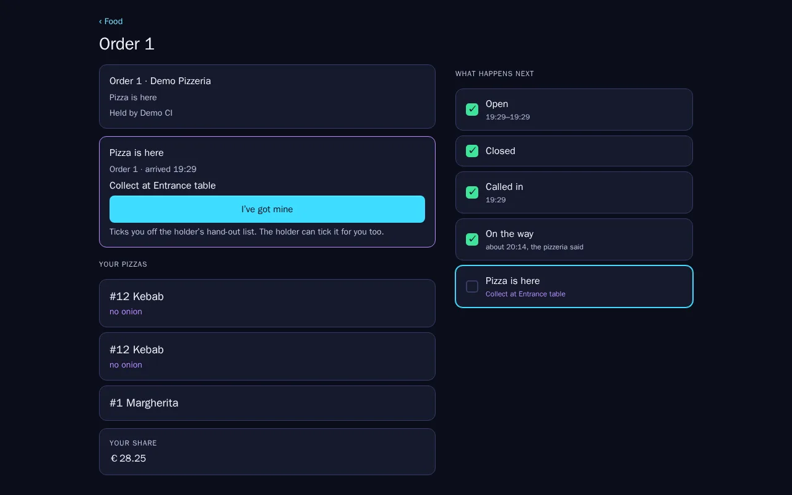 |

*Order here; seen by Demo CI, who holds it.* The order page once the holder marks it here: "Pizza is here · Order 1 · arrived" and "Collect at Entrance table", the holder's pickup note. "I've got mine" ticks the attendee off the holder's hand-out list; the holder can tick it too. Your share is now €28.25, from the confirmed receipt: the menu's prices plus a share of the delivery and the discount. Each step of What happens next has its time; On the way says "about 20:14, the pizzeria said". Mockup 05 (here).

### A8 · The notification everyone in an order gets

No image: the notification is a Web Push that the phone or the PC browser draws, outside the page, so Chromium's screenshots cannot take it (see [Seen while shooting](#seen-while-shooting)). Its words are the food topic's (`modules/pizza/src/topic.ts`, [contracts/notify.md](../../contracts/notify.md#topics-and-sources)), filled in here for this order. Each person in the order gets it on the channels they chose in Notify (push on by default, Discord DM off); the personal notices around it are below too:

| When | Title | Text | Opens |
|---|---|---|---|
| The holder calls it in | Order 1 is called in | Demo Pizzeria: expected at 20:14 | the person's order |
| It is here | **Pizza is here: order 1** | **Collect at Entrance table** | the person's order |
| 5 min after the holder's last money change, when it settles to the holder; to all but the payer and those already marked paid | Order 1: pay Demo CI your share | Your amount and how to pay are on your order | the person's order ([A6](#a6--my-order-the-total-and-pay-me-with)) |
| The holder ticks someone paid | Order 1: marked paid | Demo CI has your payment marked | the person's order |

"Pizza is here" is the notice the step 5 gate names: it reaches everyone in the order, and it follows mockup 05's push ("DEMO EVENT · FOOD / Pizza is here: order 2 / Collect at the entrance table") word for word. The plan put the payer's details in the "It's here" push; the contract (#703, pizza.md Notices) made it a notice of its own that names whom to pay, while the amount and the "Pay me with" details stay on the order page only, never in a notice or on the bus.

## The order holder

The holder is an attendee who started the order or took it over: a volunteer, so the app counts, reads and reminds (the plan's principle 2). These are the steps after the order is called in: the money, then the hand-out.

### H1 · The order's money, before the receipt

| 390 px | 1280 px |
|---|---|
| 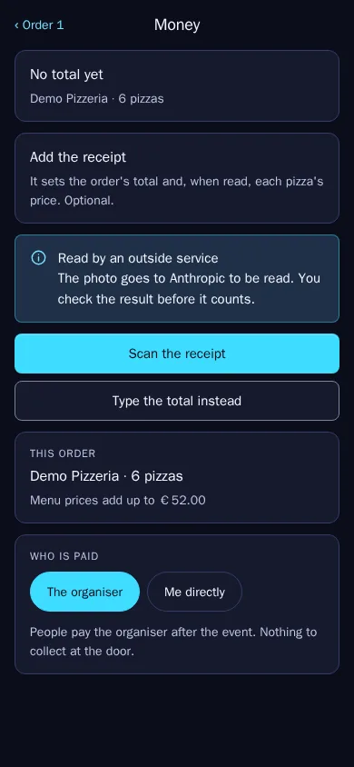 | 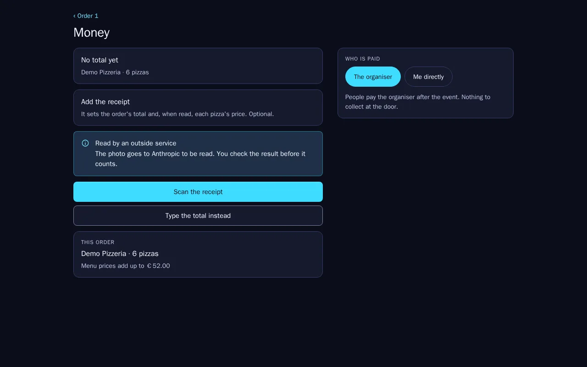 |

*Order on the way, no total yet.* Where the holder puts in what the pizzeria was paid. "Add the receipt" (optional) says what it is for; the AI reader's notice says the photo goes to Anthropic to be read and that the holder checks the result. "Scan the receipt" or "Type the total instead". This order: Demo Pizzeria, 6 pizzas, menu prices €52.00. Who is paid: the organiser by default, or "Me directly" when the event allows it (M1). Mockups 18 A and 19.

### H2 · Scanning the receipt

| 390 px | 1280 px |
|---|---|
| 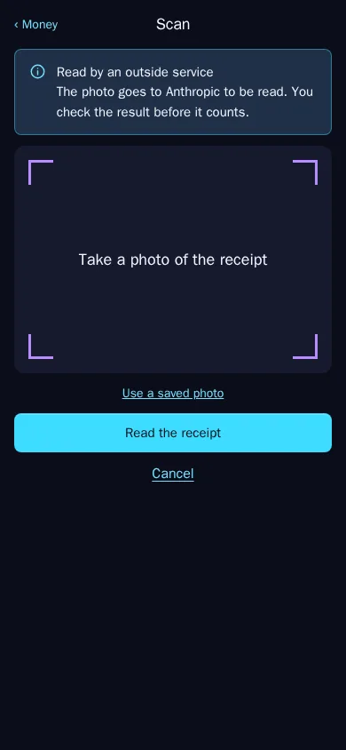 | 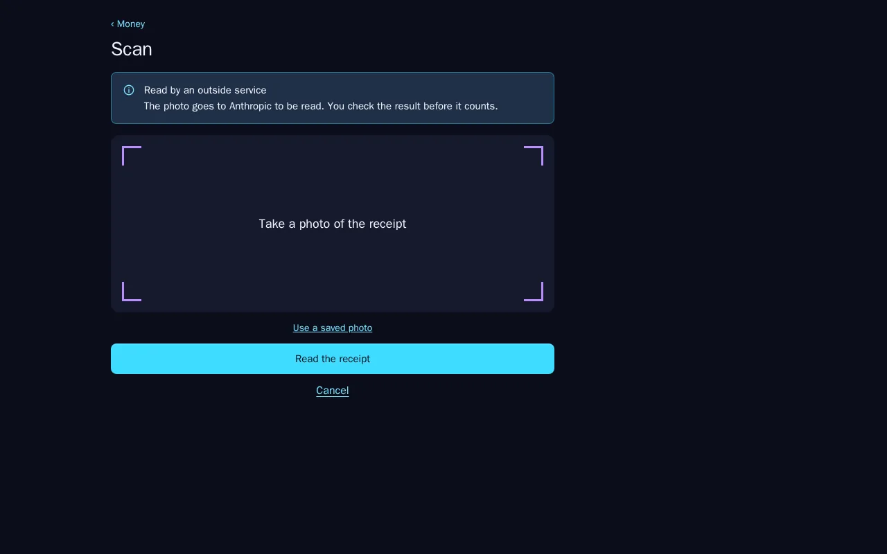 |

*The receipt upload.* The camera frame ("Take a photo of the receipt"), or "Use a saved photo" on a PC, then "Read the receipt". The outside-service notice is repeated here, where the photo is sent. Mockup 18 B.

### H3 · Checking the read

| 390 px | 1280 px |
|---|---|
| 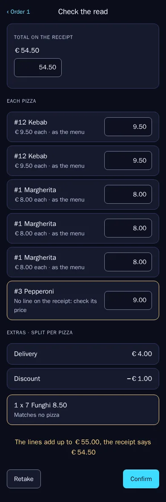 | 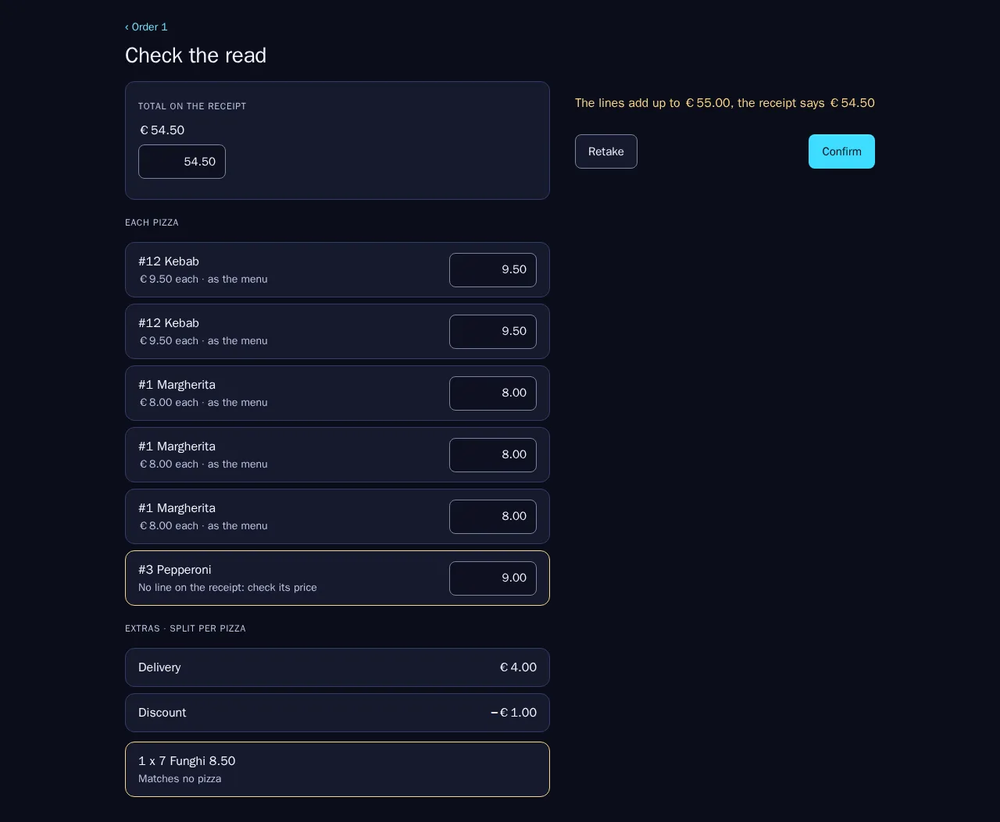 |

*After CI's fake reader read the receipt.* Nothing counts until the holder confirms (M3). The total on the receipt (€54.50, editable), each pizza with the price read or "as the menu", the one pizza with no line on the receipt marked to check, the extras (Delivery €4.00, Discount −€1.00) that are split per pizza, a line that matches no pizza, and the warning that the lines add up to €55.00 while the receipt says €54.50. Retake or Confirm. Mockup 18 C.

### H4 · Paid to the holder: "Pay me with", who owes you, Paid ticks

| 390 px | 1280 px |
|---|---|
| 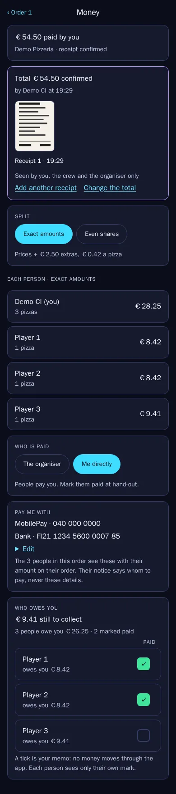 | 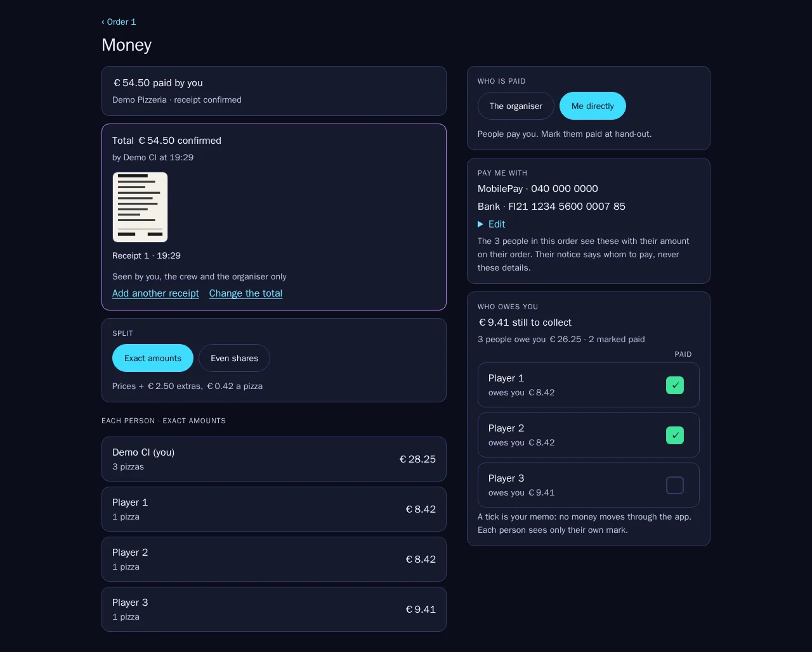 |

*Receipt confirmed, settled to the holder, Players 1 and 2 marked paid.* The holder's whole money view: €54.50 paid by them, the confirmed total with the receipt's thumbnail (seen by the holder, the crew and the organiser only), the split (Exact amounts: prices plus €2.50 extras, €0.42 a pizza), each person's amount (they add up to the total, the largest remainder going to the cent), Who is paid set to "Me directly", Pay me with (MobilePay and a bank account, behind Edit, and who sees them), and Who owes you: €9.41 still to collect, with a Paid tick per person, "a memo: no money moves through the app". On a desktop the settling part moves to the right. Mockup 19 B and C, the plan's Money.

### H5 · Hand-out

| 390 px | 1280 px |
|---|---|
| 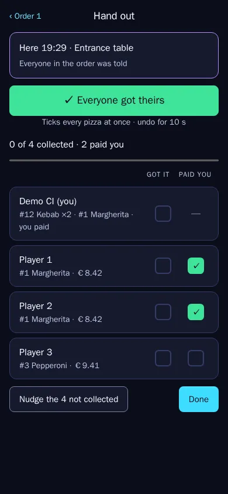 | 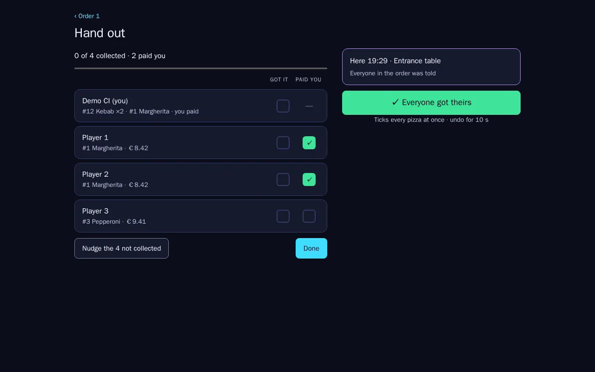 |

*Order here, nothing collected yet.* At the pickup place: "Here 19:29 · Entrance table, everyone in the order was told", then "Everyone got theirs", which ticks every pizza at once with 10 s to undo (U4). Below, one row per person with their pizzas and amount, a Got it tick and, because this order settles to the holder, a Paid you tick. "Nudge the 4 not collected" and Done. On a desktop the list is on the left and the big button on the right. Mockup 09 A, which also draws one row per person.

### H6 · Done

| 390 px | 1280 px |
|---|---|
| 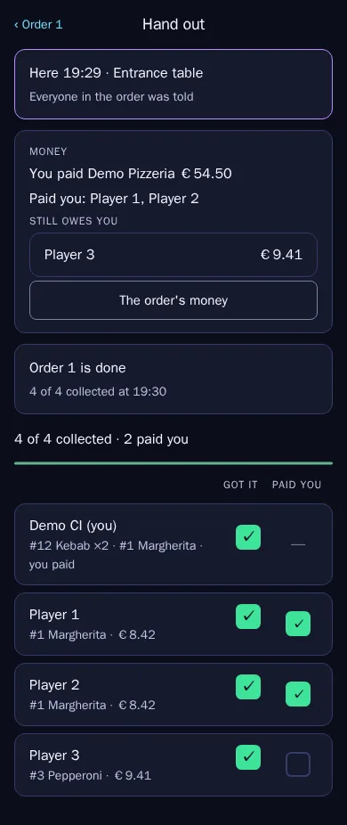 | 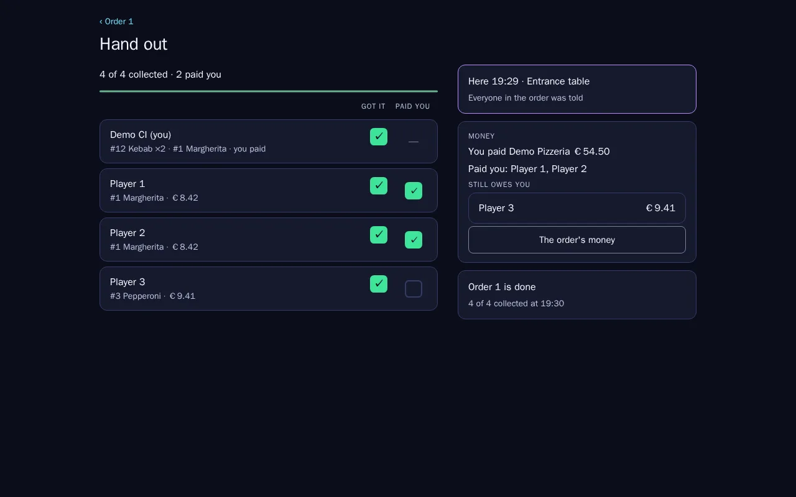 |

*After "Everyone got theirs".* "Order 1 is done, 4 of 4 collected", every Got it ticked, and the money's summary: the holder paid Demo Pizzeria €54.50, Player 1 and Player 2 paid them, Player 3 still owes €9.41, and a link to the order's money. Mockup 09 C.

## The crew

The crew and the organiser use Food in the organiser shell (Run the event → Food): its tabs are Orders, Pizzerias and menus, Record and Settings. They watch the day's orders, step in when an order stalls, and hand the day's money to the payment system after the event.

### C1 · Food's Orders tab: the order list

| 390 px | 1280 px |
|---|---|
| 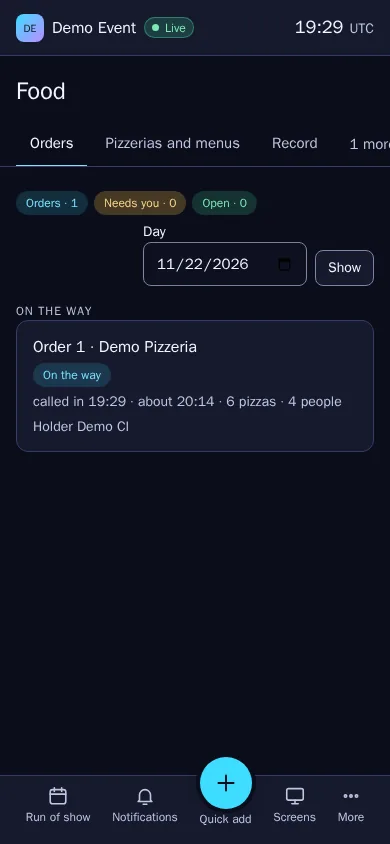 | 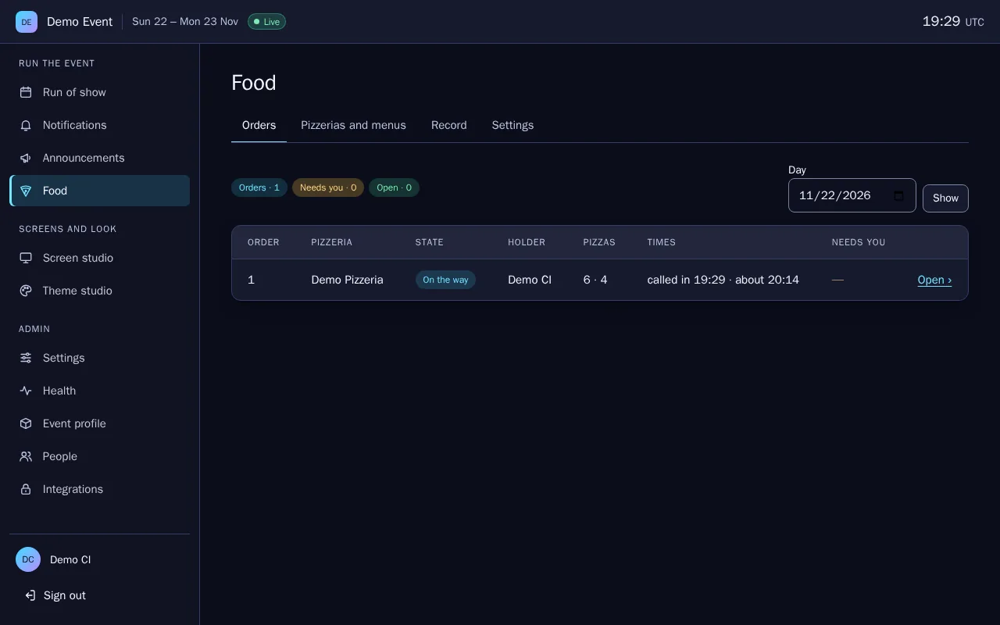 |

*Order on the way.* Food's crew page: counts (orders, needs you, open), a day picker, and the day's orders. On a desktop a table: order, pizzeria, state, holder, pizzas and people, times and what needs the crew, each with Open. On a phone the same orders as cards, grouped by state ("On the way"). Mockup 10 (without its door helper, U5 B).

### C2 · One order, for the crew

| 390 px | 1280 px |
|---|---|
| 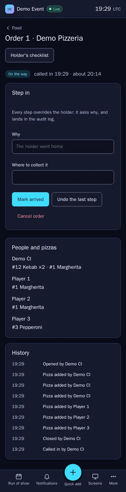 | 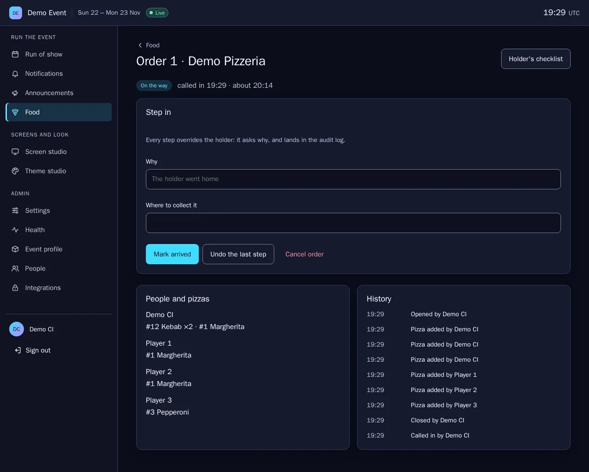 |

*Order on the way.* Where the crew steps in when a holder went home: every step asks why and lands in the audit log; here Mark arrived (with where to collect it), Undo the last step and Cancel order. Below, the people and their pizzas and the order's history, and "Holder's checklist" opens the holder's page. Mockup 10 (stepping in).

### C3 · Settings

| 390 px | 1280 px |
|---|---|
| 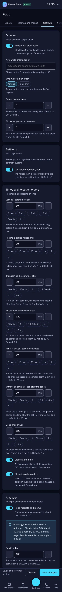 | 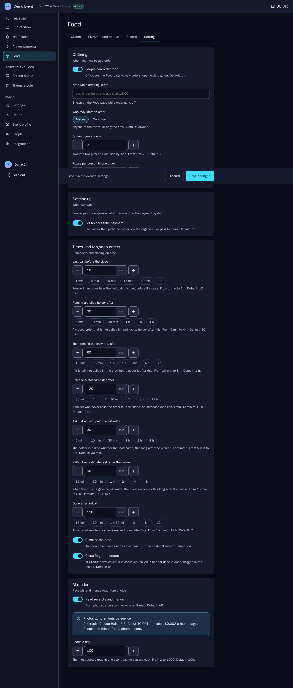 |

*Before the event, or whenever the organiser needs it.* Food → Settings (#751 moved them here from Admin): Ordering (on or off, the note while off, who may start an order, orders open at once, pizzas per person), Settling up (people pay the organiser; "Let holders take payment" lets a holder choose "Me directly"), Times and forgotten orders (last call, the holder's and then the crew's reminders, release, the arrival question, done after arrival, closing at the time and closing forgotten orders at 06:00), and the AI reader (on or off, which outside service and its cost, reads a day). The bar with Discard and Save changes stays at the window's bottom; a full-page shot draws it where the first window ended. Mockup 17.

### C4 · The Record

| 390 px | 1280 px |
|---|---|
| 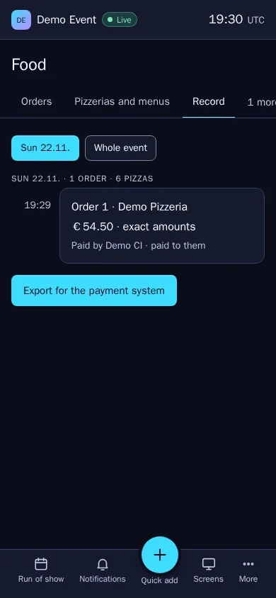 | 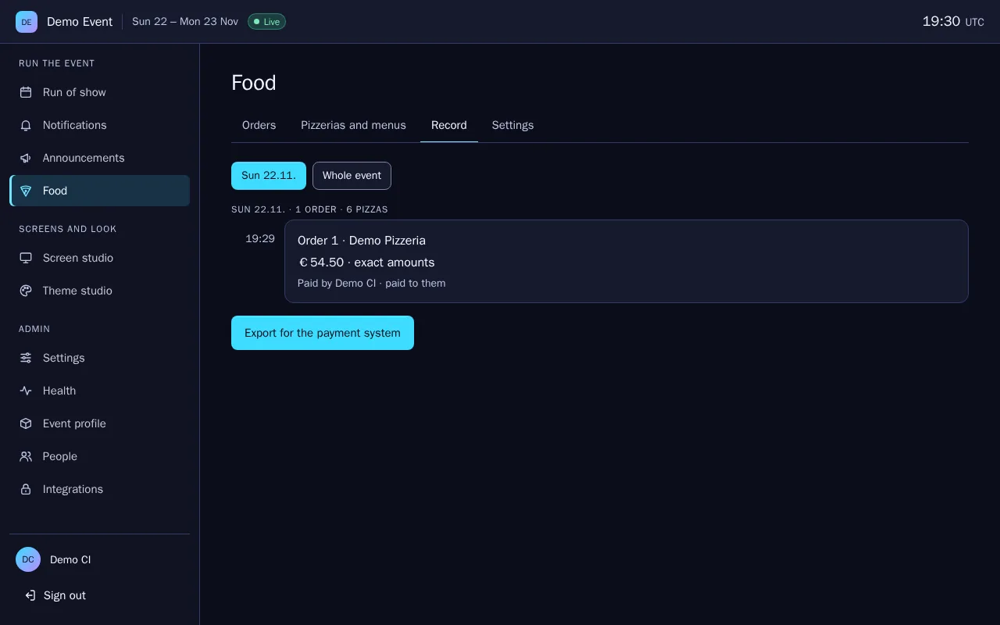 |

*After the order is done.* The treasurer's view: one event day (Sun 22.11.) or the whole event, the day's count of orders and pizzas, then each order by its time as a day schedule (amendment 4): its pizzeria, its total and split, who paid and who it settles to. "Export for the payment system" below. Mockup 12 A.

### C5 · One order's money in the Record

| 390 px | 1280 px |
|---|---|
| 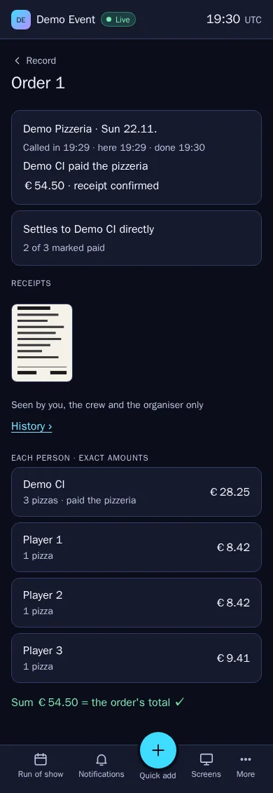 | 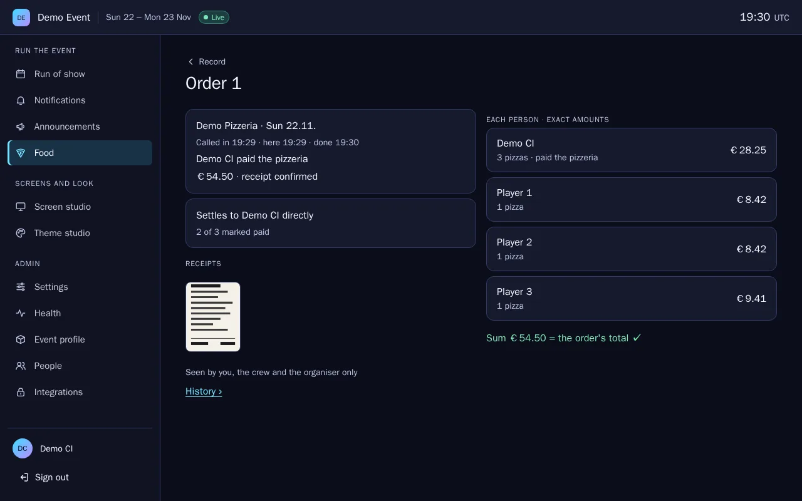 |

*After the order is done.* One order as the treasurer checks it: its pizzeria and day, called in, here and done times, who paid the pizzeria and the confirmed total, who it settles to and how many are marked paid, the receipt, its history, and each person's amount, ending "Sum €54.50 = the order's total ✓". Mockup 12 B.

### C6 · The export

| 390 px | 1280 px |
|---|---|
| 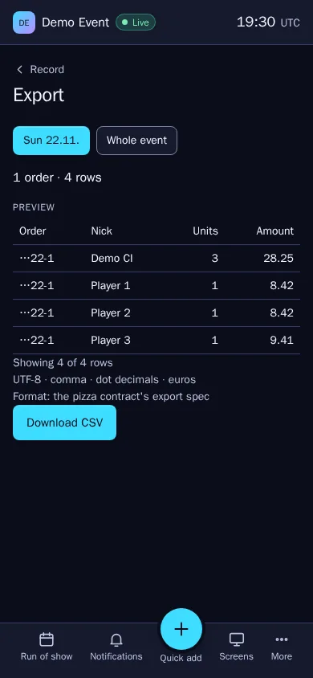 | 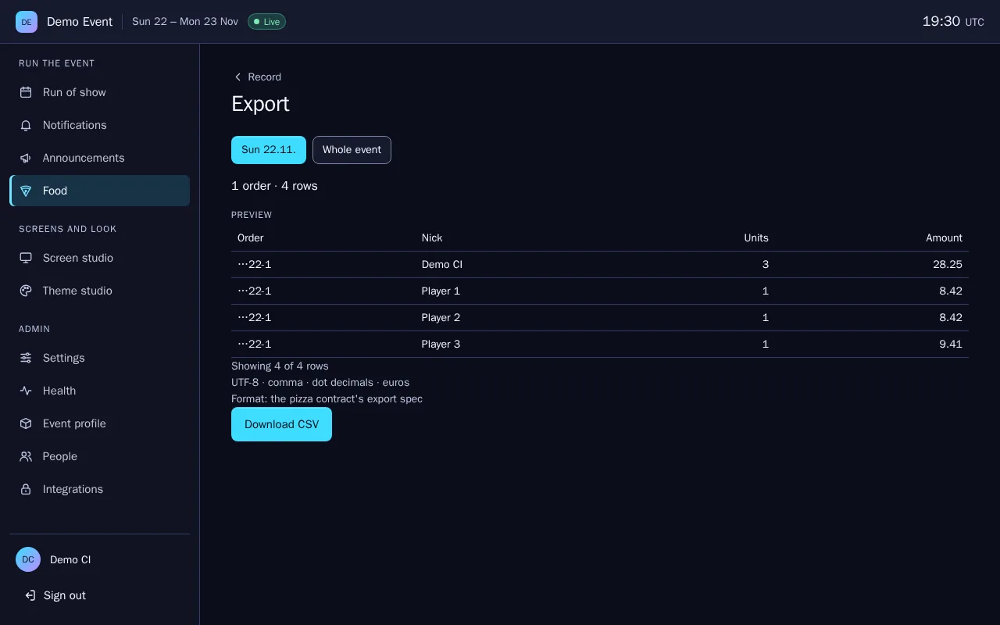 |

*After the event.* The file the organiser loads into the payment system (M4): the day or the whole event, a preview of its rows (order, nick, units, amount), its format (UTF-8, comma, dot decimals, euros, as the pizza contract's export spec) and Download CSV. Mockup 12 C and the plan's contract part for the export.

## The room

Step 5 added the food box to the venue screen (#643): one of the main zone's rail widgets, with the event hub's QR beside it. Moments' pizza stories take the hero for a while at each step. Shot at 1920×1080, shown at 1280×720.

### R1 · Open

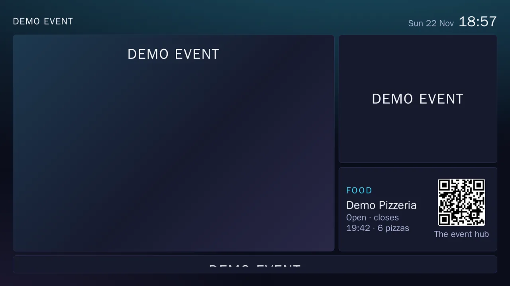

*Order open.* The food box: Demo Pizzeria, "Open · closes 19:42 · 6 pizzas", and the QR to the hub, so anyone in the hall can join from their phone. Mockup 14.

### R2 · On the way

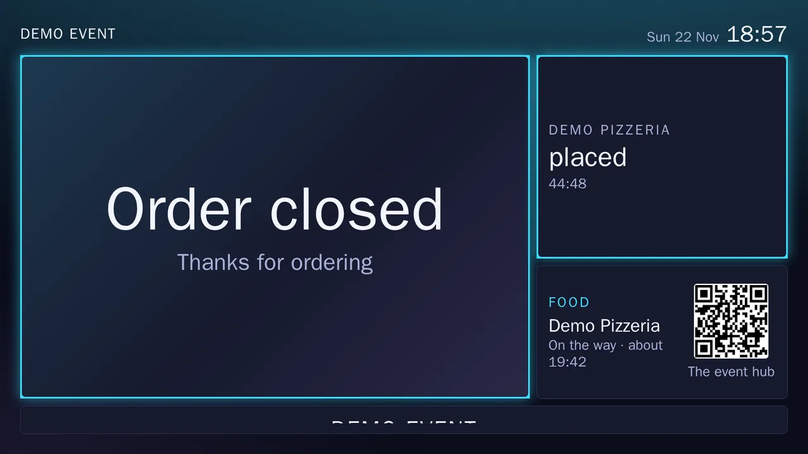

*Order called in.* The box says "On the way · about 19:42". The hero still shows Moments' "Order closed, Thanks for ordering" and a side region the order's state with a countdown (see [Seen while shooting](#seen-while-shooting)). Mockup 14.

### R3 · Here

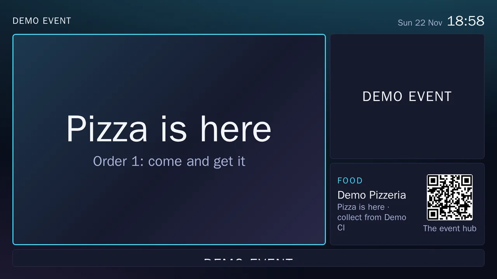

*Order here.* Moments' "Pizza is here, Order 1: come and get it" takes the hero, and the box says "Pizza is here · collect from Demo CI". Mockup 14 and the step 5 gate (the screen shows it).

## Seen while shooting

Not fixed here (out of scope); for the lead to sort into issues.

**The room**
- **R2, a stale story and a state name:** after the order was called in, the hero still shows Moments' "Order closed, Thanks for ordering", and the side region shows the order's state as the API names it, "placed", in lower case with a countdown (44:48), while the food box beside it says "On the way". In the PR's run the same "placed" region was still there after the order arrived, and the hero showed only the event's name (`pizza-screen-food-here` of run 45060878319).
- **R3, two pickup places:** the food box says "collect from Demo CI", while the holder set the pickup to "Entrance table", which the order page (A7) and the notification (A8) say.
- **R1, no open-order story:** while the order is open the hero shows only the event's name. Moments' "Pizza order open" story was not on air at the moment of either run's shot (the stories group shoots it on its own stack).
- **R1–R3, the ticker:** the bottom ticker shows only the top half of "DEMO EVENT" in all three shots, in both runs.

**The attendee**
- **A2, no way back:** the attendee's Food pages have none of the hub frame that mockups 03–05 draw (the event's header and the Now, Schedule, Play, Alerts, More bar). The Food page has no link back to the front door, and the order pages lead back only to Food.
- **A2 at 1280 px:** with one order the desktop Food page is one card and a lone button, with most of the window empty.
- **A5–A7, steps that look like checkboxes:** What happens next draws each step as an empty checkbox in a box of its own, which reads as something to tick; only "I've got mine" ticks anything.
- **A5–A7 and H4–H6, boxes:** amendment 3's "few boxes" rule: each single pizza line and each step is framed, and Who owes you (H4) and Still owes you (H6) put boxes inside a box.
- **A6, Pay me with:** the amount shows twice in one card ("€9.41", then "Pay Demo CI €9.41"), and there is no link that opens the MobilePay app, which the plan's "Pay me with" asks for where the service offers one.
- **A8, no notification list:** a push is the only place a notice shows. Notify has `GET /api/notify/inbox`, but no page in this build shows it, so a dismissed "Pizza is here" is found again only on the order page.
- **A1, Privacy:** the Privacy link sits in a black box with white underlined text in the corner, outside the theme's look.

**The order holder**
- **H4 against mockup 19 B:** each person's row shows "1 pizza" and an amount, not the pizzas and the price plus extras ("#12 Kebab ×2 · €19.00 + €1.00") the mockup draws, so the holder cannot see how an amount was made.

**The crew**
- **C1 on a phone:** Food's tabs run off the right edge, and Settings hides behind "1 more", which is cut off. The day picker writes the date as 11/22/2026 (the browser's US format), while the Record says "Sun 22.11.".
- **C1 and amendment 4:** the Orders tab lists the day's orders as a table (desktop) and as cards grouped by state (phone), not as a day schedule by call time, which amendment 4 asks of pizza orders; the Record (C4) is one.
- **C6, the export's preview:** the Order column shows "…22-1", cut short though the column has room, and the preview leaves out `settle_to`, so it does not show that this order settles to its holder, and its rows look like any rows to charge (the CSV itself carries `settle_to`).
- **C3, not a defect:** the full-page shot draws the save bar over "Pizzas per person"; in a window the bar sits at the window's bottom.

## Lead's evaluation

