# UX consistency audit: every user-facing surface of step 3 so far

Issue #377. Every page and state a person can open on the demo stack at main `1561af0` (2026-11-11), compared with each other, with `packages/ui` and with the step 3 mockups. The product owner reads this first; the lead then files the fixes as at most three issues (proposed at the end).

## In short

The platform looks like three products today:

- the **admin pages** (sign-in, settings, health, profile, people) are unstyled browser HTML: white, Times-like defaults, no `ui.css`, and on a phone they render at desktop width and shrink to unreadable;
- the **event pages** (run of show, notifications, Theme studio, check-in) use `packages/ui`, but each module draws its own header, menu, page width, title size and error page;
- the **screen** (device frames, Pulse) has its own look again, with two different backgrounds between the frames.

The five problems people will notice first:

1. The admin pages are unstyled and not phone-ready ([A1](#a1)).
2. Buttons made from links lose their label: "Quick add", "Delay" and "New template" are empty blue boxes, and "Cancel…" is unreadable ([B1](#b1)).
3. The Theme studio says "No problems." and then refuses to publish the demo event's own theme with a raw schema path ([C1](#c1)).
4. Four different "you can't open this" pages, titled "No access", "Not available" and "Not changed", show raw right ids like `agenda.items.write` ([B3](#b3)).
5. The "Event" menu differs on every page: admin's has Theme but Studio's has no Run of show; only admin has Sign out ([B2](#b2)).

## How it was made

- **Stack:** `deploy/compose.yml` with the CI overlay `deploy/compose.ci.yml` (demo event, session stub), built from main `1561af0`. It ran as its own Compose project on a local port so it touched no other stack. A local-only overlay, not committed, did three things:
  - it gave the stub's `demo-ci` session every right the pages check (the CI stub has only admin and screen rights);
  - it pointed theming, agenda, notify and tenants at the stub;
  - it added Docker's address pools to their Tailscale ranges, as the CI overlay already does for screen.

  A second stub cookie with no rights produced the "no access" pages.
- **Data:** the demo profile loaded with the Profile page's Load button, six run-of-show items through `POST /api/agenda/items` (one delayed), and two screens paired through the player itself (`/screen/` → code → `POST /api/screen/devices` → assign to zone `main`). The venue address check was turned off for the screen states through the audited `PUT /api/tenants/current/venue-ip-check`. The archived state was set in the database (see [D7](#d7)).
- **Browser:** Chromium 1.64.1 (the Playwright image CI uses). Desktop 1440×900; phone 390×844 (a current mid-size phone, touch, 2×), for the pages people use on a phone (sign-in, run of show, check-in, Studio); screens at 1920×1080 (the brief's primary target, L9), 3840×2160 and 1080×1920.
- **Compared with:**
  - `packages/ui` ([README](../../packages/ui/README.md), `ui.css`);
  - the step 3 mockups in [docs/briefs/step-3-screen/](../briefs/step-3-screen/), mainly [02 Pulse](../briefs/step-3-screen/02-pulse-main.svg), [05 device states](../briefs/step-3-screen/05-device-states.svg), [06 pairing](../briefs/step-3-screen/06-flow-pairing.svg), [12 brand kit](../briefs/step-3-screen/12-brand-kit.svg) and [14 check-in](../briefs/step-3-screen/14-flow-checkin-handoff.svg);
  - the step 3 design principles ([brief, Plan](../briefs/step-3-screen.md#design-principles)).

  **Step 2 has no mockups:** briefs start at step 3, and no step 2 issue or PR added any. Step 2's pages are therefore compared with `packages/ui` and with the rest.
- **Images:** 44 screenshots in [ux-audit-step3/](ux-audit-step3/), cropped to what matters, at 1× (desktop 1200 px wide, phone 390 px, screen 1280 px).

### What does not exist yet (gaps, not inconsistencies)

- **Hub pages:** there are none. The hub is the App track. The only attendee pages are notify's check-in page and the Studio's sample "Phone hub" preview.
- **Screen studio:** no page yet (devices, zones, schedule, content). The pairing frame already points people to it ([D3](#d3)).
- **Pulse after #375:** #375 (the built-in Pulse look per mockups 02–04) is open. The Pulse screenshots show main before it, so its gaps are listed for #375 ([D5](#d5)), not as new fixes.
- **Discord sign-in** cannot run locally. The sign-in page shows its "not configured" state; the signed-in button state was not seen.

## Inventory

| Surface | Module | Who | Screenshots |
|---|---|---|---|
| Sign-in, sign-in failed, first run | admin | anyone | [01](ux-audit-step3/01-admin-sign-in.png), [02](ux-audit-step3/02-admin-sign-in-phone.png) |
| Settings, settings of a module, health, profile, people, no access | admin | organiser | [03](ux-audit-step3/03-admin-settings.png)–[07](ux-audit-step3/07-admin-no-access.png) |
| Run of show: day, item, delay, quick add, full form, templates, notices, errors | agenda | organiser, crew | [09](ux-audit-step3/09-agenda-no-access.png), [12](ux-audit-step3/12-agenda-unknown-item.png)–[20](ux-audit-step3/20-agenda-empty.png) |
| Notifications: topics, new topic, archived notice | notify | organiser | [10](ux-audit-step3/10-notify-no-access.png), [21](ux-audit-step3/21-notify-topics.png)–[23](ux-audit-step3/23-notify-archived.png) |
| Theme studio: brand kit (no draft, draft, publish), advanced, history, four previews, errors | theming | organiser | [08](ux-audit-step3/08-studio-no-access.png), [11](ux-audit-step3/11-studio-refused-network.png), [24](ux-audit-step3/24-studio-no-draft.png)–[33](ux-audit-step3/33-studio-preview-hub-phone.png) |
| Check-in | notify | attendee (phone) | [34](ux-audit-step3/34-checkin-sign-in-phone.png)–[36](ux-audit-step3/36-checkin-invalid-phone.png) |
| Screen: pairing, not assigned, refused, Pulse, offline, identify | screen | the room | [37](ux-audit-step3/37-screen-pairing.png)–[44](ux-audit-step3/44-screen-portrait-identify.png) |

Severity: **high** = looks broken or blocks a task; **medium** = clearly inconsistent or confusing; **low** = polish.

## A. Admin pages (step 2)

### A1
**A1 · high · The admin pages are unstyled and not phone-ready.** Sign-in, settings, health, profile and people use none of `packages/ui`. They are white browser-default pages: bold black serif-less headings, blue underlined links, grey system buttons and bordered HTML tables. All other pages are dark and themed. The frame has no `<meta name="viewport">`, so a phone renders it 980 px wide and shrinks the text to about 6 px. The cause is `modules/admin/src/canccu_admin/pages.py`, which writes its own `<body style='font-family:sans-serif;max-width:48rem'>`. The sign-in page is the first thing an organiser sees.

| Desktop | Phone |
|---|---|
| 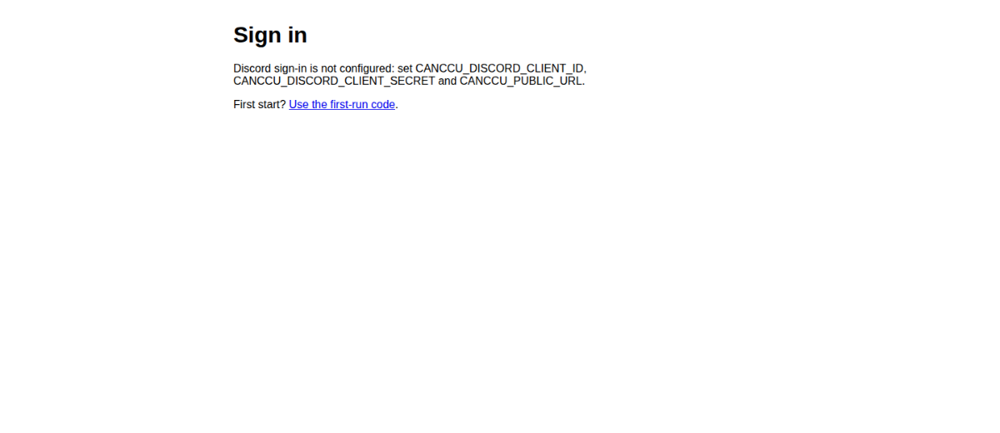 | 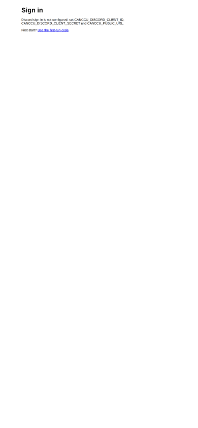 |

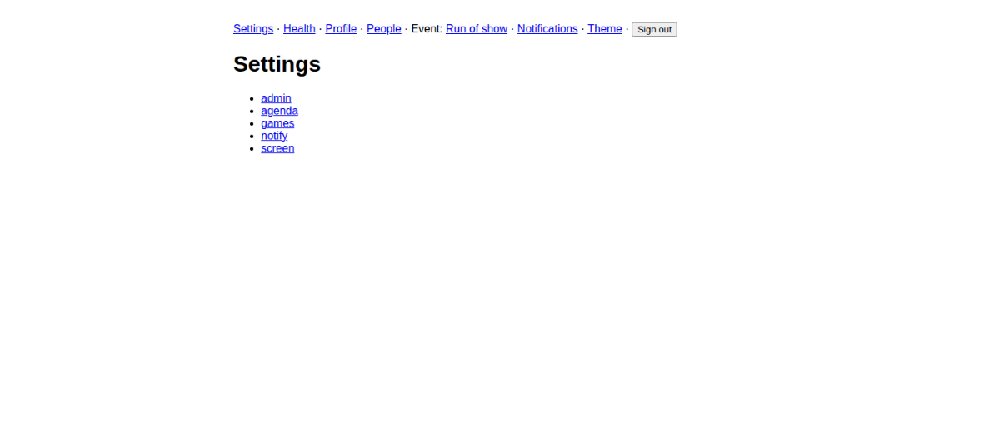
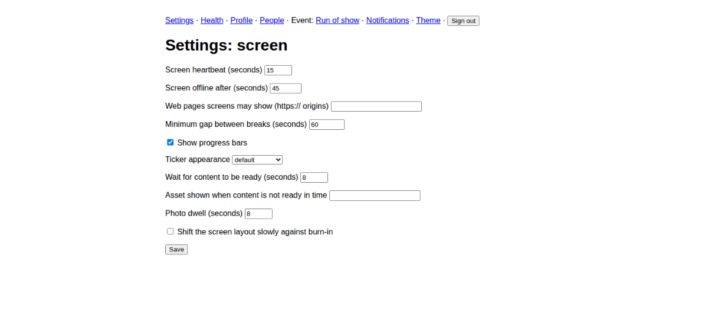

**A2 · medium · Ids instead of names.**
- Settings lists module ids as a bullet list: `admin`, `agenda`, `games`, `notify`, `screen` ([03](ux-audit-step3/03-admin-settings.png)).
- Health shows the module id, `ok` and `dev`, with an empty Detail column.
- Fix: names ("Run of show"), a status badge (`packages/ui` has `healthBadge`) and a readable version.

**A3 · medium · Health shows 3 of 8 modules.** The page polls only what `CANCCU_HEALTH_TARGETS` lists in `deploy/compose.yml`: `hello`, `screen` and `theming`, plus admin itself. agenda, notify, tenants and screen-render are missing, so a stopped run of show reads as healthy ([05](ux-audit-step3/05-admin-health.png)). `hello` is a test module and shows too.

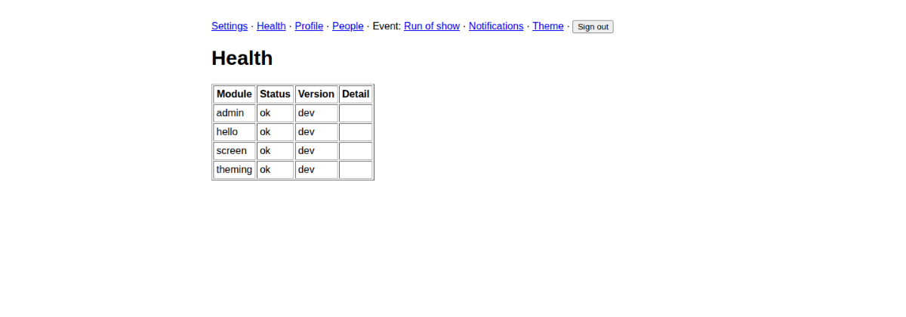

**A4 · low · Settings forms.**
- Inputs have mixed widths.
- There are no hints or units beyond the label.
- Checkbox labels sit to the right while the other labels sit to the left.
- "Saved." is plain text.
- Fix: the `packages/ui` form field and notice ([04](ux-audit-step3/04-admin-settings-screen.png)).

**A5 · low · Profile and people.**
- Profile is two stacked grey buttons, with "Loaded Demo Event" as bold text ([06](ux-audit-step3/06-admin-profile.png)).
- People is an empty two-column table with no empty state.
- The sign-in page tells the organiser to set `CANCCU_DISCORD_CLIENT_ID`, `CANCCU_DISCORD_CLIENT_SECRET` and `CANCCU_PUBLIC_URL`, which is operator wording on a user page.

## B. Shared frame of the event pages

### B1
**B1 · high · Link buttons lose their label.** `ui.css` styles `.canccu-page a { color: primary }`. That selector (one class, one element) outranks `.canccu-button--primary { color: primary-text }` (one class). Any `<a class="canccu-button …">` therefore gets primary-coloured text:
- on a primary button the text is invisible;
- on a danger button it is blue on red;
- on a secondary button it is underlined link text.

Seen on:
- run of show: "Quick add" in the bottom bar, "Delay" on an item, "Cancel…", "Show on screens now", "Edit or move" ([13](ux-audit-step3/13-agenda-day.png), [15](ux-audit-step3/15-agenda-item.png), [16](ux-audit-step3/16-agenda-item-phone.png));
- templates: "New template" ([19](ux-audit-step3/19-agenda-templates.png)).

The fix belongs in `packages/ui` (for example `.canccu-page a.canccu-button { color: inherit; text-decoration: none }` with the variant colours), so every module gets it.

| Run of show: empty blue button at the bottom | Item: blank "Delay", unreadable "Cancel…" |
|---|---|
| 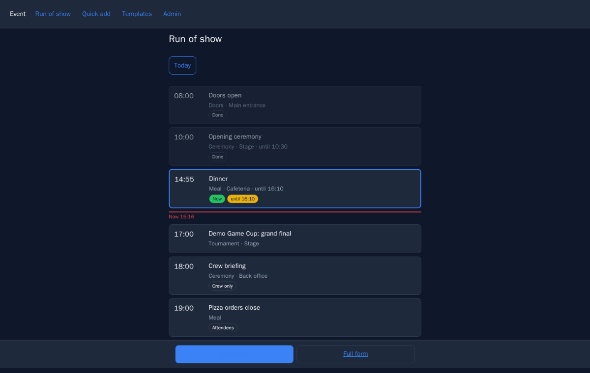 | 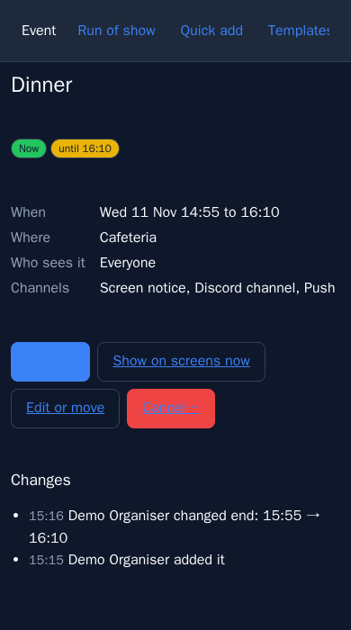 |

### B2
**B2 · medium · Every surface has its own header and Event menu.**

| Surface | Header bar | Menu |
|---|---|---|
| Admin | none | `Settings · Health · Profile · People · Event: Run of show · Notifications · Theme · [Sign out]`, inline |
| Run of show | "Event" + menu in the bar | `Run of show · Quick add · Templates · Admin` |
| Notifications | "Event" + menu in the bar | `Run of show · Notifications · New topic · Admin` |
| Theme studio | the page title ("Theme", "Theme: history", "Not available") | `Brand kit · Advanced · History · Admin`, as underlined links below the bar |

- Only admin links to Theme. The Studio links to neither Run of show nor Notifications. Run of show does not link to Notifications.
- Only admin has Sign out.
- No menu marks the current page.
- Header heights differ (48 px in Studio, 68 px in run of show and notifications).
- On a phone the run-of-show and notifications menus scroll sideways with no sign that they do: "Templates" is cut and "Admin" is out of view ([14](ux-audit-step3/14-agenda-day-phone.png)).
- Fix: one Event menu, drawn by one shared component (the brief's P4 already calls it one menu). It shows the event's name, every event page the session may open, the current page and Sign out, with the page's own sub-pages (Quick add, Templates, Brand kit…) as a second row.

### B3
**B3 · medium · Four designs for "you can't open this".** The same 403 for a missing right looks different on each surface:

| Admin | Studio |
|---|---|
| 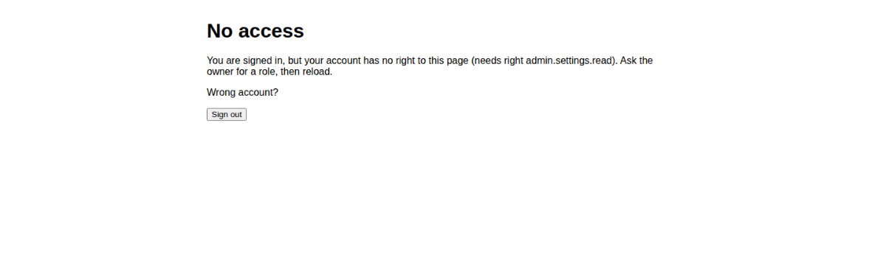 | 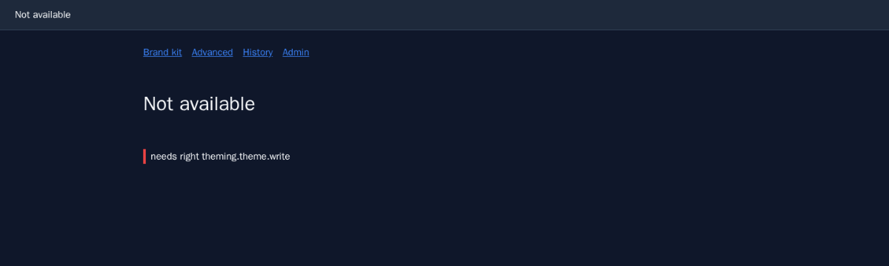 |
| **Run of show** | **Notifications** |
| 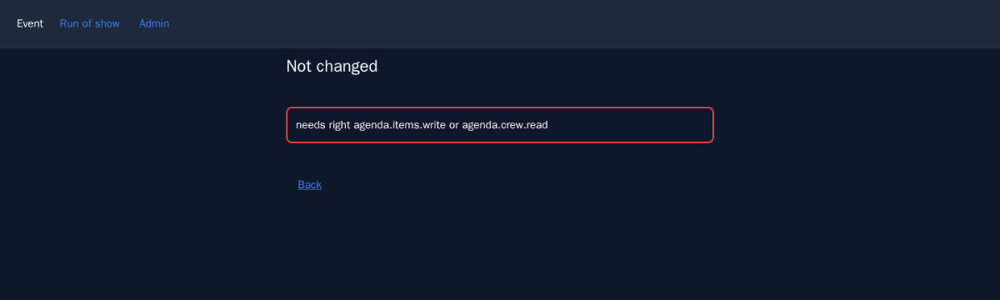 | 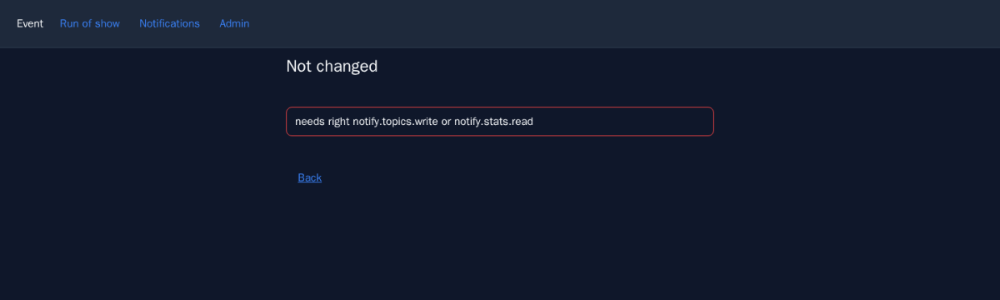 |

- **Titles:**
  - "No access" (admin).
  - "Not available" (Studio).
  - "Not changed" (run of show, notifications). It is used for opening a page, not only for a refused change, so an unknown item also says "Not changed" ([12](ux-audit-step3/12-agenda-unknown-item.png)).
- **Messages:** only admin explains ("ask the owner for a role"). The others show the raw requirement: `needs right agenda.items.write or agenda.crew.read`, `needs right theming.theme.write`.
- **Style:** a red left bar in the Studio; a red box with a 2 px border in run of show and a 1 px border in notifications; plain text in admin. "Back" sits indented in its own box.
- **The menu is still shown,** with links the person cannot follow.
- **Outside the venue or Tailscale,** the Studio says "admin is reachable only from the venue or Tailscale" ([11](ux-audit-step3/11-studio-refused-network.png)). That is lowercase, says "admin" on the Studio, and gives no next step.
- **Fix:** one error page in `packages/ui`: a title by case ("No access", "Not found", "Not at the venue", "Event archived"), one sentence in plain words, the next step and a way back. Right ids stay in the server log, not on the page.

**B4 · medium · Three content widths and three type scales.**
- Widths: admin 48rem (inline), run of show 40rem (`agenda.css`), Studio 64rem (`ui.css` default).
- Page titles: admin ~32 px bold, Studio ~32 px light, run of show and notifications 24 px light.
- Studio pages repeat the title in the header bar and as the h1 ("Theme" / "Theme").
- Fix: one width per page kind (forms 40rem, workspaces like the Studio 64rem) and one title size, set in `packages/ui`.

**B5 · low · Mixed date and time formats.**
- Run of show, Pulse and history use 24-hour times ("15:16").
- The full form's native date-time inputs follow the browser's locale; this Chromium showed "11/11/2026, 03:17 PM" ([18](ux-audit-step3/18-agenda-full-form-phone.png)).
- Admin's settings take a time zone but show none of its effect.
- Fix: the event's language setting (`en`, `fi`) should decide the format everywhere.

## C. Theme studio (step 3)

### C1
**C1 · high · "No problems", yet Publish refuses.** On a draft started from "The current theme", the Problems card reads "No problems." and Publish is enabled. Pressing it shows "The draft has errors; fix them first. theme.yaml#/tokens/fonts/body: No package font is Inter." ([26](ux-audit-step3/26-studio-publish-error.png)).
- **Why:** the demo event's profile sets the font Inter, but the draft has no font file.
- **Three problems at once:**
  - the check behind Publish is not the one behind the Problems card;
  - the message is a JSON path, not words;
  - the demo event's own theme cannot be published as it is.
- **Fix:** run the same check for both; word it ("The body font Inter is not in the theme. Upload it, or pick a system font."); and either ship the demo's font or drop it from the demo profile.

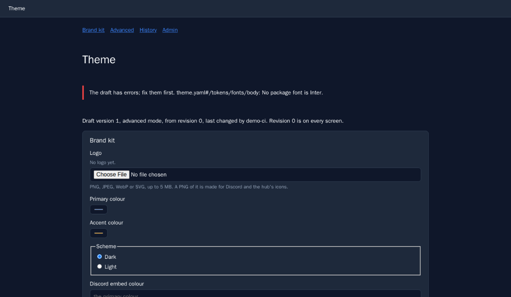

### C2
**C2 · high · The brand kit is a long form, not mockup 12.**

[Mockup 12](../briefs/step-3-screen/12-brand-kit.svg) puts the logo, two colours and the scheme on the left and four live previews on the right, with Discard, "Preview on a screen…" and Publish in one row. The page instead is one 1,760 px column ([25](ux-audit-step3/25-studio-brand-kit-draft.png)). The previews are below the fold, and Publish is at the very bottom.

Within it:
- **Colour pickers** show an empty grey swatch, not the current colour or its hex.
- **The scheme** is an unstyled `<fieldset>` with a white browser border.
- **The file input** is the browser's grey "Choose File".
- **The Colours card** lists raw token ids in monospace (`text_muted`, `status_degraded`, `primary_text`).
- **The status line:**
  - it reads "Draft version 1, advanced mode, from revision 0, last changed by demo-ci. Revision 0 is on every screen.";
  - "advanced mode" appears on the simple page;
  - it shows the user id where run of show shows the name ("Demo Organiser");
  - "Revision 0" is jargon; History says "Nothing published yet" for the same state ([29](ux-audit-step3/29-studio-history.png)).
- **The starter buttons** use slugs: "default", "terminal", "level-up" ([24](ux-audit-step3/24-studio-no-draft.png)).
- **Discard** hides in a disclosure ("▸ Discard the draft") under Publish.

| Built | Mockup 12 |
|---|---|
| 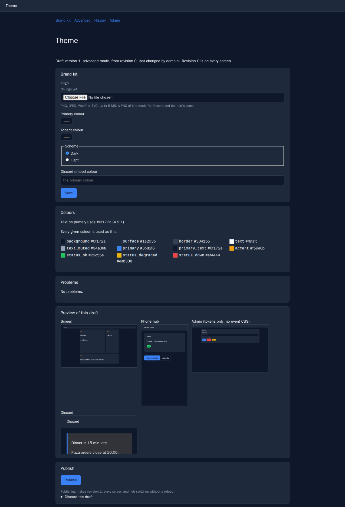 | 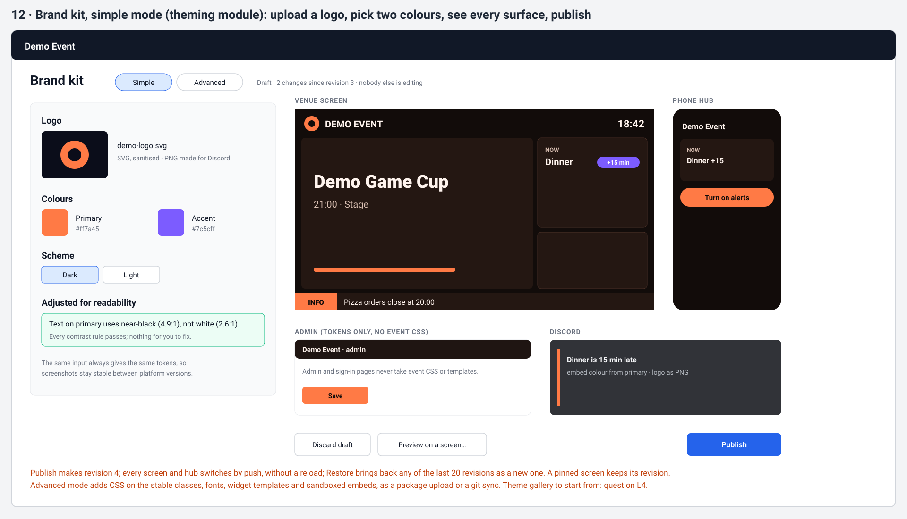 |

### C3
**C3 · high · The previews do not show the real surfaces.**
- **Screen:** a generic three-card sample with a fake "18:42", not the Pulse layout the zone plays ([30](ux-audit-step3/30-studio-preview-screen.png)). In the Studio it is a 300 px thumbnail with unreadable text.
- **Admin:** shows a dark, themed admin page ([31](ux-audit-step3/31-studio-preview-admin.png)) that does not exist; the real admin is unstyled white ([A1](#a1)). The organiser is shown a promise the product does not keep.
- **Discord:** a mostly empty grey embed, clipped in the Studio ([32](ux-audit-step3/32-studio-preview-discord.png)).
- **Phone hub:** has a green "ok" badge with no meaning ([33](ux-audit-step3/33-studio-preview-hub-phone.png)).
- **Layout:** the previews leave large empty gaps (the phone column is taller than its row).
- **Fix:** render the screen preview from the real Pulse layout at 16:9 and big enough to read. Once A1 lands, the admin preview matches the real admin.

| Screen preview | Admin preview |
|---|---|
| 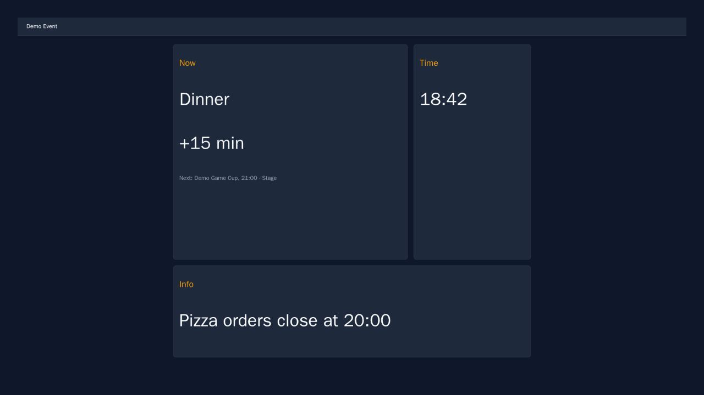 | 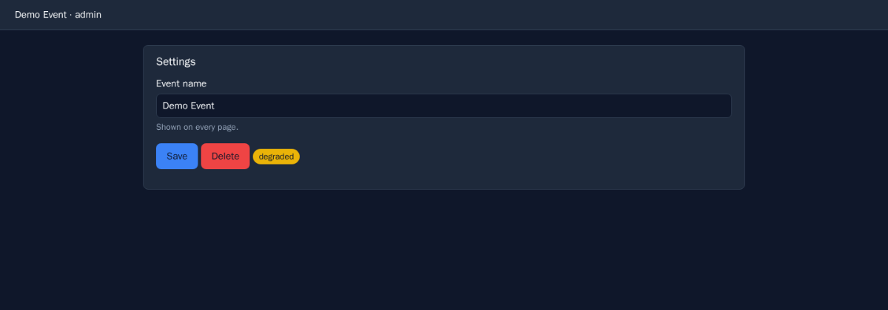 |

**C4 · medium · The Studio overflows on a phone.** The brand kit is 414 px wide in a 390 px viewport, so it scrolls sideways and the cards are cut at the right ([27](ux-audit-step3/27-studio-brand-kit-phone.png)). Run of show, notifications and history fit. U1 says organisers run the day from phones.

**C5 · low · Advanced is a long token list.** Advanced lists every token as a labelled text field: 15 rows of `#0f172a`-style hex, with no swatch and no grouping beyond "Colours" and "Fonts" ([28](ux-audit-step3/28-studio-advanced.png)).

## D. Screen: device frames and Pulse (step 3)

| Pairing | Not assigned |
|---|---|
| 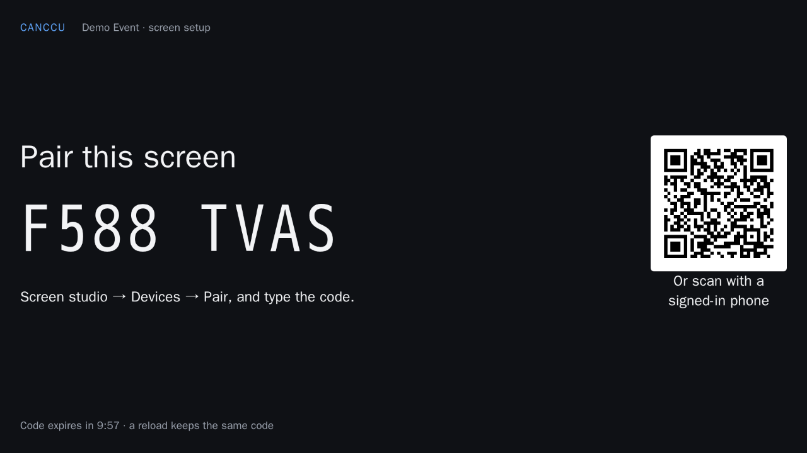 | 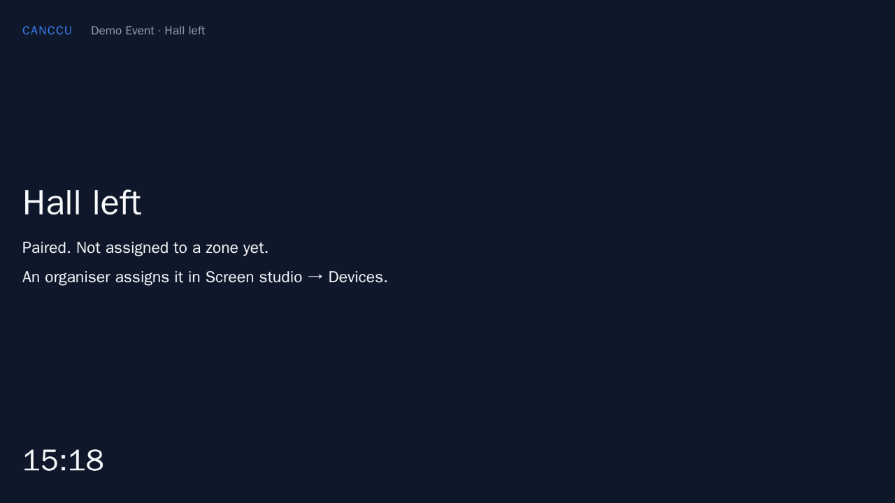 |
| **Refused (not at the venue)** | **Pulse at 1080p** |
| 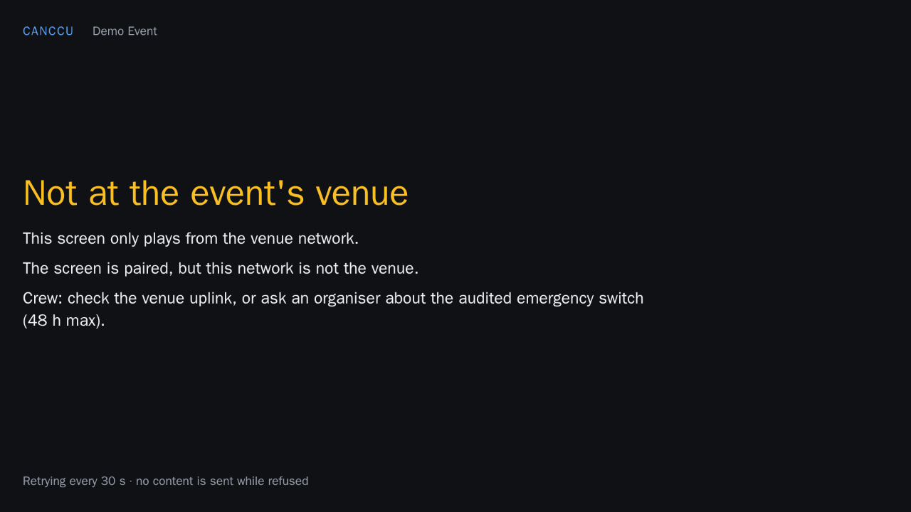 | 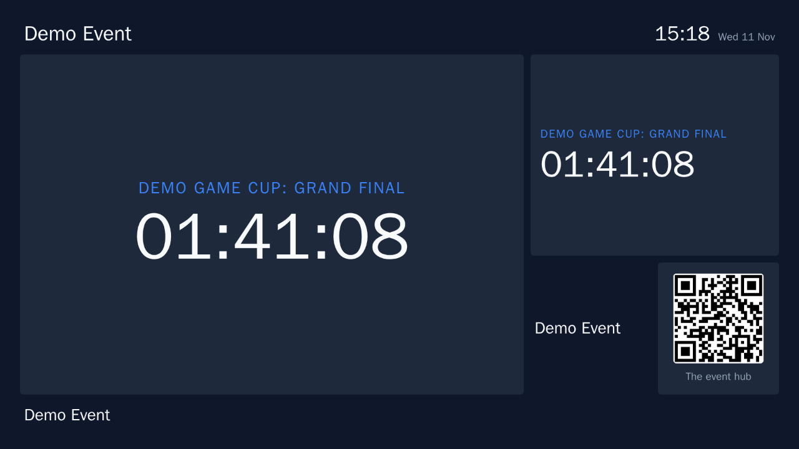 |

The frames follow [mockup 05](../briefs/step-3-screen/05-device-states.svg) closely in wording and structure; that is the most consistent part of the platform. The issues:

**D1 · medium · Two backgrounds.** Pairing and refused draw on the player's fallback near-black `#0f1115` (`player.css`), because no theme is loaded in those states. Not-assigned, Pulse and every themed page draw on the theme background (`#0f172a` in the default theme). A screen that goes from pairing to not-assigned to Pulse changes colour twice. The fallback could be `ui.css`'s default token, so the change is invisible.

**D2 · medium · The safety elements do not use `packages/ui`'s safety classes.**
- `ui.css` defines `canccu-pairing-code` and `canccu-offline-marker` as protected elements: fixed look, top right for the marker ([README](../../packages/ui/README.md), [theming contract](../../contracts/theming.md#advanced-mode)).
- The player draws its own `canccu-frame__code` and `canccu-offline-mark` (`modules/screen/player/src/frames.ts`).
- So the mark sits bottom right in muted grey ([42](ux-audit-step3/42-screen-offline.png)), where [mockup 05](../briefs/step-3-screen/05-device-states.svg) shows an amber mark top right. A theme could also restyle them.
- Contract compliance is for the reviewer of the fix; here it is the visible inconsistency.

### D3
**D3 · medium · The pairing frame points to a page that does not exist.**
- The frame says "Screen studio → Devices → Pair, and type the code", but no Screen studio page exists yet.
- The QR opens `/admin/screen/devices#pair=CODE` (`player.ts`), which answers 404.
- The not-assigned frame says the same ("An organiser assigns it in Screen studio → Devices").
- Until the Screen studio lands, the frames should name what exists, or the QR should open a page that says it is coming.

**D4 · medium · The offline mark needs a closed stream.**
- With the screen service stopped, "offline since 15:21" appears after 10 s ([42](ux-audit-step3/42-screen-offline.png)).
- With the service paused, the stream stays open but silent, and after 16 s no mark had appeared.
- The mark is set only when the stream closes (`live.ts`, `streamOpen`), so a hung uplink shows a live-looking screen with stale data.
- Principle 5 ("fail visible") suggests also marking a stream that has sent nothing, not even a ping, for the offline time.

| Offline mark (bottom right, grey) | Identify (version reads "vdev") |
|---|---|
| 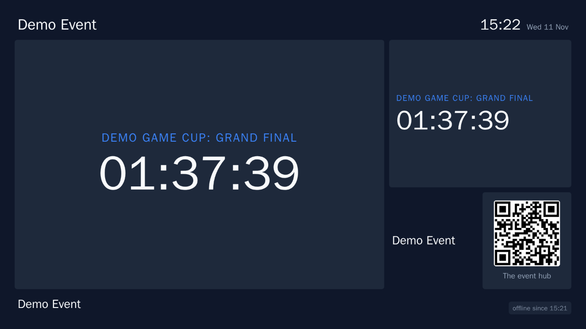 | 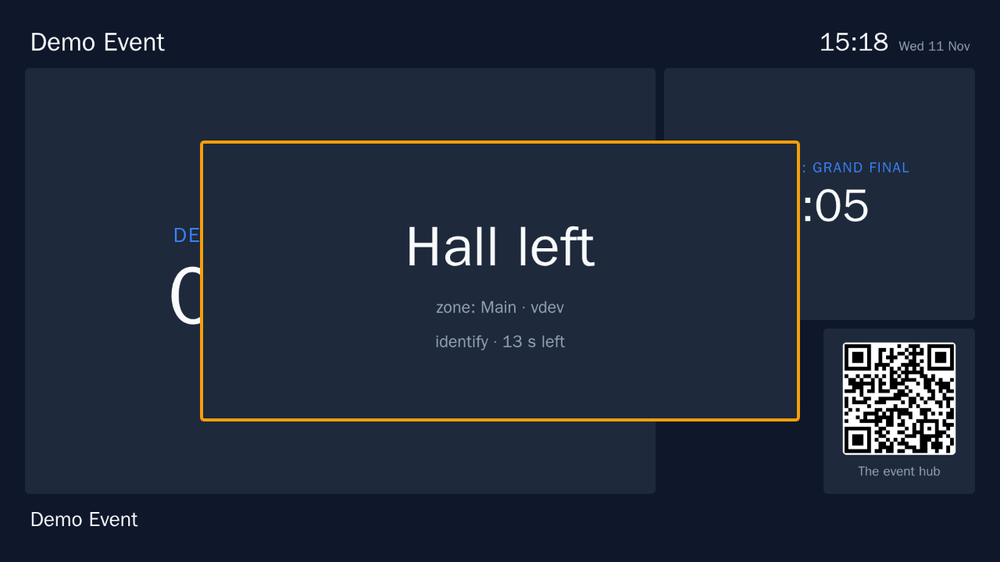 |

### D5
**D5 · for #375 · Pulse against mockup 02.** These are the gaps #375 already owns ("the built-in Pulse look matches mockups 02–04"). They are listed so the PO can check them there, not as a new fix:
- **Duplicate content:** the hero and the rail show the same countdown, "Demo Game Cup: grand final", side by side ([40](ux-audit-step3/40-screen-pulse.png)). The rail switches to "Now and next" only later ([41](ux-audit-step3/41-screen-pulse-4k-now-next.png)).
- **The event name appears three times:** in the header, in the venue rail and in the footer where the ticker is empty.
- **Missing from mockup 02:**
  - the logo;
  - the zone name in the header;
  - the "+15 min" delay chip on the delayed item;
  - Wi-Fi and check-in in the venue rail;
  - the ticker's label and text.
- **Readability (L7):** the date beside the clock and the "Now / Next" labels are small for 20 m.

**D6 · low · Identify and portrait.**
- The identify card reads "zone: Main · vdev": `v` + the build version `dev` ([43](ux-audit-step3/43-screen-identify.png)).
- In a portrait window the card scales with the window, not the stage. Its text grows to ~140 px while the landscape stage is letterboxed ([44](ux-audit-step3/44-screen-portrait-identify.png)).
- The not-assigned frame puts its clock large at bottom left; [mockup 05](../briefs/step-3-screen/05-device-states.svg) has it small at bottom right.

### D7
**D7 · medium, to confirm · Archived reaches only Notifications.** With the demo tenant set to `archived`:
- Notifications showed "The event is archived: its topics can be read, not changed." ([23](ux-audit-step3/23-notify-archived.png));
- run of show, the Studio and the check-in page looked live;
- a new screen still showed the pairing frame, not "This event has ended".

Caveat: the state was set in the database, not through `POST /api/tenants/current/status`, which needs the superadmin. A module that learns the status from the `tenants.status.changed` event, or caches the tenant, would not have seen it. Re-check through the API before acting on it. If it holds, every surface should show the same archived notice, worded alike.

## E. Check-in (attendee, step 3)

| Sign in first | Ready | Code not valid |
|---|---|---|
| 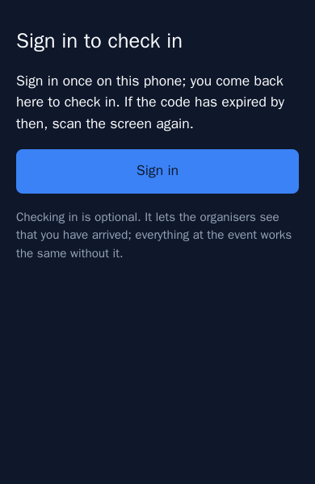 | 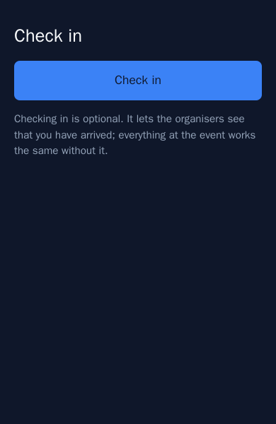 | 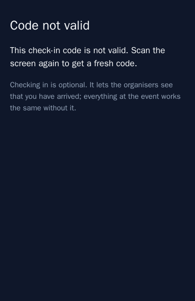 |

These pages are the best of the set: phone first, clear wording, one big button, and the "Checking in is optional" line (0027). Two issues:

**E1 · medium · No event identity.** No event name, logo or header: an attendee who scans a QR cannot tell which event or site they are on. [Mockup 14](../briefs/step-3-screen/14-flow-checkin-handoff.svg) and the Studio's own hub preview ([33](ux-audit-step3/33-studio-preview-hub-phone.png)) show the event's name in a header bar.

**E2 · low · Two different "ready" layouts.** "Sign in to check in" has a sentence above its button; "Check in" has none, so the two steps of one flow look unrelated. Mockup 14 also names the sign-in button "Continue with Discord", which says where the person goes, while the page says "Sign in".

## F. Run of show and notifications: other findings

- **F1 · medium · Quick add repeats choices.** "What" mixes templates (Food, Ceremony, Game session) and kinds (Doors, Ceremony, Tournament, Meal, Activity, Other). Ceremony appears twice, and Food and Meal sit side by side ([17](ux-audit-step3/17-agenda-quick-add-phone.png)).
- **F2 · low · The now line is red.** It uses the theme's `status_down` colour, which elsewhere means an error ([13](ux-audit-step3/13-agenda-day.png)). The accent or primary would say "now" without alarm.
- **F3 · medium · An empty select with nowhere to go.** New topic offers "Based on" with an empty select and a Next button while no module has registered a topic ([22](ux-audit-step3/22-notify-new-topic.png)). It needs the empty state the topics page already has ("No module has registered a topic yet.").
- **F4 · low · Empty states vary.** They range from a plain sentence (run of show: "Nothing on this day yet.", notifications) to nothing at all (people). One empty-state style with a next step ("Add the first item") would match.

## Proposed fix issues (for the lead, at most three)

Each line names the findings it closes. Contracts and migrations are not touched by any of them, except as noted under issue 2.

1. **`fix(ui): one admin shell for every organiser page`** (module:ui, module:admin, plus agenda, notify and theming for adoption):
   - admin's pages move onto `packages/ui`'s `page()`, with the viewport meta (A1, A4, A5);
   - names and badges on settings and health, and every module in the health list (A2, A3);
   - the link-button fix in `ui.css` (B1);
   - one Event menu component with the event name, current page and Sign out (B2);
   - one error page component with plain wording by case and no right ids (B3);
   - one content width and title scale (B4);
   - time formats from the event's language (B5);
   - quick add, the now line and empty states (F1–F4);
   - the check-in header with the event's identity (E1, E2).

   Risk normal. The admin shell touches sign-in pages only in look, not in flow; the reviewer may raise it if it touches session code.
2. **`fix(theming): the brand kit matches mockup 12`** (module:theming):
   - the two-column layout with live previews beside the form;
   - colour fields that show their colour and hex, styled scheme and file inputs, names instead of token ids, a plain status line;
   - Discard, Preview and Publish in one row (C2);
   - one check for Problems and Publish, worded, and a publishable demo theme (C1);
   - a screen preview from the real Pulse layout, a truthful admin preview, and fixed Discord and hub previews (C3);
   - no sideways scroll on a phone (C4);
   - swatches in Advanced (C5).

   Risk normal. If the demo font fix changes `events/demo/`, it stays in this issue.
3. **`fix(screen): device frames are one family`** (module:screen, module:ui):
   - one background for every frame (D1);
   - the safety classes of `packages/ui` for the pairing code and the offline marker, placed as in mockup 05 (D2);
   - frames and QR that point to pages that exist (D3);
   - an offline mark for a silent stream (D4);
   - the identify card's version and scaling, and the not-assigned clock (D6);
   - the archived frame and notices on every surface, if D7 holds.

   Risk: D2 touches a contract's safety rule, so the planner should check whether it is normal or high. The Pulse look itself (D5) stays with #375.

## Reproducing

1. Start the stack with `docker compose -f deploy/compose.yml -f deploy/compose.ci.yml up -d --build --wait` ([docs/ci.md](../ci.md#demo-stack)).
2. Use a local overlay that:
   - points theming, agenda, notify and tenants at `session-stub` (`CANCCU_ADMIN_URL`) with screen's `CANCCU_TAILSCALE_CIDRS`;
   - lists the rights the pages check in the stub's `demo-ci` answer.
3. Load the profile on `/admin/profile`.
4. Pair a screen by opening `/screen/` in a browser and posting its code to `POST /api/screen/devices` with the `demo-ci` cookie.
5. Take screenshots with the Playwright image, as `scripts/demo-screenshots` does.
