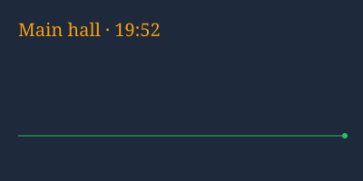

# Demo brief: the hall screen

The research pack for the demo step, built like [the briefs' outline](README.md#outline-of-a-research-pack). It uses the demo event only.

> **Source update.** The inventories were refreshed; nothing here changed.

## Goal
Show the hall what is on **now**, with `screen.changed` as the *only* event. Text such as  stays text.

## Key flows

### The first view (attendees)
- The hero fills the screen:
  - the clock;
  - the next item.
- The ticker runs below.

1. The organiser opens Studio.
2. The crew checks the [Every mockup](#every-mockup) table.

### Every mockup
| File | What it shows | For whom |
|---|---|---|
| [01-directions.svg](demo-pack/01-directions.svg) | The three directions side by side | the session |
| [02-flow.svg](demo-pack/02-flow.svg) | The first view, step by step | attendees |

## Questions
| ID | Question | Recommendation |
|---|---|---|
| Q1 | Who `picks \| the` layout? | The organiser |

---

Built with the demo event (Demo Event, Main hall).
